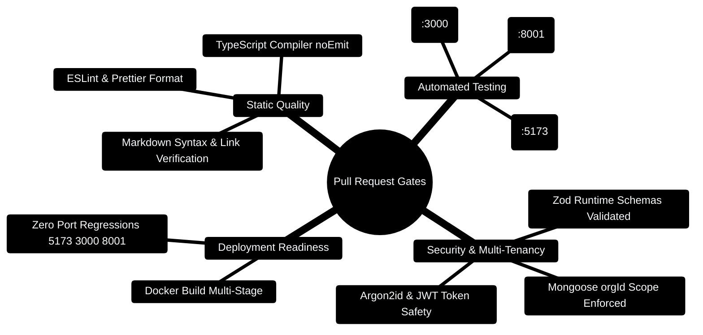

## 0. PR Review & Verification Lifecycle



---

## 0.1 CI/CD Quality Gate Pipeline

```
┌─────────────────────────────────────────────────────────────────────────────┐
│                       AUTOMATED PR QUALITY GATES                            │
├─────────────────────────────────────────────────────────────────────────────┤
│                                                                             │
│  [Developer Git Push] ────► [GitHub Actions CI Runner]                      │
│                                      │                                      │
│         ┌────────────────────────────┼────────────────────────────┐         │
│         ▼                            ▼                            ▼         │
│  [Client Gates]               [Server Gates]              [AI Core Gates]   │
│  - npm run lint               - npm run test              - pytest tests/   │
│  - npm run build              - Zod validation audit      - pytest evals/   │
│  - vitest run                 - orgId tenant audit        - Port 8001 audit │
│         │                            │                            │         │
│         └────────────────────────────┼────────────────────────────┘         │
│                                      ▼                                      │
│                         [Docker Multi-Tier Build]                           │
│                                      │                                      │
│                                      ▼                                      │
│                            [PR Approved & Merged]                           │
│                                                                             │
└─────────────────────────────────────────────────────────────────────────────┘
```

---

## 0.2 Automated Pre-Merge Verification Script

```bash
#!/usr/bin/env bash
# scripts/verify-pr.sh - Run before submitting PR
set -e

echo "🚀 [1/3] Verifying Client..."
cd client && npm run build -- --noEmit && npm test -- --run
cd ..

echo "🚀 [2/3] Verifying Express Gateway..."
cd server && npm run build && npm test
cd ..

echo "🚀 [3/3] Verifying FastAPI AI Core..."
cd server/AI_Core && pytest tests/ -q
cd ../..

echo "✅ All PR pre-flight checks PASSED!"
```

---

## Description

<!-- Brief description of the changes -->

## Type of Change

- [ ] Bug fix (non-breaking change that fixes an issue)
- [ ] New feature (non-breaking change that adds functionality)
- [ ] Breaking change (fix or feature that would cause existing functionality to not work as expected)
- [ ] Documentation update
- [ ] Test addition/update
- [ ] Refactoring (no functional changes)

## Changes Made

<!-- List the specific changes -->

-
-
-

## Testing

- [ ] Client tests pass (`cd client && npm test`)
- [ ] Server tests pass (`cd server && npm test`)
- [ ] AI Core tests pass (`cd server/AI_Core && pytest`)
- [ ] AI Core evals pass (`cd server/AI_Core && pytest evals/`)
- [ ] Manual testing completed

## Screenshots (if applicable)

<!-- Add screenshots for UI changes -->

## Checklist

- [ ] My code follows the project's coding conventions
- [ ] I have added tests that prove my fix is effective or my feature works
- [ ] New and existing unit tests pass locally with my changes
- [ ] I have updated the documentation accordingly
- [ ] I have added `.env.example` entries for any new environment variables
