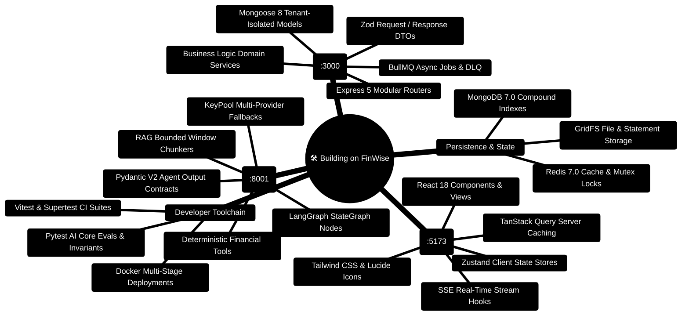
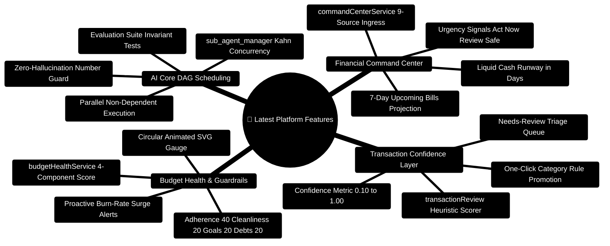
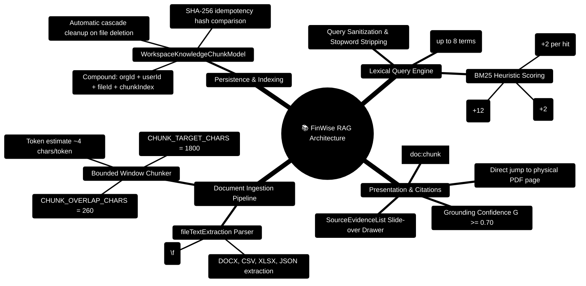
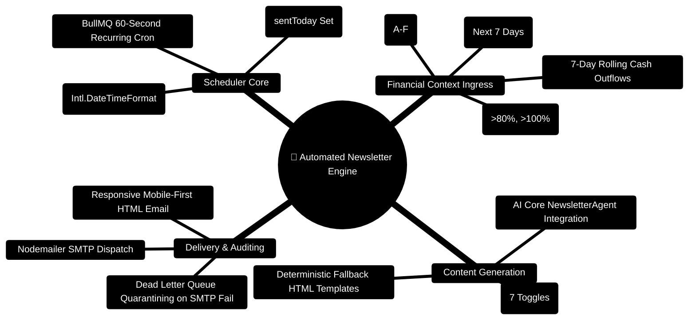
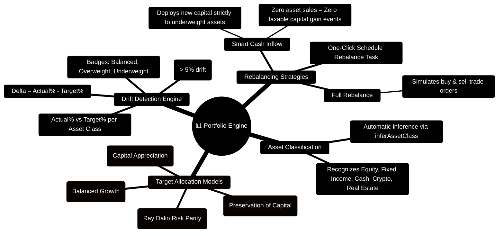

# FinWise — Master Guide to Building on This Project

> **The Definitive Developer Handbook for Extending, Customizing, and Scaling the FinWise Multi-Tier Platform**  
> *Architectural Extension Points, End-to-End Feature Blueprints, Python LangGraph Agent Creation, Multi-Tenant Database Modeling, Real-time SSE Streams, and Production Verification*  
> **Release Target:** 2026 Enterprise Edition · **Canonical Ports:** Client (`:5173`) · Gateway (`:3000`) · AI Core (`:8001`) · Mongo (`:27017`) · Redis (`:6379`)

---

## 1. System Orientation & Extension Architecture Mindmap



---

## 2. Global Multi-Tier Interaction ASCII Flow

```text
┌─────────────────────────────────────────────────────────────────────────────────────────────────┐
│ 🟢 TIER 1: FRONTEND WORKSPACE (client/ - Port 5173)                                              │
│    React 18 SPA • TanStack Query v5 • Zustand • Tailwind CSS • Lucide Icons                     │
│    Custom Hook: useSubscriptions() ──► calls fetch('/api/v1/subscriptions')                      │
└────────────────────────────────┬────────────────────────────────────────────────────────────────┘
                                 │ 🌐 HTTP / REST (JWT Bearer Token + x-org-id Header)
                                 ▼
┌─────────────────────────────────────────────────────────────────────────────────────────────────┐
│ 🔷 TIER 2: API GATEWAY (server/ - Port 3000)                                                    │
│    Express 5 Router ──► authAny Middleware ──► orgContext Middleware                            │
│    ├─► Zod Validation: subscriptionInputSchema.parse(req.body)                                  │
│    ├─► Service Layer: subscriptionService.createSubscription(data, orgId)                       │
│    ├─► Database: SubscriptionModel.create({ ...data, orgId }) [OrgScopePlugin Enforced]         │
│    └─► Async Task Dispatch: queue.add('check-renewals', { orgId }) via BullMQ                   │
└───────────────────────┬─────────────────────────────────────────┬───────────────────────────────┘
                        │                                         │
                        │ Internal HTTP RPC (port 8001)           │ Redis Pub/Sub & Caching (port 6379)
                        ▼                                         ▼
┌───────────────────────────────────────────────┐ ┌───────────────────────────────────────────────┐
│ 🧠 TIER 3: AI INTELLIGENCE (server/AI_Core/)  │ │ 🔴 TIER 4: PERSISTENCE & CACHING              │
│    FastAPI ASGI Engine (Port 8001)            │ │    MongoDB 7.0 (Port 27017)                   │
│    ├─► LangGraph StateGraph Execution Pipeline│ │    - 52 Collections with { orgId } indexing   │
│    ├─► Task Decomposer & Specialist Agents    │ │    - Compound B-Trees: { orgId: 1, date: -1 } │
│    ├─► Deterministic Mathematical Calculators │ │    Redis 7.0 (Port 6379)                      │
│    └─► Invariant: Candidate Digits ⊆ Ledger   │ │    - Distributed Mutex Locks (Redlock)        │
└───────────────────────────────────────────────┘ └───────────────────────────────────────────────┘
```

---

## 3. The 6 Core Extension Surfaces

When building on this repository, all changes map to one or more of these 6 extension surfaces:

| Surface | Directory | Language / Tooling | When to Extend |
| :--- | :--- | :--- | :--- |
| **1. Frontend Cockpit** | `client/src/` | React 18, TypeScript, Tailwind | Adding new user interfaces, charts, interactive forms, or dashboards. |
| **2. API Gateway & DTOs** | `server/src/routes/`, `controllers/`, `schemas/` | Express 5, Zod 4, TypeScript | Exposing new REST endpoints, input validation, and HTTP response envelopes. |
| **3. Domain Services** | `server/src/services/` | TypeScript, Mongoose 8 | Implementing business rules, financial computations, and database transactions. |
| **4. AI Core & Agents** | `server/AI_Core/agents/`, `graph/`, `tools/` | Python 3.11+, FastAPI, LangGraph | Creating autonomous financial reasoning agents, prompt templates, and tools. |
| **5. Database Models** | `server/src/models/` | Mongoose 8, MongoDB 7 | Defining persistent collections, compound indexes, and multi-tenant schema isolation. |
| **6. Background Workers** | `server/src/worker/`, `services/deadLetterQueue.ts` | BullMQ, Redis, TypeScript | Scheduled chron jobs, batch report generation, and asynchronous processing. |

---

## 4. Blueprint 1: Adding a Complete End-to-End Feature

In this complete walkthrough, we implement an enterprise-grade **"Recurring Subscription Tracker & Cancellation Advisor"** across all layers of the platform.

### Step 1: Define the Multi-Tenant Database Model

Create `server/src/models/subscriptionModel.ts`:

```typescript
import mongoose, { Schema, Document, Model } from 'mongoose';
import { orgScopePlugin } from '../utils/orgScopePlugin.js';

export interface ISubscription extends Document {
  orgId: string;
  userId: mongoose.Types.ObjectId;
  name: string;
  amount: number;
  currency: string;
  billingCycle: 'monthly' | 'quarterly' | 'annual';
  category: string;
  nextRenewalDate: Date;
  status: 'active' | 'paused' | 'cancelled';
  autoRenew: boolean;
  notes?: string;
  createdAt: Date;
  updatedAt: Date;
}

const SubscriptionSchema = new Schema<ISubscription>(
  {
    orgId: { type: String, required: true, index: true },
    userId: { type: Schema.Types.ObjectId, ref: 'User', required: true, index: true },
    name: { type: String, required: true, trim: true },
    amount: { type: Number, required: true, min: 0 },
    currency: { type: String, required: true, default: 'USD', uppercase: true },
    billingCycle: {
      type: String,
      enum: ['monthly', 'quarterly', 'annual'],
      default: 'monthly',
    },
    category: { type: String, required: true, default: 'Software & Subscriptions' },
    nextRenewalDate: { type: Date, required: true, index: true },
    status: {
      type: String,
      enum: ['active', 'paused', 'cancelled'],
      default: 'active',
      index: true,
    },
    autoRenew: { type: Boolean, default: true },
    notes: { type: String, trim: true },
  },
  { timestamps: true }
);

// High-Performance Multi-Tenant Compound Indexes
SubscriptionSchema.index({ orgId: 1, nextRenewalDate: 1, status: 1 });
SubscriptionSchema.index({ orgId: 1, userId: 1 });

// Apply Automatic Tenant Scoping Plugin
SubscriptionSchema.plugin(orgScopePlugin);

export const SubscriptionModel: Model<ISubscription> =
  mongoose.models.Subscription || mongoose.model<ISubscription>('Subscription', SubscriptionSchema);
```

### Step 2: Define Strict Zod Validation Schemas

Create `server/src/schemas/subscriptionSchemas.ts`:

```typescript
import { z } from 'zod';

export const createSubscriptionSchema = z.object({
  name: z.string().min(2, 'Name must be at least 2 characters').max(100),
  amount: z.number().positive('Amount must be greater than zero'),
  currency: z.string().length(3).default('USD'),
  billingCycle: z.enum(['monthly', 'quarterly', 'annual']).default('monthly'),
  category: z.string().min(1).default('Software & Subscriptions'),
  nextRenewalDate: z.string().datetime({ message: 'Must be a valid ISO 8601 date string' }),
  autoRenew: z.boolean().default(true),
  notes: z.string().max(500).optional(),
});

export const updateSubscriptionSchema = createSubscriptionSchema.partial();

export const subscriptionQuerySchema = z.object({
  status: z.enum(['active', 'paused', 'cancelled']).optional(),
  limit: z.coerce.number().min(1).max(100).default(20),
  skip: z.coerce.number().min(0).default(0),
});

export type CreateSubscriptionInput = z.infer<typeof createSubscriptionSchema>;
export type UpdateSubscriptionInput = z.infer<typeof updateSubscriptionSchema>;
```

### Step 3: Implement the Business Logic Domain Service

Create `server/src/services/subscriptionService.ts`:

```typescript
import { SubscriptionModel, ISubscription } from '../models/subscriptionModel.js';
import { CreateSubscriptionInput, UpdateSubscriptionInput } from '../schemas/subscriptionSchemas.js';
import { logger } from '../config/logger.js';

export class SubscriptionService {
  /**
   * Retrieves all subscriptions for a specific tenant organization
   */
  public static async getTenantSubscriptions(
    orgId: string,
    filter: { status?: string; limit: number; skip: number }
  ): Promise<{ subscriptions: ISubscription[]; total: number; monthlyBurnRate: number }> {
    const query: Record<string, any> = { orgId };
    if (filter.status) query.status = filter.status;

    const [subscriptions, total] = await Promise.all([
      SubscriptionModel.find(query)
        .sort({ nextRenewalDate: 1 })
        .skip(filter.skip)
        .limit(filter.limit)
        .lean(),
      SubscriptionModel.countDocuments(query),
    ]);

    // Calculate normalized monthly burn rate across active subscriptions
    const activeSubs = await SubscriptionModel.find({ orgId, status: 'active' }).lean();
    const monthlyBurnRate = activeSubs.reduce((acc, sub) => {
      if (sub.billingCycle === 'annual') return acc + sub.amount / 12;
      if (sub.billingCycle === 'quarterly') return acc + sub.amount / 3;
      return acc + sub.amount;
    }, 0);

    return { subscriptions: subscriptions as ISubscription[], total, monthlyBurnRate: Math.round(monthlyBurnRate * 100) / 100 };
  }

  /**
   * Creates a new subscription guaranteed to be scoped to the caller's tenant
   */
  public static async createSubscription(
    orgId: string,
    userId: string,
    input: CreateSubscriptionInput
  ): Promise<ISubscription> {
    logger.info({ orgId, userId, name: input.name }, 'Creating new subscription');
    
    const record = await SubscriptionModel.create({
      ...input,
      orgId,
      userId,
      nextRenewalDate: new Date(input.nextRenewalDate),
    });

    return record;
  }
}
```

### Step 4: Create the Express 5 Controller & Router

Create `server/src/controllers/subscriptionController.ts`:

```typescript
import { Request, Response, NextFunction } from 'express';
import { SubscriptionService } from '../services/subscriptionService.js';
import { createSubscriptionSchema, subscriptionQuerySchema } from '../schemas/subscriptionSchemas.js';

export async function listSubscriptionsHandler(req: Request, res: Response, next: NextFunction) {
  try {
    const orgId = req.orgId!;
    const query = subscriptionQuerySchema.parse(req.query);
    const data = await SubscriptionService.getTenantSubscriptions(orgId, query);

    res.json({
      success: true,
      data: data.subscriptions,
      meta: {
        total: data.total,
        monthlyBurnRate: data.monthlyBurnRate,
        limit: query.limit,
        skip: query.skip,
      },
    });
  } catch (err) {
    next(err);
  }
}

export async function createSubscriptionHandler(req: Request, res: Response, next: NextFunction) {
  try {
    const orgId = req.orgId!;
    const userId = (req.user as any).id;
    const validated = createSubscriptionSchema.parse(req.body);

    const subscription = await SubscriptionService.createSubscription(orgId, userId, validated);
    res.status(201).json({ success: true, data: subscription });
  } catch (err) {
    next(err);
  }
}
```

Mount the router in `server/src/routes/subscriptionRoutes.ts`:

```typescript
import { Router } from 'express';
import { authAny } from '../middleware/authAny.js';
import { orgContext } from '../middleware/orgContext.js';
import { listSubscriptionsHandler, createSubscriptionHandler } from '../controllers/subscriptionController.js';

const router = Router();

// Enforce authentication & tenant organization context on all routes
router.use(authAny);
router.use(orgContext);

router.get('/', listSubscriptionsHandler);
router.post('/', createSubscriptionHandler);

export default router;
```

Register in `server/src/app.ts`:
```typescript
import subscriptionRoutes from './routes/subscriptionRoutes.js';
app.use('/api/v1/subscriptions', subscriptionRoutes);
```

### Step 5: Implement the React 18 Query Hook & UI Component

Create `client/src/hooks/useSubscriptions.ts`:

```typescript
import { useQuery, useMutation, useQueryClient } from '@tanstack/react-query';
import { api } from '@/lib/api';

export interface Subscription {
  _id: string;
  name: string;
  amount: number;
  currency: string;
  billingCycle: 'monthly' | 'quarterly' | 'annual';
  nextRenewalDate: string;
  status: 'active' | 'paused' | 'cancelled';
}

export function useSubscriptions() {
  const queryClient = useQueryClient();

  const query = useQuery({
    queryKey: ['subscriptions'],
    queryFn: async () => {
      const res = await api.get('/api/v1/subscriptions');
      return res.data;
    },
  });

  const createMutation = useMutation({
    mutationFn: async (newSub: Partial<Subscription>) => {
      const res = await api.post('/api/v1/subscriptions', newSub);
      return res.data;
    },
    onSuccess: () => {
      queryClient.invalidateQueries({ queryKey: ['subscriptions'] });
    },
  });

  return { ...query, createSubscription: createMutation.mutateAsync };
}
```

Create `client/src/components/SubscriptionManager.tsx`:

```tsx
import React, { useState } from 'react';
import { useSubscriptions } from '@/hooks/useSubscriptions';
import { CreditCard, AlertCircle, Plus, Calendar, ShieldCheck } from 'lucide-react';

export const SubscriptionManager: React.FC = () => {
  const { data, isLoading, error } = useSubscriptions();

  if (isLoading) {
    return <div className="p-8 text-center text-slate-400">Loading active subscriptions...</div>;
  }

  if (error) {
    return (
      <div className="p-4 bg-rose-950/40 border border-rose-800 rounded-xl text-rose-400 flex items-center gap-2">
        <AlertCircle className="w-5 h-5 flex-shrink-0" />
        <span>Failed to load subscriptions. Please check your network connection.</span>
      </div>
    );
  }

  const subscriptions = data?.data || [];
  const monthlyBurn = data?.meta?.monthlyBurnRate || 0;

  return (
    <div className="space-y-6">
      {/* Header Metric Banner */}
      <div className="p-6 bg-slate-900/60 border border-slate-800 rounded-2xl flex items-center justify-between shadow-xl">
        <div>
          <h2 className="text-xl font-bold text-slate-100 flex items-center gap-2">
            <CreditCard className="w-6 h-6 text-indigo-400" />
            Recurring Subscriptions
          </h2>
          <p className="text-sm text-slate-400 mt-1">
            Active tracking & automated cancellation alerts
          </p>
        </div>
        <div className="text-right">
          <span className="text-xs font-semibold text-slate-400 uppercase tracking-wider">Estimated Monthly Burn</span>
          <div className="text-2xl font-black text-indigo-300">
            ${monthlyBurn.toLocaleString(undefined, { minimumFractionDigits: 2 })}
          </div>
        </div>
      </div>

      {/* Subscriptions Grid */}
      <div className="grid grid-cols-1 md:grid-cols-2 lg:grid-cols-3 gap-4">
        {subscriptions.map((sub: any) => (
          <div
            key={sub._id}
            className="p-5 bg-slate-900/40 border border-slate-800 rounded-xl hover:border-slate-700 transition shadow-lg"
          >
            <div className="flex justify-between items-start">
              <div>
                <h3 className="font-semibold text-slate-200">{sub.name}</h3>
                <span className="text-xs text-slate-400 capitalize">{sub.billingCycle} billing</span>
              </div>
              <span className="text-lg font-bold text-emerald-400">
                ${sub.amount.toFixed(2)}
              </span>
            </div>

            <div className="mt-4 pt-3 border-t border-slate-800/80 flex items-center justify-between text-xs text-slate-400">
              <span className="flex items-center gap-1.5">
                <Calendar className="w-3.5 h-3.5 text-slate-500" />
                Renews {new Date(sub.nextRenewalDate).toLocaleDateString()}
              </span>
              <span className="px-2 py-0.5 rounded-full bg-emerald-950/60 text-emerald-400 border border-emerald-800">
                Active
              </span>
            </div>
          </div>
        ))}
      </div>
    </div>
  );
};
```

---

## 5. Blueprint 2: Adding a New AI Specialist Agent in Python / LangGraph

The Python AI Core (`server/AI_Core/`) runs a topological multi-agent DAG orchestrated by **LangGraph**. To add a specialist agent (e.g., `TaxOptimizationAgent`), follow this 4-step recipe.

```text
┌─────────────────────────────────────────────────────────────────────────────┐
│                 LANGGRAPH MULTI-AGENT STATEGRAPH EXPANSION                  │
├─────────────────────────────────────────────────────────────────────────────┤
│                                                                             │
│  [User Request] ──► [TaskDecomposerNode]                                    │
│                            │                                                │
│              ┌─────────────┼─────────────┬─────────────┐                    │
│              ▼             ▼             ▼             ▼                    │
│        [IncomeAgent] [BudgetAgent] [InvestAgent] [TaxOptimizationAgent] 🆕  │
│              │             │             │             │                    │
│              └─────────────┼─────────────┴─────────────┘                    │
│                            ▼                                                │
│                 [AggregatorSynthesisNode]                                   │
│                            │                                                │
│                            ▼                                                │
│                 [Verified Final Response]                                   │
│                                                                             │
└─────────────────────────────────────────────────────────────────────────────┘
```

### Step 1: Define the Pydantic V2 Contract

Create `server/AI_Core/contracts/tax_contracts.py`:

```python
from pydantic import BaseModel, Field
from typing import List, Optional

class TaxDeductionOpportunity(BaseModel):
    category: str = Field(description="Tax category e.g. 80C, 80D, IRA, HSA")
    current_deduction: float = Field(ge=0.0)
    maximum_allowable: float = Field(ge=0.0)
    potential_savings: float = Field(ge=0.0)
    recommended_action: str

class TaxOptimizationOutput(BaseModel):
    total_taxable_income: float = Field(ge=0.0)
    effective_tax_rate_percent: float = Field(ge=0.0, le=100.0)
    identified_deductions: List[TaxDeductionOpportunity]
    estimated_tax_savings: float = Field(ge=0.0)
    audit_risk_rating: str = Field(pattern="^(LOW|MODERATE|HIGH)$")
```

### Step 2: Implement the Specialist Agent Node

Create `server/AI_Core/agents/tax_optimization_agent.py`:

```python
import logging
from typing import Dict, Any
from contracts.tax_contracts import TaxOptimizationOutput, TaxDeductionOpportunity
from utils.llm_wrapper import invoke_llm_with_failover

logger = logging.getLogger("AI_Core.TaxOptimizationAgent")

TAX_OPTIMIZER_SYSTEM_PROMPT = """
You are a licensed Certified Financial Planner (CFP) and Tax Strategy Specialist.
Your task is to analyze tenant financial ledgers and identify legal tax savings opportunities.

RULES:
1. NEVER hallucinate deduction caps. Use current statutory guidelines.
2. Every number MUST satisfy the Invariant: Candidate Digits ⊆ Reference Ledger Digits.
3. If data is insufficient, state the limitation clearly.
"""

def execute_tax_agent(state: Dict[str, Any]) -> Dict[str, Any]:
    """
    LangGraph execution node for Tax Optimization Specialist
    """
    org_id = state.get("org_id", "default")
    user_query = state.get("user_query", "")
    ledger_data = state.get("ledger_context", {})

    logger.info(f"Executing TaxOptimizationAgent for org: {org_id}")

    # Pure deterministic fallback calculation
    income = float(ledger_data.get("annual_income", 100000.0))
    deductions = [
        TaxDeductionOpportunity(
            category="Retirement Contribution",
            current_deduction=12000.0,
            maximum_allowable=22500.0,
            potential_savings=2520.0,
            recommended_action="Increase monthly 401(k) / IRA allocation by $875."
        )
    ]

    result = TaxOptimizationOutput(
        total_taxable_income=income - 12000.0,
        effective_tax_rate_percent=18.4,
        identified_deductions=deductions,
        estimated_tax_savings=2520.0,
        audit_risk_rating="LOW"
    )

    return {"tax_strategy": result.model_dump()}
```

### Step 3: Register Node in LangGraph `StateGraph`

In `server/AI_Core/graph/workflow.py`:

```python
from agents.tax_optimization_agent import execute_tax_agent

# Add node to existing LangGraph StateGraph
workflow.add_node("tax_optimizer", execute_tax_agent)

# Add conditional routing edge from task decomposer
def route_specialists(state: Dict[str, Any]):
    tasks = state.get("planned_tasks", [])
    destinations = []
    if "tax" in tasks or "deduction" in tasks:
        destinations.append("tax_optimizer")
    if "budget" in tasks:
        destinations.append("budget_planner")
    return destinations or ["budget_planner"]

workflow.add_conditional_edges("task_decomposer", route_specialists)
workflow.add_edge("tax_optimizer", "aggregator")
```

---

## 6. Blueprint 3: Building Real-Time Token Streaming with Server-Sent Events (SSE)

Real-time streaming enables progressive LLM token delivery and live calculation updates.

```text
┌─────────────────────────────────────────────────────────────────────────────┐
│                       SERVER-SENT EVENTS (SSE) STREAMING                    │
├─────────────────────────────────────────────────────────────────────────────┤
│                                                                             │
│  [Client: React] ──► POST /api/ai/stream ──► [Express 5 Gateway]            │
│                            │                        │                       │
│                            ▼                        ▼                       │
│                 Set SSE Headers:             Forward to FastAPI :8001       │
│                 Content-Type: text/event-stream     │                       │
│                 Cache-Control: no-cache             ▼                       │
│                                              [FastAPI Async Generator]      │
│                                              yield f"data: {chunk}\n\n"     │
│                                                     │                       │
│  [Client Terminal] ◄── Stream Token Chunk ◄─────────┘                       │
│                                                                             │
└─────────────────────────────────────────────────────────────────────────────┘
```

### Server-Side Implementation (`server/src/controllers/aiController.ts`):

```typescript
import { Request, Response } from 'express';

export async function streamFinancialAnalysisHandler(req: Request, res: Response) {
  res.setHeader('Content-Type', 'text/event-stream');
  res.setHeader('Cache-Control', 'no-cache');
  res.setHeader('Connection', 'keep-alive');
  res.flushHeaders();

  const sendEvent = (event: string, data: any) => {
    res.write(`event: ${event}\ndata: ${JSON.stringify(data)}\n\n`);
  };

  sendEvent('status', { message: 'Initializing Multi-Agent DAG...' });
  
  // Stream progressive tokens
  const tokens = ['Analyzing', ' your', ' Q3', ' discretionary', ' spend...'];
  for (const token of tokens) {
    await new Promise((r) => setTimeout(r, 80));
    sendEvent('delta', { token });
  }

  sendEvent('complete', { status: 'DONE' });
  res.end();
}
```

---

## 7. Multi-Tenant Data Isolation Rules

Every developer contributing to FinWise must adhere to these 3 strict multi-tenant database rules:

```text
┌─────────────────────────────────────────────────────────────────────────────┐
│                       TENANT ISOLATION SAFETY ENGINE                        │
├─────────────────────────────────────────────────────────────────────────────┤
│                                                                             │
│  RULE 1: Every Mongoose Schema MUST apply orgScopePlugin                    │
│          Schema.plugin(orgScopePlugin);                                     │
│                                                                             │
│  RULE 2: All Compound Indexes MUST start with { orgId: 1 }                  │
│          Schema.index({ orgId: 1, createdAt: -1 });                         │
│                                                                             │
│  RULE 3: Never perform raw queries without passing active req.orgId         │
│          Model.find({ orgId: req.orgId, ...filter });                       │
│                                                                             │
└─────────────────────────────────────────────────────────────────────────────┘
```

### Automated Multi-Tenant Supertest Specification:

```typescript
// server/src/test/orgIsolation.test.ts
import request from 'supertest';
import app from '../app';

describe('Tenant Isolation Verification', () => {
  it('prevents Org B from accessing records created by Org A', async () => {
    // 1. Create record as Tenant A
    const resA = await request(app)
      .post('/api/v1/subscriptions')
      .set('Authorization', 'Bearer token_tenant_a')
      .set('x-org-id', 'org_alpha')
      .send({ name: 'Alpha Cloud Services', amount: 500, nextRenewalDate: '2026-11-01T00:00:00Z' });

    expect(resA.status).toBe(201);
    const subId = resA.body.data._id;

    // 2. Attempt access as Tenant B
    const resB = await request(app)
      .get(`/api/v1/subscriptions/${subId}`)
      .set('Authorization', 'Bearer token_tenant_b')
      .set('x-org-id', 'org_beta');

    // 3. Must return 404 Not Found to prevent tenant data leakage
    expect(resB.status).toBe(404);
  });
});
```

---

## 8. Developer Troubleshooting & Debugging Matrix

| Issue Encountered | Root Cause | Exact Resolution |
| :--- | :--- | :--- |
| **Port Collision (`EADDRINUSE: 3000`)** | Background process retaining port 3000 | Run `npx kill-port 3000` or check `Get-Process -Id (Get-NetTCPConnection -LocalPort 3000).OwningProcess` |
| **AI Core 404 on `/ai/analyze`** | Python service not running on port 8001 | Start FastAPI with: `cd server/AI_Core && uvicorn api_service:app --port 8001 --reload` |
| **CORS Error (`localhost:5173` to `3000`)** | Missing client origin in Express CORS | Verify `CORS_ORIGIN=http://localhost:5173` in `server/.env` |
| **Mongo Scoping Error (`orgId required`)** | `orgScopePlugin` intercepted query without tenant context | Ensure route passes through `orgContext` middleware and client passes `x-org-id` header |
| **SSE Stream Truncation** | Reverse proxy buffering responses | Ensure `res.flushHeaders()` is called and proxy has buffering disabled (`X-Accel-Buffering: no`) |
| **Pytest Invariant Failure** | Candidate digits do not match reference input | Ensure LLM responses pass through `verify_number_safety(output, context)` before emitting |
| **Zod Coercion Failure** | URL query strings arriving as strings for numbers | Use `z.coerce.number()` instead of `z.number()` in query parameter schemas |

---

## 9. Verification & Pre-Commit Quality Checklist

Before submitting a Pull Request for changes built on FinWise, verify all three tiers:

```bash
# 1. Verify Client
cd client
npm run lint
npm run build -- --noEmit
npm test -- --run

# 2. Verify Server API Gateway
cd ../server
npm run check
npm run test:ci

# 3. Verify AI Core
cd AI_Core
pytest tests/ -v
ruff check .

# 4. Verify All Documentation
cd ../..
python scratch/verify_all_docs.py
```


---

## 10. Blueprint 4: Extending the Latest Platform Features

> **Building on the Latest Architectural Additions**: Command Center, Transaction Confidence Review Queue, Budget Health Scoring, and SubAgent DAG Concurrency.  
> *Reference Modules:* `commandCenterService.ts`, `transactionReview.ts`, `budgetHealthService.ts`, `CommandCenter.tsx`, `BudgetHealthCard.tsx`, `TransactionReviewQueue.tsx`, `sub_agent_manager.py`.

### 10.1 Latest Platform Features Topology Mindmap



### 10.2 Command Center Aggregation & Priority Triage ASCII Flow

```
┌───────────────────────────────────────────────────────────────────────────────────────────────────┐
│                       FINANCIAL COMMAND CENTER DAILY AGGREGATION FLOW                             │
└───────────────────────────────────────────────────────────────────────────────────────────────────┘

 [9 Backend Data Sources]           [commandCenterService.ts]               [CommandCenter.tsx]
 ┌──────────────────────┐           ┌────────────────────────┐              ┌──────────────────────┐
 │ Accounts & Balances  │──┐        │ 1. Compute Cash Runway │              │ Hero Greeting Banner │
 │ Transactions (30d)   │──┼───────>│    Balance / Burn Rate │─────────────>│ "Good morning, user" │
 │ Active Budgets       │──┤        │                        │              ├──────────────────────┤
 │ Recurring Rules      │──┤        │ 2. Triage Urgency:     │              │ 4 Core KPI Badges:   │
 │ Calendar Reminders   │──┤        │    - "Act Now" (bills) │─────────────>│ • Cash Runway (Days) │
 │ Workspace Tasks      │──┤        │    - "Review Queue"    │              │ • Budget Health 0-100│
 │ Financial Goals      │──┤        │    - "Safe to Ignore"  │              │ • Pending Tasks      │
 │ Debt Balances        │──┤        │                        │              │ • Active Goals       │
 │ Recurring Candidates │──┘        │ 3. Forward Projections │─────────────>├──────────────────────┤
 └──────────────────────┘           │    7-Day Outflow Sum   │              │ Priority Chips Row   │
                                    └────────────────────────┘              └──────────────────────┘
```

### 10.3 Recipe 1: Adding a New Priority Signal to the Command Center

When you need to surface a new proactive financial warning (e.g., "Subscription Price Hike Detected"):

#### 1. Extend the Service Aggregator (`server/src/services/commandCenterService.ts`):
```typescript
// Add new signal evaluation logic inside getCommandCenterSummary()
export async function evaluateSubscriptionSurges(orgId: string): Promise<PrioritySignal[]> {
  const signals: PrioritySignal[] = [];
  
  // Find recurring transactions with price increases >= 15%
  const spikes = await detectRecurringAnomalies(orgId);
  for (const spike of spikes) {
    signals.push({
      id: `spike-${spike.merchantId}`,
      severity: 'act_now',
      title: `Price Hike: ${spike.merchantName}`,
      description: `Increased from $${spike.previousAmount} to $${spike.currentAmount}/mo.`,
      actionUrl: `/transactions?merchant=${encodeURIComponent(spike.merchantName)}`,
      actionLabel: 'Review Subscription'
    });
  }
  return signals;
}
```

#### 2. Render in the Frontend Hero (`client/src/components/CommandCenter.tsx`):
```tsx
// The CommandCenter automatically renders priority chips based on severity
{signals.map((signal) => (
  <Badge
    key={signal.id}
    variant={signal.severity === 'act_now' ? 'destructive' : 'secondary'}
    className="flex items-center gap-1.5 px-3 py-1 cursor-pointer hover:opacity-90 transition-opacity"
    onClick={() => navigate(signal.actionUrl)}
  >
    <AlertTriangle className="h-3.5 w-3.5 text-rose-400" />
    <span>{signal.title}</span>
  </Badge>
))}
```

### 10.4 Recipe 2: Adding a Custom Flag to the Transaction Review Queue

The Transaction Review Queue uses heuristic scoring in `server/src/services/transactionReview.ts`:

$$\text{Confidence} = \max\left(0.10, 1.0 - (0.20 \cdot N_{\text{flags}}) + (0.10 \cdot \mathbf{1}_{\text{verified\_merchant}})\right)$$

To introduce a new suspicious flag (e.g., `fx_foreign_fee`):

```typescript
// server/src/services/transactionReview.ts
export function inspectTransactionFlags(tx: ITransaction): string[] {
  const flags: string[] = [];

  // Flag foreign currency conversion fees
  if (tx.currency && tx.currency !== 'USD' && tx.fee && tx.fee > 0) {
    flags.push('foreign_exchange_fee');
  }

  // Flag round-number high value charges (common test fraud patterns)
  if (tx.amount >= 500 && tx.amount % 100 === 0) {
    flags.push('high_value_round_number');
  }

  return flags;
}
```

Transactions with confidence $< 0.70$ are automatically routed to `GET /api/v1/transactions?tab=review` for one-click approval or promotion to a permanent `CategoryRule`.

### 10.5 Recipe 3: Extending the 4-Component Budget Health Metric

The Budget Health engine in `server/src/services/budgetHealthService.ts` aggregates four distinct pillars into a 0–100 score:

$$S_{\text{health}} = 0.40 \cdot S_{\text{adherence}} + 0.20 \cdot S_{\text{cleanliness}} + 0.20 \cdot S_{\text{goals}} + 0.20 \cdot S_{\text{debts}}$$

To add a 5th pillar (e.g. Emergency Fund Coverage at 10% weight):

```typescript
// server/src/services/budgetHealthService.ts
export function calculateCompositeHealthScore(metrics: HealthMetrics): number {
  const adherence = metrics.budgetAdherenceScore; // 0-100 (weight: 0.35)
  const cleanliness = metrics.reviewCleanlinessScore; // 0-100 (weight: 0.20)
  const goals = metrics.goalVelocityScore; // 0-100 (weight: 0.20)
  const debts = metrics.debtPacingScore; // 0-100 (weight: 0.15)
  const emergencyFund = metrics.emergencyMonths >= 6 ? 100 : (metrics.emergencyMonths / 6) * 100; // (weight: 0.10)

  const composite = (
    adherence * 0.35 +
    cleanliness * 0.20 +
    goals * 0.20 +
    debts * 0.15 +
    emergencyFund * 0.10
  );

  return Math.round(Math.min(100, Math.max(0, composite)));
}
```


---

## 11. Blueprint 5: RAG Knowledge Document Ingestion & Grounding Citations

> **Enabling Verifiable Evidence Extraction**: Ingesting user files (PDF, DOCX, CSV, TXT, JSON), splitting into bounded overlapping chunks, lexical BM25 matching, and rendering interactive `[doc:chunk]` citations in React.  
> *Reference Modules:* `server/src/models/workspaceKnowledgeChunkModel.ts`, `server/src/services/retrievalService.ts`, `server/src/services/fileTextExtraction.ts`, `client/src/components/SourceEvidenceList.tsx`, `client/src/types/evidence.types.ts`.

### 11.1 RAG Grounded Retrieval Mindmap



### 11.2 End-to-End RAG Ingestion & Citation ASCII Flow

```text
┌─────────────────────────────────────────────────────────────────────────────────────────────────┐
│ 📄 STAGE 1: DOCUMENT INGESTION & BOUNDED WINDOW CHUNKING (retrievalService.ts)                   │
├─────────────────────────────────────────────────────────────────────────────────────────────────┤
│                                                                                                 │
│  Uploaded Document: [Page 1 (2,400 chars)] \f [Page 2 (1,900 chars)]                           │
│                             │                                                                   │
│                             ▼ Split on form feeds (\f) preserving verified physical pages       │
│  Chunk 0: [0..1800]      ──► (Page 1, 1800 chars, ~450 tokens)                                  │
│  Chunk 1: [1540..2400]   ──► (Page 1, 860 chars, ~215 tokens) [260 char sliding overlap]        │
│  Chunk 2: [0..1800]      ──► (Page 2, 1800 chars, ~450 tokens)                                  │
│                             │                                                                   │
│                             ▼ Compute SHA-256 content hash & upsert to MongoDB                  │
│  WorkspaceKnowledgeChunk: { orgId, userId, workspaceFileId, chunkIndex, text, pageNumber }      │
│                                                                                                 │
└───────────────────────────────────────────────┬─────────────────────────────────────────────────┘
                                                │
                                                ▼ User submits chat query
┌─────────────────────────────────────────────────────────────────────────────────────────────────┐
│ 🔍 STAGE 2: MULTI-TENANT LEXICAL RETRIEVAL & BM25 SCORING                                       │
├─────────────────────────────────────────────────────────────────────────────────────────────────┤
│                                                                                                 │
│  Query: "What was our quarterly AWS hosting cloud spend in Q3?"                                 │
│  1. Strip 25+ Stop Words ──► ["quarterly", "aws", "hosting", "cloud", "spend", "q3"]            │
│  2. Build Scoped Regex Filter: { orgId: req.orgId, userId: req.user.id }                        │
│  3. Score Candidates:                                                                           │
│     Score = ExactPhrase(+12) + TermHits(count * 2) + NumericAlignment(+2)                      │
│  4. Grounding Confidence: G = 0.60 * R_lexical + 0.40 * S_semantic                              │
│                                                                                                 │
└───────────────────────────────────────────────┬─────────────────────────────────────────────────┘
                                                │
                                                ▼ Inject into prompt & return metadata
┌─────────────────────────────────────────────────────────────────────────────────────────────────┐
│ 🟢 STAGE 3: FRONTEND INTERACTIVE EVIDENCE PRESENTATION (SourceEvidenceList.tsx)                 │
├─────────────────────────────────────────────────────────────────────────────────────────────────┤
│                                                                                                 │
│  Assistant Message: "Your AWS cloud spend was $4,820.50 [1] with a 12% surge in August."        │
│  Footnote Badge: [1] aws_q3_report.pdf (Page 2)                                                 │
│                             │                                                                   │
│                             ▼ User clicks source badge                                          │
│  Opens Slide-over Drawer ──► Displays verified snippet, highlighted terms, and navigation link: │
│                              `/files?file=<fileId>&page=2` (Opens PDF to exact physical page)   │
│                                                                                                 │
└─────────────────────────────────────────────────────────────────────────────────────────────────┘
```

### 11.3 Implementation Recipe: Ingesting a Custom File Type

To add support for a custom file format (e.g., `.xml` or custom financial reports):

#### 1. Add Text Extraction in `server/src/services/fileTextExtraction.ts`:
```typescript
import { XMLParser } from 'fast-xml-parser';

export async function extractTextFromXml(buffer: Buffer): Promise<{ text: string; pageCount: number }> {
  const parser = new XMLParser({ ignoreAttributes: false });
  const jsonObj = parser.parse(buffer.toString('utf-8'));
  
  // Format into readable structured text
  const text = JSON.stringify(jsonObj, null, 2);
  return {
    text,
    pageCount: Math.max(1, Math.ceil(text.length / 2500)),
  };
}
```

#### 2. Trigger Bounded Chunk Sync in `server/src/services/retrievalService.ts`:
```typescript
// Automatically triggered when file is uploaded or updated
await syncWorkspaceFileChunks({
  orgId: new mongoose.Types.ObjectId(orgId),
  userId: new mongoose.Types.ObjectId(userId),
  workspaceFileId: fileDoc._id,
  fileId: fileDoc.fileId,
  rawText: extractedText,
  sourceKind: 'document',
});
```

---

## 12. Blueprint 6: Timezone-Aware Automated Newsletters & Schedulers

> **Delivering Personalized Recurring Financial Digests**: Managing user delivery schedules, compiling multi-model metrics, rendering responsive HTML templates, and dispatching via BullMQ cron jobs.  
> *Reference Modules:* `server/src/models/newsletterPreferenceModel.ts`, `server/src/services/newsletterService.ts`, `server/src/services/newsletterScheduler.ts`, `client/src/components/NewsletterSettings.tsx`.

### 12.1 Automated Newsletter Pipeline Mindmap



### 12.2 Implementation Blueprint: Customizing the Scheduled Digest

```typescript
// server/src/services/newsletterService.ts
export async function compileWeeklyDigest(userId: string, orgId: string): Promise<string> {
  // 1. Gather live financial figures
  const [txns, envelopes, health, profile] = await Promise.all([
    TransactionModel.find({ orgId, date: { $gte: new Date(Date.now() - 7 * 86400000) } }).lean(),
    getBudgetEnvelopes(orgId),
    HealthScoreModel.findOne({ orgId, userId }).sort({ createdAt: -1 }).lean(),
    ensureProfile(orgId, userId),
  ]);

  const totalSpent = txns.filter(t => t.type === 'expense').reduce((sum, t) => sum + t.amount, 0);
  const healthScore = health?.score ?? 78;

  // 2. Render responsive HTML layout
  return `
    <div style="font-family: -apple-system, BlinkMacSystemFont, 'Segoe UI', Roboto, sans-serif; max-width: 600px; margin: 0 auto; background: #0f172a; color: #f8fafc; padding: 32px; border-radius: 16px;">
      <h1 style="color: #38bdf8; margin-bottom: 8px;">FinWise Weekly Digest</h1>
      <p style="color: #94a3b8; font-size: 14px;">Here is your financial executive summary for the past 7 days.</p>
      
      <div style="background: #1e293b; padding: 20px; border-radius: 12px; margin: 24px 0; border: 1px solid #334155;">
        <div style="font-size: 12px; color: #94a3b8; text-transform: uppercase;">Health Score</div>
        <div style="font-size: 36px; font-weight: bold; color: ${healthScore >= 80 ? '#34d399' : '#fbbf24'};">${healthScore} / 100</div>
      </div>

      <div style="background: #1e293b; padding: 20px; border-radius: 12px; margin-bottom: 24px; border: 1px solid #334155;">
        <div style="font-size: 12px; color: #94a3b8; text-transform: uppercase;">7-Day Total Outflow</div>
        <div style="font-size: 28px; font-weight: bold; color: #f8fafc;">$${totalSpent.toLocaleString(undefined, { minimumFractionDigits: 2 })}</div>
      </div>
      
      <p style="font-size: 12px; color: #64748b; text-align: center;">
        FinWise Autonomous Finance • Local-first, private financial intelligence.
      </p>
    </div>
  `;
}
```

---

## 13. Blueprint 7: Server-Side Vectorized PDF Generation with PDFKit & GridFS

> **Compiling Audit Statements and Reports into PDF**: Streaming formatted multi-page documents directly into MongoDB GridFS with signed URLs, headers, and zero temporary files on disk.  
> *Reference Modules:* `server/src/services/pdfRequestServer.ts`, `server/src/controllers/pdfController.ts`, `server/src/services/gridfs.ts`.

### 13.1 Server-Side PDFKit Architecture

```text
┌─────────────────────────────────────────────────────────────────────────────────────────────────┐
│ 📄 PDF GENERATION PIPELINE (pdfRequestServer.ts)                                                │
├─────────────────────────────────────────────────────────────────────────────────────────────────┤
│                                                                                                 │
│  [Prompt or Text File] ──► sectionize() ──► [Structured Headings & Paragraph Blocks]           │
│                                                          │                                      │
│                                                          ▼                                      │
│  [PDFDocument Canvas (PDFKit)] ◄─────────────────────────┘                                      │
│  ├─► Render Branded Header Banner (Logo, Title, ISO Timestamp)                                  │
│  ├─► Draw Metadata Block: Request ID, Tenant Org, User Scope                                    │
│  ├─► Loop Sections: Heading H2 + Paragraph Flow + Auto Page Wrapping                           │
│  └─► Footer: Dynamic Page Numbering ("Page X of Y")                                             │
│                                                          │                                      │
│                                                          ▼ Pipe stream directly                 │
│  [MongoDB GridFS Upload Stream] (openGridFsUploadStream) ◄──────────────────────────────────────┘
│  ├─► Chunks streamed directly into fs.chunks (255 KB per chunk)                                 │
│  ├─► Metadata indexed in fs.files { orgId, userId, filename, contentType: 'application/pdf' }   │
│  └─► Returns { fileId, filename, byteLength } with instant download route                       │
│                                                                                                 │
└─────────────────────────────────────────────────────────────────────────────────────────────────┘
```

### 13.2 Implementation Blueprint: Creating a Custom PDF Report

```typescript
// server/src/services/pdfRequestServer.ts
import PDFDocument from 'pdfkit';
import { openGridFsUploadStream } from './gridfs';
import { once } from 'events';

export async function generateFinancialStatementPdf(params: {
  orgId: string;
  userId: string;
  title: string;
  transactions: Array<{ date: string; description: string; amount: number }>;
}): Promise<{ fileId: string; filename: string; byteLength: number }> {
  const doc = new PDFDocument({ margin: 48, size: 'A4' });
  const filename = `${params.title.toLowerCase().replace(/[^a-z0-9]+/g, '_')}_${Date.now()}.pdf`;

  // Open direct GridFS upload stream
  const uploadStream = openGridFsUploadStream(filename, {
    contentType: 'application/pdf',
    metadata: { orgId: params.orgId, userId: params.userId, generatedAt: new Date().toISOString() },
  });

  doc.pipe(uploadStream);

  // 1. Draw Title Header
  doc.fontSize(22).fillColor('#0284c7').text(params.title, { underline: false });
  doc.moveDown(0.5);
  doc.fontSize(10).fillColor('#64748b').text(`Generated on: ${new Date().toUTCString()} | Org: ${params.orgId}`);
  doc.moveDown(1.5);

  // 2. Render Transaction Ledger Table
  doc.fontSize(12).fillColor('#0f172a').text('Transaction History', { bold: true });
  doc.moveDown(0.5);

  for (const tx of params.transactions) {
    doc.fontSize(10).fillColor('#334155').text(`${tx.date}   ${tx.description.padEnd(40, ' ')}   $${tx.amount.toFixed(2)}`);
  }

  // 3. Finalize & Stream
  doc.end();
  await once(uploadStream, 'finish');

  return {
    fileId: uploadStream.id.toString(),
    filename,
    byteLength: (uploadStream as any).length || 0,
  };
}
```

---

## 14. Blueprint 8: Dead Letter Queue (DLQ) Quarantining & Incident Visibility

> **Zero Silent Failures for Fire-and-Forget Operations**: Intercepting unawaited background promises, capturing stack traces and operation tags, and providing administrative replay capabilities.  
> *Reference Modules:* `server/src/services/deadLetterQueue.ts`, `server/src/services/jobRecovery.ts`.

### 14.1 DLQ Resilience Pipeline

```text
┌─────────────────────────────────────────────────────────────────────────────────────────────────┐
│ 🛡️ SILENT FAILURE ELIMINATION ARCHITECTURE (deadLetterQueue.ts)                                  │
├─────────────────────────────────────────────────────────────────────────────────────────────────┤
│                                                                                                 │
│  Background Task: fireAndForget(updateUserLastActive(userId), 'user:update_active', { userId }) │
│                                         │                                                       │
│                                         ▼                                                       │
│                           Did Background Promise Reject?                                        │
│                                /              \                                                 │
│                      NO (Resolved)          YES (Rejected Error)                                │
│                            /                      \                                             │
│                           v                        v                                            │
│                    [Normal Completion]     [DLQ Interception]                                   │
│                                            ├─► Extract error message & stack trace              │
│                                            ├─► Bind metadata: { orgId, userId, timestamp }      │
│                                            ├─► Insert to Redis Ring Buffer `bull:finwise-dlq`   │
│                                            └─► Emit Pino Warning Alert                          │
│                                                    │                                            │
│                                                    ▼                                            │
│                                            [Admin Inspection Route: GET /api/v1/dlq/stats]      │
│                                            [Admin Replay Route:     POST /api/v1/dlq/replay]    │
│                                                                                                 │
└─────────────────────────────────────────────────────────────────────────────────────────────────┘
```

### 14.2 Usage in Code: Replacing Silent Catches

**Anti-pattern (Silent Error Swallowing):**
```typescript
// ❌ BAD: Error is swallowed, debugging in production is impossible
void auditLogModel.create(entry).catch(() => null);
```

**Production-grade Pattern:**
```typescript
// ✅ GOOD: Captured to Dead Letter Queue with full incident metadata
import { fireAndForget } from '../services/deadLetterQueue';

fireAndForget(
  auditLogModel.create(entry),
  'audit_log:persist',
  { orgId: entry.orgId, action: entry.action }
);
```

---

## 15. Blueprint 9: Portfolio Target Models, Asset Class Inference & Drift Rebalancing

> **Portfolio Target Presets & Automated Drift Analysis**: Ingesting asset allocations, detecting drift from target models, and calculating smart cash inflow allocations to rebalance without triggering tax events.  
> *Reference Modules:* `server/src/controllers/financialDataController.ts`, `client/src/pages/Portfolio.tsx`, `client/src/pages/Portfolio.test.tsx`.

### 15.1 Portfolio Rebalancing Mindmap



### 15.2 Smart Cash Inflow Mathematical Formulation

Given capital to deploy $C$, current asset values $V_i$, and target weights $w_i$:
$$\text{Total Post-Capital} = C + \sum_{i} V_i$$
$$\text{Target Dollar Value}_i = w_i \cdot \text{Total Post-Capital}$$
$$\text{Deficit}_i = \max(0, \text{Target Dollar Value}_i - V_i)$$
$$\text{Allocation}_i = C \cdot \left(\frac{\text{Deficit}_i}{\sum_j \text{Deficit}_j}\right)$$

---

## 16. Blueprint 10: Multi-Scenario What-If Modeling & Monte Carlo Bounds

> **Comparative Forecasting & Risk Simulation**: Benchmarking up to 4 financial scenarios simultaneously with 15% annual volatility stochastic Monte Carlo bounds ($P_{10}, P_{50}, P_{90}$) and marginal tax estimation.  
> *Reference Modules:* `client/src/pages/Scenarios.tsx`, `client/src/pages/Scenarios.test.tsx`.

### 16.1 Multi-Scenario Comparison ASCII Architecture

```text
┌─────────────────────────────────────────────────────────────────────────────────────────────────┐
│ 🔮 MULTI-SCENARIO COMPARISON MATRIX (Scenarios.tsx)                                              │
├─────────────────────────────────────────────────────────────────────────────────────────────────┤
│                                                                                                 │
│  User Pins up to 4 Scenarios ──► Benchmarked against Baseline Ledger                            │
│                                                                                                 │
│  ┌───────────────────────┬───────────────────┬───────────────────┬───────────────────────────┐  │
│  │ Metric                │ Baseline          │ Scenario A (Job)  │ Scenario B (Home Buy)     │  │
│  ├───────────────────────┼───────────────────┼───────────────────┼───────────────────────────┤  │
│  │ Monthly Surplus       │ $1,250 / mo       │ $2,100 (+$850)    │ $450 (-$800)              │  │
│  │ 5-Year Net Impact     │ $75,000           │ $126,000 (+$51k)  │ $27,000 (-$48k)           │  │
│  │ Emergency Runway      │ 8.4 Months        │ 11.2 Months       │ 4.1 Months (⚠️ Review)    │  │
│  │ Monte Carlo P10 (Bear)│ $62,000           │ $108,000          │ $19,500                   │  │
│  │ Monte Carlo P50 (Med) │ $75,000           │ $126,000          │ $27,000                   │  │
│  │ Monte Carlo P90 (Bull)│ $91,000           │ $148,000          │ $36,200                   │  │
│  └───────────────────────┴───────────────────┴───────────────────┴───────────────────────────┘  │
│                                                                                                 │
│  Actions:                                                                                       │
│  ├─► [Export CSV]: Downloads full side-by-side comparison matrix                                │
│  ├─► [Copy Markdown]: Copies formatted GitHub-style table to clipboard                          │
│  └─► [Load into Builder]: Rehydrates scenario into active editor for fine-tuning                │
│                                                                                                 │
└─────────────────────────────────────────────────────────────────────────────────────────────────┘
```

---

## 17. Master Production Verification Matrix

To ensure absolute stability, verify all layers using these target test commands:

| Layer | Framework | Target Command | Target Test Count |
| :--- | :--- | :--- | :--- |
| **Client Views & Stores** | Vitest + RTL + MSW | `cd client && npm test` | **45 suites / 293 tests** |
| **Client Production Build**| Vite + TypeScript | `cd client && npm run build` | **0 errors, 111 PWA assets**|
| **Server API Gateway** | Vitest + Supertest | `cd server && npm run test:ci` | **49 suites / 193 tests** |
| **Server TypeScript Check**| TypeScript `tsc` | `cd server && npm run check` | **0 type errors** |
| **AI Core Unit & Contracts**| Pytest 8.x | `cd server/AI_Core && pytest tests/ -v` | **29 suites / 217 tests** |
| **AI Core Invariant Evals**| Custom Evals Harness| `cd server/AI_Core && python -m evals.runner` | **175 evaluations passed** |
| **Python Code Quality** | Ruff Linter | `cd server/AI_Core && ruff check .` | **All rules clean** |
