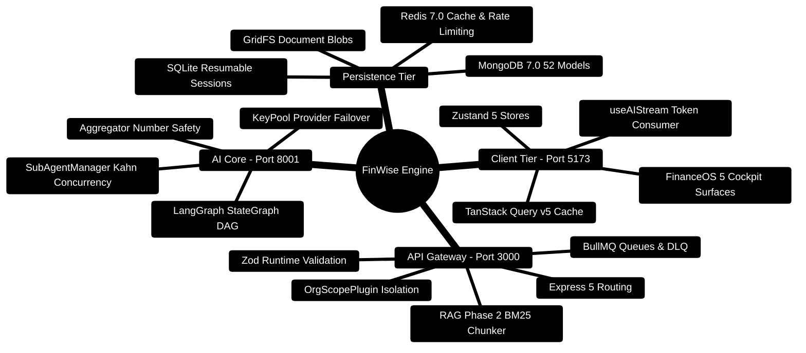

# FinWise — Developer Quick-Reference & Architecture Cheat Sheet

> **Engineering Reference, Command Cheat Sheet, Architecture Mindmaps, and Style Invariants**  
> *Node.js 24 LTS · Express 5 · Python 3.11+ · FastAPI · LangGraph · React 18 · MongoDB 7.0 · Redis 7.0*

---

> [!TIP]
> **Extending FinWise?**  
> See the [**Master Developer Handbook: Building on This Project**](docs/BUILDING_ON_THIS_PROJECT.md) for full-stack implementation recipes and testing checklists.

## 1. Quick-Start Commands (3 Terminals)

```bash
# Terminal 1: Python AI Core (Port 8001)
cd server/AI_Core
source .venv/bin/activate  # Windows: .venv\Scripts\activate
uvicorn api_service:app --host 0.0.0.0 --port 8001 --reload

# Terminal 2: Express 5 API Gateway (Port 3000)
cd server
npm run dev

# Terminal 3: React 18 SPA (Port 5173)
cd client
npm run dev
```

---

## 2. High-Level Architecture Mindmap



---

## 3. End-to-End System Topology ASCII Flow

```text
┌────────────────────────────────────────────────────────────────────────┐
│ 🟢 CLIENT: React 18 SPA (Vite 7.3 - Port 5173)                         │
│    FinanceOS Cockpit • Command Bar (Cmd+K) • Review Queue • SSE Streams│
└───────────────────────────────────┬────────────────────────────────────┘
                                    │ 🌐 HTTPS 1.1 / SSE / Port 3000
                                    ▼
┌────────────────────────────────────────────────────────────────────────┐
│ 🔷 API GATEWAY: Express 5 + TypeScript (Node 24 LTS - Port 3000)       │
│    ├─► Edge Security: Helmet (Strict CSP) • Double-Submit CSRF Guard   │
│    ├─► Multi-Tenant Invariant: OrgScopePlugin auto-injects { orgId }   │
│    ├─► RAG Phase 2: Bounded Window Chunker (1,800 ch) + BM25 Retrieval │
│    └─► Async Queues: BullMQ + Redis for Newsletters, PDFs, and DLQ     │
└───────────────────────┬─────────────────────────────────┬──────────────┘
                        │                                 │
        💾 Read / Write Database IO              ⚡ High-Speed IPC / HTTP
                        ▼                                 ▼
┌───────────────────────────────────────┐ ┌──────────────────────────────┐
│ 🗄️ PERSISTENCE TIER                   │ │ 🧠 AI CORE (FastAPI - 8001)  │
│  • MongoDB 7.0 (52 Scoped Collections)│ │  • LangGraph StateGraph DAG  │
│  • Redis 7.0 (Cache & Rate Limiting)  │ │  • SubAgentManager Kahn Sort │
│  • GridFS Document Blobs              │ │  • Number Safety Guard       │
│  • SQLite AI Memory & Checkpoints     │ │  • Multi-Key KeyPool Failover│
└───────────────────────────────────────┘ └──────────────────────────────┘
```

---

## 4. Key Engineering Conventions

### 4.1 TypeScript (Server & Client)
- **Node Engine**: Strictly Node `>=24.14.1 <25` and npm `>=11.0.0`.
- **Validation**: Strict Zod schemas for all request parameters, bodies, and query strings (`server/src/schemas/`).
- **Tenant Scoping**: All database operations must be scoped by `orgId` via `orgScopePlugin` or explicit filters.
- **Async Handling**: Wrap all route handlers with `asyncRoute(...)` to ensure unhandled promise rejections are normalized.

### 4.2 Python (AI Core)
- **Deterministic Calculations First**: Compute financial mathematics algorithmically before passing to LLMs.
- **Number Safety Guard**: LLM outputs containing new or altered numerical digits are discarded in favor of deterministic tables:
  $$\sum \Delta B_i = 0, \quad \forall i: B_i \ge 0, \quad \text{Candidate Digits} \subseteq \text{Reference Digits}$$
- **Topological Concurrency**: Subtasks execute level-by-level using Kahn's algorithm up to `max_concurrency = 4`.

---

## 5. Testing & Quality Verification Matrix

```bash
# Client Component & Store Tests
cd client
npm test
npm run build

# Server Integration & Tenant Isolation Tests
cd server
npm run check
npm run test:ci

# AI Core Invariant & Latency Benchmarks
cd server/AI_Core
pytest tests/ -v
python -m evals.runner
```
