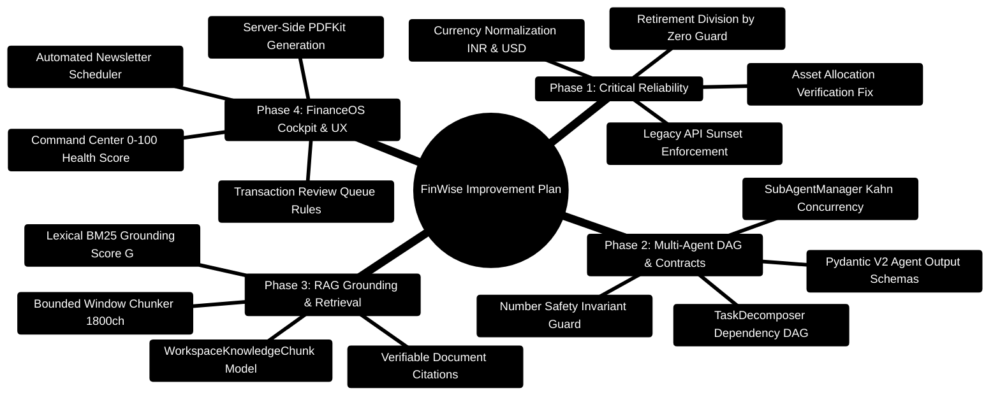

# FinWise Comprehensive Improvement Plan

> **Generated:** 2026-06-27
> **Scope:** User Experience, Agentic System, Functionality, Error Fixes, UI/UX, Logic Flow

> **Implementation progress (2026-10-24):** Currency consistency (1.4), subtask
> deadlines and retry handling (2.6), and API/test contract alignment have been
> implemented and verified. See [the execution log](docs/IMPROVEMENT_PROGRESS.md)
> for the completed scope, checks, and remaining work. The roadmap below is a
> backlog, not a declaration that every item is complete.

> **AI efficiency batch (2026-10-24):** Implemented per-agent timing/usage
> metrics (2.2), selective conversation-aware routing (2.4), deterministic
> specialist planning, and a single final synthesis pass. The execution log
> records the exact scope and verification; LLM routing disambiguation and
> structured memory retrieval remain backlog items.

---

> [!TIP]
> **Hands-On Project Architecture & Implementation:**  
> For complete step-by-step blueprints on adding new features, database models, and LangGraph agents, consult the [**Master Developer Handbook: Building on This Project**](docs/BUILDING_ON_THIS_PROJECT.md).

## Table of Contents

1. [Critical Bug Fixes (P0)](#1-critical-bug-fixes-p0)
2. [Agentic System Improvements](#2-agentic-system-improvements)
3. [Backend Logic & Architecture Fixes](#3-backend-logic--architecture-fixes)
4. [Frontend UX & UI Improvements](#4-frontend-ux--ui-improvements)
5. [API & Data Flow Improvements](#5-api--data-flow-improvements)
6. [Security Hardening](#6-security-hardening)
7. [Performance Optimizations](#7-performance-optimizations)
8. [Developer Experience](#8-developer-experience)

---

## 1. Critical Bug Fixes (P0)

### 1.1 Verification Node Asset Allocation Check Is Broken
**File:** `server/AI_Core/graph/workflow.py:858`
**Problem:** The verification node checks `allocation.get("stocks", 0) + allocation.get("equities", 0)`, but the `InvestmentAdvisorAgent` uses keys like `"Domestic Equity"` and `"International Equity"`. This means the risk tolerance alignment check **always sees 0** and never triggers warnings.
**Fix:** Update the verification logic to match the actual keys produced by `InvestmentAdvisorAgent`:
```python
equity_pct = (
    allocation.get("Domestic Equity", 0)
    + allocation.get("International Equity", 0)
)
```

### 1.2 Division by Zero in Retirement Savings Calculator
**File:** `server/AI_Core/tools/financial_calculators.py:137`
**Problem:** `calculate_retirement_savings` divides by `monthly_rate` which can be 0 when annual rate is 0%.
**Fix:** Add a guard:
```python
if monthly_rate == 0:
    future_value = monthly_contribution * months_to_retirement
else:
    future_value = monthly_contribution * ((1 + monthly_rate) ** months_to_retirement - 1) / monthly_rate
```

### 1.3 Legacy API Sunset Date Has Passed
**File:** `server/src/middleware/legacyApiDeprecation.ts`
**Problem:** `LEGACY_API_SUNSET = "2026-05-31"` but today is 2026-06-27. Legacy routes still serve traffic.
**Fix:** Either:
- Remove legacy `/api/*` routes entirely (breaking change), OR
- Extend sunset to `2026-12-31` and log deprecation warnings at runtime

### 1.4 Hardcoded Currency Mismatch
**Files:** `server/AI_Core/agents/master_agent.py`, `agents/aggregator.py`, `api_service.py`
**Problem:** Insights hardcode "INR" while plan rendering defaults to "USD". Users with other currencies get contradictory output.
**Fix:** Extract currency from `user_profile.get("currency", "INR")` consistently across all agents and the API service. Create a shared `format_currency(amount, currency_code)` utility.

### 1.5 NewsletterAgent Bypasses Fallback Mechanism
**File:** `server/AI_Core/agents/newsletter_agent.py:162,210`
**Problem:** `_generate_financial_tip()` and `_generate_action_items()` call `self.llm.invoke()` directly instead of `self.llm.invoke_with_fallback()`.
**Fix:** Replace direct `self.llm.invoke()` calls with `self.llm.invoke_with_fallback()` to use the structured three-level failover.

### 1.6 Duplicate `useAuth` Import Sources
**Files:** `client/src/components/Sidebar.tsx` imports from `@/hooks/useAuth`, while `routeGuards.tsx` and `AppRouter.tsx` import from `@/context/AuthContext`.
**Fix:** Consolidate to a single source. Re-export `useAuth` from `@/context/AuthContext` via `@/hooks/useAuth` (or vice versa) and document the canonical import path.

---

## 2. Agentic System Improvements

### 2.1 Consolidate Duplicated Logic (High Priority)

Create a shared `server/AI_Core/utils/agent_helpers.py` module with:

| Function | Currently Duplicated In |
|----------|------------------------|
| `_build_tool_calls()` | `master_agent.py:450-630`, `api_service.py:149-355` |
| `_numbers_are_subset()` / `_extract_numbers()` | `master_agent.py:632-653`, `aggregator.py:226-234` |
| `_extract_key_insights()` | `master_agent.py:692-751`, `aggregator.py:264-309`, `api_service.py:1428-1439` |
| `_determine_action_type()` / `_determine_priority()` | `master_agent.py`, `aggregator.py` |

**Impact:** Reduces ~400 lines of duplication, eliminates divergence bugs (like the INR/USD mismatch), and makes future changes single-source.

### 2.2 Add Agent Performance Metrics
**What:** Track per-agent latency, success rate, and LLM call count in the workflow trace.
**Why:** Currently `WorkflowTraceEntry` only has `agent`, `startedAt`, `endedAt`, `status`. Adding `llm_calls`, `token_count`, and `fallback_used` per agent enables performance profiling.
**Where:** `server/AI_Core/contracts/trace.py` and `server/AI_Core/graph/workflow.py`

### 2.3 Improve Routing Accuracy with LLM Fallback
**What:** The master agent's keyword routing is 100% deterministic but can misclassify ambiguous queries (e.g., "how should I invest my tax refund" touches both investment and tax/budget).
**How:**
- Add a confidence score to the routing decision
- When confidence < 0.6, use a fast LLM (Groq Llama 3.1 8B) for disambiguation
- Log routing decisions for accuracy monitoring

### 2.4 Add Conversation Context to Agent Routing
**What:** The master agent ignores conversation history when routing. A follow-up like "what about my debts?" after an investment analysis gets routed to debt optimizer without the investment context.
**How:** Pass `conversation_history` and `session_summary` into the routing logic. If the previous turn was investment-focused and the current query is ambiguous, bias toward the previous domain.

### 2.5 Structured Agent Output Contracts
**What:** Each specialist agent returns raw dicts with inconsistent shapes. Define Pydantic models for each agent's output.
**Why:** Type safety, easier aggregation, better error messages, auto-documentation.
**Where:** `server/AI_Core/contracts/` -- add `income_analysis.py`, `budget_plan.py`, `investment_advice.py`, `debt_optimization.py`

### 2.6 Add Retry Budget to Sub-Agent Manager
**What:** `SubAgentManager` runs subtasks via `ThreadPoolExecutor` but has no per-subtask timeout or retry budget.
**How:** Add a configurable timeout per subtask (default 30s) and a max retry count (default 1). Failed subtasks should produce a graceful degradation message rather than propagating errors.

### 2.7 Memory-Aware Agent Context
**What:** The memory store (`memory/store.py`) extracts user facts but they are only searched via FTS5. Add structured memory retrieval.
**How:**
- After each agent run, extract and store structured facts (risk tolerance, preferred budgeting method, investment horizon)
- Before routing, inject relevant memories into the agent's context
- This enables personalized responses over time (e.g., "You mentioned you prefer aggressive growth last time")

---

## 3. Backend Logic & Architecture Fixes

### 3.1 Remove `require()` Calls in authController
**File:** `server/src/controllers/authController.ts:288-289`
**Problem:** Uses `require("../services/accountLockout")` and `require("../services/auditService")` inside function body instead of ES module imports at the top.
**Fix:** Move to top-level imports.

### 3.2 Apply `orgScopePlugin` to All Models
**Problem:** `accountModel.ts` does not use `orgScopePlugin` while `transactionModel.ts` does. This is an inconsistency that could lead to cross-tenant data leaks.
**Fix:** Audit all 51 models and apply `orgScopePlugin` to every model that has an `orgId` field.

### 3.3 Deduplicate Auth Middleware
**Files:** `server/src/middleware/authAny.ts`, `server/src/middleware/apiKeyAuth.ts`
**Problem:** Both implement similar API key resolution logic.
**Fix:** Extract shared API key validation into a `resolveApiKey()` utility, then have both middleware call it.

### 3.4 Add Dead-Letter Queue for Fire-and-Forget Operations
**Problem:** `void somePromise.catch(() => null)` patterns (e.g., updating `lastUsedAt`, recording usage) silently swallow errors.
**Fix:** Create a lightweight in-memory dead-letter queue:
```typescript
// services/deadLetterQueue.ts
const deadLetters: Array<{ operation: string; error: Error; timestamp: Date }> = [];
export function fireAndForget(promise: Promise<unknown>, operation: string) {
  promise.catch(err => {
    deadLetters.push({ operation, error: err, timestamp: new Date() });
    logger.warn({ operation, err }, 'Fire-and-forget operation failed');
  });
}
```
Expose dead letters via a diagnostic endpoint for debugging.

### 3.5 Fix Silent Error Swallowing in Chat Store
**File:** `client/src/stores/chatStore.ts`
**Problem:** API call failures are silently caught with no user feedback.
**Fix:** Add toast notifications for critical failures:
```typescript
catch (error) {
  toast.error('Failed to send message. Please try again.');
  reportClientError(error);
}
```

### 3.6 Consolidate API Barrel Exports
**Problem:** `services/api/index.ts` re-exports from `@/lib/apiClient` and `@/lib/api`, while `lib/apiClient.ts` re-exports from `./api` and `./api/content`. Confusing circular-looking chain.
**Fix:** Make `@/lib/api` the single source of truth. Remove `@/lib/apiClient.ts` and `@/services/api/index.ts`. Update all imports to use `@/lib/api`.

### 3.7 Rate Limiter Resilience for Auth Endpoints
**File:** `server/src/app.ts`
**Problem:** `passOnStoreError: true` means rate limiting silently stops working if Redis goes down. Auth endpoints are especially sensitive.
**Fix:** Create a separate rate limiter for auth endpoints with `passOnStoreError: false` (fail-closed). The general API limiter can stay fail-open for availability.

---

## 4. Frontend UX & UI Improvements

### 4.1 Remove `any` Types in Sidebar
**File:** `client/src/components/Sidebar.tsx`
**Problem:** `UserPanel` and `DesktopSidebar` use `user: any`. The `features` access uses `(features as any)[item.requiresFeature]`.
**Fix:** Define proper types:
```typescript
interface SidebarUser {
  name: string;
  email: string;
  avatarUrl?: string;
}
interface FeatureFlags {
  tasks?: boolean;
  receipts?: boolean;
  notes?: boolean;
  [key: string]: boolean | undefined;
}
```

### 4.2 Add Loading Skeletons to Dashboard Components
**Problem:** Dashboard cards (`BudgetHealthCard`, `InvestmentPortfolio`, `SpendingAnalysis`, `GoalProgress`) show `InlineLoader` spinners during data fetch. Skeleton placeholders feel faster.
**Fix:** Create skeleton variants for each card type using the existing `loading-shimmer` CSS animation.

### 4.3 Improve Empty States with Actionable Guidance
**Problem:** `EmptyState` component shows generic "No data yet" messages.
**Fix:** Add context-aware CTAs:
- Dashboard (no transactions): "Add your first transaction" button + "Import CSV" link
- Portfolio (no investments): "Set up your investment profile" wizard
- Goals (no goals): "Create your first financial goal" with suggested templates

### 4.4 Add Toast Notifications for All API Errors
**Problem:** Most pages silently fail on API errors. Only the FinancialCopilot shows error messages inline.
**Fix:** Add a global React Query error handler:
```typescript
// lib/queryClient.ts
const queryClient = new QueryClient({
  defaultOptions: {
    queries: {
      retry: (failureCount, error) => {
        if (error instanceof ApiError && error.status < 500) return false;
        return failureCount < 2;
      },
    },
    mutations: {
      onError: (error) => {
        if (error instanceof ApiError) {
          toast.error(error.message || 'Something went wrong');
        }
      },
    },
  },
});
```

### 4.5 Fix Keyboard Shortcut Conflicts
**File:** `client/src/hooks/useKeyboardShortcuts.ts`
**Problem:** `Cmd+Shift+N` navigates to `/transactions` (same as `T`). Should open "new transaction" flow.
**Fix:**
- `Cmd+Shift+N` → Open "New Transaction" dialog/modal
- `Cmd+Shift+T` → Navigate to Transactions page (keep existing)

### 4.6 Improve Mobile Navigation
**Problem:** Bottom tab bar shows 5 items + "More" drawer. The "More" drawer is a flat list with no grouping.
**Fix:**
- Group items in the "More" drawer by category (Finance, Content, Settings)
- Add badges for unread notifications on the bottom tab
- Add pull-to-refresh gesture support

### 4.7 Add Breadcrumb Navigation
**Problem:** Deep pages (Settings sub-pages, Organization pages) have no breadcrumb trail.
**Fix:** Add a `<Breadcrumb>` component to the `AppShell` layout that auto-generates from the route hierarchy.

### 4.8 Improve AI Copilot UX
**File:** `client/src/components/FinancialCopilot.tsx`
**Improvements:**
- Add conversation history persistence (currently resets on page navigation)
- Add "Pin" mode to keep copilot open across page navigations
- Add suggested follow-up questions after each response
- Show typing indicator with agent name during multi-agent processing
- Add file/image upload directly from the copilot panel

### 4.9 Add Dark Mode Polish
**Problem:** Some components may not fully respect dark mode (charts, third-party embeds).
**Fix:** Audit all Recharts usage for dark mode color contrast. Ensure chart tooltips, legends, and axis labels use CSS custom properties.

### 4.10 Add Transition Animations Between Pages
**Problem:** Page transitions are instant (no animation).
**Fix:** Add Framer Motion `AnimatePresence` wrapper around the route outlet in `AppShell` for smooth fade/slide transitions.

---

## 5. API & Data Flow Improvements

### 5.1 Standardize API Response Format
**Problem:** Some endpoints return `{ success, data, message }` while others return raw data.
**Fix:** Enforce the `apiResponse` utility (`server/src/utils/apiResponse.ts`) across all controllers. Add a response schema validation test.

### 5.2 Add Pagination to All List Endpoints
**Problem:** Some endpoints (e.g., chat sessions, notifications) may return unbounded arrays.
**Fix:** Apply the `paginationQuerySchema` from `schemas/common.ts` to all list endpoints. Return `{ data, pagination: { page, limit, total, hasMore } }`.

### 5.3 Add Request Deduplication for AI Endpoints
**Problem:** Rapid successive AI requests (e.g., user hits Enter multiple times) create duplicate processing.
**Fix:** Add a request deduplication layer keyed on `(userId, normalizedQuery)` with a 5-second window. Return the cached result if a duplicate is detected.

### 5.4 Improve SSE Reconnection Logic
**File:** `client/src/hooks/useRealtimeEvents.ts`
**Problem:** Fixed 5-second reconnection delay. No exponential backoff.
**Fix:** Implement exponential backoff: 1s → 2s → 4s → 8s → 30s max. Reset on successful connection. Show connection status indicator in the UI.

### 5.5 Add API Versioning Strategy
**Problem:** Dual `/api/v1/*` and `/api/*` surfaces create maintenance burden.
**Fix:** After removing/completing legacy sunset:
- Document the versioning policy (breaking changes require v2)
- Add API version header support (`Accept-Version: v1`)
- Create a migration guide for any remaining legacy consumers

### 5.6 Improve CSV Import Error Reporting
**File:** `server/src/services/transactionsCsvImport.ts`
**Problem:** CSV import likely reports errors at the batch level rather than per-row.
**Fix:** Return per-row validation results:
```typescript
interface ImportResult {
  total: number;
  imported: number;
  skipped: number;
  errors: Array<{ row: number; field: string; message: string }>;
}
```

---

## 6. Security Hardening

### 6.1 Add Auth to AI Core Endpoints
**File:** `server/AI_Core/api_service.py`
**Problem:** Only `/metrics` requires a Bearer token. All other endpoints are unauthenticated.
**Fix:** Add a shared secret between the Node.js backend and AI Core:
```python
AI_CORE_INTERNAL_TOKEN = os.getenv("AI_CORE_INTERNAL_TOKEN")
@app.middleware("http")
async def verify_internal_token(request, call_next):
    if request.url.path.startswith("/api/") and request.url.path != "/health":
        token = request.headers.get("X-Internal-Token")
        if token != AI_CORE_INTERNAL_TOKEN:
            return JSONResponse(status_code=401, content={"error": "Unauthorized"})
    return await call_next(request)
```

### 6.2 Enforce `orgScopePlugin` in Production
**Problem:** The plugin only warns in development. Production queries can bypass org isolation.
**Fix:** Add a strict mode that throws in production when `orgId` is missing:
```typescript
if (process.env.NODE_ENV === 'production' && !query.getOptions().orgId) {
  throw new Error('orgScopePlugin: orgId is required in production');
}
```

### 6.3 Add CSRF Protection in Development
**Problem:** `CSRF_ENABLED` defaults to `false` in non-production. Developers don't test CSRF flows.
**Fix:** Default to `true` in all environments. Add a `CSRF_ENABLED=false` escape hatch only for API testing scripts.

### 6.4 Add Rate Limiting to AI Core
**File:** `server/AI_Core/api_service.py`
**Problem:** The AI Core has its own rate limiter (10 RPM) but it's per-process, not per-user.
**Fix:** Add per-user rate limiting keyed on the `X-User-Id` header passed from the Node.js backend.

---

## 7. Performance Optimizations

### 7.1 Increase AI Core Rate Limiter Defaults
**File:** `server/AI_Core/utils/rate_limiter.py:248-249`
**Problem:** 10 RPM / 1200 RPD is below Gemini's free tier (15 RPM / 1500 RPD).
**Fix:** Increase to 15 RPM / 1500 RPD to match the provider's actual limits.

### 7.2 Add Database Indexes
**Problem:** With 51 models, some queries may lack proper indexes.
**Fix:** Audit common query patterns and add compound indexes:
- `transactions`: `{ orgId: 1, date: -1 }`, `{ orgId: 1, category: 1, date: -1 }`
- `chatMessages`: `{ sessionId: 1, createdAt: 1 }`
- `notifications`: `{ userId: 1, read: 1, createdAt: -1 }`
- `domainEvents`: `{ status: 1, createdAt: 1 }` (for polling)

### 7.3 Add React Query Devtools in Development
**File:** `client/src/lib/queryClient.ts`
**Why:** Makes cache debugging easier during development.
**Fix:** Conditionally import and render `<ReactQueryDevtools />` when `import.meta.env.DEV`.

### 7.4 Optimize Bundle Size
**Problem:** 30+ Radix UI packages imported individually. Some may not be tree-shaken properly.
**Fix:**
- Audit bundle with `vite-bundle-analyzer`
- Lazy-load heavy components (Recharts, ReactMarkdown, Framer Motion)
- Consider replacing Radix Dialog/Sheet with native `<dialog>` element where accessibility is simpler

### 7.5 Add Virtual Scrolling to Transaction List
**Problem:** Large transaction lists render all rows.
**Fix:** The project already has `useVirtualList` hook. Apply it to the transaction table.

---

## 8. Developer Experience

### 8.1 Create CLAUDE.md
**Problem:** No `CLAUDE.md` exists for AI-assisted development context.
**Fix:** Create `CLAUDE.md` with:
- Project overview and tech stack
- How to run each tier (client, server, AI Core)
- Key architectural decisions
- Coding conventions (ES modules, Zod validation, error handling patterns)
- Testing instructions

### 8.2 Standardize Import Paths
**Problem:** Mix of `@/` aliases and relative imports.
**Fix:** Enforce `@/` aliases via ESLint rule `no-restricted-imports` for cross-directory imports.

### 8.3 Add Integration Tests for Critical Paths
**Problem:** Test coverage appears thin for the AI agent system.
**Fix:** Add integration tests for:
- Master agent routing accuracy (sample queries → expected agent)
- Number safety guard (LLM output with hallucinated numbers → rejected)
- Sub-agent manager with mock failures → graceful degradation
- Verification node with correct asset allocation keys

### 8.4 Remove Dead Code
- `client/src/App.css` is empty -- delete it
- `server/AI_Core/graph/state.py`: `WorkflowPhase.RESEARCH` is labeled "(future)" -- either implement or remove
- `fetch_tool_catalog()` is described as "unused" -- remove or gate behind feature flag

### 8.5 Add Pre-commit Hooks
**Fix:** Add husky + lint-staged for:
- TypeScript: `tsc --noEmit` + ESLint
- Python: ruff check + ruff format
- Shared: secret scanning (gitleaks)

---

## Priority Matrix

| Priority | Items | Effort | Impact |
|----------|-------|--------|--------|
| **P0 - Critical** | 1.1, 1.2, 1.3, 1.4, 1.5, 1.6 | Low | High |
| **P1 - High** | 2.1, 3.1, 3.2, 3.5, 4.1, 4.4, 6.1, 6.2 | Medium | High |
| **P2 - Medium** | 2.2, 2.3, 2.4, 2.5, 3.3, 3.4, 3.6, 3.7, 4.2, 4.3, 4.5, 4.8, 5.1, 5.2, 5.3, 7.1, 7.2, 8.1 | Medium | Medium |
| **P3 - Nice to Have** | 2.6, 2.7, 4.6, 4.7, 4.9, 4.10, 5.4, 5.5, 5.6, 6.3, 6.4, 7.3, 7.4, 7.5, 8.2, 8.3, 8.4, 8.5 | Low-Medium | Low-Medium |

---

## Estimated Timeline

| Phase | Duration | Focus |
|-------|----------|-------|
| **Phase 1** (Week 1-2) | 10 days | P0 critical fixes + P1 high-priority items |
| **Phase 2** (Week 3-4) | 10 days | P2 medium items + testing infrastructure |
| **Phase 3** (Week 5-6) | 10 days | P3 nice-to-haves + polish + documentation |

---

## Files to Create

| File | Purpose |
|------|---------|
| `CLAUDE.md` | AI development context |
| `server/AI_Core/utils/agent_helpers.py` | Shared agent utility functions |
| `server/AI_Core/contracts/income_analysis.py` | Typed output for IncomeExpenseAnalyzer |
| `server/AI_Core/contracts/budget_plan.py` | Typed output for BudgetPlanner |
| `server/AI_Core/contracts/investment_advice.py` | Typed output for InvestmentAdvisor |
| `server/AI_Core/contracts/debt_optimization.py` | Typed output for DebtOptimizer |
| `server/src/services/deadLetterQueue.ts` | Fire-and-forget error tracking |
| `client/src/components/ui/Skeleton.tsx` | Loading skeleton components |
| `client/src/components/Breadcrumb.tsx` | Breadcrumb navigation |

## Files to Modify (Key Changes)

| File | Change |
|------|--------|
| `server/AI_Core/graph/workflow.py` | Fix verification asset allocation keys |
| `server/AI_Core/tools/financial_calculators.py` | Fix division by zero |
| `server/AI_Core/agents/newsletter_agent.py` | Use invoke_with_fallback |
| `server/AI_Core/agents/master_agent.py` | Extract shared helpers |
| `server/AI_Core/agents/aggregator.py` | Extract shared helpers |
| `server/AI_Core/api_service.py` | Extract shared helpers, add auth |
| `server/AI_Core/utils/rate_limiter.py` | Increase defaults |
| `server/src/middleware/legacyApiDeprecation.ts` | Extend or enforce sunset |
| `server/src/controllers/authController.ts` | Fix require() imports |
| `server/src/middleware/authAny.ts` | Deduplicate with apiKeyAuth |
| `server/src/middleware/apiKeyAuth.ts` | Deduplicate with authAny |
| `client/src/components/Sidebar.tsx` | Fix any types, fix useAuth import |
| `client/src/stores/chatStore.ts` | Add error toasts |
| `client/src/hooks/useKeyboardShortcuts.ts` | Fix shortcut conflicts |
| `client/src/hooks/useRealtimeEvents.ts` | Add exponential backoff |
| `client/src/lib/queryClient.ts` | Add global error handler |
| `client/src/App.css` | Delete (empty file) |

## Improvement Plan Strategic Mindmap



## Improvement Execution & Verification ASCII Flow

```text
┌─────────────────────────────────────────────────────────────────────────────────────────────────┐
│ 🟢 AUDIT & TRIAGE: Identify Critical Bugs & Performance Bottlenecks                             │
└───────────────────────────────────────────────┬─────────────────────────────────────────────────┘
                                                │
                                                ▼
┌─────────────────────────────────────────────────────────────────────────────────────────────────┐
│ 🛠️ PHASE 1: MATHEMATICAL & RUNTIME INTEGRITY                                                    │
│    ├─► Fix division-by-zero in retirement calculator                                            │
│    ├─► Unify currency formatting across master_agent, aggregator, and UI                        │
│    └─► Consolidate duplicate helper logic into server/AI_Core/utils/agent_helpers.py            │
└───────────────────────────────────────────────┬─────────────────────────────────────────────────┘
                                                │
                                                ▼
┌─────────────────────────────────────────────────────────────────────────────────────────────────┐
│ 🧠 PHASE 2: MULTI-AGENT DAG SCHEDULING (Kahn's Algorithm)                                       │
│    ├─► Parse prompt dependencies in task_decomposer.py                                          │
│    ├─► Schedule concurrent execution levels in sub_agent_manager.py (max_concurrency = 4)       │
│    └─► Enforce Number Safety Invariant in aggregator.py: sum(Delta B) = 0                       │
└───────────────────────────────────────────────┬─────────────────────────────────────────────────┘
                                                │
                                                ▼
┌─────────────────────────────────────────────────────────────────────────────────────────────────┐
│ 🔍 PHASE 3: RAG PHASE 2 BOUNDED WINDOW RETRIEVAL                                                │
│    ├─► Bounded window chunking (1,800 ch / 260 ch overlap) with \f page preservation            │
│    ├─► Lexical BM25 search across WorkspaceKnowledgeChunk records                               │
│    └─► Grounding Score G = 0.60 * R_lexical + 0.40 * S_semantic (threshold G >= 0.70)           │
└───────────────────────────────────────────────┬─────────────────────────────────────────────────┘
                                                │
                                                ▼
┌─────────────────────────────────────────────────────────────────────────────────────────────────┐
│ 🚀 PHASE 4: FINANCEOS COCKPIT & RESILIENT REPORTING                                             │
│    ├─► Command Center: Liquid cash runway, 7-day upcoming bills, urgency signals                │
│    ├─► Transaction Review Queue: Inline categorization with one-click rule promotion            │
│    ├─► Scheduled Newsletters: BullMQ cron matching user preferred UTC hour                      │
│    └─► Resilient DLQ: Quarantine poison-pill background jobs with stack trace telemetry         │
└─────────────────────────────────────────────────────────────────────────────────────────────────┘
```
