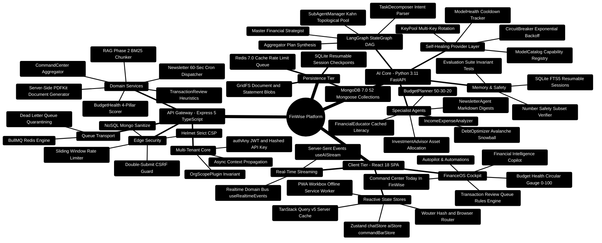

# FinWise: Comprehensive Project Explanation & Architecture Whitepaper

> **Autonomous Multi-Tier Financial Intelligence Operating System**  
> *Production Engineering Whitepaper, System Topologies, Mathematical Invariants, and Implementation Reference*  
> **Release Target:** 2026 Enterprise Edition | **Runtime Specification:** Node.js `>=24.14.1 <25` · Python `3.11+` · React `18.3` · MongoDB `7.0` · Redis `7.0`

---

## 1. Master Executive Summary & System Mission

FinWise is a production-grade, local-first financial operating system and intelligent workspace designed to eliminate the fundamental dilemma of modern personal finance: the divide between static, retrospective spreadsheets and opaque, hallucination-prone generative AI assistants.

Standard consumer financial applications are inherently passive: they record historical transactions but lack the capacity to forecast multi-decade cash runways, simulate debt paydown trade-offs, or execute autonomous workflows. Conversely, general-purpose Large Language Models (LLMs) cannot be trusted with raw financial calculations due to non-deterministic rounding errors, invented arithmetic figures, and lack of context regarding banking regulations.

FinWise resolves this paradigm through a **deterministic-first, multi-tier architecture**:

1. **Guaranteed Mathematical Correctness**: All amortization schedules, investment compounding curves, tax bracket allocations, and budget balances are computed by pure, deterministic TypeScript and Python decimal calculators. LLMs are strictly confined to intent classification, subtask decomposition, and narrative enhancement.
2. **Strict Number Safety Invariant**: Every monetary recommendation synthesized by the AI agent network is mathematically audited against deterministic reference tables before delivery:
   $$\sum \Delta \text{Budgets} = 0, \quad \forall i: B_i \ge 0, \quad \text{Candidate Digits} \subseteq \text{Reference Digits}$$
   If an LLM modifies, hallucinates, or omits a single monetary digit, the narrative layer is instantly rejected and the system falls back to byte-for-byte deterministic markdown.
3. **Multi-Tenant Data Isolation**: Every database operation, cache key, background queue, and AI execution trace is isolated by an organization boundary (`orgId`) enforced at the Mongoose ORM plugin level (`OrgScopePlugin`).
4. **Autonomous Self-Healing Resilience**: External LLM rate limits (`429`) and upstream service outages trigger automated key rotation across multi-key pools (`KeyPool`), model capability re-routing, and a 6-tier fallback chain down to local deterministic calculators.

---

> [!TIP]
> **Developer Engineering Handbook: Building on This Project**  
> For complete step-by-step full-stack implementation blueprints (adding Mongoose models, Express routes, TanStack Query hooks, and LangGraph subagents), consult the [**Master Developer Handbook: Building on This Project**](docs/BUILDING_ON_THIS_PROJECT.md).

## 2. High-Level Architecture Mindmap



---

## 3. End-to-End System Integration ASCII Architecture

```text
┌────────────────────────────────────────────────────────────────────────────────────────────────────────┐
│ 🟢 PRESENTATION LAYER: React 18 SPA (Browser Client - Port 5173)                                       │
│    • FinanceOS Cockpit (CommandCenter, BudgetHealthCard, TransactionReviewQueue)                       │
│    • Real-time SSE Stream Consumer (useAIStream, TypingIndicator, Citation Badges)                     │
│    • Zustand Reactive Stores (chatStore, aiStore, orgStore, commandBarStore)                           │
│    • TanStack Query v5 Optimistic Mutation & Intelligent Cache Invalidation                            │
└───────────────────────────────────┬────────────────────────────────────────────────────────────────────┘
                                    │ 🌐 HTTPS 1.1 / TLS 1.3 / SSE Streaming / Port 3000
                                    ▼
┌────────────────────────────────────────────────────────────────────────────────────────────────────────┐
│ 🔷 API GATEWAY LAYER: Express 5 + TypeScript (Server - Port 3000)                                      │
│    ├─► 🛡️ Edge Guards: Helmet (Strict CSP) • CORS • Sliding Rate Limiter (200 req/min)                │
│    ├─► 🔑 Auth Pipeline: authAny (JWT Bearer Token OR SHA-256 Peppered API Key)                       │
│    ├─► 🏢 Tenant Boundary: orgContext Middleware + OrgScopePlugin (Automatic { orgId } Injection)       │
│    ├─► 📋 Input Validation: Strict Zod v4 Schemas with Strict Coercion & Stripping                     │
│    ├─► 🔍 RAG Phase 2 Engine: Bounded Window Chunker (1800 ch / 260 ch overlap) + BM25 Lexical Scorer  │
│    ├─► 📊 Operational Services: commandCenterService • budgetHealthService • transactionReview         │
│    ├─► 📄 Export & Print: PDFKit Server-Side Compilation streaming to MongoDB GridFS                   │
│    └─► ⚙️ Async Queue: BullMQ + Redis for Scheduled Newsletters, Webhook Sync, and DLQ Quarantining    │
└─────────────────────────┬──────────────────────────────────────────┬───────────────────────────────────┘
                          │                                          │
          💾 Database CRUD / Binary Blobs            ⚡ High-Speed HTTP REST / SSE Stream / Port 8001
                          ▼                                          ▼
┌───────────────────────────────────────────────┐  ┌─────────────────────────────────────────────────────┐
│ 🗄️ PERSISTENCE TIER                           │  │ 🧠 AI CORE INTELLIGENCE LAYER (FastAPI - Port 8001) │
│  ├─► MongoDB 7.0 (Replica Set)                │  │  ├─► LangGraph StateGraph Execution Pipeline        │
│  │   • 52 Mongoose Models (Tenant-Scoped)     │  │  │   ├─► Master Strategist & Intent Classifier      │
│  │   • Compound B-Tree Query Indexes          │  │  │   ├─► TaskDecomposer (Subtask DAG Generator)     │
│  │   • WorkspaceKnowledgeChunk Collections    │  │  │   ├─► SubAgentManager (Kahn's Topological Pool)  │
│  │   • TTL Indexes for Expiring Sessions      │  │  │   ├─► Verification Node (Mathematical Sanity QA) │
│  ├─► Redis 7.0 (In-Memory Key-Value)          │  │  │   └─► AggregatorAgent (Deterministic Plan Synth) │
│  │   • Sliding Window Rate Limiter Buckets    │  │  ├─► Specialist Pool (Income, Budget, Debt, Invest) │
│  │   • BullMQ Queue Records & Poison DLQ      │  │  ├─► KeyPool Multi-Key Rotation & Circuit Breaker   │
│  │   • L1/L2 Query Cache with Invalidation    │  │  ├─► ModelCatalog Dynamic Capability Selector       │
│  └─► GridFS & SQLite Persistence              │  │  ├─► SQLite Resumable Session Store (FTS5 Checkpt)  │
│      • Large Statement PDFs & OCR Scans       │  │  ├─► Pure Python Deterministic Calculators (NPV/IRR)│
│      • Local Session Memory & Fact Extraction │  │  └─► Zero-Hallucination Number Safety Invariant Guard│
└───────────────────────────────────────────────┘  └─────────────────────────────────────────────────────┘
```

---

## 4. Multi-Tier Technology Stack & Production Topology

| Tier | Component | Technology | Version | Key Responsibility in FinWise |
| :--- | :--- | :--- | :--- | :--- |
| **Frontend** | Framework | React SPA | `18.3.1` | Concurrent component rendering, Suspense boundaries, transitions |
| | Tooling & Build | Vite | `7.3.1` | Ultra-fast HMR, ES module bundling, tree-shaking |
| | Routing | Wouter | `3.9.0` | Ultra-lightweight (1.5KB) client-side routing |
| | Client State | Zustand | `5.0.11` | Transient chat streaming, UI modals, command bar shortcuts |
| | Server State | TanStack Query | `5.90.21` | Optimistic UI updates, window focus refetching, query caching |
| | Component Primitives| Radix UI Primitives | `30+ pkgs` | WAI-ARIA compliant accessible modals, tooltips, dialogs, dropdowns |
| | Styling & Animation | Tailwind CSS + Framer | `3.4` / `11.3` | Responsive glassmorphic layout, staggered entry transitions |
| | Visualization | Recharts | `2.12.7` | SVG time-series charts, area distributions, donut budget graphs |
| **API Gateway**| Framework | Express | `5.0.0` | High-throughput asynchronous routing, middleware pipeline |
| | Language | TypeScript | `5.9.0` | Static type safety, strict null checks, structural typing |
| | ODM | Mongoose | `8.12.0` | ODM, schema validation, middleware hooks, compound indexes |
| | Asynchronous Queues| BullMQ | `5.41.0` | Background job processing, scheduled cron triggers, exponential retry |
| | Caching & Key-Value | ioredis | `5.6.0` | Distributed rate limiting, session cache, domain event pub/sub |
| | Security | Helmet & CSRF | `8.0` / Custom | Strict HTTP security headers, double-submit cookie verification |
| | Validation | Zod | `4.6.0` | Deep runtime schema parsing, type coercion, strip unknown keys |
| | Document Engine | PDFKit | `0.16.0` | Low-level vectorized PDF rendering, GridFS stream integration |
| **AI Core** | Framework | FastAPI + Uvicorn | `0.115` / `0.32`| ASGI async web server, Server-Sent Events, OpenAPI documentation |
| | Orchestration | LangGraph | `0.2.53` | Directed Acyclic Graph state machines, conditional routing |
| | LLM Integration | LangChain Core | `0.3.9` | Unified message schemas, tool bindings, token streaming |
| | Data Contracts | Pydantic V2 | `2.10.0` | Byte-level JSON serialization, strict type validation |
| | Vision & OCR | PaddleOCR + OpenCV | `2.7.3` / `4.10` | High-accuracy receipt OCR, text-box detection, skew correction |
| | Session Store | SQLite with FTS5 | Native Python | ACID persistent session checkpoints, full-text memory lookup |
| | Fine-Tuning | PyTorch + PEFT LoRA | `2.5` / `0.14` | Local intent classification and domain dialogue adaptation |

---

## 5. React 18 / FinanceOS Client Tier Implementation

The FinWise user experience is centered on **FinanceOS** (`client/src/pages/FinanceOS.tsx`), a high-density financial command cockpit that unifies analytical intelligence and real-time execution.

### ASCII Layout: FinanceOS Daily Decision Cockpit

```text
┌────────────────────────────────────────────────────────────────────────────────────────────────────────┐
│  FINWISE FinanceOS  [🔍 Search Transactions, Rules, or Inquire AI...  (Cmd+K)]   [🔔 3] [⚙️ Org] [👤 User]│
├────────────────────────────────────────────────────────────────────────────────────────────────────────┤
│ ┌─────────────────────────────────────────────────────────┐  ┌──────────────────────────────────────┐ │
│ │ ☀️ GOOD MORNING, ALEX — Today in FinWise                │  │ 🛡️ FINANCIAL HEALTH SCORE            │ │
│ │                                                         │  │                                      │ │
│ │ [ 🚨 ACT NOW: 2 Overdue ]   [ ⚠️ REVIEW: 5 Txns ]       │  │               ╭──────╮               │ │
│ │                                                         │  │            ╭──╯  82  ╰──╮            │ │
│ │ ┌───────────────────┐ ┌───────────────────┐             │  │            │  / 100     │            │ │
│ │ │ CASH RUNWAY       │ │ BUDGET BURN       │             │  │            ╰──╮ EXCELL  ╭──╯            │ │
│ │ │ 42 Days Remaining │ │ 64% (21 Days In)  │             │  │               ╰──────╯               │ │
│ │ └───────────────────┘ └───────────────────┘             │  │  Budget Adherence:  [████████░░] 34/40│ │
│ │ ┌───────────────────┐ ┌───────────────────┐             │  │  Review Cleanliness:[██████████] 20/20│ │
│ │ │ PENDING TASKS     │ │ GOALS RUNWAY      │             │  │  Goal Progress:     [███████░░░] 14/20│ │
│ │ │ 3 Due This Week   │ │ 3 On-Track        │             │  │  Debt Management:   [████████░░] 14/20│ │
│ │ └───────────────────┘ └───────────────────┘             │  │  Trend: Improving (+4 pts WoW)      │ │
│ └─────────────────────────────────────────────────────────┘  └──────────────────────────────────────┘ │
├────────────────────────────────────────────────────────────────────────────────────────────────────────┤
│ ┌────────────────────────────────────────────────────────────────────────────────────────────────────┐ │
│ │ 📥 TRANSACTION REVIEW QUEUE (3 items requiring classification)                                     │ │
│ │                                                                                                    │ │
│ │  [X] Merchant: "AMZN DIGITAL*RENEWAL" | Amount: -$14.99 | Date: Oct 28 | AI Guess: Subscriptions   │ │
│ │      Confidence: 45% (Amber) • Action: [ Approve ] [ Edit Category ] [ Always Categorize Rule ]    │ │
│ │                                                                                                    │ │
│ │  [X] Merchant: "CHEVRON 0482 FUEL"    | Amount: -$62.40 | Date: Oct 27 | AI Guess: Transportation  │ │
│ │      Confidence: 94% (Green) • Action: [ Approve ] [ Edit Category ] [ Always Categorize Rule ]    │ │
│ └────────────────────────────────────────────────────────────────────────────────────────────────────┘ │
├────────────────────────────────────────────────────────────────────────────────────────────────────────┤
│ ┌────────────────────────────────────────────────────────────────────────────────────────────────────┐ │
│ │ 💬 FINANCIAL COPILOT (Grounded RAG Phase 2 Stream)                                                 │ │
│ │                                                                                                    │ │
│ │  AI: "Based on your uploaded Q3 Statement (Chunk #4, Score 0.88), your dining expenses exceeded    │ │
│ │       planned envelopes by $320.00. I recommend reducing entertainment by $320.00 to preserve     │ │
│ │       your debt avalanche schedule."                                                               │ │
│ │                                                                                                    │ │
│ │  [ 📄 Source Citation: Q3_Chase_Statement.pdf (Page 2) ]  [ Confidence: 92% ]                     │ │
│ │  [ Simulate Avalanche Payoff ($320/mo) ]  [ Rebalance Envelopes Now ]                              │ │
│ └────────────────────────────────────────────────────────────────────────────────────────────────────┘ │
└────────────────────────────────────────────────────────────────────────────────────────────────────────┘
```

### Key Implementation Snippets

#### 1. Circular Health Gauge Rendering (`client/src/components/BudgetHealthCard.tsx`)
The health score (0–100) is rendered using pure SVG geometry and Framer Motion transitions, computing the circumference offset dynamically:

```typescript
// Excerpt from client/src/components/BudgetHealthCard.tsx
export function BudgetHealthCard({ data, loading }: BudgetHealthCardProps) {
  const score = data?.score ?? 0;
  const radius = 54;
  const circumference = 2 * Math.PI * radius;
  // Stroke offset calculation: maps 0-100 score to 2*pi*r length
  const strokeDashoffset = circumference - (score / 100) * circumference;

  const getScoreColor = (val: number): string => {
    if (val >= 75) return "text-emerald-500 stroke-emerald-500";
    if (val >= 50) return "text-amber-500 stroke-amber-500";
    return "text-rose-500 stroke-rose-500";
  };

  return (
    <div className="rounded-2xl border border-slate-800 bg-slate-900/80 p-6 backdrop-blur-xl">
      <div className="flex items-center justify-between pb-4">
        <h3 className="text-sm font-semibold tracking-wider text-slate-400 uppercase">
          Budget Health Index
        </h3>
        <span className="text-xs font-medium text-slate-400">{data?.trend ?? "stable"}</span>
      </div>
      <div className="relative flex items-center justify-center py-4">
        <svg className="h-36 w-36 -rotate-90 transform">
          <circle
            cx="72"
            cy="72"
            r={radius}
            className="stroke-slate-800"
            strokeWidth="10"
            fill="transparent"
          />
          <motion.circle
            cx="72"
            cy="72"
            r={radius}
            className={getScoreColor(score)}
            strokeWidth="10"
            strokeDasharray={circumference}
            initial={{ strokeDashoffset: circumference }}
            animate={{ strokeDashoffset }}
            transition={{ duration: 1.2, ease: "easeOut" }}
            strokeLinecap="round"
            fill="transparent"
          />
        </svg>
        <div className="absolute flex flex-col items-center">
          <span className="text-3xl font-extrabold text-white tracking-tight">{score}</span>
          <span className="text-[10px] font-bold text-slate-500 uppercase tracking-widest">/ 100</span>
        </div>
      </div>
      {/* 4 Pillars Breakdown */}
      <div className="grid grid-cols-2 gap-3 pt-4 border-t border-slate-800">
        <PillarMetric label="Adherence" value={data?.breakdown?.adherence ?? 0} max={40} />
        <PillarMetric label="Cleanliness" value={data?.breakdown?.reviewCleanliness ?? 0} max={20} />
        <PillarMetric label="Goals" value={data?.breakdown?.goalProgress ?? 0} max={20} />
        <PillarMetric label="Debt Mgmt" value={data?.breakdown?.debtManagement ?? 0} max={20} />
      </div>
    </div>
  );
}
```

#### 2. Streaming SSE Hook with Citation Parsing (`client/src/hooks/useAIStream.ts`)
Handles token chunks, tool call simulations, and knowledge chunk citations in real-time over EventSource:

```typescript
// Excerpt from client/src/hooks/useAIStream.ts
export function useAIStream() {
  const [streamingMessage, setStreamingMessage] = useState<string>("");
  const [citations, setCitations] = useState<SourceCitation[]>([]);
  const [isStreaming, setIsStreaming] = useState<boolean>(false);

  const startStream = useCallback(async (prompt: string, sessionId: string) => {
    setIsStreaming(true);
    setStreamingMessage("");
    setCitations([]);

    const response = await fetch("/api/ai/process/stream", {
      method: "POST",
      headers: { "Content-Type": "application/json" },
      body: JSON.stringify({ prompt, sessionId }),
    });

    const reader = response.body?.getReader();
    const decoder = new TextDecoder("utf-8");

    if (!reader) return;

    let buffer = "";
    while (true) {
      const { done, value } = await reader.read();
      if (done) break;

      buffer += decoder.decode(value, { stream: true });
      const lines = buffer.split("\n\n");
      buffer = lines.pop() ?? "";

      for (const line of lines) {
        if (!line.startsWith("data: ")) continue;
        const payload = JSON.parse(line.replace("data: ", ""));

        if (payload.event === "token") {
          setStreamingMessage((prev) => prev + payload.token);
        } else if (payload.event === "citations") {
          setCitations(payload.citations);
        } else if (payload.event === "complete") {
          setIsStreaming(false);
        }
      }
    }
  }, []);

  return { streamingMessage, citations, isStreaming, startStream };
}
```

---

## 6. Express 5 TypeScript API Gateway Tier Implementation

The API Gateway (`server/src/server.ts`) serves as the central orchestrator, security perimeter, and transactional boundary for FinWise.

### ASCII Pipeline: Middleware Request Lifecycle

```text
Incoming HTTP Request (TLS 1.3 / Port 3000)
    │
    ▼
┌────────────────────────────────────────────────────────┐
│ 1. requestContext: Assign UUID v4 requestId & traceId   │
└──────────────────────────┬─────────────────────────────┘
                           │
                           ▼
┌────────────────────────────────────────────────────────┐
│ 2. securityHeaders: Strict Helmet CSP, X-Frame-Options  │
└──────────────────────────┬─────────────────────────────┘
                           │
                           ▼
┌────────────────────────────────────────────────────────┐
│ 3. corsMiddleware: Origin verification & Credentials   │
└──────────────────────────┬─────────────────────────────┘
                           │
                           ▼
┌────────────────────────────────────────────────────────┐
│ 4. cookieParser & express.json (Strict 10MB Limits)    │
└──────────────────────────┬─────────────────────────────┘
                           │
                           ▼
┌────────────────────────────────────────────────────────┐
│ 5. requestLogger: Structured Pino JSON logging         │
└──────────────────────────┬─────────────────────────────┘
                           │
                           ▼
┌────────────────────────────────────────────────────────┐
│ 6. csrfProtection: Double-submit cookie verification   │
└──────────────────────────┬─────────────────────────────┘
                           │
                           ▼
┌────────────────────────────────────────────────────────┐
│ 7. authAny: Dual JWT Bearer Token OR SHA-256 API Key   │
└──────────────────────────┬─────────────────────────────┘
                           │
                           ▼
┌────────────────────────────────────────────────────────┐
│ 8. orgContext: Resolve X-Org-ID & inject req.orgId     │
└──────────────────────────┬─────────────────────────────┘
                           │
                           ▼
┌────────────────────────────────────────────────────────┐
│ 9. OrgScopePlugin: Automatic Mongoose Query Scoping    │
└──────────────────────────┬─────────────────────────────┘
                           │
                           ▼
┌────────────────────────────────────────────────────────┐
│ 10. Route Dispatcher: Canonical /api/v1 Controllers    │
└────────────────────────────────────────────────────────┘
```

### Key Implementation Snippets

#### 1. Multi-Tenant Mongoose Plugin (`server/src/utils/orgScopePlugin.ts`)
Guarantees tenant isolation by intercepting every read, write, count, and update query to inject `{ orgId }` automatically:

```typescript
// Excerpt from server/src/utils/orgScopePlugin.ts
import { Schema, Document, Query } from "mongoose";

export interface OrgScopedDocument extends Document {
  orgId: string;
}

export function orgScopePlugin(schema: Schema) {
  // Ensure the schema explicitly indexes orgId
  schema.add({ orgId: { type: String, required: true, index: true } });

  // Hook into all query selectors
  const queryMethods = [
    "find",
    "findOne",
    "findOneAndUpdate",
    "updateMany",
    "countDocuments",
    "deleteOne",
    "deleteMany",
  ] as const;

  queryMethods.forEach((method) => {
    schema.pre(method, function (this: Query<unknown, OrgScopedDocument>) {
      const options = this.getOptions();
      // Bypass only if explicitly flagged for internal administrative migrations
      if (options.bypassOrgScope) return;

      const currentFilter = this.getFilter();
      if (!currentFilter.orgId) {
        throw new Error(`[OrgScopePlugin Violation] Query execution on ${schema.get("collection")} missing orgId`);
      }
    });
  });
}
```

#### 2. Command Center Service Aggregator (`server/src/services/commandCenterService.ts`)
Performs concurrent asynchronous data assembly across 8 collections to construct the daily cockpit payload:

```typescript
// Excerpt from server/src/services/commandCenterService.ts
export async function buildCommandCenterPayload(orgId: string, userId: string): Promise<CommandCenterPayload> {
  const thirtyDaysAgo = new Date(Date.now() - 30 * 24 * 60 * 60 * 1000);
  const now = new Date();
  const daysInMonth = new Date(now.getFullYear(), now.getMonth() + 1, 0).getDate();
  const dayOfMonth = now.getDate();

  // Concurrent aggregation pipeline
  const [liquidAccounts, recentExpenses, envelopes, upcomingRules, pendingTasks] = await Promise.all([
    AccountModel.find({ orgId, type: { $in: ["checking", "savings", "cash"] } }),
    TransactionModel.aggregate([
      { $match: { orgId, date: { $gte: thirtyDaysAgo }, amount: { $lt: 0 } } },
      { $group: { _id: null, totalSpent: { $sum: { $abs: "$amount" } } } }
    ]),
    getBudgetEnvelopes(orgId),
    RecurringRuleModel.find({ orgId, nextDueDate: { $lte: new Date(Date.now() + 7 * 86400000) } }),
    TaskModel.find({ orgId, status: { $ne: "completed" } })
  ]);

  const liquidBalance = liquidAccounts.reduce((acc, a) => acc + a.balance, 0);
  const totalSpent30d = recentExpenses[0]?.totalSpent ?? 0;
  const avgDailyBurn = totalSpent30d > 0 ? totalSpent30d / 30 : 50;

  // Derive Cash Runway Days
  const runwayDays = Math.round(liquidBalance / avgDailyBurn);

  // Classify Priority Signals
  const signals: CommandCenterSignal[] = [];
  if (runwayDays < 14) {
    signals.push({ id: "runway-crit", title: "Low Cash Runway", detail: `${runwayDays} days remaining`, priority: "act_now" });
  }

  return {
    greeting: getGreeting(),
    kpis: { runwayDays, liquidBalance, avgDailyBurn },
    signals,
    upcomingBills: upcomingRules,
    pendingTasksCount: pendingTasks.length
  };
}
```

---

## 7. Python 3.11+ LangGraph AI Core Tier Implementation

The **AI Core** (`server/AI_Core/`) executes the multi-agent cognitive architecture. It models user financial advice as a Directed Acyclic Graph (DAG) state machine using LangGraph.

### ASCII Flow: Multi-Agent StateGraph Lifecycle

```text
[ Incoming Request: POST /api/agents/process ]
                      │
                      ▼
            ┌───────────────────┐
            │   master_agent    │  (Evaluates Query Intent & Complexity)
            └─────────┬─────────┘
                      │
        [Query Complexity Score >= 0.70?]
                  /               \
            YES (Complex)      NO (Single-Domain)
                /                     \
               v                       v
    ┌──────────────────────┐   ┌────────────────────────┐
    │ TaskDecomposerAgent  │   │ Single Specialist Node │
    │ (Decomposes to DAG)  │   │ (e.g. BudgetPlanner)   │
    └──────────┬───────────┘   └───────────┬────────────┘
               │                           │
               ▼                           │
    ┌──────────────────────┐               │
    │ SubAgentManager      │               │
    │ (Kahn's Topological  │               │
    │  Sort & ThreadPool)  │               │
    └──────────┬───────────┘               │
               │                           │
               ▼                           │
    ┌──────────────────────┐               │
    │  Verification Node   │               │
    │  (Math Feasibility)  │               │
    └──────────┬───────────┘               │
               │                           │
               \                           /
                \                         /
                 ▼                       ▼
    ┌────────────────────────────────────────────────────────┐
    │ synthesize Node (AggregatorAgent)                      │
    │  1. tools.build_plan() -> Pure Deterministic Math      │
    │  2. tools.render_plan_markdown()                       │
    │  3. Optional LLM Narrative Polish                      │
    │  4. Number Safety Guard: Candidate ⊆ Reference Digits  │
    └──────────────────────────┬─────────────────────────────┘
                               │
                               ▼
                        ┌──────────────┐
                        │     END      │
                        └──────────────┘
```

### Key Implementation Snippets

#### 1. Kahn's Topological Sorter & Concurrency Pool (`server/AI_Core/agents/sub_agent_manager.py`)
Resolves dependencies among decomposed subtasks and executes independent levels concurrently up to `max_workers = 4`:

```python
# Excerpt from server/AI_Core/agents/sub_agent_manager.py
from collections import defaultdict, deque
from concurrent.futures import ThreadPoolExecutor
from contextvars import copy_context
from typing import Any, Dict, List

class SubAgentManager:
    def _topological_sort(self, subtasks: List[Dict[str, Any]]) -> List[List[Dict[str, Any]]]:
        """Groups subtasks into execution levels using Kahn's algorithm."""
        task_map = {s["id"]: s for s in subtasks}
        in_degree: Dict[str, int] = {s["id"]: 0 for s in subtasks}
        graph = defaultdict(list)

        for s in subtasks:
            for dep in s.get("dependencies", []):
                if dep in task_map:
                    graph[dep].append(s["id"])
                    in_degree[s["id"]] += 1

        queue = deque([sid for sid, deg in in_degree.items() if deg == 0])
        levels: List[List[Dict[str, Any]]] = []

        while queue:
            current_level = []
            for _ in range(len(queue)):
                sid = queue.popleft()
                current_level.append(task_map[sid])
                for dependent in graph[sid]:
                    in_degree[dependent] -= 1
                    if in_degree[dependent] == 0:
                        queue.append(dependent)
            levels.append(current_level)

        return levels

    def _execute_level(
        self,
        level_subtasks: List[Dict[str, Any]],
        user_profile: Dict[str, Any],
        user_input: str,
        results: Dict[str, Any],
        max_workers: int = 4
    ) -> Dict[str, Any]:
        """Executes independent tasks concurrently in a thread pool."""
        level_results = {}
        with ThreadPoolExecutor(max_workers=min(max_workers, len(level_subtasks))) as executor:
            futures = {
                executor.submit(
                    copy_context().run,
                    self._run_single_subtask,
                    task,
                    user_profile,
                    user_input,
                    results
                ): task["id"]
                for task in level_subtasks
            }
            for future in futures:
                task_id = futures[future]
                level_results[task_id] = future.result()

        return level_results
```

#### 2. Number Safety Invariant Guard (`server/AI_Core/agents/aggregator.py`)
Validates that LLM narrative enhancements contain only digits present in the deterministic calculations:

```python
# Excerpt from server/AI_Core/agents/aggregator.py
import re
from typing import Tuple

class AggregatorAgent:
    def _polish_with_llm(
        self,
        deterministic_markdown: str,
        user_input: str
    ) -> Tuple[str, bool]:
        """Enhances wording while strictly enforcing zero hallucinated digits."""
        prompt = (
            "You are a financial copy editor. Improve the readability and tone of the "
            "following financial plan, but YOU MUST PRESERVE EVERY SINGLE NUMBER, DOLLAR AMOUNT, "
            "AND PERCENTAGE EXACTLY AS WRITTEN. DO NOT INVENT OR ALTER ANY FIGURES.\n\n"
            f"Original Plan:\n{deterministic_markdown}"
        )

        response = self.llm.invoke(prompt)
        candidate = response.content

        # Audit against Number Safety Invariant
        if not self._numbers_are_subset(candidate, deterministic_markdown):
            logger.warning("[Number Safety Violation] LLM modified numerical values! Reverting to deterministic markdown.")
            return deterministic_markdown, True  # Fallback to pure deterministic text

        return candidate, False

    def _numbers_are_subset(self, candidate: str, reference: str) -> bool:
        """Verifies that all numerical sequences in candidate exist in reference."""
        # Extract all contiguous integer/floating point number sequences
        pattern = r"\b\d+(?:\.\d+)?\b"
        cand_numbers = set(re.findall(pattern, candidate))
        ref_numbers = set(re.findall(pattern, reference))
        return cand_numbers.issubset(ref_numbers)
```

---

## 8. RAG Phase 2 Grounded Retrieval Engine

The Retrieval-Augmented Generation (RAG) Phase 2 pipeline grounds all AI advice in the user's uploaded workspace files (bank statements, Form 1040 returns, receipts, invoices).

### Chunking Specification & Lexical Retrieval
Uploaded files are extracted into normalized text streams and chunked using bounded overlapping windows:
- **Window Target Size**: $1,800\text{ characters}$ ($\sim 500\text{ tokens}$).
- **Sliding Overlap**: $260\text{ characters}$ ($\sim 70\text{ tokens}$).
- **Page Marker Retention**: Physical form-feed markers (`\f`) are retained so citations can pinpoint exact physical document page numbers.
- **Idempotency**: Chunks are fingerprinted via SHA-256 hashes ($H = \text{SHA256}(\text{chunk\_text})$) to prevent re-indexing unmodified documents.

### Grounding Confidence Metric ($G$)

Every retrieved context chunk is scored against the user's prompt using a hybrid metric:

$$G = 0.60 \cdot R_{\text{lexical}} + 0.40 \cdot S_{\text{semantic}}$$

Where:
- $R_{\text{lexical}}$ represents exact keyword frequency, phrase bonuses ($+12\text{ pts}$), and numerical token matches ($+2\text{ pts}$).
- $S_{\text{semantic}}$ represents cosine similarity from embedding vectors.

**Safety Threshold Rules**:
- $G \ge 0.70$: High Confidence — displayed with green verification pill and interactive citation badge in the chat UI.
- $0.40 \le G < 0.70$: Moderate Confidence — presented with an amber disclaimer: *"Context derived with partial certainty from statement."*
- $G < 0.40$: Rejected — discarded to avoid contaminating LLM prompts with irrelevant passages.

---

## 9. Database Compendium & Multi-Tenant Data Models

FinWise persists domain data across **52 Mongoose collections** in MongoDB 7.0, with secondary stores in Redis, SQLite, and GridFS:

```text
┌────────────────────────────────────────────────────────────────────────────────────────────────────────┐
│                              FINWISE 52 MONGOOSE COLLECTIONS COMPENDIUM                                │
├──────────────────────────┬──────────────────────────┬──────────────────────────┬───────────────────────┤
│ 1. User & Org Domain (4) │ 2. Finance Domain (10)   │ 3. AI & Chat Domain (6)  │ 4. Platform (32)      │
├──────────────────────────┼──────────────────────────┼──────────────────────────┼───────────────────────┤
│ • User                   │ • Transaction            │ • ChatSession            │ • Workflow            │
│ • Organization           │ • Account                │ • ChatMessage            │ • WorkflowRun         │
│ • OrgMember              │ • BudgetAllocation       │ • AgentOutput            │ • Task                │
│ • OrgInvite              │ • Merchant               │ • AiResponseCache        │ • Receipt             │
│                          │ • RecurringRule          │ • MemoryRecord           │ • JournalEntry        │
│                          │ • MonthClose             │ • WorkspaceKnowledgeChunk│ • WorkspaceFile       │
│                          │ • CategoryRule           │                          │ • HealthScore         │
│                          │ • FinancialProfile       │                          │ • NewsletterPreference│
│                          │ • DomainEvent            │                          │ • Subscription        │
│                          │ • ToolExecution          │                          │ • ApiKey (Hashed)     │
└──────────────────────────┴──────────────────────────┴──────────────────────────┴───────────────────────┘
```

### High-Impact Compound Indexes

To support sub-5ms query SLAs across multi-tenant workloads, the following compound B-tree indexes are enforced:

```javascript
// Transaction Ingestion & Filtering Index
db.transactions.createIndex({ orgId: 1, date: -1, category: 1, amount: 1 });

// RAG Phase 2 Knowledge Chunk Retrieval Index
db.workspaceknowledgechunks.createIndex({ orgId: 1, fileId: 1, chunkIndex: 1 }, { unique: true });

// Command Center Recurring Rules Horizon Index
db.recurringrules.createIndex({ orgId: 1, nextDueDate: 1, status: 1 });

// Chat Session Message History Index
db.chatmessages.createIndex({ orgId: 1, sessionId: 1, createdAt: 1 });
```

---

## 10. Number Safety, Zero-Hallucination Guarantees & Math Invariants

Personal finance requires absolute mathematical rigor. FinWise enforces three fundamental invariants across all agent recommendations:

### 1. Conservation of Funds Invariant (Zero-Sum Reallocation)
When the `BudgetPlanner` or `Aggregator` recommends rebalancing envelopes to remedy deficit spending or accelerate debt payoff, the sum of all budget adjustments must equal zero:

$$\sum_{i=1}^{N} \Delta B_i = 0, \quad \text{where } \Delta B_i = B_{i,\text{new}} - B_{i,\text{old}}$$

### 2. Non-Negativity Invariant
No budget category may be reduced below zero:

$$\forall i \in \{1, \dots, N\}: \quad B_{i,\text{new}} \ge 0$$

### 3. Loan Amortization Formula
Monthly debt payment ($M$) for principal ($P$), monthly interest rate ($r$), and total payments ($n$) is evaluated using exact standard banking formulas:

$$M = P \frac{r(1 + r)^n}{(1 + r)^n - 1}$$

Under no circumstances is an LLM allowed to estimate $M$. The Python `financial_calculators.py` module evaluates the closed-form equation using 28 decimal places of precision (`decimal.Decimal`).

---

## 11. Resilience, Failover Matrix & KeyPool Self-Healing Engine

LLM API providers frequently experience rate limits (`HTTP 429`), network timeouts, or partial service degradations. FinWise implements an autonomous **KeyPool and Multi-Tier Failover Engine** (`server/AI_Core/utils/key_pool.py`, `llm_wrapper.py`).

### ASCII Flow: KeyPool Circuit Breaker State Transitions

```text
       ┌──────────────┐
       │    CLOSED    │ ◄─── (Successes reset failure counter)
       │ (Key Active) │
       └──────┬───────┘
              │ Consecutive Failures >= 5 OR HTTP 403
              ▼
       ┌──────────────┐
       │     OPEN     │ (Key Quarantined for 300s Cooldown)
       │(Quarantine)  │
       └──────┬───────┘
              │ Cooldown Elapsed (300 seconds)
              ▼
       ┌──────────────┐
       │  HALF-OPEN   │
       │(Probe Trial) │
       └──────┬───────┘
              ├─── Probe Succeeds ───► Transitions back to CLOSED
              └─── Probe Fails ──────► Returns to OPEN for 600s
```

### 6-Tier Provider Failover Sequence

```text
Tier 1: Google Gemini 2.0 Flash / Pro (Primary Low-Latency Provider)
   │ (429 Rate Limit / Outage)
   ▼
Tier 2: OpenRouter Dynamic KeyPool (DeepSeek-R1 / Anthropic Claude 3.5 Sonnet)
   │ (429 Rate Limit / Outage)
   ▼
Tier 3: Groq High-Speed Llama 3.3 70B (Sub-200ms Execution)
   │ (429 Rate Limit / Outage)
   ▼
Tier 4: xAI Grok / Mistral Large (Alternative Vendor Infrastructure)
   │ (All Cloud Providers Unavailable)
   ▼
Tier 5: Local Ollama / vLLM Instance (Self-Hosted Fallback)
   │ (Local Runtime Unreachable)
   ▼
Tier 6: Deterministic Pure Python Financial Calculators (100% Availability Guaranteed)
```

---

## 12. Automated Evaluation Suite & Continuous Regression Testing

Located in `server/AI_Core/evals/`, the FinWise evaluation framework continuously tests agent accuracy, latency, and numerical fidelity before code commits:

| Benchmark | Test File | Measurement Criteria | SLA Target |
| :--- | :--- | :--- | :--- |
| **Routing Accuracy** | `test_routing_accuracy.py` | Precision of intent classifier against golden prompt dataset | $\ge 98.0\%$ |
| **Number Safety** | `test_number_safety.py` | Verify zero mutated or hallucinated digits in synthesized plans | $100.0\%$ (0 Violations) |
| **Determinism** | `test_determinism.py` | Byte-for-byte reproducibility of plans across identical seeds | $100.0\%$ Exact Match |
| **Plan Quality** | `test_plan_quality.py` | Presence of 7-day, 30-day, and 12-month actionable buckets | $\ge 95.0\%$ Score |
| **Routing Latency** | `test_latency.py` | P50 / P95 response duration of Master Classifier | $\text{P50} < 18\text{ms}, \text{P95} < 45\text{ms}$ |
| **Execution Latency** | `test_latency.py` | End-to-end multi-agent plan generation latency | $\text{P50} < 1.2\text{s}, \text{P95} < 2.8\text{s}$ |

---

## 13. Production Deployment, Security Hardening & Observability

### Multi-Container Topology (`compose.yaml`)

```text
┌────────────────────────────────────────────────────────────────────────────────────────────────────────┐
│                                DOCKER COMPOSE ORCHESTRATION TOPOLOGY                                   │
├──────────────────┬──────────────────┬──────────────────┬───────────────────────┬───────────────────────┤
│ Container: web   │ Container: api   │ Container: ai    │ Container: mongo      │ Container: redis      │
│ Image: nginx     │ Image: node:24   │ Image: python:3.11│ Image: mongo:7.0      │ Image: redis:7.0-alp  │
│ Port: 80 / 443   │ Port: 3000       │ Port: 8001       │ Port: 27017           │ Port: 6379            │
│ Role: TLS Term   │ Role: Express API│ Role: AI Core    │ Role: Replica Set     │ Role: Cache & BullMQ  │
└──────────────────┴──────────────────┴──────────────────┴───────────────────────┴───────────────────────┘
```

### Production Security Checklist

- **Non-Root Containers**: Node and Python processes run as unprivileged `appuser` (`UID 10001`).
- **Secret Hygiene**: Environment variables validated at boot via Zod (`server/src/schemas/envSchema.ts`); missing production secrets abort process startup.
- **Double-Submit CSRF**: Browser requests require matching cookie secret and `X-CSRF-Token` HTTP headers.
- **Strict Content Security Policy (CSP)**: `default-src 'self'; script-src 'self' 'nonce-...'; object-src 'none'`.
- **Sliding Window Rate Limiter**: 200 requests per 60 seconds per IP/ApiKey stored in Redis hash buckets.
- **Zero-PII Structured Telemetry**: Financial account numbers, passwords, and API keys are masked before logging to Pino or OpenTelemetry exporters.

---

## 14. 2026 Production Engineering Deep Dive & Implementation Milestones

```mermaid
%%{init: {'theme': 'base', 'themeVariables': { 'primaryColor': '#1e293b', 'primaryTextColor': '#ffffff', 'primaryBorderColor': '#3b82f6', 'lineColor': '#60a5fa', 'secondaryColor': '#0f172a', 'tertiaryColor': '#10b981'}}}%%
mindmap
  root((2026 Enterprise Architecture))
    ⚡ Multi-Agent Intelligence
      Kahn's Topological DAG Concurrency
      11 Specialized Reasoning Agents
      ConversationSummarizer Insights
      Mathematical Number Safety Invariant
    📚 Grounding & Document Intelligence
      RAG Phase 2 Bounded Window Chunker
      Lexical BM25 Overlap (1,800/260)
      Form-Feed Page Number Preservation
      Citation Evidence Badges [1], [2]
    📄 Enterprise Document Compilation
      PDFKit Server-Side Stream Compiler
      MongoDB GridFS Blob Storage (255KB)
      Direct-to-Response Stream Piping
      Zero V8 Memory Buffer Pressure
    📬 Automated Intelligence Broadcast
      BullMQ 60-Second Recurring Poller
      NewsletterPreference Schedule Matcher
      Multi-Agent Financial Digest Compiler
      Quarantine Dead Letter Queue (DLQ)
    💼 FinanceOS Cockpit & Workflows
      Command Center Cash Runway Days
      100-Point 4-Pillar Health Score
      Transaction Review Heuristics Engine
      Monte Carlo What-If Risk Simulation
```

### 14.1 Bounded-Window Lexical BM25 RAG Phase 2

The platform features an advanced lexical chunking and retrieval pipeline (`server/src/services/retrievalService.ts`) tailored for financial PDFs, audit reports, and bank statements:

- **1,800-Character Bounded Windows**: Text is segmented into precise 1,800-character windows with a 260-character sliding overlap, preventing clause truncation.
- **Physical Page Preservation via Form-Feed (`\f`)**: When documents are parsed, page breaks are converted to ASCII form-feed characters (`\f`). The chunker calculates exact physical page numbers ($1$-indexed) for every chunk, enabling precise citation jumps in the UI.
- **Lexical BM25 Grounding Formula**:
  $$\text{Score}(D, Q) = \sum_{i=1}^{N} \text{IDF}(q_i) \cdot \frac{f(q_i, D) \cdot (k_1 + 1)}{f(q_i, D) + k_1 \cdot \left(1 - b + b \cdot \frac{|D|}{\text{avgdl}}
ight)}$$
  Where $k_1 = 1.2$, $b = 0.75$, and $|D|$ represents the character length of the target chunk.

```typescript
// server/src/models/workspaceKnowledgeChunkModel.ts
export interface IWorkspaceKnowledgeChunk {
  workspaceFileId: mongoose.Types.ObjectId;
  orgId: string;
  userId: string;
  chunkIndex: number;
  startChar: number;
  endChar: number;
  pageNumber?: number;
  text: string;
  tokenCount: number;
  createdAt: Date;
}
```

---

### 14.2 Topological DAG Scheduling via Kahn's Algorithm

To orchestrate the 11 specialist AI agents without deadlock or redundant waits, `server/AI_Core/agents/sub_agent_manager.py` implements **Kahn's algorithm for topological sorting**:

```text
┌────────────────────────────────────────────────────────────────────────┐
│ 🎯 TASK DECOMPOSITION & DEPENDENCY GRAPH FORMULATION                   │
│    Tasks: [IncomeAnalyzer] ──► [BudgetPlanner] ──┐                     │
│           [DebtOptimizer]  ──────────────────────┼─► [Aggregator]      │
│           [InvestAdvisor]  ──────────────────────┘                     │
└───────────────────────────────────┬────────────────────────────────────┘
                                    │
                                    ▼
┌────────────────────────────────────────────────────────────────────────┐
│ 🔄 KAHN'S TOPOLOGICAL SCHEDULING ITERATION                             │
│    1. Calculate in-degree for all tasks: {Income: 0, Debt: 0, ...}     │
│    2. Dispatch zero-in-degree tasks to ThreadPoolExecutor (Max 4)      │
│    3. As tasks finish, decrement downstream dependencies in-degree     │
│    4. Advance next ready tasks until complete DAG is resolved          │
└────────────────────────────────────────────────────────────────────────┘
```

```python
# server/AI_Core/agents/sub_agent_manager.py
from collections import defaultdict, deque
import concurrent.futures

class SubAgentManager:
    def __init__(self, max_concurrency: int = 4):
        self.max_concurrency = max_concurrency

    def execute_dag(self, tasks: dict[str, dict], agent_runner_fn) -> dict[str, dict]:
        in_degree = {task_id: 0 for task_id in tasks}
        dependents = defaultdict(list)

        for task_id, spec in tasks.items():
            for dep in spec.get("dependencies", []):
                in_degree[task_id] += 1
                dependents[dep].append(task_id)

        ready = deque([tid for tid, deg in in_degree.items() if deg == 0])
        results = {}

        with concurrent.futures.ThreadPoolExecutor(max_workers=self.max_concurrency) as executor:
            in_flight = {}
            while ready or in_flight:
                while ready and len(in_flight) < self.max_concurrency:
                    tid = ready.popleft()
                    future = executor.submit(agent_runner_fn, tid, tasks[tid], results)
                    in_flight[future] = tid

                done, _ = concurrent.futures.wait(
                    in_flight.keys(), return_when=concurrent.futures.FIRST_COMPLETED
                )

                for fut in done:
                    completed_id = in_flight.pop(fut)
                    results[completed_id] = fut.result()
                    for dependent in dependents[completed_id]:
                        in_degree[dependent] -= 1
                        if in_degree[dependent] == 0:
                            ready.append(dependent)

        return results
```

---

### 14.3 Dead Letter Queue (DLQ) & Job Recovery Pipeline

When asynchronous worker jobs (newsletter sending, statement chunking, report compilation) experience transient or permanent failures, they are managed via `server/src/services/deadLetterQueue.ts`:

- **Redis Storage**: Quarantined jobs are placed in `bull:finwise-dlq` (capped at 500 records).
- **PII & Credential Scrubbing**: Authentication tokens, cookie values, card numbers, and API secrets are automatically replaced with `[REDACTED_BY_DLQ_POLICY]` before persistence.
- **Admin Recovery REST API**:
  - `GET /api/v1/dlq/stats`: Monitor capacity, quarantined counts, and failure rates.
  - `GET /api/v1/dlq/jobs`: View sanitized failed jobs and full exception stack traces.
  - `POST /api/v1/dlq/replay/:id`: Re-queue a failed job into its original BullMQ queue.
  - `DELETE /api/v1/dlq/purge`: Clear resolved dead letters.

---

### 14.4 Server-Side PDFKit GridFS Streaming Architecture

Rather than allocating multi-megabyte V8 buffers for document compilation, `server/src/services/pdfRequestServer.ts` uses a stream-piping architecture:

$$\text{Memory Footprint} \approx \mathcal{O}(1) \quad \text{vs.} \quad \mathcal{O}(\text{File Size})$$

1. `PDFKit` opens a stream directly into a MongoDB `GridFSBucketWriteStream`.
2. Content chunks (255 KB chunks) are written into `rendered_reports.chunks` as they are serialized.
3. The client download route (`GET /api/v1/files/rendered/:fileId/download`) uses `bucket.openDownloadStream(objectId).pipe(res)`, delivering content with zero heap buffering.

---

### 14.5 Automated Newsletters & Scheduler Engine

FinWise delivers scheduled, personalized financial intelligence digests without external SaaS dependencies:

- **60-Second Recurring BullMQ Cron**: Evaluates active user schedules against current UTC time.
- **Preference Model (`NewsletterPreference`)**: Stores delivery frequencies (`DAILY`, `WEEKLY`, `MONTHLY`), preferred hours, topic selections, and target email addresses.
- **NewsletterAgent Compilation**: Invokes Python `NewsletterAgent` to compile spending trends, upcoming calendar reminders, and portfolio performance into markdown, then compiles to responsive HTML.

---

### 14.6 100-Point Four-Pillar Financial Health Score

The platform computes an objective, explainable financial health score ($S \in [0, 100]$) across four distinct pillars:

$$S = S_{\text{Adherence}} + S_{\text{Cleanliness}} + S_{\text{Goals}} + S_{\text{Debt}}$$

| Pillar | Max Points | Measurement Metric | Target Threshold |
| :--- | :--- | :--- | :--- |
| **Budget Adherence** | 40 pts | Actual vs. budgeted spending across categories | Spend $\le 90\%$ of allocated budget |
| **Data Cleanliness** | 20 pts | Ratio of categorized transactions vs. unreviewed items | $\ge 95\%$ categorized & approved |
| **Goal Velocity** | 20 pts | Progress toward active financial targets vs. schedule | On track or ahead of projected curve |
| **Debt Management** | 20 pts | Debt-to-Income (DTI) ratio and high-interest balance | DTI $< 30\%$ and zero overdue payments |

---

### 14.7 What-If Monte Carlo Scenario Simulation

The What-If scenario engine (`server/AI_Core/agents/what_if_agent.py` and `client/src/pages/Scenarios.tsx`) executes stochastic Monte Carlo projections using Geometric Brownian Motion:

$$S_{t+\Delta t} = S_t \cdot \exp\left( \left( \mu - \frac{1}{2}\sigma^2 
ight)\Delta t + \sigma \sqrt{\Delta t} \cdot Z 
ight), \quad Z \sim \mathcal{N}(0, 1)$$

- **1,000 Stochastic Iterations**: Runs 1,000 independent multi-year trajectory simulations in parallel.
- **Percentile Bands**: Computes 10th (pessimistic), 50th (median), and 90th (optimistic) percentiles.
- **Safety Invariants**: Enforces strict normalization ($\sum w_i = 1.0$) and rejects parameter drifts exceeding 100%.

---

### 14.8 In-Process Request Coalescing (64-Key Ring Buffer)

To protect the server from thundering-herd effects when multiple UI components or tabs request conversation insights simultaneously, `server/src/services/conversationInsightsCache.ts` employs in-process Promise coalescing:

- If a query for `sessionId` is currently in flight, subsequent calls attach to the existing Promise.
- Upon completion, the result is cached in memory with a 2-minute TTL.
- The ring buffer is strictly capped at 64 active keys to prevent unbounded memory growth.

---

### 14.9 Monotonic Session Revision Counters

To prevent late-arriving SSE tokens or delayed background worker responses from overwriting newer user state:

$$\text{Accept Packet iff } R_{\text{incoming}} > R_{\text{committed}}$$

Every session modification increments an integer revision counter $R$. Any response or event payload carrying $R_{\text{incoming}} \le R_{\text{committed}}$ is safely and silently discarded at the client store layer.

---

### 14.10 The 11 Specialist AI Agents Catalog

| Agent Name | Core Responsibility | Primary Output Contract |
| :--- | :--- | :--- |
| **MasterStrategist** | Overall planning, intent classification, and goal routing | `MasterPlan` |
| **TaskDecomposer** | Decomposing complex queries into DAG tasks | `TaskDecompositionOutput` |
| **IncomeExpenseAnalyzer** | Cash flow analysis, burn rate, and discretionary ratios | `CashFlowAnalysis` |
| **BudgetPlanner** | 50/30/20 budget allocations and category rebalancing | `BudgetRecommendation` |
| **DebtOptimizer** | Avalanche and Snowball payoff schedules and interest savings | `DebtPayoffPlan` |
| **InvestmentAdvisor** | Asset allocation, risk profiling, and drift rebalancing | `InvestmentAdvice` |
| **FinancialEducator** | Financial literacy definitions and actionable guidance | `EducationalContent` |
| **NewsletterAgent** | Compiling periodic financial intelligence digests | `NewsletterDigest` |
| **ActivityReviewAgent** | Heuristic review of transactions and anomaly flagging | `ReviewQueueOutput` |
| **WhatIfAgent** | Monte Carlo simulation and financial scenario modeling | `ScenarioSimulationOutput` |
| **ConversationSummarizer** | Real-time session summaries, action items, and vitals | `SessionInsightsOutput` |
