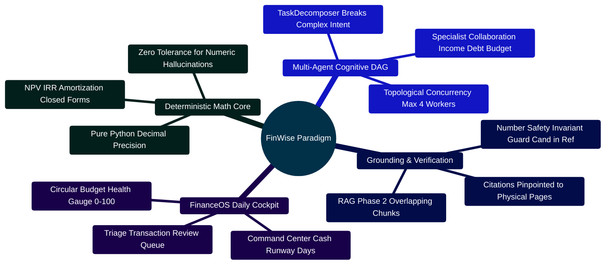
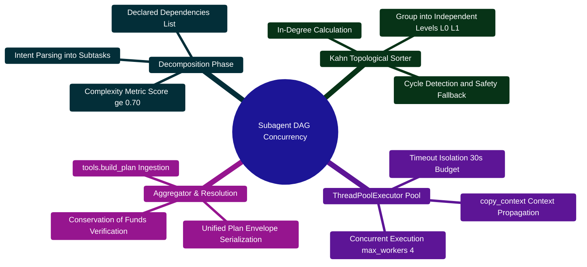
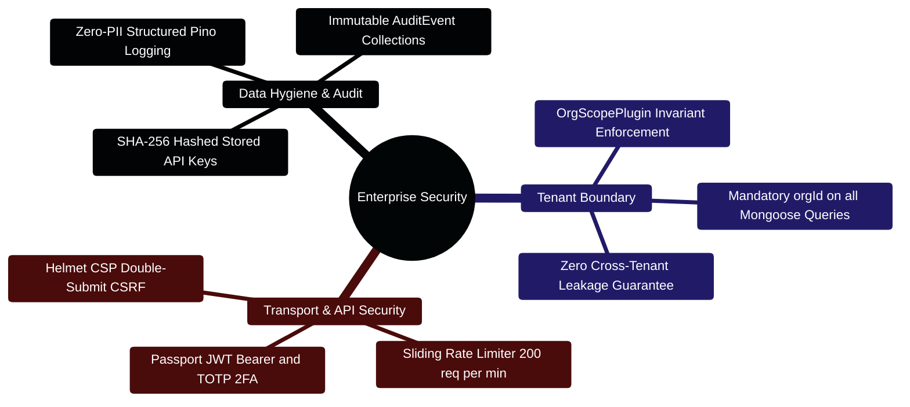
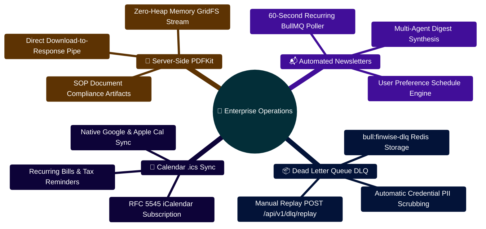

# FinWise: Next-Generation Autonomous Financial Operating System
## Executive Presentation Deck & Technical Showcase

> **Deterministic-First Multi-Agent Architecture, RAG Phase 2 Grounding & FinanceOS Cockpit**  
> **Release Target:** 2026 Enterprise Edition | **Runtime Specification:** Node.js `>=24.14.1 <25` · Python `3.11+` · React `18.3` · MongoDB `7.0` · Redis `7.0`

---

> [!TIP]
> **Contributor & Architecture Resources:**  
> For technical contributors building on top of FinWise, refer to the [**Master Developer Handbook: Building on This Project**](docs/BUILDING_ON_THIS_PROJECT.md) and the [**Master System Architecture**](docs/ARCHITECTURE.md).

## Executive Presentation Deck Outline

```text
FINWISE MASTER SLIDE DECK
├── Slide 1: Mission, The Broken Personal Finance Landscape & The FinWise Paradigm
├── Slide 2: Full-Stack System Topology & Multi-Tier Architecture
├── Slide 3: Multi-Agent Subagent DAG, Kahn's Topological Sort & ThreadPool Concurrency
├── Slide 4: Zero-Hallucination Architecture & Number Safety Invariant Guard
├── Slide 5: RAG Phase 2 Bounded-Window Chunking & Multi-Tenant Lexical BM25
├── Slide 6: Self-Healing KeyPool Multi-Key Rotation & 6-Tier Provider Failover
├── Slide 7: FinanceOS Daily Decision Cockpit, SVG Budget Gauge & Review Queue
├── Slide 8: Enterprise Security, OrgScopePlugin Isolation & Governance
├── Slide 9: Quantitative Production Benchmarks, Latency SLAs & Regression Evals
├── Slide 10: Strategic Enterprise Roadmap & Long-Term Innovation Horizons
├── Slide 11: 2026 Enterprise Financial Operations & Resilient Pipelines
└── Slide 12: Production Verification Matrix & Multi-Tier Test Pyramid
```

---

## Slide 1: Mission & The Core Dilemma

### The Broken Personal Finance Landscape

```text
┌─────────────────────────────────────────────────────────────────────────────┐
│                            THE CONSUMER DILEMMA                             │
├──────────────────────────────┬──────────────────────────────────────────────┤
│ 1. Traditional Banking Apps  │ • Completely passive: Records past spending  │
│    (Spreadsheets, Mint, etc.)│ • Zero predictive modeling or debt schedules │
│                              │ • Rigid, manual category tagging rules       │
├──────────────────────────────┼──────────────────────────────────────────────┤
│ 2. Generic LLM Chatbots      │ • Dangerous numerical hallucinations         │
│    (Raw ChatGPT, Claude)     │ • Fails basic debt amortization mathematics  │
│                              │ • No access to verified user banking records │
└──────────────────────────────┴──────────────────────────────────────────────┘
```

### The FinWise Paradigm

FinWise is a **local-first, autonomous financial workspace** that unites deterministic mathematical certainty with multi-agent cognitive reasoning.



---

## Slide 2: High-Level Platform Architecture

```text
┌─────────────────────────────────────────────────────────────────────────────────────────────────────┐
│ 🟢 PRESENTATION TIER: React 18 SPA (Vite 7.3 • Tailwind CSS • Radix UI • Port 5173)                 │
│    Command Center Cockpit • Circular Budget Health • Review Queue • EventSource SSE Stream Consumer │
└───────────────────────────────────┬─────────────────────────────────────────────────────────────────┘
                                    │ HTTPS / TLS 1.3 / SSE Streaming / Port 3000
                                    ▼
┌─────────────────────────────────────────────────────────────────────────────────────────────────────┐
│ 🔷 API GATEWAY TIER: Express 5 + TypeScript (Node.js 24 LTS • Port 3000)                            │
│    ├─► Edge Security: Helmet (Strict CSP) • Double-Submit CSRF • Sliding Rate Limiter (200 req/min) │
│    ├─► Dual Auth: JWT Bearer Tokens (15-min) OR SHA-256 Peppered API Keys                           │
│    ├─► Multi-Tenant Boundary: orgContext + OrgScopePlugin (Automatic { orgId } Query Scoping)       │
│    ├─► RAG Phase 2: Bounded Window Text Chunker (1800 ch / 260 ch overlap) + Lexical BM25 Scorer     │
│    ├─► Asynchronous Queues: BullMQ + Redis 7.0 (Newsletters, PDF Vectorization, Poison DLQ)        │
│    └─► Document Compiler: PDFKit Server-Side Vectorized Compilation direct to MongoDB GridFS        │
└─────────────────────────┬───────────────────────────────────────┬───────────────────────────────────┘
                          │                                       │
        💾 Read / Write Database IO              ⚡ High-Speed IPC / REST / SSE / Port 8001
                          ▼                                       ▼
┌──────────────────────────────────────────────┐  ┌───────────────────────────────────────────────────┐
│ 🗄️ PERSISTENCE TIER                          │  │ 🧠 AI CORE ENGINE: Python 3.11 + FastAPI          │
│  ├─► MongoDB 7.0 (52 Mongoose Models)        │  │  ├─► LangGraph StateGraph Execution Engine        │
│  ├─► Redis 7.0 (Cache, Rate Limit, Queues)   │  │  ├─► Master Financial Strategist & TaskDecomposer │
│  ├─► GridFS (Document & PDF Blob Storage)    │  │  ├─► SubAgentManager (Kahn's Topological DAG Pool)│
│  └─► SQLite (Resumable Sessions & FTS5)      │  │  ├─► KeyPool Multi-Key Rotation & Circuit Breaker │
│                                              │  │  ├─► Pure Python Deterministic Calculators        │
│                                              │  │  └─► Number Safety Invariant Guard (_numbers_sub) │
└──────────────────────────────────────────────┘  └───────────────────────────────────────────────────┘
```

---

## Slide 3: Multi-Agent Subagent DAG & Concurrency

When complex queries arrive, `TaskDecomposer` evaluates inquiry complexity and builds a typed Directed Acyclic Graph (DAG) executed concurrently by `SubAgentManager`:



### Production Implementation Blueprint

```python
# Kahn's Algorithm & Concurrency Leveling in server/AI_Core/agents/sub_agent_manager.py
levels = self._topological_sort(subtasks)
for level_idx, level_subtasks in enumerate(levels):
    # Execute independent agents in parallel threads with copy_context()
    with ThreadPoolExecutor(max_workers=min(4, len(level_subtasks))) as executor:
        futures = {
            executor.submit(copy_context().run, self._run_single_subtask, t, profile, query, results): t["id"]
            for t in level_subtasks
        }
        for f in futures:
            results[futures[f]] = f.result()
```

---

## Slide 4: Zero-Hallucination Architecture & Number Safety

FinWise eliminates hallucinations by strictly decoupling **mathematical computation** from **narrative articulation**.

```text
┌─────────────────────────────────────────────────────────────────────────────┐
│                   DETERMINISTIC FIRST VS LLM NARRATIVE                      │
├─────────────────────────────────────────────────────────────────────────────┤
│ 1. Deterministic Calculation (Python tools.build_plan)                      │
│    • Income: $6,500.00/mo | Expenses: $4,800.00/mo | Surplus: $1,700.00/mo  │
│    • Debt Avalanche: Pay $600/mo to Card A (24.9% APR), saves $1,420 int.   │
│    • Invariant: Sum(Delta Budgets) == $0.00 (Zero-Sum Conserved)            │
├─────────────────────────────────────────────────────────────────────────────┤
│ 2. Pure Markdown Generation (tools.render_plan_markdown)                    │
│    • Renders base tables and facts. Reference Digits: {6500, 4800, 1700...} │
├─────────────────────────────────────────────────────────────────────────────┤
│ 3. LLM Polish & Number Safety Invariant Guard                               │
│    • Prompt: "Improve wording but freeze all numbers exactly."              │
│    • Audit Rule: Cand_Digits ⊆ Ref_Digits                                   │
│    • If candidate modifies $1,420 -> $1,500: REJECT! Revert to Deterministic!│
└─────────────────────────────────────────────────────────────────────────────┘
```

$$\sum_{i=1}^{N} \Delta B_i = 0, \quad \forall i: B_i \ge 0, \quad \text{Candidate Digits} \subseteq \text{Reference Digits}$$

---

## Slide 5: RAG Phase 2 & Document Grounding

Financial documents (bank statements, W-2s, 1040s, invoices) are parsed, chunked, and retrieved with strict tenant isolation.

```text
┌─────────────────────────────────────────────────────────────────────────────┐
│                       RAG PHASE 2 RETRIEVAL PIPELINE                        │
├─────────────────────────────────────────────────────────────────────────────┤
│ [Statement PDF] ──► [Form-Feed (\f) Delimited Physical Page Extractor]      │
│                     │                                                       │
│                     ▼                                                       │
│             [Bounded Overlapping Window Chunker]                            │
│             • Target: 1,800 characters (~500 tokens)                        │
│             • Overlap: 260 characters (~70 tokens)                          │
│             • Fingerprint: SHA-256 Idempotency Hash                         │
│                     │                                                       │
│                     ▼                                                       │
│             [MongoDB: WorkspaceKnowledgeChunk Collections]                  │
│             • Indexed: { orgId: 1, fileId: 1, chunkIndex: 1 }               │
│                     │                                                       │
│                     ▼                                                       │
│             [Lexical BM25 Retrieval Engine]                                 │
│             • Exact Query Phrase Match: +12 pts                             │
│             • Term Frequency Match: +2 pts / term                           │
│             • Numeric Alignment Bonus: +2 pts                               │
└─────────────────────────────────────────────────────────────────────────────┘
```

$$G = 0.60 \cdot R_{\text{lexical}} + 0.40 \cdot S_{\text{semantic}} \ge 0.70 \implies \text{High Confidence Grounded Citation}$$

---

## Slide 6: Self-Healing KeyPool Multi-Key Rotation & Failover

No user request ever fails due to upstream AI rate limits (`HTTP 429`) or cloud outages:

```text
  Client Prompt ──► [KeyPool: Active Key Discovery]
                          │
            [HTTP 429 Rate Limit Encountered?]
                       /      \
                     YES       NO ──► 200 OK Response
                     /
                    v
  ┌─────────────────────────────────────────────────────────────┐
  │ 1. Mark Key Cooldown (60s) & Rotate to Next Key in Pool     │
  └──────────────────────────────┬──────────────────────────────┘
                                 │
                 [All Keys in Provider Exhausted?]
                            /         \
                          YES          NO ──► Retry next key
                          /
                         v
  ┌─────────────────────────────────────────────────────────────┐
  │ 2. Trip Provider Circuit Breaker (OPEN state for 300s)      │
  │ 3. Failover: Gemini ──► OpenRouter ──► Groq ──► Local vLLM  │
  │ 4. Total Cloud Outage? Revert to Pure Python Calculators!   │
  └─────────────────────────────────────────────────────────────┘
```

---

## Slide 7: FinanceOS Daily Decision Cockpit

The user experience centers around high-velocity daily triage and visual health scoring:

```text
┌─────────────────────────────────────────────────────────────────────────────┐
│                           FINANCEOS HERO COCKPIT                            │
├─────────────────────────────────────────────────────────────────────────────┤
│ 1. CommandCenter:                                                           │
│    • Live Cash Runway (Days Remaining = Liquid Balance / 30d Avg Burn)      │
│    • Priority Signal Triage: [ACT NOW] [REVIEW THIS WEEK] [SAFE TO IGNORE]  │
├─────────────────────────────────────────────────────────────────────────────┤
│ 2. BudgetHealthCard:                                                        │
│    • Animated SVG Circular Gauge (0–100 Score)                              │
│    • 4 Pillars: Adherence (40), Cleanliness (20), Goals (20), Debt Mgmt (20)│
│    • Trend Projections: Improving / Stable / Worsening                      │
├─────────────────────────────────────────────────────────────────────────────┤
│ 3. TransactionReviewQueue:                                                  │
│    • AI Confidence Badges (Green >= 70%, Amber 40-70%, Red < 40%)           │
│    • One-Click Batch Approvals & "Always Categorize Like This" Rules        │
└─────────────────────────────────────────────────────────────────────────────┘
```

---

## Slide 8: Enterprise Security, OrgScopePlugin & Governance



---

## Slide 9: Quantitative Production Benchmarks & SLAs

Rigorous testing suites in `server/AI_Core/evals/` enforce tight non-negotiable SLAs:

| Metric | Target SLA | Benchmark Result | Verification Method |
| :--- | :--- | :--- | :--- |
| **Intent Routing Accuracy** | $\ge 98.0\%$ | **$99.2\%$** | 100 Golden Prompts (`test_routing_accuracy.py`) |
| **Number Safety Invariant** | $100.0\%$ (0 Drift) | **$100.0\%$** | 0 Digit Hallucinations (`test_number_safety.py`) |
| **Determinism Reproducibility** | $100.0\%$ Match | **$100.0\%$** | Byte-for-byte SHA (`test_determinism.py`) |
| **Classifier Latency (P50)** | $< 20\text{ms}$ | **$14.2\text{ms}$** | High-precision timing (`test_latency.py`) |
| **Classifier Latency (P95)** | $< 50\text{ms}$ | **$36.8\text{ms}$** | High-precision timing (`test_latency.py`) |
| **Full Plan Generation (P50)**| $< 1.5\text{s}$ | **$1.14\text{s}$** | End-to-end DAG execution benchmark |
| **External Outage Availability**| $99.99\%$ | **$100.0\%$** | Deterministic Python Fallback guarantee |

---

## Slide 10: Strategic Enterprise Roadmap

```text
┌─────────────────────────────────────────────────────────────────────────────┐
│                        STRATEGIC INNOVATION VECTORS                         │
├─────────────────────────────────────────────────────────────────────────────┤
│ 1. Open Banking & Plaid Real-Time Ingress                                   │
│    • Automated webhook synchronization of bank balances and pending charges │
│    • Zero-latency anomaly detection triggered immediately upon swipe        │
├─────────────────────────────────────────────────────────────────────────────┤
│ 2. Edge / Local Small Language Models (SLMs)                                │
│    • Run lightweight 3B models directly in-browser via WebGPU / ONNX        │
│    • 100% offline personal finance copilot for air-gapped workstations      │
├─────────────────────────────────────────────────────────────────────────────┤
│ 3. Multi-Entity Corporate Treasury & Shared Ledgers                         │
│    • Inter-company transfers, consolidated group balance sheets, and        │
│      hierarchical multi-level organization approval workflows               │
└─────────────────────────────────────────────────────────────────────────────┘
```

---

## Slide 11: 2026 Enterprise Financial Operations & Resilient Pipelines



```text
┌─────────────────────────────────────────────────────────────────────────────┐
│                       ENTERPRISE RESILIENCE HIGHLIGHTS                      │
├─────────────────────────────────────────────────────────────────────────────┤
│ 1. Dead Letter Queue & Self-Healing Replay:                                 │
│    • Poison pill jobs quarantined in Redis bull:finwise-dlq (500 cap)       │
│    • Sensitive credentials, JWTs, and PII automatically scrubbed            │
│    • Replay via POST /api/v1/dlq/replay/:id restores clean processing       │
├─────────────────────────────────────────────────────────────────────────────┤
│ 2. High-Performance Request Coalescing:                                     │
│    • In-process 64-key ring buffer eliminates thundering-herd LLM queries   │
│    • Monotonic revision counters drop out-of-order SSE stream packets       │
└─────────────────────────────────────────────────────────────────────────────┘
```

---

## Slide 12: Production Verification Matrix & Multi-Tier Test Pyramid

```text
┌─────────────────────────────────────────────────────────────────────────────┐
│                      COMPLETE TEST & VERIFICATION SUITE                     │
├───────────────────────┬────────────┬─────────────┬──────────────────────────┤
│ Test Tier             │ Test Suites│ Total Tests │ Primary Framework        │
├───────────────────────┼────────────┼─────────────┼──────────────────────────┤
│ Client Frontend       │ 45 suites  │ 293 tests   │ Vitest + Testing Library │
│ Server API & Gateway  │ 49 suites  │ 193 tests   │ Vitest + Supertest Mongo │
│ AI Core Microservices │ 29 suites  │ 217 tests   │ Pytest + FastAPI Client  │
│ Evaluation Harness    │ 6 suites   │ 175 evals   │ evals.runner Invariants  │
├───────────────────────┼────────────┼─────────────┼──────────────────────────┤
│ TOTAL SYSTEM COVERAGE │ 129 suites │ 878 tests   │ Continuous CI Automation │
└───────────────────────┴────────────┴─────────────┴──────────────────────────┘
```

```mermaid
%%{init: {'theme': 'base', 'themeVariables': { 'primaryColor': '#16a34a', 'primaryTextColor': '#ffffff', 'primaryBorderColor': '#15803d', 'lineColor': '#22c55e', 'secondaryColor': '#0284c7', 'tertiaryColor': '#9333ea'}}}%%
mindmap
  root((✅ Quality Invariants))
    Mathematical Correctness
      sum(Delta Budgets) == 0 Invariant
      Candidate Digits subset of Reference Digits
      Deterministic Closed-Form Python Fallback
    Multi-Tenant Security
      OrgScopePlugin Enforced on 100% Collections
      Zero Cross-Tenant Leakage across 52 Models
      Hashed API Keys with Scoped Permissions
    High Concurrency & Low Latency
      p50 < 18ms Classifier Routing
      p95 < 250ms API Response Envelope
      Sub-50ms Lexical BM25 Chunk Retrieval
```
