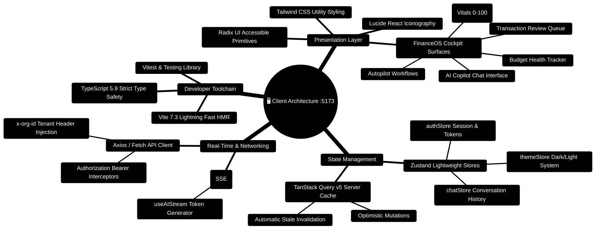

# FinWise Client — Frontend Workspace & FinanceOS Cockpit

> **React 18 + Vite Production-Grade Single Page Application (SPA)**  
> *FinanceOS Cockpit, Zustand State Stores, TanStack Query v5 Caching, Server-Sent Events (SSE) Streaming, and Tailwind CSS Design Tokens*  
> **Development Port:** `http://localhost:5173` · **Gateway API Proxy:** `http://localhost:3000`

---

> [!TIP]
> **Developer Guide: Building on FinWise**  
> For complete end-to-end full-stack feature recipes, Mongoose models, Zod schemas, Express controllers, and Python LangGraph subagents, consult the [**Master Developer Handbook: Building on This Project**](../docs/BUILDING_ON_THIS_PROJECT.md).

## 1. Client Architecture Mindmap



---

## 2. Client Runtime & Data Flow ASCII Topology

```text
┌─────────────────────────────────────────────────────────────────────────────────────────────────┐
│ 🟢 BROWSER RUNTIME (Port 5173)                                                                  │
│    AppShell Layout ──► Sidebar Navigation • Header Badges • Command Bar (Cmd+K)                 │
└───────────────────────────────────────────────┬─────────────────────────────────────────────────┘
                                                │
                                                ▼
┌─────────────────────────────────────────────────────────────────────────────────────────────────┐
│ 🔀 CLIENT ROUTING & STATE ENGINE                                                               │
│    AppRouter ──► RouteGuards (AuthGuard, OrgScopeGuard) ──► Lazy Loaded Pages                   │
│    ├─► /dashboard     ──► FinancialVitals • SpendingAnalysis • RecentActivity                   │
│    ├─► /chat          ──► FinancialCopilot • ConversationInsights • CitationPills               │
│    ├─► /transactions  ──► TransactionReviewQueue • Virtualized List • CategoryRules             │
│    └─► /scenarios     ──► Monte Carlo Projections • Wealth Simulators • GoalProgress            │
└───────────────────────┬─────────────────────────────────────────┬───────────────────────────────┘
                        │                                         │
                        ▼ Local Reactive State                    ▼ Server Data Cache
┌───────────────────────────────────────────────┐ ┌───────────────────────────────────────────────┐
│ 📦 ZUSTAND STORES                             │ │ 🔄 TANSTACK QUERY V5 CACHE                    │
│    chatStore (Messages, streaming flag)       │ │    ['transactions', orgId] ── Cache 5 mins   │
│    authStore (User profile, active token)     │ │    ['budget-health', orgId] ── Auto Invalidate│
│    themeStore (Dark / Light token sync)       │ │    ['conversations', sessionId]               │
└───────────────────────┬───────────────────────┘ └───────────────────────┬───────────────────────┘
                        │                                                 │
                        └───────────────────────┬─────────────────────────┘
                                                │
                                                ▼ HTTP REST / SSE Stream
┌─────────────────────────────────────────────────────────────────────────────────────────────────┐
│ 🌐 API GATEWAY INGRESS (http://localhost:3000)                                                  │
│    Header: Authorization: Bearer <jwt> • Header: x-org-id: <orgId>                              │
└─────────────────────────────────────────────────────────────────────────────────────────────────┘
```

---

## 3. Developer Guide: How to Build New Features on the Client

### 3.1 Creating a New Page Component

Create `client/src/pages/MyNewFeature.tsx`:

```tsx
import React from 'react';
import { useQuery } from '@tanstack/react-query';
import { api } from '@/lib/api';
import { Sparkles, ArrowRight } from 'lucide-react';

export const MyNewFeaturePage: React.FC = () => {
  const { data, isLoading } = useQuery({
    queryKey: ['my-feature-data'],
    queryFn: async () => {
      const res = await api.get('/api/v1/my-feature');
      return res.data;
    },
  });

  if (isLoading) {
    return <div className="p-8 text-center text-slate-400">Loading feature metrics...</div>;
  }

  return (
    <div className="p-6 space-y-6">
      <div className="flex items-center justify-between">
        <h1 className="text-2xl font-bold text-slate-100 flex items-center gap-2">
          <Sparkles className="w-6 h-6 text-indigo-400" />
          My New Feature
        </h1>
      </div>
      <div className="bg-slate-900/60 border border-slate-800 rounded-xl p-5">
        <p className="text-slate-300">Feature Data: {JSON.stringify(data)}</p>
      </div>
    </div>
  );
};

export default MyNewFeaturePage;
```

### 3.2 Registering the Route in `client/src/routes/routeDefinitions.tsx`

```tsx
import { lazy } from 'react';

const MyNewFeaturePage = lazy(() => import('@/pages/MyNewFeature'));

export const APP_ROUTES = [
  // ... existing routes
  {
    path: '/my-feature',
    component: MyNewFeaturePage,
    authenticated: true,
  },
];
```

### 3.3 Consuming Real-Time AI Streaming via `useAIStream`

```tsx
import React, { useState } from 'react';
import { useAIStream } from '@/hooks/useAIStream';
import { Bot, Play, Loader2 } from 'lucide-react';

export const AIAnalysisWidget: React.FC<{ orgId: string }> = ({ orgId }) => {
  const [prompt, setPrompt] = useState('');
  const { output, isStreaming, startStream } = useAIStream();

  const handleAnalyze = () => {
    if (!prompt.trim()) return;
    startStream(prompt, orgId);
  };

  return (
    <div className="p-5 bg-slate-900/80 border border-slate-800 rounded-xl space-y-4">
      <div className="flex items-center gap-2 text-indigo-400 font-semibold">
        <Bot className="w-5 h-5" />
        Live Financial Copilot
      </div>
      <div className="flex gap-2">
        <input
          type="text"
          value={prompt}
          onChange={(e) => setPrompt(e.target.value)}
          placeholder="Ask a question about your spending..."
          className="flex-1 bg-slate-800 border border-slate-700 rounded-lg px-3 py-2 text-sm text-slate-100"
        />
        <button
          onClick={handleAnalyze}
          disabled={isStreaming}
          className="px-4 py-2 bg-indigo-600 hover:bg-indigo-500 rounded-lg text-sm font-medium text-white flex items-center gap-2"
        >
          {isStreaming ? <Loader2 className="w-4 h-4 animate-spin" /> : <Play className="w-4 h-4" />}
          Ask
        </button>
      </div>
      {output && (
        <div className="p-4 bg-slate-950/60 border border-slate-800 rounded-lg text-sm text-slate-200 whitespace-pre-wrap">
          {output}
        </div>
      )}
    </div>
  );
};
```

---


---

## 4. 2026 Enterprise Client Innovations

The client includes production-grade interfaces across all key financial domains:
1. **Custom CSV Export Column Selector (`client/src/pages/Exports.tsx`)**: Interactive column selection chips with order preservation.
2. **Financial Calendar Recurring Bill Sync & RFC 5545 `.ics` Export (`client/src/pages/FinancialCalendar.tsx`)**: Auto-detection of recurring bills and iCalendar export with reminder alarms.
3. **Multi-Goal Rebalancing & Windfall Redistribution (`client/src/pages/GoalsAndDebts.tsx`)**: Priority, urgency, and velocity algorithms to optimize multiple financial targets.
4. **Portfolio Target Models & Drift Rebalance Planner (`client/src/pages/Portfolio.tsx`)**: 60/40, 80/20, All-Weather presets with smart tax-efficient cash inflow reallocation.
5. **Tasks Batch Actions & Calendar Sync (`client/src/pages/Tasks.tsx`)**: Multi-select floating action bar for batch complete, dismiss, and calendar reminders.
6. **Finance OS Auto-Budget Roll-Forward & Predictive Caps (`client/src/pages/FinanceOS.tsx`)**: Month-stepping navigator with inflation buffers (+5%, +10%) and live envelope burn bars.
7. **What-If Multi-Scenario Comparison Matrix & Monte Carlo Bounds (`client/src/pages/Scenarios.tsx`)**: 4-scenario side-by-side comparison with stochastic volatility simulation (P10, P50, P90).
8. **Interactive Source Citations Drawer (`client/src/components/SourceEvidenceList.tsx`)**: Grounding evidence preview with direct jumps to verified physical PDF pages (`/files?file=<id>&page=<n>`).
9. **Private Query Cache Isolation (`client/src/context/AuthContext.tsx`, `client/src/app/providers/AppProviders.tsx`)**: Per-user and per-workspace QueryClient instantiation with automatic query retirement and SSE abort on context switch.

---
## 5. Local Setup & Testing Recipes

> **Verification Status:** **45 test files / 293 tests passing** (Vitest + RTL + MSW) · ESLint 0 warnings · TypeScript strict.

```bash
# 1. Install dependencies
npm install

# 2. Launch Vite development server (Port 5173)
npm run dev

# 3. Execute unit & integration test suites
npm test

# 4. Production build & type check verification
npm run build -- --noEmit
```
