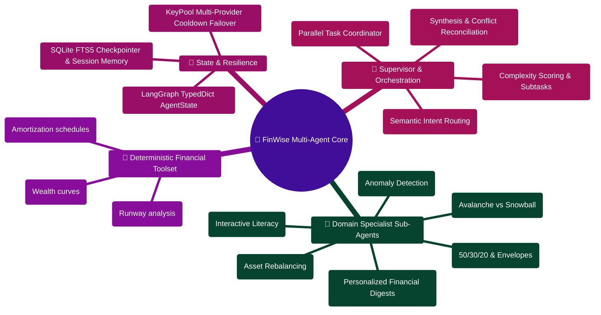

# FinWise AI Agents Reference

> Complete reference for the multi-agent AI system powering FinWise's financial intelligence.

---

> [!TIP]
> **Developer Guide: Building & Extending on This Project**  
> For complete step-by-step blueprints, Mongoose models, Zod schemas, Express controllers, React hooks, and LangGraph subagents, see the [**Master Developer Handbook: Building on This Project**](./BUILDING_ON_THIS_PROJECT.md).

## Architecture Overview

The AI Core is a Python FastAPI service using LangGraph for workflow orchestration. It implements a **deterministic-first** pattern: agents compute results algorithmically, then optionally polish with LLM. This design ensures financial calculations are always accurate while still providing natural language responses.

```
User Query -> Master Agent -> Routing -> Specialist Agent(s) -> Verification -> Synthesis -> Response
```

| Component | Technology | Purpose |
|-----------|-----------|---------|
| Framework | FastAPI + Uvicorn | HTTP server |
| Orchestration | LangGraph 0.2 + LangChain 0.3 | Workflow graph |
| LLM Providers | Gemini, OpenRouter, Groq, Grok, Together, Mistral | Language model access |
| Vision/OCR | PaddleOCR, OpenCV, Pillow | Receipt scanning |
| Data Processing | Pandas, Pydantic 2 | Data manipulation and validation |
| Memory | SQLite | Conversation memory and preferences |

---

## Master Agent (`MasterFinancialStrategistAgent`)

**File:** `server/AI_Core/agents/master_agent.py`

The coordinator of the entire multi-agent system with two primary responsibilities: **routing** and **synthesis**.

### Routing (100% Deterministic)

`determine_analysis_type()` classifies queries using keyword + regex scoring with **zero LLM calls**, keeping latency under 1ms and cost at zero.

**AnalysisType Enum:**

```python
class AnalysisType(str, Enum):
    INCOME_EXPENSE = "income_expense"        # Cash flow analysis
    BUDGET_PLANNING = "budget_planning"      # Budget creation and optimization
    INVESTMENT_ADVICE = "investment_advice"  # Portfolio recommendations
    DEBT_OPTIMIZATION = "debt_optimization"  # Debt repayment strategy
    FINANCIAL_EDUCATION = "financial_education"  # General financial knowledge
    COMPREHENSIVE = "comprehensive"          # All of the above
    DECOMPOSE = "decompose"                  # Complex request -> subtask decomposition
```

**Keyword Scoring:**

| Analysis Type | Trigger Keywords |
|---------------|-----------------|
| `INCOME_EXPENSE` | expense, spend, spending, income, cash flow, cashflow, transaction |
| `BUDGET_PLANNING` | budget, save, savings, allocation, monthly plan, cut costs |
| `INVESTMENT_ADVICE` | invest, portfolio, stock, etf, mutual fund, retirement, sip |
| `DEBT_OPTIMIZATION` | debt, loan, credit card, interest, repay, repayment, emi |

**Routing Decision Tree (evaluated in priority order):**

1. If the query looks educational AND is not personal/action-seeking AND has no amounts/timelines -> `FINANCIAL_EDUCATION`
2. If the query is educational but no domain keywords matched -> `FINANCIAL_EDUCATION`
3. If the query contains broad-plan phrases ("analyze my finances", "comprehensive", etc.) -> check for decomposition -> `COMPREHENSIVE` or `DECOMPOSE`
4. If 2+ domain categories matched -> check for decomposition -> `COMPREHENSIVE` or `DECOMPOSE`
5. If exactly 1 domain matched -> that domain's analysis type
6. If no profile is available -> `FINANCIAL_EDUCATION`
7. Fallback -> `COMPREHENSIVE`

**Context Enrichment:**
For ambiguous follow-ups like "what about investing?", the previous user message and session summary are appended to the query text for keyword matching.

**Decomposition Decision (`_should_decompose`):**

Returns `True` (triggers sub-agent architecture) when:
- 3+ domain categories score above threshold, OR
- Query contains "comprehensive plan" language AND 2+ domains, OR
- User profile has active goals AND debts AND investments AND 2+ domains

### Synthesis (Tool-First with Number Safety Guard)

`synthesize_plan()` follows a strict pipeline:

1. Filter out analyses that errored
2. Call `tools.build_plan()` to produce a structured `Plan` object
3. Render as deterministic markdown via `render_plan_markdown()`
4. If narrative mode is enabled, send to LLM with strict rules: "improve wording but do NOT change any numbers"
5. **Number safety guard**: compare every numeric token in LLM output against deterministic version
6. Return final markdown plus structured metadata

### Tool Call Generation

The master agent generates deterministic automation suggestions from the plan's key metrics:

| Tool | Trigger Condition | Risk Level |
|------|-------------------|------------|
| Weekly money check-in | Always generated | Low |
| Emergency fund top-up | Emergency fund runway < 3 months | Low |
| Debt payoff check-in | Total debt > 0 | Low |
| Transaction review | Monthly net cash flow < 0 | Low |

All tool calls require user confirmation (`requires_confirmation: true`).

---

## Specialist Agents

### IncomeExpenseAnalyzerAgent

**File:** `server/AI_Core/agents/income_expense_analyzer.py`
**LLM Calls:** None (fully deterministic)
**Input:** Transaction list
**Output:** Categorized data, financial metrics, patterns, insights, health score

**Capabilities:**
- Categorizes transactions into income, expenses, investments, transfers using pandas groupby/aggregate
- Detects anomalous transactions via z-score statistical method
- Identifies recurring income/expense patterns
- Computes key metrics: total income, expenses, net cash flow, savings rate, fixed vs. discretionary ratio
- Generates a financial health score (0-100) using a weighted point system:
  - Savings rate: up to 30 points
  - Cash flow: +/- 15-20 points
  - Fixed expense ratio: +/- 10-20 points
  - Bonuses for detected strengths/concerns

### BudgetPlannerAgent

**File:** `server/AI_Core/agents/budget_planner.py`
**LLM Calls:** None (fully deterministic)
**Input:** User profile (income, expenses, goals, debts)
**Output:** Budget allocation, savings plan, debt repayment budget, detailed recommendations

**Capabilities:**
- Allocates income using 50/30/20 split (needs/wants/savings)
- Switches to debt-heavy variant (50/30/10/10) when debt-to-income ratio > 15%
- Calculates monthly savings needed for each financial goal
- Determines debt repayment budget (minimum + recommended extra)
- Emergency fund target: 3 months of expenses (configurable via `settings.EMERGENCY_FUND_MONTHS`)
- Generates markdown budget plan with 30-day action steps

### InvestmentAdvisorAgent

**File:** `server/AI_Core/agents/investment_advisor.py`
**LLM Calls:** None (fully deterministic)
**Input:** User profile (age, risk tolerance, experience, time horizon)
**Output:** Risk profile, investment strategy, portfolio allocation, expected returns, retirement projection

**Capabilities:**
- Risk profile assessment using weighted scoring:
  - Age: 1-3 points
  - Experience: 0-3 points
  - Time horizon: 1-3 points
  - Tolerance: 0-2 points
  - Score >= 8 = aggressive, >= 5 = moderate, else conservative
- Portfolio allocation across asset classes:
  - Domestic Equity
  - International Equity
  - Bonds
  - Real Assets
  - Cash
  - Alternatives (5% sleeve for expert investors)
- Expected returns using historical averages: equities ~9%, bonds ~4.5%, cash ~2%
- Retirement projection via compound interest calculations

### DebtOptimizerAgent

**File:** `server/AI_Core/agents/debt_optimizer.py`
**LLM Calls:** None (fully deterministic)
**Input:** Debt list, user profile
**Output:** Debt analysis, snowball/avalanche plans, optimal strategy, consolidation options

**Capabilities:**
- Computes weighted interest rate, debt-to-income ratio, and total debt
- Simulates month-by-month payoff for both strategies:
  - **Snowball**: smallest balance first (psychological momentum)
  - **Avalanche**: highest interest first (mathematically optimal)
- Recommends optimal strategy (prefers snowball for >3 debts with conservative tolerance)
- Evaluates consolidation options (personal loan, balance transfer card)
- Extra payment capacity capped at 15% of monthly income

### FinancialEducatorAgent

**File:** `server/AI_Core/agents/financial_educator.py`
**LLM Calls:** Yes (the only specialist that uses LLM)
**Input:** User question
**Output:** Educational explanation

**Capabilities:**
- Extracts core concept via deterministic keyword matching + prefix stripping
- Checks in-memory LRU cache (TTL 30 minutes, max 256 entries) to avoid redundant LLM calls
- Invokes LLM with constrained system prompt (definitions and explanations only, no personalized advice)
- Falls back to deterministic explanation if LLM is unavailable
- Explicitly avoids personalized financial advice

### TaskDecomposerAgent

**File:** `server/AI_Core/agents/task_decomposer.py`
**LLM Calls:** None by default; model-assisted planning is opt-in
**Input:** User query, user profile
**Output:** List of SubtaskDefinition objects

**Capabilities:**
- Computes deterministic complexity score (0.0-1.0) from 6 signals:
  - Domain breadth (number of matched categories)
  - Planning horizon indicators
  - Trade-off language
  - Comprehensive keywords
  - Multiple amounts
  - Profile complexity
- Score < 0.5: returns empty subtask list (standard routing handles it)
- Score >= 0.5: builds a deterministic plan for the relevant specialists
- The workflow forces a targeted plan when already routed to decomposition,
  even if the complexity score is below 0.5
- Each specialist appears once and independent analyses have no artificial dependencies
- `options.llm_decomposition=true` opts into LLM planning; the model is created lazily
- Invalid or cyclic LLM plans fall back to the deterministic domain plan

**SubtaskDefinition Model:**
```python
class SubtaskDefinition(BaseModel):
    id: str                    # Unique identifier (e.g., "subtask_001")
    description: str           # Human-readable description
    assigned_agent: str        # Specialist agent name
    priority: int              # 1 (highest) to 5 (lowest)
    dependencies: List[str]    # IDs of prerequisite subtasks
    status: str                # pending/in_progress/completed/failed/skipped
    result: Optional[Dict]     # Output after execution
```

### SubAgentManager

**File:** `server/AI_Core/agents/sub_agent_manager.py`
**LLM Calls:** None (orchestration only)
**Input:** Subtask list, agent registry
**Output:** Results keyed by subtask ID

**Capabilities:**
- Kahn's algorithm for topological sort (dependency resolution)
- `ThreadPoolExecutor` with max 4 workers for parallel execution
- Configurable timeout (30 seconds) and retry budget (1 retry)
- Graceful partial failure handling (a failed subtask does not block unrelated subtasks)
- Request IDs and usage counters propagate into worker threads
- Per-attempt traces measure the work inside the worker, including retries

**Agent Method Map:**
```python
AGENT_METHOD_MAP = {
    "income_expense_analyzer": "analyze_finances",
    "budget_planner": "create_budget_plan",
    "investment_advisor": "provide_advice",
    "debt_optimizer": "optimize_repayment",
    "financial_educator": "explain_concept",
}
```

### AggregatorAgent

**File:** `server/AI_Core/agents/aggregator.py`
**LLM Calls:** Optional (narrative polish)
**Input:** Sub-agent results
**Output:** Unified financial plan

**Capabilities:**
- Merges sub-agent results into unified plan
- Same `build_plan()` + `render_plan_markdown()` pipeline as master agent
- Number safety guard on LLM-polished output

This class remains available for direct use. The workflow normalizes specialist
results directly and uses master synthesis once after verification, avoiding a
second plan rewrite.

### NewsletterAgent

**File:** `server/AI_Core/agents/newsletter_agent.py`
**LLM Calls:** Yes (financial tip, action items)
**Input:** User profile, recent transactions
**Output:** Newsletter content

**Capabilities:**
- Deterministic sections: spending summary, budget alerts, upcoming bills, health score
- LLM-generated sections: financial tip (title/category/body), action items
- Fallback content when LLM unavailable

### ConversationSummarizer

**File:** `server/AI_Core/agents/conversation_summarizer.py`  
**LLM Calls:** Optional (narrative enhancement with a 2-attempt budget)  
**Input:** Bounded snapshot of caller's recent sessions (`conversation_sessions`, up to 8 entries)  
**Output:** Structured cross-conversation pulse, repeated topic clusters, next moves, and recommended prompt  

**Capabilities:**
- Read-only cross-conversation synthesis from caller-supplied snapshots
- Skips financial tool/specialist fanout (low latency, minimal tokens)
- Enforces Number Safety: candidate figures must strictly be a subset of reference session metadata
- Deterministic factual markdown recap fallback on LLM failure or rate limits

---

## LangGraph Workflow

**File:** `server/AI_Core/graph/workflow.py`

### Graph Topology

```
master_agent -> conditional routing:
  INCOME_EXPENSE      -> income_analyzer -> synthesize -> END
  BUDGET_PLANNING     -> budget_planner -> synthesize -> END
  INVESTMENT_ADVICE   -> investment_advisor -> synthesize -> END
  DEBT_OPTIMIZATION   -> debt_optimizer -> synthesize -> END
  FINANCIAL_EDUCATION -> financial_educator -> END (no synthesis)
  COMPREHENSIVE       -> comprehensive_analysis -> verification -> synthesize -> END
  DECOMPOSE           -> task_decomposer -> sub_agent_pool -> verification -> synthesize -> END
```

### Key Features

- Explicit questions take precedence over earlier domains; ambiguous follow-ups
  can inherit the latest user topic.
- Comprehensive requests run only the selected specialists. A full financial
  review retains every specialist with applicable input data.
- Both parallel paths share the same timeout and retry policy.
- Graph-node exceptions retry within the node before execution advances.
- Workflow trace entries preserve `latencyMs`, `llmCalls`, `inputTokens`,
  `outputTokens`, `tokenCount`, `fallbackUsed`, and `cacheHit` through the HTTP
  contract and Node response normalization.

| Feature | Description |
|---------|-------------|
| **Session checkpointing** | State persisted and resumable across requests via SQLite |
| **Verification phase** | Rule-based QA: budget vs. income, emergency fund adequacy, risk alignment |
| **Parallel execution** | Relevant specialists share a bounded pool with deadlines and retry budgets |
| **Retry with graceful degradation** | Each node retries up to 2 times before error propagation |
| **Workflow tracing** | Nodes and specialist attempts record timing, usage, fallback, cache status, and errors |

### Workflow Phases

```python
class WorkflowPhase(str, Enum):
    ROUTING = "routing"            # Master agent determining analysis type
    PLANNING = "planning"          # Subtask decomposition
    RESEARCH = "research"          # Data gathering
    EXECUTION = "execution"        # Specialist agents running
    VERIFICATION = "verification"  # QA checks on specialist outputs
    SYNTHESIS = "synthesis"        # Master agent combining into final plan
    COMPLETE = "complete"          # Workflow finished successfully
    ERROR = "error"                # Workflow failed
```

---

## Number Safety Guard

A critical safety mechanism that prevents LLM hallucinations from introducing incorrect financial numbers:

```python
def _numbers_are_subset(candidate: str, reference: str) -> bool:
    """Check that every number in candidate already exists in reference."""
    from utils.agent_helpers import numbers_are_subset
    return numbers_are_subset(candidate, reference)
```

**How it works:**
1. Extract every numeric token from both the LLM output and the deterministic version
2. If the LLM introduced ANY new number not in the original, discard its output entirely
3. Use the deterministic version as the final response

**When it triggers:**
- During synthesis when LLM is used for narrative polish
- During aggregation when sub-agent results are combined
- Any time LLM output is compared against deterministic calculations

---

## Session Management and Checkpointing

**Session Manager:** `server/AI_Core/utils/session_manager.py`

### Features

- **Session creation**: Unique session ID per conversation
- **State persistence**: AgentState serialized to SQLite after each node execution
- **Resumption**: Workflows can be resumed from the last checkpoint
- **Session summary**: Compact summary of conversation for context enrichment

### Checkpoint Metadata

```python
{
    "session_id": "uuid",
    "created_at": "ISO timestamp",
    "last_updated": "ISO timestamp",
    "phase": "routing|execution|synthesis|complete|error",
    "node_count": 5,
    "recovered_from_checkpoint": true|false
}
```

---

## Contracts (Pydantic Models)

### Plan Contract (`contracts/plan.py`)

```python
class Plan:
    executive_summary: str
    key_metrics: KeyMetrics      # monthly_net_cash_flow, savings_rate, debt_to_income, etc.
    actions: ActionBuckets       # next_7_days, next_30_days, next_12_months
    assumptions: List[str]
    data_warnings: List[str]
```

### Response Contract (`contracts/responses.py`)

```python
class ProcessResponse:
    success: bool
    final_output: str
    agent: str
    actionType: str
    priority: str
    insights: List[str]
    analysis_type: str
    plan: Plan                   # Always present
    workflow_trace: List[WorkflowTraceEntry]
    usage: UsageMetadata
    tool_calls: List[ToolCall]
    session_id: Optional[str]
```

---

## Agent State (LangGraph State Schema)

**File:** `server/AI_Core/graph/state.py`

```python
class AgentState(TypedDict):
    # Input fields
    user_input: str
    user_profile: Dict[str, Any]
    org_id: Optional[str]
    user_id: Optional[str]
    conversation_history: List[Dict[str, str]]
    session_summary: Optional[str]
    options: Dict[str, Any]

    # Analysis outputs
    current_analysis: Dict[str, Any]
    income_analysis: Optional[Dict[str, Any]]
    budget_plan: Optional[Dict[str, Any]]
    investment_advice: Optional[Dict[str, Any]]
    debt_optimization: Optional[Dict[str, Any]]
    financial_education: Optional[Dict[str, Any]]

    # Control fields
    next_agent: str
    final_output: Optional[Any]
    fallback_used: bool
    workflow_trace: List[Dict[str, Any]]
    error: Optional[str]

    # Session fields
    session_id: Optional[str]
    subtasks: Optional[List[Dict[str, Any]]]
    verification_results: Optional[Dict[str, Any]]
    retry_count: int
    max_retries: int
    phase: Optional[str]
    recovered_from_checkpoint: bool
    llm_route: Optional[Dict[str, Any]]

    # Sub-agent architecture fields
    sub_agent_results: Optional[Dict[str, Any]]
    complexity_score: Optional[float]
    decomposition_plan: Optional[Dict[str, Any]]
```

---

## LLM Provider Configuration

**Three-Level Failover:** provider -> key -> model

| Provider | Models | Use Case |
|----------|--------|----------|
| Google Gemini | gemini-2.0-flash, gemini-1.5-pro | Primary for synthesis |
| OpenRouter | Various (100+ models) | Fallback pool |
| Groq | llama-3.3-70b, mixtral-8x7b | Fast inference |
| Grok (XAI) | grok-2 | Alternative provider |
| Together | llama-3.3-70b | Additional capacity |
| Mistral | mistral-large | European provider |

**Key Pool Rotation:** Multiple API keys per provider with automatic rotation on rate limits.

---

## Key Files Reference

| File | Purpose |
|------|---------|
| `server/AI_Core/agents/master_agent.py` | Routing and synthesis coordinator |
| `server/AI_Core/agents/income_expense_analyzer.py` | Transaction analysis |
| `server/AI_Core/agents/budget_planner.py` | Budget creation |
| `server/AI_Core/agents/investment_advisor.py` | Investment recommendations |
| `server/AI_Core/agents/debt_optimizer.py` | Debt repayment optimization |
| `server/AI_Core/agents/financial_educator.py` | Financial education |
| `server/AI_Core/agents/task_decomposer.py` | Complex request decomposition |
| `server/AI_Core/agents/sub_agent_manager.py` | Parallel subtask execution |
| `server/AI_Core/agents/aggregator.py` | Sub-agent result aggregation |
| `server/AI_Core/agents/newsletter_agent.py` | Newsletter generation |
| `server/AI_Core/graph/workflow.py` | LangGraph workflow orchestration |
| `server/AI_Core/graph/state.py` | State schema and domain models |
| `server/AI_Core/api_service.py` | FastAPI HTTP server |

---

_See also_: [AI_CORE.md](./AI_CORE.md) | [AI_PROVIDERS_AND_FAILOVER.md](./AI_PROVIDERS_AND_FAILOVER.md) | [ARCHITECTURE.md](./ARCHITECTURE.md) | [DEBUGGING_GUIDE.md](./DEBUGGING_GUIDE.md)

## Multi-Agent System & Specialist Hierarchy Mindmap



## Multi-Agent Decomposition & Execution ASCII Flow

```text
┌────────────────────────────────────────────────────────────────────────┐
│ 🟢 INCOMING COMPLEX PROMPT: "I have $20k CC debt and want to buy a house"│
└───────────────────────────────────┬────────────────────────────────────┘
                                    │
                                    ▼
┌────────────────────────────────────────────────────────────────────────┐
│ 🎯 STAGE 1: MASTER AGENT & TASK DECOMPOSITION                          │
│    ├─► Complexity Scorer: Evaluates multi-domain financial intent      │
│    ├─► Task Decomposer builds parallel subtask DAG:                    │
│    │   ├── Subtask A: Optimize debt payoff schedule (High APR first)   │
│    │   ├── Subtask B: Restructure budget to maximize cash savings      │
│    │   └── Subtask C: Project home down payment savings timeline       │
│    └─► SubAgentManager dispatches tasks to specialist workers          │
└───────────────────┬────────────────────────────────┬───────────────────┘
                    │                                │
                    ▼                                ▼
┌──────────────────────────────────┐┌────────────────────────────────────┐
│ 🔴 DEBT OPTIMIZER SUB-AGENT      ││ 🟡 BUDGET PLANNER SUB-AGENT        │
│  ├─ Tool: debt_payoff_simulator  ││  ├─ Tool: calculate_50_30_20       │
│  └─ Finds $4,200 interest saving ││  └─ Reclaims $450/mo discretionary │
└──────────────────┬───────────────┘└────────────────┬───────────────────┘
                   │                                 │
                   └────────────────┬────────────────┘
                                    │
                                    ▼
┌────────────────────────────────────────────────────────────────────────┐
│ 🟣 STAGE 2: AGGREGATOR & CONFLICT RECONCILIATION                       │
│    ├─► Resolve resource contention: debt paydown vs down payment       │
│    ├─► Check mathematical consistency between monthly allocations      │
│    └─► Synthesize unified, prioritized action plan with milestones     │
└───────────────────────────────────┬────────────────────────────────────┘
                                    │
                                    ▼
┌────────────────────────────────────────────────────────────────────────┐
│ 🟢 STAGE 3: STRUCTURED VERIFICATION & OUTPUT STREAMING                 │
│    ├─► Validate ProcessResponse schema (Plan, Insights, WorkflowTrace) │
│    ├─► Checkpoint state to SQLite with session_id continuity           │
│    └─► Stream formatted recommendations and evidence citations to user │
└────────────────────────────────────────────────────────────────────────┘
```
