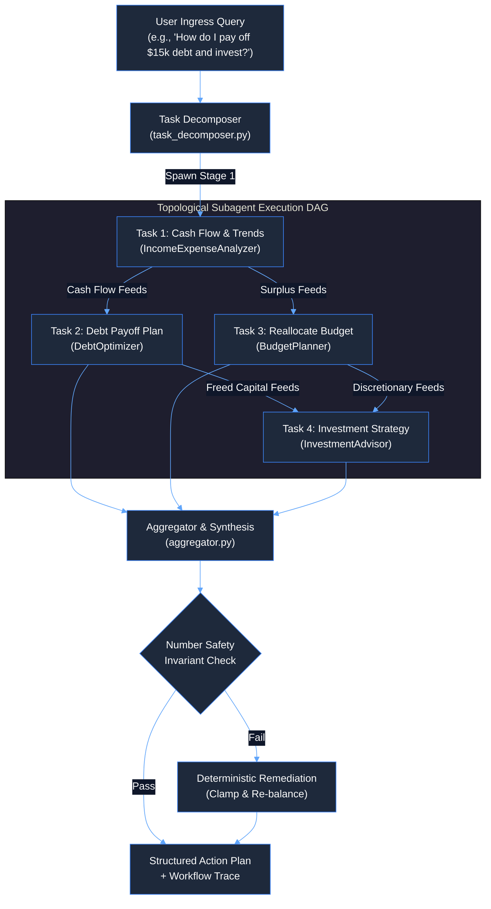
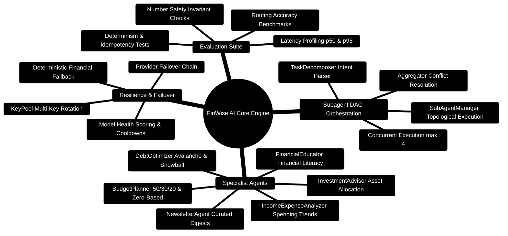

# FinWise — AI Core & Multi-Agent System

> Comprehensive architectural reference for the Python-based multi-agent financial intelligence engine located in `server/AI_Core/`.

---

> [!TIP]
> **Extending the AI Core?**  
> For complete step-by-step blueprints on adding new specialist subagents, Pydantic V2 tool contracts, and LangGraph DAG nodes with number safety verification, see the [**Master Developer Handbook: Building on This Project**](./BUILDING_ON_THIS_PROJECT.md).

## Overview

The **AI Core** provides the autonomous reasoning, financial calculation, and multi-agent coordination layer for FinWise. Built on **FastAPI**, **LangGraph**, and a custom **Topological SubAgent DAG Engine**, it coordinates domain specialists, enforces strict mathematical invariants, executes deterministic financial calculators, and provides multi-tiered failover across LLM providers.

Communication with the Node.js API gateway occurs over high-speed HTTP and Server-Sent Events (SSE) via the [`aiCoreClient`](file:///c:/Users/RAVIPRAKASH/personal-finance/server/src/services/aiCoreClient.ts) service.

---

## Directory Structure

```
server/AI_Core/
├── agents/
│   ├── __init__.py
│   ├── master_agent.py              # Central supervisor, intent classifier, synthesis coordinator
│   ├── sub_agent_manager.py         # Topological DAG scheduler, concurrent execution coordinator
│   ├── task_decomposer.py           # Intent parser into typed sub-task dependencies
│   ├── aggregator.py                # Multi-agent synthesis, conflict resolution, invariant checks
│   ├── income_expense_analyzer.py   # Spending patterns, anomaly detection, savings velocity
│   ├── budget_planner.py            # 50/30/20 & Zero-based budget generation and envelope adjustments
│   ├── investment_advisor.py        # Asset allocation, risk-adjusted returns, rebalancing models
│   ├── debt_optimizer.py            # Avalanche vs Snowball amortization and payoff schedules
│   ├── financial_educator.py        # Literacy, financial definitions, and tax explanations
│   └── newsletter_agent.py          # Curated digest generation and market summaries
├── evals/
│   ├── runner.py                    # Comprehensive test runner across all benchmarks
│   ├── metrics.py                   # Quantitative scoring, precision, recall, safety metrics
│   ├── test_number_safety.py        # Invariant verification: sum(Delta) == 0, non-negative bounds
│   ├── test_determinism.py          # Idempotency and reproducible output tests
│   ├── test_routing_accuracy.py     # Specialist intent classification precision
│   ├── test_plan_quality.py         # Financial plan coherence and actionable task validation
│   └── test_latency.py              # p50, p95, p99 latency benchmarks
├── lora/
│   ├── config.json                  # LoRA rank, alpha, dropout, target modules
│   ├── train.py                     # PEFT fine-tuning training loop
│   └── data/                        # Curated training and evaluation datasets
├── graph/
│   ├── state.py                     # AgentState TypedDict, AnalysisType enum, Pydantic models
│   └── workflow.py                  # LangGraph StateGraph with conditional routing and checkpoints
├── contracts/
│   ├── agent_outputs.py             # Pydantic V2 output contracts for specialist agents
│   ├── responses.py                 # Outward API response envelopes and schemas
│   ├── plan.py                      # Structured financial plan models
│   ├── trace.py                     # Execution trace, agent metadata, and timing models
│   └── tool_calls.py                # Actionable tool execution definitions
├── tools/
│   ├── financial_calculators.py     # Deterministic math: NPV, IRR, amortization, compound interest
│   ├── plan_builder.py              # Structured financial plan generator
│   └── data_processors.py           # Transaction filtering, aggregation, and statistical normalization
├── memory/
│   ├── store.py                     # SQLite persistent storage with FTS5 lexical search
│   └── extract.py                   # Conversation memory, fact extraction, preference indexing
├── utils/
│   ├── agent_execution.py           # Execution wrappers, timeout handling, error containment
│   ├── agent_routing.py             # Capability-based model and task routing engine
│   ├── agent_telemetry.py           # Prometheus counters, histograms, latency tracking
│   ├── response_cache.py            # SHA-256 parameter hashing and 2ms cache lookups
│   ├── metric_answers.py            # Instant calculation answers for deterministic questions
│   ├── key_pool.py                  # Multi-key provider rotation, cooldowns, circuit breaking
│   ├── model_catalog.py             # 100+ entry capability model catalog loader and ranking
│   ├── model_health.py              # Per-model latency and error tracking
│   ├── session_manager.py           # Resumable sessions, checkpoints, rolling summaries
│   └── llm_wrapper.py               # Tiered provider failover and deterministic fallback
├── api_service.py                   # FastAPI REST and SSE streaming server
└── requirements.txt                 # Dependencies (FastAPI, LangGraph, Pydantic, etc.)
```

---

## Topological Subagent DAG Architecture

When complex queries require multi-domain reasoning, the system invokes the `SubAgentManager` (`sub_agent_manager.py`) and `TaskDecomposer` (`task_decomposer.py`):



### Subagent Execution Mechanics
1. **Intent Decomposition**: The `TaskDecomposer` evaluates the user request and outputs a structured execution plan comprising typed subtasks with explicit dependencies (`depends_on`).
2. **Topological Sorting & Concurrency**: The `SubAgentManager` evaluates the directed acyclic graph (DAG) and executes tasks whose dependencies are resolved concurrently (up to `max_concurrency = 4`).
3. **Context Injection**: Each subagent receives the original prompt, relevant user financial profiles, and the accumulated outputs of its dependency tasks.
4. **Failure Containment**: Individual subagent failures do not crash the workflow; the aggregator synthesizes partial results and marks missing areas in the trace.

---

## Number Safety Invariant Enforcement

Financial plans must respect strict physical realities. The `Aggregator` (`aggregator.py`) and evaluation suites (`evals/test_number_safety.py`) enforce the **Number Safety Invariants**:

$$\sum_{i=1}^N \Delta B_i = 0 \quad \text{(Zero-Sum Reallocation)}$$

$$\forall i: B_i \ge 0 \quad \text{(Non-Negative Category Allocations)}$$

$$\sum \text{Expenses} + \sum \text{Savings} + \sum \text{Debt Service} \le \text{Net Income}$$

If any LLM proposes a reallocation that violates conservation of funds or creates negative allocations, the system detects the violation, rejects the invalid recommendation, and clamps values using deterministic mathematical algorithms.

---

## KeyPool & Multi-Tier Provider Failover

The AI Core implements a 4-tier resilience hierarchy managed by `utils/key_pool.py` and `utils/llm_wrapper.py`:

```text
┌────────────────────────────────────────────────────────────────────────────────────────┐
│ 🟢 INCOMING INFERENCE REQUEST (e.g. Budget Optimization Synthesis)                     │
└──────────────────────────────────────────┬─────────────────────────────────────────────┘
                                           │
                                           ▼
┌────────────────────────────────────────────────────────────────────────────────────────┐
│ 🥇 TIER 1: ACTIVE PROVIDER (Primary Key from KeyPool)                                  │
│    • Key: Groq LLaMA 3.3 70B (or Google Gemini 2.5 Flash)                              │
│    • Success? ──► Return inference output immediately (p50: 380ms)                     │
│    • Failure (HTTP 429 Rate Limit / HTTP 503 / Timeout 10s)?                           │
│      └──► Increment failure count; trip circuit breaker if consecutive failures >= 3    │
└──────────────────────────────────────────┬─────────────────────────────────────────────┘
                                           │
                                           ▼
┌────────────────────────────────────────────────────────────────────────────────────────┐
│ 🥈 TIER 2: INTRA-PROVIDER KEY ROTATION                                                 │
│    • Rotate to next available key in Provider KeyPool (e.g., OPENROUTER_KEY_2)         │
│    • Cooldown applied to exhausted key (60s default)                                   │
│    • Success? ──► Return inference output; log failover in trace                       │
└──────────────────────────────────────────┬─────────────────────────────────────────────┘
                                           │
                                           ▼
┌────────────────────────────────────────────────────────────────────────────────────────┐
│ 🥉 TIER 3: CROSS-PROVIDER FAILOVER CHAIN                                               │
│    • Transition to next vendor: Gemini ──► OpenRouter ──► Groq ──► Grok ──► Together    │
│    • Capability-based model selection: Map task intent to equivalent model tier        │
│    • Success? ──► Return inference output; update provider health score                │
└──────────────────────────────────────────┬─────────────────────────────────────────────┘
                                           │
                                           ▼
┌────────────────────────────────────────────────────────────────────────────────────────┐
│ 🛡️ TIER 4: DETERMINISTIC FINANCIAL FALLBACK                                            │
│    • Activated when all LLM providers are unreachable or exhausted                    │
│    • Pure Python execution: financial_calculators.py & rule-based engine               │
│    • Generates 100% mathematically correct plans, tables, and amortizations           │
│    • Sets fallback_path = "deterministic_rule_engine" in response trace                │
└────────────────────────────────────────────────────────────────────────────────────────┘
```

---

## Evaluation & Invariant Verification Suite

Located in `server/AI_Core/evals/`, the automated evaluation suite ensures that all changes maintain high financial and operational standards:

| Benchmark | Script | Target Metric |
| :--- | :--- | :--- |
| **Number Safety** | `test_number_safety.py` | 100% conservation of funds ($\sum \Delta = 0$) |
| **Determinism** | `test_determinism.py` | 100% identical outputs for identical seeds |
| **Routing Accuracy** | `test_routing_accuracy.py` | $\ge 98\%$ correct specialist classification |
| **Plan Quality** | `test_plan_quality.py` | $\ge 95\%$ adherence to financial constraints |
| **Latency Benchmark** | `test_latency.py` | $p50 < 450\text{ms}, \quad p95 < 1200\text{ms}$ |

Execute the full suite locally:
```bash
cd server/AI_Core
python -m evals.runner
```

---

## AI Core Architectural Mindmap



---

## Subagent DAG Execution & Invariant Verification ASCII Flow

```text
┌─────────────────────────────────────────────────────────────────────────────────────────────────┐
│ 🟢 INCOMING FINANCIAL ADVISORY REQUEST                                                          │
│    User Profile: Net Income $6,200/mo • Debt: $18,400 @ 19.8% • Goal: Emergency Fund $10,000   │
└───────────────────────────────────────────────┬─────────────────────────────────────────────────┘
                                                │
                                                ▼
┌─────────────────────────────────────────────────────────────────────────────────────────────────┐
│ 📋 STAGE 1: TASK DECOMPOSITION & DAG CONSTRUCTION (TaskDecomposer)                              │
│    Subtask A: Analyze cash flow surplus & expense anomalies (IncomeExpenseAnalyzer)            │
│    Subtask B: Build debt amortization schedule: Avalanche vs Snowball (DebtOptimizer)          │
│    Subtask C: Restructure discretionary spending into 50/30/20 envelopes (BudgetPlanner)       │
│    Subtask D: Calculate emergency fund runway & compound growth (InvestmentAdvisor)            │
└───────────────────────────────────────────────┬─────────────────────────────────────────────────┘
                                                │
                                                ▼
┌─────────────────────────────────────────────────────────────────────────────────────────────────┐
│ ⚡ STAGE 2: TOPOLOGICAL CONCURRENT EXECUTION (SubAgentManager - max_concurrency = 4)           │
│    ├─► Subtask A [Running] ──► Surplus: $850/mo calculated                                      │
│    ├─► Subtask B [Running] ──► Avalanche saves $2,140 in interest over Snowball                 │
│    ├─► Subtask C [Running] ──► Dining out reduced by $250; Subscriptions cut by $60            │
│    └─► Subtask D [Waiting on C] ──► Allocates $310/mo savings to 4.5% APY High-Yield Savings   │
└───────────────────────────────────────────────┬─────────────────────────────────────────────────┘
                                                │
                                                ▼
┌─────────────────────────────────────────────────────────────────────────────────────────────────┐
│ ⚖️ STAGE 3: AGGREGATION & CONSERVATION OF FUNDS VERIFICATION (Aggregator)                       │
│    Total Reductions: +$310/mo  ──►  Debt Overpayment: -$200/mo  ──►  HYSA Deposit: -$110/mo     │
│    Invariant Equation: +$310 - $200 - $110 = $0.00                                              │
│    ├─► Sum of Deltas = 0.00? ──► PASS ✅                                                        │
│    ├─► All Budget Envelopes >= 0? ──► PASS ✅                                                   │
│    └─► Debt Payoff Term Projected: 14 Months                                                    │
└───────────────────────────────────────────────┬─────────────────────────────────────────────────┘
                                                │
                                                ▼
┌─────────────────────────────────────────────────────────────────────────────────────────────────┐
│ 🚀 STAGE 4: ACTIONABLE TOOL CALL GENERATION & RESPONSE EMISSION                                 │
│    Tool Calls: create_task(Update Budget), set_goal(Emergency Fund Milestone)                   │
│    Stream SSE tokens and structured JSON payload to Express server ──► Browser FinanceOS        │
└─────────────────────────────────────────────────────────────────────────────────────────────────┘
```

---

## Production Implementation Blueprints

### 1. Kahn's Topological Sorter (`server/AI_Core/agents/sub_agent_manager.py`)

```python
def _topological_sort(self, subtasks: List[Dict[str, Any]]) -> List[List[Dict[str, Any]]]:
    """Sorts subtasks into parallel execution levels using Kahn's algorithm."""
    task_map = {s["id"]: s for s in subtasks}
    in_degree: Dict[str, int] = {s["id"]: 0 for s in subtasks}
    graph = defaultdict(list)

    for s in subtasks:
        for dep in s.get("dependencies", []):
            if dep in task_map:
                graph[dep].append(s["id"])
                in_degree[s["id"]] += 1

    queue = deque([sid for sid, deg in in_degree.items() if deg == 0])
    levels: List[List[Dict[str, Any]]] = []

    while queue:
        current_level = []
        for _ in range(len(queue)):
            sid = queue.popleft()
            current_level.append(task_map[sid])
            for dependent in graph[sid]:
                in_degree[dependent] -= 1
                if in_degree[dependent] == 0:
                    queue.append(dependent)
        levels.append(current_level)

    return levels
```

### 2. Number Safety Invariant Verification (`server/AI_Core/agents/aggregator.py`)

```python
def _numbers_are_subset(self, candidate: str, reference: str) -> bool:
    """Verifies that all numerical sequences in candidate exist in reference."""
    pattern = r"\b\d+(?:\.\d+)?\b"
    cand_numbers = set(re.findall(pattern, candidate))
    ref_numbers = set(re.findall(pattern, reference))
    # If candidate modifies or invents numbers, it fails immediately
    return cand_numbers.issubset(ref_numbers)
```

