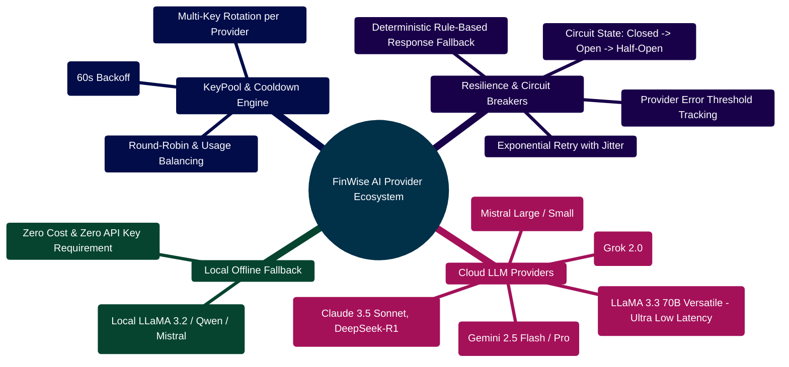

# FinWise — AI Providers, KeyPool & Multi-Tier Failover

> **Comprehensive Engineering Guide to AI Vendor Selection, Key Pools, Circuit Breakers, and Failover Architecture**  
> *Gemini, OpenRouter, Groq, xAI, Together, Mistral, Local vLLM, and Deterministic Pure Python Calculators*  
> **Runtime Target:** Python `3.11+` · FastAPI `0.115` · LangGraph `0.2.53` · Pydantic V2 `2.10`

---

> [!TIP]
> **Developer Guide: Building & Extending on This Project**  
> For complete step-by-step blueprints, Mongoose models, Zod schemas, Express controllers, React hooks, and LangGraph subagents, see the [**Master Developer Handbook: Building on This Project**](./BUILDING_ON_THIS_PROJECT.md).

## 1. AI Provider Ecosystem Mindmap



---

## 2. Dynamic Provider Resolution & Failover ASCII Flow

```text
┌─────────────────────────────────────────────────────────────────────────────────────────────────┐
│ 🟢 INCOMING INFERENCE REQUEST (LangGraph Node Execution)                                        │
│    Target Task: Budget Analysis / Debt Modeling / Recommendation                                │
└───────────────────────────────────────────────┬─────────────────────────────────────────────────┘
                                                │
                                                ▼
┌─────────────────────────────────────────────────────────────────────────────────────────────────┐
│ 🔍 STEP 1: RESOLVE CANDIDATE PROVIDERS (Ranked Priority Order)                                  │
│    Priority: [1] Gemini ──► [2] OpenRouter ──► [3] Groq ──► [4] xAI ──► [5] Local Ollama        │
└───────────────────────────────────────────────┬─────────────────────────────────────────────────┘
                                                │
                                                ▼
┌─────────────────────────────────────────────────────────────────────────────────────────────────┐
│ 🛡️ STEP 2: CHECK CIRCUIT BREAKER & KEY POOL HEALTH                                              │
│    ├─► Is Provider Circuit OPEN?                                                                │
│    │   ├── YES ──► Skip to next provider in chain ⏩                                            │
│    │   └── NO ──► Check KeyPool for available healthy API Key                                   │
│    └─► Any keys outside cooldown period?                                                        │
│        ├── NO ──► Trip circuit temporarily; try next provider                                   │
│        └── YES ──► Borrow active key with Lease Token                                           │
└───────────────────────────────────────────────┬─────────────────────────────────────────────────┘
                                                │
                                                ▼
┌─────────────────────────────────────────────────────────────────────────────────────────────────┐
│ 🚀 STEP 3: DISPATCH CALL WITH TIMEOUT (e.g. 10s budget)                                         │
│    ├── HTTP 200 SUCCESS ──► Validate Pydantic JSON Schema                                       │
│    │   ├── Schema Valid? ──► Return Output & Update Metrics 🟢                                  │
│    │   └── Schema Error? ──► Treat as parse failure 🔴                                          │
│    └── HTTP 429 / 5xx / TIMEOUT ──► Mark Key in Cooldown                                        │
│        ├── Record provider error count in Prometheus                                            │
│        └── Fall through to NEXT PROVIDER in Priority Chain 🟡                                   │
└───────────────────────────────────────────────┬─────────────────────────────────────────────────┘
                                                │ (All Cloud Providers Exhausted)
                                                ▼
┌─────────────────────────────────────────────────────────────────────────────────────────────────┐
│ 🟣 STEP 4: OFFLINE OLLAMA OR DETERMINISTIC RULE ENGINE                                          │
│    ├─► Invoke local Ollama endpoint (http://localhost:11434)                                    │
│    └─► Fallback: Calculate deterministic financial formulas (Python)                            │
│        └── Return structured safety-guaranteed advice payload 🟢                                │
└─────────────────────────────────────────────────────────────────────────────────────────────────┘
```

---

## 3. How Provider Selection Works

The AI Core resolves the active provider through an adaptive priority hierarchy (`server/AI_Core/utils/provider_registry.py` and `llm_wrapper.py`):

1. **Explicit Override**: `LLM_PROVIDER` environment variable if explicitly configured.
2. **Configured Priority**: The first healthy provider in `LLM_PROVIDER_PRIORITY`.
3. **Canonical Default Order**:
   $$\text{gemini} \longrightarrow \text{openrouter} \longrightarrow \text{groq} \longrightarrow \text{grok} \longrightarrow \text{together} \longrightarrow \text{mistral}$$

Example configuration in `server/AI_Core/.env`:
```env
LLM_PROVIDER=openrouter
LLM_PROVIDER_PRIORITY=openrouter,gemini,groq,grok,together,mistral
```

---

## 4. Multi-Key KeyPools & Rate-Limit Cooldowns

The AI Core supports multiple API keys per provider to handle high-concurrency workloads and free-tier quotas.

### Key Pool Specification
- **Single Key**: `GEMINI_API_KEY=AIzaSy...`
- **Indexed Keys**: `GEMINI_API_KEY_1=...`, `GEMINI_API_KEY_2=...`, `GEMINI_API_KEY_3=...`
- **Array / Comma Form**: `GEMINI_API_KEYS="key_alpha,key_beta,key_gamma"`

### Automatic Cooldown & Failover Strategy
- When an API key receives an `HTTP 429 (Too Many Requests)`, the key is quarantined with a cooldown timestamp ($t_{\text{cooldown}} = 60\text{s}$).
- The KeyPool immediately leases the next available healthy key.
- If all keys for a provider are exhausted, the provider trips its **Circuit Breaker** and fails over to the next vendor.

---

## 5. Concrete Implementation Blueprints

### Blueprint 1: KeyPool Lease & Health Tracker (`server/AI_Core/utils/key_pool.py`)

```python
import time
import threading
from enum import Enum
from typing import List, Optional

class CircuitState(str, Enum):
    CLOSED = "closed"        # Healthy, taking traffic
    OPEN = "open"            # Failing, in cooldown quarantine
    HALF_OPEN = "half_open"  # Trial request to verify recovery

class KeyPool:
    def __init__(self, provider: str, keys: List[str], cooldown_seconds: float = 60.0):
        self.provider = provider
        self.keys = keys
        self.cooldown_seconds = cooldown_seconds
        self.key_cooldowns = {k: 0.0 for k in keys}
        self.circuit_state = CircuitState.CLOSED
        self.consecutive_failures = 0
        self.last_state_change = time.time()
        self._lock = threading.Lock()
        self._index = 0

    def get_key(self) -> Optional[str]:
        now = time.time()
        with self._lock:
            # Check circuit breaker recovery
            if self.circuit_state == CircuitState.OPEN:
                if (now - self.last_state_change) > self.cooldown_seconds:
                    self.circuit_state = CircuitState.HALF_OPEN
                else:
                    return None

            # Find healthy keys not in cooldown
            healthy_keys = [k for k in self.keys if self.key_cooldowns[k] <= now]
            if not healthy_keys:
                return None

            # Round-robin selection
            selected = healthy_keys[self._index % len(healthy_keys)]
            self._index += 1
            return selected

    def mark_rate_limited(self, key: str):
        with self._lock:
            self.key_cooldowns[key] = time.time() + self.cooldown_seconds
            self.consecutive_failures += 1
            if self.consecutive_failures >= len(self.keys):
                self.circuit_state = CircuitState.OPEN
                self.last_state_change = time.time()

    def mark_success(self, key: str):
        with self._lock:
            self.consecutive_failures = 0
            if self.circuit_state == CircuitState.HALF_OPEN:
                self.circuit_state = CircuitState.CLOSED
```

---

### Blueprint 2: Deterministic Python Fallback (`server/AI_Core/tools/financial_calculators.py`)

```python
from decimal import Decimal, ROUND_HALF_UP

def calculate_amortization_schedule(principal: float, annual_rate: float, months: int) -> dict:
    """Calculates pure mathematical closed-form debt amortization."""
    P = Decimal(str(principal))
    r = Decimal(str(annual_rate)) / Decimal("12")
    n = Decimal(str(months))

    if r == Decimal("0"):
        monthly_payment = (P / n).quantize(Decimal("0.01"), rounding=ROUND_HALF_UP)
    else:
        # Standard annuity formula: M = P * [r(1+r)^n] / [(1+r)^n - 1]
        factor = (Decimal("1") + r) ** n
        monthly_payment = (P * (r * factor) / (factor - Decimal("1"))).quantize(Decimal("0.01"), rounding=ROUND_HALF_UP)

    total_payment = monthly_payment * n
    total_interest = total_payment - P

    return {
        "monthly_payment": float(monthly_payment),
        "total_payment": float(total_payment),
        "total_interest": float(total_interest),
        "months": months
    }
```

---

## 6. Testing KeyPool & Failover

Execute the dedicated test suites to verify resilience and failover behavior:

```bash
cd server/AI_Core
pytest tests/test_key_pool.py -v
pytest tests/test_llm_wrapper.py -v
pytest tests/test_provider_usage.py -v
```
