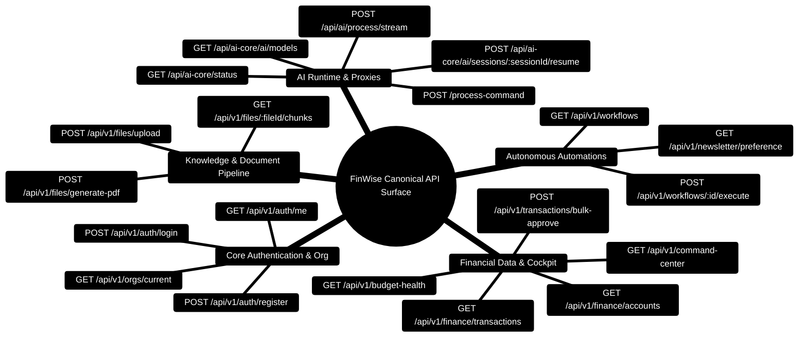

# Personal Finance — REST API Reference

> Complete reference for the Personal Finance backend API. All protected endpoints require a valid JWT token in the `Authorization: Bearer <token>` header or a valid API key.

> **vNext Migration**: The canonical API surface is `/api/v1`. Legacy `/api` routes remain available during the deprecation window and include an `X-API-Deprecation` header.

---

> [!TIP]
> **Developer Guide: Building & Extending on This Project**  
> For complete step-by-step blueprints, Mongoose models, Zod schemas, Express controllers, React hooks, and LangGraph subagents, see the [**Master Developer Handbook: Building on This Project**](./BUILDING_ON_THIS_PROJECT.md).

## Base URL

```
Development: http://localhost:3000
Production:  https://<your-domain>/api
```

All versioned endpoints are prefixed with `/api/v1`.

---

## API Surface Topology Mindmap



---

## API Gateway Request Pipeline ASCII Flow

```text
  Client Request (Browser / External Tool)
        │
        ▼
  ┌─────────────────────────────────────────────────────────────┐
  │ 1. Edge Guards: Helmet CSP • CORS • Rate Limiter (200 req)  │
  └─────────────────────────────┬───────────────────────────────┘
                                │
                                ▼
  ┌─────────────────────────────────────────────────────────────┐
  │ 2. Authentication: authAny (JWT Bearer OR Peppered API Key) │
  └─────────────────────────────┬───────────────────────────────┘
                                │
                                ▼
  ┌─────────────────────────────────────────────────────────────┐
  │ 3. Tenant Boundary: orgContext Middleware ({ orgId })       │
  └─────────────────────────────┬───────────────────────────────┘
                                │
                                ▼
  ┌─────────────────────────────────────────────────────────────┐
  │ 4. Validation: Zod v4 Schemas with Strict Error Mapping     │
  └─────────────────────────────┬───────────────────────────────┘
                                │
                                ▼
  ┌─────────────────────────────────────────────────────────────┐
  │ 5. Execution: Business Service OR AI Core Proxy (/process)  │
  └─────────────────────────────┬───────────────────────────────┘
                                │
                                ▼
  ┌─────────────────────────────────────────────────────────────┐
  │ 6. Response: Standardized ApiResponse envelope { success }  │
  └─────────────────────────────────────────────────────────────┘
```

---

## AI Runtime And Chat Orchestration

FinWise now exposes both Node-level AI endpoints and proxied AI Core operational endpoints.

### Node server AI endpoints

| Endpoint | Purpose |
| --- | --- |
| `POST /process-command` | Run a structured AI command through the Node server and AI Core |
| `POST /api/ai/process/stream` | Stream AI responses and workflow progress |
| `GET /api/ai-core/status` | Aggregated Node + AI Core health snapshot |
| `GET /api/ai-core/ai/status` | Detailed AI Core status, key pools, model health, sessions |
| `GET /api/ai-core/ai/models` | Proxied model catalog listing |
| `GET /api/ai-core/ai/sessions` | Proxied resumable AI sessions list |
| `GET /api/ai-core/ai/sessions/:sessionId` | Proxied AI session detail |
| `POST /api/ai-core/ai/sessions/:sessionId/resume` | Resume a paused or interrupted AI session |

### AI response metadata

Recent AI responses may now include:

- `session_id`
- `session_status`
- `workflow_phase`
- `active_provider`
- `active_model`
- `active_key_id`
- `fallback_path`
- `recovered_failures`
- `recovered_from_checkpoint`

This metadata is used by the chat UI to display session continuity, failover visibility, and active model/provider status.

---

## Authentication

### `POST /api/v1/auth/register`

Register a new user account.

| Field      | Type   | Required |
| ---------- | ------ | -------- |
| `email`    | string | ✅       |
| `password` | string | ✅       |
| `name`     | string | ✅       |

### `POST /api/v1/auth/login`

Authenticate and receive a JWT token. Returns `{ twoFactorEnabled: true }` if 2FA is active.

### `POST /api/v1/auth/verify-email`

Verify email address with a token sent via email.

### `POST /api/v1/auth/forgot-password`

Request a password reset email.

### `POST /api/v1/auth/reset-password`

Reset password with a valid reset token.

### `GET /api/v1/auth/google`

Initiate Google OAuth2 sign-in flow.

### `GET /api/v1/auth/google/callback`

Google OAuth2 callback handler.

### `GET /api/v1/auth/me`

🔒 Returns the authenticated user's profile (includes `authProvider`, `isEmailVerified`, `phoneNumber`).

### `PUT /api/v1/auth/profile`

🔒 Update the authenticated user's profile (name, phone, etc.).

### `POST /api/v1/auth/password`

🔒 Change the authenticated user's password (requires `currentPassword` and `newPassword`).

---

## Two-Factor Authentication (2FA)

### `POST /api/v1/auth/2fa/setup`

🔒 Generate TOTP secret and provisioning URI for QR code scanning.

### `POST /api/v1/auth/2fa/verify`

🔒 Verify a TOTP code to enable 2FA (on setup) or complete login (on auth).

### `POST /api/v1/auth/2fa/disable`

🔒 Disable 2FA (requires valid TOTP code or backup code).

### `GET /api/v1/auth/2fa/status`

🔒 Check whether 2FA is enabled for the authenticated user.

---

## Global Search

### `GET /api/v1/search`

🔒 Full-text search across transactions, tasks, and financial data.

| Query Param | Type   | Description           |
| ----------- | ------ | --------------------- |
| `q`         | string | Search query string   |
| `limit`     | number | Max results to return |

---

## Category Rules

### `GET /api/v1/category-rules`

🔒 List auto-categorization rules.

### `POST /api/v1/category-rules`

🔒 Create a new category rule.

### `PATCH /api/v1/category-rules/:id`

🔒 Update a category rule.

### `DELETE /api/v1/category-rules/:id`

🔒 Delete a category rule.

---

## Calendar Reminders

### `GET /api/v1/calendar-reminders`

🔒 List reminders for the current user, optionally filtered by date range.

| Query Param | Type   | Description             |
| ----------- | ------ | ----------------------- |
| `from`      | string | Start date (YYYY-MM-DD) |
| `to`        | string | End date (YYYY-MM-DD)   |

### `POST /api/v1/calendar-reminders`

🔒 Create a new calendar reminder.

| Field         | Type   | Required        |
| ------------- | ------ | --------------- |
| `date`        | string | ✅ (YYYY-MM-DD) |
| `title`       | string | ✅              |
| `description` | string |                 |

### `PATCH /api/v1/calendar-reminders/:id/toggle`

🔒 Toggle a reminder’s completion status.

### `DELETE /api/v1/calendar-reminders/:id`

🔒 Delete a calendar reminder.

---

## Organizations

### `GET /api/v1/orgs/me`

🔒 List organizations the current user belongs to.

### `POST /api/v1/orgs`

🔒 Create a new organization.

### `POST /api/v1/orgs/:orgId/members`

🔒 Add a member to an organization.

### `PATCH /api/v1/orgs/:orgId/settings`

🔒 Update organization settings.

### `POST /api/v1/org-invites/accept`

🔒 Accept an organization invite.

---

## API Keys

### `GET /api/v1/api-keys`

🔒 List API keys for the current user.

### `POST /api/v1/api-keys`

🔒 Create a new API key.

### `POST /api/v1/api-keys/:id/revoke`

🔒 Revoke an API key.

---

## Financial Data

### `GET /api/v1/financial-data/profile`

🔒 Get the user's complete financial profile.

### `PUT /api/v1/financial-data/profile`

🔒 Update the financial profile.

### `GET /api/v1/financial-data/transactions`

🔒 List transactions with pagination, filtering, and sorting.

| Query Param | Type     | Description         |
| ----------- | -------- | ------------------- |
| `page`      | number   | Page number         |
| `limit`     | number   | Items per page      |
| `category`  | string   | Filter by category  |
| `startDate` | ISO date | Start of date range |
| `endDate`   | ISO date | End of date range   |

### `POST /api/v1/financial-data/transactions`

🔒 Create a new transaction.

### `PATCH /api/v1/financial-data/transactions/:id`

🔒 Update a transaction.

### `DELETE /api/v1/financial-data/transactions/:id`

🔒 Delete a transaction.

### `GET /api/v1/financial-data/monthly-close/:periodKey`

🔒 Get month-close summary for a given period (e.g., `2024-01`).

### `POST /api/v1/financial-data/monthly-close/:periodKey/close`

🔒 Close a month and generate the period summary.

---

## Finance Module

### `GET /api/v1/finance/accounts`

🔒 List user's financial accounts.

### `POST /api/v1/finance/accounts`

🔒 Create a financial account.

### `PATCH /api/v1/finance/accounts/:id`

🔒 Update an account.

### `GET /api/v1/finance/merchants`

🔒 List merchants with optional search.

### `POST /api/v1/finance/merchants`

🔒 Create or update a merchant.

### `GET /api/v1/finance/budgets/:periodKey/allocations`

🔒 Get budget allocations for a period.

### `PUT /api/v1/finance/budgets/:periodKey/allocations`

🔒 Upsert budget allocations.

### `GET /api/v1/finance/budgets/:periodKey/envelopes`

🔒 Get budget envelope breakdown for a period (actual vs. allocated).

### `GET /api/v1/finance/recurring/candidates`

🔒 Detect recurring transaction candidates from transaction history.

### `GET /api/v1/finance/recurring`

🔒 List recurring transaction rules.

### `POST /api/v1/finance/recurring`

🔒 Create a recurring rule.

### `PATCH /api/v1/finance/recurring/:id`

🔒 Update a recurring rule.

### `GET /api/v1/finance/forecast`

🔒 Generate a forward-looking financial forecast.

---

## AI & Insights

### `POST /api/v1/ai/command`

🔒 Process an AI command (synchronous response).

### `POST /api/v1/ai/stream`

🔒 Process an AI command with streaming response (SSE).

### `POST /api/v1/ai/scenario`

🔒 Run a what-if financial scenario.

### `POST /api/v1/ai/insights`

🔒 Generate AI-powered financial insights.

### `POST /api/v1/ai/financial-story`

🔒 Generate a narrative financial story.

### `POST /api/v1/ai/handwriting`

🔒 OCR processing for handwritten receipts/notes.

---

## Chat

### `GET /api/v1/chat/sessions`

🔒 List chat sessions.

### `POST /api/v1/chat/sessions`

🔒 Create a new chat session.

### `GET /api/v1/chat/sessions/:sessionId/messages`

🔒 Get messages for a session.

### `POST /api/v1/chat/sessions/:sessionId/messages`

🔒 Send a message (triggers AI response via streaming).

### `DELETE /api/v1/chat/sessions/:sessionId`

🔒 Delete a chat session.

---

## Tasks

### `GET /api/v1/tasks`

🔒 List AI-generated financial tasks.

### `POST /api/v1/tasks`

🔒 Create a task.

### `PATCH /api/v1/tasks/:id`

🔒 Update task status.

### `POST /api/v1/tasks/:id/apply`

🔒 Apply a task's recommended action.

---

## Workflows

### `GET /api/v1/workflows`

🔒 List organization workflows.

### `POST /api/v1/workflows`

🔒 Create a new workflow.

### `POST /api/v1/workflows/:id/run`

🔒 Trigger a workflow run.

### `GET /api/v1/workflows/templates`

🔒 List available workflow templates.

---

## Receipts

### `GET /api/v1/receipts`

🔒 List receipts with pagination.

### `POST /api/v1/receipts`

🔒 Upload and OCR-process a receipt (multipart form data).

### `GET /api/v1/receipts/:id`

🔒 Get a single receipt with extracted data.

---

## Exports

### `GET /api/v1/exports`

🔒 List export jobs.

### `POST /api/v1/exports`

🔒 Create an export job (CSV, PDF).

### `GET /api/v1/exports/:id`

🔒 Get export job status.

### `GET /api/v1/exports/:id/download`

🔒 Download the generated export file.

---

## Autopilot

### `POST /api/v1/autopilot/plan`

🔒 Create an autopilot financial plan.

### `POST /api/v1/autopilot/simulate`

🔒 Simulate an autopilot run.

### `POST /api/v1/autopilot/approve`

🔒 Approve an autopilot run for execution.

### `POST /api/v1/autopilot/execute`

🔒 Execute an approved autopilot run.

### `GET /api/v1/autopilot/runs/:id`

🔒 Get autopilot run details.

---

## Tools

### `POST /api/v1/tools/simulate`

🔒 Simulate a financial tool action.

### `POST /api/v1/tools/execute`

🔒 Execute a financial tool action.

---

## Analytics

### `GET /api/v1/analytics/overview`

🔒 Get analytics overview with transaction summaries and trends.

---

## Blogs & Growth Stories

### `GET /api/v1/blogs`

List published blog posts.

### `GET /api/v1/blogs/:slug`

Get a single blog post by slug.

### `GET /api/v1/growth-stories`

List published growth stories.

### `GET /api/v1/growth-stories/:slug`

Get a single growth story by slug.

---

## Billing & Monetization

### `POST /api/v1/billing/checkout`

🔒 Create a Stripe checkout session.

### `GET /api/v1/billing/portal`

🔒 Generate a Stripe customer portal link.

### `POST /api/v1/billing/webhook`

Stripe webhook handler (no auth — verified by Stripe signature).

### `GET /api/v1/usage/ledger`

🔒 Get detailed usage ledger entries.

---

## Integrations

### `GET /api/v1/integrations`

🔒 List all integration connections.

### `POST /api/v1/integrations/:id/connect`

🔒 Connect an integration.

### `POST /api/v1/integrations/:id/disconnect`

🔒 Disconnect an integration.

### `POST /api/v1/integrations/:id/sync`

🔒 Trigger a data sync for an integration.

### `GET /api/v1/integrations/:id/history`

🔒 Get sync history.

### `GET /api/v1/integrations/:id/health`

🔒 Check integration health status.

### `GET /api/v1/integrations/health-summary`

🔒 Get connector health summary for all integrations in the org.

### `POST /api/v1/integrations/transactions_csv/import`

🔒 Import transactions via CSV upload (multipart form data).

---

## Marketplace & Plugins

### `GET /api/v1/marketplace/catalog`

🔒 Browse available marketplace plugins.

### `POST /api/v1/marketplace/install`

🔒 Install a marketplace plugin.

### `GET /api/v1/plugins`

🔒 List installed plugins.

### `POST /api/v1/plugins/:id/update`

🔒 Update an installed plugin's configuration.

### `POST /api/v1/plugins/:id/uninstall`

🔒 Uninstall a marketplace plugin.

### `POST /api/v1/plugins/validate-manifest`

🔒 Validate a plugin manifest against the permission schema.

---

## Shares

### `POST /api/v1/shares/financial-story`

🔒 Create a public share link for a financial story.

---

## Referrals

### `GET /api/v1/referrals/me`

🔒 Get the current user's referral code.

### `POST /api/v1/referrals/redeem`

🔒 Redeem a referral code.

---

## Notifications & Events

### `GET /api/v1/notifications`

🔒 List notifications.

### `POST /api/v1/notifications/:id/read`

🔒 Mark a notification as read.

### `GET /api/v1/events/stream`

🔒 Server-Sent Events (SSE) stream for real-time updates.

---

## Activity Feed

### `GET /api/v1/activity/feed`

🔒 Get the organization activity feed with recent actions and events.

| Query Param | Type   | Description           |
| ----------- | ------ | --------------------- |
| `limit`     | number | Max entries to return |
| `cursor`    | string | Cursor for pagination |

---

## Comments & Annotations

### `GET /api/v1/comments`

🔒 List comments for a given target resource.

| Query Param  | Type   | Description   |
| ------------ | ------ | ------------- |
| `targetType` | string | Resource type |
| `targetId`   | string | Resource ID   |

### `POST /api/v1/comments`

🔒 Create a new comment on a resource.

### `PATCH /api/v1/comments/:id`

🔒 Update a comment.

### `DELETE /api/v1/comments/:id`

🔒 Delete a comment.

---

## Settings & Profile

### `GET /api/v1/settings/profile`

🔒 Get the current user's profile and preferences.

### `PATCH /api/v1/settings/profile`

🔒 Update user profile information.

### `PATCH /api/v1/settings/preferences`

🔒 Update user preferences (theme, notifications, etc.).

---

## Automation Events

### `GET /api/v1/automation/events`

🔒 List domain automation events.

### `POST /api/v1/automation/events/emit`

🔒 Emit a domain automation event.

---

## Feature Flags

### `GET /api/v1/feature-flags`

🔒 List feature flags.

### `PUT /api/v1/feature-flags/:key`

🔒 Upsert a feature flag value.

### `DELETE /api/v1/feature-flags/:key`

🔒 Delete a feature flag.

---

## Security Audit Log

### `GET /api/v1/security/audit-log`

🔒 Get the current user's security audit log.

| Query Param | Type   | Description                       |
| ----------- | ------ | --------------------------------- |
| `limit`     | number | Max entries (default 50, max 200) |
| `actions`   | string | Comma-separated action filter     |

### `GET /api/v1/orgs/audit-log`

🔒 Get org-wide audit log (requires org context).

| Query Param | Type   | Description                             |
| ----------- | ------ | --------------------------------------- |
| `limit`     | number | Max entries (default 100, max 500)      |
| `severity`  | string | Filter by severity (info/warn/critical) |

---

## Miscellaneous

### `GET /api/v1/audit/events`

🔒 List audit log events (operational).

### `GET /api/v1/config`

Get public application configuration.

### `GET /api/v1/media/:id`

Serve a stored media file (GridFS).

### `GET /api/v1/public/:token`

Access a publicly shared financial story (no auth required).

---

## Health & Diagnostics

### `GET /healthz`

Liveness probe (returns `ok`).

### `GET /api/test`

Returns greeting JSON (quick connectivity check).

### `GET /api/python-health`

Check Python AI Core service health.

### `GET /api/metrics`

Prometheus metrics (requires `METRICS_TOKEN` in Authorization header).

---

## Internal Tools

### `POST /api/internal/tools/execute`

🔒 Execute internal tool calls (AI agent → server tool bridge).

---

## Newsletter & Health Score

### `GET /api/v1/newsletter/preferences`

🔒 Retrieve authenticated user's newsletter delivery schedule and section toggles.

### `PUT /api/v1/newsletter/preferences`

🔒 Update newsletter preferences (delivery cadence, preferred day, included sections).

### `POST /api/v1/newsletter/preview`

🔒 Generate a sample digest preview without sending an email.

### `POST /api/v1/newsletter/send-now`

🔒 Immediately compile and dispatch the financial newsletter to user's registered email.

### `GET /api/v1/newsletter/unsubscribe/:token`

One-click unsubscribe link embedded in email footers.

### `GET /api/v1/newsletter/history`

🔒 View past newsletter generation runs and delivery timestamps.

### `GET /api/v1/finance/health-score/trend`

🔒 Retrieve composite Financial Health Score (0–100), trend direction (`improving`/`stable`/`declining`), delta, and metric breakdowns.

### `GET /api/v1/finance/health-score/chart`

🔒 Retrieve historical monthly data points for health score trend visualizations.

### `POST /api/v1/finance/health-score`

🔒 Record a new snapshot health score.

### `POST /api/v1/files/:workspaceFileId/render-pdf`

🔒 **Render Workspace Document into PDF**: Compiles an uploaded workspace text file into a styled PDF document using PDFKit, streaming directly into MongoDB GridFS.

**Headers:**
- `Authorization: Bearer <jwt>`
- `X-Org-Id: <orgId>`

**Parameters:**
- `workspaceFileId` (path, string, required): MongoDB ObjectId of the workspace file.

**Response `201 Created`:**
```json
{
  "success": true,
  "data": {
    "fileId": "6631ad02e9b8b548f029bc41",
    "filename": "quarterly_budget_audit_2026.pdf",
    "byteLength": 142850,
    "downloadUrl": "/api/v1/files/rendered/6631ad02e9b8b548f029bc41/download"
  }
}
```

---

### `POST /api/v1/files/render-prompt`

🔒 **Render Direct Text into PDF**: Renders arbitrary prompt or markdown text into a formal PDF report.

**Headers:**
- `Authorization: Bearer <jwt>`
- `X-Org-Id: <orgId>`

**Request Body:**
```json
{
  "title": "Monthly Cash Flow Statement",
  "content": "# Executive Summary\n\nMonthly surplus reached $1,450.00.\n\n## Envelopes\n- Groceries: $600\n- Rent: $1,800",
  "filenameStem": "monthly_statement_october"
}
```

**Response `201 Created`:**
```json
{
  "success": true,
  "data": {
    "fileId": "6631ad02e9b8b548f029bc42",
    "filename": "monthly_statement_october_1730412000.pdf",
    "byteLength": 89420,
    "downloadUrl": "/api/v1/files/rendered/6631ad02e9b8b548f029bc42/download"
  }
}
```

---

### `GET /api/v1/files/rendered/:fileId/download`

🔒 **Stream PDF Statement**: Streams a rendered PDF directly from MongoDB GridFS chunks with proper `Content-Type: application/pdf` and `Content-Disposition: attachment` headers.

**Headers:**
- `Authorization: Bearer <jwt>`
- `X-Org-Id: <orgId>`

**Response:** Binary PDF stream (`application/pdf`).

---

### `GET /api/v1/files/:fileId/chunks`

🔒 **Retrieve Bounded Knowledge Chunks**: Fetches all 1,800-character RAG knowledge chunks and verified page offsets associated with an uploaded document.

**Headers:**
- `Authorization: Bearer <jwt>`
- `X-Org-Id: <orgId>`

**Response `200 OK`:**
```json
{
  "success": true,
  "data": [
    {
      "_id": "6631ad02e9b8b548f029bc50",
      "chunkIndex": 0,
      "pageNumber": 1,
      "tokenCountEstimate": 420,
      "text": "FINANCIAL SERVICES AGREEMENT\nThis Agreement is entered into...",
      "sourceKind": "document"
    }
  ]
}
```

---

### `GET /api/v1/dlq/stats`

🔒 **Dead Letter Queue Diagnostics**: Returns operational metrics on poisoned background jobs quarantined in Redis.

**Headers:**
- `Authorization: Bearer <jwt>` (Admin only)
- `X-Org-Id: <orgId>`

**Response `200 OK`:**
```json
{
  "success": true,
  "data": {
    "totalQuarantined": 2,
    "byOperation": {
      "newsletter:send": 1,
      "csv_import:batch": 1
    }
  }
}
```

---

### `POST /api/v1/dlq/replay/:id`

🔒 **Replay Dead Letter Job**: Re-enqueues a quarantined failed job back into active BullMQ processing after underlying service resolution.

**Headers:**
- `Authorization: Bearer <jwt>` (Admin only)
- `X-Org-Id: <orgId>`

**Response `200 OK`:**
```json
{
  "success": true,
  "message": "Job re-enqueued to active processing queue",
  "jobId": "dlq_job_9f8a2"
}
```

---

## Error Response Format

All errors follow a consistent flat shape:

```json
{
  "message": "Human-readable description",
  "code": "VALIDATION_ERROR",
  "details": [{ "field": "email", "message": "Invalid email format" }],
  "request_id": "req_abc123"
}
```

| HTTP Status | Meaning                                 |
| ----------- | --------------------------------------- |
| `400`       | Bad Request — validation failed         |
| `401`       | Unauthorized — missing or invalid token |
| `402`       | Payment Required — feature limit hit    |
| `403`       | Forbidden — insufficient permissions    |
| `404`       | Not Found                               |
| `429`       | Too Many Requests — rate limited        |
| `500`       | Internal Server Error                   |

---

_See also_: [ARCHITECTURE.md](./ARCHITECTURE.md) · [DATABASE.md](./DATABASE.md) · [SETUP.md](./SETUP.md) · [MIDDLEWARE.md](./MIDDLEWARE.md) · [SERVICES.md](./SERVICES.md)

## API Surface & Route Architecture Mindmap

```mermaid
%%{init: {'theme': 'base', 'themeVariables': { 'primaryColor': '#2563eb', 'primaryTextColor': '#ffffff', 'primaryBorderColor': '#1d4ed8', 'lineColor': '#8b5cf6', 'secondaryColor': '#06b6d4', 'tertiaryColor': '#10b981'}}}%%
mindmap
  root((📡 REST API Architecture (/api/v1)))
    🔐 Authentication & Identity
      POST /api/auth/register
      POST /api/auth/login
      POST /api/auth/refresh
      POST /api/auth/2fa/verify
      GET /api/auth/me
    💳 Financial Management
      Transactions (/transactions)
        GET /transactions (filtered, paginated)
        POST /transactions (manual & CSV import)
        POST /transactions/review-queue (rules & batch)
      Budgets (/budgets)
        GET /budgets (category limits & spend)
        GET /budgets/health-score (composite vitals)
      Investments & Debts (/investments, /debts)
    🧠 AI & Intelligent Workflows
      POST /ai/process (LangGraph multi-agent)
      GET /ai/process/stream (SSE token stream)
      POST /ai/command-center (quick actions)
      POST /retrieval/query (RAG chunk matching)
    🏢 Tenancy & Platform Operations
      Organizations & Invites (/orgs, /invites)
      Hashed API Keys (/api-keys)
      Audit Trail Logs (/audit)
      PDF Reports & Newsletters (/pdf, /newsletter)
```

## API Gateway Request Pipeline & Verification ASCII Flow

```text
┌────────────────────────────────────────────────────────────────────────┐
│ 🟢 INCOMING INGRESS REQUEST (HTTP 1.1 / TLS 1.3)                       │
│    POST /api/v1/transactions/review-queue/batch-approve                │
│    Headers: Authorization: Bearer <jwt> • X-Org-Id: "org_prod_01"      │
└───────────────────────────────────┬────────────────────────────────────┘
                                    │
                                    ▼
┌────────────────────────────────────────────────────────────────────────┐
│ 🛡️ STAGE 1: GLOBAL GUARDS & OBSERVABILITY                              │
│    ├─► Assign UUIDv4 Correlation ID (X-Request-Id)                     │
│    ├─► Helmet (Strict-Transport-Security, CSP, X-Frame-Options)        │
│    ├─► CORS Origin Whitelist Check                                     │
│    └─► Sliding Window Rate Limiter (200 req/min per caller)            │
└───────────────────────────────────┬────────────────────────────────────┘
                                    │ (Allowed)
                                    ▼
┌────────────────────────────────────────────────────────────────────────┐
│ 🔑 STAGE 2: CREDENTIAL & TENANT SCOPE EXTRACTION (authAny)             │
│    ├─► Header: Bearer <JWT> ──► Verify token, extract userId & orgId   │
│    ├─► Header: X-API-Key ──► SHA-256 peppered hash lookup in DB        │
│    ├─► Ensure caller belongs to target organization                    │
│    └─► OrgScopePlugin: Injects strict orgId filter into Mongoose       │
└───────────────────────────────────┬────────────────────────────────────┘
                                    │ (Authenticated)
                                    ▼
┌────────────────────────────────────────────────────────────────────────┐
│ 📋 STAGE 3: PAYLOAD VALIDATION & CONTROLLER EXECUTION                  │
│    ├─► Zod Schema Parser (strip extra attributes, validate types)      │
│    │   ├── Validation Error? ──► Return 400 Bad Request envelope 🔴    │
│    │   └── Payload Valid? ──► Execute Domain Controller 🟢             │
│    └─► Domain Service (Mongo Replica Set / Redis Cache / AI Core)      │
└───────────────────────────────────┬────────────────────────────────────┘
                                    │
                                    ▼
┌────────────────────────────────────────────────────────────────────────┐
│ 🟣 STAGE 4: RESPONSE SERIALIZATION & EVENT DISPATCH                    │
│    ├─► Omit sensitive fields (_id mapping, password hashes)            │
│    ├─► Asynchronously record AuditLog event                            │
│    └─► Send 200 OK / 201 Created JSON response envelope 🟢             │
└────────────────────────────────────────────────────────────────────────┘
```

---

## Production TypeScript Client & Axios Interceptor Implementation

```typescript
import axios, { AxiosInstance, InternalAxiosRequestConfig } from "axios";

export interface FinWiseClientConfig {
  baseURL: string;
  token?: string;
  orgId?: string;
}

/**
 * Creates a pre-configured Axios client instance with automatic JWT injection,
 * multi-tenant X-Org-Id headers, and CSRF double-submit token propagation.
 */
export function createFinWiseClient(config: FinWiseClientConfig): AxiosInstance {
  const client = axios.create({
    baseURL: config.baseURL,
    timeout: 30000,
    headers: {
      "Content-Type": "application/json",
      ...(config.orgId ? { "X-Org-Id": config.orgId } : {}),
    },
  });

  client.interceptors.request.use((reqConfig: InternalAxiosRequestConfig) => {
    // Inject Authorization header if Bearer token is provided
    if (config.token) {
      reqConfig.headers.set("Authorization", `Bearer ${config.token}`);
    }

    // In browser runtime, extract XSRF-TOKEN cookie for double-submit CSRF verification
    if (typeof document !== "undefined") {
      const match = document.cookie.match(/(?:^|; )XSRF-TOKEN=([^;]*)/);
      if (match && match[1]) {
        reqConfig.headers.set("x-csrf-token", decodeURIComponent(match[1]));
      }
    }

    return reqConfig;
  });

  // Response interceptor for automatic refresh token handling
  client.interceptors.response.use(
    (response) => response,
    async (error) => {
      const originalRequest = error.config;
      if (error.response?.status === 401 && !originalRequest._retry) {
        originalRequest._retry = true;
        try {
          const { data } = await axios.post(`${config.baseURL}/api/v1/auth/refresh`, {}, { withCredentials: true });
          if (data.token) {
            config.token = data.token;
            originalRequest.headers.Authorization = `Bearer ${data.token}`;
            return client(originalRequest);
          }
        } catch (refreshErr) {
          // Token refresh failed; redirect to login
          if (typeof window !== "undefined") {
            window.location.href = "/login";
          }
        }
      }
      return Promise.reject(error);
    }
  );

  return client;
}
```
