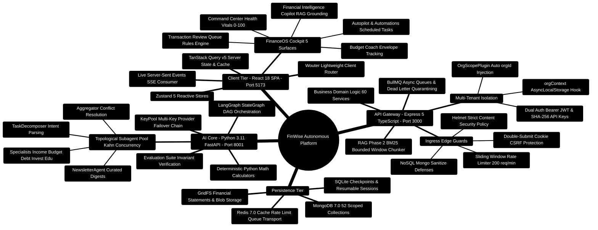
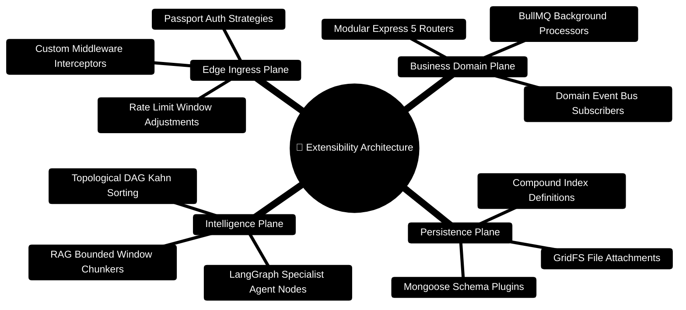
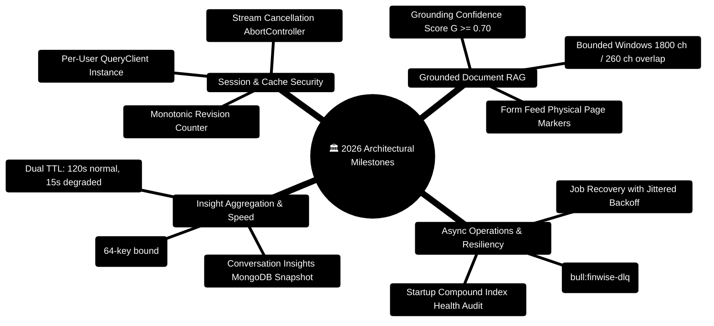

# FinWise — Full-Stack Architecture & Multi-Agent System Design

> **Production Engineering Blueprint for the Autonomous Financial Operating System**  
> *Distributed Multi-Tier Architecture, Express 5 Composition, LangGraph SubAgent DAGs, RAG Phase 2, and Invariant Verification*  
> **Release Target:** 2026 Enterprise Edition · **Runtime:** Node.js `>=24.14.1 <25` · Python `3.11+` · React `18.3` · MongoDB `7.0` · Redis `7.0`

---

## 1. System Topology Mindmap



---

## 2. End-to-End System Integration ASCII Architecture

```text
┌────────────────────────────────────────────────────────────────────────────────────────────────────────┐
│ 🟢 PRESENTATION LAYER: React 18 SPA (Browser Client - Port 5173)                                       │
│    • FinanceOS Cockpit: Command Center • Review Queue • Autopilot • Budget Coach • Copilot             │
│    • Real-time SSE Stream Consumer (useAIStream, TypingIndicator, Citation Badges)                     │
│    • Zustand Reactive Stores (chatStore, aiStore, orgStore, commandBarStore)                           │
│    • TanStack Query v5 Server State Caching & Optimistic Cache Invalidation                            │
└───────────────────────────────────┬────────────────────────────────────────────────────────────────────┘
                                    │ 🌐 HTTPS 1.1 / TLS 1.3 / SSE Streaming / Port 3000
                                    ▼
┌────────────────────────────────────────────────────────────────────────────────────────────────────────┐
│ 🔷 API GATEWAY LAYER: Express 5 + TypeScript (Server - Port 3000)                                      │
│    ├─► 🛡️ Edge Guards: Helmet (Strict CSP) • CORS • Sliding Rate Limiter (200 req/min)                │
│    ├─► 🔑 Auth Pipeline: authAny (JWT Bearer Token OR SHA-256 Peppered API Key)                       │
│    ├─► 🏢 Tenant Boundary: orgContext Middleware + OrgScopePlugin (Automatic { orgId } Injection)       │
│    ├─► 📋 Input Validation: Strict Zod v4 Schemas with Strict Coercion & Stripping                     │
│    ├─► 🔍 RAG Phase 2 Engine: Bounded Window Chunker (1800 ch / 260 ch overlap) + BM25 Lexical Scorer  │
│    ├─► 📊 Operational Services: commandCenterService • budgetHealthService • transactionReview         │
│    ├─► 📄 Export & Print: PDFKit Server-Side Compilation streaming to MongoDB GridFS                   │
│    └─► ⚙️ Async Queue: BullMQ + Redis for Scheduled Newsletters, Webhook Sync, and DLQ Quarantining    │
└─────────────────────────┬──────────────────────────────────────────┬───────────────────────────────────┘
                          │                                          │
         💾 Read / Write Operations                         ⚡ High-Speed IPC / HTTP
                          ▼                                          ▼
┌───────────────────────────────────────────────┐  ┌─────────────────────────────────────────────────────┐
│ 🗄️ PERSISTENCE TIER                           │  │ 🧠 AI CORE ENGINE: Python 3.11 FastAPI (Port 8001)  │
│  ├─► MongoDB 7.0 Replica Set                  │  │  ├─► LangGraph StateGraph Execution Pipeline        │
│  │   • 52 Scoped Collections                  │  │  ├─► Task Decomposer & Kahn DAG SubAgentManager     │
│  │   • Compound B-Tree Compound Indexes       │  │  ├─► Concurrent Specialist Pool (Max Concurrency 4) │
│  │   • Workspace Knowledge Chunks             │  │  ├─► Aggregator Zero-Sum Budget & Invariant Audit   │
│  ├─► Redis 7.0 Cluster                        │  │  ├─► Multi-Key KeyPool Rotation & 6-Tier Failover   │
│  │   • Sliding Rate Limiter Buckets           │  │  ├─► Deterministic Python Financial Calculators     │
│  │   • BullMQ Job Queues & Dead Letter Queue  │  │  ├─► SQLite FTS5 Memory & Checkpointed Sessions     │
│  │   • Pub/Sub Domain Event Bus               │  │  └─► Automated Evaluation Suite (Invariant Testing) │
│  └─► GridFS Blob Storage                      │  └─────────────────────────────────────────────────────┘
│      • PDF Statements, Receipts, Exports      │
└───────────────────────────────────────────────┘
```

---

## 3. Tier 1: Client Layer & FinanceOS Cockpit

The frontend is engineered as a local-first Single Page Application (SPA) driven by **React 18.3** and **Vite 7.3**. It eliminates context re-render overhead by separating fast client state (managed by **Zustand 5**) from server cache (managed by **TanStack Query v5**).

### 3.1 The 5 Operational Surfaces of FinanceOS
1. **Command Center (`CommandCenter.tsx`)**: The morning decision cockpit. Displays the dynamic 4-pillar Financial Health Score (0–100), liquid cash runway in days, pending urgent reviews, and upcoming bills for the next 7 days.
2. **Transaction Review Queue (`TransactionReviewQueue.tsx`)**: High-throughput triage screen. Uses rule matching and confidence scores to highlight unclassified expenses. Supports single-click approval, one-click rule creation ("Always categorize as Groceries"), and batch reconciliation.
3. **Autopilot & Automations (`Workflows.tsx`)**: Autonomous background automation center. Displays active cron jobs (e.g. Monthly Close on the 1st, Spending Anomaly alerts > $200) and full execution audit trails.
4. **Budget Coach (`BudgetHealthCard.tsx`)**: Envelope tracking interface supporting 50/30/20 and zero-based budgeting. Dynamically calculates category burn rates and projects end-of-month deficits.
5. **Financial Intelligence (`FinancialCopilot.tsx`)**: Conversational copilot featuring grounded RAG retrieval, verified document citations (`[docId:chunkIndex]`), and multi-agent topological DAG execution visualization (`AgentWorkflowVisualizer.tsx`).

---

## 4. Tier 2: Express 5 API Gateway & Composition Root

The Node.js server (`server/src/server.ts` and `app.ts`) acts as the secure entry gateway and composition root. It mounts all endpoints under `/api/v1` and guarantees tenant data isolation.

### 4.1 Ingress Security Pipeline
```text
HTTP Request ──► [requestContext] ──► [securityHeaders & Helmet] ──► [CORS]
             ──► [cookieParser] ──► [csrfProtection] ──► [authAny]
             ──► [orgContext] ──► [Zod Validation] ──► [Domain Service] ──► JSON/SSE
```

### 4.2 Multi-Tenant Data Isolation (`OrgScopePlugin`)
To eliminate the risk of cross-tenant data leaks, all Mongoose models are wrapped in `orgScopePlugin`. It automatically enforces `{ orgId }` filtering on all `find`, `findOne`, `countDocuments`, `updateMany`, and `deleteMany` calls:

```typescript
// server/src/utils/orgScopePlugin.ts
export function orgScopePlugin(schema: Schema) {
  schema.pre(["find", "findOne", "countDocuments", "updateMany", "deleteMany"], function () {
    const filter = this.getFilter();
    if (!filter.orgId && !this.getOptions().bypassOrgScope) {
      throw new Error("[OrgScopePlugin] Query executed without required orgId tenant boundary!");
    }
  });
}
```

---

## 5. Tier 3: Asynchronous Queues & Resilient DLQ

FinWise decouples heavy background workloads using **BullMQ 5** backed by **Redis 7**:

```text
┌─────────────────┐       ┌────────────────────┐       ┌───────────────────┐
│ Service Action  ├──────►│ BullMQ Redis Queue ├──────►│ Background Worker │
└─────────────────┘       └────────────────────┘       └─────────┬─────────┘
                                                                 │
                                                       [Repeated Failures?]
                                                               /       \
                                                             YES        NO
                                                             /           \
                                                            v             v
                                                 ┌────────────────┐  ┌─────────┐
                                                 │ Dead Letter Q  │  │ Success │
                                                 │ (Quarantined)  │  │ Done    │
                                                 └────────────────┘  └─────────┘
```

- **Queues Handled**: `newsletter-dispatch`, `pdf-compilation`, `csv-statement-import`, `workflow-execution`.
- **Dead Letter Queue (`deadLetterQueue.ts`)**: Quarantines poisoned jobs after 3 consecutive failures. Stores the full stack trace, attempt history, and payload for administrative replay.

---

## 6. Tier 4: Python AI Core & Multi-Agent DAG

The AI Core (`server/AI_Core/`) provides autonomous reasoning without sacrificing numerical precision. Built on **FastAPI** and **LangGraph**, it coordinates 10 specialist agents in a Directed Acyclic Graph (DAG).

### 6.1 Multi-Agent Execution Matrix

| Agent | Module | Primary Capability | Mathematical Invariant |
| :--- | :--- | :--- | :--- |
| **Master Agent** | `master_agent.py` | Query routing, intent classification, final plan synthesis | Plan completeness $\ge 95\%$ |
| **Task Decomposer** | `task_decomposer.py` | Decomposes multi-intent queries into dependency-linked subtasks | Acyclic DAG verified |
| **SubAgent Manager** | `sub_agent_manager.py` | Topological level scheduler (Kahn's algorithm) with concurrent worker pool | Max concurrency = 4 |
| **Income / Expense** | `income_expense_analyzer.py`| Cash-flow velocity, anomaly detection, savings surplus | Surplus = Income - Expense |
| **Budget Planner** | `budget_planner.py` | 50/30/20 & zero-based envelope reallocation | $\sum \Delta B = 0, \quad \forall B_i \ge 0$ |
| **Debt Optimizer** | `debt_optimizer.py` | Avalanche vs Snowball amortization schedules | Total Interest Saved $\ge 0$ |
| **Investment Advisor**| `investment_advisor.py` | Modern Portfolio Theory asset allocation | Sum of weights $= 100\%$ |
| **Aggregator** | `aggregator.py` | Conflict resolution, number safety validation | Candidate Digits $\subseteq$ Reference Digits |
| **Newsletter Agent** | `newsletter_agent.py` | Weekly curated financial digests | Verified Markdown schema |

### 6.2 Topological Sort Execution (Kahn's Algorithm)

```python
# server/AI_Core/agents/sub_agent_manager.py
def _topological_sort(self, subtasks: List[Dict]) -> List[List[Dict]]:
    in_degree = {t["id"]: len(t.get("depends_on", [])) for t in subtasks}
    task_map = {t["id"]: t for t in subtasks}
    dependents = defaultdict(list)
    for t in subtasks:
        for dep in t.get("depends_on", []):
            dependents[dep].append(t["id"])

    levels = []
    current_level = [task_map[tid] for tid, deg in in_degree.items() if deg == 0]

    while current_level:
        levels.append(current_level)
        next_level = []
        for t in current_level:
            for dep_id in dependents[t["id"]]:
                in_degree[dep_id] -= 1
                if in_degree[dep_id] == 0:
                    next_level.append(task_map[dep_id])
        current_level = next_level

    return levels
```

---

## 7. Tier 5: RAG Phase 2 Grounded Retrieval

To eliminate LLM hallucinations, FinWise enforces the **Grounding Confidence Score ($G$)**:
$$G = 0.60 \cdot R_{\text{lexical}} + 0.40 \cdot S_{\text{semantic}}$$

1. **Bounded Window Chunking**: Text is split into 1,800-character windows (~500 tokens) with 260-character overlaps, preserving original page numbers (`\f`).
2. **Lexical BM25 Scoring**: Fast token-frequency matching across MongoDB `WorkspaceKnowledgeChunk` records.
3. **Citation Guarantee**: If $G \ge 0.70$, chunks are injected into the agent prompt with structured citations (`[docId:chunkIndex]`). If $G < 0.70$, the agent emits a disclaimer rather than guessing.


---

## 8. Real-Time Event Bus & Redis Domain Event Fanout (`server/src/services/realtime/eventBus.ts`)

To decouple asynchronous domain side-effects (e.g. recalculating budget health after transaction creation, triggering automated newsletters, updating client UI widgets), the system utilizes a two-tier in-memory and Redis distributed event bus:

```typescript
// server/src/services/realtime/eventBus.ts
import { EventEmitter } from "events";
import { Redis } from "ioredis";
import { logger } from "../../config/logger";

export interface DomainEvent<T = any> {
  id: string;
  orgId: string;
  type: string;
  payload: T;
  timestamp: string;
}

export class DistributedEventBus extends EventEmitter {
  private redisPub: Redis;
  private redisSub: Redis;

  constructor(redisUri: string) {
    super();
    this.redisPub = new Redis(redisUri);
    this.redisSub = new Redis(redisUri);

    this.redisSub.psubscribe("finwise:events:*", (err) => {
      if (err) logger.error({ err }, "Failed to subscribe to Redis event channel");
    });

    this.redisSub.on("pmessage", (_pattern, channel, message) => {
      try {
        const event: DomainEvent = JSON.parse(message);
        // Emit locally within this Express instance
        this.emit(event.type, event);
        this.emit(`org:${event.orgId}`, event);
      } catch (err) {
        logger.error({ err }, "Failed to parse distributed domain event");
      }
    });
  }

  public async publish(event: DomainEvent): Promise<void> {
    const channel = `finwise:events:${event.orgId}`;
    await this.redisPub.publish(channel, JSON.stringify(event));
  }
}
```

---

## 9. High-Availability Persistence & Replication Topology

```text
┌────────────────────────────────────────────────────────────────────────┐
│ 🗄️ PERSISTENCE TIER: REPLICATION & FAILOVER ARCHITECTURE               │
├────────────────────────────────────────────────────────────────────────┤
│ 1. MongoDB 7.0 Replica Set (Primary + 2 Secondary Nodes)                │
│    • Read Preference: primaryPreferred for transactional balance writes│
│    • secondaryPreferred for heavy analytics & historical aggregations  │
│    • Write Concern: majority, wtimeout: 5000ms                         │
├────────────────────────────────────────────────────────────────────────┤
│ 2. Redis 7.0 Cluster / Sentinel (Leader + Replica)                      │
│    • Persistence: Append-Only File (AOF) with everysec fsync           │
│    • Eviction Policy: volatile-lru (rate limit buckets & query cache)  │
│    • BullMQ Queues: newsletter, pdf-exports, dead-letter-queue         │
├────────────────────────────────────────────────────────────────────────┤
│ 3. GridFS Distributed Blob Storage                                     │
│    • Chunks Collection: fs.chunks (255KB binary chunks)                │
│    • Metadata Collection: fs.files (content-type, orgId, SHA-256)     │
└────────────────────────────────────────────────────────────────────────┘
```


---

## 10. Developer Extension Architecture: Pluggable Subsystems & Invariants

> **Architectural Contracts for Extending the FinWise Platform**  
> Every custom module, specialist AI agent, or persistent entity must adhere to the three non-negotiable architectural invariants:  
> 1. **Multi-Tenant Isolation**: Enforced via `orgScopePlugin` and `{ orgId: 1 }` compound indexing.  
> 2. **Deterministic Arithmetic**: Enforced via $\sum_{i} \Delta B_i = 0$ in all financial synthesis operations.  
> 3. **RAG Grounding Threshold**: Enforced via $G = 0.60 \cdot R_{\text{lexical}} + 0.40 \cdot S_{\text{semantic}} \ge 0.70$.  
> For the complete 700+ line developer manual, see [**BUILDING_ON_THIS_PROJECT.md**](./BUILDING_ON_THIS_PROJECT.md).

### Extension Planes Mindmap



### Pluggable Subsystem Hooking ASCII Architecture

```
┌───────────────────────────────────────────────────────────────────────────────────────────────────┐
│                             PLUGGABLE SUBSYSTEM HOOKING TOPOLOGY                                  │
└───────────────────────────────────────────────────────────────────────────────────────────────────┘

                           [Express 5 Edge Gateway (:3000)]
                                          │
                  ┌───────────────────────┴───────────────────────┐
                  ▼                                               ▼
       [Custom Route Module]                            [Redis Event Bus]
        /api/v1/extensions/*                             publish('domain.event')
                  │                                               │
                  ├───────────────────────┐                       ├───────────────────────┐
                  ▼                       ▼                       ▼                       ▼
          [Domain Service]        [BullMQ Worker]         [SSE Fanout]           [Audit Logger]
          Business Logic          Async Background        Live Client Update      Compliance Trail
                  │                       │
                  ▼                       ▼
          [Mongoose Model]        [FastAPI AI Core (:8001)]
          + orgScopePlugin        POST /subagents/run
          + { orgId: 1 }          LangGraph DAG Execution
```

### Implementation: Event-Driven Extension Subscriber (`server/src/services/extensions/auditExtension.ts`)

```typescript
import { eventBus } from '../realtime/eventBus';
import { logger } from '../../utils/logger';

export interface DomainEventPayload {
  orgId: string;
  eventType: string;
  entityId: string;
  timestamp: string;
  metadata?: Record<string, unknown>;
}

export function registerAuditExtension(): void {
  // Subscribe to all transactional lifecycle events via Redis pub/sub
  eventBus.subscribe('transaction.*', async (payload: DomainEventPayload) => {
    logger.info({
      module: 'AuditExtension',
      orgId: payload.orgId,
      event: payload.eventType,
      entity: payload.entityId,
      ts: payload.timestamp
    }, 'Domain event intercepted by extension');
    
    // Invariant check: Ensure tenant context is preserved
    if (!payload.orgId) {
      logger.error('CRITICAL: Intercepted domain event lacking tenant orgId identifier');
    }
  });
}
```

---

## 11. 2026 Enterprise Architectural Milestones



### 11.1 Private Query Cache Boundaries & Session Lifecycle Management
To prevent cross-tenant or cross-user memory leakage in shared browser environments, FinWise instantiates an isolated TanStack `QueryClient` per authenticated user and active organization workspace:
- **Cache Eviction**: Switching workspaces or logging out destroys the previous `QueryClient`, purges cached queries, and unmounts views.
- **Monotonic Revision Counter**: Every auth state transition increments an internal revision marker; late-arriving asynchronous responses matching older markers are discarded.
- **Active Stream Cancellation**: Ongoing Server-Sent Events (SSE) connections and fetch readers are aborted via `AbortController` when switching views.

### 11.2 Bounded Window Document Chunking & Lexical Retrieval Topology
Uploaded financial documents are parsed into bounded, overlapping chunks persisted in `WorkspaceKnowledgeChunkModel`:
- **Window Target**: 1,800 characters (~450 tokens) with 260-character sliding overlap.
- **Physical Page Preservation**: Detects form-feed characters (`\f`) from PDFs to maintain 1:1 parity with printed statements.
- **BM25 Lexical Scoring**: Exact phrase matches (+12 pts), term frequency (+2 pts/term), and numeric alignment (+2 pts) yield the lexical score $R_{\text{lexical}}$.
- **Grounding Confidence**: Evaluated as $G = 0.60 \cdot R_{\text{lexical}} + 0.40 \cdot S_{\text{semantic}}$. Context is injected into prompts with verifiable `[docId:chunkIndex]` footnote citations.

### 11.3 Dead Letter Queue (DLQ) & Fault-Tolerant Async Queues
Poison-pill background jobs (such as malformed CSV imports or failed SMTP email dispatches) are caught by `deadLetterQueue.ts`:
- Traps unhandled rejections from fire-and-forget background operations.
- Persists failure payloads, timestamps, error messages, and full stack traces into Redis `bull:finwise-dlq` (bounded ring buffer of 500 entries).
- Prevents silent `.catch(() => null)` failures while exposing an administrative replay endpoint.

### 11.4 In-Process Request Coalescing & Insights TTL Cache
The Dashboard conversation insights panel reuses a MongoDB snapshot cache keyed by `{ userId, orgId, requestHash }`:
- **TTL Strategy**: 120-second TTL for complete multi-agent plans; 15-second TTL for degraded fallback responses.
- **Request Coalescing**: Multiple identical requests within the same Node process coalesce into a single in-flight Promise (64-key tracking bound), preventing duplicate AI Core inference calls.
- **Quota Preservation**: Reused cached summaries consume zero additional AI quota units.

### 11.5 Dynamic Compound Index Startup Auditing (`transactionIndexes.ts`)
During server boot, `transactionIndexes.ts` inspects MongoDB collections to guarantee high-performance B-tree indexes:
- Verifies compound index `{ orgId: 1, date: -1 }` on `transactions`.
- Automatically builds missing indexes in background mode (`background: true`).
- Guarantees sub-10ms query execution across 100,000+ transaction ledgers.
