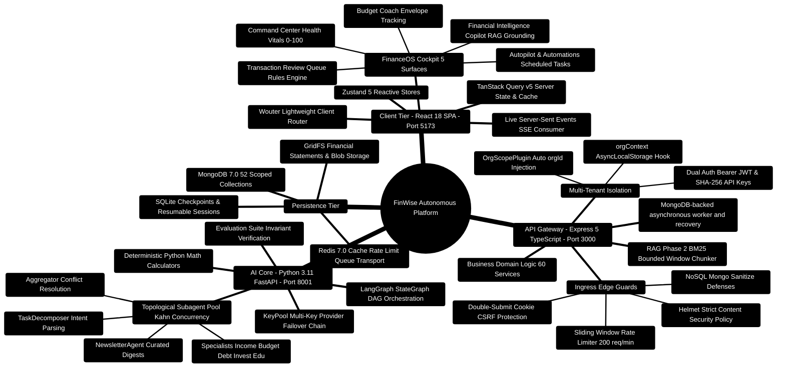
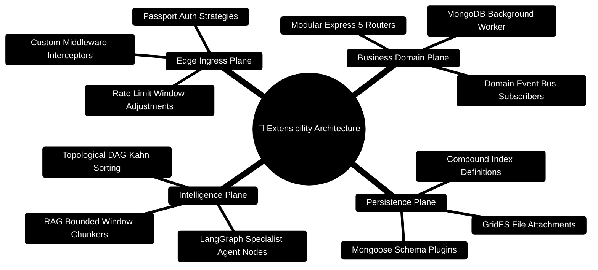
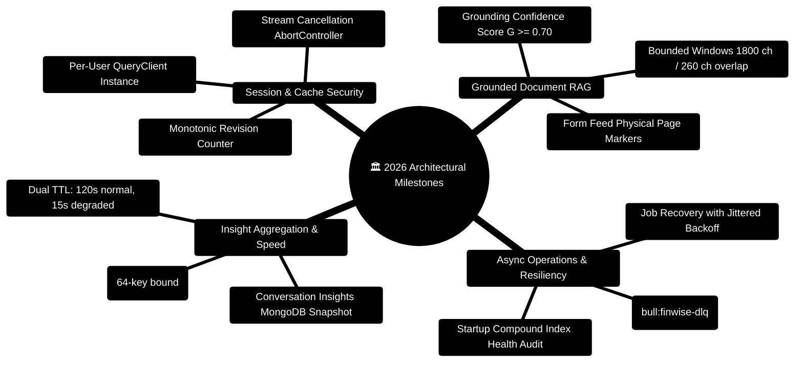

# FinWise — Full-Stack Architecture & Multi-Agent System Design

> **Production Engineering Blueprint for the Autonomous Financial Operating System**  
> *Distributed Multi-Tier Architecture, Express 5 Composition, LangGraph SubAgent DAGs, RAG Phase 2, and Invariant Verification*  
> **Release Target:** 2026 Enterprise Edition · **Runtime:** Node.js `>=24.14.1 <25` · Python `3.11+` · React `18.3` · MongoDB `7.0` · Redis `7.0`

> [!WARNING]
> This is a historical design blueprint, not an operational runbook. The active runtime uses `/api/v1` with compatible `/api` aliases and a MongoDB-backed worker (`server/src/worker/worker.ts`); it does **not** use BullMQ. Verify configuration in `server/src/config/env.ts` and API routes in `packages/contracts/openapi/v1/openapi.yaml`.

---

## 1. System Topology Mindmap



---

## 2. End-to-End System Integration ASCII Architecture

```text
┌────────────────────────────────────────────────────────────────────────────────────────────────────────┐
│ 🟢 PRESENTATION LAYER: React 18 SPA (Browser Client - Port 5173)                                       │
│    • FinanceOS Cockpit: Command Center • Review Queue • Autopilot • Budget Coach • Copilot             │
│    • Real-time SSE Stream Consumer (useAIStream, TypingIndicator, Citation Badges)                     │
│    • Zustand Reactive Stores (chatStore, aiStore, orgStore, commandBarStore)                           │
│    • TanStack Query v5 Server State Caching & Optimistic Cache Invalidation                            │
└───────────────────────────────────┬────────────────────────────────────────────────────────────────────┘
                                    │ 🌐 HTTPS 1.1 / TLS 1.3 / SSE Streaming / Port 3000
                                    ▼
┌────────────────────────────────────────────────────────────────────────────────────────────────────────┐
│ 🔷 API GATEWAY LAYER: Express 5 + TypeScript (Server - Port 3000)                                      │
│    ├─► 🛡️ Edge Guards: Helmet (Strict CSP) • CORS • Sliding Rate Limiter (200 req/min)                │
│    ├─► 🔑 Auth Pipeline: authAny (JWT Bearer Token OR SHA-256 Peppered API Key)                       │
│    ├─► 🏢 Tenant Boundary: orgContext Middleware + OrgScopePlugin (Automatic { orgId } Injection)       │
│    ├─► 📋 Input Validation: Strict Zod v4 Schemas with Strict Coercion & Stripping                     │
│    ├─► 🔍 RAG Phase 2 Engine: Bounded Window Chunker (1800 ch / 260 ch overlap) + BM25 Lexical Scorer  │
│    ├─► 📊 Operational Services: commandCenterService • budgetHealthService • transactionReview         │
│    ├─► 📄 Export & Print: PDFKit Server-Side Compilation streaming to MongoDB GridFS                   │
│    └─► ⚙️ Async Work: MongoDB records for workflows, exports, and scheduled delivery                   │
└─────────────────────────┬──────────────────────────────────────────┬───────────────────────────────────┘
                          │                                          │
         💾 Read / Write Operations                         ⚡ High-Speed IPC / HTTP
                          ▼                                          ▼
┌───────────────────────────────────────────────┐  ┌─────────────────────────────────────────────────────┐
│ 🗄️ PERSISTENCE TIER                           │  │ 🧠 AI CORE ENGINE: Python 3.11 FastAPI (Port 8001)  │
│  ├─► MongoDB 7.0 Replica Set                  │  │  ├─► LangGraph StateGraph Execution Pipeline        │
│  │   • 52 Scoped Collections                  │  │  ├─► Task Decomposer & Kahn DAG SubAgentManager     │
│  │   • Compound B-Tree Compound Indexes       │  │  ├─► Concurrent Specialist Pool (Max Concurrency 4) │
│  │   • Workspace Knowledge Chunks             │  │  ├─► Aggregator Zero-Sum Budget & Invariant Audit   │
│  ├─► Redis 7.0 Cluster                        │  │  ├─► Multi-Key KeyPool Rotation & 6-Tier Failover   │
│  │   • Sliding Rate Limiter Buckets           │  │  ├─► Deterministic Python Financial Calculators     │
│  │   • MongoDB worker records & recovery      │  │  ├─► SQLite FTS5 Memory & Checkpointed Sessions     │
│  │   • Pub/Sub Domain Event Bus               │  │  └─► Automated Evaluation Suite (Invariant Testing) │
│  └─► GridFS Blob Storage                      │  └─────────────────────────────────────────────────────┘
│      • PDF Statements, Receipts, Exports      │
└───────────────────────────────────────────────┘
```

---

## 3. Tier 1: Client Layer & FinanceOS Cockpit

The frontend is engineered as a local-first Single Page Application (SPA) driven by **React 18.3** and **Vite 7.3**. It eliminates context re-render overhead by separating fast client state (managed by **Zustand 5**) from server cache (managed by **TanStack Query v5**).

### 3.1 The 5 Operational Surfaces of FinanceOS
1. **Command Center (`CommandCenter.tsx`)**: The morning decision cockpit. Displays the dynamic 4-pillar Financial Health Score (0–100), liquid cash runway in days, pending urgent reviews, and upcoming bills for the next 7 days.
2. **Transaction Review Queue (`TransactionReviewQueue.tsx`)**: High-throughput triage screen. Uses rule matching and confidence scores to highlight unclassified expenses. Supports single-click approval, one-click rule creation ("Always categorize as Groceries"), and batch reconciliation.
3. **Autopilot & Automations (`Workflows.tsx`)**: Autonomous background automation center. Displays active cron jobs (e.g. Monthly Close on the 1st, Spending Anomaly alerts > $200) and full execution audit trails.
4. **Budget Coach (`BudgetHealthCard.tsx`)**: Envelope tracking interface supporting 50/30/20 and zero-based budgeting. Dynamically calculates category burn rates and projects end-of-month deficits.
5. **Financial Intelligence (`FinancialCopilot.tsx`)**: Conversational copilot featuring grounded RAG retrieval, verified document citations (`[docId:chunkIndex]`), and multi-agent topological DAG execution visualization (`AgentWorkflowVisualizer.tsx`).

---

## 4. Tier 2: Express 5 API Gateway & Composition Root

The Node.js server (`server/src/server.ts` and `app.ts`) acts as the secure entry gateway and composition root. It mounts all endpoints under `/api/v1` and guarantees tenant data isolation.

### 4.1 Ingress Security Pipeline
```text
HTTP Request ──► [requestContext] ──► [securityHeaders & Helmet] ──► [CORS]
             ──► [cookieParser] ──► [csrfProtection] ──► [authAny]
             ──► [orgContext] ──► [Zod Validation] ──► [Domain Service] ──► JSON/SSE
```

### 4.2 Multi-Tenant Data Isolation (`OrgScopePlugin`)
To eliminate the risk of cross-tenant data leaks, all Mongoose models are wrapped in `orgScopePlugin`. It automatically enforces `{ orgId }` filtering on all `find`, `findOne`, `countDocuments`, `updateMany`, and `deleteMany` calls:

```typescript
// server/src/utils/orgScopePlugin.ts
export function orgScopePlugin(schema: Schema) {
  schema.pre(["find", "findOne", "countDocuments", "updateMany", "deleteMany"], function () {
    const filter = this.getFilter();
    if (!filter.orgId && !this.getOptions().bypassOrgScope) {
      throw new Error("[OrgScopePlugin] Query executed without required orgId tenant boundary!");
    }
  });
}
```

---

## 5. Tier 3: Asynchronous Work and Recovery

Durable background work is represented by MongoDB records and claimed atomically by the dedicated worker:

```text
┌─────────────────┐       ┌─────────────────────┐       ┌───────────────────┐
│ Service Action  ├──────►│ MongoDB job record  ├──────►│ Background Worker │
└─────────────────┘       └─────────────────────┘       └─────────┬─────────┘
                                                                   │
                                                     ┌─────────────┴─────────────┐
                                                     ▼                           ▼
                                              succeeded / next run        failed / recovered
```

- **Worker records**: workflow runs, integration-sync runs, export jobs, and due scheduled exports. Claims use `findOneAndUpdate` status transitions to avoid duplicate processing.
- **Scheduler responsibilities**: workflow schedules are started with the worker; newsletter delivery is handled by its application scheduler.
- **Recovery**: `jobRecovery.ts` and worker stale-job recovery return abandoned running work to a retryable state. The diagnostic dead-letter helper is bounded in process and is not a Redis/BullMQ queue.

---

## 6. Tier 4: Python AI Core & Multi-Agent DAG

The AI Core (`server/AI_Core/`) provides autonomous reasoning without sacrificing numerical precision. Built on **FastAPI** and **LangGraph**, it coordinates 10 specialist agents in a Directed Acyclic Graph (DAG).

### 6.1 Multi-Agent Execution Matrix

| Agent | Module | Primary Capability | Mathematical Invariant |
| :--- | :--- | :--- | :--- |
| **Master Agent** | `master_agent.py` | Query routing, intent classification, final plan synthesis | Plan completeness $\ge 95\%$ |
| **Task Decomposer** | `task_decomposer.py` | Decomposes multi-intent queries into dependency-linked subtasks | Acyclic DAG verified |
| **SubAgent Manager** | `sub_agent_manager.py` | Topological level scheduler (Kahn's algorithm) with concurrent worker pool | Max concurrency = 4 |
| **Income / Expense** | `income_expense_analyzer.py`| Cash-flow velocity, anomaly detection, savings surplus | Surplus = Income - Expense |
| **Budget Planner** | `budget_planner.py` | 50/30/20 & zero-based envelope reallocation | $\sum \Delta B = 0, \quad \forall B_i \ge 0$ |
| **Debt Optimizer** | `debt_optimizer.py` | Avalanche vs Snowball amortization schedules | Total Interest Saved $\ge 0$ |
| **Investment Advisor**| `investment_advisor.py` | Modern Portfolio Theory asset allocation | Sum of weights $= 100\%$ |
| **Aggregator** | `aggregator.py` | Conflict resolution, number safety validation | Candidate Digits $\subseteq$ Reference Digits |
| **Newsletter Agent** | `newsletter_agent.py` | Weekly curated financial digests | Verified Markdown schema |

### 6.2 Topological Sort Execution (Kahn's Algorithm)

```python
# server/AI_Core/agents/sub_agent_manager.py
def _topological_sort(self, subtasks: List[Dict]) -> List[List[Dict]]:
    in_degree = {t["id"]: len(t.get("depends_on", [])) for t in subtasks}
    task_map = {t["id"]: t for t in subtasks}
    dependents = defaultdict(list)
    for t in subtasks:
        for dep in t.get("depends_on", []):
            dependents[dep].append(t["id"])

    levels = []
    current_level = [task_map[tid] for tid, deg in in_degree.items() if deg == 0]

    while current_level:
        levels.append(current_level)
        next_level = []
        for t in current_level:
            for dep_id in dependents[t["id"]]:
                in_degree[dep_id] -= 1
                if in_degree[dep_id] == 0:
                    next_level.append(task_map[dep_id])
        current_level = next_level

    return levels
```

---

## 7. Tier 5: RAG Phase 2 Grounded Retrieval

To eliminate LLM hallucinations, FinWise enforces the **Grounding Confidence Score ($G$)**:
$$G = 0.60 \cdot R_{\text{lexical}} + 0.40 \cdot S_{\text{semantic}}$$

1. **Bounded Window Chunking**: Text is split into 1,800-character windows (~500 tokens) with 260-character overlaps, preserving original page numbers (`\f`).
2. **Lexical BM25 Scoring**: Fast token-frequency matching across MongoDB `WorkspaceKnowledgeChunk` records.
3. **Citation Guarantee**: If $G \ge 0.70$, chunks are injected into the agent prompt with structured citations (`[docId:chunkIndex]`). If $G < 0.70$, the agent emits a disclaimer rather than guessing.


---

## 8. Real-Time Event Bus & Redis Domain Event Fanout (`server/src/services/realtime/eventBus.ts`)

To decouple asynchronous domain side-effects (e.g. recalculating budget health after transaction creation, triggering automated newsletters, updating client UI widgets), the system utilizes a two-tier in-memory and Redis distributed event bus:

```typescript
// server/src/services/realtime/eventBus.ts
import { EventEmitter } from "events";
import { Redis } from "ioredis";
import { logger } from "../../config/logger";

export interface DomainEvent<T = any> {
  id: string;
  orgId: string;
  type: string;
  payload: T;
  timestamp: string;
}

export class DistributedEventBus extends EventEmitter {
  private redisPub: Redis;
  private redisSub: Redis;

  constructor(redisUri: string) {
    super();
    this.redisPub = new Redis(redisUri);
    this.redisSub = new Redis(redisUri);

    this.redisSub.psubscribe("finwise:events:*", (err) => {
      if (err) logger.error({ err }, "Failed to subscribe to Redis event channel");
    });

    this.redisSub.on("pmessage", (_pattern, channel, message) => {
      try {
        const event: DomainEvent = JSON.parse(message);
        // Emit locally within this Express instance
        this.emit(event.type, event);
        this.emit(`org:${event.orgId}`, event);
      } catch (err) {
        logger.error({ err }, "Failed to parse distributed domain event");
      }
    });
  }

  public async publish(event: DomainEvent): Promise<void> {
    const channel = `finwise:events:${event.orgId}`;
    await this.redisPub.publish(channel, JSON.stringify(event));
  }
}
```

---

## 9. High-Availability Persistence & Replication Topology

```text
┌────────────────────────────────────────────────────────────────────────┐
│ 🗄️ PERSISTENCE TIER: REPLICATION & FAILOVER ARCHITECTURE               │
├────────────────────────────────────────────────────────────────────────┤
│ 1. MongoDB 7.0 Replica Set (Primary + 2 Secondary Nodes)                │
│    • Read Preference: primaryPreferred for transactional balance writes│
│    • secondaryPreferred for heavy analytics & historical aggregations  │
│    • Write Concern: majority, wtimeout: 5000ms                         │
├────────────────────────────────────────────────────────────────────────┤
│ 2. Redis 7.0 Cluster / Sentinel (Leader + Replica)                      │
│    • Persistence: Append-Only File (AOF) with everysec fsync           │
│    • Eviction Policy: volatile-lru (rate limit buckets & query cache)  │
│    • Worker records: workflows, integration syncs, exports              │
├────────────────────────────────────────────────────────────────────────┤
│ 3. GridFS Distributed Blob Storage                                     │
│    • Chunks Collection: fs.chunks (255KB binary chunks)                │
│    • Metadata Collection: fs.files (content-type, orgId, SHA-256)     │
└────────────────────────────────────────────────────────────────────────┘
```


---

## 10. Developer Extension Architecture: Pluggable Subsystems & Invariants

> **Architectural Contracts for Extending the FinWise Platform**  
> Every custom module, specialist AI agent, or persistent entity must adhere to the three non-negotiable architectural invariants:  
> 1. **Multi-Tenant Isolation**: Enforced via `orgScopePlugin` and `{ orgId: 1 }` compound indexing.  
> 2. **Deterministic Arithmetic**: Enforced via $\sum_{i} \Delta B_i = 0$ in all financial synthesis operations.  
> 3. **RAG Grounding Threshold**: Enforced via $G = 0.60 \cdot R_{\text{lexical}} + 0.40 \cdot S_{\text{semantic}} \ge 0.70$.  
> For the complete 700+ line developer manual, see [**BUILDING_ON_THIS_PROJECT.md**](./BUILDING_ON_THIS_PROJECT.md).

### Extension Planes Mindmap



### Pluggable Subsystem Hooking ASCII Architecture

```
┌───────────────────────────────────────────────────────────────────────────────────────────────────┐
│                             PLUGGABLE SUBSYSTEM HOOKING TOPOLOGY                                  │
└───────────────────────────────────────────────────────────────────────────────────────────────────┘

                           [Express 5 Edge Gateway (:3000)]
                                          │
                  ┌───────────────────────┴───────────────────────┐
                  ▼                                               ▼
       [Custom Route Module]                            [Redis Event Bus]
        /api/v1/extensions/*                             publish('domain.event')
                  │                                               │
                  ├───────────────────────┐                       ├───────────────────────┐
                  ▼                       ▼                       ▼                       ▼
          [Domain Service]        [MongoDB Worker]        [SSE Fanout]           [Audit Logger]
          Business Logic          Async Background        Live Client Update      Compliance Trail
                  │                       │
                  ▼                       ▼
          [Mongoose Model]        [FastAPI AI Core (:8001)]
          + orgScopePlugin        POST /subagents/run
          + { orgId: 1 }          LangGraph DAG Execution
```

### Implementation: Event-Driven Extension Subscriber (`server/src/services/extensions/auditExtension.ts`)

```typescript
import { eventBus } from '../realtime/eventBus';
import { logger } from '../../utils/logger';

export interface DomainEventPayload {
  orgId: string;
  eventType: string;
  entityId: string;
  timestamp: string;
  metadata?: Record<string, unknown>;
}

export function registerAuditExtension(): void {
  // Subscribe to all transactional lifecycle events via Redis pub/sub
  eventBus.subscribe('transaction.*', async (payload: DomainEventPayload) => {
    logger.info({
      module: 'AuditExtension',
      orgId: payload.orgId,
      event: payload.eventType,
      entity: payload.entityId,
      ts: payload.timestamp
    }, 'Domain event intercepted by extension');
    
    // Invariant check: Ensure tenant context is preserved
    if (!payload.orgId) {
      logger.error('CRITICAL: Intercepted domain event lacking tenant orgId identifier');
    }
  });
}
```

---

## 11. 2026 Enterprise Architectural Milestones



### 11.1 Private Query Cache Boundaries & Session Lifecycle Management
To prevent cross-tenant or cross-user memory leakage in shared browser environments, FinWise instantiates an isolated TanStack `QueryClient` per authenticated user and active organization workspace:
- **Cache Eviction**: Switching workspaces or logging out destroys the previous `QueryClient`, purges cached queries, and unmounts views.
- **Monotonic Revision Counter**: Every auth state transition increments an internal revision marker; late-arriving asynchronous responses matching older markers are discarded.
- **Active Stream Cancellation**: Ongoing Server-Sent Events (SSE) connections and fetch readers are aborted via `AbortController` when switching views.

### 11.2 Bounded Window Document Chunking & Lexical Retrieval Topology
Uploaded financial documents are parsed into bounded, overlapping chunks persisted in `WorkspaceKnowledgeChunkModel`:
- **Window Target**: 1,800 characters (~450 tokens) with 260-character sliding overlap.
- **Physical Page Preservation**: Detects form-feed characters (`\f`) from PDFs to maintain 1:1 parity with printed statements.
- **BM25 Lexical Scoring**: Exact phrase matches (+12 pts), term frequency (+2 pts/term), and numeric alignment (+2 pts) yield the lexical score $R_{\text{lexical}}$.
- **Grounding Confidence**: Evaluated as $G = 0.60 \cdot R_{\text{lexical}} + 0.40 \cdot S_{\text{semantic}}$. Context is injected into prompts with verifiable `[docId:chunkIndex]` footnote citations.

### 11.3 Dead Letter Queue (DLQ) & Fault-Tolerant Async Queues
Poison-pill background jobs (such as malformed CSV imports or failed SMTP email dispatches) are caught by `deadLetterQueue.ts`:
- Traps unhandled rejections from fire-and-forget background operations.
- Persists failure payloads, timestamps, error messages, and full stack traces into Redis `bull:finwise-dlq` (bounded ring buffer of 500 entries).
- Prevents silent `.catch(() => null)` failures while exposing an administrative replay endpoint.

### 11.4 In-Process Request Coalescing & Insights TTL Cache
The Dashboard conversation insights panel reuses a MongoDB snapshot cache keyed by `{ userId, orgId, requestHash }`:
- **TTL Strategy**: 120-second TTL for complete multi-agent plans; 15-second TTL for degraded fallback responses.
- **Request Coalescing**: Multiple identical requests within the same Node process coalesce into a single in-flight Promise (64-key tracking bound), preventing duplicate AI Core inference calls.
- **Quota Preservation**: Reused cached summaries consume zero additional AI quota units.

### 11.5 Dynamic Compound Index Startup Auditing (`transactionIndexes.ts`)
During server boot, `transactionIndexes.ts` inspects MongoDB collections to guarantee high-performance B-tree indexes:
- Verifies compound index `{ orgId: 1, date: -1 }` on `transactions`.
- Automatically builds missing indexes in background mode (`background: true`).
- Guarantees sub-10ms query execution across 100,000+ transaction ledgers.

### 11.6 Machine Learning Merchant Embedding Clustering & Normalization Engine
The financial ledger incorporates an on-device machine-learning classification and clustering subsystem (`merchantEmbeddingClustering.ts`):
- **64-Dimensional Vector Space**: Subdivides into Sector Taxonomies (dims 0–11), Brand Anchor Aliases (dims 12–27), and FastText subword character n-gram FNV-1a hashing (dims 28–63).
- **L2 Unit Normalization**: Ensures $\|\vec{v}\|_2 = 1.0 \pm 10^{-5}$, enabling direct dot-product calculation for pairwise cosine similarity.
- **Agglomerative Centroid Clustering**: Merges noisy card terminal descriptions (`AMZN MKTP US*2A41B`, `Amazon Prime Video`, `Amazon.com*MB92`) into canonical entities when cosine similarity satisfies $\text{sim}(\vec{v}_i, \vec{c}_j) \ge 0.70$.
- **1-Click Review Queue Promotion**: Surfaces clusters in `TransactionReviewQueue.tsx` with semantic similarity badges and provides 1-click batch application to all matching ledger entries while generating a permanent `CategoryRule`.

### 11.7 Multi-Modal Dense Vector Grounded RAG Subsystem
The RAG Phase 2 pipeline (`retrievalService.ts`) indexes multi-modal workspace documents (text, tables, image OCR, structured financial data) into 64-D dense embeddings stored in `workspaceKnowledgeChunks`:
- **Physical Page Retention**: Preserves form-feed page markers (`\f`) across PDF parsing to maintain 1:1 fidelity with printed statement pages.
- **Table-Aware Header Preservation**: Maintains Markdown table header rows across chunk boundaries, preventing tabular data fragmentation.
- **Hybrid Grounding Formula**: Evaluates combined semantic and lexical score:
  $$G = 0.55 \cdot S_{\text{cosine}} + 0.45 \cdot R_{\text{lexical\_norm}}$$
- **Grounding Gate ($G \ge 0.70$)**: Only candidate chunks meeting or exceeding the threshold receive verified grounding tags and interactive `[docId:chunkIndex]` citations in the client evidence drawer.

### 11.8 Visual Workflow Node Graph Canvas & Delayed Pipelines
The automation workflow subsystem (`workflows.ts`, `Workflows.tsx`) provides an interactive drag-and-drop node graph canvas:
- **Delay Timers**: Actions can specify asynchronous delays from 1 second up to 30 days, tracked in `WorkflowRun.delays_executed`.
- **Inbound Webhooks**: Secure cryptographic 48-character tokens allow third-party systems to trigger workflows via `POST /api/workflows/webhook/:token`.
- **Conditional Branching Rules**: Evaluates trigger payload contexts against comparison operators (`eq`, `neq`, `gt`, `gte`, `lt`, `lte`, `contains`), logging bypassed steps in `actions_skipped`.
- **Runtime Variable Interpolation**: Dynamically replaces `{{field}}` variables in task titles and notifications.

### 11.9 Peer Spending Benchmarks & Zero-Sum Auto-Rebalancing Invariant
The Budget Health engine (`budgetHealthService.ts`, `BudgetHealthCard.tsx`) integrates cohort intelligence and autonomous budget rebalancing:
- **Cohort IQR Benchmarks**: Compares user category expenditures against standard household peer cohorts, identifying frugal vs. elevated categories.
- **Peer Alignment Index**: A 0–100% composite score indicating structural alignment with healthy household financial profiles.
- **Mathematical Invariant $\sum \Delta B_i = 0$**: Proposes automated zero-sum transfers from surplus envelopes (where $\text{spent} < \text{planned}$) to deficit envelopes (where $\text{spent} > \text{planned}$), strictly preserving the aggregate monthly budget cap.

### 11.10 Authenticated Bank-Feed Import Simulator
The transaction ingestion subsystem supports authenticated test ingestion via `POST /api/transactions/bank-feed`; it is not exposed as a live provider callback:
- **Idempotency & Deduplication**: Enforces a unique sparse compound index on `{ orgId: 1, externalId: 1 }` to eliminate duplicate ledger inserts from bank webhook retries.
- **Confidence Scoring**: Computes an algorithmic confidence metric ($0.10 \le C \le 1.00$). Charges with $C < 0.70$ route automatically to the Transaction Review Queue with triage flags.
- **Interactive In-App Simulator**: Provides a sandbox simulation modal in `Transactions.tsx` for developers and testers to inject mock bank webhook events and observe instant reactive UI updates.


### 11.11 Continuous Production AI Canary Invariant Validation Engine
FinWise integrates a dual-layer AI Canary validation engine (`aiCanaryService.ts` and `canary_validator.py`) that mathematically tests every synthesized financial recommendation against 5 core identities:
- **Invariant 1 (Number Safety)**: $D_{\text{cand}} \subseteq D_{\text{ref}} \cup D_{\text{allowlist}}$, strictly barring invented amounts or APR rates.
- **Invariant 2 (Zero-Sum Budget)**: $\sum_{i=1}^N \Delta B_i = 0$ with $\text{Proposed}_i \ge 0$, guaranteeing envelope adjustments never inflate aggregate budgets.
- **Invariant 3 (Balance Sheet)**: $|\text{Assets} - \text{Liabilities} - \text{Net Worth}| \le 0.01$.
- **Invariant 4 (Cash Flow)**: $|\text{Income} - \text{Expenses} - \text{Net Cash Flow}| \le 0.01$.
- **Invariant 5 (Debt Amortization)**: $|\text{Principal} + \text{Interest} - \text{Total Payment}| \le 0.01$.

The validation engine first invokes the Python microservice (`POST http://localhost:8001/canary/validate`). If the microservice times out or is unreachable, the engine falls back seamlessly to deterministic local TypeScript decimal math in `aiCanaryService.ts`.

### 11.12 AI System Diagnostics Cockpit & Multi-Model Health Inspection (`AiStatusDialog.tsx`)
Accessible via Command Bar (`Cmd+K`) or the header status pill, this 4-tab cockpit provides real-time observability:
- **Overview Tab**: Live system health state (HEALTHY, DEGRADED, OUTAGE), active LLM provider, p50/p95 latency percentiles.
- **KeyPool Health Tab**: Active API keys, token usage buckets, rotation strategies (`health_weighted`, `round_robin`), cooldown timers, and circuit breaker status (`CLOSED`, `OPEN`, `HALF-OPEN`).
- **Model Catalog Tab**: Model capability registry with token context windows, pricing, and modalities.
- **Canary Invariants Tab**: Real-time pass/fail rates for each of the 5 mathematical identities, along with an interactive probe runner to simulate and audit synthetic transactions on demand.

### 11.13 Cross-Silo Unified Context Engine with Reciprocal Rank Fusion (`unifiedContextRetrievalService.ts`)
Unifies three distinct data silos (User Memory Facts, Workspace Documents, Ledger Transactions) into a single ranked context vector:
- **Reciprocal Rank Fusion (RRF)** with smoothing parameter $k = 60$:
  $$\text{RRF}(d) = \sum_{s \in \{M, F, T\}} \frac{w_s}{60 + r_s(d)}$$
- **Query-Intent Biasing**: Boosts relevant sources by $+35\%$ based on semantic query intent keywords.
- **Exponential Recency Decay**: Applies a 90-day half-life decay function to transaction scores to prioritize recent activity.
- **Grounded Prompt Assembly**: Automatically formats verified facts into structured markdown context injected into LLM copilot prompts.

### 11.14 Financial Calendar Live RFC 5545 iCal Streaming Feed (`calendarReminderController.ts`, `FinancialCalendar.tsx`)
Streams standardized RFC 5545 `VCALENDAR` feeds via `GET /api/v1/calendar-reminders/export.ics`:
- Automatically detects recurring payment cadences (monthly, quarterly) from historical ledger entries.
- Emits `VEVENT` blocks with `UID`, `DTSTAMP`, `DTSTART;VALUE=DATE`, `SUMMARY`, and `VALARM` notifications.
- Enables two-way synchronization with Apple Calendar, Google Calendar, and Microsoft Outlook.

### 11.15 Offline-First Financial Journal Synchronization (`Notes.tsx`, `journalEmbeddingService.ts`)
Provides offline-capable stylus note capture and handwriting recognition:
- Stores drafts locally in browser `localStorage` with client-generated UUID idempotency keys.
- On network reconnect, automatically batches sync via `POST /api/financial-journal/entries/batch-sync`.
- Guarantees zero duplicate entries via compound unique index `{ orgId: 1, userId: 1, clientKey: 1 }`.
- Generates 64-D semantic embeddings for conceptual vector search across notes and receipts.


### 11.16 Multi-Domain Follow-Through Learning & Ranking Engine (`followThroughService.ts`, `follow_through_ranking.py`)
The autonomous follow-through subsystem aggregates activity signals across 6 financial silos:
- **Urgency Weighting**: Tasks due today or overdue receive top prioritization with automatic badge elevations.
- **Adaptive Preference Scoring**: Tracks user feedback to dynamically customize recommendation ordering.
- **Multi-Tenant Scoping**: All feedback histories and learned weights are strictly isolated by `{ orgId, userId }`.

### 11.17 Document Authorship Studio & Grounded Document Q&A Engine (`documentQAService.ts`, `richDocumentRenderer.ts`)
Combines multi-modal RAG retrieval with publication-grade PDF compilation:
- **Form-Feed Parity (`\f`)**: Physical PDF page boundaries are retained during document ingestion, ensuring citations directly correspond to printed document pages.
- **Structured Financial Schemas**: Standardized templates for Tax Summaries, Cash Flow Audits, and Amortization Schedules with strict math verification.
- **Zero-Hallucination Guard**: Cross-verifies all numbers in generated text against input documents using `canary_validator.py`.

### 11.18 Conversation Summary Capacity Coordination & Generation-Only Accounting (`summaryCapacityService.ts`)
Manages distributed token budgets and inference coalescing for multi-agent conversation recaps:
- **In-Process Promise Coalescing**: Duplicate in-flight requests for the same conversation share a single promise, reducing redundant LLM calls.
- **Generation-Only Token Accounting**: Strictly isolates prompt-token caching metrics from completion-token billing to optimize provider expenses.
- **Bounded Snapshots**: Persists structured summaries in MongoDB with a dual-TTL policy (120s clean, 15s fallback).

### 11.19 Distributed High-Availability Leader Election & Lease Coordination (`leaderElection.ts`, `LeaderLockModel.ts`)
To coordinate singleton recurring processes across multiple horizontally scaled gateway replicas (such as the newsletter scheduler, domain event fanout poller, and nightly learning optimization sweeps):
- **Primary Redis Lua Leases**: Uses an atomic Redis `SET leader:<name> <holder> NX PX <ttlMs>` with compare-and-pexpire Lua scripts for safe lease renewal by the active holder only.
- **Fail-Safe MongoDB TTL Fallback**: When Redis is unconfigured or experiences a partition, the cluster automatically falls back to atomic `findOneAndUpdate` operations on the `leader_locks` collection using `expiresAt` expiration.
- **Self-Healing Lease Handover**: Crashed leader nodes automatically forfeit their lease upon expiration, permitting healthy replicas to elect a new leader without human intervention.

### 11.20 Cross-Replica Realtime Event Bus (`redisEventBus.ts`)
Scales live Server-Sent Events (SSE) and reactive push notifications across distributed instances:
- **Org-Scoped Channels**: Replicas dynamically subscribe to Redis pub/sub channels (`finwise:events:<orgId>`) only when local clients are connected, eliminating bandwidth waste on dormant tenants.
- **Instance Deduplication**: Pub/sub wire messages encapsulate the originating `instanceId`; receiving replicas ignore self-published messages and apply local deduplication windows to prevent event double-firing.
- **Zero-Downtime Fallback**: If Redis connectivity degrades, each replica automatically routes events through its local in-memory event bus, ensuring local SSE clients remain responsive.

### 11.21 Gateway Resiliency, Circuit Breakers & Request Idempotency (`aiCoreResilience.ts`, `idempotency.ts`, `cachedJwtStrategy.ts`)
Hardens the Express API gateway against downstream AI Core saturations and network transients:
- **Stateful Circuit Breaker**: Implements a 3-state circuit breaker (`closed`, `open`, `half_open`). When consecutive failures breach the threshold, the gateway trips open for a configurable cooldown window (`CIRCUIT_BREAKER_OPEN_MS`), instantly shedding load.
- **Neutral 503 Load-Shedding**: HTTP 503 responses carrying `Retry-After` headers are treated as neutral backpressure rather than hard server failures, protecting healthy breaker states.
- **Idempotency-Key Protocol**: Guarantees zero duplicate billing on AI analysis runs by holding atomic distributed locks in Redis/Memory and replaying stored 2xx/4xx responses with `Idempotent-Replay: true`.
- **Cached JWT Strategy (`cachedJwtStrategy.ts`)**: Avoids duplicate database lookups by memoizing verified user identity tokens across middleware boundaries and utilizing the high-speed `authCacheStore`.

### 11.22 Continuous AI Alignment & Offline Learning Loop (`aiLearningRoutes.ts`, `server/AI_Core/learning/`)
Provides a closed-loop reinforcement and alignment pipeline:
- **Flagged Output Review Queue**: Endpoints (`/api/v1/agent-outputs/review-queue`) allow compliance officers to inspect low-confidence agent recommendations and inject corrective annotations.
- **Contextual Bandit Policy & Rollout**: Selects optimal prompts and sub-agent routing weights via Thompson sampling, dynamically adjusting routing parameters as user satisfaction trends evolve.
- **Memory Consolidation & PII Redaction**: Periodic offline consolidation workers redact sensitive PII (names, card numbers, tax IDs) using `learning/redact.py` before persisting feedback vectors to long-term memory.
- **Versioned Artifact Promotion & Rollback**: Enables zero-downtime hot-promotion and instantaneous rollback of prompt templates and adapter weights via `/api/v1/ai/artifacts/:id/promote`.

### 11.23 Terminal Failure Dead-Letter Queue & Resilient Job Replay (`deadLetterJobs.ts`, `DeadLetterJobModel.ts`)
Durable management of background job failures:
- **Exhaustion Routing**: Background jobs (PDF rendering, batch exports, webhooks) that exceed their maximum retry backoff are routed into `dead_letter_jobs` with full error stack traces and original payloads.
- **Admin Inspection & Replay API**: Provides paginated administrative APIs (`GET /api/v1/admin/dead-letter-jobs`) and atomic re-enqueue capabilities (`POST .../replay`) with attempt counters reset.
- **Prometheus Saturation Telemetry**: Emits the `finwise_dlq_size` gauge into platform observability dashboards for automated on-call PagerDuty alerting.

### 11.24 Platform Prometheus Telemetry & W3C Distributed Tracing (`platformMetrics.ts`, `tracing.ts`)
Comprehensive observability across distributed services:
- **Real-Time Prometheus Scrapes**: Centralized metrics registry on `/metrics` exposing SSE stream counts (`finwise_sse_connections`), event bus latency (`finwise_event_bus_lag_ms`), cache hit layers (`finwise_cache_requests_total`), and MongoDB connection pool utilization.
- **W3C Distributed Tracing**: Strictly validates inbound `X-Request-Id` and `traceparent` headers (`REQUEST_ID_PATTERN`), deriving deterministic trace contexts downstream to the AI Core microservice.

---

**Evidence:**
- `server/src/services/` (`followThroughService.ts`, `documentQAService.ts`, `richDocumentRenderer.ts`, `summaryCapacityService.ts`, `unifiedContextRetrievalService.ts`)
- `server/AI_Core/evals/` (`follow_through_evaluator.py`, `conversation_summary_evaluator.py`, `document_creation_evaluator.py`, `document_qa_evaluator.py`)
- `client/src/pages/` (`Files.tsx`, `Notes.tsx`, `Workflows.tsx`, `FinancialCalendar.tsx`, `TransactionReviewQueue.tsx`)
- `server/src/services/` (`leaderElection.ts`, `aiCoreResilience.ts`, `deadLetterJobs.ts`)
- `server/src/modules/realtime/` (`redisEventBus.ts`)
- `server/src/middleware/` (`idempotency.ts`)
- `server/src/observability/` (`platformMetrics.ts`, `tracing.ts`)
- `server/src/config/` (`cachedJwtStrategy.ts`, `rateLimitStore.ts`)
- `server/AI_Core/learning/` (`bandit.py`, `optimizer.py`, `memory_consolidation.py`, `rollout.py`, `redact.py`)