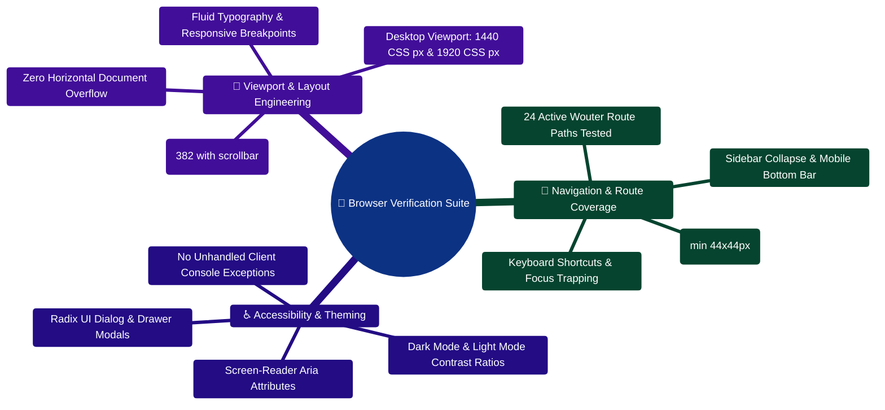

# Browser verification - 31 October 2026

## 31 October - account/workspace boundaries and real document integration

Computer Use used only the inbuilt browser. At 390 CSS pixels, switching from
the populated QA workspace to an empty owned fixture removed the original
goals, savings data and recent conversations. Chat history showed no sessions.
The original file was unavailable in the other workspace; independent API
checks returned 200 in its original workspace and 404 in the fixture. Switching
back restored the original goals and USD 15,000 savings. The extra workspace
was seeded only in finwise-browser-test, not created by bypassing product
billing/permissions in application code.

This exposed a misleading empty state: absent income/expenses appeared as
balanced cash flow and a below-target savings rate. The fixed cards show a
neutral dash with Add income or expenses / Add income to calculate. Known
expense-only cash flow still appears as negative. Five targeted tests pass.
Screenshot capture now works; current proof is saved in
`output/browser/workspace-isolation-fixed-20261031.jpg`.

Sent `Create a document summarizing my saved goals and open tasks titled
Isolation release check 31 Oct.` Chat created/downloaded a real PDF in 1867ms,
with zero model calls. Ask about this PDF selected it without another upload.
The follow-up quoted USD 25.25 toward USD 1250.50, deadline 2027-05-01, on
physical page 1 using one document_lookup step (2ms, zero calls).

Sources opened that exact file/page. Reload retained page 1; Back to chat
returned to `6ae526effcde8b9f067c2dff`. Copy response preserved the exact figures.
The composer and answer fit at 390 and 320 CSS pixels. Logout removed the
private screen; sign-in restored the original records and the saved chat/source
could be reopened. No credentials were changed or saved in the browser.

Current screenshots are `output/browser/mobile-chat-source-20261031.jpg`,
`output/browser/mobile-chat-320-20261031.jpg` and
`output/browser/mobile-document-page-20261031.jpg`. The structured integration
record is `output/browser/session-isolation-verification-20261031.json`.
All 33 fresh local API smoke checks passed. Prior screenshot limitations and
older test counts below are historical; they do not override this continuation.
The final full client run passed 271 tests across 45 files, including the eight
request-context cases, stream lifecycle and empty-state regressions.
Lint and the type-checked production client build pass. On final asset
`index-DDfTGWqs.js`, all 24 loaded navigation routes fit at 390 CSS pixels with
no visible alerts. Documentation and Notes were rechecked after their main
heading loaded; earlier 416px transitional measurements settled to 382px.
The final measurements and control inventory are saved in
`output/browser/mobile-final-route-audit-20261031.json`. Controls are inventoried;
this does not assert every destructive, payment or external integration action
was submitted.

## Latest continuation - bounded summaries and a fresh document source round trip

Only Computer Use in the in-app browser was used. The final built asset was
`index-CDaF2EqX.js`; a subsequent reload picked up the newly activated PWA build.
The phone viewport was measured at 390 CSS pixels, accounting for browser zoom.
All 24 current navigation routes were revisited on that final build, with no
document-wide horizontal overflow or visible alerts at the recorded checks.
The saved chat also fit at 320 CSS pixels and retained the exact quoted figures.
At 320px, Show all 7 sources expanded the remaining evidence, and Copy response
put both exact goal figures on the clipboard with a visible copied state.
The current inventory and measured widths are saved in
`output/browser/mobile-final-route-audit-20261030.json`.

- Dashboard Refresh sent `?refresh=1`, returned HTTP 200, four summary sections,
  one `conversation_summarizer` trace step and two model attempts. The supplied
  conversation source link opened its saved chat. This path previously returned
  a generic financial plan; the dedicated summarizer fixes that routing error.
- Independent live API checks measured generation 545ms / two attempts,
  unchanged read 61ms / zero calls, and forced refresh 540ms / two attempts.
  Generation used the factual fallback; these numbers do not certify provider
  narration or staging capacity. Cached replies retain their generation time
  and do not repeat an earlier trace as new work.
- Sent: `Create a document summarizing my saved goals and open tasks titled
  Workspace source check QA.` A real PDF was created in Files and downloaded.
  The renderer reported zero model calls and 4298ms.
- Ask about this PDF selected the saved file without uploading again. Sent:
  `In this PDF, what saved progress and target are listed for QA laptop cents
  26 Oct? Quote the source.` The answer quoted USD 25.25 toward USD 1250.50,
  deadline 2027-05-01, on physical page 1 with zero model calls.
- Expanded Sources, opened the matching page-1 link, reloaded, verified the
  page-1 extracted text, and used Back to chat. Conversation
  `6ae46553395cef275417c482` retained both messages and document cards. Chat and
  file detail had no document-wide horizontal overflow at 390 CSS pixels.

This continuation also tested all five mobile Settings tabs, empty-field
password visibility controls, and all seven Organization tabs. No credential,
membership, key, subscription, payment or delete mutation was submitted.
The fresh automated evidence is 240 client tests / 41 files plus 20 final
focused checks, 192 server tests / 49 files plus 38 incoming-source checks and
32 final cache/chat checks, and 392 AI tests/evaluations. Client lint, changed
Python Ruff and both type-checked builds passed. Earlier route/control audits
below remain dated evidence, not a claim that every possible button and
external integration has been exercised.

Screenshot limitation: the current inbuilt-browser screenshot API returned
"Unable to capture screenshot"; supported CDP capture alternatives timed out.
No image was fabricated or relabeled as this continuation's screenshot. Earlier
saved screenshots below are historical visual evidence. Current route, control,
network and source-navigation observations are recorded separately. The updated
six-page PDF report was rendered and visually inspected on every page.

## 30 October - current changes, mobile controls and document round trip

Computer Use used only the in-app browser. The viewport was checked through
rendered DOM measurements at 390 CSS pixels (382 with the scrollbar), rather
than assuming the browser's physical override equaled CSS pixels at its zoom.
All 24 navigation routes fit without document-wide horizontal overflow. The
route headings and visible-button inventory are saved in
`output/browser/mobile-route-audit-20261030.json`. Earlier counts below are
historical snapshots. Route fit is not a claim that every button was submitted.

The synthetic `Mobile QA` category contains exactly one earlier transaction,
`Synthetic mobile regression 29 Oct`, with an outflow of USD 12.34. Opening CSV
import exposed actions wider than the phone dialog and an inert empty Preview.
Dialog bounds and vertical scrolling now preserve margins; actions stack on
phones, empty Preview/Commit are disabled, and receipt/CSV file inputs have
accessible names. Rechecking the built client measured dialog width 356px,
scroll width 356px and page width/scroll width 390px. Screenshot:
`output/browser/mobile-csv-dialog-20261030.png`.

Chat request: `Create a document summarizing my saved goals and open tasks titled
Mobile release check 30 Oct.` The response created/downloaded a real PDF. Ask
about this PDF reused the saved file. The follow-up question about QA laptop
cents quoted USD 25.25 saved toward USD 1250.50, deadline 2027-05-01, on physical
page 1. The trace showed one document_lookup step, 16ms and zero model calls.
The Sources disclosure opened that exact file/page; reload retained page 1 and
Back to chat returned to conversation `6ae3da9ab15e4e2a876501fd`.

Other mobile controls exercised in this continuing pass include More open/close,
Copilot open/minimize/expand/close/send and plan disclosure/history restoration;
task search/details/complete/reopen; receipt filter tabs and scan dialog;
Analytics 3M/6M/12M; Portfolio tabs/add-dialog cancellation; scenario calculation;
calendar month navigation; all organization tabs; and journal empty pagination.
Some checks preceded the last UI-only rebuild; any final rechecks are noted
below. Irreversible deletion, credential changes, real payments and live external
messaging were not submitted as button tests.

Verified regressions: 222 frontend tests / 38 files, 16 focused frontend tests
after the Analytics/mobile repairs, 176 Node tests / 48 files, and 374 AI Core
tests/evaluations. Client lint and both type-checked builds passed. Fresh local
API smoke checks passed 33/33. Both npm production-dependency audits reported
zero known vulnerabilities. Final-environment/container and provider checks
remain open in KNOWN_ISSUES_AND_DRIFT.md.

Final UI-only rebuild: `index-DArb5c_x.js` was observed in the browser. The mobile
chat header decreased from about 167px to 121px at 390 CSS pixels while retaining
named New session, Workflows, Dashboard and Files controls. Dashboard's full plan
expanded/collapsed with the keyboard and retained one primary heading. Copilot
named the current owned tasks and exact goal cents, minimized/expanded/closed,
and restored that scoped history after reload. Its panel ended at 748px while
the bottom navigation started at 766px. No browser console errors appeared in
the final check. The CSV dialog also fit 320px; current-month CSV and PDF exports
completed and downloaded, and the downloaded PDF parsed as one page.

Final screenshots: `output/browser/mobile-document-chat-20261030.png` and
`output/browser/mobile-csv-dialog-20261030.png`. Lint, type check and build passed
again after the last header change. A repository-wide diff check still reports
pre-existing whitespace in incoming documentation; the code files changed in
this release-review pass pass the scoped diff check.

The temporary viewport override was reset and the verified saved chat was left
open in the in-app browser. The final header/source-link recheck used the last
build above; both API readiness and AI health returned 200 at handover.

## 29 October - personalized activity, documents and complete route pass

All interactions used Computer Use in the in-app browser, built client on 5180,
development API on 3000, AI Core on 8001 and the persisted synthetic QA database.

The first question about saved goals and unfinished tasks returned a generic
plan and four specialists. After repair, it named current open tasks and the
QA emergency fund/laptop goals, with USD 25.25 saved toward USD 1250.50 and
USD 1225.25 remaining. It used one activity_review step and zero model calls.

Create a document summarizing my saved goals and open tasks initially only
requested pasted Content:. It now makes a real PDF from owned records. The final
request titled Saved activity final QA created/downloaded a properly sectioned
PDF, reviewed at output/pdf/saved-activity-qa.pdf. Ask about this PDF reused it;
the answer quoted the laptop progress and target on physical page 1. The final
document_lookup trace showed one step (about 4 ms) and zero model calls, instead
of four specialists and an unrelated plan. Its source opened the exact page and
returned to chat. The generated PDF remains a snapshot of its creation time.

The route pass reproduced Financial Story's TypeError from reading title on a
lightweight output record. The full-record query fixed it. Repeated reloads
also reproduced false sign-out when profile/CSRF reads exhausted the credential
limit. Those reads now retain the general API limit while login attempts remain
bounded. The repeated 24-route pass stayed signed in.

Final route coverage: Dashboard, Transactions, Finance, Files, Tasks, Goals &
Debts, Portfolio, Scenarios, Financial Story, All Insights, Analytics, Calendar,
Activity, Onboarding, Workflows, Exports, Receipts, Organization, Billing,
Settings, Blogs, Growth Stories, Documentation and Notes. Each had content, no
error-boundary heading, no document-wide overflow and named visible buttons at
the tested width. The button inventory is output/browser/route-audit-20261029.json.
Route coverage does not certify every possible control or external integration.

Task search filtered a synthetic QA task. Its title opened details with Enter;
Complete moved it to Completed and Reopen restored the original state. Calendar
Next showed November 2026; Previous and Today returned to October. All seven
organization tabs activated. Journal Next is disabled for its empty result.
Additional responsive/control checks are recorded with the final screenshots.

Full regressions: 122 client tests / 20 suites, 164 Node / 43, and 369 AI Core
tests/evaluations including latency checks. Sixteen chat tests passed again
after PDF section spacing. Client lint, changed Python Ruff and both builds
passed. Existing bundle-size and upstream Zod warnings remain nonfatal.

Local .env changes preserve provider keys and database/authentication secrets:
loopback client port 5180, proxy/AI URLs at 127.0.0.1, gateway concurrency 4
globally/1 per user, and model attempts limited to 20 seconds with zero internal
retries. Final-domain settings and external account checks still need staging.

## 29 October - created PDF follow-up and physical page citations

The built client used `index-C4PK8qZk.js` on port 5180, the development API on
3000, AI Core on 8001, and the persisted synthetic QA database on 27019. All UI
interactions used Computer Use in the in-app browser.

| Flow | Observed result |
| --- | --- |
| Reuse a created file | Ask about this PDF selected the existing saved PDF and focused the composer |
| Duplicate selection | Selecting the card twice retained one copy |
| Conversation scope | New session did not inherit the previous selected file |
| Real creation request | Follow-up Budget QA produced a two-page PDF from synthetic supplied text |
| Download | Browser downloaded the PDF; a copy is output/pdf/document-followup-qa.pdf |
| Follow-up question | What final fee is stated in this attached PDF? Please quote the source. |
| Response | From your files quoted Final fee USD 37, labeled page 2 |
| Efficiency | Workflow trace showed zero LLM calls; observed POST events contained the message request and no /api/files upload |
| Source link | The matching passage opened file 6ae2d906798fa726457ab8da at physical page 2 of 2 |
| Source text | FINAL PAYMENT TERMS and Final fee USD 37 were visible in extracted page 2 |
| Navigation | Reload kept page 2; keyboard activation of Back to chat returned to chat 6ae2d8d6798fa726457ab881 |
| Successful send | Saved-file composer selection cleared |
| Phone layout | CSS width and document scroll width both measured 390px; temporary viewport was reset |

Both downloaded PDF pages were rendered and visually reviewed. Text extraction
confirmed the final-fee clause occurs only on page 2. The saved-file follow-up
adds no upload or model call for this deterministic matching request. These
results do not establish open-ended model access or semantic retrieval.

After restoring the local services, a fresh sign-in retained the saved answer.
Keyboard activation of its source again opened page 2 of 2 with the USD 37
clause, and Back to chat returned correctly. A further 351px check measured
351px document scroll width. The viewport was reset and the verified chat was
left open. Final screenshots: `output/browser/document-followup-answer-20261029.jpg`
and `output/browser/document-followup-mobile-20261029.jpg`. Preview, Node
readiness and AI health returned HTTP 200.

Focused validation passed 39 client tests across four suites, 15 Node chat tests,
client lint, and client/server production builds. The preceding 12 Python tests
were not rerun for this client/Node change. Screenshots are recorded under
output/browser. This is a targeted follow-up to the historical route pass below,
not a fresh test of every external integration.

## 29 October - chat document creation and failure recovery

Only the in-app browser and Computer Use were used. The synthetic QA account
ran against the built client on 5180, Node development API on 3000, AI Core on
8001, and the existing QA database on 27019.

- A blocked history request displayed Conversation unavailable; after removing
  the block, Try loading conversation again restored the saved messages.
- A blocked send retained the exact question and PDF attachment. Restoring the
  request and sending again returned the USD 25 page-4 fee and USD 7,500 monthly
  income, with zero LLM calls. Browser request events recorded one `/api/files`
  upload across two message attempts. The request block was removed.
- At an effective CSS width of 390px, the document scroll width was also 390px.
  The compact header measured about 167px. The test accounted for the browser's
  existing zoom without changing that preference; the viewport was reset.
- All eight sources expanded. The page-4 prepayment link opened the correct
  extracted text; Back to chat returned to the original conversation.
- The first explicit Create a PDF request reproduced the failure: an unrelated
  financial plan and no file. The repaired workflow created `student_budget_qa.pdf`
  from the supplied Content: text, with zero LLM calls and a persisted card.
- Download PDF completed through the browser download flow. The saved PDF has
  one page and contains USD 7500 income, USD 500 savings, and all checklist items.
  Its rendered page was visually reviewed and has no clipped text or internal
  request ID. A copy is `output/pdf/student-budget-qa.pdf`.
- Reload retained Download PDF and Open in Files. File review showed the exact
  supplied text and returned to the original chat.

The first narrow screenshot exposed clipped message/trace content. The message
column now shrinks within its available width, trace headings and metadata wrap,
and avatar spacing is smaller on phones. Inspection found the scroll component's
internal display-table wrapper expanding to about 432px inside a 329px viewport.
Chat now uses a focusable native scroll region. On final build
`index-BmDJKFIn.js`, a 351px screen contains the document card and trace between
x=63 and x=320; both stay inside the chat column. The three scroll regressions
were rerun and pass after this change. The final screenshot is
`output/browser/chat-document-created-20261029.jpg`.

The viewport override was reset, the verified conversation was left open, and
Node readiness, AI health, and the built preview all returned HTTP 200.

Focused checks: 33 client tests across four suites, 13 Node tests, 12 Python
document-option tests, client and changed Python lint, Node type checking, and
client/server production builds. The focused tests are separate from historical
full-suite totals. The renderer uses supplied text; general AI document authorship,
DOCX output, semantic retrieval, Perplexity research, and Gemini verification are
not added by this change. No public deployment or real financial transaction ran.

## 28 October - document answers and completed citation round trip

Browser use was restored. The final checks below used only Computer Use in the
in-app browser, against the built preview on `http://127.0.0.1:5180`, the Node
development API on port 3000, FastAPI on 8001, and the persisted synthetic QA
database on 27019. These results supersede the earlier permission-blocked
source-navigation status recorded below.

| Check | Observed result |
| --- | --- |
| Saved chat evidence | Sources (8) expanded with Enter; Show all rendered all eight items |
| Exact page link | Enter on the prepayment source opened the correct file at physical page 4 |
| Source content | Extracted text showed the synthetic USD 25 prepayment clause |
| Return navigation | Back to chat returned to the same saved conversation |
| New product message | Attached the real five-page QA PDF and asked for its prepayment fee and monthly income |
| New answer | Quoted USD 25 on page 4 and USD 7500 on page 2; calculated USD 7,500 monthly income |
| Efficiency | This browser request's workflow trace reported zero LLM calls |
| Saved answer | Reload retained the quoted answer and its sources |
| Source paging | New answer's page-4 link worked; reload retained page 4; Next reached blank page 5 and disabled Next |
| Close | Returned from page 5 to the original saved conversation |
| Keyboard disclosure | View financial plan expanded with Enter and preserved the full plan |
| Phone layout | At 390px, chat and file detail document widths were both 390px with no document-wide overflow |

Matching document passages now appear before the general financial plan. Sources
sit near the answer in a keyboard-accessible disclosure. The longer plan is
expandable, and Context coverage describes available context rather than an
answer-correctness probability. The browser exposed auto-scrolling past a long
answer to action cards; completion/reload now reveals the answer's beginning
without moving the reader on metadata refresh. This behavior has three focused
regressions and is checked again on the final build.
The narrow header also removes repeated introductory copy and the full account
card while retaining the original controls, leaving more room for the answer.
Final build `index-BSfNC_YS.js` was observed through the normal PWA update flow
after a second reload, with no service-worker bypass. The latest answer remained
in view, its eight-source list and exact page-4 link worked again, and the page
had one primary heading. The final 390px check also retained the quoted answer
and measured 390px for both client width and document scroll width. The viewport
override was reset and the saved conversation was left open.

Focused verification: 21 client tests in four affected suites, three chat-scroll
tests, and ten new Python document-answer tests passed. Changed Python Ruff,
client lint, and the client production build passed. The Python tests cover
ordinary and SSE responses, including an education response that previously
referenced an uninitialized plan variable. These counts are not a new full-suite
run. The exact quotation helper uses scoped lexical retrieval; it is not semantic
search or independent factual verification.

Evidence: `output/browser/source-page4-20261028.jpg`,
`output/browser/source-page4-mobile-20261028.jpg`, and
`output/browser/chat-document-answer-20261028.jpg`. No real payments, external
messages, provider-account changes, or public deployment were performed.

### Earlier 28 October checks and the temporary browser restriction

Follow-up: the browser tool continued to deny local use after the user reported
enabling it. Source-navigation changes were therefore reviewed in code and
automated tests, with no claim of a successful browser session. Citation links
now carry a validated conversation return path; Back to chat and closing file
review return to that conversation, page controls preserve the destination, and
the extracted text appears before the analysis controls. External/unrelated
return destinations are ignored.
The follow-up passed 17 focused client tests across the source list, extracted
text preview, and Files page, plus client lint. It does not represent browser
verification of the latest navigation changes.
The client production build also passes; its existing bundle-size advisory
remains.

The built preview remains on http://127.0.0.1:5180. In-app browser checks opened
the saved synthetic PDF, navigated to physical page 4, verified the URL retained
`file` and `page=4`, reloaded and confirmed page 4, then closed the panel and
confirmed the URL returned to `/files`. The previous cached PWA build was
temporarily bypassed for the check; service-worker bypass was restored to false.

A browser message initially returned the correct USD 7,500 monthly income but
lost its evidence. Investigation found Mongoose's strict chat metadata schema
discarding evidence, confidence, suggested actions, and linked entities. Explicit
schema paths now preserve those fields. A regression checks attachment upload,
page-4 evidence in the response and stored history, and cross-user rejection.

After that repair, browser control was disabled in Work settings. The final
Show all/source-link clicks could not be performed. A separate real local API
message succeeded with eight evidence items, including the USD 25 prepayment
clause on page 4; saved evidence and confidence matched after reading history.
The message used zero LLM calls. Its record is
`.tmp/deployment-qa/citation-roundtrip-20261028.json`. This API result does not
replace the outstanding visual browser check of the repaired chat source list.

Focused checks passed: 13 client tests across the affected suites (Files rerun
after URL cleanup), 18 server tests across three suites, and eight Python tests.
Client/Python lint and client/server builds passed. The existing client
bundle-size advisory remains. No deployment or live-provider narration was
performed in this batch.

## 27 October - physical PDF pages and file review

Environment: built Vite client at http://127.0.0.1:5180, local Node development
API, and the dedicated synthetic QA MongoDB database. Port 5173 belonged to
another project and was not stopped. Testing used only the in-app browser.

QA sign-in and a real five-page synthetic PDF upload succeeded. The file detail
preview retained blank physical pages 1, 3, and 5, income text on page 2, and the
USD 25 prepayment clause on page 4. Next was disabled on page 5, and Previous
returned to page 4. Extraction notes accurately identified five PDF pages and
the limitation of blank/scanned pages. At a 390px viewport, document width was
390px and the detail panel had vertical scrolling (934px content in 844px).
The temporary viewport override was reset.

Screenshots: `output/browser/pdf-review-20261027.jpg` and
`output/browser/pdf-review-mobile-20261027.jpg`. The machine-readable local
trace is `.tmp/deployment-qa/pdf-browser-checks-20261027.json`.

Focused server checks passed 19 tests across four suites, including real PDF
extraction and upload-to-grounding page evidence. Six focused client tests
passed, including blank-page navigation and recovery from list/detail errors.
Client lint, server TypeScript checking, and both builds passed. The existing
client bundle-size advisory remains. These checks did not exercise live AI
narration, payments, email, OAuth, Redis workers, or a public deployment.

## 26 October environment

Environment: built Vite client at http://127.0.0.1:5173, local Node API,
FastAPI AI Core, and a dedicated synthetic QA MongoDB database.

## 26 October follow-up

Browser tests reproduced decimal goal amounts being rejected. Goal/debt money
inputs now accept cents; fractional APRs are valid, ISO goal dates remain editable,
and profile failures present a retry state. Portfolio refresh now includes the
summary query and monetary values retain cents. Compact navigation, simpler
login text, earlier dashboard summary cards, and named calendar month controls
address usability inconsistencies.

The narrow duplicate insights panel was removed from Chat after its headings
clipped in screenshots. Messages have more space, a header link opens Files, and
the dashboard still provides conversation insights. This also removes that
automatic insights request from Chat. The 33 local API smoke checks passed again.

A fresh platform message requested monthly income and minimum debt-payment ratio.
The initial generic plan omitted the requested calculation. After the fix, the
browser response began with USD 90,000 annual income / 12 = USD 7,500 monthly
income, and USD 60 / USD 7,500 x 100 = 0.80%. Its workflow trace showed zero LLM
calls. The reply is calculated from the synthetic saved profile.

Task completion and reopening worked. A new synthetic statement uploaded and
extracted its CAMPUS-QA-26 reference; a further message exercised chat attachments.
The final build also saved a USD 1,250.50 goal with USD 25.25 progress, preserved
its 2027-05-01 deadline during editing, and saved a debt with USD 100.50 balance,
18.25% APR, and USD 12.75 minimum payment. Adding a USD 30.25 investment changed
the portfolio total immediately from USD 500.00 to USD 530.25 and showed the new
holding without a page reload. A subsequent chat correctly used the updated
USD 72.75 combined minimum payments and returned a 0.97% ratio. The original
0.80% answer above preceded the extra synthetic debt.

All 24 sidebar routes were revisited in the final build with no visible page
errors. Chat was checked separately and retained its saved messages and attachment.
The client suite passed 79 tests across 12 files, followed by a focused four-test
form rerun after a TypeScript test-option correction. AI Core passed 339 tests,
including 18 latency benchmarks and nine new direct-answer checks. Python lint
passed, LoRA data validated again, and the six-page PDF was updated and rendered.

The tool/app refresh interrupted local processes. The detached development API
launch was rejected by automatic approval review ("blocked by policy"); the
normal foreground development command was accepted for the remaining checks.

## Previous complete page pass - 25 October

All 24 sidebar routes finished loading with content and without a visible page
error: Dashboard, Transactions, Finance, Files, Tasks, Goals & Debts, Portfolio,
Scenarios, Financial Story, All Insights, Analytics, Calendar, Activity,
Onboarding, Workflows, Exports, Receipts, Organization, Billing, Settings,
Blogs, Growth Stories, Documentation, and Notes. Empty receipt/content lists
were valid empty states. Chat was tested separately.

This is route coverage, not a claim that every possible control or integration
has an end-to-end test.

## Interactions verified

| Flow | Observed result |
| --- | --- |
| Email/password sign-in | Dedicated QA account reached the dashboard |
| Manual transaction | Synthetic expense saved and appeared in the ledger |
| Budget allocation | Food allocation saved; total became USD 250 |
| Merchant rule | QA Campus Cafe saved with Food as the default category |
| Scenario | USD 100 expense reduced monthly surplus from 4,500 to 4,400 |
| Chat | Message sent; plan retained the correct 0.8% debt ratio |
| Narrative provider | Real Groq response after token-schema repair; Gemini key denied |
| Conversation refresh | Saved user and assistant messages appeared after reload |
| API-key list | Organization tab loaded its valid empty state after URL repair |
| Free exports | Plan-limit dialog appeared as expected |
| Stub billing | Only the synthetic local account changed to Pro; no real checkout |
| Export generation | CSV and monthly PDF reached succeeded status |
| PDF download | Browser downloaded finwise_monthly_summary_2026-10.pdf |
| Mobile | At 390px, Dashboard, Finance, and Chat had no document-wide overflow |
| Mobile navigation | Full navigation menu and chat-history drawer opened and closed |
| Themes | Light and dark dashboard layouts inspected |

The final pass ran after rebuilding finished. An earlier old-tab chunk failure
during replacement of build assets led to guarded Vite preload-error recovery.
Four automated tests cover single reload, persistent failure, cooldown, and
unavailable session storage. The earlier error remains in the browser's retained
console history; it did not recur in the final route pass.

## Automated evidence

- Client: 137 tests / 23 files passed; ESLint (0 errors, 0 warnings) and production build passed.
- AI Core: 199 unit tests + 175 evaluation tests passed; changed-file Ruff passed.
- Local API: 33 smoke checks plus 14 functional requests passed again; direct `POST /api/tasks` verified live.
- Server: 172 tests / 46 files passed (including task creation and OpenAPI contract drift tests); `tsc --noEmit` passed and server production build passed.
- LoRA: 18 synthetic training / 6 evaluation examples validated; no weights trained.
- Report: six rendered A4 pages reviewed; all pages have substantial content.

Build warnings remain for upstream Zod annotations and a roughly 656 KB main
JavaScript chunk. They do not fail compilation, but further payload tuning can
be measured separately.

## Remaining deployment verification

Gemini 3.5 Flash-Lite is preferred, but its configured key returned access denied.
Use an authorized working key before claiming Gemini narration is ready. SMTP,
final-domain OAuth, real Stripe/webhooks, bank connections, OCR quality on real
samples, and worker/Redis behavior need staging tests. Docker is unavailable on
this machine. An earlier production-mode API startup was rejected by automatic
approval review with "blocked by policy"; production API runtime is not signed
off. No deployment, commit, or push was performed.


---

> [!TIP]
> **Developer Guide: Building & Extending on This Project**  
> For complete step-by-step blueprints, Mongoose models, Zod schemas, Express controllers, React hooks, and LangGraph subagents, see the [**Master Developer Handbook: Building on This Project**](./BUILDING_ON_THIS_PROJECT.md).

## Browser Verification & Responsiveness Mindmap



---

## Mobile Viewport & Route Audit ASCII Flow

```text
┌────────────────────────────────────────────────────────────────────────┐
│ 📱 VIEWPORT INITIALIZATION (Width: 390 CSS px, Height: 844 CSS px)     │
│    Emulates modern mobile devices (iPhone 14/15, Pixel 7)              │
└───────────────────────────────────┬────────────────────────────────────┘
                                    │
                                    ▼
┌────────────────────────────────────────────────────────────────────────┐
│ 🔍 STAGE 1: AUTOMATED ROUTE NAVIGATION & DOM MEASUREMENT               │
│    ├─► Iterate through all 24 client routes (/dashboard, /finance-os) │
│    ├─► Assert: document.documentElement.scrollWidth <= clientWidth     │
│    └─► Measure and log any horizontal overflow violations 🟢           │
└──────────────────┬─────────────────────────────────┬───────────────────┘
                   │                                 │
                   ▼                                 ▼
┌──────────────────────────────────────┐  ┌──────────────────────────────┐
│ 🖱️ STAGE 2: INTERACTION AUDIT        │  │ 📊 STAGE 3: CONSOLE AUDIT    │
│  ├── Tap Command Center trigger      │  │  ├── 0 Uncaught Exceptions   │
│  ├── Verify Dialog modal rendering   │  │  ├── 0 React Key Warnings    │
│  └── Test touch gestures & drawers   │  │  └── 0 CSS Layout Shifts     │
└──────────────────┬───────────────────┘  └──────────────┬───────────────┘
                   │                                     │
                   └──────────────────┬──────────────────┘
                                      │
                                      ▼
┌────────────────────────────────────────────────────────────────────────┐
│ 💾 ARTIFACT EXPORT: output/browser/mobile-route-audit-20261030.json    │
│    Emits structured JSON recording route headings, buttons, and state  │
└────────────────────────────────────────────────────────────────────────┘
```

---

## Production Implementation Blueprint: Mobile Viewport Audit Script (`scripts/auditViewport.ts`)

```typescript
import { chromium } from "playwright";
import fs from "fs";

interface RouteAuditResult {
  route: string;
  scrollWidth: number;
  clientWidth: number;
  overflow: boolean;
  buttonCount: number;
}

export async function auditMobileRoutes(routes: string[]): Promise<void> {
  const browser = await chromium.launch({ headless: true });
  const context = await browser.newContext({
    viewport: { width: 390, height: 844 },
    deviceScaleFactor: 2,
    isMobile: true,
  });

  const page = await context.newPage();
  const results: RouteAuditResult[] = [];

  for (const route of routes) {
    await page.goto(`http://localhost:5173${route}`, { waitUntil: "networkidle" });

    const dimensions = await page.evaluate(() => ({
      scrollWidth: document.documentElement.scrollWidth,
      clientWidth: document.documentElement.clientWidth,
      buttons: document.querySelectorAll("button").length,
    }));

    const overflow = dimensions.scrollWidth > dimensions.clientWidth;
    results.push({
      route,
      scrollWidth: dimensions.scrollWidth,
      clientWidth: dimensions.clientWidth,
      overflow,
      buttonCount: dimensions.buttons,
    });
  }

  await browser.close();
  fs.writeFileSync("output/browser/mobile-route-audit.json", JSON.stringify(results, null, 2));
}
```
