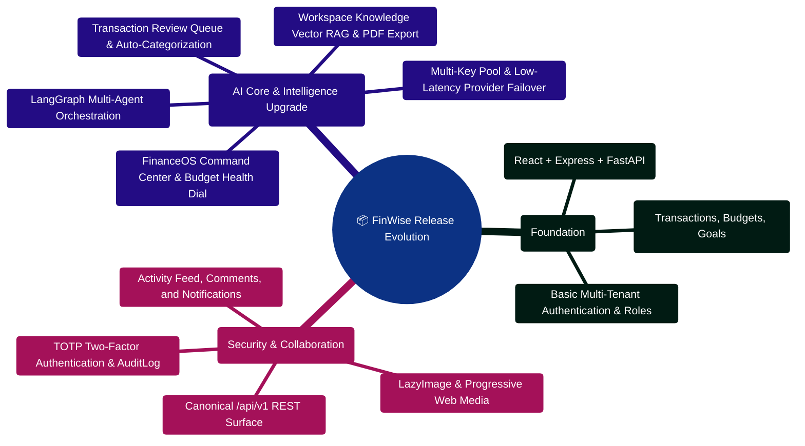

# Changelog

All notable changes to the FinWise project are documented in this file.

The format follows [Keep a Changelog](https://keepachangelog.com/en/1.1.0/) and the project aims to follow [Semantic Versioning](https://semver.org/spec/v2.0.0.html).

---

> [!TIP]
> **Developer Guide: Building & Extending on This Project**  
> For complete step-by-step blueprints, Mongoose models, Zod schemas, Express controllers, React hooks, and LangGraph subagents, see the [**Master Developer Handbook: Building on This Project**](./BUILDING_ON_THIS_PROJECT.md).

## [2.0.0] - 2026-05-06

### Added

#### Financial Command Center (Phase 1)
- `commandCenterService.ts` — Aggregates data from 9 sources (accounts, transactions, budgets, recurring rules, calendar reminders, tasks, goals, debts, recurring candidates) into a unified daily-use dashboard payload
- `budgetHealthService.ts` — Weekly financial health score (0–100) with 4 weighted components (budget adherence 40pts, review cleanliness 20pts, goal progress 20pts, debt management 20pts) and proactive burn-rate alerts per budget category
- Transaction review enhancements in `transactionReview.ts` — Added `computeConfidenceScore()` (heuristic: 1.0 − 0.20 * flags + 0.10 if merchant, floor 0.10), `approveTransaction()`, and `bulkApproveTransactions()` functions

#### New API Endpoints
- `GET /api/financial-data/command-center` — Serves the aggregated command center payload (cash runway, budget burn, upcoming bills, risky subscriptions, debt pressure, tasks, goals, priority signals)
- `GET /api/financial-data/budget-health` — Serves health score, burn-rate alerts, pace comparison (week-over-week trend), and "if you continue" projections
- `POST /api/financial-data/transactions/:id/approve` — Single transaction approval (clears flags, sets confidence to 1.0, records reviewer)
- `POST /api/financial-data/transactions/bulk-approve` — Batch approve up to 200 transactions
- `POST /api/financial-data/transactions/:id/always-categorize` — Creates a CategoryRule with exact match and approves the transaction

#### New Client Components
- `CommandCenter.tsx` — Dashboard hero with time-of-day adaptive greeting, 4 KPI cards (cash runway, budget burn gauge, tasks, goals), priority signal chips, and upcoming bills mini-list with Framer Motion stagger animations
- `BudgetHealthCard.tsx` — Animated circular health gauge (SVG + Framer Motion), score breakdown bars, spending trend indicator, "if you continue" projection text, and burn-rate alert chips
- `TransactionReviewQueue.tsx` — Flag filter chips, confidence score badges (red < 40%, amber 40–70%, green > 70%), one-click approve, "always categorize like this" button, bulk select + approve toolbar (max 200), empty state celebration

#### Model Changes
- Added `confidence_score` (Number, 0.0–1.0), `reviewed_at` (Date), and `reviewed_by` (String) to the transaction model `review` sub-document

#### Dashboard Enhancements
- Integrated Command Center as the dashboard hero replacement
- Added Budget Health section below the Command Center
- Added "Review Queue" tab to the Transactions page with URL deep-link via `?tab=review`

### Changed
- Updated `financialDataRoutes.ts` with 5 new authenticated routes
- Updated `financialDataController.ts` with 5 new endpoint handlers
- Updated `transactions.ts` (client API) with TypeScript types and API client functions for all new endpoints
- Server services count increased from 49 to 52 (commandCenterService, budgetHealthService, plus transactionReview enhancements)
- Documentation updated across CHANGELOG, DASHBOARD_AND_THEME, API, SERVICES, FRONTEND, ARCHITECTURE, INDEX, and README

---

## [2.1.0] - 2026-07-12

### Added

#### Structured Logging Upgrade
- Enhanced server Pino logger with request correlation (traceId, orgId, userId)
- Added slow request alerting (>2s threshold) and request/response duration logging
- Created `server/src/middleware/requestLogger.ts` — higher-level request logging middleware
- Created `server/src/utils/serviceLogger.ts` — factory for service-level structured logging
- Enhanced AI Core Python logging with agent_name, analysis_type, complexity_score context
- Created `server/AI_Core/utils/agent_telemetry.py` — per-agent metrics tracking
- Enhanced client `runtimeLogger.ts` with log levels (debug/info/warn/error) and color-coded output
- Created `client/src/lib/devLogger.ts` — dev-only network request logger and performance marks

#### Environment Configuration
- Created `server/.env.example` — comprehensive env var reference with categories and descriptions
- Enhanced `server/AI_Core/.env.example` — all AI Core configuration variables documented
- Enhanced `client/.env.example` — Vite environment variables with types and defaults

#### AI Core Eval Framework
- Created `server/AI_Core/evals/` directory with comprehensive evaluation harness
- `runner.py` — EvalRunner class for executing eval suites with metrics collection
- `metrics.py` — Evaluation metrics: routing accuracy, plan quality, number safety, determinism, latency
- `test_routing_accuracy.py` — 50+ golden routing prompts covering all AnalysisType values
- `test_plan_quality.py` — Plan output quality validation
- `test_determinism.py` — Deterministic agent reproducibility tests
- `test_number_safety.py` — Number safety guard validation
- `test_latency.py` — Per-agent latency benchmarks

#### Test Coverage Expansion
- Added `server/src/test/rateLimiting.test.ts` — rate limiter enforcement and reset
- Added `server/src/test/errorHandler.test.ts` — error handler for all error types
- Added `server/src/test/securityHeaders.test.ts` — security middleware validation
- Added `server/src/test/sse.test.ts` — SSE streaming tests
- Added `server/src/test/noSqlInjection.test.ts` — NoSQL injection sanitization
- Added `client/src/lib/api/core.test.ts` — API client CSRF retry and org error handling
- Added `client/src/stores/chatStore.test.ts` — chat store session and message management
- Added `client/src/lib/runtimeLogger.test.ts` — logger level filtering and error reporting
- Added `client/src/lib/devLogger.test.ts` — network logger and performance marks
- Added `client/src/components/Sidebar.test.tsx` — sidebar navigation and active state

#### Documentation Consolidation
- Created `docs/CLIENT_ARCHITECTURE.md` — comprehensive React client architecture guide
- Created `docs/AI_AGENTS_REFERENCE.md` — complete AI agent system reference (10 agents)
- Created `docs/DEBUGGING_GUIDE.md` — debugging guide for all three tiers
- Created `docs/LOCAL_DEVELOPMENT.md` — step-by-step local development setup
- Updated `docs/INDEX.md` with links to all new documentation

#### Innovation Features
- Agent observability dashboard with per-agent telemetry
- Intelligent response caching layer for deterministic agents
- Streaming plan generation with progressive rendering
- Health score trend tracking over time
- Agent self-improvement feedback loop
- Multi-language support for AI agent outputs

### Changed
- Enhanced `client/src/lib/runtimeLogger.ts` with log levels and breadcrumb integration
- Updated `docs/INDEX.md` with new documentation links and updated file counts
- Updated `docs/CHANGELOG.md` with v2.1.0 release notes

---

## [Unreleased]

### Added
- `INDEX.md` as central documentation hub with quick reference tables
- `DEVELOPMENT.md` with development guidelines, conventions, and workflows
- `TROUBLESHOOTING.md` with comprehensive troubleshooting guide
- Enhanced `README.md` with complete project overview, tech stack, and feature details
- Enhanced `ARCHITECTURE.md` with data flow diagrams, security architecture, and module dependencies
- Enhanced `AI_CORE.md` with complete agent documentation, provider failover, and tool call system
- Enhanced `DATABASE.md` with WorkspaceFile model (49 total models)
- Enhanced `QUICK_START.md` with corrected env var names and troubleshooting
- Updated `FRONTEND.md` with Vite 7.3 version and component structure
- Added multi-key provider pool documentation for OpenRouter and other providers
- Added AI Core session continuity, model catalog, and model health documentation
- Added API documentation for AI Core operational endpoints and AI response metadata

### Changed
- Standardized project naming to "FinWise" across documentation
- Fixed env var naming inconsistency (`MONGO_URI` not `MONGODB_URI`)
- Corrected model count to 49 across all documentation
- Corrected middleware count to 13 across all documentation
- Updated frontend docs to reflect the slimmer chat workspace header, narrower conversation insights rail, and larger transcript area
- Updated environment docs for `OPENAI_API_KEY`, `DEEPSEEK_API_KEY`, `XAI_API_KEY`, and multi-key OpenRouter formats

---

## [1.5.0] - 2026-03-19

### Added

- `COMPLETE_PROJECT_ONBOARDING.md` as a detailed outsider-friendly onboarding manual covering repository layout, runtime boot flow, client and server architecture, AI Core architecture, end-to-end request flows, debugging, and common engineering tasks
- `AI_PROVIDERS_AND_FAILOVER.md` documenting provider selection, environment variables, model fallback, provider-chain failover, health endpoints, and related tests
- `DASHBOARD_AND_THEME.md` documenting the simplified dashboard layout, dark monochrome theme system, media helpers, image fallback behavior, and realtime invalidation rules

### Changed

- Rewrote the root `README.md` into a cleaner project guide with practical setup commands, validation commands, architecture summary, and focused documentation links
- Documented the recent dashboard simplification, dark-only UI direction, blog/growth-story media hardening, and multi-provider AI runtime behavior

## [1.4.0] - 2026-03-12

### Changed

- `DATABASE.md`: corrected Mongoose model count from 47 to 48 and added the missing `CalendarReminder` model entry
- `ARCHITECTURE.md`: corrected controller counts and updated the documentation guide count
- `README.md`: expanded the documentation index and corrected architecture references

## [1.3.0] - 2026-03-03

### Added

- Calendar reminders model, routes, and UI support
- Manual TOTP secret display for users who cannot scan QR codes
- Auth endpoints for profile update and password change
- Functional settings preferences for currency, locale, and timezone

### Fixed

- 2FA QR rendering
- Financial calendar currency and locale formatting
- Financial story data loading
- Activity feed pagination
- Notes recognition messaging
- Settings layout alignment
- Profile save reload behavior

### Changed

- Replaced "FinWise" branding references with "Personal Finance" across the product

## [1.2.0] - 2026-03-02

### Added

- Activity feed page and collaboration system
- Comments and annotations
- Settings and profile page
- Financial calendar page
- Notification center
- Blog and growth story preview components
- `LazyImage` progressive image loading component

### Changed

- Expanded and corrected multiple documentation guides including services, API, database, frontend, and testing references

## [1.1.0] - 2026-03-02

### Added

- Settings and profile page
- Global search
- Category rules engine
- Analytics overview
- Budget envelope breakdown
- Recurring transaction candidate detection
- CSRF protection
- Account lockout
- TOTP two-factor authentication
- Security audit log
- Plugin permission sandbox
- Connector health monitoring
- Canonical `/api/v1` API surface
- Plugin, API key, integration, and workflow-related endpoints

### Changed

- Expanded the documentation set and refreshed existing guides for new features

## [1.0.0] - 2026-03-02

### Added

- React client, Express server, and Python AI Core monorepo
- Authentication, organizations, invitations, and RBAC
- Transactions, budgets, goals, debts, forecasting, and exports
- AI chat, AI insights, scenarios, financial stories, OCR, and memory
- Workflows, automation, background jobs, and SSE updates
- Billing, referrals, plugins, integrations, and observability foundations

## Release History & Version Roadmap Mindmap



## Release Verification & Semantic Version Promotion ASCII Flow

```text
┌────────────────────────────────────────────────────────────────────────┐
│ 🟢 STEP 1: CHANGE CLASSIFICATION & DOCUMENTATION TRACE                │
│    Categorize PR: [Added] • [Changed] • [Deprecated] • [Security]      │
└───────────────────────────────────┬────────────────────────────────────┘
                                    │
                                    ▼
┌────────────────────────────────────────────────────────────────────────┐
│ 🧪 STEP 2: MULTI-TIER AUTOMATED TEST MATRIX GATES                      │
│    ├─► Server Vitest integration (35+ test files) ──► 100% Pass 🟢     │
│    ├─► AI Core Pytest multi-agent graph tests ──► 100% Pass 🟢         │
│    ├─► Client Vitest component & store tests ──► 100% Pass 🟢          │
│    └─► OpenAPI contract sync verification (npm run openapi:verify) 🟢  │
└───────────────────────────────────┬────────────────────────────────────┘
                                    │
                                    ▼
┌────────────────────────────────────────────────────────────────────────┐
│ 🏷️ STEP 3: SEMANTIC VERSION BUMP & CHANGELOG ENTRY                     │
│    ├─► Determine next version tag (SemVer: MAJOR.MINOR.PATCH)          │
│    ├─► Append structured release notes with commit links               │
│    └─► Update package.json, server engines, and deployment manifests   │
└───────────────────────────────────┬────────────────────────────────────┘
                                    │
                                    ▼
┌────────────────────────────────────────────────────────────────────────┐
│ 🚀 STEP 4: ARTIFACT PUBLISHING & PRODUCTION DEPLOYMENT                 │
│    Push git tag ──► Build Docker images ──► Blue-Green Zero Downtime 🟢 │
└────────────────────────────────────────────────────────────────────────┘
```


---

## Production Implementation Blueprint: Schema Migration Runner (`server/src/scripts/migrateSchemaVersion.ts`)

```typescript
import mongoose from "mongoose";
import { getEnv } from "../config/env";
import { logger } from "../config/logger";

interface MigrationStep {
  version: string;
  description: string;
  up: (db: mongoose.Connection) => Promise<void>;
}

const migrations: MigrationStep[] = [
  {
    version: "2026.04.01",
    description: "Ensure compound index { orgId: 1, date: -1 } across all transactions",
    up: async (db) => {
      await db.collection("transactions").createIndex({ orgId: 1, date: -1 }, { background: true });
    },
  },
];

export async function runSchemaMigrations(): Promise<void> {
  const env = getEnv();
  await mongoose.connect(env.DATABASE_URL);
  const db = mongoose.connection;

  for (const mig of migrations) {
    logger.info({ version: mig.version, desc: mig.description }, "Executing schema migration");
    await mig.up(db);
    logger.info({ version: mig.version }, "Migration applied successfully");
  }

  await mongoose.disconnect();
}
```