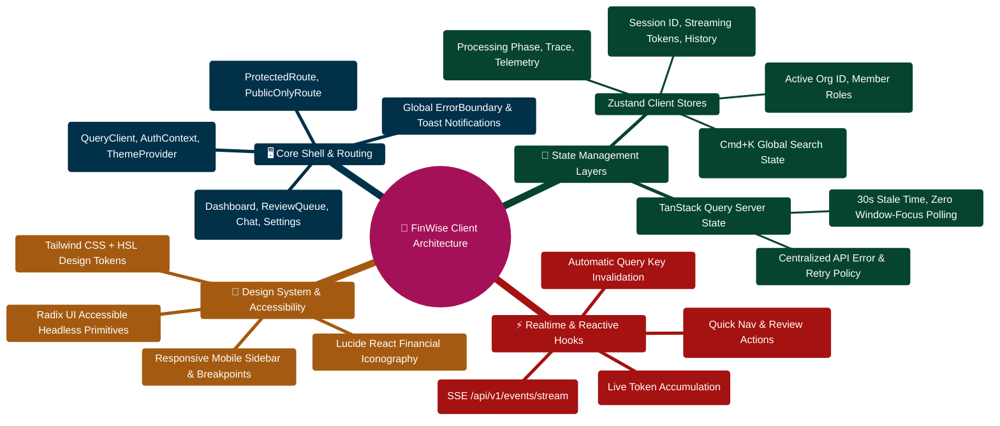

# FinWise Client Architecture

> Comprehensive architecture documentation for the React 18 + Vite + TypeScript frontend.

---

> [!TIP]
> **Developer Guide: Building & Extending on This Project**  
> For complete step-by-step blueprints, Mongoose models, Zod schemas, Express controllers, React hooks, and LangGraph subagents, see the [**Master Developer Handbook: Building on This Project**](./BUILDING_ON_THIS_PROJECT.md).

## Overview

The FinWise client is a single-page application (SPA) built with React 18, Vite 7, and TypeScript. It features 34 lazy-loaded pages, 6 Zustand state stores, 13 custom hooks, and a PWA-capable service worker. The client communicates with the Express server via REST API and Server-Sent Events (SSE).

| Aspect | Technology |
|--------|-----------|
| Framework | React 18 + TypeScript |
| Build Tool | Vite 7.3 |
| Routing | Wouter |
| Server State | TanStack React Query 5 |
| Client State | Zustand 5 |
| UI Components | Radix UI (30+ primitives) |
| Styling | Tailwind CSS 3 + CSS custom properties |
| PWA | vite-plugin-pwa + Workbox |
| Testing | Vitest + Testing Library + MSW |

---

## Provider Composition Tree

The application uses a nested provider pattern defined in `client/src/app/providers/AppProviders.tsx`. The nesting order is deliberate -- each provider depends on the contexts provided by outer providers.

```
ThemeProvider                -- Dark/light theme switching
  AuthProvider               -- Authentication through the HTTP client
    ScopedDataProvider       -- QueryClientProvider per account/workspace
      RealtimeAppEffects     -- SSE event listeners + keyboard shortcuts
        TooltipProvider      -- Radix UI tooltip configuration
          SkipToContent      -- Accessibility skip link
          Toaster            -- Toast notification system
          FeatureLimitDialog -- Feature limit exceeded dialog
          PlanAndUsageDialog -- Plan and usage information dialog
          {children}         -- Application content (AppRouter)
```

### Why This Order?

1. **ThemeProvider** supplies display preferences before the application renders.
2. **AuthProvider** resolves identity and CSRF through the HTTP client; it does not depend on React Query.
3. **ScopedDataProvider** owns a fresh query client per account/workspace. Context changes cancel and clear the old cache, remount private screens and clear transient drafts/history. Persisted chat selection is owner-scoped; late auth/chat replies and retired API retries cannot restore old context.
4. **RealtimeAppEffects** depends on auth context -- it only connects to SSE when a user is authenticated.
5. **TooltipProvider** is innermost -- it only configures tooltip behavior for child components.

### Global Components

Four components are rendered once at the provider level, outside the router:

| Component | Purpose |
|-----------|---------|
| `SkipToContent` | Accessibility skip link for keyboard navigation |
| `Toaster` | Toast notification system (Radix-based) |
| `FeatureLimitDialog` | Modal shown when API returns 402 FEATURE_LIMIT_REACHED |
| `PlanAndUsageDialog` | Modal for viewing plan and usage information |

### RealtimeAppEffects

This intermediate component activates two app-wide side effects that require React context:

```typescript
function RealtimeAppEffects({ children }: { children: ReactNode }) {
  useRealtimeEvents();     // SSE subscription for real-time cache invalidation
  useKeyboardShortcuts();  // Global keyboard shortcuts (Cmd+K, navigation)
  return <>{children}</>;
}
```

---

## Routing System

FinWise uses **Wouter** for client-side routing with code-splitting via `React.lazy()`.

### Route Definition Structure

Routes are defined in `client/src/routes/routeDefinitions.tsx` as an array of `AppRouteDefinition` objects:

```typescript
type AppRouteDefinition = {
  path: string;                    // URL pattern (e.g., "/dashboard", "/chat/:sessionId")
  access: "protected" | "public" | "public-only";
  layout?: "app" | "chat" | "default";
  component: LazyExoticComponent<ComponentType<any>>;
};
```

### Access Levels

| Level | Behavior |
|-------|----------|
| `protected` | Requires authentication. Redirects to `/login` if not authenticated. |
| `public` | Accessible to everyone (e.g., shared links, invite acceptance). |
| `public-only` | Only for unauthenticated users. Redirects to `/dashboard` if authenticated. |

### Layout Modes

| Layout | Description |
|--------|-------------|
| `app` | Full application layout with sidebar navigation (AppShell) |
| `chat` | Chat-optimized layout with conversation panel (ChatLayout) |
| `default` | No layout wrapper (used for auth pages) |

### Code Splitting

Each `React.lazy(() => import("@/pages/Xxx"))` creates a separate webpack chunk. The chunk is only downloaded when the user navigates to that route, significantly reducing initial bundle size.

### Route Categories

**Authentication Routes** (public-only):
- `/login` -- User login
- `/register` -- User registration
- `/verify-email` -- Email verification

**Public Routes**:
- `/accept-invite` -- Organization invite acceptance
- `/share/financial-story/:token` -- Shared financial story view

**Chat Routes** (protected, chat layout):
- `/chat` -- New conversation
- `/chat/:sessionId` -- Existing conversation

**Core Application Routes** (protected, app layout):
- `/dashboard` -- Financial overview
- `/transactions` -- Transaction management
- `/finance` -- Finance OS
- `/analytics` -- Analytics and reports
- `/portfolio` -- Investment portfolio
- `/goals-debts` -- Goals and debt tracking
- `/tasks` -- Task management
- `/workflows` -- Automation workflows
- `/receipts` -- Receipt scanning
- `/notes` -- Financial journaling
- `/billing` -- Subscription management
- `/org` -- Organization settings
- `/settings` -- User settings
- `/calendar` -- Financial calendar
- `/activity` -- Activity feed
- `/files` -- File management
- `/docs` -- Documentation viewer
- `/scenarios` -- Scenario planning
- `/financial-story` -- Financial story
- `/growth-stories` -- Growth stories
- `/blogs` -- Blog articles
- `/exports` -- Data exports
- `/onboarding` -- User onboarding

### Redirect Routes

Legacy URLs are redirected to their new locations:

| Old Path | New Path |
|----------|----------|
| `/app` | `/dashboard` |
| `/home` | `/dashboard` |
| `/organization` | `/org` |
| `/documentation` | `/docs` |
| `/insights` | `/all-insights` |
| `/stories` | `/growth-stories` |

---

## State Management

FinWise uses a hybrid state management approach: Zustand for client-side state and React Query for server-side state.

### Zustand Stores (6 stores)

| Store | Purpose | Persistence |
|-------|---------|-------------|
| `aiStore` | AI processing phase and workflow trace | None |
| `chatStore` | Chat sessions, messages, workflow progress | localStorage (currentSessionId only) |
| `orgStore` | Active organization ID | localStorage |
| `commandBarStore` | Command bar (Cmd+K) open state and history | None |
| `appDialogStore` | Feature limit and plan/usage dialog state | None |

See [STORE_REFERENCE.md](./STORE_REFERENCE.md) for complete store documentation.

### React Query Configuration

The React Query client is configured in `client/src/lib/queryClient.ts`:

```typescript
const queryClient = new QueryClient({
  defaultOptions: {
    queries: {
      staleTime: 30_000,           // Data fresh for 30 seconds
      refetchInterval: false,      // No automatic polling (SSE handles updates)
      refetchOnWindowFocus: false, // No refetch on window focus
      retry: (failureCount, error) => {
        if (failureCount >= 2) return false;
        if (error instanceof ApiError) return error.status >= 500;
        return true;
      },
    },
    mutations: {
      retry: (failureCount, error) => {
        if (failureCount >= 1) return false;
        if (error instanceof ApiError) return error.status >= 500;
        return true;
      },
    },
  },
});
```

Key design decisions:
- **No auto-refetch**: The app uses SSE for real-time updates instead of polling.
- **30s stale time**: Reduces unnecessary refetches while keeping data reasonably fresh.
- **Smart retry**: Only retries 5xx server errors, not 4xx client errors.
- **Query key convention**: Query keys are joined with "/" to form the API URL (e.g., `["/api/transactions"]`).
- **Global mutation error handler**: Shows toast for non-401/402 errors.

### Server-Sent Events (SSE)

The `useRealtimeEvents` hook establishes a persistent SSE connection to `/api/events/stream`. When domain events occur on the server, they are pushed to the client and automatically invalidate the relevant React Query caches.

**Event-to-Query Mapping**:

| Event Type | Invalidated Queries |
|------------|-------------------|
| `TransactionCreated` | transactions, dashboard, portfolio, analytics, activity-feed |
| `TransactionUpdated` | transactions, dashboard, portfolio, analytics, activity-feed |
| `TransactionDeleted` | transactions, dashboard, portfolio, analytics, activity-feed |
| `GoalUpdated` | financial-profiles, dashboard, goals, activity-feed |
| `BudgetAllocationUpdated` | budget-envelopes, dashboard, analytics, activity-feed |
| `WorkflowRunCompleted` | workflow-runs, tasks, activity-feed |
| `ReceiptProcessed` | receipts, transactions, dashboard, analytics, activity-feed |
| `InsightGenerated` | insights, agent-outputs, ai-status, ai-sessions, activity-feed |
| `TaskCreated` | tasks, activity-feed |
| `TaskUpdated` | tasks, activity-feed |
| `ExportCompleted` | exports, activity-feed |
| `ScenarioEvaluated` | analytics, dashboard, activity-feed |

**Reconnection**: If the SSE connection drops, the hook automatically reconnects with exponential backoff (1s, 2s, 4s, 8s, up to 30s max). The backoff resets on successful connection.

---

## Component Hierarchy

```
App
  AppProviders
    AppRouter
      Route Guard (protected/public/public-only)
        Layout (AppShell / ChatLayout / none)
          Page Component
            Feature Components
              UI Primitives (Radix-based)
```

### Component Organization

| Directory | Purpose | Examples |
|-----------|---------|----------|
| `components/ui/` | 47 Radix-based UI primitives | Button, Dialog, Toast, Tooltip, Card |
| `components/forms/` | Form components | TransactionForm, BudgetForm |
| `components/layout/` | Layout components | Sidebar, Header, AppShell |
| `components/feedback/` | Loading/error feedback | Spinner, ErrorBoundary |
| `features/` | Feature modules | chat/, journaling/, workflows/ |
| `pages/` | 34 route-level page components | Dashboard, Transactions, Chat |

---

## API Client Architecture

The API client is defined in `client/src/lib/api/core.ts` and provides a consistent interface for all HTTP requests.

### Automatic Behaviors

1. **Content-Type**: `application/json` (unless FormData body)
2. **X-Org-Id**: Injected from active org store (multi-tenancy)
3. **X-CSRF-Token**: Injected for state-changing requests (POST/PUT/DELETE)
4. **credentials**: `include` -- sends HTTP-only JWT cookie
5. **Error normalization**: All errors become `ApiError` instances
6. **Feature limit dialog**: 402 errors with FEATURE_LIMIT codes trigger a modal

### CSRF Protection (Double Submit Cookie Pattern)

```
1. On app mount: AuthProvider fetches CSRF token from GET /auth/csrf
2. Token is cached in memory (not localStorage)
3. Every state-changing request includes X-CSRF-Token header
4. Server validates token matches the CSRF cookie
5. On 403 CSRF_FAILED: fetch new token and retry once
```

### Org Context Injection

```
1. User selects an org -> useOrgStore.setActiveOrg(orgId)
2. Org ID is persisted to localStorage
3. API client reads activeOrgId and injects X-Org-Id header
4. Server scopes all data queries to that org
5. On 403 ORG_ACCESS_DENIED: clear stale org and retry once
```

### Retry Logic

| Error | Condition | Action |
|-------|-----------|--------|
| CSRF_FAILED (403) | State-changing request, first retry | Fetch new CSRF token, retry |
| ORG_ACCESS_DENIED (403) | GET request with injected header, first retry | Clear org, retry |
| ORG_ACCESS_DENIED (403) | Non-GET request | Clear org immediately (no retry) |
| FEATURE_LIMIT_REACHED (402) | Any request | Show upgrade dialog |
| All other errors | -- | Throw ApiError |

### API Base URL Resolution

The `buildApiUrl` function in `client/src/lib/apiBase.ts` normalizes endpoint formats:

```
"/ai/process"       -> "/api/ai/process"
"/auth/login"       -> "/api/auth/login"
"/api/transactions" -> "/api/transactions"
```

The `VITE_API_BASE_URL` environment variable supports cross-origin deployments. Defaults to `/api` for same-origin (Vite proxy) development.

---

## PWA Configuration

FinWise is a Progressive Web App configured via `vite-plugin-pwa` in `client/vite.config.ts`.

### Manifest

| Property | Value |
|----------|-------|
| name | "Personal Finance -- AI Financial Strategist" |
| short_name | "Personal Finance" |
| display | standalone |
| theme_color | #34d399 |
| background_color | #000000 |
| start_url | / |
| icons | 192x192, 512x512 (including maskable) |

### Service Worker (Workbox)

**Registration**: `autoUpdate` -- new service worker versions are applied automatically.

**Caching Strategies**:

| Pattern | Strategy | Cache Name | Max Entries | Max Age |
|---------|----------|------------|-------------|---------|
| Static assets (JS, CSS, HTML, fonts) | Precache | Default | -- | -- |
| `/api/v1/*` | NetworkFirst | api-cache | 50 | 5 minutes |
| Images (png, jpg, svg, gif, webp) | CacheFirst | image-cache | 100 | 30 days |

The NetworkFirst strategy for API calls means:
- The app tries the network first (fresh data)
- Falls back to cache if the network is unavailable (offline support)
- 10-second network timeout before falling back to cache

---

## Error Boundary and Error Reporting

### Error Boundary

React error boundaries catch rendering errors and display a fallback UI instead of crashing the entire application. The `AppErrorBoundary` component wraps the router.

### Error Reporting Service

The error reporting service in `client/src/services/errorReporting.ts` provides:

**Global Listeners**:
- `unhandledrejection` -- Catches unhandled promise rejections
- `error` -- Catches uncaught JavaScript errors

**Breadcrumb System**:
Maintains a rolling buffer of 30 recent user actions for debugging context:

| Type | Captured Data |
|------|--------------|
| `navigation` | URL changes via `history.pushState` |
| `click` | Element tag, ID, test ID, and text content (first 30 chars) |
| `console` | Console log messages |
| `custom` | Manually added breadcrumbs |

**Error Report Payload**:
```typescript
interface ErrorReport {
  message: string;
  stack?: string;
  componentStack?: string;
  url: string;
  timestamp: string;
  userAgent: string;
  sessionId: string;
  breadcrumbs: Breadcrumb[];
}
```

Reports are sent to `POST /api/client-errors` (best-effort, non-blocking). In development, errors are logged to the console with full context.

---

## Authentication Flow

The authentication flow is managed by `AuthProvider` in `client/src/context/AuthContext.tsx`:

```
1. App loads -> AuthProvider mounts
2. useEffect fires -> fetches CSRF token from GET /auth/csrf
3. checkAuthStatus() calls GET /auth/profile with JWT cookie
4. If successful: sets user state, stores userId in localStorage
5. If 401: clears user state (not logged in)
6. loading=false -> app renders with auth state
```

**Key design decisions**:
- JWT is stored in HTTP-only cookies (not accessible via JavaScript)
- CSRF token is cached in memory (not localStorage)
- `credentials: "include"` on all auth requests to send the JWT cookie
- Graceful logout: clears local state even if server call fails

---

## Development Configuration

### Vite Dev Server

```typescript
// vite.config.ts
server: {
  proxy: {
    "/api": {
      target: "http://localhost:3000",
      changeOrigin: true,
    },
  },
},
```

The Vite dev server proxies all `/api` requests to the Express backend at port 3000.

### Path Aliases

The `@/` alias resolves to `./src/`, enabling clean imports:

```typescript
import { useAuth } from "@/hooks/useAuth";
import { apiClient } from "@/lib/api/core";
```

### Test Configuration

```typescript
// vite.config.ts
test: {
  environment: "jsdom",
  setupFiles: ["./src/test/setup.ts"],
  css: true,
  include: ["src/**/*.{test,spec}.{ts,tsx}"],
},
```

---

## Key Files Reference

| File | Purpose |
|------|---------|
| `client/src/App.tsx` | Root component (AppProviders + AppRouter) |
| `client/src/app/providers/AppProviders.tsx` | Provider composition tree |
| `client/src/routes/routeDefinitions.tsx` | All route definitions with access control |
| `client/src/lib/api/core.ts` | API client with CSRF, org context, retry logic |
| `client/src/lib/apiBase.ts` | API base URL resolution |
| `client/src/lib/queryClient.ts` | React Query configuration |
| `client/src/context/AuthContext.tsx` | Authentication context provider |
| `client/src/services/errorReporting.ts` | Error reporting and breadcrumb system |
| `client/src/hooks/useRealtimeEvents.ts` | SSE event handling and cache invalidation |
| `client/vite.config.ts` | Vite + PWA + test configuration |

---

_See also_: [HOOK_REFERENCE.md](./HOOK_REFERENCE.md) | [STORE_REFERENCE.md](./STORE_REFERENCE.md) | [ARCHITECTURE.md](./ARCHITECTURE.md) | [DEBUGGING_GUIDE.md](./DEBUGGING_GUIDE.md)

## Client Architecture & Component Hierarchy Mindmap



## Client Data Fetching & Realtime Synchronization ASCII Flow

```text
┌────────────────────────────────────────────────────────────────────────┐
│ 🟢 USER INTERACTION: Dashboard / Review Queue / Chat Copilot           │
│    User action triggers React Query fetch OR Zustand store mutation    │
└───────────────────────────────────┬────────────────────────────────────┘
                                    │
                  ┌─────────────────┴─────────────────┐
                  ▼                                   ▼
┌──────────────────────────────────┐┌────────────────────────────────────┐
│ ⚡ SERVER STATE: React Query     ││ 🧠 CLIENT STATE: Zustand Stores    │
│  ├─ Check cache (staleTime: 30s) ││  ├─ useChatStore.appendUserMessage │
│  ├─ Cache Miss ➔ Call apiClient  ││  ├─ useCommandBarStore.setOpen(true│
│  └─ Populate Query Cache         ││  └─ Instant optimistic UI feedback │
└─────────────────┬────────────────┘└─────────────────┬──────────────────┘
                  │                                   │
                  └─────────────────┬─────────────────┘
                                    │
                                    ▼
┌────────────────────────────────────────────────────────────────────────┐
│ 📡 SERVER-SENT EVENTS REALTIME BRIDGE (useRealtimeEvents)              │
│    ├─► Server emits 'transaction.created' or 'budget.alert'            │
│    ├─► EventSource listener catches domain event payload               │
│    ├─► Invalidate associated query keys: ['transactions', orgId]       │
│    └─► Seamless background refetch updates UI with zero flicker 🟢     │
└────────────────────────────────────────────────────────────────────────┘
```
