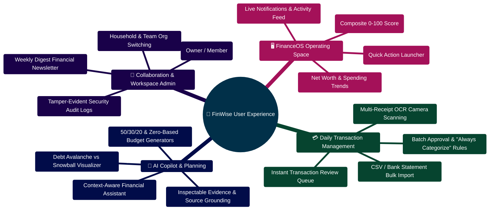

# Personal Finance Platform — Comprehensive User & Admin Manual

Welcome to the ultimate guide for the Personal Finance Platform. This vast document covers every feature, administrative capability, and AI workflow present in the system.

---

> [!TIP]
> **Developer Guide: Building & Extending on This Project**  
> For complete step-by-step blueprints, Mongoose models, Zod schemas, Express controllers, React hooks, and LangGraph subagents, see the [**Master Developer Handbook: Building on This Project**](./BUILDING_ON_THIS_PROJECT.md).

## TABLE OF CONTENTS

1. [Platform Overview](#1-platform-overview)
2. [User Onboarding & Basic Setup](#2-user-onboarding--basic-setup)
3. [The "Strategist's Desk" Dashboard](#3-the-strategists-desk-dashboard)
4. [Transaction & Cash Flow Management](#4-transaction--cash-flow-management)
5. [The Multi-Agent AI Copilot](#5-the-multi-agent-ai-copilot)
6. [Budgeting & Goals](#6-budgeting--goals)
7. [Organizations & Collaboration](#7-organizations--collaboration)
8. [Automation & Workflows](#8-automation--workflows)
9. [Plugins & Extensibility](#9-plugins--extensibility)
10. [Security & Account Settings](#10-security--account-settings)

---

## 1. PLATFORM OVERVIEW

The Personal Finance Platform is not just another expense tracker. It is an intelligent financial operating system designed to analyze your past spending, coordinate your current budgets, and actively strategist your future wealth.

Powered by a Multi-Agent AI network, the platform serves as a digital financial advisor that works 24/7, offering extreme data privacy and deep collaborative features.

---

## 2. USER ONBOARDING & BASIC SETUP

### Account Creation

You can create an account using a standard Email/Password combination or via Google OAuth2 Single Sign-On.

### Initial Financial Profile

Upon your first login, you will be guided through an onboarding wizard wizard. You will be asked to define:

- Your primary base currency.
- Your general risk tolerance (Conservative, Moderate, Aggressive).
- Your primary financial goals (e.g., Get out of debt, Save for a house, Invest for retirement).

### Connecting Data

You can input data via three methods:

1. **Manual Entry:** Use the quick-add buttons to enter transactions.
2. **CSV Import:** Upload bulk CSV exports from your traditional banks. The system uses a smart parsing engine to automatically map columns (Date, Amount, Merchant, Category).
3. **Receipt OCR:** Take a photo of an invoice or receipt. The AI will automatically extract the merchant, date, total amount, and line items.

---

## 3. THE "STRATEGIST'S DESK" DASHBOARD

The Dashboard is your command center. It is composed of several widgets operating in real-time.

### Financial Vitals

This widget displays your core metrics:

- **Net Worth:** Total assets minus total liabilities.
- **Monthly Cash Flow:** Income vs. Expenses for the current 30-day period.
- **Savings Rate:** The percentage of your income that is actively being saved or invested.

### Actionable Insights

Unlike static charts, the platform's AI continually scans your profile in the background. If it notices a trend (e.g., "Your dining out expenses have increased 40% this month"), it generates an Insight Card. Clicking an Insight Card expands it into a detailed report explaining the issue and offering 1-click solutions.

### Recent Activity Feed

If you share your Organization with a spouse or partner, this feed shows a live stream of all actions taken by anyone in the account—from adding a transaction to modifying a budget limit.

---

## 4. TRANSACTION & CASH FLOW MANAGEMENT

### Advanced Filtering and Search

Navigate to the `/transactions` page to view your ledger. The platform supports complex search queries. You can filter by:

- Date Ranges
- Amount Ranges ($50 to $100)
- Categories and Tags
- Types (Income, Expense, Transfer)

### Category Rules Engine

To save time, use the Rules Engine. You can create a rule that says: "If merchant contains 'UBER', automatically categorize as 'Transportation' and tag as 'Business'". The engine will apply this to all future transactions.

### Threaded Comments

Every transaction is a collaborative object. You or a partner can click on a transaction (e.g., $400 at Home Depot) and leave a comment: _"Was this for the bathroom remodel?"_ keeping communication tied directly to the data.

---

## 5. THE MULTI-AGENT AI COPILOT

The heart of the Personal Finance platform is the AI Copilot, accessible via the `/chat` interface or the global ⌘K Command Bar.

### How It Works: The Orchestrator

When you ask a question like, "How can I pay off my student loans faster?", you are not just querying a chatbot.
The system routes your question to the **Master Strategist**, who then wakes up the **Debt Optimizer Agent** and the **Budget Planner Agent**.

### The Workflow Visualizer

While the AI "thinks", open the sidebar Visualizer. You will literally see the network of agents lighting up passing data back and forth. This transparency ensures you know exactly how the AI arrived at its conclusion.

### Interactive Markdown Plans

The AI doesn't just respond with text. It generates structured Markdown documents complete with tables, bulleted action plans, and simulated timelines.

---

## 6. BUDGETING & GOALS

### Zero-Based Budgeting

The platform supports tracking every dollar. Build your monthly budget by allocating specific amounts to categories. The interface will show you progress bars that turn yellow at 80% usage and red at 100%.

### Long-Term Goals

Create specific goals with target dates (e.g., "Save $10,000 for a Wedding by July 2026"). The Goals Widget will track your linked savings accounts and provide AI-generated advice if you fall behind schedule.

### What-If Scenarios

Use the Scenario Modeler before making big choices. Input a hypothetical event (e.g., "Taking a 15% pay cut" or "Buying a $30,000 car with a 7% interest loan"). The system simulates the next 5 years and shows exactly how this decision impacts your Net Worth trajectory.

---

## 7. ORGANIZATIONS & COLLABORATION

### Multi-Tenancy Architecture

Your account exists within an "Organization". By default, you are the Owner of your personal Org.

### Inviting Members

Go to the Organization Settings to invite others via email.

- **Owner:** Full control, including billing and deleting the Org.
- **Admin:** Can add/remove members and change all financial data.
- **Member:** Can view data and add transactions, but cannot modify core settings or budgets.

### Data Isolation

Your financial data never leaks between contexts. The stringent Role-Based Access Control (RBAC) ensures absolute privacy.

---

## 8. AUTOMATION & WORKFLOWS

### Trigger-Based Workflows

Navigate to the `/workflows` section to act as your own developer.
You can create "If This Then That" rules.

- **Trigger:** When a transaction over $500 occurs.
- **Action:** Send a high-priority push notification.

### Scheduled Tasks

Set up Cron-based tasks. For example, instruct the system to "Run an AI Cash Flow Analysis every Friday at 5:00 PM and generate a summary report."

### Autopilot

For advanced users, Autopilot allows the AI to suggest structural changes (like restructuring category rules). These actions are always placed in a "Pending Approval" queue. The AI cannot execute changes without explicit human consent.

---

## 9. PLUGINS & EXTENSIBILITY

### The Marketplace

The platform isn't closed. Visit the Marketplace to install third-party plugins.
Examples include crypto portfolio trackers, realtime stock tickers, or specific real estate valuation tools.

### Security Sandbox

Plugins are heavily restricted. Before installing, a plugin will request permissions (e.g., "Needs Read access to Transactions"). If approved, the plugin runs in a secure sandbox. It cannot access your passwords, nor can it modify data unless explicitly granted write-access.

---

## 10. SECURITY & ACCOUNT SETTINGS

### Two-Factor Authentication (2FA)

We strongly recommend enabling 2FA. In the Security tab, scan the provided QR code with Google Authenticator or Authy to require a time-based token upon login.

### Session Management

View all active sessions across your devices. Notice a login from a browser you don't recognize? Click "Revoke" to instantly kill that session and force a logout on that device.

### Exporting Data

Your data belongs to you. Go to the Exports tab to download your entire financial history in CSV format, or generate beautiful PDF reports of your yearly summaries for tax purposes.

### Audit Logs

For absolute peace of mind, Administrators can view the unmodifiable Audit Log. This tracks exactly who logged in, who added which transaction, and who changed permissions, down to the exact millisecond.

---

_End of User Manual. For technical architecture or API endpoints, please see ARCHITECTURE.md and API.md._

## User & Admin Experience Mindmap



## User Daily Operating Lifecycle & Review ASCII Flow

```text
┌────────────────────────────────────────────────────────────────────────┐
│ 🟢 STEP 1: MORNING BRIEFING & COMMAND CENTER                           │
│    User opens FinanceOS dashboard ──► Inspects Budget Health Score     │
└───────────────────────────────────┬────────────────────────────────────┘
                                    │
                                    ▼
┌────────────────────────────────────────────────────────────────────────┐
│ 💳 STEP 2: TRANSACTION REVIEW QUEUE                                    │
│    ├─► Review 5 new uncategorized transactions imported from bank/CSV  │
│    ├─► Click "Categorize with AI" ──► Auto-assigned: Food & Groceries  │
│    ├─► Click "Always Categorize 'Trader Joe' as Groceries"             │
│    └─► Click "Approve All"; transactions merge into confirmed ledger 🟢│
└───────────────────────────────────┬────────────────────────────────────┘
                                    │
                                    ▼
┌────────────────────────────────────────────────────────────────────────┐
│ 🧠 STEP 3: FINANCIAL COPILOT CONSULTATION                              │
│    ├─► User asks: "Can I afford a $2,000 summer vacation?"            │
│    ├─► AI analyzes savings rate, current debt, and emergency buffer    │
│    └─► Generates 3-month savings plan with milestone checkpoints 🟢    │
└───────────────────────────────────┬────────────────────────────────────┘
                                    │
                                    ▼
┌────────────────────────────────────────────────────────────────────────┐
│ 📊 STEP 4: GOAL PROGRESS & NEWSLETTER PREVIEW                          │
│    ├─► View vacation goal updated to 65% complete                      │
│    └─► Download PDF executive summary report for weekly review 🟢      │
└────────────────────────────────────────────────────────────────────────┘
```


---

## Production Implementation Blueprint: Client CSV Importer (`client/src/lib/csvImporter.ts`)

```typescript
import Papa from "papaparse";

export interface ParsedCsvTransaction {
  date: string;
  description: string;
  amount: number;
  type: "income" | "expense";
  category?: string;
}

export function parseTransactionCsv(csvText: string): Promise<ParsedCsvTransaction[]> {
  return new Promise((resolve, reject) => {
    Papa.parse(csvText, {
      header: true,
      skipEmptyLines: true,
      transformHeader: (h) => h.trim().toLowerCase(),
      complete: (results) => {
        try {
          const transactions: ParsedCsvTransaction[] = results.data.map((row: any) => {
            const rawAmount = parseFloat(row.amount || row.price || "0");
            const isNegative = rawAmount < 0;
            const amount = Math.abs(rawAmount);

            return {
              date: new Date(row.date || row.timestamp || Date.now()).toISOString(),
              description: String(row.description || row.payee || "Uncategorized Item").trim(),
              amount,
              type: isNegative || row.type === "expense" ? "expense" : "income",
              category: row.category ? String(row.category).trim() : undefined,
            };
          });
          resolve(transactions);
        } catch (err) {
          reject(new Error("FAILED_CSV_TRANSFORM: Malformed data rows detected"));
        }
      },
      error: (err) => reject(err),
    });
  });
}
```