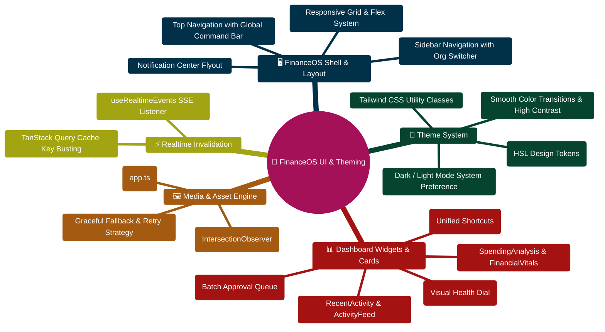

# FinWise — Dashboard, Theming, and Media

This guide documents the current dashboard structure (including the Financial Command Center), the dual light/dark theme system, and the media-loading rules used by blogs and growth stories.

## Dashboard intent

The dashboard is an **active Financial Command Center** — a daily-use decision cockpit that aggregates signals, scores financial health, and enables one-click transaction review workflows.

As of v2.0.0, the dashboard hero has been replaced by the Command Center, and the page layout is:

1. **Command Center** — time-adaptive greeting + 4 KPI cards + priority signals + upcoming bills
2. **Budget Health Card** — animated health score gauge + burn-rate alerts + projections
3. **AI command bar**
4. **Financial vitals**
5. **AI-generated insights**

Main file:

- `client/src/pages/Dashboard.tsx`

## Dashboard building blocks

### Command Center (v2.0.0)

`client/src/components/CommandCenter.tsx`

Responsibilities:

- Time-of-day adaptive greeting (morning / afternoon / evening)
- 4 KPI cards: Cash Runway, Budget Burn (circular gauge), Pending Tasks, Goals
- Priority signal chips ranked by urgency (`act_now` > `review_this_week` > `safe_to_ignore`)
- Upcoming bills mini-list (calendar reminders + recurring rules, next 7 days)
- Framer Motion stagger animations for card entry

Data source: `GET /api/financial-data/command-center` → `commandCenterService.ts`

The command center aggregates data from 9 sources in parallel:
- Accounts (liquid balance for cash runway)
- Transactions (30-day and current-month spending velocity)
- Budget Envelopes (planned vs. spent per category)
- Recurring Rules (upcoming bills)
- Calendar Reminders (upcoming financial events)
- Tasks (open/due-soon/overdue counts)
- Financial Profile (goals, debts)
- Recurring Candidates (risky subscriptions)
- Finance Intelligence (budget envelopes)

### Budget Health Card (v2.0.0)

`client/src/components/BudgetHealthCard.tsx`

Responsibilities:

- Animated circular health gauge (SVG + Framer Motion, 0–100 score)
- Score breakdown bars (budget adherence 40pts, review cleanliness 20pts, goal progress 20pts, debt management 20pts)
- Spending trend indicator (improving / stable / worsening)
- "If you continue at this pace…" projection text
- Burn-rate alert chips (warning / critical severity)
- Week-over-week pace comparison

Data source: `GET /api/financial-data/budget-health` → `budgetHealthService.ts`

### Transaction Review Queue (v2.0.0)

`client/src/components/TransactionReviewQueue.tsx`

Responsibilities:

- Displayed as a "Review Queue" tab on the Transactions page (`?tab=review`)
- Flag filter chips (uncategorized, duplicate, merchant, split, recurring)
- Confidence score badges (red < 40%, amber 40–70%, green > 70%)
- One-click approve with slide-out animation
- "Always categorize like this" button (creates CategoryRule + approves)
- Bulk select + bulk approve toolbar (max 200 per batch)
- Empty state celebration when queue is cleared

Data sources:
- `POST /api/financial-data/transactions/:id/approve`
- `POST /api/financial-data/transactions/bulk-approve`
- `POST /api/financial-data/transactions/:id/always-categorize`

### Financial vitals

`client/src/components/FinancialVitals.tsx`

Responsibilities:

- Query dashboard summary data
- Render four key financial metrics
- Present metrics in the monochrome card system

### AI-generated insights

`client/src/components/ActionableInsights.tsx`

Responsibilities:

- Fetch user insights
- Render insight priority and action buttons
- Open detail modal for deeper inspection

The dashboard keeps this component central because it is the main "what should I do next?" surface.

## Theme model

The project now uses a dark-first monochrome token system.

Primary theme files:

- `client/src/index.css`
- `client/src/components/ThemeProvider.tsx`

Behavior:

- The app boots in dark mode
- The provider keeps the root element in `dark`
- Light mode is intentionally disabled for now
- Design tokens use black, white, and grayscale values instead of colorful accents

If light mode returns later, it should be implemented deliberately instead of partially re-enabling the previous palette.

## Media loading rules

Media normalization is centralized in:

- `client/src/lib/media.ts`

Helpers:

- `resolveMediaUrl`
- `resolveBlogCoverImage`
- `resolveGrowthStoryCoverImage`
- `resolveAuthorAvatar`

What these helpers do:

- accept absolute URLs
- accept data/blob URLs
- preserve root-relative paths
- convert Mongo-style media ids to `/api/v1/media/:id`
- provide safe fallback images for missing content

## Image rendering behavior

Image rendering is handled by:

- `client/src/components/LazyImage.tsx`

Behavior:

- lazy-load images with `IntersectionObserver`
- support a placeholder image
- retry once with a fallback source
- show a neutral fallback surface if loading still fails

This is used in blog and growth-story UI so missing or broken images fail gracefully instead of collapsing the layout.

## Content pages using media helpers

Blog UI:

- `client/src/components/BlogCard.tsx`
- `client/src/pages/BlogDetail.tsx`

Growth-story UI:

- `client/src/components/GrowthStoryCard.tsx`
- `client/src/pages/GrowthStoryDetail.tsx`

## Server-side support

External images are allowed by the Express content security policy in:

- `server/src/app.ts`

The image CSP now allows:

- `self`
- `data:`
- `blob:`
- `https:`
- `http:`

Without that, external blog and growth-story images may resolve correctly in the client but still be blocked by the browser.

## Realtime updates

Dashboard freshness depends on:

- `client/src/hooks/useRealtimeEvents.ts`

The hook listens to server-sent domain events and invalidates query keys for:

- transactions
- dashboard summary
- analytics
- profile summaries
- portfolio summary
- receipts
- tasks
- workflow runs
- insights
- activity feed

If a dashboard card looks stale after a user action, this file is the first place to inspect.

## Recommended maintenance rules

- Keep the dashboard focused on summary and decision support, not every operational widget.
- Prefer the shared media helpers instead of embedding raw image URL logic in page components.
- Route new theme changes through `index.css` tokens first, then component-level overrides only when needed.
- Extend realtime invalidation centrally in `useRealtimeEvents.ts` instead of scattering manual refetch logic across pages.

## Dashboard, Theming & Media Mindmap



## Dashboard State Composition & Realtime Refresh ASCII Flow

```text
┌────────────────────────────────────────────────────────────────────────┐
│ 🟢 USER ENTERS FINANCEOS ROUTE (http://localhost:5173/dashboard)        │
│    AppProviders initialize Auth, Theme, QueryClient, and SSE bus       │
└───────────────────────────────────┬────────────────────────────────────┘
                                    │
                                    ▼
┌────────────────────────────────────────────────────────────────────────┐
│ ⚡ STAGE 1: PARALLEL DATA AGGREGATION (TanStack Query)                 │
│    ├─► GET /api/v1/finance/summary ──► Cash balances & totals          │
│    ├─► GET /api/v1/budgets/health-score ──► Composite Health Dial      │
│    ├─► GET /api/v1/transactions/review-queue ──► Uncategorized items   │
│    └─► GET /api/v1/activity ──► Recent tenant activity events          │
└───────────────────────────────────┬────────────────────────────────────┘
                                    │
                                    ▼
┌────────────────────────────────────────────────────────────────────────┐
│ 🎨 STAGE 2: REACTIVE CARD COMPOSITION & THEME RESOLUTION                │
│    ├─► Check prefers-color-scheme / localStorage 'finwise-theme'       │
│    ├─► Inject HSL CSS variables (--background, --foreground, --card)   │
│    ├─► Render CardSkeleton while queries resolve in parallel           │
│    └─► Hydrate BudgetHealthCard, ActionableInsights, and Queue Cards 🟢│
└───────────────────────────────────┬────────────────────────────────────┘
                                    │
                                    ▼
┌────────────────────────────────────────────────────────────────────────┐
│ 📡 STAGE 3: REALTIME SSE EVENT INVALIDATION (useRealtimeEvents)        │
│    ├─► Server emits 'transaction.reviewed' domain event                │
│    ├─► TanStack Query automatically invalidates ['review-queue', orgId]│
│    └─► Card reflects updated pending counter with zero page reload 🟢  │
└────────────────────────────────────────────────────────────────────────┘
```


---

> [!TIP]
> **Developer Guide: Building & Extending on This Project**  
> For complete step-by-step blueprints, Mongoose models, Zod schemas, Express controllers, React hooks, and LangGraph subagents, see the [**Master Developer Handbook: Building on This Project**](./BUILDING_ON_THIS_PROJECT.md).

## Production Implementation Blueprint: Theme Context (`client/src/context/ThemeContext.tsx`)

```typescript
import React, { createContext, useContext, useEffect, useState } from "react";

type Theme = "dark" | "light" | "system";

interface ThemeContextType {
  theme: Theme;
  setTheme: (theme: Theme) => void;
  actualTheme: "dark" | "light";
}

const ThemeContext = createContext<ThemeContextType | undefined>(undefined);

export function ThemeProvider({ children }: { children: React.ReactNode }) {
  const [theme, setThemeState] = useState<Theme>(() => {
    return (localStorage.getItem("finwise-theme") as Theme) || "system";
  });

  const [actualTheme, setActualTheme] = useState<"dark" | "light">("dark");

  useEffect(() => {
    const root = window.document.documentElement;
    root.classList.remove("light", "dark");

    let resolved: "dark" | "light" = "dark";
    if (theme === "system") {
      resolved = window.matchMedia("(prefers-color-scheme: dark)").matches ? "dark" : "light";
    } else {
      resolved = theme;
    }

    root.classList.add(resolved);
    setActualTheme(resolved);
    localStorage.setItem("finwise-theme", theme);
  }, [theme]);

  return (
    <ThemeContext.Provider value={{ theme, setTheme: setThemeState, actualTheme }}>
      {children}
    </ThemeContext.Provider>
  );
}

export function useTheme() {
  const context = useContext(ThemeContext);
  if (!context) throw new Error("useTheme must be used within a ThemeProvider");
  return context;
}
```

---

## 2026 Canonical `/api/v1` Dashboard Integration

The dashboard routes have been unified under the canonical `/api/v1` prefix:

| Capability | Canonical Endpoint | Service Handler | Query Response |
| :--- | :--- | :--- | :--- |
| **Command Center** | `GET /api/v1/command-center` | `commandCenterService.ts` | 9-source aggregate (runway, bills, KPIs) |
| **Budget Health** | `GET /api/v1/budget-health` | `budgetHealthService.ts` | 100-pt 4-pillar score + burn rate alerts |
| **Single Approval** | `POST /api/v1/transactions/:id/approve` | `transactionReview.ts` | One-click transaction approval |
| **Bulk Approval** | `POST /api/v1/transactions/bulk-approve` | `transactionReview.ts` | Bulk approval (up to 200 transactions) |
| **Rule Promotion** | `POST /api/v1/transactions/:id/always-categorize` | `transactionReview.ts` | Promotes merchant to `CategoryRule` |
| **Session Insights** | `GET /api/v1/chat/sessions/:id/insights` | `conversationInsightsCache.ts` | Coalesced action items and vitals |
