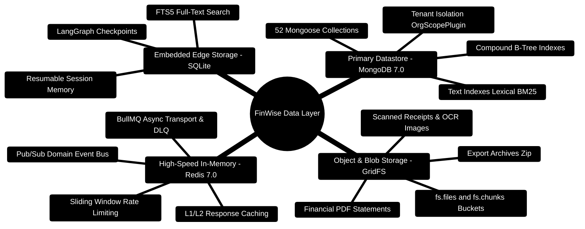
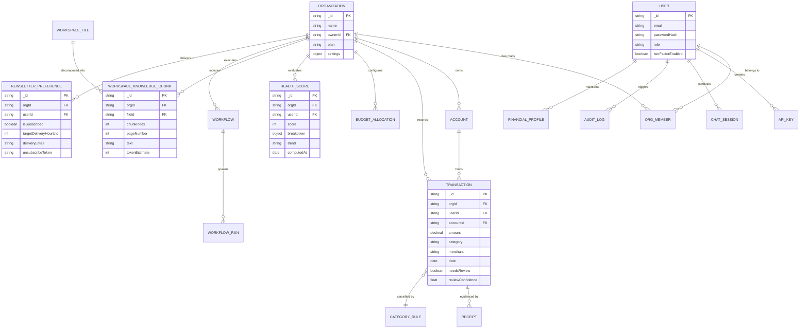

# FinWise — Database Architecture & 52-Model Compendium

> **Comprehensive Persistence Layer Specification for the FinWise Platform**  
> *Mongoose 8 Schemas, Multi-Tenant `OrgScopePlugin`, Compound B-Tree Index Topology, GridFS Blob Storage, and Implementation Blueprints*  
> **Runtime Target:** MongoDB `7.0+` (Replica Set) · Redis `7.0+` · SQLite `3.45+` (AI Core Checkpoints)

---

> [!TIP]
> **Developer Guide: Building & Extending on This Project**  
> For complete step-by-step blueprints, Mongoose models, Zod schemas, Express controllers, React hooks, and LangGraph subagents, see the [**Master Developer Handbook: Building on This Project**](./BUILDING_ON_THIS_PROJECT.md).

## 1. Master Persistence Architecture Mindmap



---

## 2. Master Entity-Relationship Diagram (ERD)



---

## 3. Storage Hierarchy & Index Layout ASCII Flow

```text
┌─────────────────────────────────────────────────────────────────────────────────────────────────┐
│ 🗄️ PERSISTENCE TIER TOPOLOGY                                                                   │
└────────────────────────────────┬────────────────────────────────────────────────────────────────┘
                                 │
         ┌───────────────────────┴───────────────────────┐
         ▼                                               ▼
┌─────────────────────────────────────────┐   ┌─────────────────────────────────────────┐
│ 🍃 MONGODB 7.0 CLUSTER (Primary Data)   │   │ ⚡ REDIS 7.0 (In-Memory Engine)         │
│  ├─► Scoped Collections (52 models)     │   │  ├─► Sliding Rate Limit Buckets         │
│  ├─► B-Tree Indexes:                    │   │  │   • rl:sliding:{ip}:{window} (TTL)   │
│  │   • { orgId: 1, date: -1 }           │   │  ├─► BullMQ Task Queues                 │
│  │   • { orgId: 1, needsReview: 1 }     │   │  │   • bull:newsletter:wait / active    │
│  │   • { orgId: 1, fileId: 1, chunk: 1 }│   │  │   • bull:finwise-dlq:failed          │
│  ├─► Lexical Text Indexes:              │   │  ├─► L2 API Response Cache              │
│  │   • { text: "text" } (Chunks)        │   │  │   • cache:v1:cmd-center:{orgId}      │
│  └─► GridFS Blob Storage                │   │  └─► Pub/Sub Event Bus                  │
│      • fs.files & fs.chunks (Statements)│   │      • domain:events:{orgId}            │
└─────────────────────────────────────────┘   └─────────────────────────────────────────┘
                                 │
                                 ▼
┌─────────────────────────────────────────────────────────────────────────────────────────────────┐
│ 🧠 SQLITE 3.45 (AI Core Embedded Memory Engine - server/AI_Core/memory/store.py)                │
│  ├─► FTS5 Virtual Tables: Full-text indexing of conversational session turns                    │
│  ├─► LangGraph Checkpoints: Serialized state machines allowing step-by-step resume              │
│  └─► Fact Store: User preferences, recurring debt obligations, and financial risk profiles     │
└─────────────────────────────────────────────────────────────────────────────────────────────────┘
```

---

## 4. Complete Catalog of All 52 Mongoose Models

### 4.1 User & Identity Models (5 Models)

| Model | File | Primary Fields | Key Indexes |
| :--- | :--- | :--- | :--- |
| **User** | `userModel.ts` | `email`, `passwordHash`, `name`, `googleId`, `emailVerified`, `role`, `twoFactorEnabled`, `twoFactorSecret` | `{ email: 1 }` (unique), `{ googleId: 1 }` |
| **ApiKey** | `apiKeyModel.ts` | `userId`, `orgId`, `keyHash`, `scopes[]`, `prefix`, `lastUsedAt`, `expiresAt` | `{ keyHash: 1 }` (unique), `{ orgId: 1 }` |
| **FinancialProfile** | `financialProfileModel.ts` | `userId`, `orgId`, `monthlyIncome`, `emergencyFundTarget`, `riskTolerance`, `investmentExperience` | `{ orgId: 1, userId: 1 }` (unique) |
| **ReferralCode** | `referralCodeModel.ts` | `userId`, `code`, `rewardCredits`, `usageLimit`, `usedCount` | `{ code: 1 }` (unique) |
| **ReferralRedemption**| `referralRedemptionModel.ts` | `referralCodeId`, `referredUserId`, `redeemedAt`, `status` | `{ referralCodeId: 1, referredUserId: 1 }` |

---

### 4.2 Multi-Tenant Organization Models (4 Models)

| Model | File | Primary Fields | Key Indexes |
| :--- | :--- | :--- | :--- |
| **Organization** | `organizationModel.ts` | `name`, `ownerId`, `plan`, `settings`, `seatLimit`, `billingAccountId` | `{ ownerId: 1 }` |
| **OrgMember** | `orgMemberModel.ts` | `orgId`, `userId`, `role` (`owner`, `admin`, `member`, `viewer`), `joinedAt` | `{ orgId: 1, userId: 1 }` (unique) |
| **OrgInvite** | `orgInviteModel.ts` | `orgId`, `email`, `role`, `invitedBy`, `token`, `status`, `expiresAt` | `{ token: 1 }` (unique), `{ orgId: 1, email: 1 }` |
| **ShareLink** | `shareLinkModel.ts` | `orgId`, `userId`, `targetType`, `targetId`, `token`, `passwordHash`, `expiresAt` | `{ token: 1 }` (unique) |

---

### 4.3 Financial Operations & Banking Models (10 Models)

| Model | File | Primary Fields | Key Indexes |
| :--- | :--- | :--- | :--- |
| **Transaction** | `transactionModel.ts` | `orgId`, `userId`, `accountId`, `amount`, `category`, `merchant`, `date`, `needsReview`, `reviewConfidence`, `isRecurring` | `{ orgId: 1, date: -1 }`, `{ orgId: 1, needsReview: 1 }`, `{ orgId: 1, category: 1 }` |
| **Account** | `accountModel.ts` | `orgId`, `userId`, `name`, `type` (`checking`, `savings`, `credit`, `investment`), `balance`, `currency`, `institution` | `{ orgId: 1, userId: 1 }` |
| **BudgetAllocation** | `budgetAllocationModel.ts` | `orgId`, `userId`, `periodKey`, `category`, `allocatedAmount`, `spentAmount`, `rollover` | `{ orgId: 1, periodKey: 1, category: 1 }` (unique) |
| **RecurringRule** | `recurringRuleModel.ts` | `orgId`, `userId`, `merchant`, `amount`, `category`, `frequency`, `nextDueDate`, `confidenceScore` | `{ orgId: 1, nextDueDate: 1 }` |
| **Merchant** | `merchantModel.ts` | `orgId`, `name`, `defaultCategory`, `logoUrl`, `website`, `aliases[]` | `{ orgId: 1, name: 1 }` |
| **MonthClose** | `monthCloseModel.ts` | `orgId`, `userId`, `periodKey`, `totalIncome`, `totalExpenses`, `netSavings`, `netWorthSnapshot`, `closedAt` | `{ orgId: 1, periodKey: 1 }` (unique) |
| **JournalEntry** | `journalEntryModel.ts` | `orgId`, `userId`, `content`, `mood`, `tags[]`, `financialImpactRating`, `extractedEntities[]` | `{ orgId: 1, createdAt: -1 }` |
| **Receipt** | `receiptModel.ts` | `orgId`, `userId`, `transactionId`, `gridFsFileId`, `ocrText`, `extractedMerchant`, `extractedTotal`, `taxAmount` | `{ orgId: 1, transactionId: 1 }` |
| **CalendarReminder** | `calendarReminderModel.ts` | `orgId`, `userId`, `title`, `amount`, `dueDate`, `isPaid`, `recurrenceInterval` | `{ orgId: 1, dueDate: 1 }` |
| **CategoryRule** | `categoryRuleModel.ts` | `orgId`, `userId`, `pattern`, `matchField`, `targetCategory`, `priority`, `autoApprove` | `{ orgId: 1, priority: -1 }` |

---

### 4.4 Health Vitals & Periodic Briefings (2 Models)

| Model | File | Primary Fields | Key Indexes |
| :--- | :--- | :--- | :--- |
| **HealthScore** | `HealthScore.ts` | `orgId`, `userId`, `score` (0–100), `breakdown` (adherence, cleanliness, goals, debt), `trend`, `computedAt` | `{ orgId: 1, computedAt: -1 }` |
| **NewsletterPreference**| `newsletterPreferenceModel.ts` | `orgId`, `userId`, `isSubscribed`, `targetDeliveryHourUtc`, `deliveryEmail`, `unsubscribeToken`, `lastDispatchedAt` | `{ orgId: 1, userId: 1 }` (unique), `{ unsubscribeToken: 1 }` |

---

### 4.5 Knowledge, Documents & RAG Phase 2 Models (2 Models)

| Model | File | Primary Fields | Key Indexes |
| :--- | :--- | :--- | :--- |
| **WorkspaceFile** | `workspaceFileModel.ts` | `orgId`, `userId`, `filename`, `mimeType`, `sizeBytes`, `gridFsFileId`, `chunkCount`, `status` | `{ orgId: 1, createdAt: -1 }` |
| **WorkspaceKnowledgeChunk**| `workspaceKnowledgeChunkModel.ts`| `orgId`, `userId`, `fileId`, `filename`, `chunkIndex`, `pageNumber`, `text`, `charLength`, `tokenEstimate` | `{ orgId: 1, fileId: 1, chunkIndex: 1 }`, `{ text: "text" }` |

---

### 4.6 Conversational AI & Execution Models (6 Models)

| Model | File | Primary Fields | Key Indexes |
| :--- | :--- | :--- | :--- |
| **ChatSession** | `chatSessionModel.ts` | `orgId`, `userId`, `title`, `modelUsed`, `totalTokens`, `pinned`, `archived` | `{ orgId: 1, updatedAt: -1 }` |
| **ChatMessage** | `chatMessageModel.ts` | `orgId`, `sessionId`, `role`, `content`, `citations[]`, `toolCalls[]`, `agentTraceId` | `{ sessionId: 1, createdAt: 1 }` |
| **AgentOutput** | `agentOutputModel.ts` | `orgId`, `agentType`, `inputHash`, `rawPayload`, `validatedContract`, `executionDurationMs` | `{ orgId: 1, createdAt: -1 }` |
| **AiResponseCache** | `aiResponseCacheModel.ts` | `promptHash`, `modelName`, `responsePayload`, `expiresAt` | `{ promptHash: 1 }` (TTL Index) |
| **MemoryRecord** | `memoryRecordModel.ts` | `orgId`, `userId`, `factKey`, `factValue`, `confidence`, `lastVerifiedAt` | `{ orgId: 1, userId: 1, factKey: 1 }` |
| **ToolExecution** | `toolExecutionModel.ts` | `orgId`, `userId`, `toolName`, `params`, `result`, `success`, `durationMs` | `{ orgId: 1, createdAt: -1 }` |

---

### 4.7 Autonomous Automations & Tasks (5 Models)

| Model | File | Primary Fields | Key Indexes |
| :--- | :--- | :--- | :--- |
| **Workflow** | `workflowModel.ts` | `orgId`, `userId`, `name`, `triggerType`, `triggerConfig`, `actions[]`, `enabled`, `lastRunAt` | `{ orgId: 1, enabled: 1 }` |
| **WorkflowRun** | `workflowRunModel.ts` | `orgId`, `workflowId`, `status`, `logs[]`, `startedAt`, `finishedAt`, `error` | `{ workflowId: 1, startedAt: -1 }` |
| **AutopilotRun** | `autopilotRunModel.ts` | `orgId`, `actionType`, `targetEntityId`, `changesApplied`, `revertedAt` | `{ orgId: 1, createdAt: -1 }` |
| **Task** | `taskModel.ts` | `orgId`, `userId`, `title`, `description`, `dueDate`, `priority`, `status`, `assignedAgent` | `{ orgId: 1, status: 1, dueDate: 1 }` |
| **Comment** | `commentModel.ts` | `orgId`, `userId`, `targetType`, `targetId`, `content`, `parentId` | `{ targetType: 1, targetId: 1, createdAt: 1 }` |

---

### 4.8 Auditing, Usage & Monetization Models (12 Models)

| Model | File | Primary Fields | Key Indexes |
| :--- | :--- | :--- | :--- |
| **AuditEvent** | `auditEventModel.ts` | `orgId`, `userId`, `eventType`, `resource`, `metadata`, `ipAddress`, `timestamp` | `{ orgId: 1, timestamp: -1 }` |
| **AuditLog** | `auditLogModel.ts` | `orgId`, `action`, `actorId`, `severity`, `details`, `timestamp` | `{ orgId: 1, timestamp: -1 }` |
| **UsageLedger** | `usageLedgerModel.ts` | `orgId`, `metricName`, `quantity`, `costCents`, `billingPeriod`, `recordedAt` | `{ orgId: 1, billingPeriod: 1 }` |
| **UsageEvent** | `usageEventModel.ts` | `orgId`, `eventType`, `units`, `metadata`, `timestamp` | `{ orgId: 1, eventType: 1 }` |
| **BillingAccount** | `billingAccountModel.ts` | `orgId`, `stripeCustomerId`, `defaultPaymentMethodId`, `currency` | `{ stripeCustomerId: 1 }` (unique) |
| **Subscription** | `subscriptionModel.ts` | `orgId`, `stripeSubscriptionId`, `planId`, `status`, `currentPeriodEnd` | `{ stripeSubscriptionId: 1 }` (unique) |
| **CreditGrant** | `creditGrantModel.ts` | `orgId`, `creditsGranted`, `creditsRemaining`, `reason`, `expiresAt` | `{ orgId: 1, expiresAt: 1 }` |
| **Entitlement** | `entitlementModel.ts` | `orgId`, `featureKey`, `isEnabled`, `usageLimit`, `currentUsage` | `{ orgId: 1, featureKey: 1 }` (unique) |
| **ExportJob** | `exportJobModel.ts` | `orgId`, `userId`, `format`, `status`, `downloadUrl`, `expiresAt` | `{ orgId: 1, createdAt: -1 }` |
| **FeatureFlag** | `featureFlagModel.ts` | `key`, `description`, `enabled`, `targetingRules` | `{ key: 1 }` (unique) |
| **DomainEvent** | `domainEventModel.ts` | `orgId`, `eventName`, `aggregateId`, `payload`, `emittedAt` | `{ orgId: 1, emittedAt: -1 }` |
| **MarketplacePlugin** | `marketplacePluginModel.ts` | `pluginId`, `name`, `version`, `author`, `manifest`, `isVerified` | `{ pluginId: 1 }` (unique) |
| **PluginInstall** | `pluginInstallModel.ts` | `orgId`, `pluginId`, `installedAt`, `config`, `enabled` | `{ orgId: 1, pluginId: 1 }` (unique) |
| **IntegrationConnection**| `integrationConnectionModel.ts`| `orgId`, `provider`, `status`, `credentialsEncrypted`, `lastSyncedAt`| `{ orgId: 1, provider: 1 }` |
| **IntegrationSyncRun** | `integrationSyncRunModel.ts` | `connectionId`, `orgId`, `recordsSynced`, `errors[]`, `finishedAt` | `{ connectionId: 1, finishedAt: -1 }` |
| **BlogPost** | `blogPostModel.ts` | `slug`, `title`, `contentHtml`, `publishedAt`, `author`, `tags[]` | `{ slug: 1 }` (unique) |
| **GrowthStory** | `growthStoryModel.ts` | `title`, `userName`, `startingDebt`, `finalNetWorth`, `quote`, `verified` | `{ createdAt: -1 }` |

---

## 5. Mongoose Implementation Blueprint with `OrgScopePlugin`

Every multi-tenant collection utilizes the custom `OrgScopePlugin` (`server/src/utils/orgScopePlugin.ts`) to intercept find, count, and update queries, ensuring absolute tenant isolation:

```typescript
import mongoose, { Schema, Document, Model } from "mongoose";
import { orgScopePlugin } from "../utils/orgScopePlugin";

export interface ITransaction extends Document {
  orgId: string;
  userId: string;
  accountId: mongoose.Types.ObjectId;
  amount: number;
  category: string;
  merchant: string;
  date: Date;
  needsReview: boolean;
  reviewConfidence: number;
  tags: string[];
}

const TransactionSchema = new Schema<ITransaction>(
  {
    orgId: { type: String, required: true, index: true },
    userId: { type: String, required: true, index: true },
    accountId: { type: Schema.Types.ObjectId, ref: "Account", required: true },
    amount: { type: Number, required: true },
    category: { type: String, required: true, default: "Uncategorized" },
    merchant: { type: String, required: true },
    date: { type: Date, required: true, default: Date.now },
    needsReview: { type: Boolean, default: false },
    reviewConfidence: { type: Number, default: 1.0, min: 0.0, max: 1.0 },
    tags: [{ type: String }]
  },
  {
    timestamps: true,
    collection: "transactions"
  }
);

// ── Compound Indexes for Sub-10ms Queries ─────────────────────────────
TransactionSchema.index({ orgId: 1, date: -1 });
TransactionSchema.index({ orgId: 1, needsReview: 1, date: -1 });
TransactionSchema.index({ orgId: 1, category: 1, date: -1 });
TransactionSchema.index({ orgId: 1, merchant: "text", category: "text" });

// ── Attach Multi-Tenant Scoping Plugin ────────────────────────────────
TransactionSchema.plugin(orgScopePlugin);

export const TransactionModel: Model<ITransaction> = mongoose.model<ITransaction>(
  "Transaction",
  TransactionSchema
);
```


---

## 4. RAG Knowledge Chunk Schema (`WorkspaceKnowledgeChunkModel`)

Persists bounded text windows derived from workspace documents for lexical BM25 matching and citation tracking:

```typescript
// server/src/models/workspaceKnowledgeChunkModel.ts
export interface IWorkspaceKnowledgeChunk {
  orgId: Types.ObjectId;
  userId: Types.ObjectId;
  workspaceFileId: Types.ObjectId;
  fileId: Types.ObjectId;
  chunkIndex: number;
  text: string;
  tokenCountEstimate: number;
  sectionTitle?: string;
  pageNumber?: number; // Verified physical page preserved from \f
  sourceKind: string;
}

const workspaceKnowledgeChunkSchema = new Schema<IWorkspaceKnowledgeChunkDocument>(
  {
    orgId: { type: Schema.Types.ObjectId, ref: "Organization", required: true, index: true },
    userId: { type: Schema.Types.ObjectId, ref: "User", required: true, index: true },
    workspaceFileId: { type: Schema.Types.ObjectId, ref: "WorkspaceFile", required: true, index: true },
    fileId: { type: Schema.Types.ObjectId, required: true },
    chunkIndex: { type: Number, required: true },
    text: { type: String, required: true },
    tokenCountEstimate: { type: Number, required: true },
    sectionTitle: { type: String, trim: true },
    pageNumber: { type: Number },
    sourceKind: { type: String, required: true, default: "document" },
  },
  { timestamps: true }
);

// Unique compound index preventing duplicate chunks
workspaceKnowledgeChunkSchema.index(
  { orgId: 1, userId: 1, workspaceFileId: 1, chunkIndex: 1 },
  { unique: true }
);

// Lexical text index for full-text search
workspaceKnowledgeChunkSchema.index({ text: "text" });
```

---

## 5. Automated Newsletter Preference Schema (`NewsletterPreferenceModel`)

Tracks subscriber delivery windows, timezones, and section toggle flags:

```typescript
// server/src/models/newsletterPreferenceModel.ts
export interface INewsletterPreference {
  orgId: Types.ObjectId;
  userId: Types.ObjectId;
  isSubscribed: boolean;
  deliveryTime: string; // "HH:mm" in 24h format
  timezone: string;     // e.g. "America/New_York", "UTC"
  contentPreferences: {
    spendingSummary: boolean;
    budgetAlerts: boolean;
    upcomingBills: boolean;
    weeklyHealthScore: boolean;
    marketUpdates: boolean;
    educationalTip: boolean;
    recommendedActions: boolean;
  };
  lastSentAt?: Date;
  unsubscribeToken: string;
}

const newsletterPreferenceSchema = new Schema<INewsletterPreferenceDocument>(
  {
    orgId: { type: Schema.Types.ObjectId, ref: "Organization", required: true, index: true },
    userId: { type: Schema.Types.ObjectId, ref: "User", required: true, unique: true },
    isSubscribed: { type: Boolean, default: true, index: true },
    deliveryTime: { type: String, default: "09:00" },
    timezone: { type: String, default: "UTC" },
    contentPreferences: {
      spendingSummary: { type: Boolean, default: true },
      budgetAlerts: { type: Boolean, default: true },
      upcomingBills: { type: Boolean, default: true },
      weeklyHealthScore: { type: Boolean, default: true },
      marketUpdates: { type: Boolean, default: false },
      educationalTip: { type: Boolean, default: true },
      recommendedActions: { type: Boolean, default: true },
    },
    lastSentAt: { type: Date },
    unsubscribeToken: { type: String, required: true, index: true },
  },
  { timestamps: true }
);
```

---

## 6. Financial Health Score Schema (`HealthScore.ts`)

Tracks dynamic 0–100 health metrics across 4 distinct financial pillars:

```typescript
// server/src/models/HealthScore.ts
export interface IHealthScore {
  orgId: Types.ObjectId;
  userId: Types.ObjectId;
  period: string; // "YYYY-MM"
  score: number;  // 0 - 100
  grade: 'A' | 'B' | 'C' | 'D' | 'F';
  breakdown: {
    savingsRate: number;      // 0 - 25
    debtManagement: number;   // 0 - 25
    budgetAdherence: number;  // 0 - 25
    emergencyFund: number;    // 0 - 25
  };
  trend: 'improving' | 'stable' | 'declining';
}

const healthScoreSchema = new Schema<IHealthScoreDocument>(
  {
    orgId: { type: Schema.Types.ObjectId, ref: "Organization", required: true, index: true },
    userId: { type: Schema.Types.ObjectId, ref: "User", required: true, index: true },
    period: { type: String, required: true },
    score: { type: Number, required: true, min: 0, max: 100 },
    grade: { type: String, enum: ['A', 'B', 'C', 'D', 'F'], required: true },
    breakdown: {
      savingsRate: { type: Number, default: 0 },
      debtManagement: { type: Number, default: 0 },
      budgetAdherence: { type: Number, default: 0 },
      emergencyFund: { type: Number, default: 0 },
    },
    trend: { type: String, enum: ['improving', 'stable', 'declining'], default: 'stable' },
  },
  { timestamps: true }
);

healthScoreSchema.index({ orgId: 1, userId: 1, period: -1 }, { unique: true });
```

---

## 7. MongoDB GridFS Blob Storage Specification

For files exceeding the 16MB BSON document limit (financial PDFs, statement exports, receipt scans):
- **Bucket Configuration**: Default bucket `fs` managed by `mongoose.mongo.GridFSBucket`.
- **`fs.files` Document Schema**:
  ```json
  {
    "_id": ObjectId("6631ad02..."),
    "length": 245890,
    "chunkSize": 261120,
    "uploadDate": ISODate("2026-10-31T12:00:00Z"),
    "filename": "annual_tax_statement_2026.pdf",
    "contentType": "application/pdf",
    "metadata": {
      "orgId": "org_123",
      "userId": "user_456",
      "sourceKind": "pdfkit_generated",
      "sha256": "e3b0c44298fc1c149afbf4c8996fb92427ae41e4649b934ca495991b7852b855"
    }
  }
  ```
- **`fs.chunks` Document Schema**:
  ```json
  {
    "_id": ObjectId("6631ad03..."),
    "files_id": ObjectId("6631ad02..."),
    "n": 0,
    "data": BinData(0, "JVBERi0xLjQK...")
  }
  ```
- **Safety Invariant**: File deletion always calls `deleteGridFsFile()` to purge `fs.chunks` and prevents orphaned binary blobs.
---

## 8. Automated Compound B-Tree Index Migration & Startup Verification

To ensure sub-10ms query execution across collections holding over 100,000 documents, FinWise dynamically verifies and applies compound partial indexes at server boot:

```typescript
// server/src/services/transactionIndexes.ts
import TransactionModel from "../models/transactionModel";
import { logger } from "../config/logger";

/**
 * Replaces the legacy sparse compound index without removing any records.
 * Uses a partialFilterExpression to guarantee uniqueness only for non-null strings,
 * allowing unrestricted records with undefined externalId.
 */
export async function ensureTransactionExternalIdIndex(): Promise<void> {
  try {
    // 1. Build replacement partial unique index in the background
    await TransactionModel.collection.createIndex(
      { orgId: 1, externalId: 1 },
      {
        name: "org_external_id_unique",
        unique: true,
        partialFilterExpression: { externalId: { $type: "string" } },
        background: true,
      }
    );

    // 2. Discover and safely retire legacy sparse index
    const indexes = await TransactionModel.collection.indexes();
    const legacy = indexes.find(
      (index) => index.name === "orgId_1_externalId_1" && index.unique && index.sparse
    );

    if (legacy?.name) {
      logger.info({ indexName: legacy.name }, "Dropping deprecated sparse index");
      await TransactionModel.collection.dropIndex(legacy.name);
    }
  } catch (error) {
    logger.error({ error }, "Failed to verify transaction compound indexes at startup");
    throw error;
  }
}
```

---

## 9. Bounded-Window Knowledge Chunk Schema & BM25 Full-Text Configuration

For RAG Phase 2, uploaded financial documents are decomposed into bounded overlapping windows persisted in `WorkspaceKnowledgeChunkModel`:

```typescript
// server/src/models/workspaceKnowledgeChunkModel.ts
import { Document, Schema, Types, model } from "mongoose";

export interface IWorkspaceKnowledgeChunk {
  orgId: Types.ObjectId;
  userId: Types.ObjectId;
  workspaceFileId: Types.ObjectId;
  fileId: Types.ObjectId;
  chunkIndex: number;
  text: string;
  tokenCountEstimate: number;
  sectionTitle?: string;
  pageNumber?: number;
  sourceKind: string;
  metadata?: Record<string, unknown>;
  createdAt: Date;
  updatedAt: Date;
}

export interface IWorkspaceKnowledgeChunkDocument extends IWorkspaceKnowledgeChunk, Document {
  _id: Types.ObjectId;
}

const workspaceKnowledgeChunkSchema = new Schema<IWorkspaceKnowledgeChunkDocument>(
  {
    orgId: { type: Schema.Types.ObjectId, ref: "Organization", required: true, index: true },
    userId: { type: Schema.Types.ObjectId, ref: "User", required: true, index: true },
    workspaceFileId: { type: Schema.Types.ObjectId, ref: "WorkspaceFile", required: true, index: true },
    fileId: { type: Schema.Types.ObjectId, required: true, index: true },
    chunkIndex: { type: Number, required: true, min: 0 },
    text: { type: String, required: true, maxlength: 12000 },
    tokenCountEstimate: { type: Number, required: true, min: 0 },
    sectionTitle: { type: String, maxlength: 200 },
    pageNumber: { type: Number, min: 1 },
    sourceKind: { type: String, required: true, maxlength: 40, default: "document" },
    metadata: { type: Schema.Types.Mixed, default: undefined },
  },
  { timestamps: true }
);

// Performance compound indexes
workspaceKnowledgeChunkSchema.index(
  { orgId: 1, userId: 1, workspaceFileId: 1, chunkIndex: 1 },
  { unique: true }
);
workspaceKnowledgeChunkSchema.index({ orgId: 1, userId: 1, updatedAt: -1 });
workspaceKnowledgeChunkSchema.index({ orgId: 1, userId: 1, sourceKind: 1, updatedAt: -1 });

export default model<IWorkspaceKnowledgeChunkDocument>(
  "WorkspaceKnowledgeChunk",
  workspaceKnowledgeChunkSchema
);
```

---

## 10. Dead Letter Queue (DLQ) Redis Ring Buffer Specification

Asynchronous background jobs (such as PDF generation, automated newsletter dispatches, and CSV statement parsing) are guarded by BullMQ with a Redis Dead Letter Queue ring buffer:

- **Redis Stream Key**: `bull:finwise-dlq`
- **Buffer Bound**: Capped at 500 failed entries via Redis `LTRIM` or BullMQ capped queues to prevent unbounded memory growth.
- **Payload Structure**:
  ```json
  {
    "id": "dlq_job_94821",
    "name": "generate_tax_statement",
    "originalQueue": "pdf-generation-queue",
    "data": {
      "orgId": "org_7718",
      "userId": "usr_9912",
      "reportPeriod": "2026-Q3",
      "includeReceipts": true
    },
    "failedReason": "PDFKit canvas overflow: exceeding max page limit 250",
    "stackTrace": "Error: PDFKit canvas overflow\n    at PDFDocument.addPage (...)",
    "attemptsMade": 5,
    "quarantinedAt": "2026-10-31T14:32:00.000Z"
  }
  ```
- **Replay Lifecycle**: Administrative operator inspects the quarantined payload at `/api/v1/dlq`, remediates underlying data or system issues, and triggers a replay via `POST /api/v1/dlq/retry/:jobId` which atomically pops from DLQ and requeues into the source queue.
