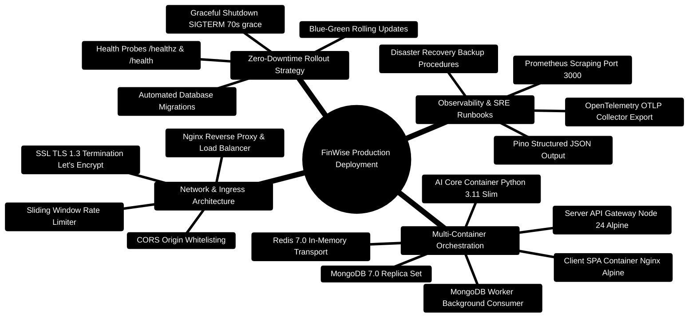

# FinWise — Production Deployment, Docker & Orchestration Runbook

> **Complete SRE Deployment Runbook, Multi-Container Orchestration, and Scaling Architecture**  
> *Docker Compose, Node 24 LTS Base Images, Nginx Reverse Proxy, SSL Termination, and Zero-Downtime Updates*  
> **Runtime Target:** Node.js `>=24.14.1 <25` · Python `3.11+` · Docker `24+` · Docker Compose `2.20+` · MongoDB `7.0` · Redis `7.0`

---

> [!TIP]
> **Developer Guide: Building & Extending on This Project**  
> For complete step-by-step blueprints, Mongoose models, Zod schemas, Express controllers, React hooks, and LangGraph subagents, see the [**Master Developer Handbook: Building on This Project**](./BUILDING_ON_THIS_PROJECT.md).

## 1. Production Deployment Mindmap



---

## 2. Multi-Container Orchestration ASCII Topology

```text
┌─────────────────────────────────────────────────────────────────────────────────────────────────┐
│ 🌐 PUBLIC INTERNET / CLOUDFLARE EDGE (HTTPS / Port 443)                                         │
└───────────────────────────────────────────────┬─────────────────────────────────────────────────┘
                                                │
                                                ▼
┌─────────────────────────────────────────────────────────────────────────────────────────────────┐
│ 🛡️ EDGE REVERSE PROXY: Nginx / Traefik (TLS 1.3 Termination • Strict CSP • WebSocket / SSE)    │
│    ├─► Path /api/*          ──► Proxy to Express Gateway Cluster (Port 3000)                    │
│    ├─► Path /api/v1/events  ──► Proxy SSE stream with proxy_buffering off; keepalive            │
│    └─► Path /*              ──► Serve React 18 SPA static assets from client/dist/              │
└───────────────────────┬─────────────────────────────────────────┬───────────────────────────────┘
                        │                                         │
                        ▼                                         ▼
┌──────────────────────────────────────────────┐  ┌──────────────────────────────────────────────┐
│ 🔷 CONTAINER: finwise-server (Node 24 LTS)   │  │ 🧠 CONTAINER: finwise-ai-core (Python 3.11)  │
│  • Express 5 Gateway (Port 3000)             │  │  • FastAPI + Uvicorn ASGI (Port 8001)        │
│  • MongoDB job producers & dispatchers       │  │  • LangGraph Multi-Agent Topological DAG     │
│  • RAG Phase 2 BM25 Bounded Window Chunker   │  │  • KeyPool Multi-Key Rotation Manager        │
└───────────────────────┬──────────────────────┘  └──────────────────────┬───────────────────────┘
                        │                                                │
                        ├───────────────────────┬────────────────────────┘
                        │                       │
                        ▼                       ▼
┌──────────────────────────────────────────────┐  ┌──────────────────────────────────────────────┐
│ 🍃 CONTAINER: mongo:7.0 (Replica Set)        │  │ ⚡ CONTAINER: redis:7.0-alpine               │
│  • 52 Scoped Domain Collections              │  │  • MongoDB job records and recovery          │
│  • GridFS Document Blobs (fs.files/chunks)   │  │  • Sliding Window Rate Limiter Buckets       │
│  • Compound B-Tree & Text Indexes            │  │  • Pub/Sub Domain Event Bus                  │
└──────────────────────────────────────────────┘  └──────────────────────────────────────────────┘
```

---

## 3. Production Docker Specifications

> The Dockerfile excerpts in 3.1 and 3.2 are abridged. The real files also define a `HEALTHCHECK` (15 s interval: gateway `/readyz`,
> AI Core `/health`), and AI Core starts **one** uvicorn process (`--proxy-headers --timeout-keep-alive 65
> --timeout-graceful-shutdown 60`) with `AI_CORE_MAX_INFLIGHT=6`; scale it with replicas (see [CAPACITY_AND_SLOS.md](./CAPACITY_AND_SLOS.md#2-capacity-model)).

### 3.1 Server Dockerfile (`server/Dockerfile`)
Strictly targets **Node 24 LTS** with alpine footprint and non-root execution:

```dockerfile
FROM node:24-alpine AS builder
WORKDIR /app
COPY package*.json ./
RUN npm ci
COPY . .
RUN npm run build

FROM node:24-alpine AS runner
WORKDIR /app
ENV NODE_ENV=production
COPY package*.json ./
RUN npm ci --only=production
COPY --from=builder /app/dist ./dist
USER node
EXPOSE 3000
CMD ["node", "dist/server.js"]
```

---

### 3.2 AI Core Dockerfile (`server/AI_Core/Dockerfile`)
Strictly targets **Python 3.11** with native build essentials:

```dockerfile
FROM python:3.11-slim AS runner
WORKDIR /app
ENV PYTHONUNBUFFERED=1 \
    PYTHONDONTWRITEBYTECODE=1

RUN apt-get update && apt-get install -y --no-install-recommends \
    build-essential \
    libgomp1 \
    curl \
    && rm -rf /var/lib/apt/lists/*

COPY requirements.txt .
RUN pip install --no-cache-dir -r requirements.txt

COPY . .
USER 1000
EXPOSE 8001
CMD ["uvicorn", "api_service:app", "--host", "0.0.0.0", "--port", "8001"]
```

---

### 3.3 Production Docker Compose (`compose.yaml`)

`compose.yaml` at the repo root is the source of truth; do not copy an inline snapshot of it into other files (earlier
revisions of this document did, and drifted). What it does today:

- **Services:** `mongo` (single-node replica set `rs0`, auto-initiated by its healthcheck), `redis`, `ai-core`, `server`
  (default 2 replicas via `SERVER_REPLICAS`), `worker` (exactly 1 replica), `web` (nginx + SPA, published on `127.0.0.1:8080`).
- **Secrets are required, no defaults:** `JWT_SECRET`, `AI_CORE_INTERNAL_TOKEN`, `WEBHOOK_CREDENTIALS_KEY` (base64, 32 bytes) use
  `${VAR:?...}` guards and must be in the root `.env` or the shell. Compose also reads `server/.env` and `server/AI_Core/.env`
  (copy from the `.env.example` files). **`_FILE` secrets (Docker/Kubernetes secret mounts) are not supported** by the apps; pass
  values as environment variables.
- **Overrides:** `SERVER_REPLICAS`, `AI_CORE_REPLICAS`, `AI_CORE_MAX_INFLIGHT`, `METRICS_ENABLED`, `METRICS_TOKEN`,
  `AI_CORE_METRICS_TOKEN`, `LLM_PROVIDER`, `LLM_MOCK_LATENCY_MS`, `CLIENT_URL`, `CORS_ORIGINS`.
- **Worker:** job claims use an atomic `findOneAndUpdate`, but the workflow scheduler tick is **not leader-elected**, so keep one
  worker replica.
- **Mock LLM:** `LLM_PROVIDER=mock` makes AI Core return a deterministic canned reply with no network call or key
  (`LLM_MOCK_LATENCY_MS` simulates latency, clamped to 0 to 30000). It exists for CI and load tests only; never set it in production.
- **Load/smoke override:** `docker compose -f compose.yaml -f loadtest/compose.loadtest.yaml up -d --wait` (development mode so
  k6 can read `dev_otp`, raised rate limits, mock LLM). Never deploy with it.
- **Metrics overlay:** `deploy/observability/compose.observability.yaml` adds Prometheus and Grafana
  ([README](../deploy/observability/README.md)).

### 3.4 Edge nginx (`client/nginx.conf`, `client/nginx-main.conf`)

| Behaviour | Setting |
| :-- | :-- |
| Worker capacity | `worker_connections 4096`, `worker_rlimit_nofile 16384` (`nginx-main.conf`, copied by the Dockerfile) |
| Upstream discovery | `resolver 127.0.0.11 valid=10s` + variable upstream, so replaced/scaled containers are found without reload |
| Retries | `proxy_next_upstream error timeout http_503`, 2 tries, 10 s. POST/PATCH are **not** retried once sent |
| Timeouts | 5 s connect, 60 s read/send; 3600 s and no buffering on `/stream` and SSE routes |
| Edge rate limits | `finwise_api` 200 r/s (burst 400), `finwise_auth` 10 r/s (burst 20), status 429 |
| Request id | reuses inbound `X-Request-Id` else nginx `$request_id`, forwarded upstream and logged (`rid=`) |
| Blocked | `/api/metrics` returns 404 at the edge; scrape the replicas directly |
| Probe | `/healthz` on nginx itself returns 200. Gateway `/healthz` and `/readyz` are not under `/api`, so not proxied |

The variable-upstream form cannot do `least_conn` or keepalive pools. `client/nginx.upstream.conf.example` shows the static
`upstream {}` alternative and its trade-off (resolved only at nginx start). Docker's DNS round-robin is the default balancing here.

### 3.5 Other deploy targets

- **AWS ECS Fargate:** `deploy/aws/` (CloudFormation + `deploy.sh`, AWS CLI only). See [deploy/aws/README.md](../deploy/aws/README.md).
- **Kubernetes (optional, never applied):** `deploy/k8s/` reference Deployments, HPAs and PDBs. See [deploy/k8s/README.md](../deploy/k8s/README.md).
- **CI:** `.github/workflows/test.yml` runs unit tests, image builds and a compose + k6 smoke gate; `nightly-load.yml` runs load,
  spike and SSE soak.

---

## 4. Rolling Updates

Compose has no true blue/green. `server` runs with `replicas: 2` and `stop_grace_period: 70s`, which is longer than the gateway
drain window.

```bash
git pull origin main
docker compose build --parallel

# Replace services; compose recreates containers and waits on health checks.
docker compose up -d --no-deps server ai-core worker web

# Verify (the gateway's /healthz is inside the container network, so exec into it)
docker compose exec server node -e "fetch('http://127.0.0.1:3000/readyz').then(r=>console.log(r.status))"
curl -f http://127.0.0.1:8080/api/test
curl -f http://127.0.0.1:8080/api/python-health
```

Notes:

- **Do not scale with `--scale server=2`** or use `docker compose kill -s SIGTERM <id>` as a rollout recipe. An earlier version of
  this document recommended it; it contradicts `deploy.replicas` in `compose.yaml` and has no readiness gate. Change
  `SERVER_REPLICAS` instead.
- Compose has no readiness-gated rolling policy, so expect a brief capacity dip and dropped SSE streams while replicas are recreated
  (clients reconnect). For gradual replacement use ECS (`deploy/aws`) or Kubernetes (`maxUnavailable: 0`).
- Rollback and incident procedures: [CAPACITY_AND_SLOS.md](./CAPACITY_AND_SLOS.md#runbook).

---

## 5. Production Health Probes

| Endpoint | Where | Purpose | Expected |
| :-- | :-- | :-- | :-- |
| `GET /healthz` | gateway container, port 3000 (not under `/api`) | Liveness | `200` |
| `GET /readyz` | gateway container, port 3000 | Readiness (Docker HEALTHCHECK uses it) | `200` |
| `GET /api/test` | through nginx | Edge + gateway reachability | `200` |
| `GET /api/python-health` | through nginx | Gateway to AI Core | `200` |
| `GET /api/metrics` | gateway, Bearer `METRICS_TOKEN` (required when `METRICS_ENABLED=true`) | Prometheus scrape | `200` |
| `GET /health` / `GET /ready` | AI Core, port 8001 | Liveness / readiness (`/ready` returns 503 while draining on SIGTERM) | `200` |
| `GET /metrics` | AI Core, Bearer `AI_CORE_METRICS_TOKEN` | Prometheus scrape (404 unless the token is set) | `200` |
| `GET /api/v1/ai/canary/status` | through nginx | AI canary status | `200` |
