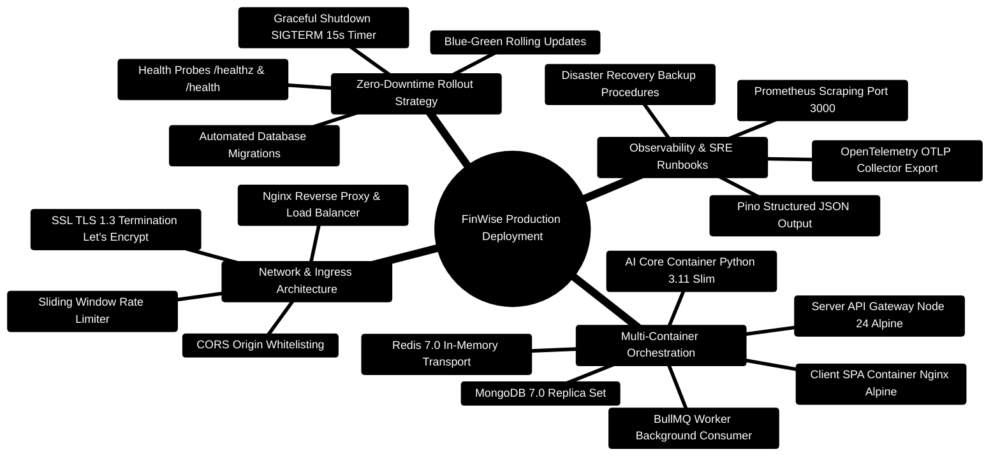

# FinWise — Production Deployment, Docker & Orchestration Runbook

> **Complete SRE Deployment Runbook, Multi-Container Orchestration, and Scaling Architecture**  
> *Docker Compose, Node 24 LTS Base Images, Nginx Reverse Proxy, SSL Termination, and Zero-Downtime Updates*  
> **Runtime Target:** Node.js `>=24.14.1 <25` · Python `3.11+` · Docker `24+` · Docker Compose `2.20+` · MongoDB `7.0` · Redis `7.0`

---

> [!TIP]
> **Developer Guide: Building & Extending on This Project**  
> For complete step-by-step blueprints, Mongoose models, Zod schemas, Express controllers, React hooks, and LangGraph subagents, see the [**Master Developer Handbook: Building on This Project**](./BUILDING_ON_THIS_PROJECT.md).

## 1. Production Deployment Mindmap



---

## 2. Multi-Container Orchestration ASCII Topology

```text
┌─────────────────────────────────────────────────────────────────────────────────────────────────┐
│ 🌐 PUBLIC INTERNET / CLOUDFLARE EDGE (HTTPS / Port 443)                                         │
└───────────────────────────────────────────────┬─────────────────────────────────────────────────┘
                                                │
                                                ▼
┌─────────────────────────────────────────────────────────────────────────────────────────────────┐
│ 🛡️ EDGE REVERSE PROXY: Nginx / Traefik (TLS 1.3 Termination • Strict CSP • WebSocket / SSE)    │
│    ├─► Path /api/*          ──► Proxy to Express Gateway Cluster (Port 3000)                    │
│    ├─► Path /api/v1/events  ──► Proxy SSE stream with proxy_buffering off; keepalive            │
│    └─► Path /*              ──► Serve React 18 SPA static assets from client/dist/              │
└───────────────────────┬─────────────────────────────────────────┬───────────────────────────────┘
                        │                                         │
                        ▼                                         ▼
┌──────────────────────────────────────────────┐  ┌──────────────────────────────────────────────┐
│ 🔷 CONTAINER: finwise-server (Node 24 LTS)   │  │ 🧠 CONTAINER: finwise-ai-core (Python 3.11)  │
│  • Express 5 Gateway (Port 3000)             │  │  • FastAPI + Uvicorn ASGI (Port 8001)        │
│  • BullMQ Queue Producers & Dispatchers      │  │  • LangGraph Multi-Agent Topological DAG     │
│  • RAG Phase 2 BM25 Bounded Window Chunker   │  │  • KeyPool Multi-Key Rotation Manager        │
└───────────────────────┬──────────────────────┘  └──────────────────────┬───────────────────────┘
                        │                                                │
                        ├───────────────────────┬────────────────────────┘
                        │                       │
                        ▼                       ▼
┌──────────────────────────────────────────────┐  ┌──────────────────────────────────────────────┐
│ 🍃 CONTAINER: mongo:7.0 (Replica Set)        │  │ ⚡ CONTAINER: redis:7.0-alpine               │
│  • 52 Scoped Domain Collections              │  │  • BullMQ Task Queues & Dead Letter Queue    │
│  • GridFS Document Blobs (fs.files/chunks)   │  │  • Sliding Window Rate Limiter Buckets       │
│  • Compound B-Tree & Text Indexes            │  │  • Pub/Sub Domain Event Bus                  │
└──────────────────────────────────────────────┘  └──────────────────────────────────────────────┘
```

---

## 3. Production Docker Specifications

### 3.1 Server Dockerfile (`server/Dockerfile`)
Strictly targets **Node 24 LTS** with alpine footprint and non-root execution:

```dockerfile
FROM node:24-alpine AS builder
WORKDIR /app
COPY package*.json ./
RUN npm ci
COPY . .
RUN npm run build

FROM node:24-alpine AS runner
WORKDIR /app
ENV NODE_ENV=production
COPY package*.json ./
RUN npm ci --only=production
COPY --from=builder /app/dist ./dist
USER node
EXPOSE 3000
CMD ["node", "dist/server.js"]
```

---

### 3.2 AI Core Dockerfile (`server/AI_Core/Dockerfile`)
Strictly targets **Python 3.11** with native build essentials:

```dockerfile
FROM python:3.11-slim AS runner
WORKDIR /app
ENV PYTHONUNBUFFERED=1 \
    PYTHONDONTWRITEBYTECODE=1

RUN apt-get update && apt-get install -y --no-install-recommends \
    build-essential \
    libgomp1 \
    curl \
    && rm -rf /var/lib/apt/lists/*

COPY requirements.txt .
RUN pip install --no-cache-dir -r requirements.txt

COPY . .
USER 1000
EXPOSE 8001
CMD ["uvicorn", "api_service:app", "--host", "0.0.0.0", "--port", "8001"]
```

---

### 3.3 Production Docker Compose (`compose.yaml`)

```yaml
version: "3.9"

services:
  mongo:
    image: mongo:7.0
    restart: always
    command: ["--replSet", "rs0", "--bind_ip_all"]
    volumes:
      - mongo-data:/data/db
    ports:
      - "27017:27017"
    healthcheck:
      test: echo 'db.runCommand("ping").ok' | mongosh localhost:27017/test --quiet
      interval: 10s
      timeout: 5s
      retries: 5

  redis:
    image: redis:7.0-alpine
    restart: always
    command: ["redis-server", "--appendonly", "yes"]
    volumes:
      - redis-data:/data
    ports:
      - "6379:6379"
    healthcheck:
      test: ["CMD", "redis-cli", "ping"]
      interval: 10s
      timeout: 5s
      retries: 5

  ai-core:
    build:
      context: ./server/AI_Core
      dockerfile: Dockerfile
    restart: always
    ports:
      - "8001:8001"
    env_file:
      - ./server/AI_Core/.env
    healthcheck:
      test: ["CMD", "curl", "-f", "http://localhost:8001/health"]
      interval: 15s
      timeout: 5s
      retries: 3

  server:
    build:
      context: ./server
      dockerfile: Dockerfile
    restart: always
    ports:
      - "3000:3000"
    env_file:
      - ./server/.env
    depends_on:
      mongo:
        condition: service_healthy
      redis:
        condition: service_healthy
      ai-core:
        condition: service_healthy
    healthcheck:
      test: ["CMD", "wget", "--no-verbose", "--tries=1", "--spider", "http://localhost:3000/healthz"]
      interval: 10s
      timeout: 5s
      retries: 3

  client:
    build:
      context: ./client
      dockerfile: Dockerfile
    restart: always
    ports:
      - "5173:80"
    depends_on:
      - server

volumes:
  mongo-data:
  redis-data:
```

---

## 4. Zero-Downtime Deployment & Rolling Restarts

To deploy new code without dropping user connections:

```bash
# 1. Pull latest git changes
git pull origin main

# 2. Rebuild images with buildkit caching
docker compose build --parallel

# 3. Rolling update of backend services
docker compose up -d --no-deps --scale server=2 --no-recreate server
# Wait for healthy probe
docker compose kill -s SIGTERM <OLD_CONTAINER_ID>
docker compose up -d --no-deps --scale server=1 server

# 4. Verify deployment health
curl -f http://localhost:3000/healthz
curl -f http://localhost:8001/health
```

---

## 5. Production Health Probes

| Endpoint | Probe Type | Purpose | Expected Status |
| :--- | :--- | :--- | :--- |
| `GET /healthz` | Kubernetes Liveness | Basic process responsiveness | `200 OK` |
| `GET /api/health` | Kubernetes Readiness | Verifies Mongo & Redis connectivity | `200 OK` |
| `GET /api/metrics` | Prometheus Scraper | Ingests latency and error telemetry | `200 OK` |
| `GET http://ai-core:8001/health` | AI Core Probe | Verifies FastAPI and LLM KeyPool | `200 OK` |
