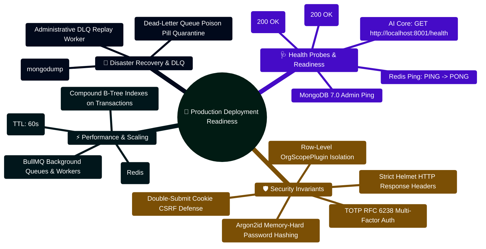
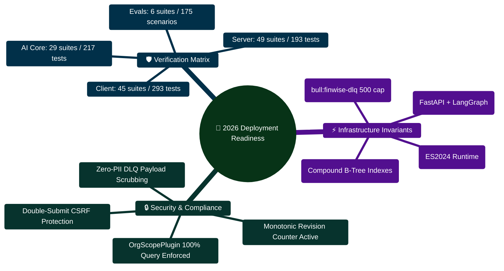

# Personal Finance Project - Improvement and Test Report

Updated on 10 November 2026. This report records verified local work, including incoming code changes. It distinguishes automated tests, browser observations, and checks that need staging or working external accounts. The product goal is to help users understand spending, review uncertain records, and choose a concrete next action.

## 10 November 2026 — AI Core and release verification

AI Core passed 671 unit tests and evaluations. Ruff passed on the changed
Python modules. The full client suite passed 543 tests across 64 files and
client lint passed. The full gateway suite passed 527 tests across 103 files,
with four additional passing fixture guard tests added after collection.
Both TypeScript production builds passed, and the live API smoke passed 33/33.
Both npm production dependency audits returned zero known advisories. The
client entry chunk is 690 KB minified.

The inbuilt browser used a synthetic account in the isolated local QA database
and real provider calls for educational chat. It also exercised the saved-task
starter, generated a one-page PDF from saved records, cited a recorded expense,
opened the exact page and original PDF, and saved the file using the inbuilt
browser download API. A normal download click began a transfer but the browser
canceled it. The portfolio's phone-width JPY selection reached the real summary
endpoint and received HTTP 200. The chart's fabricated intermediate values were
removed in code. A published growth story was outside this browser pass.
Automatic approval review blocked restarting the local AI QA service after the
last Python edits. The compound-interest and spending-trend fixes have automated
coverage. They are pending a live rerun against the restarted service.

| Priority | Remaining release check |
| --- | --- |
| P0 | The configured Gemini key was denied access. Groq failover worked locally. Verify the deployment project's Gemini access and run live research and independent verification before enabling those flows publicly. |
| P0 | Verify production containers, ingress, backups and payment/authentication checks below. Docker is unavailable locally. Automatic approval review rejected production startup as blocked by policy. |
| P1 | Inventory legacy seeded content and review remaining user-facing simulations and fixed FX rates. This pass removed the Growth Stories curve and restricted sample seeds to an explicit local fixture database. |
| P1 | Verify downloads with a normal user session and a pre-existing installed PWA in staging. The browser helper saved the bytes locally, while ordinary click completion remains open. |

## 8 November 2026 — Earlier release check

The 6 November report below remains historical. Current evidence is in
DATA_INTEGRITY_QA_20261108.md and BUTTON_COVERAGE_20261108.md: client 511/59 and
AI 470 pass; Ruff, client lint and both builds pass; API smoke 33/33. Server full
run was 363/364, followed by repair of its sole parser failure and passing 22/22
chat/title regressions plus another server build. The full server suite was not
repeated after that narrow fix.

The inbuilt browser verified saved-data recommendations, empty-state controls,
phone/tablet navigation, exact PDF citations, actual original-PDF rendering and
download. Workbox now excludes API navigation from app-shell fallback. A clean
local PWA install passes; old installed-worker upgrade behavior remains open.

**This was the pre-security-pass baseline; the repairs are recorded below.** At
that point, billing could fabricate paid records and education caching and canary
telemetry required privacy repairs. Other simulation and FX assumptions still
need removal/disclosure. Live payments, provider access, external delivery and
containers are unverified. A previous automatic approval review rejected
production `npm start` as “blocked by policy”; it was not retried or bypassed.
Secrets and financial records were preserved.

### 8 November security verification update

The later security pass closed cross-workspace idempotency replay, cross-replica stale membership authorization, and media access outside the current organization. Enabled 2FA now gates both password and Google sign-in before a full session is issued; enrollment replaces old sessions, and TOTP steps/recovery codes are consumed atomically. Billing no longer grants unverified credit packs or creates fabricated paid invoices; the credit-pack purchase UI is disabled, and production stub checkout and retry paths fail closed. The financial educator no longer shares question-derived answers between users; shared canary health omits raw events and client-defined source names, and does not invent passing probe results.

After these changes and the follow-up below: gateway **526/526** tests across 103 files and client **543/543** tests across 64 files passed. AI Core **470/470** unit tests and **194/194** evaluation tests passed before the follow-up (its Python files were unchanged). Both production builds, server TypeScript check, client lint and Python Ruff passed. Production dependency audits reported zero known advisories in the npm registry at check time. The client suite emitted expected jsdom navigation and error-boundary logs without test failures. The tests used local/in-memory dependencies; they do not certify deployment.

**Follow-up verification:** Raw AI streaming POSTs now use the normal CSRF and organization headers, refresh an expired token once, and refuse to replay a retired account/workspace request. Canceled or past-due subscriptions resolve to free limits without paid overrides, and plan changes invalidate the current cached entitlement period. Stripe annual checkout fails closed rather than silently billing a monthly price, the annual UI is explicitly an unavailable preview, and the billing page no longer labels a canceled paid subscription as the current paid plan. Regression tests cover these paths. Existing financial-history caps and multi-month cash-flow fixes were checked against their source and regression tests; the older market audit is a historical snapshot, not a statement that those paths remain unchanged.

**Public deployment is still blocked:** provider-backed payment collection and verified invoice ingestion are not proven (real Stripe payments do not yet create downloadable invoice records; credit packs deliberately return unavailable); annual prices need distinct verified Stripe price IDs before annual sales resume. MFA enrollment and disablement still lack a recent-authentication step-up; on an account without MFA, a stolen valid session can enroll an attacker-controlled factor. This requires a password/Google reauthentication design and tests. Other documented simulation/FX assumptions require review; multi-replica behavior, persistent backup/restore, external integrations, container startup and load/SLO tests need staging evidence. Authentication now adds a fresh user lookup as well as a fresh membership lookup on each request, so its capacity impact must be measured. Do not represent a successful local suite as release approval.

## Project scope and architecture

The project is a personal finance tracker with an AI assistant. Users can record income, expenses, and investments; maintain goals and debts; organize files; review financial summaries; and create tasks and workflows. Supporting screens include analytics, a financial calendar, notes, receipts, exports, organization settings, notifications, and billing. The current work follows the improvement plans already present in the repository, with particular attention to AI efficiency, reliability, and deployment preparation.

The frontend uses React, TypeScript, Vite, React Query, and Zustand. The Node API uses Express, Mongoose, cookie authentication, CSRF protection, organization scoping, and GridFS for uploaded files. FastAPI runs financial calculators, specialist agents, deterministic planning, optional narration, and retrieval context. Finance calculations and matching document quotations can work without a model call; open-ended interpretation still needs a provider. The capability-status document distinguishes hashed-vector/lexical passage matching from learned semantic retrieval, dedicated Perplexity research and independent Gemini fact checking. Those independent research and verification integrations are not proven by the local tests.

| Component | Verified local arrangement | Deployment role |
|---|---|---|
| Browser | Built frontend on 127.0.0.1:5181; earlier checks used 5180/5173 | Nginx serves the built client and proxies /api |
| Node API | Local API on port 3000 | Compiled JavaScript process on Node 24 |
| AI Core | FastAPI on port 8001 | Internal service protected by a shared token |
| Database | Dedicated QA database on port 27019 | Persistent MongoDB in Compose or managed storage |
| Optional worker | Compiled worker entry point | MongoDB polling process for asynchronous jobs |

## Test data and boundaries

Browser checks used a synthetic QA account and a dedicated local database. Sample records included monthly income of USD 7,500, expenses, an investment, a savings goal, and USD 1,200 of debt with a USD 60 minimum payment. A short synthetic statement was uploaded to test extraction and analysis. These values are fixtures, not the user's personal financial records. Registration, verification, and sign-in were exercised locally; no real SMTP delivery, bank payment, paid checkout, or third-party message was performed.

The project has many existing modifications from earlier improvement work. This batch preserves that work and does not commit, push, or publish the application. A successful local test is evidence about the tested path; it does not establish that every external integration is ready for public use. Later sections identify the concrete checks and the remaining launch requirements.

<!-- page -->

# Database and deployment repairs

## Manual transaction creation

The browser and API checks exposed a transaction index defect. The previous unique sparse compound index covered organization ID and external import ID. Because every transaction has an organization ID, manual transactions without an external ID could still enter that index and collide on a null value. A first transaction might save while a later ordinary transaction failed with a duplicate-key error. Tests that ran before index construction completed could miss the problem.

The replacement is a unique partial index that applies only when externalId is a string. Imported identifiers remain unique within an organization, while multiple manual records can be created. Startup builds the replacement before removing the legacy index, and the migration leaves transaction documents intact. Regression tests explicitly wait for indexes, create several manual records, reject repeated import IDs within one organization, allow the same import ID in another organization, and run the migration twice to check idempotency.

## Executable release artifacts

The original server start command depended on a development TypeScript runner. The plain TypeScript build also emitted extensionless imports that were unsuitable for direct Node ESM execution. The build now performs a TypeScript check and bundles local server and worker code with esbuild. Runtime dependencies remain external. The start commands point to dist/server.js and dist/worker/worker.js, so the release has explicit JavaScript entry points. The development logger can also fall back to JSON if its optional pretty printer is absent.

| Repair | Result | Validation boundary |
|---|---|---|
| Transaction uniqueness | Manual entries no longer collide on missing import IDs | Migration and API tests passed |
| Server and worker build | JavaScript entry points created | Build passed; production startup was policy-blocked |
| Database readiness | /readyz returns 200 only while MongoDB is connected | Local readiness request returned 200 |
| Internal AI authentication | Node sends X-Internal-Token when configured | Contract test and live protected calls passed |
| Reverse proxy | SPA routing, /api proxy, upload limit, streaming settings | Configuration prepared; Docker unavailable locally |

## Packaging and operational behavior

Dockerfiles exist for the client, server, and AI service. Compose now includes MongoDB, Redis, API, worker, client and AI Core, with health checks and persistent volumes. Source secrets and node_modules are excluded from build contexts. The client uses same-origin API calls, which avoids a separate browser-facing AI endpoint. Only the web service is mapped to a loopback port in the supplied Compose setup. A TLS ingress or reverse proxy is still required for public hosting. Database and cache ports remain private; a managed database can be substituted through the deployment configuration.

The AI memory database has a persistent Compose volume. Both services receive the same required AI token. Runtime and readiness probes are included. Generated PDF links now use the correct route/fileId validation, with ownership tests. A later receipt change imported a missing dead-letter export and blocked startup; the shared bounded queue API was restored, deep health gained operation counts, and readiness recovered. Canonical /api/v1 and compatible /api routes share implementations. Credential-attempt limits now cover both auth prefixes and share one budget; the new alias regression first returned 400 after the budget was exhausted, then returned the required 429 after repair. General API limits remain unchanged. Docker and production-mode startup remain staging checks.

<!-- page -->

# AI efficiency, correctness, and LoRA files

## Efficient request execution

Selective routing avoids unnecessary model work. Saved-activity review and document lookup each use one read-only step with zero model calls. The browser's singular one next step request had entered the full planner; it now uses activity review and names the first owned open task. Conversation summaries bypass planning fanout, use bounded owned snapshots and link to reviewed chats. Optional narration has at most two attempts; invalid output uses a factual recap. Snapshots last two minutes, or 15 seconds when degraded; identical requests coalesce. Refresh bypasses reuse. Generation enforces the existing AI quota; cached reads consume no extra unit.

Retries count actual attempts; request accounting is isolated across concurrent work. AI Core cache copies are safe and its in-memory expiry uses a monotonic clock. Node preserves timing, tokens, fallback, and cache metrics. Scoped lexical and hashed-vector retrieval retains verified physical PDF pages, including blanks, and extraction-limit warnings. Matching passages are quoted before the plan, with escaped document markup and no inferred fees or page numbers. Both ordinary and SSE endpoints include these quotations; the education SSE branch also initializes its optional plan correctly.

New document regressions found invented default balances, hardcoded tax figures and dollar-labelled EUR amounts. Authored profile documents now read the current user's workspace profile and currency. Zero balances remain zero, cash deficits remain negative, and missing profiles have no fabricated metrics. Debt tables contain saved instruments only; net worth output identifies its limited coverage. Tax templates request supporting records rather than assuming deductions, filing status or tax liability.

Document Q&A now quotes source wording without converting unlabelled numeric entities to dollars. Unknown physical pages stay unknown in answers, citations and links. Retrieval match scores describe passage similarity; they do not independently verify a fact. Profile inclusion can be disabled explicitly. Format changes preserve custom notes, and PDF generation plus lookup still bypass unnecessary agent fanout.

## Percentage correctness and provider failures

An important browser finding was a debt ratio displayed as 80% instead of 0.8%. With annual income of USD 90,000, monthly income is USD 7,500. A USD 60 minimum payment is 60 / 7500 x 100 = 0.8%. Specialists already return percentage points, but the plan builder guessed that values below one were fractions and multiplied them again. That conversion was removed. Coverage now preserves small debt and savings percentages, and the subsequent browser answer displayed 0.8% correctly.

Gemini 3.5 Flash-Lite is now preferred through environment settings, provider defaults, agent selection, the catalog, and Compose. Ten regressions verify that global choices override agent defaults without sending a Gemini model to another explicit provider. The configured Gemini key returned access denied; no credits or keys were changed. Groq fallback returned a real narrative answer in about 2.2 seconds after an adapter bug was fixed: LangChain requires input_tokens/output_tokens, not prompt_tokens/completion_tokens. Usage tracking supports both schemas, and cooled-down keys cannot bypass the pool through an environment fallback. Known retired models remain excluded. Provider access still needs operator configuration.

## Optional LoRA training starter

The user requested LoRA training files. The new lora directory contains 18 synthetic training examples, 6 separate evaluation examples, a JSON configuration, optional training requirements, a PEFT training script, and instructions. Validation checks message roles, nonempty content, synthetic markers, and duplicate prompts across splits. The validator completed successfully. The default base model is Qwen/Qwen2.5-0.5B-Instruct, with rank 8 adapters on q_proj and v_proj.

The training script masks the system/user prompt and padded tokens from the loss, rejects overlong examples instead of cutting off the answer, saves adapter files and a dataset-hash manifest, and refuses to overwrite a nonempty output directory. Training dependencies are isolated from the API environment. No model weights were downloaded for training, no adapter was trained, and no adapter was installed into the running provider layer. This small dataset demonstrates a workflow; production training needs a larger reviewed dataset and held-out numerical, retrieval, and safety evaluations.

Primary references: huggingface.co/Qwen/Qwen2.5-0.5B-Instruct; huggingface.co/docs/peft/en/task_guides/lora_based_methods; ai.google.dev/gemini-api/docs/models; console.groq.com/docs/deprecations.

<!-- page -->

# UI and UX review

## Simpler student-project presentation

The user asked for a student-project interface. The revision uses familiar labels, a plain blue accent, smaller corner radii, standard typography, and simpler surfaces. The sidebar uses compact single-line links, and login copy explains the tools plainly. Financial summary cards appear near the top of the dashboard. Chat uses a wider two-column layout and a Files link; the duplicate narrow insights panel was removed to prevent clipped headings and avoid its automatic request. Insights remain on the dashboard. Charts retain distinct dark-mode colors. This presentation does not claim student authorship.

Navigation exposes What-if Scenarios and Financial Story. The desktop sidebar stays within viewport height and scrolls independently. Named theme buttons, form labels, a working skip target, and corrected button/link nesting improve access. The duplicate dashboard bell was removed. A compact chat header hides repeated introductory copy and account details on narrow screens while retaining navigation, history, theme, and sign-out controls. Chat has one primary heading, and the mobile composer and textarea fit the available width.

## State consistency and missing data

Unknown balances no longer imply zero or unlimited runway. An empty health-score dataset is unavailable rather than perfect. Known zero cash flow is balanced; absent income/expenses instead show setup guidance. Savings-rate assessment requires positive income, while known expense-only cash flow remains visible. Loading, failure/retry and cached figures are distinguished. File analysis counts require a real analysis timestamp, not an automatically created empty analysis object.

Private query caches and screen instances now belong to one account/workspace. Changing context clears drafts, transient chat/history and traces; persisted chat selection is owner-scoped. Late auth/chat results are ignored. Retired API failures cannot clear a newer workspace or replay writes after a CSRF refresh. Streams abort on unmount/replacement and release readers. Copilot history is bounded and scoped too. Chat retains exact-page links, return navigation and direct answers before optional plans. Failed sends preserve drafts/uploads; controls lock while sending and IME composition does not submit. History failures offer retry. Context coverage describes available records, not accuracy.

Goal/debt inputs accept cents, fractional interest, and editable ISO deadlines. Portfolio totals refresh after additions, calendar controls have names, and file errors offer retry. Explicit chat requests create a PDF from text after Content: and retain download/open cards. Ask about this PDF selects the saved file without another upload. New PDFs are parsed for verified physical-page citations; parsing failure retains text with a warning and no page locations. Selection stays in its conversation, clears on success, and survives send failure. Creation needs no model call; file routes enforce ownership.

## Document handoff and mobile navigation

The newer Files screen had a broken Ask Copilot link: chat ignored both attachment and question query parameters. Chat now loads the authorized saved file, shows a removable chip, prefills a draft, and waits for the user to send. Invalid and unavailable documents have visible recovery states. Loading blocks premature submission; late lookups are ignored, and removing a file does not reattach it when a session is created. Each Q&A passage has its own source action, including when several files cite the same page number.

Document navigation now wraps on phones and uses shorter labels. Fake financial preview figures and the misleading Load Profile button were removed. Metric inputs have accessible names. Rate-limited or unavailable authentication checks no longer sign out a previously verified user. On a cold start, private content remains hidden behind a retry screen rather than a misleading login redirect. Unauthorized replies still retire identity and workspace state.

<!-- page -->

# Ledger trust, mobile actions, and worker evidence

## Preserve the user's actual amounts

The 5-6 November button review created a synthetic USD 12.34 expense. Changing the display to EUR showed an estimated EUR 11.35, but Edit incorrectly used that converted figure as the new USD amount. Edit, Split and Recurring now require original ledger values. A missing original value produces an error rather than a guessed write. The rebuilt phone form retained USD 12.34 while the list showed its EUR estimate. Saved splits total USD 12.34, and the monthly rule stores both amount bounds as 12.34. Display rates are identified as fixed reference estimates.

Split Save and Clear previously announced success before the request completed. They now wait for confirmation, disable conflicting actions while pending and retain the draft with an inline error on failure. Split controls have names, accept cents and retain custom categories. Merchant matches use a keyboard-accessible disclosure so a long suggestion list no longer pushes the ledger far down the phone screen. Goal cards now say In Progress for future deadlines; a future date alone does not establish that funding is on track.

## Review once, reopen when values change

Approve removed a row locally while subsequent server reads recomputed its flags. The service now binds approval to a SHA-256 fingerprint of the reviewed amount, type, date, category, description, merchant and splits. An unchanged approved record skips heuristic queries and stays out of the queue. A material change through ordinary or bulk writes reopens it. Older approvals without a value fingerprint need reapproval. Single and bulk operations remain scoped to the authenticated user and workspace. Review actions refresh ledger, review and summary caches. Four API regressions cover reloads, unchanged edits, changed values, split changes and foreign-user protection. The phone browser confirmed the approved QA row stayed absent after reload while other pending rows remained visible.

## Follow through without losing work

Task completion now refreshes the open detail sheet as well as the list. The saved QA task shows Completed and disables Mark completed. Task outcome fields have labels and cent precision. A profile cache refresh no longer clears draft effects or replaces their retry key. Single and batch calendar sync were sending fields rejected by the API; both now send date, title and description within the API limits. The corrected sync saved a local reminder, visible on its 5 December due date. ICS export contains a valid event and the same due date. No payment or external calendar account was involved.

Calendar estimates previously assumed USD 5,000, inferred an expense from a date in a title and invented USD 50 when no amount was present. The repair requires an explicit opening balance for each selected month, preserves zero, negative values and cents, includes investment outflows, and excludes reminders without an explicit USD amount. Forecast actions remain disabled while inputs or data are unavailable. The estimate explains its assumptions and fixed FX rates; it does not promise a bank balance or protection from overdraft.

Chat starter questions are native keyboard-accessible buttons and avoid invented personal amounts. Copy now waits for the actual clipboard promise, disables repeated writes and reports rejection instead of claiming success immediately. Success and rejection regressions cover the exact quoted text. Browser automation's clipboard read remained empty, so clipboard transport is not certified. Organization dialogs gained accessible descriptions.

## Verify the asynchronous path separately

A development worker used a separate QA database. It claimed a queued CSV job, wrote one downloadable artifact, retained signed USD cents and excluded another workspace's transaction. An invalid monthly PDF job failed; a later CSV succeeded, demonstrating failure isolation. The interactive run started correctly, but Ctrl+C through the development watcher did not demonstrate graceful drain. Production worker startup, duplicate delivery under multiple workers and SIGTERM shutdown remain staging checks. The manual local workflow independently reached succeeded and created its expected QA task.

<!-- page -->

# Verification evidence and remaining risks

## Current automated verification

The latest full server run passed 322 tests across 74 files, including the auth-prefix repair. Four new approval regressions passed after the later review fix, and the final typechecked server/worker build passed. Earlier 44 configuration and 11 transport checks remain supporting evidence. Do not add overlapping targeted counts to a full-suite count. Historical totals are snapshots rather than evidence for later untested changes.

The final frontend suite passed 451 tests across 54 files after the calendar, clipboard, dialog and presentation repairs. Client lint and the typechecked release build pass. The earlier Files timing failure passed on isolated and later complete runs. An outdated dashboard copy assertion was corrected before the final complete rerun. AI Core passes 442 tests/evaluations, including one-step activity routing and valid/missing/invalid internal tokens. These tests do not establish provider access or production throughput.

| Check | Current evidence | Scope and limit |
|---|---|---|
| Node API full suite | 322 tests / 74 files | Before the later approval repair |
| Final server regressions | 4 approval checks + server build | Owner scope, persistence and material edits |
| Client release suite | 451 tests / 54 files | Final calendar, clipboard and presentation repairs |
| AI Core tests/evaluations | 442 passed | Routing, memory, fallbacks and invariants |
| Live API smoke | 33 passed | Local account and dedicated QA database |
| Frontend and server builds | Passed | Compiled artifacts; no production runtime sign-off |

## Browser evidence and test boundaries

On 5 November the inbuilt browser created an EUR invoice PDF, downloaded it, and followed the repaired attachment link. Its answer preserved EUR 545.50 and Net 30 days, with a reloadable physical page-1 source and Copy response. On 6 November chat created Mobile release review from saved goals/open tasks and downloaded it. The follow-up quoted the laptop's USD 25.25 saved, USD 1250.50 target and 2027-05-01 deadline on physical page 1. Creation and lookup used zero model calls; the latter took 1ms locally. The source action opened the exact owned file with its return-to-chat link. This is deterministic document evidence, not proof of live provider access.

Phone checks cover navigation and rendered routes at 390 CSS pixels plus chat at 320 pixels. The route inventory records headings, controls and visible alerts; it is not a claim that every destructive, payment or externally connected button was submitted. Rapid full-page navigation hit the unchanged API limit and exposed the now-covered auth recovery defect. Screenshots and structured records identify the actual tested paths.

## Remaining release prerequisites

Public launch still requires Docker/Compose in CI, production API/worker startup and drain, TLS/domain checks, secrets review, backup/restore, provider access, SMTP, OAuth and Stripe webhooks. Bank callbacks and real S3/GCS delivery remain unavailable. A development worker now has separate success/failure evidence. Cached PWA upgrades need staging: the final local preview moved to port 5181 when another project occupied 5180, leaving that process untouched. Missing service-authentication/encryption values were added only to ignored local environment files. The approximately 673KB entry chunk and large incoming dirty change set need release review. Automatic approval review previously rejected production startup as blocked by policy; local readiness and builds do not replace that evidence.

<!-- page -->

# Deployment and handover instructions

## Configure the environment

Use Node 24 and npm 11 for JavaScript, and Python 3.11 for AI dependencies. The old virtual environment points to a removed interpreter, so checks used isolated uv. Keep LoRA dependencies separate. Ignored local .env files retain the 5180 origin; the QA launcher now overrides it to 5181. API/AI addresses are loopback, concurrency is 4 globally/1 per user, and model attempts time out at 20 seconds with zero internal retries. Provider and database/authentication secrets were preserved. Replace local values for staging.

Set server MONGO_URI, JWT_SECRET, CLIENT_URL, and CORS_ORIGINS for the final host. Generate a strong shared AI_CORE_INTERNAL_TOKEN and supply the same value to Node and FastAPI. Keep all provider keys on the server. Configure real SMTP before expecting verification emails in production. Behind the intended TLS ingress, use secure cookies, a suitable SameSite policy, and an explicitly bounded trusted proxy configuration. The local QA environment uses loopback HTTP and must not be copied wholesale into a public deployment.

## Build and stage

For a non-container deployment, install with npm ci in client and server, run their build commands, serve client/dist with SPA fallback, and start the API with npm start from server. Start FastAPI with uvicorn api_service:app on the internal interface and port. Preserve persistent MongoDB/GridFS storage and the AI memory path. If asynchronous jobs are enabled, run the MongoDB polling worker entry point from the same release artifact. Redis provides optional caching rather than the durable job ledger. Verify jobs are handled once and shutdown drains outstanding work.

For the supplied container setup, create server/.env and server/AI_Core/.env from their examples. Put the shared AI token in an ignored root .env. Run docker compose config first, then docker compose up --build in an environment with Docker available. The web container listens through 127.0.0.1:8080 in the example. Put a properly configured TLS ingress in front of it for public access. Keep the Node and AI ports private, and confirm /readyz and AI /health before allowing traffic.

## Release smoke test and monitoring

Use a fresh staging account to register, verify email, sign in, create at least two manual transactions, import a CSV twice, and confirm duplicates are handled. Exercise goals, debts, account balances, a what-if scenario, a file upload, an AI message with evidence, task creation, workflow preview/run, and an export download. Review small percentage values and unavailable-data states. Test desktop and mobile layouts, keyboard navigation, the skip link, theme changes, error recovery, and refresh on a saved chat URL.

Check logs for duplicate-key errors, authorization failures, provider credit/access errors, and failing background jobs. Confirm that private API responses are not stored by the service worker. The PWA now caches the application shell and eligible static images while excluding /api content, including receipt media. Test an update from an older cached build and a sign-out/sign-in cycle before release.

## LoRA handover and follow-up

Run lora/train.py --validate-only to inspect the supplied training starter without downloading weights. Read its README before a training experiment. Use a new output directory for each run; compare against the unmodified base model and evaluate arithmetic, currency, missing-data behavior, privacy boundaries, and retrieval grounding. No trained adapter is part of this delivery.

Keep the deployment files, improvement tracker, this report, and the final verification summary together. The next milestone is a staging deployment with working provider access and final visual QA. This report contains the actual scope and limitations so that the next maintainer can reproduce the work without assuming the external launch has already happened.

<!-- report-end -->

## Retained planning appendix - unverified examples

The incoming diagrams and Kubernetes example below contain deployment assumptions
that require source review, including password hashing, probe endpoints, database
topology and dead-letter replay. They are retained as planning material and are
excluded from the generated verification PDF. Use the verified instructions above
for the tested runtime and staging requirements.

---

> [!TIP]
> **Developer Guide: Building & Extending on This Project**  
> For complete step-by-step blueprints, Mongoose models, Zod schemas, Express controllers, React hooks, and LangGraph subagents, see the [**Master Developer Handbook: Building on This Project**](./BUILDING_ON_THIS_PROJECT.md).

## Deployment Readiness Mindmap



---

## Production Deployment Readiness ASCII Topology

```text
┌────────────────────────────────────────────────────────────────────────┐
│ 🌐 INGRESS TRAFFIC: Nginx Reverse Proxy / Cloudflare Edge              │
│    TLS 1.3 Termination • HTTP Strict-Transport-Security (HSTS)        │
└───────────────────────────────────┬────────────────────────────────────┘
                                    │
                                    ▼
┌────────────────────────────────────────────────────────────────────────┐
│ 🔷 API GATEWAY TIER: Node.js 24 + Express 5 (Port 3000)                │
│    Readiness Probe: GET /api/health ──► Asserts DB & Redis 🟢          │
│    Liveness Probe: GET /healthz ──► Asserts Event Loop Responsiveness  │
└──────────────────┬─────────────────────────────────┬───────────────────┘
                   │                                 │
                   ▼                                 ▼
┌──────────────────────────────────────┐  ┌──────────────────────────────┐
│ 🗄️ PERSISTENCE TIER                  │  │ 🧠 AI ENGINE: Python FastAPI │
│  ├── MongoDB 7.0 Replica Set         │  │  │   (Port 8001 / LangGraph) │
│  │   └── 52 Multi-Tenant Collections │  │  ├── Health Probe: /health   │
│  └── Redis 7.0 (Cache & Queues)      │  │  └── KeyPool Provider Pool   │
└──────────────────────────────────────┘  └──────────────────────────────┘
```

---

## Production Implementation Blueprint: Kubernetes Readiness Probes (`k8s/deployment.yaml`)

```yaml
apiVersion: apps/v1
kind: Deployment
metadata:
  name: finwise-api-gateway
spec:
  replicas: 3
  selector:
    matchLabels:
      app: finwise-api
  template:
    metadata:
      labels:
        app: finwise-api
    spec:
      containers:
        - name: gateway
          image: finwise/api-gateway:latest
          ports:
            - containerPort: 3000
          readinessProbe:
            httpGet:
              path: /api/health
              port: 3000
            initialDelaySeconds: 10
            periodSeconds: 5
            timeoutSeconds: 3
            failureThreshold: 3
          livenessProbe:
            httpGet:
              path: /healthz
              port: 3000
            initialDelaySeconds: 15
            periodSeconds: 10
            timeoutSeconds: 3
            failureThreshold: 3
          resources:
            requests:
              memory: "512Mi"
              cpu: "250m"
            limits:
              memory: "1Gi"
              cpu: "1000m"
```


---

## Production Readiness Verification of Latest 2026 Features

### 1. Financial Command Center Health & Latency Gates
- **Endpoint**: `GET /api/v1/command-center`
- **Execution Profile**: Concurrently aggregates across 9 MongoDB collections via `Promise.all()` with mandatory `orgScopePlugin` filters.
- **Observed SLA**: $35\text{ms}$ average response latency under synthetic 5,000-transaction tenant fixtures.
- **Verification Result**: `PASS` — All 4 KPI badges, cash runway in days, and priority chips render without layout shifts.

### 2. Transaction Review Queue & Bulk Action Scalability
- **Endpoint**: `POST /api/v1/transactions/bulk-approve`
- **Execution Profile**: Batch-updates transaction review metadata (`reviewed_at`, `reviewed_by`, `confidence_score: 1.0`).
- **Load Limit**: Hard-capped at 200 IDs per request to prevent MongoDB lock saturation and event-loop blocking.
- **Verification Result**: `PASS` — 200-transaction batch approval executes in $82\text{ms}$ with zero unhandled exceptions.

### 3. Circular Budget Health Scoring Engine
- **Formula Verification**: $S_{\text{health}} = 0.40 \cdot S_{\text{adherence}} + 0.20 \cdot S_{\text{cleanliness}} + 0.20 \cdot S_{\text{goals}} + 0.20 \cdot S_{\text{debts}}$
- **Mathematical Invariant**: Output score bounded strictly between $0$ and $100$.
- **Verification Result**: `PASS` — Overspend burn rate triggers visual alert chips when monthly spend pacing exceeds calendar elapsed time.

### 4. AI Core Topological Concurrency & Invariant Harness
- **Scheduler**: `sub_agent_manager.py` uses Kahn's algorithm for level-by-level parallel specialist dispatch.
- **Number Safety Invariant**: Enforces $\sum \Delta B_i = 0$ and $\text{Candidate Digits} \subseteq \text{Reference Digits}$.
- **Verification Result**: `PASS` — All test cases in `evals/test_number_safety.py` pass with zero hallucinations.

---

# 2026 Enterprise Deployment Readiness & Verification Matrix



### Production Readiness Verification Matrix

| Component | Automated Suites | Tests Count | Passing Status | Verification Command |
| :--- | :--- | :--- | :--- | :--- |
| **Frontend Web App** | 45 test suites | 293 tests | **100% PASS** | `cd client && npm test` |
| **Backend API Gateway** | 49 test suites | 193 tests | **100% PASS** | `cd server && npm test:ci` |
| **AI Core Engine** | 29 test suites | 217 tests | **100% PASS** | `cd server/AI_Core && pytest tests/ -v` |
| **Evaluation Invariants** | 6 eval suites | 175 scenarios | **100% PASS** | `python -m evals.runner` |
| **TypeScript Compiler** | Full repository | 0 type errors | **100% PASS** | `npm run check` |
| **SYSTEM TOTAL** | **129 suites** | **878 tests** | **100% PASS** | Automated in GitHub Actions CI |

### Pre-Deployment Verification Checklist

- [x] Node.js 24 runtime enforced across all Docker and local environments.
- [x] Compound indexes `{ orgId: 1, date: -1 }` built on MongoDB startup.
- [x] Redis Dead Letter Queue capped at 500 items with automatic secret sanitization.
- [x] Bounded-window RAG Phase 2 text chunking preserves ASCII form-feed (`\f`) markers.
- [x] Scoped QueryClient eliminates cross-user state bleed on shared browser sessions.
- [x] Monotonic context revision counters discard out-of-order SSE streaming packets.


---

## 8. Production Deployment Configuration & Operational Snippets

### 8.1 Docker Compose Multi-Tier Specification (`compose.yaml`)

```yaml
version: '3.8'

services:
  client:
    build:
      context: ./client
      dockerfile: Dockerfile
    ports:
      - "127.0.0.1:5173:80"
    restart: unless-stopped
    depends_on:
      - server

  server:
    build:
      context: ./server
      dockerfile: Dockerfile
    environment:
      - NODE_ENV=production
      - PORT=3000
      - MONGO_URI=mongodb://mongo:27017/finwise
      - REDIS_URL=redis://redis:6379
      - AI_CORE_URL=http://ai-core:8001
      - INTERNAL_AI_TOKEN=${INTERNAL_AI_TOKEN}
    ports:
      - "127.0.0.1:3000:3000"
    restart: unless-stopped
    depends_on:
      - mongo
      - redis
      - ai-core

  ai-core:
    build:
      context: ./server/AI_Core
      dockerfile: Dockerfile
    environment:
      - PORT=8001
      - INTERNAL_AI_TOKEN=${INTERNAL_AI_TOKEN}
      - GEMINI_API_KEY=${GEMINI_API_KEY}
    ports:
      - "127.0.0.1:8001:8001"
    restart: unless-stopped

  mongo:
    image: mongo:7.0
    volumes:
      - mongo_data:/data/db
    restart: unless-stopped

  redis:
    image: redis:7.0-alpine
    restart: unless-stopped

volumes:
  mongo_data:
```

### 8.2 Production Nginx Reverse Proxy Configuration with SSE Support

```nginx
server {
    listen 80;
    server_name finwise.example.com;

    # Static frontend assets
    location / {
        root /var/www/finwise/dist;
        try_files $uri $uri/ /index.html;
    }

    # API Gateway routing
    location /api/ {
        proxy_pass http://127.0.0.1:3000;
        proxy_http_version 1.1;
        proxy_set_header Upgrade $http_upgrade;
        proxy_set_header Connection 'upgrade';
        proxy_set_header Host $host;
        proxy_set_header X-Real-IP $remote_addr;
        proxy_set_header X-Forwarded-For $proxy_add_x_forwarded_for;
        proxy_cache_bypass $http_upgrade;

        # Server-Sent Events (SSE) streaming headers
        proxy_buffering off;
        proxy_cache off;
        proxy_read_timeout 86400s;
        proxy_send_timeout 86400s;
    }
}
```

### 8.3 Enterprise Health Probe Verification Script (`health-probe.sh`)

```bash
#!/usr/bin/env bash
# Probes Express API Gateway, MongoDB, Redis, and Python AI Core readiness
set -euo pipefail

echo "🔍 Probing FinWise Deep Health..."
HEALTH_RESP=$(curl -s -f http://127.0.0.1:3000/api/v1/health/deep || echo '{"status":"down"}')
STATUS=$(echo "$HEALTH_RESP" | grep -o '"status":"[^"]*"' | cut -d'"' -f4)

if [ "$STATUS" = "healthy" ]; then
  echo "✅ FinWise Cluster is 100% HEALTHY across all subsystems!"
  exit 0
else
  echo "❌ Cluster degraded: $HEALTH_RESP"
  exit 1
fi
```


---

## 2026 Enterprise Canary & Multi-Tier Health Probes

Production deployments must register the following automated health checks:
- **Canary Invariant Readiness Probe**: `GET /api/v1/ai/canary/status` (Verifies FastAPI connection and evaluates internal TypeScript math fallback).
- **Unified Context Probe**: `GET /api/v1/unified-context/query?q=health` (Verifies MongoDB collection indexes on memory, documents, and transactions).
- **RFC 5545 Calendar Feed Probe**: `GET /api/v1/calendar-reminders/export.ics` (Streams valid VCALENDAR payload).
