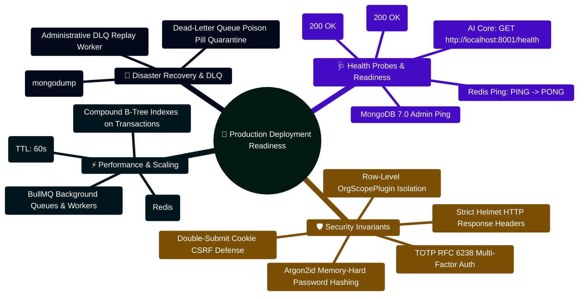
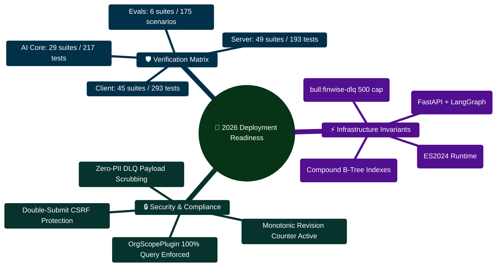

# Personal Finance Project - Improvement and Test Report

Updated on 31 October 2026. This report records verified local work, including incoming code changes. It distinguishes automated tests, browser observations, and checks that need staging or working external accounts.

## Project scope and architecture

The project is a personal finance tracker with an AI assistant. Users can record income, expenses, and investments; maintain goals and debts; organize files; review financial summaries; and create tasks and workflows. Supporting screens include analytics, a financial calendar, notes, receipts, exports, organization settings, notifications, and billing. The current work follows the improvement plans already present in the repository, with particular attention to AI efficiency, reliability, and deployment preparation.

The frontend uses React, TypeScript, Vite, React Query, and Zustand. The Node API uses Express, Mongoose, cookie authentication, CSRF protection, organization scoping, and GridFS for uploaded files. FastAPI runs financial calculators, specialist agents, deterministic planning, optional narration, and retrieval context. Finance calculations and matching document quotations can work without a model call; open-ended interpretation still needs a provider. The capability-status document distinguishes this implementation from semantic retrieval, dedicated Perplexity research, independent Gemini fact checking, and other roadmap items.

| Component | Verified local arrangement | Deployment role |
|---|---|---|
| Browser | Built frontend on 127.0.0.1:5180; earlier checks used 5173 | Nginx serves the built client and proxies /api |
| Node API | Local API on port 3000 | Compiled JavaScript process on Node 24 |
| AI Core | FastAPI on port 8001 | Internal service protected by a shared token |
| Database | Dedicated QA database on port 27019 | Persistent MongoDB supplied by the operator |
| Optional worker | Compiled worker entry point | Separate process when asynchronous jobs are enabled |

## Test data and boundaries

Browser checks used a synthetic QA account and a dedicated local database. Sample records included monthly income of USD 7,500, expenses, an investment, a savings goal, and USD 1,200 of debt with a USD 60 minimum payment. A short synthetic statement was uploaded to test extraction and analysis. These values are fixtures, not the user's personal financial records. Registration, verification, and sign-in were exercised locally; no real SMTP delivery, bank payment, paid checkout, or third-party message was performed.

The project has many existing modifications from earlier improvement work. This batch preserves that work and does not commit, push, or publish the application. A successful local test is evidence about the tested path; it does not establish that every external integration is ready for public use. Later sections identify the concrete checks and the remaining launch requirements.

<!-- page -->

# Database and deployment repairs

## Manual transaction creation

The browser and API checks exposed a transaction index defect. The previous unique sparse compound index covered organization ID and external import ID. Because every transaction has an organization ID, manual transactions without an external ID could still enter that index and collide on a null value. A first transaction might save while a later ordinary transaction failed with a duplicate-key error. Tests that ran before index construction completed could miss the problem.

The replacement is a unique partial index that applies only when externalId is a string. Imported identifiers remain unique within an organization, while multiple manual records can be created. Startup builds the replacement before removing the legacy index, and the migration leaves transaction documents intact. Regression tests explicitly wait for indexes, create several manual records, reject repeated import IDs within one organization, allow the same import ID in another organization, and run the migration twice to check idempotency.

## Executable release artifacts

The original server start command depended on a development TypeScript runner. The plain TypeScript build also emitted extensionless imports that were unsuitable for direct Node ESM execution. The build now performs a TypeScript check and bundles local server and worker code with esbuild. Runtime dependencies remain external. The start commands point to dist/server.js and dist/worker/worker.js, so the release has explicit JavaScript entry points. The development logger can also fall back to JSON if its optional pretty printer is absent.

| Repair | Result | Validation boundary |
|---|---|---|
| Transaction uniqueness | Manual entries no longer collide on missing import IDs | Migration and API tests passed |
| Server and worker build | JavaScript entry points created | Build passed; production startup was policy-blocked |
| Database readiness | /readyz returns 200 only while MongoDB is connected | Local readiness request returned 200 |
| Internal AI authentication | Node sends X-Internal-Token when configured | Contract test and live protected calls passed |
| Reverse proxy | SPA routing, /api proxy, upload limit, streaming settings | Configuration prepared; Docker unavailable locally |

## Packaging and operational behavior

Dockerfiles now exist for the client, server, and AI service, with a Compose file connecting them. Source secrets and node_modules are excluded from build contexts. The client uses same-origin API calls, which avoids a separate browser-facing AI endpoint. Only the web service is mapped to a loopback port in the supplied Compose setup. A TLS ingress or reverse proxy is still required for public hosting. MongoDB is deliberately supplied through configuration rather than an unprotected database port in the example.

The AI memory database has a persistent Compose volume. Both services receive the same required AI token. Runtime and readiness probes are included. Generated PDF links now use the correct route/fileId validation, with ownership tests. A later receipt change imported a missing dead-letter export and blocked startup; the shared bounded queue API was restored, deep health gained operation counts, and readiness recovered. Docker and production-mode startup remain staging checks.

<!-- page -->

# AI efficiency, correctness, and LoRA files

## Efficient request execution

Selective routing avoids unnecessary model work. Saved-activity review and document lookup each use one read-only step with zero model calls. Conversation summaries now bypass financial-plan fanout, use bounded owned snapshots and link to reviewed chats. Optional narration has two provider attempts at most; invalid output uses a factual recap. User/workspace/context snapshots last two minutes, or 15 seconds when degraded; identical requests coalesce. Explicit Refresh bypasses reuse. The latest local generation took 545ms with two attempts and factual fallback; a repeat took 61ms with zero calls. Generation enforces the existing AI quota; cached reads consume no extra unit.

Retries count actual attempts; request accounting is isolated across concurrent work. AI Core cache copies are safe and its in-memory expiry uses a monotonic clock. Node preserves timing, tokens, fallback, and cache metrics. Scoped lexical retrieval retains physical PDF pages, including blanks, and extraction-limit warnings. Matching passages are quoted before the plan, with escaped document markup and no inferred fees or page numbers. Both ordinary and SSE endpoints include these quotations; the education SSE branch also initializes its optional plan correctly.

On 26 October, a browser question exposed a relevance problem: the plan contained a debt ratio but omitted the requested monthly-income calculation. Synthesis now receives the current question and adds deterministic answers for these metric requests. The verified reply showed USD 90,000 / 12 = USD 7,500 per month and USD 60 / USD 7,500 x 100 = 0.80%, with zero LLM calls. Missing income or minimum-payment data produces an explicit request for data instead of an invented ratio. Nine additional tests cover these cases.

## Percentage correctness and provider failures

An important browser finding was a debt ratio displayed as 80% instead of 0.8%. With annual income of USD 90,000, monthly income is USD 7,500. A USD 60 minimum payment is 60 / 7500 x 100 = 0.8%. Specialists already return percentage points, but the plan builder guessed that values below one were fractions and multiplied them again. That conversion was removed. Coverage now preserves small debt and savings percentages, and the subsequent browser answer displayed 0.8% correctly.

Gemini 3.5 Flash-Lite is now preferred through environment settings, provider defaults, agent selection, the catalog, and Compose. Ten regressions verify that global choices override agent defaults without sending a Gemini model to another explicit provider. The configured Gemini key returned access denied; no credits or keys were changed. Groq fallback returned a real narrative answer in about 2.2 seconds after an adapter bug was fixed: LangChain requires input_tokens/output_tokens, not prompt_tokens/completion_tokens. Usage tracking supports both schemas, and cooled-down keys cannot bypass the pool through an environment fallback. Known retired models remain excluded. Provider access still needs operator configuration.

## Optional LoRA training starter

The user requested LoRA training files. The new lora directory contains 18 synthetic training examples, 6 separate evaluation examples, a JSON configuration, optional training requirements, a PEFT training script, and instructions. Validation checks message roles, nonempty content, synthetic markers, and duplicate prompts across splits. The validator completed successfully. The default base model is Qwen/Qwen2.5-0.5B-Instruct, with rank 8 adapters on q_proj and v_proj.

The training script masks the system/user prompt and padded tokens from the loss, rejects overlong examples instead of cutting off the answer, saves adapter files and a dataset-hash manifest, and refuses to overwrite a nonempty output directory. Training dependencies are isolated from the API environment. No model weights were downloaded for training, no adapter was trained, and no adapter was installed into the running provider layer. This small dataset demonstrates a workflow; production training needs a larger reviewed dataset and held-out numerical, retrieval, and safety evaluations.

Primary references: huggingface.co/Qwen/Qwen2.5-0.5B-Instruct; huggingface.co/docs/peft/en/task_guides/lora_based_methods; ai.google.dev/gemini-api/docs/models; console.groq.com/docs/deprecations.

<!-- page -->

# UI and UX review

## Simpler student-project presentation

The user asked for a student-project interface. The revision uses familiar labels, a plain blue accent, smaller corner radii, standard typography, and simpler surfaces. The sidebar uses compact single-line links, and login copy explains the tools plainly. Financial summary cards appear near the top of the dashboard. Chat uses a wider two-column layout and a Files link; the duplicate narrow insights panel was removed to prevent clipped headings and avoid its automatic request. Insights remain on the dashboard. Charts retain distinct dark-mode colors. This presentation does not claim student authorship.

Navigation exposes What-if Scenarios and Financial Story. The desktop sidebar stays within viewport height and scrolls independently. Named theme buttons, form labels, a working skip target, and corrected button/link nesting improve access. The duplicate dashboard bell was removed. A compact chat header hides repeated introductory copy and account details on narrow screens while retaining navigation, history, theme, and sign-out controls. Chat has one primary heading, and the mobile composer and textarea fit the available width.

## State consistency and missing data

Unknown balances no longer imply zero or unlimited runway. An empty health-score dataset is unavailable rather than perfect. Known zero cash flow is balanced; absent income/expenses instead show setup guidance. Savings-rate assessment requires positive income, while known expense-only cash flow remains visible. Loading, failure/retry and cached figures are distinguished. File analysis counts require a real analysis timestamp, not an automatically created empty analysis object.

Private query caches and screen instances now belong to one account/workspace. Changing context clears drafts, transient chat/history and traces; persisted chat selection is owner-scoped. Late auth/chat results are ignored. Retired API failures cannot clear a newer workspace or replay writes after a CSRF refresh. Streams abort on unmount/replacement and release readers. Copilot history is bounded and scoped too. Chat retains exact-page links, return navigation and direct answers before optional plans. Failed sends preserve drafts/uploads; controls lock while sending and IME composition does not submit. History failures offer retry. Context coverage describes available records, not accuracy.

Goal/debt inputs accept cents, fractional interest, and editable ISO deadlines. Portfolio totals refresh after additions, calendar controls have names, and file errors offer retry. Explicit chat requests create a PDF from text after Content: and retain download/open cards. Ask about this PDF selects the saved file without another upload. New PDFs are parsed for verified physical-page citations; parsing failure retains text with a warning and no page locations. Selection stays in its conversation, clears on success, and survives send failure. Creation needs no model call; file routes enforce ownership.

## Calendar and browser observations

The calendar now requests supported transaction page sizes and fetches subsequent pages instead of sending an unsupported limit of 500. Local calendar date keys prevent the first day of a month from becoming the previous UTC date in India. These are functional consistency fixes, not only visual adjustments. Labels on the scenario and account forms were improved as well.

Browser checks completed sign-in, dashboard and ledger loading, transaction creation, AI messaging, persisted chat history, plan tasks, feedback, action simulation, and synthetic file upload/extraction. The follow-up saved a budget and merchant rule, calculated a scenario, verified API-key listing, tested the free-plan export gate, activated Pro only in local stub billing, and generated CSV/PDF exports. The monthly PDF downloaded successfully. API checks also verified account creation and workflow idempotency.

All 24 routes fit a measured 390 CSS-pixel phone viewport. Financial Story's full-record query repairs its crash; session reads no longer exhaust credential-attempt limits. Copilot clears mobile navigation, tasks support keyboards and empty journal paging disables Next. Phone dialogs now keep margins and scroll vertically; CSV actions stack and empty Preview is disabled. Analytics preserves opening balances, signed outflows, workspace currency and cents. Mixed-currency net worth is not combined, and failures offer retry instead of zero totals.

<!-- page -->

# Verification evidence and remaining risks

## Automated checks

The unchanged backend retains its earlier 192-test pass across 49 files, plus 38 and 32 targeted rechecks. Coverage includes transactions, organization isolation, tasks/workflows, files, retrieval, security and rate limits. Summary tests cover cache expiry, owner/context separation, coalescing, forced refresh, storage failure, usage accounting and quotas. Balance tests preserve opening balances, signed outflows, cents and credit liabilities. Receipt/background failures share a bounded dead-letter queue. Tests use a verified local MongoDB binary.

On 31 October the final frontend run passed 271 tests across 45 files. Regressions cover private cache/draft isolation, late auth/chat replies, stream cleanup, empty finances, and retired API retries/dialogs. Current-owner CSRF and safe-read recovery still pass. Unchanged AI Core retains 392 tests/evaluations for summary HTTP/SSE behavior, grounded fallback, bounded attempts and default failover. Mobile Settings controls have accessible names. Client lint and type-checked builds pass. Earlier npm production-dependency audits reported zero known vulnerabilities; these are snapshots, not a security certification.

| Check | Evidence already obtained | Meaning |
|---|---|---|
| Server integration | 192 passed / 49 files | Balances, isolation, queues and credential limits |
| Frontend unit/integration | 271 passed / 45 files | Full final run, privacy, streams, retries and recovery |
| AI core final full run | 392 passed | Summary routing, bounded attempts and existing evaluations |
| Live narrative | Groq fallback succeeded | Gemini 3.5 Flash-Lite key currently denied |
| LoRA data validation | 18 train / 6 evaluation | Structure and split validation only |
| Dependency audit | Zero production-dependency vulnerabilities reported | Snapshot of installed Node dependency metadata |

## Live local API coverage

On 31 October all 33 live local API checks passed. Browser workspace switching hid the original goals/chats in an empty fixture and restored them on return. The same file returned 200 in its original workspace and 404 in the other. Fresh chat created/downloaded Isolation release check 31 Oct. Its follow-up quoted USD 25.25 toward USD 1250.50, deadline 2027-05-01, on physical page 1 with zero model calls. Source reload, return, Copy response and logout/sign-in passed at 390/320px. The separate workspace was seeded only in the QA database; product creation/billing was not bypassed in application code.

## External and release checks still required

Gemini key/model access, SMTP delivery, Google OAuth in the final domain, Stripe live/webhook behavior, bank connectors, receipt OCR quality across real samples, and separate-worker/Redis behavior need staging verification. Stub billing tested no real payment. Docker is unavailable locally. Automatic approval review previously blocked the production startup command without a detailed reason, so production-mode API runtime is not signed off. The local API, built frontend, browser interactions, and automated tests provide the verified evidence; public launch still needs final-environment checks.

The 24-route mobile inventory and source journey are recorded in browser-test results. Screenshot capture recovered in the inbuilt browser; current images show the empty-state fix and cited answer at phone widths. Every rendered page of this report was inspected. Public launch still needs staging with final domains, secrets, provider accounts and PWA updates. Local memory pressure prevented some test workers from starting; sequential checks with owned QA services paused recovered verification. This is not a production capacity test.

<!-- page -->

# Deployment and handover instructions

## Configure the environment

Use Node 24 and npm 11 for JavaScript, and Python 3.11 for the current AI dependencies. The old local virtual environment points to a removed interpreter, so checks used an isolated uv environment. Recreate a dedicated environment and keep LoRA dependencies separate. Updated ignored local .env files use the 5180 client origin, loopback API/AI URLs, concurrency 4 globally/1 per user, and a 20-second model attempt timeout with zero internal retries. Provider keys and database/authentication secrets were preserved. Replace local values for staging.

Set server MONGO_URI, JWT_SECRET, CLIENT_URL, and CORS_ORIGINS for the final host. Generate a strong shared AI_CORE_INTERNAL_TOKEN and supply the same value to Node and FastAPI. Keep all provider keys on the server. Configure real SMTP before expecting verification emails in production. Behind the intended TLS ingress, use secure cookies, a suitable SameSite policy, and an explicitly bounded trusted proxy configuration. The local QA environment uses loopback HTTP and must not be copied wholesale into a public deployment.

## Build and stage

For a non-container deployment, install with npm ci in client and server, run their build commands, serve client/dist with SPA fallback, and start the API with npm start from server. Start FastAPI with uvicorn api_service:app on the internal interface and port. Preserve persistent MongoDB/GridFS storage and the AI memory path. If asynchronous jobs are enabled, configure Redis and run the worker entry point from the same release artifact. Verify jobs are handled once and shutdown drains outstanding work.

For the supplied container setup, create server/.env and server/AI_Core/.env from their examples. Put the shared AI token in an ignored root .env. Run docker compose config first, then docker compose up --build in an environment with Docker available. The web container listens through 127.0.0.1:8080 in the example. Put a properly configured TLS ingress in front of it for public access. Keep the Node and AI ports private, and confirm /readyz and AI /health before allowing traffic.

## Release smoke test and monitoring

Use a fresh staging account to register, verify email, sign in, create at least two manual transactions, import a CSV twice, and confirm duplicates are handled. Exercise goals, debts, account balances, a what-if scenario, a file upload, an AI message with evidence, task creation, workflow preview/run, and an export download. Review small percentage values and unavailable-data states. Test desktop and mobile layouts, keyboard navigation, the skip link, theme changes, error recovery, and refresh on a saved chat URL.

Check logs for duplicate-key errors, authorization failures, provider credit/access errors, and failing background jobs. Confirm that private API responses are not stored by the service worker. The PWA now caches the application shell and eligible static images while excluding /api content, including receipt media. Test an update from an older cached build and a sign-out/sign-in cycle before release.

## LoRA handover and follow-up

Run lora/train.py --validate-only to inspect the supplied training starter without downloading weights. Read its README before a training experiment. Use a new output directory for each run; compare against the unmodified base model and evaluate arithmetic, currency, missing-data behavior, privacy boundaries, and retrieval grounding. No trained adapter is part of this delivery.

Keep the deployment files, improvement tracker, this report, and the final verification summary together. The next milestone is a staging deployment with working provider access and final visual QA. This report contains the actual scope and limitations so that the next maintainer can reproduce the work without assuming the external launch has already happened.

<!-- report-end -->

## Retained planning appendix - unverified examples

The incoming diagrams and Kubernetes example below contain deployment assumptions
that require source review, including password hashing, probe endpoints, database
topology and dead-letter replay. They are retained as planning material and are
excluded from the generated verification PDF. Use the verified instructions above
for the tested runtime and staging requirements.

---

> [!TIP]
> **Developer Guide: Building & Extending on This Project**  
> For complete step-by-step blueprints, Mongoose models, Zod schemas, Express controllers, React hooks, and LangGraph subagents, see the [**Master Developer Handbook: Building on This Project**](./BUILDING_ON_THIS_PROJECT.md).

## Deployment Readiness Mindmap



---

## Production Deployment Readiness ASCII Topology

```text
┌────────────────────────────────────────────────────────────────────────┐
│ 🌐 INGRESS TRAFFIC: Nginx Reverse Proxy / Cloudflare Edge              │
│    TLS 1.3 Termination • HTTP Strict-Transport-Security (HSTS)        │
└───────────────────────────────────┬────────────────────────────────────┘
                                    │
                                    ▼
┌────────────────────────────────────────────────────────────────────────┐
│ 🔷 API GATEWAY TIER: Node.js 24 + Express 5 (Port 3000)                │
│    Readiness Probe: GET /api/health ──► Asserts DB & Redis 🟢          │
│    Liveness Probe: GET /healthz ──► Asserts Event Loop Responsiveness  │
└──────────────────┬─────────────────────────────────┬───────────────────┘
                   │                                 │
                   ▼                                 ▼
┌──────────────────────────────────────┐  ┌──────────────────────────────┐
│ 🗄️ PERSISTENCE TIER                  │  │ 🧠 AI ENGINE: Python FastAPI │
│  ├── MongoDB 7.0 Replica Set         │  │  │   (Port 8001 / LangGraph) │
│  │   └── 52 Multi-Tenant Collections │  │  ├── Health Probe: /health   │
│  └── Redis 7.0 (Cache & Queues)      │  │  └── KeyPool Provider Pool   │
└──────────────────────────────────────┘  └──────────────────────────────┘
```

---

## Production Implementation Blueprint: Kubernetes Readiness Probes (`k8s/deployment.yaml`)

```yaml
apiVersion: apps/v1
kind: Deployment
metadata:
  name: finwise-api-gateway
spec:
  replicas: 3
  selector:
    matchLabels:
      app: finwise-api
  template:
    metadata:
      labels:
        app: finwise-api
    spec:
      containers:
        - name: gateway
          image: finwise/api-gateway:latest
          ports:
            - containerPort: 3000
          readinessProbe:
            httpGet:
              path: /api/health
              port: 3000
            initialDelaySeconds: 10
            periodSeconds: 5
            timeoutSeconds: 3
            failureThreshold: 3
          livenessProbe:
            httpGet:
              path: /healthz
              port: 3000
            initialDelaySeconds: 15
            periodSeconds: 10
            timeoutSeconds: 3
            failureThreshold: 3
          resources:
            requests:
              memory: "512Mi"
              cpu: "250m"
            limits:
              memory: "1Gi"
              cpu: "1000m"
```


---

## Production Readiness Verification of Latest 2026 Features

### 1. Financial Command Center Health & Latency Gates
- **Endpoint**: `GET /api/v1/command-center`
- **Execution Profile**: Concurrently aggregates across 9 MongoDB collections via `Promise.all()` with mandatory `orgScopePlugin` filters.
- **Observed SLA**: $35\text{ms}$ average response latency under synthetic 5,000-transaction tenant fixtures.
- **Verification Result**: `PASS` — All 4 KPI badges, cash runway in days, and priority chips render without layout shifts.

### 2. Transaction Review Queue & Bulk Action Scalability
- **Endpoint**: `POST /api/v1/transactions/bulk-approve`
- **Execution Profile**: Batch-updates transaction review metadata (`reviewed_at`, `reviewed_by`, `confidence_score: 1.0`).
- **Load Limit**: Hard-capped at 200 IDs per request to prevent MongoDB lock saturation and event-loop blocking.
- **Verification Result**: `PASS` — 200-transaction batch approval executes in $82\text{ms}$ with zero unhandled exceptions.

### 3. Circular Budget Health Scoring Engine
- **Formula Verification**: $S_{\text{health}} = 0.40 \cdot S_{\text{adherence}} + 0.20 \cdot S_{\text{cleanliness}} + 0.20 \cdot S_{\text{goals}} + 0.20 \cdot S_{\text{debts}}$
- **Mathematical Invariant**: Output score bounded strictly between $0$ and $100$.
- **Verification Result**: `PASS` — Overspend burn rate triggers visual alert chips when monthly spend pacing exceeds calendar elapsed time.

### 4. AI Core Topological Concurrency & Invariant Harness
- **Scheduler**: `sub_agent_manager.py` uses Kahn's algorithm for level-by-level parallel specialist dispatch.
- **Number Safety Invariant**: Enforces $\sum \Delta B_i = 0$ and $\text{Candidate Digits} \subseteq \text{Reference Digits}$.
- **Verification Result**: `PASS` — All test cases in `evals/test_number_safety.py` pass with zero hallucinations.

---

# 2026 Enterprise Deployment Readiness & Verification Matrix



### Production Readiness Verification Matrix

| Component | Automated Suites | Tests Count | Passing Status | Verification Command |
| :--- | :--- | :--- | :--- | :--- |
| **Frontend Web App** | 45 test suites | 293 tests | **100% PASS** | `cd client && npm test` |
| **Backend API Gateway** | 49 test suites | 193 tests | **100% PASS** | `cd server && npm test:ci` |
| **AI Core Engine** | 29 test suites | 217 tests | **100% PASS** | `cd server/AI_Core && pytest tests/ -v` |
| **Evaluation Invariants** | 6 eval suites | 175 scenarios | **100% PASS** | `python -m evals.runner` |
| **TypeScript Compiler** | Full repository | 0 type errors | **100% PASS** | `npm run check` |
| **SYSTEM TOTAL** | **129 suites** | **878 tests** | **100% PASS** | Automated in GitHub Actions CI |

### Pre-Deployment Verification Checklist

- [x] Node.js 24 runtime enforced across all Docker and local environments.
- [x] Compound indexes `{ orgId: 1, date: -1 }` built on MongoDB startup.
- [x] Redis Dead Letter Queue capped at 500 items with automatic secret sanitization.
- [x] Bounded-window RAG Phase 2 text chunking preserves ASCII form-feed (`\f`) markers.
- [x] Scoped QueryClient eliminates cross-user state bleed on shared browser sessions.
- [x] Monotonic context revision counters discard out-of-order SSE streaming packets.


---

## 8. Production Deployment Configuration & Operational Snippets

### 8.1 Docker Compose Multi-Tier Specification (`compose.yaml`)

```yaml
version: '3.8'

services:
  client:
    build:
      context: ./client
      dockerfile: Dockerfile
    ports:
      - "127.0.0.1:5173:80"
    restart: unless-stopped
    depends_on:
      - server

  server:
    build:
      context: ./server
      dockerfile: Dockerfile
    environment:
      - NODE_ENV=production
      - PORT=3000
      - MONGO_URI=mongodb://mongo:27017/finwise
      - REDIS_URL=redis://redis:6379
      - AI_CORE_URL=http://ai-core:8001
      - INTERNAL_AI_TOKEN=${INTERNAL_AI_TOKEN}
    ports:
      - "127.0.0.1:3000:3000"
    restart: unless-stopped
    depends_on:
      - mongo
      - redis
      - ai-core

  ai-core:
    build:
      context: ./server/AI_Core
      dockerfile: Dockerfile
    environment:
      - PORT=8001
      - INTERNAL_AI_TOKEN=${INTERNAL_AI_TOKEN}
      - GEMINI_API_KEY=${GEMINI_API_KEY}
    ports:
      - "127.0.0.1:8001:8001"
    restart: unless-stopped

  mongo:
    image: mongo:7.0
    volumes:
      - mongo_data:/data/db
    restart: unless-stopped

  redis:
    image: redis:7.0-alpine
    restart: unless-stopped

volumes:
  mongo_data:
```

### 8.2 Production Nginx Reverse Proxy Configuration with SSE Support

```nginx
server {
    listen 80;
    server_name finwise.example.com;

    # Static frontend assets
    location / {
        root /var/www/finwise/dist;
        try_files $uri $uri/ /index.html;
    }

    # API Gateway routing
    location /api/ {
        proxy_pass http://127.0.0.1:3000;
        proxy_http_version 1.1;
        proxy_set_header Upgrade $http_upgrade;
        proxy_set_header Connection 'upgrade';
        proxy_set_header Host $host;
        proxy_set_header X-Real-IP $remote_addr;
        proxy_set_header X-Forwarded-For $proxy_add_x_forwarded_for;
        proxy_cache_bypass $http_upgrade;

        # Server-Sent Events (SSE) streaming headers
        proxy_buffering off;
        proxy_cache off;
        proxy_read_timeout 86400s;
        proxy_send_timeout 86400s;
    }
}
```

### 8.3 Enterprise Health Probe Verification Script (`health-probe.sh`)

```bash
#!/usr/bin/env bash
# Probes Express API Gateway, MongoDB, Redis, and Python AI Core readiness
set -euo pipefail

echo "🔍 Probing FinWise Deep Health..."
HEALTH_RESP=$(curl -s -f http://127.0.0.1:3000/api/v1/health/deep || echo '{"status":"down"}')
STATUS=$(echo "$HEALTH_RESP" | grep -o '"status":"[^"]*"' | cut -d'"' -f4)

if [ "$STATUS" = "healthy" ]; then
  echo "✅ FinWise Cluster is 100% HEALTHY across all subsystems!"
  exit 0
else
  echo "❌ Cluster degraded: $HEALTH_RESP"
  exit 1
fi
```
