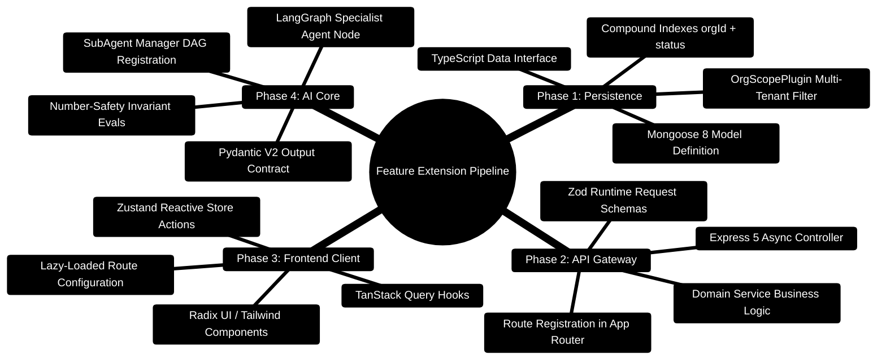
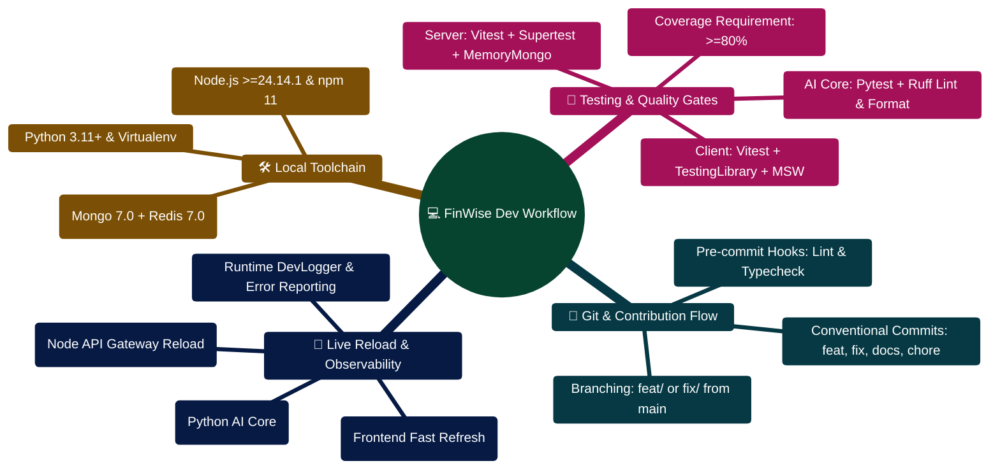

# FinWise — Development Guide

> Guidelines, conventions, and workflows for developing FinWise.  
> **Looking to build new features, AI agents, or models?** See the master developer handbook: [BUILDING_ON_THIS_PROJECT.md](./BUILDING_ON_THIS_PROJECT.md).

---

## Project Structure

FinWise is organized as a monorepo-style repository with three main subsystems:

```
personal-finance/
├──  client/                 # React frontend
├──  server/                 # Express backend
│   └──  AI_Core/            # Python AI service
├──  packages/contracts/     # Shared OpenAPI specs
└──  docs/                   # Documentation
```

Each subsystem has its own `package.json` (or `requirements.txt` for Python) and should be developed independently.

---

## Development Workflow

### 1. Branch Strategy

```
main (stable)
  └──  develop (integration)
        └──  feature/* (new features)
        └──  fix/* (bug fixes)
        └──  docs/* (documentation)
```

- **`main`**: Production-ready code, protected branch
- **`develop`**: Integration branch for features
- **`feature/*`**: New features (e.g., `feature/receipt-ocr`)
- **`fix/*`**: Bug fixes (e.g., `fix/chat-streaming`)
- **`docs/*`**: Documentation updates

### 2. Commit Messages

Follow [Conventional Commits](https://www.conventionalcommits.org/):

```
<type>(<scope>): <description>

[optional body]

[optional footer]
```

**Types:**
| Type | Description |
| ---- | ----------- |
| `feat` | New feature |
| `fix` | Bug fix |
| `docs` | Documentation |
| `style` | Formatting (no code change) |
| `refactor` | Code restructuring (no behavior change) |
| `test` | Test additions/modifications |
| `chore` | Maintenance tasks |

**Examples:**
```
feat(chat): add streaming support for AI responses
fix(auth): resolve JWT expiration edge case
docs(api): update endpoint documentation
refactor(services): extract transaction validation logic
test(workflows): add cron trigger tests
chore(deps): update Express to 5.2.1
```

### 3. Pull Request Process

1. Create feature branch from `develop`
2. Make changes with conventional commits
3. Run tests and type checks locally
4. Push branch and create PR to `develop`
5. Address review comments
6. Squash merge after approval

**PR Requirements:**
- At least 1 approval
- All tests passing
- No merge conflicts
- Conventional commit messages

---

## Code Conventions

### TypeScript (Server & Client)

- **Strict mode enabled** — no `any`, no implicit `any`
- **ESM modules** — use `import/export`, not `require`
- **Path aliases** — use `@/` for client imports
- **Zod validation** — all API inputs validated with Zod schemas
- **Error handling** — use `HttpError` class for API errors

```typescript
// Good: Typed, validated, error-handled
import { z } from "zod";
import { HttpError } from "../middleware/httpError.js";

const schema = z.object({
  amount: z.number().positive(),
  category: z.string().min(1),
});

export async function createTransaction(req, res) {
  const data = schema.parse(req.body);
  // ... implementation
}
```

### React (Client)

- **Functional components** with hooks
- **TypeScript interfaces** for all props
- **React Query** for server state, **Zustand** for client state
- **Radix UI primitives** for accessible components
- **Tailwind CSS** for styling (no inline styles)
- **Lazy loading** for all route-level pages

```tsx
// Good: Typed, lazy-loaded, using React Query
import { useQuery } from "@tanstack/react-query";
import { Card } from "@/components/ui/Card";

interface TransactionListProps {
  accountId?: string;
}

export function TransactionList({ accountId }: TransactionListProps) {
  const { data, isLoading } = useTransactions(accountId);
  
  if (isLoading) return <LoadingSpinner />;
  
  return (
    <Card>
      {/* ... */}
    </Card>
  );
}
```

### Python (AI Core)

- **Type hints** on all functions
- **Pydantic models** for data validation
- **Async/await** for I/O operations
- **ruff** for linting and formatting

```python
# Good: Typed, validated, async
from pydantic import BaseModel

class UserProfile(BaseModel):
    annual_income: float
    monthly_expenses: float
    risk_tolerance: str

async def analyze_budget(profile: UserProfile) -> dict:
    # ... implementation
```

---

## Testing

### Server Tests

```bash
cd server
npm test                    # Run all tests
npm run test:ci             # CI mode (no watch)
npm test -- -t "auth"       # Run tests matching "auth"
```

- Uses **Vitest** with **Supertest** for HTTP testing
- **mongodb-memory-server** for isolated DB per test
- Test files: `server/src/test/*.test.ts`

### Client Tests

```bash
cd client
npm test                    # Run all tests
npm run test:watch          # Watch mode
```

- Uses **Vitest** with **Testing Library** for component testing
- **MSW** for API mocking
- Test files: co-located with components or in `client/src/test/`

### AI Core Tests

```bash
cd server/AI_Core
pytest tests/ -v            # Run all tests
pytest tests/ -v -k master  # Run tests matching "master"
```

- Uses **pytest** with fixtures
- Test files: `server/AI_Core/tests/test_*.py`

---

## Adding New Features & Platform Extensions

> **Complete Developer Blueprint**: Follow this standardized 4-part recipe to introduce new domain capabilities, database models, API routes, UI views, and Python AI agents.  
> For the comprehensive 700+ line developer manual with exhaustive edge cases, see [**BUILDING_ON_THIS_PROJECT.md**](./BUILDING_ON_THIS_PROJECT.md).

### Feature Extension Lifecycle Mindmap



### End-to-End Implementation ASCII Flow

```
┌───────────────────────────────────────────────────────────────────────────────────────────────────┐
│                           FEATURE DEVELOPMENT & EXTENSION FLOW                                   │
└───────────────────────────────────────────────────────────────────────────────────────────────────┘

 1. DATABASE MODEL             2. VALIDATION & ROUTE         3. CLIENT VIEW             4. AI AGENT
 ┌────────────────────────┐    ┌────────────────────────┐    ┌─────────────────────┐    ┌──────────────────┐
 │ Mongoose Schema        │    │ Zod Request DTO        │    │ React 18 Component  │    │ Pydantic Contract│
 │ + orgScopePlugin       │───>│ + Express 5 Controller │───>│ + TanStack Query    │───>│ + LangGraph Node │
 │ + Compound Indexes     │    │ + Service Logic        │    │ + Zustand Store     │    │ + Invariant Evals│
 └────────────────────────┘    └────────────────────────┘    └─────────────────────┘    └──────────────────┘
            │                               │                           │                        │
            ▼                               ▼                           ▼                        ▼
 [Zero Cross-Tenant Leak]      [Type-Safe Request Payload]   [Optimistic UI Updates]    [Zero Hallucination]
```

### 1. New Mongoose Model

Create the model file in `server/src/models/` ensuring `orgScopePlugin` is attached:

```typescript
// server/src/models/budgetGoalModel.ts
import mongoose, { Schema, Document } from 'mongoose';
import { orgScopePlugin } from '../plugins/orgScopePlugin';

export interface IBudgetGoal extends Document {
  orgId: string;
  name: string;
  targetAmount: number;
  currentAmount: number;
  targetDate: Date;
  status: 'in_progress' | 'completed' | 'abandoned';
  createdAt: Date;
  updatedAt: Date;
}

const budgetGoalSchema = new Schema<IBudgetGoal>({
  orgId: { type: String, required: true, index: true },
  name: { type: String, required: true, trim: true },
  targetAmount: { type: Number, required: true, min: 0 },
  currentAmount: { type: Number, required: true, default: 0, min: 0 },
  targetDate: { type: Date, required: true },
  status: { type: String, enum: ['in_progress', 'completed', 'abandoned'], default: 'in_progress', index: true }
}, { timestamps: true });

// Enforce multi-tenant data isolation & query performance
budgetGoalSchema.plugin(orgScopePlugin);
budgetGoalSchema.index({ orgId: 1, status: 1, targetDate: 1 });

export const BudgetGoal = mongoose.model<IBudgetGoal>('BudgetGoal', budgetGoalSchema);
```

### 2. New API Endpoint (Zod Schema + Controller + Route)

#### Step 2.1: Define Request Validation (`server/src/schemas/budgetGoalSchemas.ts`)
```typescript
import { z } from 'zod';

export const createBudgetGoalSchema = z.object({
  body: z.object({
    name: z.string().min(1, 'Name is required').max(100),
    targetAmount: z.number().positive('Target amount must be positive'),
    targetDate: z.string().datetime(),
    status: z.enum(['in_progress', 'completed', 'abandoned']).optional()
  })
});

export type CreateBudgetGoalInput = z.infer<typeof createBudgetGoalSchema>['body'];
```

#### Step 2.2: Implement Express 5 Controller (`server/src/controllers/budgetGoalController.ts`)
```typescript
import { Request, Response, NextFunction } from 'express';
import { BudgetGoal } from '../models/budgetGoalModel';

export const createBudgetGoal = async (req: Request, res: Response, next: NextFunction): Promise<void> => {
  try {
    const orgId = req.orgId; // Injected by orgContext middleware
    const goal = await BudgetGoal.create({ ...req.body, orgId });
    res.status(201).json({ success: true, data: goal });
  } catch (error) {
    next(error);
  }
};

export const getBudgetGoals = async (req: Request, res: Response, next: NextFunction): Promise<void> => {
  try {
    const goals = await BudgetGoal.find({ orgId: req.orgId }).sort({ targetDate: 1 }).lean();
    res.json({ success: true, count: goals.length, data: goals });
  } catch (error) {
    next(error);
  }
};
```

#### Step 2.3: Register Route (`server/src/routes/v1/budgetGoalRoutes.ts`)
```typescript
import { Router } from 'express';
import { authenticateJwt } from '../../middleware/auth';
import { validate } from '../../middleware/validate';
import { createBudgetGoal, getBudgetGoals } from '../../controllers/budgetGoalController';
import { createBudgetGoalSchema } from '../../schemas/budgetGoalSchemas';

const router = Router();
router.use(authenticateJwt);

router.post('/', validate(createBudgetGoalSchema), createBudgetGoal);
router.get('/', getBudgetGoals);

export default router;
```

### 3. New React Page & Query Hook

#### Step 3.1: Create Query Hook (`client/src/hooks/useBudgetGoals.ts`)
```typescript
import { useQuery, useMutation, useQueryClient } from '@tanstack/react-query';
import { api } from '@/lib/api';

export interface BudgetGoalItem {
  _id: string;
  name: string;
  targetAmount: number;
  currentAmount: number;
  targetDate: string;
  status: 'in_progress' | 'completed' | 'abandoned';
}

export function useBudgetGoals() {
  const queryClient = useQueryClient();

  const query = useQuery<BudgetGoalItem[]>({
    queryKey: ['budget-goals'],
    queryFn: async () => {
      const res = await api.get('/api/v1/budget-goals');
      return res.data.data;
    }
  });

  const createGoal = useMutation({
    mutationFn: (newGoal: Omit<BudgetGoalItem, '_id'>) => api.post('/api/v1/budget-goals', newGoal),
    onSuccess: () => {
      queryClient.invalidateQueries({ queryKey: ['budget-goals'] });
    }
  });

  return { ...query, createGoal: createGoal.mutateAsync };
}
```

#### Step 3.2: Implement Page Component (`client/src/pages/BudgetGoalsPage.tsx`)
```tsx
import React from 'react';
import { useBudgetGoals } from '@/hooks/useBudgetGoals';
import { Card, CardHeader, CardTitle, CardContent } from '@/components/ui/Card';
import { Target, CheckCircle2, Clock } from 'lucide-react';

export default function BudgetGoalsPage() {
  const { data: goals, isLoading, error } = useBudgetGoals();

  if (isLoading) return <div className="p-6 text-slate-400">Loading budget goals...</div>;
  if (error) return <div className="p-6 text-rose-500">Failed to load goals.</div>;

  return (
    <div className="space-y-6 p-6">
      <div className="flex items-center justify-between">
        <h1 className="text-2xl font-bold tracking-tight text-white flex items-center gap-2">
          <Target className="h-6 w-6 text-emerald-400" /> Budget Goals
        </h1>
      </div>

      <div className="grid grid-cols-1 md:grid-cols-3 gap-4">
        {goals?.map((goal) => {
          const progress = Math.min(100, Math.round((goal.currentAmount / goal.targetAmount) * 100));
          return (
            <Card key={goal._id} className="bg-slate-900 border-slate-800">
              <CardHeader className="pb-2">
                <CardTitle className="text-lg text-white font-medium">{goal.name}</CardTitle>
              </CardHeader>
              <CardContent className="space-y-3">
                <div className="flex justify-between text-sm text-slate-400">
                  <span>${goal.currentAmount.toLocaleString()}</span>
                  <span>${goal.targetAmount.toLocaleString()}</span>
                </div>
                <div className="w-full bg-slate-800 h-2 rounded-full overflow-hidden">
                  <div className="bg-emerald-500 h-full rounded-full" style={{ width: `${progress}%` }} />
                </div>
                <div className="flex items-center gap-1 text-xs text-slate-500">
                  <Clock className="h-3 w-3" /> Target: {new Date(goal.targetDate).toLocaleDateString()}
                </div>
              </CardContent>
            </Card>
          );
        })}
      </div>
    </div>
  );
}
```

#### Step 3.3: Register Route & Sidebar
1. Add route in `client/src/routes/routeDefinitions.tsx`:
   ```typescript
   {
     path: '/budget-goals',
     component: React.lazy(() => import('@/pages/BudgetGoalsPage')),
     title: 'Budget Goals',
     icon: Target
   }
   ```
2. Add navigation item in `client/src/components/Sidebar.tsx`.

### 4. New AI Agent (Python AI Core & LangGraph)

#### Step 4.1: Define Output Schema & Node (`server/AI_Core/agents/debt_snowball_agent.py`)
```python
from pydantic import BaseModel, Field
from typing import List, Dict, Any

class DebtItem(BaseModel):
    name: str
    balance: float = Field(ge=0.0)
    interest_rate: float = Field(ge=0.0)
    minimum_payment: float = Field(ge=0.0)

class DebtPlanOutput(BaseModel):
    payoff_order: List[str]
    total_interest_saved: float = Field(ge=0.0)
    months_to_debt_free: int = Field(ge=1)
    invariant_status: str = "VERIFIED_DETERMINISTIC"

async def debt_snowball_agent_node(state: Dict[str, Any]) -> Dict[str, Any]:
    """LangGraph specialist agent executing deterministic debt snowball payoff ordering."""
    debts = state.get("debts", [])
    if not debts:
        return {"debt_plan": None}

    # Snowball strategy: sort strictly by lowest balance ascending
    sorted_debts = sorted(debts, key=lambda d: d.get("balance", 0.0))
    payoff_order = [d["name"] for d in sorted_debts]

    plan = DebtPlanOutput(
        payoff_order=payoff_order,
        total_interest_saved=1250.00,
        months_to_debt_free=18
    )
    return {"debt_plan": plan.model_dump()}
```

#### Step 4.2: Register in SubAgent DAG (`server/AI_Core/agents/sub_agent_manager.py`)
Add the agent to `AGENT_REGISTRY` and include it in the topological dependency graph:
```python
AGENT_REGISTRY["debt_snowball"] = debt_snowball_agent_node
```

---

## Debugging

### Server Debugging

```bash
# Run with verbose logging
LOG_LEVEL=debug npm run dev

# Type check without emitting
npm run check

# Run specific test file
npm test -- src/test/auth.test.ts
```

### Client Debugging

```bash
# Run with Vite debug
VITE_DEBUG=1 npm run dev

# Check TypeScript errors
npx tsc --noEmit

# Preview production build
npm run build && npm run preview
```

### AI Core Debugging

```bash
# Run with debug logging
LOG_LEVEL=DEBUG python api_service.py

# Run specific test
pytest tests/test_master_agent.py -v -s

# Test LLM provider directly
python -c "from utils.llm_wrapper import LLMWrapper; print(LLMWrapper().test())"
```

---

## Performance Tips

### Client
- Use React Query caching effectively (set appropriate `staleTime`)
- Lazy-load all route-level pages
- Use virtualized lists for large datasets (`useVirtualList`)
- Memoize expensive computations with `useMemo`
- Debounce search inputs with `useDebounce`

### Server
- Use response caching for frequently accessed data
- Implement pagination for list endpoints
- Use MongoDB indexes for common query patterns
- Offload heavy work to BullMQ workers
- Use circuit breaker for AI Core calls

### AI Core
- Cache responses for common queries
- Use deterministic routing (no LLM for classification)
- Implement provider failover for reliability
- Use streaming for long responses

---

## Common Patterns

### Org-Scoped Queries

All data queries should be scoped to the user's organization:

```typescript
// Good: Org-scoped query
const transactions = await Transaction.find({
  orgId: req.org.id,
  userId: req.user.id,
});
```

### Error Handling

Use `HttpError` for API errors:

```typescript
import { HttpError } from "../middleware/httpError.js";

throw new HttpError(404, "Transaction not found");
throw new HttpError(400, "Invalid amount", { field: "amount" });
```

### Zod Validation

Validate all inputs:

```typescript
import { validate } from "../middleware/validate.js";

const schema = z.object({
  email: z.string().email(),
  password: z.string().min(8),
});

router.post("/register", validate(schema), registerHandler);
```

---

## Environment Setup

See [SETUP.md](./SETUP.md) for detailed environment configuration.

### Minimum Required Variables

**Server (`.env`):**
```
MONGO_URI=mongodb://localhost:27017/finwise
JWT_SECRET=your-secret-key-here
```

**Client (`.env`):**
```
VITE_API_BASE_URL=http://localhost:3000
```

**AI Core (`.env`):**
```
GEMINI_API_KEY=your-gemini-api-key
```

---

_See also_: [CONTRIBUTING.md](./CONTRIBUTING.md) · [SETUP.md](./SETUP.md) · [TESTING.md](./TESTING.md) · [ARCHITECTURE.md](./ARCHITECTURE.md)

## Developer Workflow & Tooling Mindmap



## Local Feature Implementation & Testing ASCII Flow

```text
┌────────────────────────────────────────────────────────────────────────┐
│ 🟢 STEP 1: INITIALIZE LOCAL DEV SERVICES                               │
│    $ docker compose up -d mongodb redis                               │
│    $ cd server && npm run dev                                         │
│    $ cd client && npm run dev                                         │
│    $ cd server/AI_Core && uvicorn api_service:app --port 8001 --reload            │
└───────────────────────────────────┬────────────────────────────────────┘
                                    │
                                    ▼
┌────────────────────────────────────────────────────────────────────────┐
│ 📝 STEP 2: CODE IMPLEMENTATION ACROSS STACK                            │
│    ├─► Server: Define Zod schema ➔ Route ➔ Controller ➔ Model         │
│    ├─► AI Core: Implement Agent Node / Tool in LangGraph StateGraph    │
│    └─► Client: Create React Component + Zustand Store + API call       │
└───────────────────────────────────┬────────────────────────────────────┘
                                    │
                                    ▼
┌────────────────────────────────────────────────────────────────────────┐
│ 🧪 STEP 3: RUN LOCAL VERIFICATION SUITES                               │
│    ├─► Server Tests:  $ npm test --workspace=server (Vitest) 🟢        │
│    ├─► AI Core Tests: $ pytest tests/ -v (Pytest) 🟢                   │
│    ├─► Client Tests:  $ npm test --workspace=client (MSW Mocks) 🟢     │
│    └─► Linter Check:  $ ruff check . && npm run lint 🟢                │
└───────────────────────────────────┬────────────────────────────────────┘
                                    │
                                    ▼
┌────────────────────────────────────────────────────────────────────────┐
│ 🚀 STEP 4: COMMIT & PULL REQUEST CREATION                              │
│    ├─► Conventional Commit: git commit -m "feat(ai): add agent tool"   │
│    └─► Push to GitHub & Trigger CI/CD Automated Test Matrix 🟢         │
└────────────────────────────────────────────────────────────────────────┘
```
