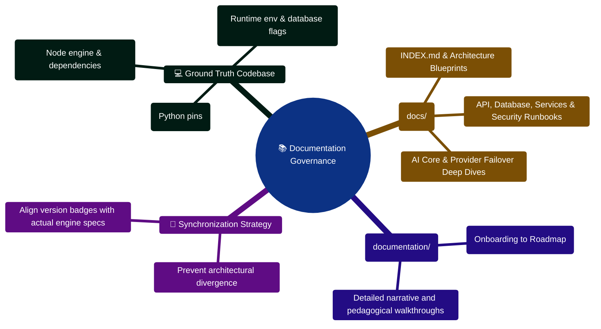

# FinWise Documentation Supplement

This file is a non-destructive add-on to the existing project documentation.
It does not replace `README.md`, the `docs/` manuals, or the parallel
`documentation/` rewrite. Its goal is to give maintainers a practical bridge
between the current implementation and the existing long-form references.

## Why this supplement exists

The repository already has a large amount of documentation, but project
knowledge is currently spread across several places:

- `README.md`
- `docs/`
- `documentation/`
- `walkthrough.md`
- `IMPROVEMENT_PLAN.txt`

That makes it easy for setup instructions, implementation guidance, and issue
tracking notes to drift apart. These supplemental files focus on the highest
value maintainer questions:

- Where should I start?
- Which files do I touch for a given kind of change?
- What implementation patterns does the repo already use?
- What issues or documentation drifts should I be aware of before editing?

## Supplemental files added

### 1. [Maintainer Guide](./MAINTAINER_GUIDE.md)

Use this first if you are onboarding or returning to the project after a gap.
It summarizes the actual runtime expectations, startup order, and the safest
working areas to inspect first.

### 2. [Implementation Map](./IMPLEMENTATION_MAP.md)

Use this when you need to ship a change. It maps common feature types to the
relevant client, server, and AI Core files and explains the normal edit path.

### 3. [Known Issues and Drift](./KNOWN_ISSUES_AND_DRIFT.md)

Use this before planning large work. It captures repository-level friction,
documentation inconsistencies, and architectural drift observed from the
current codebase layout.

## Recommended reading order

For a new maintainer:

1. `README.md`
2. `docs/QUICK_START.md`
3. `docs/MAINTAINER_GUIDE.md`
4. `docs/IMPLEMENTATION_MAP.md`
5. `docs/KNOWN_ISSUES_AND_DRIFT.md`

For feature work:

1. `docs/IMPLEMENTATION_MAP.md`
2. The relevant deep-dive in `docs/`
3. `walkthrough.md` if the change relates to the Command Center work
4. `docs/KNOWN_ISSUES_AND_DRIFT.md` before making cross-cutting updates

## Source-of-truth guidance

Until the project consolidates its documentation, this working rule is the
least confusing approach:

- Treat `server/package.json`, `client/package.json`, and runtime config under
  `server/src/config/` as the source of truth for tooling and environment.
- Treat `client/src/`, `server/src/`, and `server/AI_Core/` as the source of
  truth for implementation behavior.
- Treat `docs/` as the primary published documentation set.
- Treat `documentation/` as a parallel documentation stream that should be
  preserved and reviewed before any consolidation effort.

## Scope note

These files intentionally avoid editing or rewriting the current docs tree.
They are designed to help the next documentation cleanup happen safely, with
clear context instead of guesswork.

## Documentation Stewardship & Source-of-Truth Mindmap



## Source-of-Truth Resolution & Documentation Maintenance ASCII Flow

```text
┌────────────────────────────────────────────────────────────────────────┐
│ 🟢 STEP 1: IDENTIFY TARGET DOCUMENTATION UPDATE                        │
│    Need to document a newly added route, model, or AI capability       │
└───────────────────────────────────┬────────────────────────────────────┘
                                    │
                                    ▼
┌────────────────────────────────────────────────────────────────────────┐
│ 🔍 STEP 2: VERIFY SOURCE OF TRUTH IN CODE                              │
│    ├─► Check runtime configuration in server/src/config/               │
│    ├─► Verify actual Zod schema & Mongoose model attributes            │
│    └─► Run test harness to observe actual output payloads              │
└───────────────────────────────────┬────────────────────────────────────┘
                                    │
                                    ▼
┌────────────────────────────────────────────────────────────────────────┐
│ 📝 STEP 3: DUAL-TREE SYNCHRONIZATION                                   │
│    ├─► Update operational reference in docs/                           │
│    ├─► Update corresponding chapter in documentation/                  │
│    └─► Verify all cross-file markdown links remain valid 🟢            │
└────────────────────────────────────────────────────────────────────────┘
```


---

> [!TIP]
> **Developer Guide: Building & Extending on This Project**  
> For complete step-by-step blueprints, Mongoose models, Zod schemas, Express controllers, React hooks, and LangGraph subagents, see the [**Master Developer Handbook: Building on This Project**](./BUILDING_ON_THIS_PROJECT.md).

## Production Implementation Blueprint: Documentation Link Validator (`scripts/verifyDocLinks.ts`)

```typescript
import fs from "fs";
import path from "path";

/**
 * Traverses all markdown files across the repository to verify that all relative
 * file and symbol links point to existing targets on disk.
 */
export function verifyAllMarkdownLinks(rootDir: string = "."): { brokenLinks: string[] } {
  const brokenLinks: string[] = [];
  const mdFiles: string[] = [];

  function scan(dir: string) {
    for (const entry of fs.readdirSync(dir, { withFileTypes: true })) {
      if (entry.name.startsWith(".") || entry.name === "node_modules" || entry.name === ".venv") continue;
      const full = path.join(dir, entry.name);
      if (entry.isDirectory()) scan(full);
      else if (entry.name.endsWith(".md")) mdFiles.push(full);
    }
  }

  scan(rootDir);

  const linkRegex = /\[[^\]]+\]\((?!https?:|#|mailto:)([^\)]+)\)/g;

  for (const file of mdFiles) {
    const text = fs.readFileSync(file, "utf-8");
    let match;
    while ((match = linkRegex.exec(text)) !== null) {
      const targetRel = match[1].split("#")[0]; // Strip hash anchors
      if (!targetRel) continue;
      const resolved = path.resolve(path.dirname(file), targetRel);
      if (!fs.existsSync(resolved)) {
        brokenLinks.push(`${file} -> broken link to: ${targetRel}`);
      }
    }
  }

  return { brokenLinks };
}
```