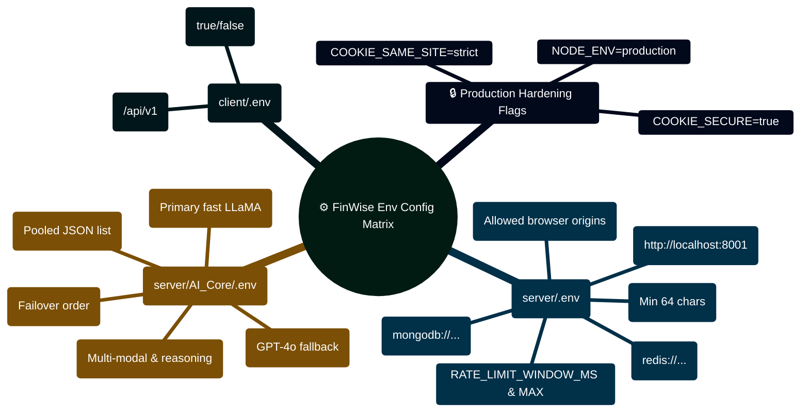

# FinWise — Environment Variables Reference

> Complete reference for every environment variable across all FinWise subsystems. Derived from the Zod schema in `server/src/config/env.ts`.

---

> [!TIP]
> **Developer Guide: Building & Extending on This Project**  
> For complete step-by-step blueprints, Mongoose models, Zod schemas, Express controllers, React hooks, and LangGraph subagents, see the [**Master Developer Handbook: Building on This Project**](./BUILDING_ON_THIS_PROJECT.md).

## Server (`server/.env`)

### Core

| Variable     | Required | Description                           | Default       | Example                                      |
| ------------ | -------- | ------------------------------------- | ------------- | -------------------------------------------- |
| `PORT`       | No       | Express server listen port            | `3000`        | `3000`                                       |
| `NODE_ENV`   | No       | Environment mode                      | `development` | `development`, `production`, `test`          |
| `MONGO_URI`  | **Yes**  | MongoDB connection string             | —             | `mongodb://localhost:27017/personal-finance` |
| `JWT_SECRET` | **Yes**  | Secret for signing JWT tokens         | —             | (random 64-char string)                      |
| `REDIS_URL`  | No\*     | Redis connection URI for optional cache features | —             | `redis://localhost:6379`                     |

> \* Recommended for caching and distributed rate limiting in production. The application worker claims durable background-job records from MongoDB.

---

### Cookies & Trust

| Variable             | Required | Description                 | Default | Example                 |
| -------------------- | -------- | --------------------------- | ------- | ----------------------- |
| `COOKIE_SECRET`      | No       | Secret for signed cookies   | —       | (random string)         |
| `COOKIE_SECURE`      | No       | Set cookie Secure flag      | auto\*  | `true`                  |
| `COOKIE_SAME_SITE`   | No       | Cookie SameSite attribute   | `lax`   | `strict`, `lax`, `none` |
| `COOKIE_DOMAIN`      | No       | Cookie Domain attribute     | —       | `.personal-finance.io`  |
| `TRUST_PROXY`        | No       | Express trust proxy setting | auto\*  | `true`, `1`             |
| `REQUEST_SIZE_LIMIT` | No       | Max HTTP request body size  | `1mb`   | `5mb`                   |

> \* `COOKIE_SECURE` defaults to `true` in production with HTTPS `CLIENT_URL`. `TRUST_PROXY` defaults to `true` in production.

---

### Authentication & OAuth

| Variable               | Required | Description                                                                                                                         | Example                                            |
| ---------------------- | -------- | ----------------------------------------------------------------------------------------------------------------------------------- | -------------------------------------------------- |
| `GOOGLE_CLIENT_ID`     | No\*     | Google OAuth2 web client ID (server-side flow; there is no `VITE_` equivalent)                                                      | `1234-abc.apps.googleusercontent.com`              |
| `GOOGLE_CLIENT_SECRET` | No\*     | Google OAuth2 client secret (server only, never exposed to the browser)                                                             | (from GCP console)                                 |
| `GOOGLE_CALLBACK_URL`  | No       | Redirect URI sent to Google. Default: `<CLIENT_URL origin>/api/auth/google/callback`. Must match an Authorized redirect URI in GCP. | `https://app.example.com/api/auth/google/callback` |

> \* Set both to enable "Continue with Google". `GET /api/auth/providers` reports `google: true` only when both are present.

---

### URL & CORS

| Variable       | Required | Description                            | Default                 | Example                           |
| -------------- | -------- | -------------------------------------- | ----------------------- | --------------------------------- |
| `CLIENT_URL`   | No       | Frontend URL (for email links, etc.)   | `http://localhost:5173` | `https://app.personal-finance.io` |
| `CORS_ORIGINS` | No       | Allowed CORS origins (comma-separated) | `http://localhost:5173` | `https://app.personal-finance.io` |

---

### CSRF Protection

| Variable           | Required | Description                          | Default      | Example      |
| ------------------ | -------- | ------------------------------------ | ------------ | ------------ |
| `CSRF_ENABLED`     | No       | Enable CSRF double-submit protection | auto\*       | `true`       |
| `CSRF_COOKIE_NAME` | No       | Name of the CSRF cookie              | `csrf_token` | `csrf_token` |

> \* Defaults to `true` in production, `false` in development.

---

### Rate Limiting

| Variable                    | Required | Description                          | Default | Example |
| --------------------------- | -------- | ------------------------------------ | ------- | ------- |
| `RATE_LIMIT_WINDOW_MS`      | No       | General rate limit window (ms)       | `60000` | `60000` |
| `RATE_LIMIT_MAX`            | No       | Max requests per window              | `200`   | `100`   |
| `AUTH_RATE_LIMIT_WINDOW_MS` | No       | Auth endpoint rate limit window (ms) | `60000` | `60000` |
| `AUTH_RATE_LIMIT_MAX`       | No       | Max auth requests per window         | `20`    | `10`    |

---

### Email (SMTP)

| Variable            | Required | Description             | Example                                  |
| ------------------- | -------- | ----------------------- | ---------------------------------------- |
| `EMAIL_HOST`        | No\*     | SMTP server host        | `smtp.gmail.com`                         |
| `EMAIL_PORT`        | No\*     | SMTP server port        | `587`                                    |
| `EMAIL_USER`        | No\*     | Sender email address    | `noreply@example.com`                    |
| `EMAIL_PASSWORD`    | No\*     | SMTP password           | (app-specific password)                  |
| `EMAIL_FROM`        | No\*     | "From" header value     | `Personal Finance <noreply@example.com>` |
| `EMAIL_SERVICE`     | No       | Nodemailer service name | `gmail`                                  |
| `EMAIL_SECURE`      | No       | Use TLS for SMTP        | `true`                                   |
| `EMAIL_REQUIRE_TLS` | No       | Require TLS connection  | `true`                                   |

> \* `EMAIL_USER`, `EMAIL_PASSWORD`, and `EMAIL_FROM` must all be set together. `EMAIL_PORT` is required when `EMAIL_HOST` is configured.

---

### Payments (Stripe)

| Variable                   | Required | Description                       | Example       |
| -------------------------- | -------- | --------------------------------- | ------------- |
| `BILLING_PROVIDER`         | No       | Billing backend (`stub`/`stripe`) | auto\*        |
| `STRIPE_SECRET_KEY`        | No\*     | Stripe API secret key             | `sk_test_...` |
| `STRIPE_WEBHOOK_SECRET`    | No       | Stripe webhook signing secret     | `whsec_...`   |
| `STRIPE_PRICE_PRO_MONTHLY` | No       | Stripe Price ID for Pro plan      | `price_...`   |
| `STRIPE_PRICE_TEAM_SEAT`   | No       | Stripe Price ID for Team seats    | `price_...`   |
| `STRIPE_PRICE_ENTERPRISE`  | No       | Stripe Price ID for Enterprise    | `price_...`   |

> \* `BILLING_PROVIDER` defaults to `stripe` when `STRIPE_SECRET_KEY` is set, otherwise `stub`.

---

### AI Core Integration

| Variable                            | Required | Description                                  | Default                 | Example          |
| ----------------------------------- | -------- | -------------------------------------------- | ----------------------- | ---------------- |
| `PYTHON_API_URL`                    | No       | URL of the Python AI Core service            | `http://localhost:8001` | `http://ai:8001` |
| `AI_CORE_TOOLS_TOKEN`               | No       | Shared token for AI Core <-> Server tool calls | —                       | (min 16 chars)   |
| `AI_CORE_MAX_CONCURRENCY`           | No       | Global max concurrent AI requests            | `8`                     | `16`             |
| `AI_CORE_MAX_CONCURRENCY_PER_USER`  | No       | Per-user max concurrent AI requests          | `2`                     | `4`              |
| `AI_CORE_STATUS_TIMEOUT_MS`         | No       | AI Core status check timeout                 | `2500`                  | `5000`           |
| `AI_CORE_TIMEOUT_MS`                | No       | AI Core request timeout                      | `45000`                 | `60000`          |
| `AI_CORE_HEALTH_TIMEOUT_MS`         | No       | AI Core health check timeout                 | `2500`                  | `5000`           |
| `AI_CORE_CIRCUIT_FAILURE_THRESHOLD` | No       | Failures before circuit breaker opens        | `3`                     | `5`              |
| `AI_CORE_CIRCUIT_OPEN_MS`           | No       | Duration circuit stays open                  | `30000`                 | `60000`          |
| `AI_MAX_CONCURRENCY` | No | Global in-flight AI work (wins over AI_CORE_MAX_CONCURRENCY alias) | `8` | `16` |
| `AI_QUEUE_MAX` | No | Max AI requests waiting in the priority queue; more are shed with 503 + Retry-After | `50` | `100` |
| `AI_QUEUE_MAX_PER_USER` | No | Max waiting AI requests per user; more are shed with 429 + Retry-After | `6` | `4` |
| `AI_QUEUE_MAX_WAIT_MS` | No | Longest an AI request may wait in the queue before 503 + Retry-After | `15000` | `10000` |
| `AI_USER_RATE_LIMIT_MAX` | No | Per-user AI POST rate limit per window (beneath the org limit; Redis-shared) | `20` | `30` |
| `AI_USER_RATE_LIMIT_WINDOW_MS` | No | Window for the per-user AI rate limit | `60000` | `60000` |
| `EVENT_BUS` | No | `memory` (default) or `redis` pub/sub so SSE events cross gateway replicas (needs REDIS_URL) | `memory` | `redis` |
| `AI_CORE_CONNECT_TIMEOUT_MS` | No | TCP connect timeout to AI Core (AI_CORE_TIMEOUT_MS is the read timeout) | `2000` | `1000` |
| `AI_CORE_RETRY_MAX` | No | Jittered retries for idempotent AI Core calls only | `1` | `2` |
| `AI_CORE_RETRY_BASE_MS` | No | Base backoff for idempotent retries | `200` | `200` |
| `AI_CORE_RETRY_AFTER_MAX_MS` | No | Longest AI Core 503 Retry-After the gateway waits before its single retry | `5000` | `5000` |
| `AI_CORE_HEALTH_CACHE_MS`           | No       | Health check response cache duration         | `5000`                  | `10000`          |
| `CONVERSATION_INSIGHTS_CACHE_TTL_MS` | No | Owned dashboard-summary cache TTL; 0 disables, maximum 300000 | `120000` | `60000` |

Conversation summaries are keyed by user, organization and the current AI
request context. Request timestamps are normalized to their UTC day. Cache
reads enforce expiry even before MongoDB TTL cleanup. Degraded replies expire
within 15 seconds. Explicit dashboard Refresh uses `refresh=1` to bypass reads;
concurrent identical computations share work within each Node process. Only
new computations consume an AI usage unit. Cached replies report zero new
model calls and omit historical execution traces.

---

### Feature Toggles

| Variable                      | Required | Description                              | Default | Example |
| ----------------------------- | -------- | ---------------------------------------- | ------- | ------- |
| `RECEIPTS_OCR_ENABLED`        | No       | Enable receipt OCR processing            | `true`  | `false` |
| `JOURNAL_ENABLED`             | No       | Enable financial journaling              | `true`  | `false` |
| `TASKS_ENABLED`               | No       | Enable AI-generated tasks                | auto\*  | `true`  |
| `MONETIZATION_ENABLED`        | No       | Enable billing and monetization features | auto\*  | `true`  |
| `ORG_LEGACY_BACKFILL_ENABLED` | No       | Enable org ID backfill for legacy data   | auto\*  | `false` |

> \* `TASKS_ENABLED` and `MONETIZATION_ENABLED` default to `true` in non-production, `false` in production. `ORG_LEGACY_BACKFILL_ENABLED` defaults to `true` in non-production.

---

### Uploads

| Variable                   | Required | Description                    | Default                           | Example    |
| -------------------------- | -------- | ------------------------------ | --------------------------------- | ---------- |
| `UPLOAD_ALLOWED_MIME`      | No       | Allowed MIME types for uploads | `image/jpeg,image/png,image/webp` | —          |
| `RECEIPT_UPLOAD_MAX_BYTES` | No       | Max receipt upload size        | `8388608` (8 MB)                  | `16777216` |
| `JOURNAL_UPLOAD_MAX_BYTES` | No       | Max journal attachment size    | `4194304` (4 MB)                  | `8388608`  |
| `CSV_UPLOAD_ALLOWED_MIME`  | No       | Allowed MIME types for CSV     | `text/csv,...`                    | —          |
| `CSV_UPLOAD_MAX_BYTES`     | No       | Max CSV upload size            | `15728640` (15 MB)                | `31457280` |

---

### Domain Events

| Variable                               | Required | Description                    | Default | Example                 |
| -------------------------------------- | -------- | ------------------------------ | ------- | ----------------------- |
| `DOMAIN_EVENT_FANOUT_ENABLED`          | No       | Enable domain event fanout     | `true`  | `false`                 |
| `DOMAIN_EVENT_FANOUT_MODE`             | No       | Fanout mode                    | `auto`  | `poll`, `change_stream` |
| `DOMAIN_EVENT_FANOUT_POLL_INTERVAL_MS` | No       | Poll interval for event fanout | `1000`  | `5000`                  |

---

### Background Jobs

| Variable                  | Required | Description                      | Default | Example |
| ------------------------- | -------- | -------------------------------- | ------- | ------- |
| `ASYNC_JOBS_ENABLED`      | No       | Enable the MongoDB polling background worker | `false` | `true`  |
| `WORKER_CONCURRENCY`      | No       | Worker concurrent job slots      | `4`     | `8`     |
| `WORKER_POLL_INTERVAL_MS` | No       | Worker queue poll interval (ms)  | `1000`  | `2000`  |

---

### Plugin Runtime

| Variable                         | Required | Description                             | Default | Example                      |
| -------------------------------- | -------- | --------------------------------------- | ------- | ---------------------------- |
| `PLUGIN_RUNTIME_TIMEOUT_MS`      | No       | Plugin HTTP request timeout             | `15000` | `30000`                      |
| `PLUGIN_RUNTIME_ALLOW_INSECURE`  | No       | Allow HTTP (non-HTTPS) plugin URLs      | auto\*  | `true`                       |
| `PLUGIN_RUNTIME_ALLOW_LOCALHOST` | No       | Allow localhost plugin URLs             | auto\*  | `true`                       |
| `PLUGIN_RUNTIME_URL`             | No       | Base URL for the plugin runtime service | —       | `http://plugin-runtime:9000` |
| `PLUGIN_RUNTIME_TOKEN`           | No       | Auth token for plugin runtime           | —       | (min 8 chars)                |

> \* Both default to `true` in non-production, `false` in production.

---

### Monetization

| Variable                       | Required | Description                           | Default | Example         |
| ------------------------------ | -------- | ------------------------------------- | ------- | --------------- |
| `USAGE_EVENTS_INTERNAL_TOKEN`  | No       | Token for internal usage event APIs   | —       | (min 8 chars)   |
| `DIGEST_EMAIL_DAYS_BACK`       | No       | Days of data included in email digest | `7`     | `14`            |
| `API_KEY_PEPPER`               | No       | Pepper for API key hashing            | —       | (random string) |
| `TOOL_POLICY_TX_CONFIRM_ABOVE` | No       | Transaction amount requiring confirm  | `200`   | `500`           |

---

### Observability

| Variable          | Required | Description                                 | Default | Example                  |
| ----------------- | -------- | ------------------------------------------- | ------- | ------------------------ |
| `LOG_LEVEL`       | No       | Pino log level                              | `info`  | `debug`, `warn`, `error` |
| `METRICS_ENABLED` | No       | Enable Prometheus metrics at `/api/metrics` | `false` | `true`                   |
| `METRICS_TOKEN`   | No\*     | Bearer token to access metrics endpoint     | —       | `my-metrics-secret`      |
| `OTEL_ENDPOINT`   | No       | OpenTelemetry OTLP exporter endpoint        | —       | `http://localhost:4318`  |

> \* Required when `METRICS_ENABLED=true`.

---

## Client (`client/.env`)

| Variable                | Required | Description             | Example                 |
| ----------------------- | -------- | ----------------------- | ----------------------- |
| `VITE_API_BASE_URL`     | **Yes**  | Backend API base URL    | `http://localhost:3000` |

> Google sign-in needs **no** client variable: the SPA only links to `/api/auth/google` and asks `GET /api/auth/providers` whether to show the button. Configure `GOOGLE_CLIENT_ID` / `GOOGLE_CLIENT_SECRET` on the server.
>
> **Note:** All client env vars must be prefixed with `VITE_` to be exposed to the browser bundle by Vite.

---

## AI Core (`server/AI_Core/.env`)

### Provider Keys

| Variable | Required | Description | Default | Example |
| --- | --- | --- | --- | --- |
| `GEMINI_API_KEY` | No* | Google Gemini API key | — | `AIza...` |
| `OPENROUTER_API_KEY` | No | Single OpenRouter API key | — | `sk-or-v1-...` |
| `OPENROUTER_API_KEY_1` | No | OpenRouter pooled key 1 | — | `sk-or-v1-...` |
| `OPENROUTER_API_KEY_2` | No | OpenRouter pooled key 2 | — | `sk-or-v1-...` |
| `OPENROUTER_API_KEYS` | No | JSON array of OpenRouter keys | — | `["key-one","key-two"]` |
| `GROQ_API_KEY` | No | Groq API key | — | `gsk_...` |
| `OPENAI_API_KEY` | No | OpenAI API key | — | `sk-...` |
| `DEEPSEEK_API_KEY` | No | DeepSeek API key | — | `sk-...` |
| `XAI_API_KEY` | No | xAI Grok API key | — | `xai-...` |
| `TOGETHER_API_KEY` | No | Together API key | — | `...` |
| `MISTRAL_API_KEY` | No | Mistral API key | — | `...` |

> \* At least one AI provider key must be configured for live LLM routing.

### Routing And Runtime

| Variable | Required | Description | Default | Example |
| --- | --- | --- | --- | --- |
| `LLM_PROVIDER` | No | Preferred default provider | auto | `openrouter` |
| `LLM_PROVIDER_PRIORITY` | No | Comma-separated provider fallback order | built-in order | `openrouter,gemini,groq,grok,together,mistral` |
| `MODEL_NAME` | No | Legacy default model fallback | provider-specific | `gemini-2.5-flash` |
| `LLM_TIMEOUT_SECONDS` | No | Upstream LLM timeout in seconds | runtime default | `30` |
| `AI_CORE_ALLOWED_ORIGINS` | No | CORS origins for the Python AI Core | `http://localhost:3000` | `http://localhost:3000,https://app.example.com` |
| `LOG_LEVEL` | No | Python logging level | `INFO` | `DEBUG` |
| `AI_CORE_MAX_INFLIGHT` | No | Heavy requests admitted per process; beyond it `503` + `Retry-After` (load shedding) | `6` | `6` |
| `AI_CORE_SHED_RETRY_AFTER_SECONDS` | No | `Retry-After` value on shed responses | `2` | `2` |
| `LLM_RPM` / `LLM_RPD` / `LLM_BURST` | No | Token-bucket budget per process (requests per minute / day / burst) | `15` / `1500` / `3` | `10` |
| `LLM_RATE_LIMIT_MAX_WAIT_SECONDS` | No | Max wait for a bucket token; `0` fails fast to the deterministic fallback | `0` | `0` |
| `LLM_MAX_ATTEMPTS` | No | Upstream attempts per call | `2` | `2` |
| `LLM_RETRY_BASE_DELAY_SECONDS` / `LLM_RETRY_MAX_DELAY_SECONDS` | No | Jittered retry backoff bounds | `1.0` / `5.0` | `1.0` |
| `LLM_CACHE_ENABLED` | No | Cache + coalesce identical low-temperature LLM calls | `1` | `0` |
| `LLM_CACHE_MAX_TEMPERATURE` | No | Calls above this temperature are never cached | `0.2` | `0.2` |
| `LLM_CACHE_TTL_SECONDS` / `LLM_CACHE_MAX_ENTRIES` | No | Entry lifetime / local LRU size | `900` / `512` | `900` |
| `LLM_CACHE_REDIS_URL` | No | Shared cache across replicas (falls back to `REDIS_URL`); a dead Redis degrades to the local LRU | unset | `redis://redis:6379` |
| `LLM_PROMPT_TEMPLATE_VERSION` | No | Part of the cache key; bump when prompts change | `v1` | `v2` |
| `SUBAGENT_POOL_SIZE` | No | Shared sub-agent thread pool size per process | `16` | `16` |
| `SUBAGENT_MAX_FANOUT` | No | Max parallel sub-agents per dependency level | `4` | `4` |

### Notes

- Endpoints: `/health` is liveness only; `/ready` returns `503` while draining so load balancers stop routing.
- The LLM cache scope (org id) is part of every key, so one org can never read another org's cached completion.

- OpenRouter supports single-key and multi-key pool formats.
- Key pools are health-tracked independently and only expose redacted fingerprints in status payloads.
- The model catalog is managed separately in `server/AI_Core/data/model_catalog.json`; configuring a provider key enables only that provider's catalog entries.

---

## Example `.env` Files

Both `client/` and `server/` ship with `.env.example` files. Copy and customize:

```bash
# Server
cp server/.env.example server/.env

# Client
cp client/.env.example client/.env

# AI Core (create manually)
echo "GEMINI_API_KEY=your-key-here" > server/AI_Core/.env
```

---

## Production Notes

- **Never commit `.env` files** — they are `.gitignore`d
- **Use secrets management** in production (Render EnvGroups, Railway Variables, AWS Secrets Manager, etc.)
- **`JWT_SECRET`** must be a strong, unique string (minimum 64 characters)
- **`NODE_ENV=production`** enables security headers (HSTS), optimized logging, CSRF protection, and disables dev-only features
- **`COOKIE_SAME_SITE=none`** requires `COOKIE_SECURE=true` (or production HTTPS `CLIENT_URL`)

---

_See also_: [SETUP.md](./SETUP.md) · [DEPLOYMENT.md](./DEPLOYMENT.md) · [SECURITY.md](./SECURITY.md)

## Environment Configuration Architecture Mindmap



## Configuration Ingestion & Schema Validation ASCII Flow

```text
┌────────────────────────────────────────────────────────────────────────┐
│ 🟢 PROCESS BOOTSTRAP (Node.js or Python runtime start)                 │
│    Reads local .env file using dotenv                                  │
└───────────────────────────────────┬────────────────────────────────────┘
                                    │
                                    ▼
┌────────────────────────────────────────────────────────────────────────┐
│ 🛡️ STAGE 1: SCHEMA VALIDATION & INTEGRITY GUARDS                       │
│    ├─► Server: server/src/config/env.ts validates with Zod             │
│    │   ├── Missing JWT_SECRET? ──► Crash immediately with fatal log 🔴 │
│    │   └── Malformed REDIS_URL? ──► Prevent startup & report error 🔴  │
│    └─► AI Core: Pydantic BaseSettings verifies required keys           │
└───────────────────────────────────┬────────────────────────────────────┘
                                    │ (Config Validated)
                                    ▼
┌────────────────────────────────────────────────────────────────────────┐
│ 🔑 STAGE 2: SECRET MASKING & TELEMETRY REGISTRATION                    │
│    ├─► Redact sensitive tokens in logs (only display sk-...3f8)        │
│    ├─► Register provider keys into KeyPool with cooldown tracking      │
│    └─► Expose typed, immutable config object to entire runtime 🟢      │
└────────────────────────────────────────────────────────────────────────┘
```


---

## Production Implementation Blueprint: Zod Environment Loader (`server/src/config/env.ts`)

```typescript
import dotenv from "dotenv";
import { z } from "zod";

dotenv.config();

const envSchema = z.object({
  NODE_ENV: z.enum(["development", "test", "production"]).default("development"),
  PORT: z.coerce.number().int().positive().default(3000),
  MONGO_URI: z.string().url(),
  REDIS_URL: z.string().url().default("redis://localhost:6379"),
  JWT_SECRET: z.string().min(32, "JWT_SECRET must be at least 32 characters long"),
  PYTHON_API_URL: z.string().url().default("http://localhost:8001"),
  CLIENT_URL: z.string().url().default("http://localhost:5173"),
  AI_CORE_TIMEOUT_MS: z.coerce.number().default(45000),
  CSRF_ENABLED: z.coerce.boolean().default(true),
});

export type Env = z.infer<typeof envSchema>;

let parsedEnv: Env | null = null;

export function getEnv(): Env {
  if (!parsedEnv) {
    const result = envSchema.safeParse(process.env);
    if (!result.success) {
      console.error("FATAL: Environment validation failed:", result.error.format());
      process.exit(1);
    }
    parsedEnv = result.data;
  }
  return parsedEnv;
}
```

---

## 2026 Enterprise Feature Environment Variables

| Variable | Required | Description | Default | Example |
| :--- | :--- | :--- | :--- | :--- |
| `AI_CORE_INTERNAL_TOKEN` | Yes (in prod) | Shared internal bearer token protecting Python AI Core | — | `sec_token_9900aabbcc11` |
| `WEBHOOK_CREDENTIALS_KEY` | Required to save webhook Authorization values | Base64-encoded 32-byte AES-256-GCM key | — | `node -e "console.log(require('crypto').randomBytes(32).toString('base64'))"` |
| `GRIDFS_UPLOAD_TIMEOUT_MS` | No | Timeout for PDFKit document compilation stream writes | `60000` | `60000` |
| `DLQ_MAX_CAPACITY` | No | Maximum quarantined jobs in `bull:finwise-dlq` | `500` | `500` |
| `NEWSLETTER_CRON_INTERVAL_MS`| No | Polling frequency for scheduled user financial digests | `60000` | `60000` |
| `CONVERSATION_INSIGHTS_TTL_MS`| No | Cache TTL for in-process coalesced session insights | `120000` | `120000` |
| `METRICS_TOKEN` | Yes (in prod) | Bearer token required to scrape Prometheus `GET /api/metrics` | — | `metric_secret_key_88` |

| `PYTHON_API_URL` | No | Internal HTTP RPC endpoint for Python FastAPI AI Core | `http://localhost:8001` | `http://ai-core.internal:8001` |
| `CANARY_SAMPLE_SIZE` | No | Number of automated probes in Canary test runs | `175` | `175` |
| `CANARY_STRICT_MODE` | No | Aborts LLM synthesis if math invariant breached | `true` | `true` |
| `MERCHANT_EMBEDDING_DIM` | No | Dimension of L2-normalized merchant vector space | `64` | `64` |
| `RAG_GROUNDING_THRESHOLD`| No | Minimum hybrid score for verified citation gating | `0.70` | `0.70` |
| `WORKFLOW_DELAY_SWEEP_MS`| No | Polling loop frequency for delayed workflow runs | `60000` | `60000` |
| `AI_CORE_METRICS_TOKEN` | No | Internal bearer token protecting AI Core metrics | — | `metric_secret_key_88` |
| `FILE_UPLOAD_MAX_BYTES` | No | Maximum workspace document upload size in bytes | `26214400` | `26214400` |
| `AI_CORE_STATE_BACKEND` | No | AI Core state backend for sessions, checkpoints and memories: `mongo`, `sqlite` or `memory` (in-process mongomock, tests). Empty = `mongo` when a Mongo URI is set, else `sqlite` | auto | `mongo` |
| `AI_CORE_MONGO_URI` | No | MongoDB URI for AI Core state; falls back to `MONGO_URI` | `MONGO_URI` | `mongodb://mongo:27017/?replicaSet=rs0` |
| `AI_CORE_MONGO_DB` | No | Database name for AI Core state | `finwise_ai_core` | `finwise_ai_core` |
| `AI_CORE_SESSION_TTL_SECONDS` | No | Mongo TTL index on session `updatedAt` (idle sessions expire) | `86400` (24h) | `86400` |
| `AI_CORE_CHECKPOINT_TTL_SECONDS` | No | Mongo TTL index on checkpoint `createdAt` | `604800` (7d) | `604800` |
| `AI_CORE_CHECKPOINT_MODE` | No | `boundary` = checkpoint at request start and end only; `every_node` = legacy write after every graph node | `boundary` | `boundary` |
| `AI_CORE_READY_REQUIRES_STATE` | No | When truthy, `/ready` returns 503 while the state backend is unhealthy (otherwise it only reports `state_backend`) | off | `1` |
| `REDIS_CIRCUIT_SECONDS` | No | Seconds the agent/sub-task response caches skip Redis after a failure (they use `REDIS_URL`, fall back to a local LRU) | `30` | `30` |
| `FINWISE_MEMORY_DB_PATH` | No | SQLite database path for AI Core memory; only used when the state backend is `sqlite` | `memory.db` | `data/memory.db` |
| `FINWISE_MEMORY_TOP_K` | No | Default top-k facts retrieved from FTS5 memory | `5` | `10` |
| `FINWISE_SERVER_URL` | No | Base URL of Express server for tool execution IPC | `http://localhost:3000` | `http://api:3000` |
| `FINWISE_TOOLS_TOKEN` | No | Shared token for internal tool calls | — | `sec_tool_token_123` |
| `LLM_COST_USD_PER_1K_INPUT_TOKENS` | No | Input token unit price for budget accounting | `0.0015` | `0.0015` |
| `LLM_COST_USD_PER_1K_OUTPUT_TOKENS` | No | Output token unit price for budget accounting | `0.002` | `0.002` |
| `LLM_MAX_RETRIES` | No | Provider retry threshold before tripping circuit | `3` | `3` |
| `LLM_MAX_TOKENS` | No | Maximum completion token ceiling | `4096` | `8192` |
| `LLM_MODEL` | No | Default foundation model identifier | `gemini-2.0-flash` | `claude-3-5-sonnet` |
| `LLM_TEMPERATURE` | No | Sampling temperature for financial synthesis | `0.2` | `0.1` |
| `MODEL_CANDIDATES` | No | Comma-separated list of candidate models for fallback | — | `gemini-2.0-flash,claude-3-5-sonnet` |
| `VISION_LANG_ALLOWED` | No | Allowed OCR language identifiers | `en` | `en,es,fr` |
| `VISION_LANG_DEFAULT` | No | Default OCR recognition language | `en` | `en` |
| `VISION_MAX_IMAGE_BYTES` | No | Maximum image size for receipt OCR in bytes | `8388608` | `8388608` |
| `VITE_API_PROXY_TARGET` | No | Vite client development API proxy target URL | `http://localhost:3000` | `http://localhost:3000` |
| `VITE_APP_NAME` | No | Application branding name displayed in UI | `FinWise` | `FinWise` |
| `VITE_LOG_LEVEL` | No | Browser runtime log filtering level | `info` | `debug` |

## Gateway Scaling: Auth Cache, Data Tier, Worker Hardening

| Variable | Required | Description | Default | Example |
| --- | --- | --- | --- | --- |
| `AUTH_CACHE_TTL_SECONDS` | No | TTL for the cached authenticated user and org memberships (Redis + local). `0` disables the cache; invalidated on every User/OrgMember write | `45` (`0` when `NODE_ENV=test`) | `30` |
| `AUTH_CACHE_LOCAL_TTL_MS` | No | In-process tier TTL when Redis is configured (bounds cross-replica staleness) | `5000` | `2000` |
| `AUTH_CACHE_LOCAL_MAX` | No | Max entries in the in-process auth cache LRU | `5000` | `10000` |
| `MONGO_MAX_POOL_SIZE` | No | MongoDB driver `maxPoolSize` | `20` | `50` |
| `MONGO_MIN_POOL_SIZE` | No | MongoDB driver `minPoolSize` | `0` | `5` |
| `MONGO_SOCKET_TIMEOUT_MS` | No | MongoDB socket timeout | `45000` | `60000` |
| `MONGO_WAIT_QUEUE_TIMEOUT_MS` | No | Max wait for a pooled connection before failing | `10000` | `5000` |
| `MONGO_SERVER_SELECTION_TIMEOUT_MS` | No | MongoDB server selection timeout | `10000` | `5000` |
| `WORKER_JOB_MAX_ATTEMPTS` | No | Attempts per queued job (workflow run, integration sync, export) before it is dead-lettered | `3` | `5` |
| `WORKER_JOB_BACKOFF_BASE_MS` | No | Base of the exponential retry backoff (equal jitter) | `5000` | `10000` |
| `WORKER_JOB_BACKOFF_MAX_MS` | No | Backoff ceiling | `300000` | `600000` |
| `WORKER_JOB_VISIBILITY_TIMEOUT_MS` | No | A `running` job older than this is treated as abandoned: requeued (or dead-lettered after max attempts) | `900000` | `600000` |
| `AI_OPTIMIZE_ENABLED` | No | Worker runs the nightly per-org AI Core optimizer (`POST /api/learning/optimize/run`); orgs with `aiLearningOptOut` are skipped; 404/501 from AI Core is tolerated | `true` | `false` |
| `AI_OPTIMIZE_HOUR_UTC` | No | UTC hour at which the nightly optimizer runs (once per day, leader-elected) | `3` | `2` |
| `AI_OPTIMIZE_CHECK_INTERVAL_MS` | No | How often the worker checks whether it is time to run | `600000` | `300000` |
| `ORG_SCOPE_ENFORCE` | No | `true` makes unscoped queries on org-scoped models throw; `false` forces warn-only; unset = enforce only in production. Cross-tenant jobs use `withOrgScopeBypass(reason, fn)` | production only | `true` |

Leader election (newsletter scheduler, domain-event fanout when `EVENT_BUS=redis`, nightly optimizer) uses Redis `SET NX PX` with Lua renewal when `REDIS_URL` is set and an atomic claim on the `leader_locks` Mongo collection otherwise; no extra variables.

Dead-letter jobs are stored in the `dead_letter_jobs` collection. Org admins list them with `GET /api/v1/admin/dead-letter-jobs?cursor=&limit=` and re-queue one with `POST /api/v1/admin/dead-letter-jobs/:id/replay`.


## AI Core Runtime, Capacity & Telemetry Advanced Tuning

| Variable | Required | Description | Default | Example |
| --- | --- | --- | --- | --- |
| `AI_CORE_DRAIN_SECONDS` | No | Seconds to wait for in-flight requests to drain during AI Core graceful termination | `10` | `15` |
| `AI_CORE_MONGO_MAX_POOL` | No | Maximum connection pool size for the AI Core PyMongo client | `20` | `50` |
| `AI_CORE_MONGO_SELECT_TIMEOUT_MS` | No | Server selection timeout in milliseconds for AI Core MongoDB connections | `5000` | `3000` |
| `AI_CORE_MONGO_SOCKET_TIMEOUT_MS` | No | Socket read/write timeout in milliseconds for AI Core MongoDB operations | `45000` | `60000` |
| `AI_CORE_REQUIRE_ACTOR_HEADERS` | No | Requires gateway-supplied `X-Internal-Org-Id` and `X-Internal-User-Id` on AI Core process requests | `false` | `true` |
| `AI_EVAL_REPORT_DIR` | No | Directory for offline eval JSON reports (the CLI runner also compares against the most recent report there) | `docs/records/evaluations` | `/var/log/finwise/evals` |
| `AI_PROMOTION_MODE` | No | `suggest` (no promotion), `human` (admin approval), or `auto_prompts` (only gated prompt/exemplar artifacts auto-promote); routing/model changes always require an admin | `human` | `human` |
| `AI_REGISTRY_CACHE_TTL_SECONDS` | No | AI Core registry artifact loader cache TTL in seconds | `30` | `120` |
| `AI_SHADOW_ENABLED` | No | Enable shadow artifact experiments; off by default to preserve free-tier LLM capacity | `false` | `false` |
| `LLM_BANDIT_ENABLED` | No | Enable bounded model ordering among allowed catalog entries | `false` | `false` |
| `AI_OPTIMIZER_LLM_BUDGET` | No | Maximum LLM calls per optimizer run; zero runs heuristics only | `0` | `0` |
| `AI_LEARNING_OPT_OUT_ORGS` | No | Additional AI Core org IDs excluded from learning, comma separated (gateway also enforces the per-org setting) | empty | `orgA,orgB` |
| `AI_RUN_TTL_DAYS` | No | AI learning run trace retention in MongoDB | `30` | `30` |
| `AI_RUN_BUFFER_SIZE` | No | Maximum buffered learning run writes per process | `2000` | `2000` |
| `CAPACITY_MAX_SESSIONS_LOCAL` | No | Maximum concurrent conversation sessions before entering local load-shedding | `50` | `100` |
| `CAPACITY_MIN_MEASURED_SAMPLES` | No | Minimum generation duration samples required before activating dynamic capacity estimation | `5` | `10` |
| `CAPACITY_RPS_LOCAL` | No | Rated requests-per-second throughput benchmark for local in-memory summary generation | `20` | `25` |
| `CAPACITY_RPS_REDIS` | No | Rated requests-per-second throughput benchmark with distributed Redis coordination | `100` | `150` |
| `CAPACITY_SATURATED_LATENCY_MS` | No | P95 generation latency threshold (ms) at which summary capacity marks status as saturated | `1500` | `2000` |
| `LLM_MOCK_LATENCY_MS` | No | Simulated inference delay in milliseconds during test and mock provider execution | `0` | `50` |
| `METRICS_ORG_LABELS` | No | When `true`, emits high-cardinality `org` labels on Prometheus token and cost counters | `false` | `true` |
