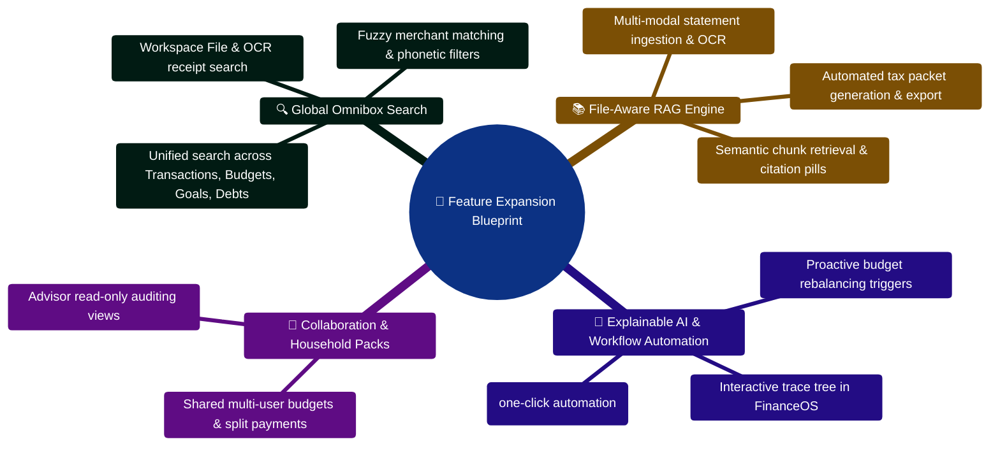
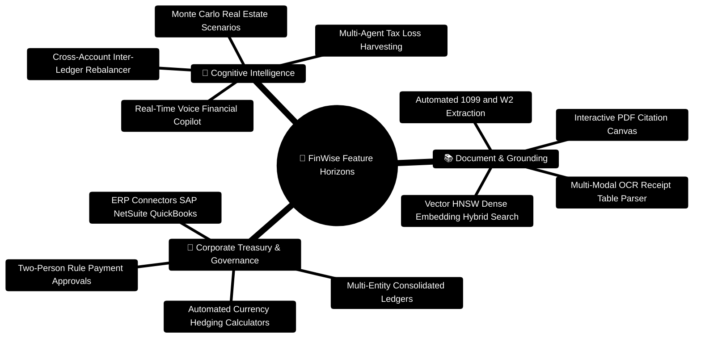

# FinWise Feature Expansion Blueprint

This document proposes new features that fit the current codebase and can be
documented or implemented incrementally.

The emphasis is on features that reuse existing assets:

- grounded AI
- file uploads and analysis
- workflows and tasks
- search
- exports
- collaboration and notifications

## 1. Feature groups

### Group A: Knowledge and retrieval

#### Ask Your Financial Documents

What it does:

- lets users ask questions against uploaded files and receive cited answers

Why it fits:

- existing file extraction pipeline
- existing file analysis flow
- existing evidence fields in AI responses

Primary docs/code touchpoints:

- `server/src/controllers/fileController.ts`
- `server/src/services/fileTextExtraction.ts`
- `server/src/services/financeGrounding.ts`
- `client/src/pages/Files.tsx`

#### Financial Knowledge Vault

What it does:

- organizes uploaded documents, insights, and memory into a searchable finance
  knowledge workspace

Why it fits:

- workspace files already exist
- AI memory already exists
- the app already has documentation, tasks, and collaboration patterns

### Group B: Guided financial operations

#### Monthly Review Copilot

What it does:

- assembles a month-end review from transactions, budgets, tasks, recurring
  candidates, and files

Why it fits:

- command center work already exists
- exports and reporting already exist
- finance grounding already aggregates the right sources

Suggested outputs:

- narrative summary
- budget wins and misses
- anomalies
- suggested actions
- exportable monthly packet

#### Proactive Risk Watchlist

What it does:

- flags upcoming bills, unusual spending spikes, low runway, duplicate-looking
  transactions, and potential missed obligations

Why it fits:

- recurring detection, reminders, tasks, and AI insights already exist

### Group C: Document intelligence

#### Statement Reconciliation Assistant

What it does:

- compares bank statements or credit card statements against imported
  transactions and highlights gaps

Why it fits:

- file extraction already handles PDFs
- transactions are already queryable
- review queue patterns already exist

#### Tax Packet Assistant

What it does:

- organizes uploaded tax documents, extracts key values, and produces a
  structured readiness checklist

Why it fits:

- document upload exists
- file analysis exists
- roadmap already includes tax optimization direction

### Group D: Collaboration and execution

#### Advisor Share Pack

What it does:

- packages a curated set of budgets, files, insights, and questions to share
  with an accountant, spouse, or advisor

Why it fits:

- share links, comments, orgs, and public/private content patterns already
  exist

#### Workflow Suggestions from AI

What it does:

- converts grounded AI recommendations into suggested workflows, not just text

Why it fits:

- tool calls and workflow creation patterns already exist
- AI responses already support `tool_calls` and `suggested_actions`

## 2. Highest-value additions by effort

### Small effort, high value

- expand global search beyond transactions
- show stronger evidence and confidence in the UI
- improve file analysis prompts by file type
- add saved AI summaries for common document classes

### Medium effort, very high value

- ask-your-files retrieval
- monthly review copilot
- statement reconciliation assistant
- workflow suggestion engine

### Larger strategic features

- knowledge vault
- advisor collaboration pack
- tax packet assistant
- unified retrieval across files, memory, and transactions

## 3. Features already partially enabled by the code

These are worth calling out because they are closer than they look.

### Search expansion

Current state:

- `server/src/services/searchService.ts` is intentionally structured to expand
- the controller and route surface already exist

Opportunity:

- add goals, debts, receipts, journal entries, files, and workflows to global
  search

### File-aware AI

Current state:

- file text extraction exists
- file analysis exists
- file snippets can already be passed into AI context

Opportunity:

- add chunk retrieval and typed document prompts

### Explainability

Current state:

- AI responses already carry workflow trace, evidence, and confidence data

Opportunity:

- expose them more deeply in the UI to improve user trust

### Automation

Current state:

- workflows, tasks, notifications, exports, and tool calls already exist

Opportunity:

- convert AI insight into executable automation more often

## 4. Documentation-first implementation suggestions

Since the current request is documentation-focused, the best next docs to add
after this blueprint would be:

- a retrieval data model spec
- a feature flag matrix
- a run-mode matrix for server and worker behavior
- an AI evidence UX guide for frontend work

## 5. Recommended next implementation order

1. Expand search scope.
2. Add file chunk retrieval and citations.
3. Build monthly review copilot on top of grounded AI.
4. Add AI-to-workflow conversion for executable suggestions.
5. Build knowledge vault capabilities once retrieval is stable.

## 6. Companion docs

- `docs/INNOVATION_ROADMAP.md`
- `docs/RAG_IMPLEMENTATION_PLAN.md`
- `docs/IMPLEMENTATION_MAP.md`

## Feature Expansion Blueprint Mindmap



## Feature Expansion Lifecycle & Phased Delivery ASCII Flow

```text
┌────────────────────────────────────────────────────────────────────────┐
│ 🟢 STEP 1: CAPABILITY AUDIT & SCHEMA FREEZE                            │
│    Identify existing backend routes & models ready for expansion       │
└───────────────────────────────────┬────────────────────────────────────┘
                                    │
                                    ▼
┌────────────────────────────────────────────────────────────────────────┐
│ 🧪 STEP 2: INCREMENTAL DOMAIN EXTENSION                                │
│    ├─► Server: Expand service logic in searchService / retrievalService│
│    ├─► Add Zod schema validations & OpenAPI contract paths             │
│    └─► Run Vitest integration tests to verify org isolation 🟢         │
└───────────────────────────────────┬────────────────────────────────────┘
                                    │
                                    ▼
┌────────────────────────────────────────────────────────────────────────┐
│ 🎨 STEP 3: FRONTEND UI & WORKSPACE COMPONENT INTEGRATION               │
│    ├─► Build React component widgets in FinanceOS dashboard            │
│    ├─► Connect to Zustand store slices & TanStack Query cache          │
│    └─► Verify accessibility (a11y) & responsive breakpoints 🟢         │
└────────────────────────────────────────────────────────────────────────┘
```


---

> [!TIP]
> **Developer Guide: Building & Extending on This Project**  
> For complete step-by-step blueprints, Mongoose models, Zod schemas, Express controllers, React hooks, and LangGraph subagents, see the [**Master Developer Handbook: Building on This Project**](./BUILDING_ON_THIS_PROJECT.md).

## Production Implementation Blueprint: Subscription Detection Service (`server/src/services/subscriptionService.ts`)

```typescript
import { TransactionModel } from "../models/transactionModel";
import { logger } from "../config/logger";

export interface RecurringSubscription {
  merchant: string;
  monthlyCost: number;
  annualizedCost: number;
  lastBilledDate: string;
  confidence: number;
}

/**
 * Analyzes transaction intervals and amounts to automatically detect active
 * recurring subscriptions and projected cost savings.
 */
export async function detectActiveSubscriptions(orgId: string): Promise<RecurringSubscription[]> {
  const sixMonthsAgo = new Date();
  sixMonthsAgo.setMonth(sixMonthsAgo.getMonth() - 6);

  // Group recurring debit transactions by merchant name
  const candidates = await TransactionModel.aggregate([
    { $match: { orgId, type: "expense", date: { $gte: sixMonthsAgo } } },
    {
      $group: {
        _id: "$merchant",
        charges: { $push: { amount: "$amount", date: "$date" } },
        totalSpent: { $sum: "$amount" },
        count: { $sum: 1 },
      },
    },
    { $match: { count: { $gte: 3 } } },
  ]);

  const subscriptions: RecurringSubscription[] = [];

  for (const item of candidates) {
    const charges = item.charges.sort((a: any, b: any) => new Date(a.date).getTime() - new Date(b.date).getTime());
    const amounts = charges.map((c: any) => c.amount);
    const isUniformAmount = amounts.every((a: number) => Math.abs(a - amounts[0]) < 0.05);

    if (isUniformAmount) {
      const monthly = amounts[0];
      subscriptions.push({
        merchant: item._id,
        monthlyCost: monthly,
        annualizedCost: parseFloat((monthly * 12).toFixed(2)),
        lastBilledDate: charges[charges.length - 1].date.toISOString(),
        confidence: 0.95,
      });
    }
  }

  logger.info({ orgId, count: subscriptions.length }, "Detected recurring subscriptions");
  return subscriptions;
}
```

---

## Feature Expansion Mindmap & Horizons



---

## Production Blueprint: Adding an Intelligent Tax Strategy Subagent to Kahn's DAG

Step-by-step implementation for extending the multi-agent AI Core with a specialized tax planning node:

```python
# server/AI_Core/agents/tax_strategy_agent.py
from pydantic import BaseModel, Field
from typing import Dict, Any, List
from langchain_core.prompts import ChatPromptTemplate
from utils.llm_wrapper import invoke_llm_json

class TaxHarvestingOpportunity(BaseModel):
    asset_name: str
    unrealized_loss_usd: float = Field(gt=0.0)
    recommended_action: str
    tax_savings_estimate: float = Field(ge=0.0)

class TaxStrategyOutput(BaseModel):
    estimated_effective_rate: float
    deduction_suggestions: List[str]
    harvesting_opportunities: List[TaxHarvestingOpportunity]

TAX_PROMPT = ChatPromptTemplate.from_messages([
    ("system", "You are an expert CPA and financial planner. Analyze taxable accounts and income brackets to suggest optimal deduction and loss-harvesting strategies. Return strict JSON."),
    ("user", "Income: {income}\nInvestments: {investments}\nContext: {finance_context}")
])

async def tax_strategy_node(state: Dict[str, Any]) -> Dict[str, Any]:
    income = state.get("income", {})
    investments = state.get("investments", [])
    context = state.get("finance_context", "")

    prompt = TAX_PROMPT.format(income=income, investments=investments, finance_context=context)
    result = await invoke_llm_json(prompt, schema=TaxStrategyOutput)
    return {"tax_strategy": result}
```

Registering the agent in `server/AI_Core/agents/sub_agent_manager.py`:

```python
from agents.tax_strategy_agent import tax_strategy_node

# Add to registry
AGENT_REGISTRY["tax_strategy"] = tax_strategy_node

# When task_decomposer outputs task dependencies:
# {
#   "income_analyzer": [],
#   "tax_strategy": ["income_analyzer"], # Runs after income is categorized
#   "aggregator": ["tax_strategy", "budget_planner"]
# }
```
