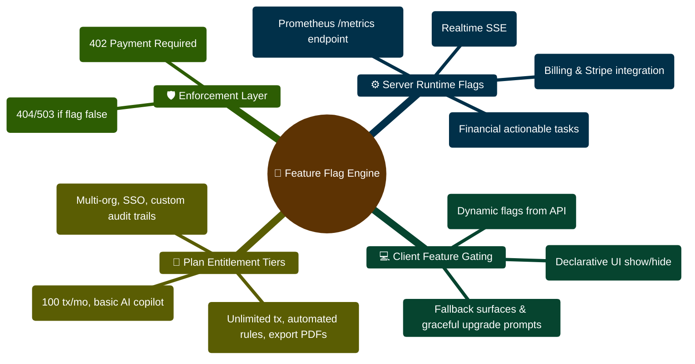

# FinWise Feature Flag Matrix

This document summarizes feature and runtime flags that materially affect
behavior in the current codebase.

It is intended as a maintainer reference for setup, debugging, and
documentation work.

## 1. Why this file exists

A meaningful part of FinWise behavior is environment-driven:

- some routes are conditionally mounted
- some services are conditionally enabled
- some security defaults change by environment
- some infrastructure responsibilities move between server and worker mode

Without a flag matrix, it is easy to misread a disabled feature as a bug.

## 2. High-impact flags

| Flag | Default behavior | Main effect | Key code areas |
| -- | -- | -- | -- |
| `ASYNC_JOBS_ENABLED` | `false` | Decides whether async workflow/export/integration jobs are processed inline by the server or by the dedicated worker process | `server/src/server.ts`, `server/src/worker/worker.ts`, `server/src/services/workflows.ts` |
| `TASKS_ENABLED` | Computed: enabled outside production unless explicitly set | Gates task route availability and task-oriented UX | `server/src/config/env.ts`, `server/src/routes/routeRegistry.ts` |
| `MONETIZATION_ENABLED` | Computed: enabled outside production unless explicitly set | Gates monetization route availability | `server/src/config/env.ts`, `server/src/routes/routeRegistry.ts` |
| `CSRF_ENABLED` | Computed: enabled in production unless explicitly set | Enables CSRF checks for state-changing API requests | `server/src/config/env.ts`, `server/src/app.ts`, `server/src/middleware/csrfProtection.ts` |
| `DOMAIN_EVENT_FANOUT_ENABLED` | `true` | Controls whether realtime/domain fanout should run | `server/src/config/env.ts`, realtime modules |
| `DOMAIN_EVENT_FANOUT_MODE` | `auto` | Chooses fanout strategy such as polling or change-stream style behavior | `server/src/config/env.ts`, realtime modules |
| `METRICS_ENABLED` | `false` | Turns on metrics behavior; requires token configuration | `server/src/config/env.ts`, observability endpoints |
| `RECEIPTS_OCR_ENABLED` | `true` | Controls receipt OCR feature availability | `server/src/config/env.ts`, receipt flows |
| `JOURNAL_ENABLED` | `true` | Controls journal-related feature availability | `server/src/config/env.ts`, journal flows |
| `ORG_LEGACY_BACKFILL_ENABLED` | Computed: enabled outside production unless explicitly set | Controls legacy org data backfill behavior | `server/src/config/env.ts`, org migration/backfill services |

## 3. Computed-default flags

Some flags are not simple literals. Their final value depends on whether the
env var was explicitly set and what `NODE_ENV` is.

### `TASKS_ENABLED`

- if explicitly set, the provided value wins
- if not explicitly set, it defaults to enabled outside production

### `MONETIZATION_ENABLED`

- if explicitly set, the provided value wins
- if not explicitly set, it defaults to enabled outside production

### `CSRF_ENABLED`

- if explicitly set, the provided value wins
- if not explicitly set, it defaults to enabled in production

### `ORG_LEGACY_BACKFILL_ENABLED`

- if explicitly set, the provided value wins
- if not explicitly set, it defaults to enabled outside production

## 4. Route-level impact

### Conditionally mounted route groups

Based on `server/src/routes/routeRegistry.ts`:

- task routes are only mounted when `TASKS_ENABLED` is true
- monetization routes are only mounted when `MONETIZATION_ENABLED` is true

This affects both:

- canonical `/api/v1/...` surfaces
- legacy `/api/...` surfaces where applicable

## 5. Infrastructure-level impact

### Async jobs

`ASYNC_JOBS_ENABLED` changes who owns job execution:

- `false`: the server can process runs inline
- `true`: the worker process becomes the expected execution engine

This is one of the most important flags in the repository because it changes
operational assumptions, not just UI availability.

### Metrics

When `METRICS_ENABLED=true`:

- metrics behavior is turned on
- `METRICS_TOKEN` must also be configured

This validation is enforced by `server/src/config/env.ts`.

## 6. Security-level impact

### CSRF

Because `CSRF_ENABLED` changes by environment, teams should not assume local
development behavior matches production behavior by default.

### Cookies and proxy behavior

Although not all are "feature flags," several environment-driven values also
change security and deployment behavior:

- `COOKIE_SECURE`
- `COOKIE_SAME_SITE`
- `COOKIE_DOMAIN`
- `TRUST_PROXY`

These belong in deployment and security reviews even when the team is focused
on product flags.

## 7. Practical debugging checklist

When a feature seems missing:

1. Check `NODE_ENV`.
2. Check the relevant explicit feature flag.
3. Confirm whether the route is actually mounted.
4. Confirm whether the client config endpoint reflects the expected state.
5. Confirm whether the issue is feature-gated or truly broken.

## 8. Suggested follow-up docs

This matrix pairs well with:

- `docs/RUN_MODE_MATRIX.md`
- `docs/KNOWN_ISSUES_AND_DRIFT.md`
- `docs/MAINTAINER_GUIDE.md`

## Feature Flag & Entitlement Architecture Mindmap



## Feature Gate Resolution & Execution ASCII Flow

```text
┌────────────────────────────────────────────────────────────────────────┐
│ 🟢 INCOMING REQUEST FOR GATED FEATURE (e.g. PDF Export / Automation)   │
│    POST /api/v1/exports/pdf/generate (User & Org Context)              │
└───────────────────────────────────┬────────────────────────────────────┘
                                    │
                                    ▼
┌────────────────────────────────────────────────────────────────────────┐
│ 🚩 STAGE 1: SYSTEM FEATURE FLAG CHECK                                  │
│    Is EXPORTS_ENABLED == true in server config?                        │
│    ├── NO ──► Return 404 Not Found (Feature disabled at server level) 🔴│
│    └── YES ──► Proceed to Tenant Entitlement Evaluation 🟢             │
└───────────────────────────────────┬────────────────────────────────────┘
                                    │ (Feature Enabled)
                                    ▼
┌────────────────────────────────────────────────────────────────────────┐
│ 💳 STAGE 2: TENANT PLAN ENTITLEMENT & METERED QUOTA                    │
│    ├─► Check tenant's current plan in Entitlement collection           │
│    ├─► Evaluate usage against quota (e.g., pdf_exports_count)          │
│    │   ├── Quota Exceeded? ──► Terminate with 402 Payment Required 🔴  │
│    │   └── Within Limit? ──► Increment UsageLedger event count 🟢      │
└───────────────────────────────────┬────────────────────────────────────┘
                                    │
                                    ▼
┌────────────────────────────────────────────────────────────────────────┐
│ 🟣 STAGE 3: EXECUTE FEATURE & RETURN ARTIFACT                          │
│    ├─► BullMQ background worker compiles financial report              │
│    └─► Client downloads generated PDF with updated usage balance 🟢    │
└────────────────────────────────────────────────────────────────────────┘
```


---

> [!TIP]
> **Developer Guide: Building & Extending on This Project**  
> For complete step-by-step blueprints, Mongoose models, Zod schemas, Express controllers, React hooks, and LangGraph subagents, see the [**Master Developer Handbook: Building on This Project**](./BUILDING_ON_THIS_PROJECT.md).

## Production Implementation Blueprint: Feature Flag Middleware (`server/src/middleware/featureFlag.ts`)

```typescript
import { Request, Response, NextFunction } from "express";
import { FeatureFlagModel } from "../models/featureFlagModel";
import { HttpError } from "./httpError";
import { logger } from "../config/logger";

/**
 * Middleware enforcing dynamic tenant feature flags.
 * Bypasses checks if flag is universally enabled or tenant matches targeting rules.
 */
export function requireFeatureFlag(flagKey: string) {
  return async (req: Request, res: Response, next: NextFunction) => {
    try {
      const orgId = req.orgId;
      const flag = await FeatureFlagModel.findOne({ key: flagKey });

      if (!flag) {
        logger.warn({ flagKey }, "Feature flag not found, defaulting to disabled");
        return next(new HttpError(403, `Feature '${flagKey}' is not enabled on this deployment`));
      }

      if (flag.enabled) {
        return next();
      }

      // Check tenant-specific whitelist in targeting rules
      const isTargetedOrg = orgId && flag.targetingRules?.organizations?.includes(orgId);
      if (isTargetedOrg) {
        return next();
      }

      logger.info({ flagKey, orgId }, "Access denied: feature flag is inactive for tenant");
      return next(new HttpError(403, `Feature '${flagKey}' is inactive for your organization`));
    } catch (err) {
      return next(err);
    }
  };
}
```