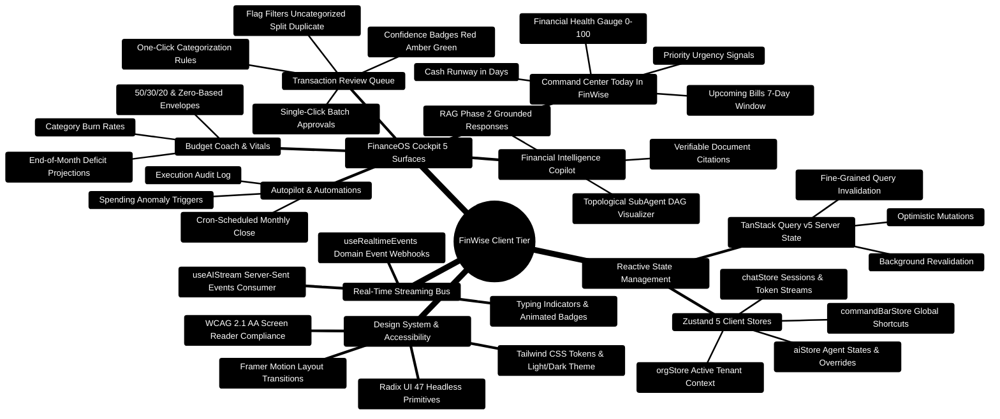

# FinWise — Frontend Architecture & FinanceOS Cockpit Guide

> **Single Page Application Engineering Blueprint, Component Hierarchy, Reactive Stores, and UI Blueprints**  
> *React 18.3 · TypeScript 5.9 · Vite 7.3 · Zustand 5.0 · TanStack Query v5.90 · Radix UI · Tailwind CSS 3.4 · Framer Motion 11.3*

---

> [!TIP]
> **Extending the Frontend UI?**  
> For complete blueprints on adding new React views, route registrations, Zustand store actions, and TanStack Query hooks, consult the [**Master Developer Handbook: Building on This Project**](./BUILDING_ON_THIS_PROJECT.md).

## 1. Frontend Architecture Mindmap



---

## 2. Component Hierarchy & State Flow ASCII Architecture

```text
┌─────────────────────────────────────────────────────────────────────────────────────────────────┐
│ 🟢 ROOT CONTAINER: index.html ──► main.tsx ──► App.tsx                                          │
│    └─► AppProviders (ThemeProvider • QueryClientProvider • AuthProvider • OrgProvider)          │
└───────────────────────────────────────────────┬─────────────────────────────────────────────────┘
                                                │
                                                ▼
┌─────────────────────────────────────────────────────────────────────────────────────────────────┐
│ 🏛️ LAYOUT LAYER: AppShell.tsx                                                                  │
│    ├─► Sidebar.tsx (Navigation • Organization Switcher • Collapsible Rail)                      │
│    ├─► AiCommandBar.tsx (Global Cmd+K Quick Launcher)                                           │
│    ├─► NotificationCenter.tsx (Real-time SSE Domain Alerts)                                     │
│    └─► Main Viewport (<Router /> via Wouter)                                                    │
└───────────────────────────────────────────────┬─────────────────────────────────────────────────┘
                                                │
                                                ▼
┌─────────────────────────────────────────────────────────────────────────────────────────────────┐
│ 🚀 OPERATIONAL COCKPIT: FinanceOS.tsx (/finance-os or /)                                        │
│  ├─► Tab 1: CommandCenter.tsx                                                                   │
│  │   ├── Circular Health Score Gauge (BudgetHealthCard.tsx)                                     │
│  │   ├── KPI Summary Cards (Runway Days • Liquid Cash • Monthly Burn)                           │
│  │   └── Priority Signal List (ranked by act_now > review_this_week > safe_to_ignore)           │
│  ├─► Tab 2: TransactionReviewQueue.tsx                                                          │
│  │   ├── Filter Chips (Uncategorized • Duplicate • Low-Confidence)                              │
│  │   ├── Transaction Item with Confidence Badge & Inline Category Select                       │
│  │   └── Bulk Actions Bar ("Approve All Selected" • "Apply Category Rule")                      │
│  ├─► Tab 3: Workflows.tsx (Autopilot & Autonomous Jobs)                                         │
│  ├─► Tab 4: SpendingAnalysis.tsx & BudgetHealthCard.tsx (Envelope Tracking)                     │
│  └─► Tab 5: FinancialCopilot.tsx                                                                │
│      ├── ChatMessageList.tsx (Virtual scrolling list with Markdown rendering)                   │
│      ├── SourceEvidenceList.tsx (Verifiable document citations [docId:chunk])                   │
│      ├── AgentWorkflowVisualizer.tsx (Real-time LangGraph DAG execution tree)                   │
│      └── ChatInput.tsx (Slash commands /budget, /debt, /forecast)                               │
└─────────────────────────────────────────────────────────────────────────────────────────────────┘
```

---

## 3. The 5 Operational Surfaces of FinanceOS

### 3.1 Command Center (`client/src/components/CommandCenter.tsx`)
The daily morning cockpit. Aggregates data from 8 backend collections in a single round-trip:
- **Time-Adaptive Greeting**: Contextualized to user timezone (Morning, Afternoon, Evening).
- **Runway & Burn Rate**: Liquid cash divided by 30-day average daily burn.
- **7-Day Bill Horizon**: Upcoming scheduled payments and calendar reminders.
- **Priority Signal Matrix**: Categorized into 3 urgency tiers:
  1. `act_now`: Overdrawn accounts, urgent bill due in $<48\text{h}$, critical overspend.
  2. `review_this_week`: Flagged transactions, unreviewed subscriptions, budget $>85\%$.
  3. `safe_to_ignore`: Positive savings velocity, early goal achievement.

---

### 3.2 Transaction Review Queue (`client/src/components/TransactionReviewQueue.tsx`)
A high-throughput triage center for financial reconciliation:
- **Confidence Badging**:
  - Green ($\ge 70\%$): High-confidence machine classification.
  - Amber ($40\%\text{--}69\%$): Heuristic match; review recommended.
  - Red ($< 40\%$): Uncategorized or duplicate suspect.
- **One-Click Rule Promotion**: Promotes an inline classification to a persistent `CategoryRule` with a single click ("Always categorize Starbucks as Coffee").
- **Batch Processing**: Multi-select support to bulk-approve up to 100 transactions simultaneously.

---

### 3.3 Budget Coach (`client/src/components/BudgetHealthCard.tsx`)
- **Animated SVG Circular Gauge**: Pure vector gauge rendering real-time score with smooth Framer Motion transitions.
- **4-Pillar Breakdown**:
  - Budget Adherence (40 points)
  - Review Cleanliness (20 points)
  - Goal Progress (20 points)
  - Debt Management (20 points)
- **Burn-Rate Projections**: Calculates category burn rate:
  $$\text{Projected Spend} = \frac{\text{Current Spend}}{\text{Days Elapsed}} \times \text{Days in Month}$$

---

### 3.4 Financial Copilot & Agent Visualizer (`client/src/components/FinancialCopilot.tsx`)
Conversational financial copilot integrating RAG Phase 2 citations and multi-agent DAG execution:
- **Token Streaming**: Consumes SSE streams via `useAIStream.ts`.
- **Source Citations**: Displays clickable document citations referencing uploaded statement chunks.
- **Agent Workflow Visualizer (`AgentWorkflowVisualizer.tsx`)**: Renders real-time execution states (`pending`, `running`, `completed`, `failed`) for each subagent in the LangGraph DAG.

---

## 4. Custom React Hooks Directory

| Hook | File | Purpose | Return Signature / Key API |
| :--- | :--- | :--- | :--- |
| **useAIStream** | `useAIStream.ts` | Consumes SSE chunk streams from the Express gateway with typing simulation. | `{ streamText, isStreaming, sendPrompt, stopStream }` |
| **useRealtimeEvents** | `useRealtimeEvents.ts` | Subscribes to the server-side domain event bus for real-time transaction updates. | `{ lastEvent, connectionStatus }` |
| **useKeyboardShortcuts**| `useKeyboardShortcuts.ts` | Global hotkey listener (Cmd+K command bar, / focus chat, Esc close). | `void` |
| **useVirtualList** | `useVirtualList.ts` | High-performance virtualized scrolling for lists $>1,000$ transactions. | `{ virtualItems, totalHeight, containerRef }` |
| **useOrgFormatters** | `useOrgFormatters.ts` | Currency and date formatting localized to organization settings. | `{ formatCurrency, formatDate, currencyCode }` |
| **useNotifications** | `useNotifications.ts` | Notification center badge counters and toast triggers. | `{ unreadCount, markAsRead, notifications }` |
| **useToast** | `useToast.tsx` | Imperative notification toast dispatch engine. | `{ toast, dismiss }` |

---

## 5. Reactive State Management (Zustand Stores)

### 5.1 Chat & Token Streaming Store (`client/src/stores/chatStore.ts`)

```typescript
import { create } from "zustand";
import { persist } from "zustand/middleware";

export interface Message {
  id: string;
  role: "user" | "assistant" | "system";
  content: string;
  citations?: Array<{ fileId: string; filename: string; pageNumber: number }>;
  agentTraceId?: string;
  timestamp: string;
}

interface ChatState {
  sessions: Record<string, Message[]>;
  activeSessionId: string | null;
  isStreaming: boolean;
  streamingContent: string;
  setActiveSession: (sessionId: string) => void;
  appendMessage: (sessionId: string, message: Message) => void;
  setStreamingContent: (content: string) => void;
  setStreaming: (isStreaming: boolean) => void;
}

export const useChatStore = create<ChatState>()(
  persist(
    (set) => ({
      sessions: {},
      activeSessionId: null,
      isStreaming: false,
      streamingContent: "",
      setActiveSession: (sessionId) => set({ activeSessionId: sessionId }),
      appendMessage: (sessionId, message) =>
        set((state) => ({
          sessions: {
            ...state.sessions,
            [sessionId]: [...(state.sessions[sessionId] || []), message]
          }
        })),
      setStreamingContent: (content) => set({ streamingContent: content }),
      setStreaming: (isStreaming) => set({ isStreaming })
    }),
    { name: "finwise-chat-storage" }
  )
);
```

---

## 6. Production Implementation Blueprints

### Blueprint 1: Animated Circular Health Gauge (`client/src/components/BudgetHealthCard.tsx`)

```typescript
import React from "react";
import { motion } from "framer-motion";

interface BudgetHealthGaugeProps {
  score: number; // 0 to 100
  size?: number;
}

export const BudgetHealthGauge: React.FC<BudgetHealthGaugeProps> = ({ score, size = 140 }) => {
  const strokeWidth = 12;
  const radius = (size - strokeWidth) / 2;
  const circumference = 2 * Math.PI * radius;
  const strokeDashoffset = circumference - (score / 100) * circumference;

  const getScoreColor = (val: number) => {
    if (val >= 80) return "#10b981"; // Emerald Green
    if (val >= 60) return "#f59e0b"; // Amber
    return "#ef4444";               // Rose Red
  };

  return (
    <div className="relative flex items-center justify-center" style={{ width: size, height: size }}>
      <svg width={size} height={size} className="transform -rotate-90">
        {/* Track background */}
        <circle
          cx={size / 2}
          cy={size / 2}
          r={radius}
          stroke="currentColor"
          strokeWidth={strokeWidth}
          className="text-slate-800"
          fill="transparent"
        />
        {/* Animated fill indicator */}
        <motion.circle
          cx={size / 2}
          cy={size / 2}
          r={radius}
          stroke={getScoreColor(score)}
          strokeWidth={strokeWidth}
          strokeDasharray={circumference}
          initial={{ strokeDashoffset: circumference }}
          animate={{ strokeDashoffset }}
          transition={{ duration: 1.2, ease: "easeOut" }}
          strokeLinecap="round"
          fill="transparent"
        />
      </svg>
      <div className="absolute flex flex-col items-center">
        <span className="text-3xl font-bold tracking-tight text-white">{score}</span>
        <span className="text-xs uppercase tracking-wider text-slate-400">Score</span>
      </div>
    </div>
  );
};
```

---

### Blueprint 2: Real-Time SSE Streaming Hook (`client/src/hooks/useAIStream.ts`)

```typescript
import { useState, useCallback, useRef } from "react";
import { useChatStore } from "../stores/chatStore";

export function useAIStream() {
  const [isStreaming, setIsStreaming] = useState(false);
  const abortControllerRef = useRef<AbortController | null>(null);
  const appendMessage = useChatStore((s) => s.appendMessage);

  const streamPrompt = useCallback(async (sessionId: string, prompt: string, orgId: string) => {
    setIsStreaming(true);
    abortControllerRef.current = new AbortController();

    try {
      const response = await fetch("/api/v1/ai/stream", {
        method: "POST",
        headers: {
          "Content-Type": "application/json",
          "X-Org-ID": orgId
        },
        body: JSON.stringify({ sessionId, prompt }),
        signal: abortControllerRef.current.signal
      });

      if (!response.ok || !response.body) {
        throw new Error(`HTTP stream failure: ${response.statusText}`);
      }

      const reader = response.body.getReader();
      const decoder = new TextDecoder();
      let accumulated = "";

      while (true) {
        const { value, done } = await reader.read();
        if (done) break;

        const chunk = decoder.decode(value, { stream: true });
        const lines = chunk.split("\n\n");

        for (const line of lines) {
          if (line.startsWith("data: ")) {
            const dataStr = line.replace("data: ", "").trim();
            if (dataStr === "[DONE]") break;

            try {
              const parsed = JSON.parse(dataStr);
              if (parsed.token) {
                accumulated += parsed.token;
                useChatStore.getState().setStreamingContent(accumulated);
              }
            } catch {
              accumulated += dataStr;
              useChatStore.getState().setStreamingContent(accumulated);
            }
          }
        }
      }

      appendMessage(sessionId, {
        id: crypto.randomUUID(),
        role: "assistant",
        content: accumulated,
        timestamp: new Date().toISOString()
      });
    } catch (err: any) {
      if (err.name !== "AbortError") {
        console.error("[useAIStream] Stream error:", err);
      }
    } finally {
      setIsStreaming(false);
      useChatStore.getState().setStreamingContent("");
    }
  }, [appendMessage]);

  const cancelStream = useCallback(() => {
    if (abortControllerRef.current) {
      abortControllerRef.current.abort();
    }
  }, []);

  return { streamPrompt, cancelStream, isStreaming };
}
```


---

### Blueprint 3: Portfolio Target Models & Smart Cash Inflow Rebalancing (`client/src/pages/Portfolio.tsx`)

```tsx
import React, { useState, useMemo } from 'react';
import { useQuery } from '@tanstack/react-query';
import { api } from '@/lib/api';

export const TARGET_PRESETS = {
  '60/40': { equity: 60, fixedIncome: 40, crypto: 0, cash: 0 },
  '80/20': { equity: 80, fixedIncome: 20, crypto: 0, cash: 0 },
  'All-Weather': { equity: 30, fixedIncome: 55, crypto: 0, commodities: 15 },
};

export const SmartRebalanceWidget: React.FC<{ totalPortfolioValue: number; holdings: Record<string, number> }> = ({
  totalPortfolioValue,
  holdings
}) => {
  const [targetModel, setTargetModel] = useState<keyof typeof TARGET_PRESETS>('60/40');
  const [deployCapital, setDeployCapital] = useState<number>(1000);

  // Compute smart cash inflow (deploying new capital to underweight assets without selling)
  const recommendations = useMemo(() => {
    const targets = TARGET_PRESETS[targetModel];
    const postCapitalTotal = totalPortfolioValue + deployCapital;
    const deficits: Record<string, number> = {};
    let totalDeficit = 0;

    for (const [asset, targetPct] of Object.entries(targets)) {
      const targetVal = (targetPct / 100) * postCapitalTotal;
      const currentVal = holdings[asset] || 0;
      const deficit = Math.max(0, targetVal - currentVal);
      deficits[asset] = deficit;
      totalDeficit += deficit;
    }

    return Object.entries(deficits).map(([asset, deficit]) => ({
      asset,
      allocatedAmount: totalDeficit > 0 ? (deficit / totalDeficit) * deployCapital : 0
    }));
  }, [targetModel, deployCapital, totalPortfolioValue, holdings]);

  return (
    <div className="p-6 bg-slate-900/60 border border-slate-800 rounded-2xl space-y-4">
      <h3 className="text-lg font-bold text-slate-100">Tax-Efficient Smart Cash Inflow</h3>
      <div className="flex gap-2">
        {Object.keys(TARGET_PRESETS).map((preset) => (
          <button
            key={preset}
            onClick={() => setTargetModel(preset as any)}
            className={`px-3 py-1.5 rounded-lg text-sm font-medium transition ${
              targetModel === preset ? 'bg-indigo-600 text-white' : 'bg-slate-800 text-slate-400'
            }`}
          >
            {preset}
          </button>
        ))}
      </div>
      <div className="space-y-2">
        {recommendations.map((rec) => (
          <div key={rec.asset} className="flex justify-between items-center text-sm py-2 border-b border-slate-800">
            <span className="text-slate-300 capitalize">{rec.asset}</span>
            <span className="font-semibold text-emerald-400">+${rec.allocatedAmount.toFixed(2)}</span>
          </div>
        ))}
      </div>
    </div>
  );
};
```

---

### Blueprint 4: Multi-Scenario Comparison Matrix & Monte Carlo Bounds (`client/src/pages/Scenarios.tsx`)

```typescript
export interface MonteCarloBounds {
  p10: number; // Bearish shock (10th percentile)
  p50: number; // Median expected trajectory
  p90: number; // Bullish upside compounding (90th percentile)
}

/**
 * Computes stochastic Monte Carlo risk bounds assuming 15% annual market volatility
 * and frictional drag across the forecast horizon.
 */
export function calculateMonteCarloBounds(
  baselineSurplus: number,
  deltaSurplus: number,
  horizonMonths: number,
  annualVolatility: number = 0.15
): MonteCarloBounds {
  const totalMonthlySurplus = baselineSurplus + deltaSurplus;
  const horizonYears = horizonMonths / 12;
  const nominalCumulative = totalMonthlySurplus * horizonMonths;

  // Stochastic diffusion coefficient: sigma * sqrt(T)
  const diffusion = annualVolatility * Math.sqrt(horizonYears);

  return {
    p10: Math.round(nominalCumulative * (1 - 1.28 * diffusion)),
    p50: Math.round(nominalCumulative),
    p90: Math.round(nominalCumulative * (1 + 1.28 * diffusion)),
  };
}
```

---

### Blueprint 5: Interactive Source Evidence Badges & Verified Physical PDF Jump (`client/src/components/SourceEvidenceList.tsx`)

```tsx
import React from 'react';
import { FileText, ExternalLink } from 'lucide-react';
import { EvidenceItem } from '@/types/evidence.types';

export const SourceEvidenceList: React.FC<{ items: EvidenceItem[]; returnTo?: string }> = ({
  items,
  returnTo
}) => {
  return (
    <div className="space-y-3 p-4 bg-slate-950/40 rounded-xl border border-slate-800">
      <h4 className="text-xs font-semibold text-slate-400 uppercase tracking-wider">Verified Sources ({items.length})</h4>
      <div className="space-y-2">
        {items.map((item, idx) => {
          // Construct verified physical page deep link
          const pageParam = item.page_number ? `&page=${item.page_number}` : '';
          const targetUrl = `/files?file=${item.entity_id || item.id}${pageParam}${returnTo ? `&returnTo=${encodeURIComponent(returnTo)}` : ''}`;

          return (
            <div key={idx} className="p-3 bg-slate-900/60 border border-slate-800 rounded-lg hover:border-slate-700 transition">
              <div className="flex items-center justify-between">
                <span className="text-sm font-medium text-sky-400 flex items-center gap-1.5">
                  <FileText className="w-4 h-4 text-sky-500" />
                  {item.label || 'Document Evidence'}
                  {item.page_number && <span className="text-xs text-slate-400">(Page {item.page_number})</span>}
                </span>
                <a
                  href={targetUrl}
                  className="text-xs text-indigo-400 hover:text-indigo-300 flex items-center gap-1 font-medium"
                >
                  Inspect <ExternalLink className="w-3 h-3" />
                </a>
              </div>
              {item.snippet && (
                <p className="mt-2 text-xs text-slate-300 italic border-l-2 border-slate-700 pl-2">
                  "{item.snippet}"
                </p>
              )}
            </div>
          );
        })}
      </div>
    </div>
  );
};
```
---

### Blueprint 6: Scoped QueryClient Lifecycle & Private Session Boundaries (`client/src/app/providers/ScopedDataProvider.tsx`)

Prevents cross-tenant and cross-user memory leakage in shared browser environments by instantiating an isolated query client per active tenant scope and unmounting views on workspace change:

```tsx
// client/src/app/providers/ScopedDataProvider.tsx
import { useEffect, useLayoutEffect, useState, useSyncExternalStore, type ReactNode } from "react";
import { QueryClientProvider } from "@tanstack/react-query";
import { useAuth } from "@/hooks/useAuth";
import { createQueryClient } from "@/lib/queryClient";
import { getActiveOrgId, subscribeActiveOrgId } from "@/lib/orgContext";
import { useChatStore } from "@/stores/chatStore";
import { useCommandBarStore } from "@/stores/commandBarStore";
import { useAIStore } from "@/stores/aiStore";
import { useAppDialogStore } from "@/stores/appDialogStore";
import { retireRequestContext } from "@/lib/requestContext";

function PrivateQueryProvider({ children }: { children: ReactNode }) {
  const [client] = useState(createQueryClient);
  useEffect(() => () => {
    void client.cancelQueries();
    client.clear();
  }, [client]);
  return <QueryClientProvider client={client}>{children}</QueryClientProvider>;
}

/** Retire private caches and component drafts whenever the data owner changes. */
export function ScopedDataProvider({ children }: { children: ReactNode }) {
  const { user, loading } = useAuth();
  const orgId = useSyncExternalStore(subscribeActiveOrgId, getActiveOrgId, () => null);
  const scope = user ? JSON.stringify([user.id, orgId]) : null;
  const chatScope = useChatStore((state) => state.dataScope);

  useLayoutEffect(() => {
    // Preserve a persisted selection while the first authentication check runs.
    if (loading || useChatStore.getState().dataScope === scope) return;
    retireRequestContext();
    useChatStore.getState().bindDataScope(scope);
    useCommandBarStore.setState({ isOpen: false, history: [] });
    useAIStore.getState().reset();
    useAppDialogStore.setState({ featureLimit: null, planAndUsageOpen: false });
  }, [scope, loading]);

  return (
    <PrivateQueryProvider key={scope || "signed-out"}>
      {!loading && chatScope !== scope ? (
        <div role="status" className="p-6 text-sm text-muted-foreground">
          Loading your workspace...
        </div>
      ) : (
        children
      )}
    </PrivateQueryProvider>
  );
}
```

---

### Blueprint 7: Financial Command Center "Today in FinWise" (`client/src/components/CommandCenter.tsx`)

Glanceable daily cockpit aggregating cash runway, priority urgency signals, budget adherence, and upcoming scheduled bills:

```tsx
// client/src/components/CommandCenter.tsx
import React from "react";
import { useQuery } from "@tanstack/react-query";
import { AlertCircle, Clock, TrendingUp, ShieldAlert, CheckCircle2 } from "lucide-react";
import { useOrgFormatters } from "@/hooks/useOrgFormatters";

export interface PrioritySignal {
  id: string;
  urgency: "act_now" | "review_this_week" | "safe_to_ignore";
  title: string;
  description: string;
  actionUrl?: string;
}

export interface CommandCenterData {
  greeting: string;
  runwayDays: number;
  burnRateVsExpectedPercent: number;
  signals: PrioritySignal[];
  upcomingBillsCount: number;
}

export const CommandCenter: React.FC = () => {
  const { formatCurrency } = useOrgFormatters();
  const { data, isLoading } = useQuery<CommandCenterData>({
    queryKey: ["/api/v1/command-center/today"],
  });

  if (isLoading || !data) {
    return <div className="p-6 bg-slate-900/40 rounded-2xl animate-pulse h-48" />;
  }

  const urgencyBadge = (urgency: PrioritySignal["urgency"]) => {
    switch (urgency) {
      case "act_now":
        return "bg-rose-500/10 text-rose-400 border-rose-500/20";
      case "review_this_week":
        return "bg-amber-500/10 text-amber-400 border-amber-500/20";
      default:
        return "bg-emerald-500/10 text-emerald-400 border-emerald-500/20";
    }
  };

  return (
    <div className="p-6 bg-slate-900/80 border border-slate-800 rounded-3xl space-y-6">
      <div className="flex justify-between items-center">
        <div>
          <h2 className="text-2xl font-bold text-slate-100">{data.greeting}</h2>
          <p className="text-sm text-slate-400">Daily operational pulse and financial runway summary</p>
        </div>
        <div className="text-right">
          <div className="text-3xl font-extrabold text-sky-400">{data.runwayDays} Days</div>
          <span className="text-xs text-slate-500 uppercase tracking-wider">Liquid Cash Runway</span>
        </div>
      </div>

      <div className="grid grid-cols-1 md:grid-cols-3 gap-4">
        {data.signals.map((signal) => (
          <div
            key={signal.id}
            className={`p-4 rounded-xl border flex flex-col justify-between ${urgencyBadge(signal.urgency)}`}
          >
            <div>
              <div className="flex items-center gap-2 mb-1.5 font-semibold text-sm">
                {signal.urgency === "act_now" ? <ShieldAlert className="w-4 h-4" /> : <AlertCircle className="w-4 h-4" />}
                {signal.title}
              </div>
              <p className="text-xs opacity-90">{signal.description}</p>
            </div>
            {signal.actionUrl && (
              <a href={signal.actionUrl} className="mt-3 text-xs underline font-medium">
                Resolve Now →
              </a>
            )}
          </div>
        ))}
      </div>
    </div>
  );
};
```

---

### Blueprint 8: Transaction Review Queue & Rule Promotion (`client/src/components/TransactionReviewQueue.tsx`)

Interactive review queue with one-click category approval and merchant classification rule promotion:

```tsx
// client/src/components/TransactionReviewQueue.tsx
import React, { useState } from "react";
import { useQuery, useMutation, useQueryClient } from "@tanstack/react-query";
import { Check, Wand2, Tag, ArrowRight } from "lucide-react";
import { toast } from "@/hooks/useToast";

export interface ReviewItem {
  id: string;
  merchant: string;
  amount: number;
  suggestedCategory: string;
  confidenceScore: number;
  date: string;
}

export const TransactionReviewQueue: React.FC = () => {
  const queryClient = useQueryClient();
  const [filter, setFilter] = useState<string>("all");

  const { data: queue = [] } = useQuery<ReviewItem[]>({
    queryKey: ["/api/v1/finance/transactions", "needs-review"],
  });

  const approveMutation = useMutation({
    mutationFn: async ({ id, category }: { id: string; category: string }) => {
      const res = await fetch(`/api/v1/finance/transactions/${id}/review`, {
        method: "POST",
        headers: { "Content-Type": "application/json" },
        body: JSON.stringify({ action: "approve", category }),
      });
      return res.json();
    },
    onSuccess: () => {
      queryClient.invalidateQueries({ queryKey: ["/api/v1/finance/transactions"] });
      toast({ title: "Transaction Approved", variant: "default" });
    },
  });

  const promoteRuleMutation = useMutation({
    mutationFn: async ({ merchant, category }: { merchant: string; category: string }) => {
      const res = await fetch("/api/v1/category-rules", {
        method: "POST",
        headers: { "Content-Type": "application/json" },
        body: JSON.stringify({ pattern: merchant, category, matchType: "exact" }),
      });
      return res.json();
    },
    onSuccess: (_, vars) => {
      toast({ title: `Auto-rule created: All '${vars.merchant}' → ${vars.category}` });
    },
  });

  return (
    <div className="p-6 bg-slate-900 border border-slate-800 rounded-2xl space-y-4">
      <div className="flex justify-between items-center border-b border-slate-800 pb-4">
        <h3 className="text-lg font-bold text-slate-100 flex items-center gap-2">
          <Tag className="w-5 h-5 text-indigo-400" /> Review Queue ({queue.length})
        </h3>
      </div>

      <div className="divide-y divide-slate-800">
        {queue.map((item) => (
          <div key={item.id} className="py-3 flex items-center justify-between">
            <div>
              <span className="font-medium text-slate-200">{item.merchant}</span>
              <span className="ml-3 text-xs text-slate-400">{item.date}</span>
              <div className="text-xs text-indigo-400 mt-0.5">
                AI Suggestion: <strong className="text-indigo-300">{item.suggestedCategory}</strong> (
                {Math.round(item.confidenceScore * 100)}% confidence)
              </div>
            </div>
            <div className="flex items-center gap-2">
              <span className="font-semibold text-slate-100 mr-4">${item.amount.toFixed(2)}</span>
              <button
                onClick={() => approveMutation.mutate({ id: item.id, category: item.suggestedCategory })}
                className="p-1.5 bg-emerald-600/20 text-emerald-400 border border-emerald-500/30 rounded-lg hover:bg-emerald-600/30"
                title="Approve Category"
              >
                <Check className="w-4 h-4" />
              </button>
              <button
                onClick={() => promoteRuleMutation.mutate({ merchant: item.merchant, category: item.suggestedCategory })}
                className="px-2.5 py-1.5 bg-indigo-600/20 text-indigo-300 border border-indigo-500/30 rounded-lg text-xs hover:bg-indigo-600/30 flex items-center gap-1"
                title="Promote to Auto-Rule"
              >
                <Wand2 className="w-3.5 h-3.5" /> Always Categorize
              </button>
            </div>
          </div>
        ))}
      </div>
    </div>
  );
};
```

---

### Blueprint 9: Multi-Agent Workflow DAG Trace Visualizer (`client/src/components/AgentWorkflowVisualizer.tsx`)

Renders the real-time execution DAG showing wave progression, agent latencies, and token counters:

```tsx
// client/src/components/AgentWorkflowVisualizer.tsx
import React from "react";
import { motion, AnimatePresence } from "framer-motion";
import { CheckCircle2, Clock, AlertTriangle, Cpu } from "lucide-react";

export interface WorkflowTraceStep {
  agentName: string;
  status: "pending" | "running" | "completed" | "failed";
  durationMs: number;
  tokensUsed?: number;
  error?: string;
}

export const AgentWorkflowVisualizer: React.FC<{ steps: WorkflowTraceStep[] }> = ({ steps }) => {
  return (
    <div className="p-4 bg-slate-950 border border-slate-800 rounded-xl space-y-3 font-mono">
      <div className="flex items-center justify-between text-xs text-slate-400 uppercase tracking-wider border-b border-slate-800/80 pb-2">
        <span className="flex items-center gap-1.5">
          <Cpu className="w-3.5 h-3.5 text-sky-400" /> Multi-Agent DAG Execution Trace
        </span>
        <span>{steps.filter((s) => s.status === "completed").length} / {steps.length} Steps</span>
      </div>

      <div className="space-y-2">
        <AnimatePresence>
          {steps.map((step, idx) => (
            <motion.div
              key={step.agentName}
              initial={{ opacity: 0, x: -10 }}
              animate={{ opacity: 1, x: 0 }}
              transition={{ delay: idx * 0.05 }}
              className={`p-2.5 rounded-lg border text-xs flex items-center justify-between ${
                step.status === "completed"
                  ? "bg-slate-900/60 border-slate-800 text-slate-300"
                  : step.status === "running"
                  ? "bg-indigo-950/40 border-indigo-500/40 text-indigo-300 animate-pulse"
                  : "bg-slate-900/20 border-slate-800/40 text-slate-500"
              }`}
            >
              <div className="flex items-center gap-2">
                {step.status === "completed" && <CheckCircle2 className="w-3.5 h-3.5 text-emerald-400" />}
                {step.status === "running" && <Clock className="w-3.5 h-3.5 text-sky-400 animate-spin" />}
                {step.status === "failed" && <AlertTriangle className="w-3.5 h-3.5 text-rose-400" />}
                <span className="font-semibold capitalize">{step.agentName.replace(/_/g, " ")}</span>
              </div>
              <div className="flex items-center gap-3 text-[11px] text-slate-400">
                {step.tokensUsed && <span>{step.tokensUsed} tokens</span>}
                <span>{step.durationMs}ms</span>
              </div>
            </motion.div>
          ))}
        </AnimatePresence>
      </div>
    </div>
  );
};
```

---

### Blueprint 10: Server-Sent Events (SSE) Real-Time Hook & Invalidation (`client/src/hooks/useRealtimeEvents.ts`)

Listens for server-sent domain events (`transaction.created`, `workflow.completed`, `health_score.updated`) and invalidates appropriate TanStack Query keys:

```typescript
// client/src/hooks/useRealtimeEvents.ts
import { useEffect } from "react";
import { useQueryClient } from "@tanstack/react-query";
import { useAuth } from "./useAuth";
import { toast } from "./useToast";

export function useRealtimeEvents() {
  const queryClient = useQueryClient();
  const { user } = useAuth();

  useEffect(() => {
    if (!user) return;

    const eventSource = new EventSource("/api/v1/events/stream", { withCredentials: true });

    eventSource.onmessage = (event) => {
      try {
        const payload = JSON.parse(event.data);
        switch (payload.type) {
          case "transaction.created":
          case "transaction.updated":
            queryClient.invalidateQueries({ queryKey: ["/api/v1/finance/transactions"] });
            queryClient.invalidateQueries({ queryKey: ["/api/v1/command-center/today"] });
            break;
          case "budget.exceeded":
            queryClient.invalidateQueries({ queryKey: ["/api/v1/budget-health"] });
            toast({ title: "Budget Alert", description: payload.message, variant: "destructive" });
            break;
          case "health_score.updated":
            queryClient.invalidateQueries({ queryKey: ["/api/v1/budget-health"] });
            break;
        }
      } catch (err) {
        console.error("[SSE] Failed to parse domain event payload", err);
      }
    };

    eventSource.onerror = (err) => {
      console.warn("[SSE] EventSource connection dropped, reconnecting...", err);
      eventSource.close();
    };

    return () => {
      eventSource.close();
    };
  }, [user, queryClient]);
}
```
