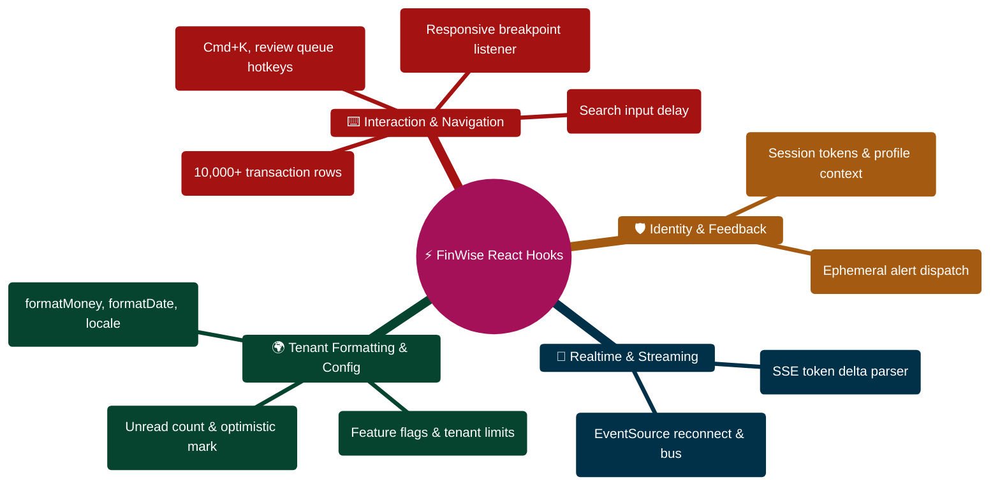

# FinWise Custom Hook Reference

> Complete catalog of all custom React hooks in the FinWise client application.

---

> [!TIP]
> **Developer Guide: Building & Extending on This Project**  
> For complete step-by-step blueprints, Mongoose models, Zod schemas, Express controllers, React hooks, and LangGraph subagents, see the [**Master Developer Handbook: Building on This Project**](./BUILDING_ON_THIS_PROJECT.md).

## Overview

FinWise uses 13 custom hooks located in `client/src/hooks/`. Each hook encapsulates a specific concern, from authentication to AI streaming. This document provides a comprehensive reference for each hook including purpose, parameters, return values, usage examples, and dependencies.

---

## useAuth

**File:** `client/src/hooks/useAuth.tsx` (re-export from `client/src/context/AuthContext.tsx`)

**Purpose:** Provides access to the authentication context. Returns the current user, loading state, and auth methods.

**Parameters:** None

**Returns:**

| Field | Type | Description |
|-------|------|-------------|
| `user` | `User \| null` | Current authenticated user (null if not authenticated) |
| `loading` | `boolean` | True while checking auth status on app load |
| `logout` | `() => Promise<void>` | Logs out the user and clears local state |
| `checkAuthStatus` | `() => Promise<void>` | Re-checks authentication status with the server |

**User Shape:**
```typescript
interface User {
  id: string;
  name: string;
  email: string;
  photoURL?: string;
  phoneNumber?: string;
  authProvider?: string;
  isEmailVerified?: boolean;
}
```

**Usage Example:**
```typescript
import { useAuth } from "@/hooks/useAuth";

function ProfilePage() {
  const { user, loading, logout } = useAuth();

  if (loading) return <Spinner />;
  if (!user) return <Navigate to="/login" />;

  return (
    <div>
      <h1>Welcome, {user.name}</h1>
      <button onClick={logout}>Logout</button>
    </div>
  );
}
```

**Dependencies:** React Context (must be used within `AuthProvider`)

**Throws:** If used outside `AuthProvider`

---

## useRealtimeEvents

**File:** `client/src/hooks/useRealtimeEvents.ts`

**Purpose:** Establishes a Server-Sent Events (SSE) connection to receive real-time domain events from the server. Automatically invalidates relevant React Query caches when events arrive.

**Parameters:** None (reads auth state from `useAuth` internally)

**Returns:** None (side-effect only hook)

**Event-to-Query Mapping:**

| Event Type | Invalidated Queries |
|------------|-------------------|
| `TransactionCreated` | transactions, dashboard, portfolio, analytics, activity-feed |
| `TransactionUpdated` | transactions, dashboard, portfolio, analytics, activity-feed |
| `TransactionDeleted` | transactions, dashboard, portfolio, analytics, activity-feed |
| `GoalUpdated` | financial-profiles, dashboard, goals, activity-feed |
| `BudgetAllocationUpdated` | budget-envelopes, dashboard, analytics, activity-feed |
| `WorkflowRunCompleted` | workflow-runs, tasks, activity-feed |
| `ReceiptProcessed` | receipts, transactions, dashboard, analytics, activity-feed |
| `InsightGenerated` | insights, agent-outputs, ai-status, ai-sessions, activity-feed |
| `TaskCreated` | tasks, activity-feed |
| `TaskUpdated` | tasks, activity-feed |
| `ExportCompleted` | exports, activity-feed |
| `ScenarioEvaluated` | analytics, dashboard, activity-feed |

**Reconnection:** Exponential backoff starting at 1s, doubling up to 30s max. Resets on successful connection.

**Usage Example:**
```typescript
// Typically used once in AppProviders -- not called directly in components
function RealtimeAppEffects({ children }) {
  useRealtimeEvents();
  useKeyboardShortcuts();
  return <>{children}</>;
}
```

**Dependencies:** `useAuth`, `useQueryClient` (React Query)

---

## useKeyboardShortcuts

**File:** `client/src/hooks/useKeyboardShortcuts.ts`

**Purpose:** Registers application-wide keyboard shortcuts for power users. Uses a single event listener on `window`.

**Parameters:** None

**Returns:** None (side-effect only hook)

**Registered Shortcuts:**

| Shortcut | Action |
|----------|--------|
| `Ctrl/Cmd + K` | Toggle AI command bar |
| `Ctrl/Cmd + /` | Toggle AI command bar (alternative) |
| `Ctrl/Cmd + Shift + D` | Navigate to dashboard |
| `Ctrl/Cmd + Shift + A` | Navigate to analytics |
| `Ctrl/Cmd + Shift + T` | Navigate to transactions |
| `Ctrl/Cmd + Shift + N` | Navigate to chat (new conversation) |
| `Ctrl/Cmd + Shift + F` | Navigate to finance OS |
| `Ctrl/Cmd + Shift + C` | Navigate to chat |
| `Escape` | Close command bar |

**Design Decisions:**
- `e.metaKey || e.ctrlKey` handles both macOS (Cmd) and Windows/Linux (Ctrl)
- Command bar toggle works even in input fields (industry standard)
- Navigation shortcuts are skipped when the user is typing in an input/textarea
- Escape always closes the command bar (universal close convention)

**Usage Example:**
```typescript
// Typically used once in AppProviders -- not called directly in components
function RealtimeAppEffects({ children }) {
  useRealtimeEvents();
  useKeyboardShortcuts();
  return <>{children}</>;
}
```

**Dependencies:** `useCommandBarStore`, `useLocation` (wouter)

---

## useAIStream

**File:** `client/src/hooks/useAIStream.ts`

**Purpose:** Processes AI requests via Server-Sent Events (SSE) streaming. Provides real-time phase updates and workflow trace entries instead of waiting for a complete response.

**Parameters:** None

**Returns:**

| Field | Type | Description |
|-------|------|-------------|
| `chunks` | `AIResponseChunk[]` | All received SSE chunks |
| `isStreaming` | `boolean` | Whether a stream is currently active |
| `result` | `Record<string, unknown> \| null` | The final AI result (null until complete) |
| `error` | `string \| null` | Error message (null if no error) |
| `stream` | `(payload: Record<string, unknown>) => Promise<void>` | Function to start streaming |
| `abort` | `() => void` | Function to cancel the stream |

**AIResponseChunk Types:**
```typescript
type AIResponseChunk =
  | { phase: "routing"; request_id: string }
  | { phase: "trace"; entry: WorkflowTraceEntry }
  | { phase: "complete"; result: Record<string, unknown> }
  | { phase: "error"; message: string };
```

**Streaming Phases:**
1. `routing` -- Request is being routed to the appropriate AI agent
2. `trace` -- AI agent is processing (workflow trace entries)
3. `complete` -- AI response is ready
4. `error` -- An error occurred during processing

**Usage Example:**
```typescript
import { useAIStream } from "@/hooks/useAIStream";

function AiCommandBar() {
  const { stream, isStreaming, result, error, abort } = useAIStream();

  const handleSubmit = async (query: string) => {
    await stream({ command: query });
  };

  return (
    <div>
      <input onSubmit={handleSubmit} />
      {isStreaming && <WorkflowVisualizer />}
      {result && <ResultDisplay data={result} />}
      {error && <ErrorMessage message={error} />}
      {isStreaming && <button onClick={abort}>Cancel</button>}
    </div>
  );
}
```

**Dependencies:** `useAIStore` (Zustand), `createAiStreamRequest` service

---

## useDebounce

**File:** `client/src/hooks/useDebounce.ts`

**Purpose:** Delays updating a value until a specified period of inactivity has passed. Commonly used for search inputs, filter controls, and auto-save features.

**Parameters:**

| Parameter | Type | Description |
|-----------|------|-------------|
| `value` | `T` | The value to debounce |
| `delay` | `number` | Debounce delay in milliseconds |

**Returns:** `T` -- The debounced value (updates only after the delay)

**Usage Example:**
```typescript
import { useDebounce } from "@/hooks/useDebounce";

function SearchInput() {
  const [searchTerm, setSearchTerm] = useState("");
  const debouncedSearch = useDebounce(searchTerm, 300);

  useEffect(() => {
    if (debouncedSearch) {
      fetchResults(debouncedSearch);
    }
  }, [debouncedSearch]);

  return <input value={searchTerm} onChange={(e) => setSearchTerm(e.target.value)} />;
}
```

**Dependencies:** None (pure React hooks)

---

## useIsMobile

**File:** `client/src/hooks/use-mobile.ts`

**Purpose:** Detects whether the current viewport is below the mobile breakpoint (768px). Uses `matchMedia` for efficient, event-driven detection.

**Parameters:** None

**Returns:** `boolean` -- True if viewport width is below 768px

**Design Decisions:**
- Uses `matchMedia` instead of `resize` event (fires only on breakpoint crossing)
- Initial state is `undefined` to avoid hydration mismatches in SSR
- Coerces `undefined` to `false` via `!!isMobile` for simpler usage

**Usage Example:**
```typescript
import { useIsMobile } from "@/hooks/use-mobile";

function Navigation() {
  const isMobile = useIsMobile();
  return isMobile ? <MobileNav /> : <DesktopNav />;
}
```

**Dependencies:** None (pure React hooks)

---

## useAppConfig

**File:** `client/src/hooks/useAppConfig.ts`

**Purpose:** Fetches the current user's merged configuration (user + organization settings). The config includes locale, currency, timezone, feature flags, and plan details.

**Parameters:**

| Parameter | Type | Default | Description |
|-----------|------|---------|-------------|
| `options.enabled` | `boolean` | `true` | Whether to enable the query |

**Returns:** React Query result with `AppConfig` data

**Caching:**
- Query key: `["/api/config/me"]`
- Stale time: 30 seconds (config rarely changes during a session)

**Usage Example:**
```typescript
import { useAppConfig } from "@/hooks/useAppConfig";

function FeatureGate({ feature, children }) {
  const { data: config } = useAppConfig();
  const isEnabled = config?.features?.[feature] ?? false;
  return isEnabled ? children : null;
}
```

**Dependencies:** `@tanstack/react-query`

---

## useOrgFormatters

**File:** `client/src/hooks/useOrgFormatters.ts`

**Purpose:** Provides locale-aware formatting functions for numbers, currencies, dates, and times based on the user's organization settings.

**Parameters:**

| Parameter | Type | Default | Description |
|-----------|------|---------|-------------|
| `options.enabled` | `boolean` | `true` | Whether to fetch config |

**Returns:**

| Field | Type | Description |
|-------|------|-------------|
| `configQuery` | `UseQueryResult` | The underlying config query |
| `locale` | `string` | Current locale (e.g., "en-US") |
| `currency` | `string` | Current currency (e.g., "USD") |
| `timezone` | `string` | Current timezone (e.g., "UTC") |
| `formatNumber` | `(value: unknown) => string` | Format number with locale separators |
| `formatMoney` | `(value: unknown, format?) => string` | Format with currency symbol |
| `formatDate` | `(value: string \| Date, format?) => string` | Format date locale-aware |
| `formatDateTime` | `(value: string \| Date, format?) => string` | Format date+time |
| `formatTime` | `(value: string \| Date, format?) => string` | Format time only |

**Defaults:** en-US, USD, UTC (when org config is missing)

**Usage Example:**
```typescript
import { useOrgFormatters } from "@/hooks/useOrgFormatters";

function TransactionRow({ transaction }) {
  const { formatMoney, formatDate } = useOrgFormatters();

  return (
    <div>
      <span>{formatMoney(transaction.amount)}</span>
      <span>{formatDate(transaction.date)}</span>
    </div>
  );
}
```

**Dependencies:** `useAppConfig`

---

## useToast

**File:** `client/src/hooks/useToast.tsx`

**Purpose:** Provides a toast notification system. Uses an external store pattern (not Zustand) with a reducer and listener array for maximum compatibility.

**Parameters:** None (for the hook)

**Returns:**

| Field | Type | Description |
|-------|------|-------------|
| `toasts` | `ToasterToast[]` | Current toast list |
| `toast` | `(props: Toast) => { id, dismiss, update }` | Show a new toast |
| `dismiss` | `(toastId?: string) => void` | Dismiss a specific or all toasts |

**Toast Properties:**

| Property | Type | Description |
|----------|------|-------------|
| `title` | `ReactNode` | Toast title |
| `description` | `ReactNode` | Toast description |
| `variant` | `"default" \| "destructive"` | Visual style |
| `action` | `ToastActionElement` | Action button |

**Usage Example:**
```typescript
import { useToast } from "@/hooks/useToast";
// Or import the standalone toast function for use outside components:
import { toast } from "@/hooks/useToast";

function SaveButton() {
  const { toast } = useToast();

  const handleSave = async () => {
    try {
      await saveData();
      toast({ title: "Saved successfully" });
    } catch {
      toast({ title: "Save failed", variant: "destructive" });
    }
  };

  return <button onClick={handleSave}>Save</button>;
}
```

**Dependencies:** None (self-contained state management)

---

## useNotifications

**File:** `client/src/hooks/useNotifications.ts`

**Purpose:** Fetches and manages user notifications with polling, optimistic updates, and mark-as-read functionality.

**Parameters:**

| Parameter | Type | Default | Description |
|-----------|------|---------|-------------|
| `params.status` | `"unread" \| "read"` | all | Filter by read status |
| `params.limit` | `number` | 50 | Max notifications to fetch |
| `params.enabled` | `boolean` | `true` | Whether to enable the query |

**Returns:**

| Field | Type | Description |
|-------|------|-------------|
| `notifications` | `NotificationItem[]` | Notification list |
| `unreadCount` | `number` | Number of unread notifications |
| `isLoading` | `boolean` | Loading state |
| `isError` | `boolean` | Error state |
| `markRead` | `(id: string) => void` | Mark single notification as read |
| `markAllRead` | `() => void` | Mark all notifications as read |
| `isMarkingRead` | `boolean` | Mark-read mutation pending state |
| `isMarkingAllRead` | `boolean` | Mark-all-read mutation pending state |
| `refetch` | `() => void` | Manually refetch notifications |

**Polling:** Every 30 seconds as SSE fallback (stale time: 10 seconds)

**Optimistic Updates:** When marking as read, the UI updates immediately. If the server request fails, React Query rolls back automatically via `onSettled` invalidation.

**Usage Example:**
```typescript
import { useNotifications } from "@/hooks/useNotifications";

function NotificationBell() {
  const { unreadCount, notifications, markRead, markAllRead } = useNotifications({ status: "unread" });

  return (
    <div>
      <Bell count={unreadCount} />
      <Dropdown>
        {notifications.map((n) => (
          <NotificationItem key={n.id} notification={n} onRead={() => markRead(n.id)} />
        ))}
        <button onClick={markAllRead}>Mark all read</button>
      </Dropdown>
    </div>
  );
}
```

**Dependencies:** `@tanstack/react-query`, notification API module

---

## useAccessibility

**File:** `client/src/hooks/useAccessibility.tsx`

**Purpose:** Provides accessibility utilities including screen reader announcements, reduced motion detection, and focus trapping.

**Exports:**

### `announce(message, priority?)`

Announces a message to screen readers via an ARIA live region.

| Parameter | Type | Default | Description |
|-----------|------|---------|-------------|
| `message` | `string` | -- | Message to announce |
| `priority` | `"polite" \| "assertive"` | `"polite"` | Announcement priority |

### `useReducedMotion()`

Returns `true` if the user prefers reduced motion (`prefers-reduced-motion: reduce`).

**Returns:** `boolean`

### `useFocusTrap(containerRef, active)`

Traps keyboard focus inside a container element (for modals and panels).

| Parameter | Type | Description |
|-----------|------|-------------|
| `containerRef` | `React.RefObject<HTMLElement>` | Ref to the container element |
| `active` | `boolean` | Whether the focus trap is active |

**Behavior:**
- Focuses the first focusable element when activated
- Traps Tab and Shift+Tab within the container
- Restores focus to the previously focused element on deactivation

### `SkipToContent`

A component that renders a visually hidden "Skip to main content" link that becomes visible on focus.

**Usage Example:**
```typescript
import { announce, useReducedMotion, useFocusTrap, SkipToContent } from "@/hooks/useAccessibility";

function Modal({ isOpen, onClose }) {
  const modalRef = useRef(null);
  useFocusTrap(modalRef, isOpen);
  const prefersReducedMotion = useReducedMotion();

  useEffect(() => {
    if (isOpen) announce("Modal opened");
  }, [isOpen]);

  return (
    <div ref={modalRef} className={prefersReducedMotion ? "" : "animate-slide-in"}>
      {/* Modal content */}
    </div>
  );
}
```

**Dependencies:** None (pure React + DOM APIs)

---

## useVirtualList

**File:** `client/src/hooks/useVirtualList.ts`

**Purpose:** Implements virtualized list rendering for performance with large datasets. Only renders items visible in the viewport plus a small buffer (overscan).

**Parameters:**

| Parameter | Type | Default | Description |
|-----------|------|---------|-------------|
| `items` | `T[]` | -- | Full list of items |
| `itemHeight` | `number` | -- | Fixed height per item in pixels |
| `overscan` | `number` | `5` | Extra items to render above/below viewport |
| `containerHeight` | `number` | `400` | Container height override |

**Returns:**

| Field | Type | Description |
|-------|------|-------------|
| `visibleItems` | `VirtualItem<T>[]` | Items currently visible + overscan buffer |
| `totalHeight` | `number` | Total height of the virtual list |
| `containerRef` | `React.RefObject<HTMLDivElement>` | Ref to attach to scroll container |
| `refresh` | `() => void` | Force re-measure |

**VirtualItem Shape:**
```typescript
interface VirtualItem<T> {
  item: T;
  index: number;
  offsetTop: number;
}
```

**Performance Impact:**
- Without virtualization: 10,000 items = 10,000 DOM nodes
- With virtualization: 10,000 items with 10 visible = ~20 DOM nodes

**Usage Example:**
```typescript
import { useVirtualList } from "@/hooks/useVirtualList";

function TransactionList({ transactions }) {
  const { visibleItems, containerRef, totalHeight } = useVirtualList({
    items: transactions,
    itemHeight: 56,
    overscan: 5,
  });

  return (
    <div ref={containerRef} style={{ height: 400, overflow: "auto" }}>
      <div style={{ height: totalHeight, position: "relative" }}>
        {visibleItems.map(({ item, index, offsetTop }) => (
          <div key={index} style={{ position: "absolute", top: offsetTop, height: 56 }}>
            <TransactionRow transaction={item} />
          </div>
        ))}
      </div>
    </div>
  );
}
```

**Dependencies:** None (pure React hooks + DOM APIs)

---

## Hook Dependency Graph

```text
useAuth
  └── AuthContext (React Context)

useRealtimeEvents
  ├── useAuth
  └── useQueryClient (React Query)

useKeyboardShortcuts
  ├── useCommandBarStore (Zustand)
  └── useLocation (wouter)

useAIStream
  └── useAIStore (Zustand)

useOrgFormatters
  └── useAppConfig
        └── useQuery (React Query)

useNotifications
  └── useQuery, useMutation, useQueryClient (React Query)

useToast
  └── (self-contained)

useDebounce
  └── (pure React)

useIsMobile
  └── (pure React + matchMedia)

useAccessibility
  └── (pure React + DOM APIs)

useVirtualList
  └── (pure React + DOM APIs)
```

---

_See also_: [CLIENT_ARCHITECTURE.md](./CLIENT_ARCHITECTURE.md) | [STORE_REFERENCE.md](./STORE_REFERENCE.md) | [AI_AGENTS_REFERENCE.md](./AI_AGENTS_REFERENCE.md)

## React Custom Hooks Architecture Mindmap



## Hook State Synchronization & Event Invalidation ASCII Flow

```text
┌────────────────────────────────────────────────────────────────────────┐
│ 🟢 COMPONENT MOUNT: TransactionTable.tsx                               │
│    Initializes useVirtualList, useOrgFormatters, and useRealtimeEvents │
└───────────────────────────────────┬────────────────────────────────────┘
                                    │
                                    ▼
┌────────────────────────────────────────────────────────────────────────┐
│ ⚡ STAGE 1: LOCAL FORMATTING & HOTKEY BINDING                          │
│    ├─► useOrgFormatters: Load locale ("en-US"), currency ("USD")       │
│    ├─► useKeyboardShortcuts: Bind 'j' (down), 'k' (up), 'a' (approve)  │
│    └─► useVirtualList: Calculate visible row window (e.g., 20 of 5,000)│
└───────────────────────────────────┬────────────────────────────────────┘
                                    │
                                    ▼
┌────────────────────────────────────────────────────────────────────────┐
│ 📡 STAGE 2: LIVE SSE EVENT STREAMING (useRealtimeEvents)               │
│    ├─► Persistent SSE listener connected to /api/v1/events/stream      │
│    ├─► Incoming 'TransactionCreated' event received                    │
│    ├─► TanStack Query automatically invalidates ['transactions']       │
│    └─► useToast triggers notification: "New transaction imported" 🟢   │
└───────────────────────────────────┬────────────────────────────────────┘
                                    │
                                    ▼
┌────────────────────────────────────────────────────────────────────────┐
│ 🧠 STAGE 3: AI COPILOT TOKEN STREAMING (useAIStream)                   │
│    ├─► Triggered on user prompt submission                             │
│    ├─► Streams raw chunks, parses event blocks, accumulates delta text │
│    └─► Synchronously updates chat store without re-rendering full page │
└────────────────────────────────────────────────────────────────────────┘
```
