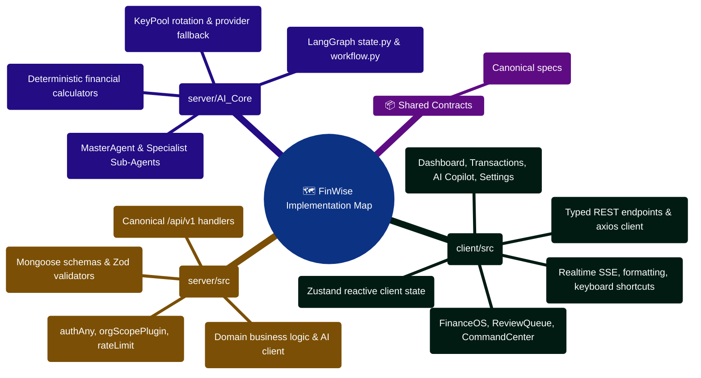

# FinWise Implementation Map

This document is a practical change map: if you want to add or modify a
feature, these are the places you will usually touch.

## 1. Core implementation flow

Most product work follows this path:

1. User interacts with a page or component in `client/src/`
2. Client API helper calls the Express server
3. Express route validates and dispatches to a controller or service
4. Services read/write MongoDB models and may call Redis-backed helpers
5. AI-enabled features may proxy to `server/AI_Core/`
6. The result returns to the client and is rendered through page/state layers

## 2. Frontend change map

### For a new page or route

Look at:

- `client/src/pages/`
- `client/src/routes/routeDefinitions.tsx`
- `client/src/routes/AppRouter.tsx`
- `client/src/layouts/`

Typical work:

- add a page component
- register the route
- choose access mode and layout
- connect loading/error states

### For a reusable UI component

Look at:

- `client/src/components/`
- `client/src/components/ui/`
- `client/src/components/feedback/`

Typical work:

- place app-level reusable widgets in `components/`
- place base UI primitives in `components/ui/`
- keep feature-specific behavior close to the feature page unless reuse is real

### For API consumption

Look at:

- `client/src/lib/api/`
- `client/src/lib/apiClient.ts`
- `client/src/services/`
- `client/src/hooks/`
- `client/src/stores/`

Typical work:

- define or extend the API client function
- decide whether data is query-based, stream-based, or store-driven
- keep transport details out of presentation components

## 3. Server change map

### For a new REST endpoint

Look at:

- `server/src/routes/`
- `server/src/controllers/`
- `server/src/schemas/`
- `server/src/services/`
- `server/src/routes/routeRegistry.ts`

Typical edit sequence:

1. add or update Zod schema
2. add controller handler
3. add or update service logic
4. mount the route in the relevant router
5. verify route registry behavior if the endpoint belongs to a gated feature

### For data model changes

Look at:

- `server/src/models/`
- `server/src/services/`
- `server/src/scripts/`
- `docs/DATABASE.md`

Typical work:

- update the Mongoose model
- check all services that depend on the changed shape
- decide whether a migration or backfill script is required
- update import/export or reporting code if the model is broadly reused

### For auth, security, or request lifecycle changes

Look at:

- `server/src/app.ts`
- `server/src/middleware/`
- `server/src/config/passport.ts`
- `server/src/config/env.ts`
- `server/src/utils/apiResponse.ts`

Typical work:

- update middleware ordering carefully
- check rate limiting, CSRF, auth, and org context interactions
- verify canonical and legacy routes still behave consistently

### For background work or scheduling

Look at:

- `server/src/services/workflowScheduler.ts`
- `server/src/services/workflowCron.ts`
- `server/src/modules/queue/`
- `server/src/worker/worker.ts`
- `server/src/server.ts`

Typical work:

- confirm whether the work runs in-process or via dedicated worker mode
- check `ASYNC_JOBS_ENABLED`
- confirm shutdown behavior for timers, pollers, and queue consumers

## 4. AI Core change map

### For AI request handling

Look at:

- `server/AI_Core/api_service.py`
- `server/src/services/aiCoreClient.ts`
- `server/src/services/aiRequestBuilder.ts`

Typical work:

- adjust the Node-to-Python payload shape
- update Python request/response models or helper conversion
- confirm timeout and concurrency assumptions on both sides

### For agent orchestration

Look at:

- `server/AI_Core/graph/workflow.py`
- `server/AI_Core/graph/state.py`
- `server/AI_Core/agents/`
- `server/AI_Core/contracts/`

Typical work:

- update workflow state
- revise specialist behavior or routing
- maintain stable contract output back to the Node server

### For OCR or file intelligence

Look at:

- `server/AI_Core/vision/`
- `server/src/services/fileTextExtraction.ts`
- `server/src/routes/fileRoutes.ts`
- `server/src/routes/receiptRoutes.ts`

Typical work:

- separate raw file storage from extraction logic
- keep graceful fallback behavior in mind when optional dependencies are absent
- verify max upload size and MIME handling on the server side

## 5. Shared contracts

If a change affects API shape or shared typing, check:

- `packages/contracts/openapi/`
- `packages/contracts/typescript/`
- `server/src/scripts/generateOpenApiPaths.ts`

This is especially important when a server change also powers docs, generated
types, or external consumers.

## 6. Change recipes

### Recipe: add a standard CRUD feature

Touch these areas:

- `server/src/models/`
- `server/src/schemas/`
- `server/src/services/`
- `server/src/controllers/`
- `server/src/routes/`
- `client/src/lib/api/`
- `client/src/pages/` or `client/src/components/`
- relevant test folders on both client and server

### Recipe: add an AI-assisted finance workflow

Touch these areas:

- `client/src/pages/` or AI-facing components
- `client/src/services/aiStream.ts` or chat-related services
- `server/src/routes/aiRoutes.ts` or `chatRoutes.ts`
- `server/src/services/aiCoreClient.ts`
- `server/AI_Core/api_service.py`
- `server/AI_Core/agents/`, `graph/`, `tools/`, or `contracts/`

### Recipe: add a background automation feature

Touch these areas:

- route/controller/service layer for creation and status
- persistence models for workflows or runs
- scheduler or worker code path
- test coverage for both schedule creation and execution behavior

## 7. Test map

### Client

- component and hook tests live under `client/src/`
- broader test support is under `client/src/test/`
- use Vitest and Testing Library

### Server

- integration-style tests live under `server/src/test/`
- route and service behavior are heavily represented there
- use Vitest, Supertest, and in-memory Mongo tooling

### AI Core

- tests live under `server/AI_Core/tests/`
- use pytest

## 8. Documentation map for implementation work

Use these existing docs when you need deeper context:

- `docs/API.md` for endpoint shape
- `docs/FRONTEND.md` for client structure
- `docs/SERVICES.md` for server business logic inventory
- `docs/AI_CORE.md` for AI Core behavior
- `docs/WORKFLOWS.md` for scheduler and automation concepts
- `docs/TESTING.md` for verification strategy

## 9. Common implementation mistakes to avoid

- Editing only `/api/v1` behavior and forgetting the legacy `/api` surface
- Updating a model without tracing all dependent services
- Treating feature-flagged routes as always mounted
- Writing docs from the README alone instead of checking package and runtime
  config
- Mixing generated/runtime directories into code searches when the actual work
  belongs in `src/`

## Implementation Codebase Navigation Mindmap



## End-to-End Feature Implementation Recipe ASCII Flow

```text
┌────────────────────────────────────────────────────────────────────────┐
│ 🟢 STEP 1: DEFINE CONTRACT & DATA MODEL                                │
│    ├─► Create Mongoose model in server/src/models/with orgId field     │
│    ├─► Define Zod input/output schemas in server/src/schemas/          │
│    └─► Run openapi:generate to keep API contracts synchronized        │
└───────────────────────────────────┬────────────────────────────────────┘
                                    │
                                    ▼
┌────────────────────────────────────────────────────────────────────────┐
│ ⚙️ STEP 2: IMPLEMENT BUSINESS SERVICE & ROUTE CONTROLLER               │
│    ├─► Implement domain logic in server/src/services/                  │
│    ├─► Wire controller & mount route in server/src/routes/v1Routes.ts  │
│    └─► Add integration test in server/src/test/ (Vitest) 🟢            │
└───────────────────────────────────┬────────────────────────────────────┘
                                    │
                                    ▼
┌────────────────────────────────────────────────────────────────────────┐
│ 🧠 STEP 3: INTEGRATE WITH AI CORE (If AI-assisted)                     │
│    ├─► Define agent tool or node in server/AI_Core/                    │
│    ├─► Add pytest verification in server/AI_Core/tests/ 🟢             │
│    └─► Connect Node server via aiCoreClient.ts                         │
└───────────────────────────────────┬────────────────────────────────────┘
                                    │
                                    ▼
┌────────────────────────────────────────────────────────────────────────┐
│ 📱 STEP 4: IMPLEMENT FRONTEND CLIENT EXPERIENCE                        │
│    ├─► Add typed API client function in client/src/lib/api/            │
│    ├─► Integrate React Query hook & Zustand store slice                │
│    └─► Build UI component in client/src/components/ & route lazy-load 🟢│
└────────────────────────────────────────────────────────────────────────┘
```


---

> [!TIP]
> **Developer Guide: Building & Extending on This Project**  
> For complete step-by-step blueprints, Mongoose models, Zod schemas, Express controllers, React hooks, and LangGraph subagents, see the [**Master Developer Handbook: Building on This Project**](./BUILDING_ON_THIS_PROJECT.md).

## Production Implementation Blueprint: Express Route Registry Dispatcher (`server/src/routes/routeRegistry.ts`)

```typescript
import { Router } from "express";
import { v1Router } from "./v1Routes";
import { authAny } from "../middleware/authAny";
import { orgContext } from "../middleware/orgContext";
import { csrfProtection } from "../middleware/csrf";
import { rateLimiter } from "../middleware/rateLimiter";

/**
 * Universal Route Registry: Mounts versioned domain routers with
 * full edge security, rate limiting, and tenant scoping guards.
 */
export function registerApplicationRoutes(appRouter: Router): void {
  const apiV1 = Router();

  // 1. Edge security & rate limiting pipeline
  apiV1.use(rateLimiter({ windowMs: 60000, max: 200 }));
  apiV1.use(csrfProtection);

  // 2. Tenant isolation & authentication pipeline
  apiV1.use(authAny);
  apiV1.use(orgContext);

  // 3. Mount canonical v1 domain routes (Transactions, Budgets, AI, etc.)
  apiV1.use("/", v1Router);

  // 4. Attach to root router table
  appRouter.use("/api/v1", apiV1);
}
```