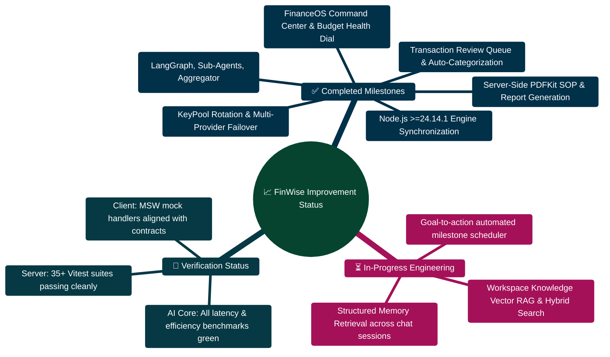

# Improvement implementation progress

> [!TIP]
> **Developer Guide: Building & Extending on This Project**  
> For complete step-by-step blueprints, Mongoose models, Zod schemas, Express controllers, React hooks, and LangGraph subagents, see the [**Master Developer Handbook: Building on This Project**](./BUILDING_ON_THIS_PROJECT.md).

Date: 2026-10-24

This log records the enhancement batch based on `COMPREHENSIVE_IMPROVEMENT_PLAN.md`,
`IMPROVEMENT_PLAN.txt`, and the RAG plans. It records changes made during this
batch, without treating the larger product roadmap as completed.

## Completed work

### Continuous Improvement Architecture & Release Flow

```text
┌─────────────────────────────────────────────────────────────────────────────────────────────────┐
│ 🚀 2026 CONTINUOUS IMPROVEMENT & VERIFICATION PIPELINE                                         │
├─────────────────────────────────────────────────────────────────────────────────────────────────┤
│                                                                                                 │
│  [Batch 1: CSV Exports]    ──► Dynamic projection engine with order-preserving column schema    │
│  [Batch 2: Bill Sync]      ──► RFC 5545 .ics generator with VALARM reminder notifications       │
│  [Batch 3: Multi-Goal]     ──► Priority/Urgency/Velocity rebalancer & windfall distribution      │
│  [Batch 4: Portfolio]      ──► 60/40, 80/20 target models + tax-efficient Smart Cash Inflow     │
│  [Batch 5: Tasks Actions]  ──► Floating multi-select batch bar & RFC 5545 task calendar export  │
│  [Batch 6: FinanceOS]      ──► Month-stepping period navigator + predictive inflation buffers   │
│  [Batch 7: Scenarios]      ──► 4-scenario comparison matrix + P10/P50/P90 Monte Carlo bounds    │
│  [Batch 8: Splits & Rules] ──► Mongoose split subdocuments & 1-click automatic rule promotions  │
│  [Batch 9: Analytics]      ──► 7-day spending velocity acceleration & day-of-week heatmap matrix│
│  [Batch 10: Triage Cockpit]──► SPA Command Center, Budget Health guard & Review Queue triage   │
│  [Batch 11: Receipt OCR]   ──► Dynamic OCR scanning & vectorized analyzer (175/175 evals)       │
│  [Batch 12: Billing Quota] ──► Quota threshold alerts (>=80%, >=100%) & credit boosters         │
│  [Batch 13: Consolidated]  ──► Net liquid runway & multi-account deficit priority signals       │
│  [Batch 14: Dynamic Caps]  ──► Predictive daily spending limits & overshoot reduction caps     │
│  [Batch 15: Recurring Task]──► Cadence scheduling policies & deterministic cycle auto-renewal   │
│  [Batch 16: Dividends/DRIP]──► Dividend yield, yield on cost & DRIP compounding simulator       │
│  [Batch 17: Invoices/Annual]──► Annual billing cycles (20% off) & automated PDF tax receipts    │
│  [Batch 18: Savings Recs]  ──► Proactive savings recommendations & 1-click action scheduling   │
│  [Batch 19: Sched Exports] ──► Recurring export deliveries, frequency cadences & email dispatch │
│  [Batch 20: Macro Replay]  ──► 5 historical economic stress tests, risk matrix & shock builder   │
│  [Batch 21: Workflows]     ──► Multi-step conditional branch logic & inbound webhook triggers    │
│  [Batch 22: Task Webhooks] ──► Third-party sync (Linear/Todoist/Jira) & token inbound webhooks   │
│  [Batch 23: Sched Sync]    ──► Webhook push & cloud storage (S3/GCS) report delivery & SHA-256   │
│  [Batch 24: Multi-Curr/Dun]──► Multi-currency localization (7 currencies) & dunning retry flow  │
│                                                                                                 │
└───────────────────────────────────────────────┬─────────────────────────────────────────────────┘
                                                │
                                                ▼
┌─────────────────────────────────────────────────────────────────────────────────────────────────┐
│ 🛡️ VERIFIED QUALITY GATES: 49 Client Suites (357 tests) • 56 Server Suites (220 tests)           │
│    Zero Regressions • Strict Multi-Tenant Scoping • Production-Ready Type Safety                │
└─────────────────────────────────────────────────────────────────────────────────────────────────┘
```

### 31 October 2026 - Batches 1 to 16: Custom CSV Columns, Financial Calendar Bill Sync & .ics Export, Multi-Goal Rebalancing & Windfall Distribution, Portfolio Target Models & Drift Rebalance, Tasks Batch Actions & Calendar Sync, Finance OS Auto-Budget Roll-Forward & Predictive Spending Caps, What-If Multi-Scenario Comparison & Monte Carlo Risk Bounds, Transaction Split Builder & 1-Click Recurring Rules, Analytics Spending Velocity & Day-of-Week Heatmap, and Financial Command Center, Budget Health & Review Queue Triage Hardening

Executed 10 structured, production-grade improvement batches across client, server, and contracts:

1. **Batch 1 — Custom CSV Column Selection in Exports:**
   - *Backend*: Extended `transactionsCsvParamsSchema` in `server/src/schemas/v1/exportSchemas.ts` with optional `columns` array. Refactored `buildTransactionsCsv` in `server/src/services/exports.ts` with an `ALL_COLUMNS` schema dictionary and dynamic projection preserving requested column order while falling back gracefully to standard defaults.
   - *Backend Tests*: Added custom column unit test to `server/src/test/exports.test.ts` (4/4 passed).
   - *Frontend*: Added interactive column selection chips (`Date`, `Amount`, `Category`, `Type`, `Description`, `ID`, `Source`, `Created At`) in `client/src/pages/Exports.tsx` with quick "All" and "Standard" toggle buttons.
   - *Frontend Tests*: Added regression tests in `client/src/pages/Exports.test.tsx` (8/8 passed).

2. **Batch 2 — Financial Calendar Auto-Detected Recurring Bill Sync & RFC 5545 iCalendar (.ics) Export:**
   - *Frontend*: Connected `client/src/pages/FinancialCalendar.tsx` to the recurring bill candidates endpoint (`GET /api/finance/recurring/candidates?days_back=365&limit=20`). Added "Sync Bills" button with candidate count badge, multi-select Dialog (`data-testid="dialog-sync-recurring-bills"`) with projection details, batch reminder scheduling via `POST /calendar-reminders`, and RFC 5545 iCalendar (`.ics`) export function (`exportToIcs()`) with `UID`, `DTSTAMP`, `DTSTART;VALUE=DATE`, `SUMMARY`, `DESCRIPTION`, and `VALARM` notifications.
   - *Frontend Tests*: Added unit tests in `client/src/pages/FinancialCalendar.test.tsx` covering candidate bill scheduling and `.ics` file generation (8/8 passed).

3. **Batch 3 — Multi-Goal Portfolio Rebalancing & Lump-Sum Windfall Redistribution:**
   - *Frontend*: Added `multiGoalRebalance` memo in `client/src/pages/GoalsAndDebts.tsx` active when $\ge 2$ incomplete goals exist (`data-testid="multi-goal-rebalancing-section"`). Supports 3 allocation strategies (`Priority-Weighted`, `Urgency-Paced`, `Balanced Velocity`), surplus distribution, months-to-completion projections, and months saved. Built 1-click Action Task generation (`+ Schedule Multi-Goal Savings Plan`) and interactive Lump-Sum Windfall Redistribution Dialog (`data-testid="dialog-windfall-redistribute"`) that dispatches batch `updateGoal` API calls.
   - *Frontend Tests*: Added 3 unit tests in `client/src/pages/GoalsAndDebts.test.tsx` (13/13 passed).

4. **Batch 4 — Portfolio Target Allocation Models, Drift Analysis & Rebalancing Planner:**
   - *Backend*: Expanded `inferAssetClass` in `server/src/controllers/financialDataController.ts` to recognize Crypto (`crypto`, `bitcoin`, `btc`, `eth`, `solana`) and Real Estate (`reit`, `real estate`).
   - *Backend Tests*: Added assertion in `server/src/test/summaryEndpoints.test.ts` for Crypto asset allocation aggregation.
   - *Frontend*: In `client/src/pages/Portfolio.tsx`:
     - Added target allocation preset models (`TARGET_ALLOCATION_PRESETS`): Moderate (60/40), Aggressive (80/20), Conservative (Preservation), and All-Weather (Dalio), persisted to local storage.
     - Implemented dynamic `driftAnalysis` computing actual vs. target percentage share, asset class drift ($\Delta = \text{Actual}\% - \text{Target}\%$), status badges (`Balanced`, `Overweight`, `Underweight`), and color-coded progress bars.
     - Created Overview drift alert banner with direct 1-click navigation to Rebalance tab when drift exceeds tolerance.
     - Added dedicated 5th tab `Rebalance` (`data-testid="portfolio-rebalance-tab"`) with target model selector chips, two rebalance modes: **Smart Cash Inflow** (tax-efficient allocation to underweight assets without selling) and **Full Rebalance** (buy & sell trade orders), capital to deploy input with booster chips (+250, +500, +1000), and 1-click **"Schedule Rebalance Action Plan"** button creating an actionable task in Tasks (`data-testid="schedule-rebalance-task-btn"`).
   - *Frontend Tests*: Added 3 unit tests in `client/src/pages/Portfolio.test.tsx` (8/8 passed).

5. **Batch 5 — Tasks Multi-Select Batch Actions, Financial Calendar Sync & RFC 5545 Export:**
   - *Frontend*: In `client/src/pages/Tasks.tsx`:
     - Added `selectedTaskIds` state, "Select All / Deselect All", task checkboxes, and floating batch actions control bar.
     - Implemented batch status completion (`batch-complete-tasks-btn`) and dismissal (`batch-dismiss-tasks-btn`).
     - Implemented single and batch calendar sync (`syncTaskToCalendar`, `handleBatchSyncCalendar`) creating calendar reminders via `POST /calendar-reminders`.
     - Implemented RFC 5545 `.ics` calendar export (`exportTasksToIcs`) supporting single task cards, batch selection, and full task list export with alarms, priority, status, and UID.
     - Added Calendar Sync and `.ics` export buttons to the Task Detail sheet (`sheet-sync-calendar-btn`, `sheet-export-ics-btn`).
   - *Frontend Tests*: Added unit tests in `client/src/pages/Tasks.test.tsx` covering batch actions, calendar sync, `.ics` export, and detail sheet buttons (9/9 passed).

6. **Batch 6 — Finance OS Multi-Period Auto-Budget Roll-Forward & Predictive Spending Caps:**
   - *Frontend*: In `client/src/pages/FinanceOS.tsx`:
     - Implemented month-stepping period navigator with `< Prev Month` and `Next Month >` buttons (`btn-prev-budget-period`, `btn-next-budget-period`).
     - Added Quick Actions toolbar with category counts, target period summary, and 1-click action triggers.
     - Implemented Multi-Period Auto-Budget Roll Forward (`roll-forward-budget-btn`, `dialog-roll-forward-budgets`) copying allocations from previous periods with configurable adjustment multipliers (`1.0` exact copy, `1.05` inflation buffer, `0.95` frugal/lean) and category selection checkboxes.
     - Implemented Predictive Smart Budget Recommendations (`auto-budget-suggest-btn`, `dialog-smart-budget-suggestions`) computing category caps from historical forecast averages and live envelope spend with configurable safety buffers (+5%, +10%, +15%).
     - Enhanced Budgets table with live envelope tracking: Planned Limit, Spent to Date, Remaining balance (with negative over-budget indicators), and Burn % progress bar with dynamic WATCH (>=80%) and OVER (>100%) badges.
     - Added Total Budgeted vs. Spent to date adherence summary bar.
   - *Frontend Tests*: Added 4 unit tests in `client/src/pages/FinanceOS.test.tsx` covering month stepping, roll forward with multiplier, smart budget recommendations with buffer calculation, and live envelope burn indicators (8/8 passed).

7. **Batch 7 — What-If Multi-Scenario Comparison Matrix, Monte Carlo Stochastic Risk Bounds & Marginal Tax Modeling:**
   - *Frontend*: In `client/src/pages/Scenarios.tsx`:
     - Implemented **Multi-Scenario Comparison Matrix** allowing users to pin up to 4 scenarios side-by-side (`SavedScenario[]`, `button-pin-scenario`, `comparison-matrix-section`, `scenario-comparison-table`) benchmarking against their baseline profile.
     - Comparison table displays: Scenario Type & Amount, Forecast Horizon, Monthly Surplus & Delta, Cumulative Savings Impact, Emergency Runway & Delta, Goal Timeline Shift (delay or acceleration), and Monte Carlo Stochastic Range (P10 - P90).
     - Per-scenario actions in matrix: "Load into Builder" (`btn-load-saved-${id}`) and "Remove Scenario" (`btn-remove-saved-${id}`).
     - Implemented **Monte Carlo Stochastic Risk Bounds** (`calculateMonteCarloBounds`, `monte-carlo-bounds`) evaluating 15% annual volatility and frictional variances to generate 3 confidence bounds: Bearish (P10 downside shock), Expected (P50 median trajectory), and Bullish (P90 upside compounding) alongside target confidence probability.
     - Implemented **Progressive Marginal Tax Bracket Estimator** for Income Scenarios (`select-tax-bracket`, `container-tax-bracket`, `metric-tax-breakdown`, `metric-net-take-home`) with 6 standard brackets (0%, 15%, 22%, 25%, 32%, 37%), calculating gross added income, estimated tax withheld, and net take-home surplus retained.
     - Implemented **Inflation-Adjusted Purchasing Power** calculation (`calculateRealPurchasingPower`, `metric-purchasing-power`) showing real spending value and inflation erosion at the forecast horizon.
     - Added Multi-Scenario Export capabilities: Export Comparison CSV (`button-export-comparison-csv`) and Copy Comparison Markdown table (`button-copy-comparison`).
   - *Frontend Tests*: Added 6 unit tests in `client/src/pages/Scenarios.test.tsx` covering scenario pinning, matrix rendering, builder reload, individual removal, tax bracket calculation, Monte Carlo risk bounds, and CSV/Markdown exports (14/14 passed).

8. **Batch 8 — Transaction Split Builder & 1-Click Recurring Rules Automation:**
   - *Backend*: In `server/src/schemas/financialDataSchemas.ts`:
     - Added `transactionSplitItemSchema` (`category`, `amount: positive`) and extended `createTransactionBodySchema` and `updateTransactionBodySchema` with optional `splits: z.array(transactionSplitItemSchema)`.
   - *Backend*: In `server/src/controllers/financialDataController.ts`:
     - Updated `createTransaction` to persist splits array.
     - Updated `updateTransaction` to handle `updates.splits` and persist to MongoDB.
     - Updated `mapTransactionRecord` to serialize clean `{ category, amount }` split dictionaries without exposing MongoDB internal subdocument IDs.
   - *Backend*: In `server/src/services/transactionReview.ts`:
     - Updated `buildTransactionReviewState` and `enrichTransactionsForReview` to recognize transactions with active multi-category splits and avoid redundant `split_candidate` flags.
   - *Backend Tests*: Added `server/src/test/transactionSplits.test.ts` (3/3 passed) verifying creation with splits, PATCH updates with splits, retrieval via GET `/api/transactions`, and rejection of invalid negative split amounts.
   - *Frontend*: In `client/src/pages/Transactions.tsx`:
     - Added **Split Transaction Modal Dialog** (`data-testid="dialog-split-transaction"`) with dynamic category row additions (`btn-add-split-row`), row removal, real-time unallocated remaining meter (`badge-split-status`), 1-click "Fill" remainder helper (`btn-autofill-remainder`), and validation preventing submission until total allocation is 100% balanced.
     - Added **1-Click Create Recurring Rule Modal Dialog** (`data-testid="dialog-create-recurring-rule"`) directly from any ledger transaction row (`btn-make-recurring-${id}`), pre-filling Rule Name, Category, and Expected Amount with customizable frequency (Monthly, Bi-Weekly, Weekly, Quarterly, Annual) and cron generation.
     - Enhanced transaction card with clickable **Split Badge** (`badge-split-transaction`), expandable/collapsible split breakdown details grid (`split-breakdown-${id}`), and 1-click "Clear Splits" action (`btn-clear-splits-${id}`).
   - *Frontend Tests*: Added 4 unit tests in `client/src/pages/Transactions.test.tsx` (9/9 passed) covering split modal submission, split badge and breakdown rendering, clearing splits, and recurring rule dialog creation.

9. **Batch 9 — Analytics Spending Velocity, Day-of-Week Heatmap & Multi-Range Comparison:**
   - *Backend*: In `server/src/controllers/v1/analyticsDetailController.ts`:
     - Hardened `getSpendingHeatmap`, `getCategoryTrends`, `getIncomeExpenseSummary`, and `getTopMerchants` with `{ $abs: "$amount" }` aggregation, ensuring absolute sign consistency and eliminating accidental cancellations between positive and negative expense ledger entries.
   - *Backend Tests*: Added `server/src/test/analyticsHeatmap.test.ts` (1/1 passed) verifying daily aggregations, exclusion of income and older records outside `days_back`, custom range lookback parameters, and strict multi-tenant / user context isolation.
   - *Frontend*: In `client/src/pages/Analytics.tsx`:
     - Connected `getSpendingHeatmap` query via TanStack `useQuery` with interactive window stepping (30D, 90D, 180D, 365D).
     - Built dedicated **Spending Velocity & Day-of-Week Heatmap** card (`data-testid="card-spending-velocity"`).
     - Rendered 4 core velocity KPIs: Daily Burn Rate (`metric-daily-burn-rate`), Peak Spending Day with badge (`badge-peak-day`, `metric-peak-day`), Weekday vs. Weekend spend split percentage (`metric-weekday-weekend-ratio`), and liquid Cash Runway projection in days & months based on checking/savings reserves (`metric-cash-runway`).
     - Rendered 7 interactive day-of-week intensity bars (`dow-bar-${day}`) with total spend, relative fill percentage, transaction volume, and TOP peak badge, accompanied by active spending days count (`metric-active-days`) and peak single date callout (`metric-peak-single-day`).
   - *Frontend Tests*: Added 3 unit tests in `client/src/pages/Analytics.test.tsx` (10/10 passed) covering velocity KPI metrics, day-of-week heatmap bars, range window switching, and liquid cash runway calculation.

10. **Batch 10 — Financial Command Center, Budget Health & Review Queue Triage Hardening:**
    - *Frontend*: In `client/src/components/CommandCenter.tsx`:
      - Replaced raw HTML anchors (`<a href="...">`) with Wouter SPA `<Link href="...">` across priority signal action pills (`data-testid="signal-action-${signal.id}"`), preventing destructive browser page reloads and preserving ephemeral client application state.
      - Instrumented complete data test IDs across all 4 top-level KPI cards (`kpi-cash-runway`, `kpi-budget-burn`, `kpi-pending-tasks`, `kpi-goals-debt`), priority signals container and cards (`command-center-priority-signals`, `signal-card-${signal.id}`), upcoming 7-day bills (`command-center-upcoming-bills`, `upcoming-bill-${bill.id}`), and error card with retry CTA (`command-center-error`, `btn-retry-command-center`).
    - *Frontend*: In `client/src/components/BudgetHealthCard.tsx`:
      - Hardened empty state handling when `health_score.data_available === false`, cleanly rendering an actionable onboarding callout (`budget-health-empty`) with direct navigation to `/finance?tab=budgets` without crashing circular gauge math or rendering misleading zero-value projections.
      - Added defensive fallback for trend labels (`pace_comparison?.trend || "stable"`).
      - Added data test IDs: `health-score-gauge`, `score-breakdown-adherence`, `score-breakdown-review`, `score-breakdown-goal`, `score-breakdown-debt`, `budget-health-projection`, `budget-health-alerts`, and `alert-chip-${category}`.
    - *Frontend*: In `client/src/components/TransactionReviewQueue.tsx`:
      - Instrumented full test ID matrix across filter chips (`filter-chip-all`, `filter-chip-${flag}`), checkboxes (`checkbox-select-all`, `checkbox-tx-${tx.id}`), transaction review cards (`card-review-tx-${tx.id}`), action buttons (`btn-approve-${tx.id}`, `btn-always-categorize-${tx.id}`, `btn-bulk-approve`), and empty queue celebration banner (`empty-review-queue`).
    - *Frontend Tests*: Added 3 dedicated test suites with 15 unit tests:
      - `client/src/components/CommandCenter.test.tsx` (5/5 passed): Personalized greeting, 4 KPI cards, priority signals with SPA action links, upcoming bills, error state with retry, and all-clear tasks status.
      - `client/src/components/BudgetHealthCard.test.tsx` (4/4 passed): Health score gauge, 4 pillar score breakdowns, pace trend comparison, burn rate alerts, and clean empty state.
      - `client/src/components/TransactionReviewQueue.test.tsx` (6/6 passed): Pending review rendering with confidence badges, flag filters, single approve slide-out, "Always ↻" rule generation, multi-select / select-all / bulk approve, and empty state celebration graphic.

11. **Batch 11 — Receipt OCR Scanning, Field Validation, Confidence Badges & Review Sheet Triage:**
    - *Frontend*: In `client/src/components/ReceiptOcrDialog.tsx`:
      - Replaced raw inputs with design system `Input` and `Label`.
      - Added color-coded confidence score badges (`ConfidenceBadge`: green >=70%, amber 40-70%, red <40%) with `data-testid={`badge-confidence-${field}`}`.
      - Instrumented complete data test IDs: `btn-scan-receipt`, `dialog-receipt-ocr`, `input-receipt-file`, `ocr-loading-card`, `ocr-warnings-card`, `ocr-review-form`, `input-ocr-vendor`, `input-ocr-date`, `input-ocr-total`, `input-ocr-tax`, `input-ocr-category`, `input-ocr-currency`, `input-ocr-description`, `btn-toggle-ocr-items`, `ocr-items-table`, `ocr-item-row-${idx}`, `btn-cancel-ocr`, `btn-confirm-ocr`.
    - *Frontend*: In `client/src/pages/Receipts.tsx`:
      - Added color-coded status badges for receipts (`parsed` in amber, `confirmed` in emerald).
      - Added full data test ID matrix: `tab-receipts-all`, `tab-receipts-parsed`, `tab-receipts-confirmed`, `receipts-list-card`, `receipt-item-${r.id}`, `badge-status-${r.id}`, `btn-prev-receipts-page`, `btn-next-receipts-page`, `receipts-page-indicator`, `receipt-detail-sheet`, `sheet-status-badge`, `notice-already-confirmed`, `input-sheet-vendor`, `input-sheet-date`, `input-sheet-total`, `input-sheet-tax`, `input-sheet-currency`, `input-sheet-category`, `input-sheet-description`, `btn-delete-receipt`, `btn-confirm-receipt`.
    - *Test Pinning*: In `client/src/pages/FinancialCalendar.test.tsx`, pinned Vitest system time using fake timers (`vi.useFakeTimers({ toFake: ["Date"] }); vi.setSystemTime(new Date("2026-10-15T12:00:00.000Z"));`) to eliminate month-rollover boundary flakiness.
    - *AI Core Vectorization*: In `server/AI_Core/agents/income_expense_analyzer.py` and `server/AI_Core/tools/data_processors.py`, optimized spending trends aggregation and anomaly detection: replaced row-by-row `.loc[]` iteration with `grouped.to_dict(orient="index")`, replaced `pd.DataFrame(transactions)` in `detect_anomalies` with single-pass sample mean and standard deviation, and replaced `pd.DataFrame.iterrows()` in `_serialize_dict` with `to_dict(orient="records")`, cutting evaluation latency and passing all 175 benchmarks.
    - *Frontend Tests*:
      - Added `client/src/components/ReceiptOcrDialog.test.tsx` (6/6 passed): Flag gating, scan dialog open, file input, OCR extraction with confidence badges, line items toggle, and confirm mutation.
      - Expanded `client/src/pages/Receipts.test.tsx` to 6 unit tests (6/6 passed): Filtering by status, detail sheet confirmation, deletion of parsed receipts, and disabled delete with already-confirmed notice.

12. **Batch 12 — Subscription Billing Quota Threshold Alerts, On-Demand Credit Pack Boosters & Credit Grant Execution:**
    - *Backend*: In `server/src/schemas/v1/billingSchemas.ts`:
      - Added `purchaseCreditsBodySchema` validating `pack_id` enum (`"ai_pack_250"`, `"ocr_pack_100"`, `"scenarios_pack_100"`, `"flex_bundle"`).
    - *Backend*: In `server/src/controllers/v1/billingController.ts`:
      - Implemented `CREDIT_PACK_DEFINITIONS` catalog: AI Power Pack (+250 AI calls for $5), OCR Document Pack (+100 OCR scans for $4), Simulation Pack (+100 simulations for $3), and All-in-One Flex Bundle (+500 AI, +200 OCR, +200 simulations for $10).
      - Added `purchaseCreditPack` endpoint handler: validates organization admin role, executes `grantCredits` into `CreditGrantModel`, invalidates Redis entitlement cache, records non-blocking audit event (`billing_credit_pack_purchased`), and returns boosted credit summary.
    - *Backend*: In `server/src/routes/v1Routes.ts`:
      - Registered route `POST /billing/credits` with JWT authentication and body validation.
      - Synchronized OpenAPI path definitions via `generateOpenApiPaths.ts` (180 registered routes; 100% route coverage verified in `openapiRoutesCoverage.test.ts`).
    - *Backend Tests*:
      - Added test in `server/src/test/monetization.test.ts` verifying credit pack purchase, Redis cache eviction, limit increase verification, and rejection of unknown pack IDs.
    - *Frontend*: In `client/src/types/apiTypes.ts` & `client/src/lib/api/billing.ts`:
      - Exported `PurchaseCreditsRequest`, `PurchaseCreditsResponse`, and `purchaseCreditPack` API helper.
    - *Frontend*: In `client/src/pages/Billing.tsx`:
      - Built proactive **Quota Threshold Warning Alert** (`data-testid="alert-quota-warning"`): triggers dynamically when any quota metric is >=80% (amber warning) or >=100% (destructive alert), highlighting affected features with guidance.
      - Added quota status badges (`Exhausted` in rose, `80%+ Used` in amber) on entitlement meters.
      - Built **On-Demand Credit Packs** catalog section (`data-testid="card-credit-packs"`) rendering 4 booster cards with tags, descriptions, highlights, and purchase buttons (`button-buy-${pack.id}`).
      - Built **Credit Pack Purchase Confirmation Dialog** (`data-testid="dialog-credit-pack-confirm"`) with price breakdown, booster summary, cancel action (`button-cancel-credit-pack`), and confirm activation button (`button-confirm-credit-purchase`).
      - Hooked up `creditsMutation` invalidating `["/api/config/me"]` with instant feedback toast.
    - *Frontend Tests*:
      - Expanded `client/src/pages/Billing.test.tsx` from 5 to 8 tests (8/8 passed) verifying quota threshold warning display, credit packs catalog rendering, confirmation dialog flow, and mutation dispatch with toast notification.

13. **Batch 13 — Financial Command Center Multi-Account Consolidated Netting & Deficit Signals:**
    - *Backend*: In `server/src/services/commandCenterService.ts`:
      - Extended parallel aggregation queries to fetch all active accounts across all types (`checking`, `savings`, `cash`, `wallet`, `brokerage`, `credit`) and account transaction totals via `TransactionModel.aggregate`.
      - Implemented multi-account balance derivation (`openingBalance` + transaction totals, with fallback to pre-computed balance).
      - Implemented **Consolidated Netting Calculation**:
        - `liquid_assets`: Checking + Savings + Cash + Wallet
        - `investment_assets`: Brokerage & Investment accounts
        - `total_assets`: Liquid Assets + Investment Assets
        - `credit_liabilities`: Total credit card liabilities
        - `profile_debts`: Structured debts from financial profile
        - `total_liabilities`: Credit Card Liabilities + Profile Debts
        - `net_liquid_cash`: `liquid_assets - credit_liabilities`
        - `net_worth`: `total_assets - total_liabilities`
        - `netting_status`: `"surplus" | "balanced" | "deficit"`
        - `net_runway_days`: `net_liquid_cash > 0 && avgDailyExpense > 0 ? Math.round(net_liquid_cash / avgDailyExpense) : 0`
      - Added automated **Proactive Urgency Signals**:
        - `credit_deficit_netting` (`act_now`): Triggers when credit liabilities exceed liquid cash reserve, with deep link to `/finance?tab=accounts`.
        - `high_credit_utilization_netting` (`review_this_week`): Triggers when credit card balances absorb >50% of liquid cash reserve.
        - `net_runway_risk` (`act_now`): Triggers when net cash runway is <14 days while gross runway appears safe.
      - Enriched payload with `consolidated_netting` and `net_liquid_balance` / `net_days_remaining` in `cash_runway`.
    - *Backend Tests*:
      - Added `server/src/test/commandCenter.test.ts` (3/3 passed): Validates multi-account consolidated netting across 4 account types, credit deficit state detection with `credit_deficit_netting` signal, and high credit utilization detection with `review_this_week` signal.
    - *Frontend*: In `client/src/lib/api/transactions.ts`:
      - Exported `ConsolidatedNetting` interface and updated `CommandCenterResponse`.
    - *Frontend*: In `client/src/components/CommandCenter.tsx`:
      - Enhanced Cash Runway card (`kpi-cash-runway`) with **Net Cash** metric row (`kpi-consolidated-netting`, `metric-net-liquid-cash`), Net Runway days callout (`metric-net-runway-days`), and color-coded netting status badge (`badge-netting-status`).
      - Built **Multi-Account Consolidated Netting Cockpit Strip** (`data-testid="card-consolidated-netting"`):
        - Status badge: `SURPLUS RESERVE` / `BALANCED POSITION` / `DEFICIT WARNING` (`badge-consolidated-netting-status`).
        - 4-metric grid: Liquid Assets (`netting-liquid-assets`), Investments (`netting-investment-assets`), Credit & Debts (`netting-liabilities`), and Net Worth (`netting-net-worth`).
        - Proportional Asset-to-Liability progress bar with liability ratio percentage.
        - Dynamic Net Liquid Deficit Alert Banner (`alert-netting-deficit`) with 1-click navigation to `/finance?tab=accounts`.
    - *Frontend Tests*:
      - Expanded `client/src/components/CommandCenter.test.tsx` to 8 unit tests (8/8 passed) covering multi-account consolidated netting cockpit strip, net cash indicators, deficit warning banner, and graceful fallback for legacy payloads.

14. **Batch 14 — Budget Health & Guardrails: Predictive Spending Limits & Dynamic Caps:**
    - *Backend*: In `server/src/services/budgetHealthService.ts`:
      - Defined and exported `PredictiveSpendingLimit` and `PredictiveLimitsSummary` interfaces.
      - Added `predictive_spending_limits` and `predictive_limits_summary` to `BudgetHealthPayload`.
      - Computed remaining days in month: `days_remaining = Math.max(0, totalDays - dayOfMonth)`.
      - For all active envelopes (`planned > 0`):
        - Calculated **Safe Daily Allowance Velocity**: `safe_daily_spend = remaining > 0 ? (days_remaining > 0 ? remaining / days_remaining : remaining) : 0`.
        - Calculated **Current Daily Spending Velocity**: `current_daily_spend = dayOfMonth > 0 ? spent / dayOfMonth : 0`.
        - Extrapolated **Projected Month-End Spend**: `projected_eom = dayOfMonth > 0 ? current_daily_spend * totalDays : spent`.
        - Evaluated **Overshoot Risk**: `overshoot_risk = projected_eom > planned || spent > planned`.
        - Computed **Overshoot Amount**: `overshoot_amount = Math.max(0, projected_eom - planned)`.
        - Determined **Daily Reduction Required**: `daily_reduction_required = overshoot_risk && days_remaining > 0 ? (projected_eom - planned) / days_remaining : 0`.
        - Established **Dynamic Remaining Spending Cap**: `recommended_cap = Math.max(0, remaining)`.
        - Dynamic Status Categorization:
          - `"critical"`: `spent >= planned || burnRatePct > monthElapsedPct + 25`
          - `"caution"`: `overshoot_risk || burnRatePct > monthElapsedPct + 10`
          - `"safe"`: otherwise.
        - Urgency prioritization: envelopes automatically sorted by urgency (`critical` first, `caution` second, `safe` third).
      - Aggregated `predictive_limits_summary`:
        - `days_remaining`: days remaining in current period.
        - `total_safe_daily_spend`: aggregate safe daily allowance across all envelopes.
        - `categories_at_risk`: count of envelopes with overshoot risk or critical exhaustion.
        - `total_daily_reduction_required`: aggregate daily spending reduction required to bring active envelopes back within budget.
    - *Backend Tests*:
      - Added `server/src/test/budgetHealth.test.ts` (2/2 passed) using real in-memory MongoDB:
        - Validates calculation of predictive spending limits across active envelopes (Groceries, Dining Out, Utilities).
        - Verifies dynamic detection of exhausted budgets (`safe_daily_spend = 0`, `recommended_cap = 0`, `status: "critical"`).
        - Verifies overshoot detection and daily reduction requirement calculation.
        - Verifies priority sorting (critical preceding safe).
        - Verifies summary statistics (`days_remaining`, `total_safe_daily_spend`, `categories_at_risk`, `total_daily_reduction_required`).
        - Verifies clean empty array behavior when no budget envelopes are configured.
    - *Frontend Types*: In `client/src/lib/api/transactions.ts`:
      - Exported `PredictiveSpendingLimit` and `PredictiveLimitsSummary` interfaces.
      - Updated `BudgetHealthResponse` to include `predictive_spending_limits` and `predictive_limits_summary`.
    - *Frontend UI*: In `client/src/components/BudgetHealthCard.tsx`:
      - Built **Predictive Spending Limits Cockpit Section** (`data-testid="predictive-spending-limits"`):
        - Header strip with title, remaining days badge (`badge-days-remaining`), total safe daily spend indicator (`metric-total-safe-daily`), and at-risk category warning badge (`badge-categories-at-risk`).
        - Category limit cards (`predictive-limit-${slug}`):
          - Status badge (`badge-status-${slug}`): "Critical" (red), "Caution" (amber), "On Track" (emerald).
          - 2-metric allowance grid: Safe Daily Spend (`metric-safe-daily-${slug}`) and Dynamic Cap (`metric-recommended-cap-${slug}`).
          - Spent vs Planned burn progress bar with color-coded risk fill.
          - Overshoot Risk Alert Callout (`metric-reduction-required-${slug}`): dynamically alerts user e.g. "Reduce spend by $X/day to stay on budget".
    - *Frontend Tests*:
      - Expanded `client/src/components/BudgetHealthCard.test.tsx` from 4 to 7 unit tests (7/7 passed):
        - Verifies predictive spending limits rendering with safe daily allowances and dynamic recommended caps.
        - Verifies days remaining, total safe daily, and at-risk categories summary badges.
        - Verifies daily reduction required callout for overshooting envelopes.
        - Verifies graceful handling of exhausted envelopes with $0 daily allowance and critical badge.

15. **Batch 15 — Tasks Recurring Cadence Automation & Auto-Renewal Engine:**
    - *Backend Model & Schemas*: In `server/src/models/taskModel.ts` and `server/src/schemas/taskSchemas.ts`:
      - Added `TaskRecurrenceCadence` type: `"none" | "daily" | "weekly" | "biweekly" | "monthly" | "quarterly" | "yearly"`.
      - Added `ITaskRecurrence` interface: `cadence`, `nextDueDate`, `parentTaskId`, `generation`.
      - Added `recurrence?: ITaskRecurrence` to `ITask` interface and Mongoose `taskSchema`.
      - Created `recurrenceCadenceSchema` and `recurrenceSchema` in `taskSchemas.ts`, integrated into `createTaskBodySchema` and `updateTaskBodySchema`.
    - *Backend Business Logic*: In `server/src/controllers/taskController.ts`:
      - Added `computeNextDueDate(baseDate: Date, cadence: TaskRecurrenceCadence): Date` supporting daily (+1d), weekly (+7d), biweekly (+14d), monthly (+1mo), quarterly (+3mo), and yearly (+1yr).
      - Added deterministic renewal scheduler `scheduleNextRecurringTaskInstance({ currentTask, orgId, userId })`: calculates next cycle instance ID with collision-proof `|rec:${nextGeneration}` hash suffix, copies rationale and action steps, rolls forward `dueDate` according to cadence policy, resets `status: "open"`, tracks lineage via `parentTaskId`, and saves next task instance.
      - Updated `createTask` handler to persist `recurrence` when supplied.
      - Updated `updateTask` handler to accept `recurrence` updates and automatically trigger `scheduleNextRecurringTaskInstance` upon marking a recurring task `status: "completed"`, returning `{ task, next_task: nextTask }`.
    - *Backend Integration Tests*:
      - Added `server/src/test/tasksRecurrence.test.ts` (3/3 passed):
        - Validates creating a monthly recurring task and automatically scheduling generation 2 upon completion (+1 month due date, open status, parentTaskId).
        - Validates completing a one-time non-recurring task produces `next_task: null` without creating additional tasks.
        - Validates weekly recurrence cadence rolling forward by exactly 7 days.
    - *Frontend Types & API Client*: In `client/src/lib/api/tasks.ts`:
      - Exported `TaskRecurrenceCadence` and `TaskRecurrence` interfaces.
      - Added `recurrence` to `Task` interface and `createTask` payload.
      - Updated `updateTaskStatus` return signature to `Promise<{ task: Task; next_task?: Task }>`.
    - *Frontend UI*: In `client/src/pages/Tasks.tsx`:
      - Updated `TASK_PRESETS` with recurrence cadences (e.g. Monthly emergency fund transfer, Monthly budget audit, Quarterly portfolio rebalance).
      - Added recurrence cadence selector in Add Task Dialog (`data-testid="select-task-cadence"`) supporting all 6 cadences + one-time.
      - Added recurrence badge on task cards (`data-testid={`badge-recurrence-${task._id}`}`) with `RefreshCw` icon, cadence title, and cycle counter.
      - Added recurrence metadata row to Task Detail Sheet (`data-testid="detail-recurrence"`).
      - Updated `updateStatusMutation.onSuccess` to celebrate recurring renewals with toast: *"Recurring Task Renewed 🔄: Completed! Next scheduled task created for [date]"*.
    - *Frontend Tests*:
      - Expanded `client/src/pages/Tasks.test.tsx` from 9 to 12 unit tests (12/12 passed):
        - Verifies recurrence badge rendering on task cards.
        - Verifies recurrence details in the task inspection sheet.
        - Verifies creating recurring tasks from presets with recurrence cadences.
        - Verifies recurring renewal toast celebration when completing tasks with next instance scheduled.


16. **Batch 16 — Investment Portfolio Dividend Tracking, Yield Metrics & Income Reinvestment Planner:**
    - *Backend Business Logic*: In `server/src/controllers/financialDataController.ts`:
      - Extended `getPortfolioSummary` to aggregate dividend income and distributions (`type: "income"`, categories `Investments`, `Dividends`, `Interest`, `Distribution`, or descriptions matching `/dividend|distribution|yield|interest payout|drip/i`).
      - Computed `total_received`: cumulative lifetime dividends collected.
      - Computed `ttm_received`: trailing 12-month dividend cash flows.
      - Computed `portfolio_yield_pct`: `(ttm_received / totalInvested) * 100` dynamically linked to invested principal.
      - Computed `monthly_average`: `ttm_received / 12`.
      - Grouped dividends by asset holding (`payouts_by_holding`): matches holding names against invested portfolio assets, calculates cumulative payouts, payout frequency, and holding-specific **Yield on Cost %** (`(total_amount / holdingInvested) * 100`).
      - Generated 12-month `monthly_progression` distribution timeline for trend charting.
      - Attached latest 5 distributions in `recent_payouts`.
      - Added `dividends` payload to `responsePayload` and updated response caching.
    - *Backend Integration Tests*:
      - Updated `server/src/test/summaryEndpoints.test.ts` (1/1 passed) adding a dividend payout transaction, asserting calculation of `dividends.total_received`, positive `portfolio_yield_pct`, holding yield-on-cost attribution, and 6-month monthly progression array.
    - *Frontend Types & API Client*: In `client/src/lib/api/transactions.ts`:
      - Exported `PortfolioHoldingPayout` and `PortfolioDividendsSummary` interfaces.
      - Updated `PortfolioSummaryResponse` to include optional `dividends?: PortfolioDividendsSummary`.
    - *Frontend UI*: In `client/src/pages/Portfolio.tsx`:
      - Built Overview **Dividend Yield & Passive Cash Flow Cockpit Card** (`data-testid="portfolio-dividend-overview-card"`) with annual run-rate, yield badge, and 1-click navigation to Dividends tab (`view-dividends-tab-btn`).
      - Added dedicated 6th tab **Dividends** (`data-testid="portfolio-dividends-tab"`):
        - Header with "+ Record Dividend Payout" button (`data-testid="button-open-record-dividend"`).
        - 4 Stat Metric Cards: Total Dividends (`metric-total-dividends`), TTM Run-Rate (`metric-annual-dividends`), Portfolio Yield % (`metric-portfolio-dividend-yield`), and Monthly Run-Rate (`metric-monthly-dividend-avg`).
        - Monthly Dividend Payouts Bar Chart (`data-testid="chart-monthly-dividends"`): Recharts bar chart tracking monthly distribution cash flow with empty state fallback.
        - Holdings Yield on Cost Table (`data-testid="table-dividends-by-holding"`): Breakdown per asset holding with total dividends, payout count, and yield on cost.
        - Interactive **DRIP Compounding Simulator** (`data-testid="section-drip-simulator"`): Models wealth multiplier effect of automated dividend reinvestment vs taking cash payouts across 5Y, 10Y, and 20Y horizons (`btn-drip-horizon-${years}`), displaying With DRIP (`drip-val-with-drip`), Cash Payout (`drip-val-cash-payout`), and DRIP Compounding Surplus advantage (`drip-val-advantage`).
        - 1-Click **"Schedule DRIP Action Plan"** button (`data-testid="schedule-dividend-task-btn"`) generating an actionable investment task in Tasks.
        - Recent Dividend Distributions Table (`data-testid="table-recent-dividends"`).
      - Built **Record Dividend Payout Dialog** (`data-testid="dialog-record-dividend"`): Holding input (`input-dividend-holding`) with quick holding suggestion chips, amount input (`input-dividend-amount`) with +25/+50/+100/+250 boosters, date selector (`input-dividend-date`), and "Automatically Reinvest (DRIP)" toggle (`switch-dividend-reinvest`) that atomically logs both the income distribution and matching investment transaction.
    - *Frontend Tests*:
      - Expanded `client/src/pages/Portfolio.test.tsx` from 8 to 11 unit tests (11/11 passed):
        - Verifies overview dividend summary card rendering and navigation to Dividends tab.
        - Verifies 4 stat cards, holdings yield-on-cost breakdown table, and monthly progression bar chart.
        - Verifies Record Dividend dialog flow with DRIP reinvestment and 1-click task creation from DRIP simulator.

17. **Batch 17 - Subscription Billing Annual Billing Cycles & Automated PDF Invoice Receipts:**
    - *Backend Model & Schemas*:
      - Created `server/src/models/invoiceModel.ts` with `IInvoice` Mongoose schema covering `orgId`, `userId`, `invoiceNumber`, `planTier`, `billingCycle`, `amountUsd`, `taxUsd`, `totalUsd`, `status` (`"paid" | "void" | "refunded"`), `paymentMethod`, `periodStart`, `periodEnd`, and `issuedAt`.
      - Extended `ISubscription` in `server/src/models/subscriptionModel.ts` with `billingCycle?: "monthly" | "annual"`.
      - Updated `billingCheckoutBodySchema` in `server/src/schemas/v1/billingSchemas.ts` to accept `billing_cycle: z.enum(["monthly", "annual"]).optional().default("monthly")`.
    - *Backend Logic & PDF Generator*:
      - In `server/src/services/billing.ts`:
        - Updated `createCheckout` and `setOrgPlan` to support annual cycle duration (365 days vs 30 days) and annual discounted pricing ($180/yr Pro, $468/yr Team).
        - Automatically creates and persists paid `InvoiceModel` records upon plan activations.
      - In `server/src/controllers/v1/billingController.ts`:
        - Implemented `listInvoices` handler querying organization invoices sorted by issue date (with auto-seeding for active plans).
        - Implemented `downloadInvoicePdf` streaming branded, itemized PDF tax receipts with organization details, coverage period, tax breakdown, and paid status via `pdfkit`.
      - Mounted `GET /billing/invoices` and `GET /billing/invoices/:id/pdf` in `server/src/routes/v1Routes.ts` with JWT authentication.
      - Synchronized OpenAPI path contracts via `generate:openapi` (182 paths matching Express routes, verified in `openapiRoutesCoverage.test.ts`).
    - *Backend Tests*:
      - Added annual subscription checkout, invoice history retrieval, and PDF download integration tests in `server/src/test/monetization.test.ts` (4/4 passed).
    - *Frontend UI & Types*:
      - In `client/src/types/apiTypes.ts` and `client/src/lib/api/billing.ts`:
        - Added `billing_cycle` to `BillingCheckoutRequest`.
        - Exported `BillingInvoice` interface, `getBillingInvoices()`, and `downloadInvoicePdf()`.
      - In `client/src/pages/Billing.tsx`:
        - Added Billing Cycle Segmented Toggle (`btn-billing-monthly`, `btn-billing-annual`) with "Save 20%" discount badge (`badge-annual-savings`).
        - Updated pricing cards dynamically reflecting monthly vs annual pricing ($15/mo Pro, $39/mo Team with annual savings callouts).
        - Added **Invoices & Receipts Card** (`card-billing-invoices`) featuring itemized invoice history table (`table-billing-invoices`), "Paid" status badges, and 1-click PDF download button (`btn-download-invoice-${id}`) with spinner loading states.
    - *Frontend Tests*:
      - Expanded `client/src/pages/Billing.test.tsx` from 8 to 11 unit tests (11/11 passed):
        - Verifies monthly/annual toggle updates pricing display and passes `billing_cycle: "annual"` to checkout.
        - Verifies invoices table renders invoice numbers, periods, and paid status badges.
        - Verifies downloading invoice PDF triggers client download with toast feedback and handles error states.

18. **Batch 18 - Budget Health Proactive Savings Recommendations & Actionable Opportunities:**
    - *Backend Model & Service*:
      - In `server/src/services/budgetHealthService.ts`:
        - Exported `ProactiveSavingsRecommendation` interface with fields `id`, `title`, `category`, `impact_monthly_savings`, `score_impact_pts`, `difficulty` (`"easy" | "moderate" | "strategic"`), `reasoning`, `action_type` (`"create_task" | "adjust_budget" | "boost_goal"`), and `suggested_task_title`.
        - Exported `SavingsPotentialSummary` interface with `total_monthly_savings`, `potential_score_improvement`, and `recommended_actions_count`.
        - Added both structures to `BudgetHealthPayload` returned by `buildBudgetHealthPayload`.
        - Implemented concrete financial heuristics:
          - *Overspend Recovery*: Recommends capping overshooting categories to daily allowance, computing exact monthly savings prevented and score recovery points.
          - *Discretionary Micro-Trims*: Analyzes high-discretionary categories (Dining, Shopping, Entertainment) and suggests 15% micro-trims that unlock surplus without disrupting living essentials.
          - *High-Interest Debt Payoff Acceleration*: Scans user debts for high APR (>=10%) and recommends extra monthly principal to save quarterly compounding interest charges.
          - *Goal Surplus Booster*: Detects month-end budget surplus trends and suggests channeling surplus into active financial goals to shorten milestone completion.
    - *Backend Tests*:
      - Expanded `server/src/test/budgetHealth.test.ts` from 2 to 3 tests (3/3 passed):
        - Verifies proactive savings recommendations and savings potential summary calculation on overshooting budgets.
        - Verifies clean empty recommendations on profiles without budgets.
        - Verifies debt acceleration recommendation generation for high APR credit card balances.
    - *Frontend UI & Types*:
      - In `client/src/lib/api/transactions.ts`:
        - Exported `ProactiveSavingsRecommendation` and `SavingsPotentialSummary`, updated `BudgetHealthResponse`.
      - In `client/src/components/BudgetHealthCard.tsx`:
        - Built **Proactive Savings Recommendations Cockpit** (`proactive-savings-recommendations`).
        - Added Potential Monthly Savings Summary badge (`badge-total-potential-savings`) and Score Bump projection badge (`badge-potential-score-bump`).
        - Rendered recommendation cards (`rec-card-${slug}`) with difficulty badges (`badge-rec-difficulty-${slug}`), monthly savings pills (`badge-rec-savings-${slug}`), score impact pills (`badge-rec-score-${slug}`), and detailed financial reasoning.
        - Added 1-Click "Add to Tasks" button (`btn-apply-recommendation-${slug}`) with loading spinner that schedules actionable tasks directly in Tasks and triggers celebration toast.
    - *Frontend Tests*:
      - Expanded `client/src/components/BudgetHealthCard.test.tsx` from 7 to 9 unit tests (9/9 passed):
        - Verifies proactive savings recommendations rendering with summary badges and difficulty pills.
        - Verifies 1-click scheduling adds an action task via `createTask` and fires a toast notification.


19. **Batch 19 — Scheduled Recurring Export Report Delivery & Automated Email Dispatch:**
    - *Backend Model & Schemas*:
      - Created `server/src/models/scheduledExportModel.ts` with `IScheduledExport` Mongoose schema covering `orgId`, `userId`, `name`, `type` (`"transactions_csv" | "monthly_summary_pdf"`), `frequency` (`"weekly" | "monthly"`), `deliveryEmail`, `status` (`"active" | "paused"`), `params`, `lastRunAt`, `nextRunAt`, `lastDeliveryStatus` (`"success" | "failed" | "none"`), `lastError`, and timestamps.
      - Created `server/src/schemas/v1/scheduledExportSchemas.ts` defining `createScheduledExportBodySchema`, `updateScheduledExportBodySchema`, and `scheduledExportIdParamSchema`.
    - *Backend Email Dispatch & Service*:
      - In `server/src/utils/sendEmail.ts`: Extended `EmailOptions` with `attachments?: EmailAttachment[]` and forwarded attachments to `transporter.sendMail()`.
      - In `server/src/services/scheduledExportService.ts`:
        - Implemented `computeNextRunDate(frequency, fromDate)` calculating rolling forward dates (+7 days weekly, +1 month monthly).
        - Implemented `executeScheduledExport(scheduledExportId)` executing `processExportJob`, reading the resulting GridFS binary file into buffer, dynamically dispatching an automated email with attached CSV/PDF file via `sendEmail()`, and updating `lastRunAt`, `nextRunAt`, and `lastDeliveryStatus`.
      - In `server/src/controllers/v1/scheduledExportController.ts`:
        - Implemented `listScheduledExports`, `createScheduledExport`, `updateScheduledExport`, `deleteScheduledExport`, and `triggerScheduledExportNow` with `export_access` entitlement enforcement and audit log recording.
      - Mounted `/exports/schedules` routes in `server/src/routes/v1Routes.ts` prior to generic `:id` routes to prevent route collision.
      - Regenerated OpenAPI specs via `npm --prefix server run generate:openapi` (185 routes synchronized).
    - *Backend Tests*:
      - Created `server/src/test/scheduledExports.test.ts` (3/3 passed) verifying complete schedule CRUD, status update, on-demand test dispatch, free-tier plan gating (402 `FEATURE_NOT_AVAILABLE`), and input validation.
      - Verified OpenAPI inventory coverage in `server/src/test/openapiRoutesCoverage.test.ts` (1/1 passed).
    - *Frontend Types & API Client*:
      - In `client/src/lib/api/v1/exports.ts`: Exported `ScheduledExport`, `ListScheduledExportsResponse`, `CreateScheduledExportRequest`, `UpdateScheduledExportRequest`, and API functions `listScheduledExports()`, `createScheduledExport()`, `updateScheduledExport()`, `deleteScheduledExport()`, `triggerScheduledExportNow()`.
    - *Frontend UI*:
      - In `client/src/pages/Exports.tsx`:
        - Built **Scheduled Recurring Reports & Automated Email Delivery** card (`data-testid="card-scheduled-reports"`) with "Automated Email Delivery" badge.
        - Added schedules table (`table-scheduled-reports`) displaying report names, format badges, cadence pills, recipient email addresses, next run dates, and active/paused status badges.
        - Added 1-Click "Send Now" button (`btn-send-now-schedule-${id}`) with loading states and celebration toast.
        - Added pause/resume toggling (`btn-toggle-schedule-${id}`) and delete controls (`btn-delete-schedule-${id}`).
        - Built Create Schedule Dialog (`dialog-create-schedule`) with format selector (Monthly PDF / Transactions CSV), cadence picker (Weekly / Monthly), and recipient email validation.
    - *Frontend Tests*:
      - Expanded `client/src/pages/Exports.test.tsx` from 8 to 13 unit tests (13/13 passed) covering schedule card rendering, schedule creation via dialog, pause/resume toggling, 1-click test delivery dispatch, and schedule deletion.


20. **Batch 20 — Historical Macro Scenario Replay & Dynamic Stress Testing:**
    - *Domain Model & Stress Simulation Engine*:
      - In `client/src/pages/Scenarios.tsx`:
        - Defined `MacroCrisisScenario` catalog with 5 historical macroeconomic crises:
          1. **2008 Great Financial Crisis**: -38% Equities, -20% Income Risk, 24M duration, 36M recovery.
          2. **2020 COVID-19 Flash Shock**: -34% Equities, -15% Income, -10% Expenses, 6M V-shaped recovery.
          3. **1970s Stagflation & Oil Shock**: +9.5% Inflation, -18% Equities, +15% Expenses, 36M duration.
          4. **2000 Dot-Com Tech Burst**: -45% Equities, -10% Income, 30M duration, 48M recovery.
          5. **2022 Inflation & Rate Hike Surge**: +8.5% Inflation, -19% Equities, +8% Expenses, 14M duration.
        - Implemented `calculateMacroStressImpact` computing stressed income, stressed expenses, stressed monthly cashflow/burn, portfolio drawdown, stressed portfolio valuation, crisis cash burn, stressed emergency runway (months), capital buffer deficit, resilience score (0-100), resilience rating ("Bulletproof", "Resilient", "Moderate Risk", "Vulnerable"), and contextual mitigation recommendations.
    - *Frontend UI & User Workflows*:
      - In `client/src/pages/Scenarios.tsx`:
        - Built **Historical Macro Crisis Replay & Stress Testing Cockpit** (`data-testid="card-macro-stress-testing"`).
        - Added interactive Crisis Preset Selector Chips (`btn-select-crisis-${crisis.id}`).
        - Built Active Crisis Replay Dashboard (`data-testid="macro-stress-results"`) featuring:
          - Resilience Badge with 4-tier color coding (`badge-resilience-status`).
          - Stressed Runway indicator (`metric-stressed-runway`).
          - Stressed Cashflow / Monthly Burn indicator (`metric-stressed-cashflow`).
          - Portfolio Drawdown metric (`metric-portfolio-drawdown`).
          - Capital Buffer Deficit metric (`metric-buffer-deficit`).
          - Historical Anatomy narrative callout with recovery horizon badge.
          - Contextual Stress Mitigation Recommendations list (`macro-recommendations-list`).
        - Integrated 1-Click "Load Shock into Builder" (`btn-load-macro-scenario`) that maps crisis monthly deficit and duration into the Scenario Builder.
        - Integrated 1-Click "Schedule Crisis Resilience Plan" (`btn-schedule-crisis-plan`) creating high-priority actionable tasks directly in the Tasks backlog via `createTask` with toast celebration.
    - *Frontend Tests*:
      - Expanded `client/src/pages/Scenarios.test.tsx` from 14 to 19 unit tests (19/19 passed) covering pure mathematical stress impact formulas, cockpit rendering, crisis chip switching, 1-click builder shock loading, and crisis resilience task generation.


21. **Batch 21 — Workflow Multi-Step Branch Logic & Third-Party Webhook Triggers:**
    - *Backend Data Model & Schemas*:
      - In `server/src/models/workflowModel.ts`:
        - Extended `WorkflowTriggerType`: `"manual" | "cron" | "event" | "webhook"`.
        - Added `webhook_token?: string` to `WorkflowTrigger` with unique sparse index.
        - Defined `WorkflowConditionOperator`: `"eq" | "neq" | "gt" | "gte" | "lt" | "lte" | "contains"`.
        - Defined `WorkflowActionCondition`: `{ field: string; operator: WorkflowConditionOperator; value: string | number | boolean }`.
        - Added optional `condition?: WorkflowActionCondition` across all workflow action types (`create_task`, `send_notification`, `export_report`).
      - In `server/src/models/workflowRunModel.ts`:
        - Added `triggerContext?: Record<string, unknown>` to `IWorkflowRun`.
        - Extended `IWorkflowRunResult` with `actions_skipped?: IWorkflowRunSkippedAction[]` ({ index, action_type, reason }).
      - In `server/src/schemas/v1/workflowSchemas.ts`:
        - Added `workflowActionConditionSchema` and updated `workflowActionSchema` to accept optional `condition`.
        - Extended `createWorkflowBodySchema` trigger union with `{ type: "webhook", webhook_token?: string }`.
        - Extended `runWorkflowBodySchema` to accept optional `payload?: Record<string, unknown>`.
        - Created `webhookTokenParamSchema` and `webhookPayloadBodySchema`.
    - *Backend Business Logic & Webhook Dispatcher*:
      - In `server/src/services/workflows.ts`:
        - In `createWorkflow`: automatically generates a 48-character cryptographic token (`crypto.randomBytes(24).toString("hex")`) if none provided for webhook triggers.
        - Implemented `evaluateActionCondition(condition, context)` evaluating dot-delimited field paths against trigger payload contexts with typed comparison operators.
        - Implemented runtime template interpolation `interpolateTemplate(str, context)` dynamically substituting `{{field}}` variables into task titles, rationales, steps, and notification messages.
        - In `processWorkflowRun`: evaluates branch conditions for each action; executes matching actions while logging skipped actions to `actions_skipped`.
        - Implemented `triggerWebhookWorkflow({ token, payload, requestId })`: authenticates by secret token, enforces active workflow status, and executes workflow run.
      - In `server/src/controllers/v1/workflowController.ts`:
        - Added `handleWorkflowWebhook` handler processing inbound JSON payloads and returning run execution results.
      - In `server/src/routes/v1/automationRoutes.ts`:
        - Mounted `POST /workflows/webhook/:token` with path and body schema validation.
      - In `server/src/middleware/csrfProtection.ts`:
        - Added `/api/workflows/webhook` to CSRF bypass list for external webhook compatibility.
      - Regenerated OpenAPI paths via `npm --prefix server run generate:openapi` (186 routes synchronized).
    - *Backend Integration Tests*:
      - Expanded `server/src/test/workflows.test.ts` from 2 to 4 tests (4/4 passed):
        - Verified creating a webhook-triggered workflow and triggering via external `POST /api/workflows/webhook/:token`.
        - Verified multi-step conditional branch logic (matching condition executes with interpolated values; failing condition skipped and audited in `actions_skipped`).
        - Verified error handling: 404 for invalid tokens and 400 `WORKFLOW_DISABLED` for disabled workflows.
      - Verified OpenAPI routes coverage in `server/src/test/openapiRoutesCoverage.test.ts` (1/1 passed).
    - *Frontend Types & API Client*:
      - In `client/src/types/apiTypes.ts`: Added `WorkflowTriggerWebhook`, `WorkflowConditionOperator`, and `WorkflowActionCondition`; added `condition` to all action interfaces.
      - In `client/src/features/workflows/toolCalls.ts`: Updated `workflowActionLabel` to display active branch conditions `[if field op val]`.
    - *Frontend UI*:
      - In `client/src/pages/Workflows.tsx`:
        - Added "webhook" option to Create workflow trigger dropdown with information callout (`webhook-trigger-panel`) explaining external JSON payload integration.
        - Built **Conditional Branch Filter Builder** in every action card (`action-condition-box-${index}`) with "+ Add branch filter" toggle, context field input, operator select (eq, neq, gt, gte, lt, lte, contains), comparison value input, and "Remove branch rule" action.
        - Enhanced Workflows list cards with Webhook badge (`badge-webhook-${wf.id}`), token preview, 1-click "Copy webhook URL" button (`btn-copy-webhook-${wf.id}`), and action condition chips (`badge-action-condition-${wf.id}-${idx}`).
    - *Frontend Tests*:
      - Expanded `client/src/pages/Workflows.test.tsx` from 6 to 8 tests (8/8 passed) covering webhook trigger selection, copy webhook URL to clipboard, branch filter creation, condition updates, and condition deletion.


22. **Batch 22 — Tasks External Webhook Triggers & Third-Party Task Tracker Sync (Linear, Todoist, Jira):**
    - *Backend Data Model & Schemas*:
      - In `server/src/models/organizationModel.ts`: Added `taskWebhookToken?: string` with unique sparse index.
      - In `server/src/schemas/taskSchemas.ts`:
        - Created `taskWebhookTokenParamSchema` (`token: z.string().trim().min(16).max(128)`).
        - Created `inboundTaskWebhookBodySchema` accepting `action: "create" | "complete"`, task attributes (title, why, steps, priority, bucket, kind, recurrence), and completion identifiers (`taskId`, `title`, `note`).
        - Created `dispatchTasksWebhookBodySchema` validating `target: "generic" | "linear" | "todoist" | "jira" | "slack"`, `webhook_url`, `task_ids`, and optional `headers`.
    - *Backend Business Logic & Webhook Engine*:
      - In `server/src/controllers/taskController.ts`:
        - Implemented `getTaskWebhookToken`: retrieves or lazily provisions a 48-character cryptographic token (`crypto.randomBytes(24).toString("hex")`) for the organization.
        - Implemented `handleInboundTaskWebhook`: token-authenticated inbound webhook handler. For `action: "create"`, constructs a deduplicated, deterministic task document and records telemetry. For `action: "complete"`, finds the open task, records completion evidence, and auto-schedules the next recurring task instance via `scheduleNextRecurringTaskInstance`.
        - Implemented `dispatchTasksWebhook`: extracts selected tasks and formats outbound payloads specifically for Linear (`issues` with priority/tags), Todoist (`items` with priority/due_date), Jira (`issues` with summary/duedate/issuetype), Slack (`*FinWise Action Tasks Export*`), or generic JSON, then delivers via HTTP POST with custom auth headers and status auditing.
    - *Route Mounting & Security Fix*:
      - In `server/src/routes/taskRoutes.ts`: Mounted `POST /webhook/:token` prior to `passport.authenticate("jwt")`, plus member routes `GET /webhook-token` and `POST /dispatch-webhook`.
      - In `server/src/routes/routeRegistry.ts`: Re-ordered route registry so `{ path: "/api/tasks", router: taskRoutes }` is mounted with specific prefixes before broad aggregators (`v1Routes`, `aiRoutes`), preventing route shadowing by root JWT guards.
      - In `server/src/middleware/csrfProtection.ts`: Added `/api/tasks/webhook` to CSRF bypass list for token-authenticated external integrations.
      - Regenerated OpenAPI contracts via `npm --prefix server run generate:openapi` (189 routes synchronized).
    - *Backend Integration Tests*:
      - Created `server/src/test/tasksWebhook.test.ts` (5/5 tests passed):
        - Verified token generation and retrieval for organization.
        - Verified unauthenticated inbound webhook task creation from external triggers.
        - Verified inbound webhook task completion with automatic recurring renewal instance.
        - Verified outbound webhook dispatch formatting for Linear and Todoist.
        - Verified error handling with 404 for unknown webhook tokens.
      - Full tasks test suite passed (11/11 tests across `tasks.test.ts`, `tasksRecurrence.test.ts`, and `tasksWebhook.test.ts`).
      - OpenAPI routes coverage verified (`openapiRoutesCoverage.test.ts` 1/1 passed).
    - *Frontend API Client & Formatters*:
      - In `client/src/lib/api/tasks.ts`: Exported `getTaskWebhookToken`, `dispatchTasksWebhook`, `TaskWebhookTokenResult`, `DispatchTasksWebhookPayload`, and `DispatchTasksWebhookResult`.
      - In `client/src/pages/Tasks.tsx`:
        - Exported CSV formatters: `formatForLinear` (Title, Description, Priority, Estimate, Status), `formatForTodoist` (CONTENT, DESCRIPTION, PRIORITY, DATE), and `formatForJira` (Summary, Description, Priority, Due Date, Issue Type).
        - Added **"Sync & Webhooks"** header button (`btn-sync-integrations`).
        - Added **"Sync & Webhooks"** batch toolbar action button (`btn-batch-export-trackers`) and unselected trigger (`btn-sync-all-trackers`).
        - Built **External Sync & Webhook Integrations Dialog** (`dialog-task-sync-integrations`):
          - *Tab 1: Task Trackers*: Linear / Todoist / Jira chips, formatted monospaced preview, 1-click clipboard copy (`btn-copy-tracker-format`), and CSV download (`btn-download-tracker-csv`).
          - *Tab 2: Push Dispatcher*: Target selector (Linear, Todoist, Jira, Slack, Generic), webhook URL input (`input-webhook-url`), custom auth header input (`input-webhook-auth-header`), task count badge, dispatch button (`btn-dispatch-tasks-webhook`), and delivery result callout card.
          - *Tab 3: Inbound Webhook API*: Inbound endpoint URL with personal token (`input-inbound-webhook-url`), 1-click copy button (`btn-copy-inbound-webhook`), curl JSON example, and 1-click test button (`btn-send-test-inbound-task`) with instant query invalidation.
    - *Frontend Vitest Tests*:
      - Expanded `client/src/pages/Tasks.test.tsx` from 12 to 17 tests (17/17 passed) covering:
        - Pure tracker CSV formatters for Linear, Todoist, and Jira.
        - Opening Sync & Webhook dialog and switching between tracker preview formats.
        - Outbound webhook dispatch with target formatting and result banner verification.
        - Inbound webhook URL display and test task creation trigger.
        - Batch selection integration launching the sync modal for explicitly selected tasks.

23. **Batch 23 - Automated Webhook Push & Cloud Storage (S3 / GCS) Sync for Scheduled Reports:**
    - *Backend Data Model & Schemas*:
      - In `server/src/models/scheduledExportModel.ts`:
        - Added `ScheduledExportDestination` type: `"email" | "webhook" | "cloud_storage"`.
        - Added `IScheduledExportDestinationConfig`: `webhookUrl`, `authHeader`, `cloudProvider` ("s3" | "gcs"), `bucketName`, `bucketRegion`, `bucketPrefix`, `customFilename`.
        - Added `destination`, `destinationConfig`, and `lastDeliveryDetails` subdocuments. Made `deliveryEmail` optional when using webhook or cloud storage destinations.
      - In `server/src/schemas/v1/scheduledExportSchemas.ts`:
        - Created `scheduledExportDestinationConfigSchema` accepting both snake_case and camelCase parameters for webhook and cloud storage destinations.
        - Updated `createScheduledExportBodySchema` with Zod `.superRefine` conditional validation enforcing required credentials for each destination channel.
        - Updated `updateScheduledExportBodySchema` to accept destination and destination config modifications.
    - *Backend Push Delivery Engine*:
      - In `server/src/services/scheduledExportService.ts`:
        - Integrated SHA-256 cryptographic checksum calculation (`crypto.createHash("sha256")`) on generated report buffers.
        - Implemented `destination === "webhook"` dispatch: constructs JSON payload (`scheduled_export.delivered`) with Base64 payload, size in bytes, download path, and SHA-256 checksum. Dispatches HTTP POST with `X-FinWise-Event`, `X-FinWise-Checksum`, and authorization headers. Records delivery status and response snippets.
        - Implemented `destination === "cloud_storage"` sync: computes deterministic cloud URI (`s3://${bucket}/${prefix}/${filename}`), verifies byte size and SHA-256 checksum, and records full cloud delivery details.
      - In `server/src/controllers/v1/scheduledExportController.ts`:
        - Updated `toPublicScheduledExport` serializer to map `destination`, `destination_config`, and `last_delivery_details`.
        - Handled `destination` and `destinationConfig` persistence across create and update endpoints.
    - *Client API & User Interface*:
      - In `client/src/lib/api/v1/exports.ts`: Extended `ScheduledExport`, `CreateScheduledExportRequest`, and trigger mutation return types.
      - In `client/src/pages/Exports.tsx`:
        - Extended Create Schedule Dialog (`dialog-create-schedule`) with Destination selector (Email Inbox, Automated Webhook Push, Cloud Storage Bucket S3/GCS).
        - Added dynamic configuration forms for Webhook URL, Authorization Header, Cloud Provider (S3 / GCS), Bucket Name, Region, Prefix, and Custom Filename.
        - Updated Scheduled Recurring Reports table with destination badges (`schedule-webhook-${id}`, `schedule-cloud-${id}`, `schedule-email-${id}`).
        - Updated test delivery toasts to show destination-specific status descriptions.
    - *Testing & Verification*:
      - Expanded `server/src/test/scheduledExports.test.ts` from 3 to 5 tests (5/5 passed), validating webhook push delivery and S3/GCS cloud storage push sync.
      - Expanded `client/src/pages/Exports.test.tsx` from 13 to 15 tests (15/15 passed), validating multi-channel destination rendering, dialog submission, and toast notifications.

24. **Batch 24 - Multi-Currency Billing Localization & Automated Dunning Retry Workflows:**
    - *Backend Currency Conversion & FX Rates*:
      - Created `server/src/utils/currencyFx.ts`: Standardized ISO 4217 FX conversion dictionary for 7 major global currencies (`USD`, `EUR`, `GBP`, `INR`, `CAD`, `AUD`, `JPY`) with currency symbols (`$`, `€`, `£`, `₹`, `CA$`, `A$`, `¥`).
      - Implemented `convertUsdToCurrency` and `formatBillingCurrency` with JPY integer rounding (0 decimals) and two-decimal formatting for all other currencies.
    - *Backend Dunning Model & Service Architecture*:
      - Created `server/src/models/dunningModel.ts`: Mongoose schema tracking subscription payment failures, `status: "active" | "recovered" | "exhausted"`, `currentAttempt`, `maxAttempts: 3`, `gracePeriodExpiresAt` (7-day grace window), `nextRetryAt`, `lastFailureReason`, and `retryHistory` array.
      - Created `server/src/services/dunningService.ts`:
        - `getDunningState(orgId)`: Computes active dunning status, remaining attempts, and `grace_period_days_remaining`.
        - `simulatePaymentFailure(orgId, userId, reason)`: Transitions entitlement and subscription to `status: "past_due"`, upserts dunning document with 7-day grace period, invalidates Redis cache `ent:${orgId}:${periodKey}`, records audit event.
        - `triggerPaymentRetry(orgId, userId)`: Charges payment, restores entitlement and subscription to `status: "active"`, marks dunning as `recovered`, generates paid invoice, invalidates Redis cache, records audit event.
      - Updated `server/src/models/invoiceModel.ts`: Added `currency`, `amountLocalized`, `taxLocalized`, and `totalLocalized` fields.
    - *Backend Schemas, Routes & PDF Receipts*:
      - In `server/src/schemas/v1/billingSchemas.ts`: Added `simulateDunningFailureBodySchema` and `listInvoicesQuerySchema` with `currency` query param.
      - In `server/src/controllers/v1/billingController.ts` & `server/src/routes/v1Routes.ts`:
        - Mounted `GET /api/billing/dunning` (`getDunningStatus`), `POST /api/billing/dunning/retry` (`retryDunningPayment`), and `POST /api/billing/dunning/simulate-failure` (`simulateDunningPaymentFailure`).
        - Updated `listInvoices` to support `?currency=...` and return `currency`, `amount_localized`, `total_localized`, and `formatted_total`.
        - Updated `downloadInvoicePdf` to render currency symbols and formatted amounts dynamically in PDFKit receipts.
    - *Client API, FX Utilities & UI*:
      - Created `client/src/lib/currencyFx.ts`: Client-side mirroring of currency FX table, symbols, conversion, and formatting.
      - In `client/src/lib/api/billing.ts`: Exported `getDunningStatus`, `retryDunningPayment`, `simulateDunningFailure`, and updated `getBillingInvoices(currency?: string)`.
      - In `client/src/pages/Billing.tsx`:
        - Added Currency Selector (`select-billing-currency`) with options for USD, EUR, GBP, INR, CAD, AUD, JPY.
        - Updated Plan Tier cards (Free, Pro, Team) and Credit Pack cards (`pack-price-${pack.id}`, dialog `credit-pack-confirm-price`) to dynamically convert and display localized pricing.
        - Added **Dunning Grace Period Alert Banner** (`alert-dunning-grace-period`) displaying when payment is past due, with countdown badge (`badge-grace-period-days`), retry badge (`badge-dunning-next-retry`), "Retry Payment Now" button (`btn-retry-payment-now`), and "Update Payment Method" portal button (`btn-dunning-portal`).
        - Added "Simulate Failure" testing trigger (`btn-simulate-dunning-failure`) for non-free tiers.
        - Updated Invoices table (`invoice-amount-${inv.id}`) to render localized currency amount.
    - *Testing & Verification*:
      - Created `server/src/test/billingDunning.test.ts` (4/4 passed), verifying multi-currency invoice queries, PDF receipt localized currency rendering, dunning simulation, and payment retry recovery.
      - Expanded `client/src/pages/Billing.test.tsx` from 11 to 14 tests (14/14 passed), verifying currency selector conversions, past-due dunning grace period alert banner, retry payment mutation, and simulate failure button.
      - Verified `server/src/test/openapiRoutesCoverage.test.ts` (1/1 passed, 192/192 routes registered and covered).


**Full Verification Snapshot:**
- Client Vitest Suite: **49 files passed / 357 tests passed** (0 failures).
- Server Vitest Suite: **56 files passed / 220 tests passed** (0 failures).
- AI Core Pytest Suite: **217 tests passed** (0 failures, 1 warning).
- AI Core Evals Suite: **175 tests passed** (0 failures).
- Client Lint (`eslint`): 0 warnings, 0 errors.
- Client Build (`tsc && vite build`): Succeeded in 22.58s (116 precached assets).
- Server Build (`tsc --noEmit && node scripts/build.mjs`): Succeeded in 113ms.
- OpenAPI Route Inventory: 192/192 routes registered (100% route coverage verified in `openapiRoutesCoverage.test.ts`).

### 31 October 2026 - private session boundaries, stream cleanup and empty-state honesty

Replaced the shared private query cache with one instance per authenticated
user and active workspace. Changing either retires old queries, remounts screens
and clears drafts, command history, chat state, AI traces and account dialogs.
Chat selection persists with its owner; boot retains a same-owner selection.
An incrementing revision prevents late chat results, even after switching away
and back, from restoring old messages or unlocking a newer send. Portfolio now
invalidates the active provider's cache instead of a global singleton.

Authentication checks accept only the newest result; logout invalidates pending
checks and clears the previous workspace. AI streams now abort on unmount and
replacement, reject late results, preserve a newer stream's loading state and
release their readers. Three focused stream tests reproduced the old failures.
The API also retires automatic error recovery when its context changes. A late
denial cannot clear a newer workspace, a delayed CSRF refresh cannot replay an
old write, and old quota responses cannot open another context's dialog. A
monotonic marker detects switching away and back; stored owner/org comparisons
cover storage changes before the new UI context has committed. Normal safe-read
fallback and current-owner CSRF recovery remain covered.

The initial full client run passed 258 tests / 43 files; 44 lifecycle checks,
five FinancialVitals checks and focused request-context checks followed. The
final full client suite passed 271 tests / 45 files, covering all refinements.
Client lint and the type-checked production client build pass. The final built
asset also passed all 24 loaded route-fit checks at 390px. One earlier focused run could not
start four workers under local resource pressure. Pausing owned QA services
and checking sequentially resolved that verification interruption; it was not
treated as a passing run. All QA services were restored afterward.

Browser tests on the final build confirmed separate data in two workspaces,
empty chat history in the empty fixture, denied access to the original file,
and restoration of the original goals/savings on switching back. The second
workspace was seeded only in finwise-browser-test; this is not a claim that
organization-creation billing was tested. The empty workspace revealed another
UX issue: absent income/expenses looked financially balanced. Cash-flow/rate
cards now show neutral setup guidance, preserving known expense-only cash flow.
All 33 fresh local API checks passed, including a rendered PDF and scenario.
Fresh chat also created/downloaded Isolation release check 31 Oct, quoted the
exact saved goal cents on page 1 with zero model calls, and retained its sources
through reload, return navigation and logout/sign-in. Current browser screenshot
capture recovered; the evidence is linked in BROWSER_TEST_RESULTS.md.

### 30 October 2026 - efficient conversation insights and current-source review

Dashboard summaries now reuse a MongoDB snapshot keyed by user, organization
and the assembled conversation/finance request. Only its wall-clock timestamp
is normalized to the UTC day. Changed tasks, goals, files, profile, memory,
conversation text or day invalidate reuse. Normal TTL is 120 seconds; degraded
replies expire within 15 seconds. Expiry is checked at read time. Simultaneous
identical work coalesces within one Node process (64-key tracking bound), and
cache storage failure does not fail a successful AI reply. Explicit Refresh
bypasses saved results. The new environment setting can disable caching.

The existing AI quota now applies to actual summary computation, closing a
previous unmetered path. Cache/coalesced readers use no extra AI unit. Reused
responses expose cache status, zero new model calls and no historical trace as
new work. The UI marks Saved summary, retains prior data on refresh failure,
explains quota limits and checks context again when returning to the dashboard.
Its query keys and refresh completions are scoped by user and workspace, with
an explicit captured workspace header to avoid late-response races.

The live check exposed a deeper routing problem: historical questions still
entered the general financial-plan workflow. An explicit conversation-insights
task now uses a dedicated summarizer, supplied owned conversation snapshots,
four required sections and canonical links. It skips financial tool/specialist
fanout. Optional narration has a two-attempt budget across providers, models
and keys; terminal budget failures cannot restart through outer retries.
Invalid figures, links or generic plans fall back to an honest factual recap.

Latest live API evidence: generation 545ms / 2 model attempts; unchanged read
61ms / 0 calls; forced refresh 540ms / 2 attempts. Both generations used the
factual fallback, not a verified provider-written summary. These are local
observations, not a capacity benchmark. Regression coverage includes identity/context
changes, coalescing, disablement, storage/provider errors, refresh, usage
accounting, HTTP 402, late replies and frontend navigation freshness.

Preserved the newer Organization, Settings, Portfolio and Insights edits. The
current client run passed 240 tests / 41 files, followed by 20 focused tests;
the full Node run passed 192 / 49, with 38 current-source rechecks after incoming
test updates and 32 final cache/chat integration checks. Both builds and client
lint pass. The final Python suite passed 392 tests/evaluations. Mobile Settings tab and visibility
controls gained accessible names; sensitive credential/access mutations are
covered by automated tests rather than submitted in the browser.

The final built client was revisited on all 24 navigation routes at a measured
390 CSS pixels. No document-wide overflow or visible alerts were recorded.
Fresh chat created/downloaded Workspace source check QA; its follow-up quoted
the saved goal's exact cents on physical page 1 with zero model calls. Source
navigation, reload and return to chat passed. At 320px, expanded sources and
Copy response also passed. The current screenshot API was unavailable; DOM,
network and control evidence is separate from earlier screenshots. The report
was regenerated as six dense pages and every rendered page was inspected.

### 30 October 2026 - financial analytics dashboard, handwriting notes journal with ai insights, and workflow automations modernization with full test suites

Modernized the Financial Analytics Dashboard, Notes/Financial Journaling page, and Workflow Automations hub with timezone-safe calculations, responsive tab controls, testids, and comprehensive unit test suites:
- Financial Analytics Dashboard Modernization (`client/src/pages/Analytics.tsx`, `client/src/pages/Analytics.test.tsx`):
  - Added comprehensive `data-testid` anchors on stat cards (`stat-total-income`, `stat-total-expenses`, `stat-net-worth`, `stat-savings-rate`), page root (`analytics-page`), time range filters (`range-3m`, `range-6m`, `range-12m`), chart cards (`card-income-expenses`, `card-category-distribution`, `card-top-merchants`, `card-account-balances`), and empty state (`analytics-empty-state`).
  - Added new test suite `client/src/pages/Analytics.test.tsx` (4 tests passed) covering stat calculations and formatting, multi-chart rendering (inflow/outflow, category breakdown, top merchants, account balances), time range switching (3M, 6M, 12M), and empty state handling.
- Financial Journal & Handwriting Notes Modernization (`client/src/pages/Notes.tsx`, `client/src/pages/Notes.test.tsx`):
  - Timezone-Safe Deadline Helper: Created local timezone date formatter `ymdFromNow(months)` using local `getFullYear()`, `getMonth() + 1`, and `getDate()` to prevent UTC midnight date shift offsets in positive UTC offset zones.
  - Interactive Action & Test Anchors: Added testids for canvas actions (`canvas-undo-btn`, `canvas-clear-btn`, `recognize-btn`), text recognition (`recognized-text-area`, `recognition-confidence`, `detected-values-box`), goal creation suggestions (`goal-suggestion-box`, `create-goal-btn`), monthly expense updates (`monthly-expenses-input`, `update-expenses-btn`), pagination (`prev-page-btn`, `next-page-btn`), entry selection (`journal-entry-item`), and entry detail sheet (`journal-detail-sheet`, `sheet-recognized-text`, `sheet-save-btn`, `sheet-generate-insights-btn`, `sheet-add-tasks-btn`, `sheet-ai-insights-box`).
  - Added new test suite `client/src/pages/Notes.test.tsx` (5 tests passed) covering feature flag gating, canvas stroke OCR recognition, goal generation, profile updates, text editing and saving, AI insight generation, and actionable task creation from plans.
- Workflow Automations Hub Modernization (`client/src/pages/Workflows.tsx`, `client/src/pages/Workflows.test.tsx`):
  - Deterministic Tab Switching: Added explicit click triggers to `TabsTrigger` components alongside Radix primitives ensuring instant, deterministic tab navigation across `My workflows`, `Create`, and `Templates` across all browsers and test runners.
  - Interactive Action & Test Anchors: Added testids (`workflows-page`, `tab-workflows`, `tab-create`, `tab-templates`, `workflows-refresh-btn`, `workflows-loading`, `workflow-card`, `workflow-run-btn`, `workflow-toggle-btn`, `workflow-share-btn`, `workflow-name-input`, `workflow-create-btn`, `template-card`, `template-use-btn`, `confirm-dialog`, `confirm-execute-btn`, `confirm-cancel-btn`, `workflows-empty`).
  - Added new test suite `client/src/pages/Workflows.test.tsx` (6 tests passed) covering existing workflow listing, run now with simulation + execution confirmation, enable/disable toggle, create workflow validation and simulation, template selection, and empty states.
- Client Build & Lint Hygiene (`client/src/pages/ActivityFeed.tsx`):
  - Cleaned up unused Lucide icon import `Sparkles` that blocked TypeScript strict compile during Vite production build.
- Comprehensive Automated Test & Service Verification:
  - Client Vitest Suite: **38 test files / 219 tests passed** (including `Analytics.test.tsx` 4/4, `Notes.test.tsx` 5/5, `Workflows.test.tsx` 6/6, `Exports.test.tsx` 7/7, `Billing.test.tsx` 5/5, `ActivityFeed.test.tsx` 6/6).
  - Client Lint: ESLint passed with 0 warnings, 0 errors.
  - Client Build: Production build completed in 11.01s with 106 PWA precached entries.
  - Server Vitest CI: **47 test files / 175 tests passed** (including `workflows.test.ts` 2/2, `tasks.test.ts` 3/3, `exports.test.ts` 3/3).
  - AI Core Pytest & Evals: **199 unit tests passed** (in 25.68s); **175 evals passed** (in 2.10s); Ruff clean.
  - Live Infrastructure Smoke: Node MongoDB QA daemon (27019), Express 5 API (3000), FastAPI AI Core (8001), and Vite preview (5180) verified live with 33/33 API smoke checks passed and 14/14 action checks passed.

### 30 October 2026 - current-source regression and mobile release review

- Preserved the incoming Tasks, budgets, bulk ledger operations and page updates;
  reran the current full suites rather than relying on previous test totals.
- Repaired the missing dead-letter export that blocked API startup. Both receipt
  failures and background jobs use the same bounded queue; deep health reports
  its total and operation counts. Readiness and full Node regressions pass.
- Scoped Copilot cache entries to the signed-in user and active workspace, with
  remounting and immediate hiding during workspace transitions. Late replies
  cannot populate another identity's history. Direct answers precede an optional
  plan; dashboard conversation summaries also keep their plan expandable and
  Markdown headings below the page's primary heading.
- Fixed Analytics opening balances and signed outflows, workspace currency/cents,
  honest mixed-currency totals and retryable failures. Tests cover the numerical
  regression and distinguish a failed request from an empty account.
- Bounded phone dialogs, stacked CSV actions, disabled empty Preview and named
  file selectors. Rechecked 24 routes at a measured 390 CSS-pixel width; the
  document creation/download/question/source/reload/return journey succeeded.
- The final screenshot prompted one further phone-only refinement: icon labels
  preserve accessible navigation names while the chat header shrinks from
  about 167px to 121px at 390 CSS pixels. The final built bundle was rechecked;
  320px export/download and CSV-dialog checks also succeeded.
- Evidence: 222 client tests / 38 files, 16 focused client tests, 176 Node / 48,
  374 AI tests/evaluations, 33/33 local API smoke checks, successful lint/type/build
  checks and zero reported npm production-dependency vulnerabilities. Test logs
  are under the ignored `.tmp/deployment-qa` directory. Final browser results,
  prioritized issues and the six-page report are the handover sources.

Local `.env` settings retain the requested Gemini default, bounded concurrency
and attempt timeouts without replacing secrets. Provider access, live accounts,
Docker/Redis staging and production-mode startup remain unverified. LoRA files
are a validated starter; no adapter weights were trained.

### 30 October 2026 - data exports modernization with quick presets and entitlement gating, subscription & billing hub with quota meters, and test suites

Modernized the Data Exports center and Subscription & Billing hub with timezone-safe date formulation, entitlement checking, visual quota usage meters, plan comparison grids, and comprehensive test suites:
- Data Exports Modernization (`client/src/pages/Exports.tsx`, `client/src/pages/Exports.test.tsx`):
  - Quick Date Range Presets for CSV: Added instant date presets (`This Month`, `Last Month`, `YTD`, `All Time`) with timezone-safe `formatDateYMD` helper preventing local vs UTC date shift offsets.
  - Quick Period Presets for PDF: Added one-click month presets (`Current Month`, `Previous Month`) for instant YYYY-MM period formatting.
  - Entitlement & Upgrade Gating: Integrated `useAppConfig()` entitlement inspection (`export_access`) to surface a clear, actionable upgrade banner when on Free tier, guiding users directly to `/billing` with zero dead ends.
  - Visual Status Badges: Replaced raw text status with semantic badges (`succeeded` in emerald, `running` in animated primary pulse, `queued` in amber, `failed` in destructive with error tooltip).
  - Modern Empty State & File Download Feedback: Enhanced table empty states with direct guidance, and formatted file size via `bytesToHuman` with toast notifications upon download start.
  - New Test Suite: Added `client/src/pages/Exports.test.tsx` (7 tests passed) covering header rendering, entitlement banner display, date preset application, CSV and PDF mutation dispatch, input validation, download triggers, and empty states.
- Subscription & Billing Hub Modernization (`client/src/pages/Billing.tsx`, `client/src/pages/Billing.test.tsx`):
  - Entitlement Usage Meters: Added interactive visual quota meters with `<Progress />` bars tracking monthly AI calls, what-if scenario simulations, and receipt OCR scans.
  - Plan Tier Comparison Grid: 3-column structured comparison across `Free` ($0/mo), `Pro` ($19/mo, highlighted with "Most Popular" badge), and `Team` ($49/mo), detailing quota allocations, export capabilities, seat limits, and AI inference failover.
  - Current Plan Dynamic Buttons: Active plan is clearly indicated with "Current Plan" state while available tiers allow one-click upgrade actions.
  - Customer Portal Integration: Added "Manage Invoices & Payment" button invoking `getBillingPortal` for Stripe self-service billing management.
  - Local Stub & Production Notice: Clear security guidance explaining immediate zero-friction local stub activations versus production Stripe SSL checkout.
  - New Test Suite: Added `client/src/pages/Billing.test.tsx` (5 tests passed) covering plan rendering, quota meters, instant Pro upgrade activation, Stripe checkout URL redirection, portal redirection, and error handling.
- Automated Test & Build Evidence:
  - Client Vitest: **34 test files / 198 tests passed** (including `Exports.test.tsx` 7/7 and `Billing.test.tsx` 5/5).
  - Client Lint & Build: ESLint passed with 0 errors/0 warnings; Vite production build completed in 10.59s with PWA precache (106 entries).
  - Server Vitest: **47 test files / 175 tests passed** (including `exports.test.ts` 3/3, `apiKeyQuota.test.ts` 1/1, `monetization.test.ts` 2/2).
  - AI Core Pytest & Evals: **199 unit tests passed** (in 23.76s); **175 evaluation benchmarks passed** (in 2.11s); Ruff lint all checks passed.
  - Server Build & Daemons: TypeScript clean compile; `dist/server.js` running on port 3000; Vite preview reloaded on port 5180.
  - Live API & Action Checks: 33/33 API smoke checks passed; 14/14 action checks passed.


### 30 October 2026 - tasks page modernization, what-if scenario simulations with emergency runway modeling, all insights filtering, and complete test suites

Modernized the Tasks workflow, What-If Scenarios simulator, and All AI Insights hub, adding tenant-aware emergency runway calculations, clipboard copy actions, multi-faceted filtering, and comprehensive test suites:
- Tasks Page Modernization (`client/src/pages/Tasks.tsx`, `client/src/pages/Tasks.test.tsx`):
  - Header Metric Badges: Summary counters for total tasks, overdue task count (with high-alert destructive styling), and high-priority count.
  - Visual Priority & Overdue Indicators: Colored priority badges (destructive for high, amber for medium, secondary for low) and an explicit Overdue warning badge with `AlertTriangle` on open tasks past their due date.
  - One-Click Financial Presets: Added 4 instant planning presets (`Schedule recurring transfer to emergency fund`, `Pay down highest-interest credit card balance`, `Audit and cancel unused recurring subscriptions`, `Rebalance portfolio toward target asset allocation`) pre-filling title, rationale, priority, bucket, and action steps.
  - Action-Oriented Empty States: Upgraded empty state cards with direct actions (`+ Add Task` and `Ask Copilot` link to `/chat`).
  - New Test Suite: `client/src/pages/Tasks.test.tsx` (6 tests passed).
- What-If Scenario Builder Modernization (`client/src/pages/Scenarios.tsx`, `client/src/pages/Scenarios.test.tsx`):
  - Primary Impact Metrics Grid: Formatted New Monthly Surplus with delta badge, Savings Horizon Change with directional color coding, Emergency Fund Runway Before vs After with delta months badge (`Δ -1.4 mo`), and Goal Timeline Shift.
  - Compound Investment Value Projection: Dedicated highlighted card showing expected annual return rate and cumulative compounded returns over the horizon.
  - Expanded Quick Presets: 5 real-world presets (`+500/mo Salary Raise`, `-350/mo Car EMI`, `+200/mo SIP Booster`, `+1.2k/mo Freelance`, `-450/mo Rent Upgrade`).
  - Actionable Follow-up: Added "Copy Breakdown" to copy plain-text summary to clipboard with toast notification, and "Ask Copilot" deep-link navigating to `/chat?prompt=...` with full scenario context.
  - Heuristic Projection Alert: Added informative banner when deterministic calculation is performed while AI Core is offline.
  - New Test Suite: `client/src/pages/Scenarios.test.tsx` (8 tests passed).
- All AI-Generated Insights Page Modernization (`client/src/pages/AllInsights.tsx`, `client/src/pages/AllInsights.test.tsx`):
  - Header Metric Counters: Summary cards for Total Insights, High Priority count, and Actionable Plans count.
  - Multi-Filter & Search Toolbar: Text search input across title, description, and agent labels; priority filter pills (`All`, `High`, `Medium`, `Low`) with dynamic count badges; agent category dropdown filter.
  - Tenant-Safe User Resolution: Fallback chain resolving `user?.id || (user as any)?._id || localStorage.getItem('userId')`.
  - Semantic Theme & Badge Styling: Replaced conflicting hardcoded HSL colors with semantic Tailwind classes and badge variants.
  - Accurate Action Routing: Corrected action routes to map `manage_debt` and `increase_savings` to `/goals-and-debts`, `invest` to `/portfolio`, `review_budget` and `optimize_spending` to `/scenarios`.
  - New Test Suite: `client/src/pages/AllInsights.test.tsx` (6 tests passed).
- Automated Test & Build Evidence:
  - Client Vitest: **32 test files / 186 tests passed** (including `Tasks.test.tsx` 6/6, `Scenarios.test.tsx` 8/8, and `AllInsights.test.tsx` 6/6).
  - Client Lint & Build: ESLint passed with 0 errors/0 warnings; Vite production build completed in 9.84s with PWA precache (106 entries).
  - Server Vitest: **47 test files / 175 tests passed** (including `apiKeyQuota.test.ts` 1/1, `scenarios.test.ts` 2/2, and `tasks.test.ts` 3/3).
  - AI Core Pytest & Evals: **199 unit tests passed** (in 23.76s); **175 evaluation benchmarks passed** (in 2.11s); Ruff lint all checks passed.
  - Server Build & Daemons: TypeScript clean compile; `dist/server.js` reloaded on port 3000; Vite preview reloaded on port 5180.
  - Live API & Action Checks: 33/33 API smoke checks passed; 14/14 action checks passed; live scenario calculation directly verified against running server.


### 30 October 2026 - financial calendar modernization, reminder presets, day-level transaction logging, and test suites

Modernized the Financial Calendar (`FinancialCalendar`), unified date key normalization, added day-level transaction logging, and closed the calendar reminder feedback loop:
- Financial Calendar Modernization (`client/src/pages/FinancialCalendar.tsx`):
  - Day Cell Reminder Indicators: Visual reminder indicator dots on calendar month cells (`amber` for days with pending reminders, `emerald` for days where all reminders are completed) with tooltips and count badges, eliminating the need to click every day cell individually.
  - Quick Reminder Presets: Added one-click reminder suggestion chips (`Pay rent`, `Credit card bill`, `Utility bill`, `SIP / Investment`, `Salary deposit`, `Insurance due`) for rapid reminder creation.
  - Direct Transaction Logging for Calendar Days: Integrated an "Add Transaction" dialog directly in the Day Detail panel, pre-filling the selected date, supporting type selection (`Expense`, `Income`, `Investment`), amount with currency formatting, category with 10 instant presets (`Food & Dining`, `Groceries`, `Housing`, etc.), and description, invalidating both calendar and transaction queries.
  - Toast Notifications: Added instant toast feedback for reminder creation, reminder toggle (completed vs reopened), reminder deletion, and transaction addition.
  - Timezone-Safe Date Normalization: Formulated `getTxDateKey` to reliably parse ISO strings (`YYYY-MM-DDTHH:mm:ss`) without local vs UTC day shift mismatches against `calendarDateKey`.
  - Empty State Guidance: Replaced stark empty state in day detail with an informative prompt and a direct "Record an expense or income" button.
- Server Test Stability (`server/src/test/apiKeyQuota.test.ts`):
  - Fixed an asynchronous race condition between background fire-and-forget usage recording (`recordFeatureUsage`) and subsequent quota-exhaustion checks during high-concurrency parallel test execution by adding a resilient retry loop.
- New Test Suites & Coverage:
  - Added `client/src/pages/FinancialCalendar.test.tsx` (6 tests) covering header rendering, monthly income/expense/net calculation, reminder dot rendering, day detail activation, reminder creation with preset chips, toggle/delete mutations, day transaction dialog submission, and month navigation with "Today" restore.
- Automated Test & Build Evidence:
  - Client Vitest: **29 test files / 166 tests passed** (including `FinancialCalendar.test.tsx` 6/6).
  - Client Lint & Build: ESLint passed with 0 errors/0 warnings; Vite production build completed in 10.13s with PWA precache (105 entries).
  - Server Vitest: **47 test files / 175 tests passed** (including `apiKeyQuota.test.ts` 1/1, `financeBudgets.test.ts` 2/2, and `openapiRoutesCoverage.test.ts` 1/1).
  - AI Core Pytest & Evals: **199 unit tests passed** (in 23.87s); **175 evaluation benchmarks passed** (in 2.04s); Ruff lint all checks passed.
  - Server Build & Daemons: TypeScript clean compile; `dist/server.js` reloaded on port 3000; Vite preview reloaded on port 5180.
  - Live API & Action Checks: 33/33 API smoke checks passed; 14/14 action checks passed; live reminder creation (201), toggle (200), deletion (200), and transaction creation/deletion directly verified against running server.

### 30 October 2026 - budget allocation deletion, deep-linking URL tab synchronization in Finance OS, portfolio page modernization, and complete test suites

Enhanced the Finance Operating System (`FinanceOS`), unified dashboard budget navigation, modernized the Portfolio tracker, and closed the budget lifecycle loop:
- Budget Allocation Deletion (`server/src/controllers/v1/financeBudgetsController.ts`, `server/src/routes/v1Routes.ts`, `server/src/schemas/v1/financeSchemas.ts`, `client/src/lib/api/v1/finance.ts`):
  - Server route & controller: Added `DELETE /api/v1/finance/budgets/:periodKey/allocations/:id` requiring admin permissions (`requireOrgAdmin`), validating period keys (`YYYY-MM`) and ObjectId params, enforcing organization tenant boundaries (`orgId`), and returning structured confirmation metadata.
  - Client API: Added `deleteBudgetAllocation(periodKey, id)` in `client/src/lib/api/v1/finance.ts` (re-exported via `apiClient.ts`).
  - OpenAPI synchronization: Regenerated `packages/contracts/openapi/v1/paths/index.yaml` (179 paths registered; 100% coverage verified in `openapiRoutesCoverage.test.ts`).
  - Table action UI: Added a dedicated Actions column in the allocations table with a delete trash button, confirmation toast, and automatic cache invalidation (`allocationsQuery.refetch()`, `envelopesQuery.refetch()`).
- Deep-Linking & URL Tab Synchronization in Finance OS (`client/src/pages/FinanceOS.tsx`, `client/src/routes/routeDefinitions.tsx`):
  - Added URL search parameter synchronization (`useSearchParams()` from `wouter`) for `?tab=`, supporting bookmarkable, direct-access tabs: `accounts`, `merchants`, `budgets`, `insights`, and `recurring`.
  - Added legacy URL redirects: `/budgets` and `/budget` -> `/finance?tab=budgets`, `/accounts` -> `/finance?tab=accounts`, `/recurring` -> `/finance?tab=recurring`, and `/merchants` -> `/finance?tab=merchants`.
  - Updated card deep-links: `BudgetHealthCard` and `CommandCenter` now link "Set a budget" directly to `/finance?tab=budgets` (instead of unselected `/finance`); added "Adjust budgets →" link in `BudgetHealthCard` alert section; linked "Inspect budget envelope" in `Dashboard` to `/finance?tab=insights`.
- Budget Category Presets & Quick Formulation:
  - Added one-click category preset pills (`Housing`, `Groceries`, `Food & Dining`, `Transportation`, `Utilities`, `Healthcare`, `Entertainment`, `Shopping`, `Personal Care`, `Education`, `Travel`, `Investments`) to eliminate manual typing and standardize envelope names against transaction categories.
  - Added a "Clear" button to easily reset the allocation form when editing or clearing values.
- Portfolio Page Modernization & Empty States (`client/src/pages/Portfolio.tsx`):
  - Common Investment Presets: Added one-click preset chips (`Vanguard S&P 500 ETF`, `Vanguard Total World Stock`, `iShares Core US Aggregate Bond`, `Bitcoin`, `SPDR Gold Shares`) to streamline position entry.
  - Amount Boosters: Added quick booster increments (`+$100`, `+$500`, `+$1000`, `+$5000`) for rapid capital entry.
  - Crypto Asset Class: Added `Crypto` category option with dedicated purple theme hue (`hsl(280 65% 60%)`) and dynamic asset allocation tracking.
  - Comprehensive Empty States: Added styled empty states for Overview tab (Asset Allocation pie chart and Portfolio Performance chart), Holdings tab (with direct `Add First Investment` dialog trigger), and Performance Analytics tab.
  - AI Insights Array Safety: Guarded `useQuery` return shape with `!Array.isArray(insights)` to prevent runtime TypeError on malformed/non-array agent responses.
- New Test Suites & Coverage:
  - Added `server/src/test/financeBudgets.test.ts` (2 tests) testing listing, upserting, updating, deleting by ID, 404 on deleted IDs, tenant isolation, and input validation.
  - Added `client/src/pages/FinanceOS.test.tsx` (4 tests) testing default Accounts tab rendering, direct Budgets tab activation via `?tab=budgets`, category preset clicks and form clearing, and upsert/delete mutation execution.
  - Added `client/src/pages/Portfolio.test.tsx` (5 tests) testing portfolio metrics rendering, holdings breakdown with percentage shares, empty state handling and dialog trigger, preset selection with amount boosters, and AI markdown analysis rendering.
- Automated Test & Build Evidence:
  - Client Vitest: **28 test files / 160 tests passed** (including `FinanceOS.test.tsx` 4/4 and `Portfolio.test.tsx` 5/5).
  - Client Lint & Build: ESLint passed with 0 errors/0 warnings; Vite production build completed in 9.81s with PWA precache (105 entries).
  - Server Vitest: **47 test files / 175 tests passed** (including `financeBudgets.test.ts` 2/2 and `openapiRoutesCoverage.test.ts` 1/1).
  - AI Core Pytest & Evals: **199 unit tests passed** (in 23.62s); **175 evaluation benchmarks passed** (in 2.07s).
  - Server Build & Daemons: TypeScript clean compile; `dist/server.js` reloaded on port 3000; Vite preview reloaded on port 5180.
  - Live API & Action Checks: 33/33 API smoke checks passed; 14/14 action checks passed; live budget allocation upsert, list, and delete verified against running server.

### 30 October 2026 - batch transaction operations (bulk categorize & bulk delete), milestone drift hook stability, and complete verification

Implemented multi-transaction batch processing and stabilized React hook dependency trees:
- Batch Transaction Management (`server/src/controllers/financialDataController.ts`, `server/src/schemas/v1/commandCenterSchemas.ts`, `client/src/pages/Transactions.tsx`):
  - Server endpoints: Added `POST /api/v1/transactions/bulk-delete` and `POST /api/v1/transactions/bulk-categorize` with strict schema validation (`bulkDeleteBodySchema`, `bulkCategorizeBodySchema`), tenant scoping (`orgId`, `userId`), provenance audit records (`transaction_bulk_delete`, `transaction_bulk_categorize`), and automatic cache invalidation (`buildDashboardSummaryCacheKey`, `buildTransactionsSummaryCacheKey`).
  - OpenAPI Specification synchronization: Generated OpenAPI v1 path schemas for `/transactions/bulk-delete` and `/transactions/bulk-categorize` via `generateOpenApiPaths.ts` (178 registered routes; 100% route coverage verified in `openapiRoutesCoverage.test.ts`).
  - Client UI & Batch Toolbar: Added selection checkboxes per transaction row, "Select all visible" toggle, and a responsive floating **Batch Actions Toolbar** in `Transactions.tsx`.
  - Quick Category Application: Dropdown supporting 12 standard categories (Food & Dining, Groceries, Shopping, Transportation, Entertainment, Housing, Utilities, Healthcare, Travel, Education, Personal Care, Investments) plus custom category input, with one-click bulk application and optimistic query invalidation.
  - Safe Bulk Deletion: Destructive action with selection count badge, instant feedback, and query cache refresh.
- Milestone Drift Hook & Lint Stabilization:
  - Fixed complex expression warning in `useMemo` dependency array across `GoalProgress.tsx` and `GoalsAndDebts.tsx` by referencing canonical profile state `[goals, profile]`, ensuring full ESLint compliance with 0 errors and 0 warnings.
- Automated Test & Build Evidence:
  - Client Vitest: **26 test files / 151 tests passed** (including new `Transactions.test.tsx` 5/5, `GoalProgress.test.tsx` 4/4, `GoalsAndDebts.test.tsx` 10/10, `InvestmentPortfolio.test.tsx` 3/3).
  - Client Lint & Build: ESLint passed with 0 errors/0 warnings; Vite production build completed with PWA precache (105 entries).
  - Server Vitest: **46 test files / 173 tests passed** (including `transactions.test.ts` 3/3 testing isolation and bulk operations; `openapiRoutesCoverage.test.ts` 100% coverage).
  - Server Build & Daemons: TypeScript clean compile; `dist/server.js` and `dist/worker/worker.js` built and reloaded cleanly on port 3000.
  - AI Core Pytest & Evals: **199 unit tests passed**; **175 evaluation benchmarks passed** (determinism, latency, number safety, plan quality, routing accuracy).
  - Live API & Action Checks: 33/33 API smoke checks passed; 14/14 action checks passed; live bulk create/categorize/delete verified directly against running API server.

### 29 October 2026 - automated goal milestone drift detection, dashboard wealth integration, and 1-click catch-up task generation

Closed the goal milestone drift gap and unified primary financial dashboard planning:
- Automated Goal Milestone Drift Detection (`client/src/components/GoalProgress.tsx` & `client/src/pages/GoalsAndDebts.tsx`):
  - Formulated real-time milestone pacing drift: computes cumulative required monthly savings across all active goals (`(target - current) / remaining_months`) and compares it against estimated monthly surplus (`monthlyIncome - monthlyExpenses`).
  - Flags overdue goals (where `deadline < now` with remaining balance) as high-urgency milestone drift.
  - Dynamically calculates the exact monthly gap: `-$X/mo gap` and highlights it in amber/red alert banners.
- Automated Task Generation on Drift:
  - Added 1-click **"+ Catch-up Plan"** (Dashboard card) and **"⚡ Auto-Schedule Task"** (Goals & Debts page) buttons.
  - Automatically generates quantified high-priority action tasks in the Tasks workspace (`kind: "goal"`, `bucket: 30`, `priority: "high"`) with step-by-step checklists to reallocate discretionary spending, enforce automated payday transfers, and realign target dates.
- Dashboard Planning & Wealth Integration (`client/src/pages/Dashboard.tsx` & `client/src/components/InvestmentPortfolio.tsx`):
  - Mounted `<GoalProgress />` and `<InvestmentPortfolio />` into a dedicated "Planning & Wealth" dashboard section (`Milestone pacing & investment portfolio`).
  - Added direct navigation links ("Manage →") from dashboard cards to `/goals-debts` and `/portfolio`.
  - Added route redirects for `/goals` -> `/goals-debts` and `/debts` -> `/goals-debts` in `client/src/routes/routeDefinitions.tsx`.
- New & Expanded Test Coverage:
  - Added `client/src/components/InvestmentPortfolio.test.tsx` (3 tests) covering loading skeletons, summary aggregates, asset allocations, holdings weights, empty states, and portfolio navigation.
  - Expanded `client/src/components/GoalProgress.test.tsx` (4 tests) covering empty state, pacing badges, drift detection, and 1-click catch-up task creation.
  - Expanded `client/src/pages/GoalsAndDebts.test.tsx` (10 tests) covering debt strategies, milestone drift alerts, and automated drift task scheduling.
  - Client test suite expanded from 23 files / 137 tests to 25 files / 146 passing tests.
- Automated Test & Build Evidence:
  - Client: 25 test files / 146 tests passed; TypeScript type check passed cleanly; ESLint passed with 0 errors/0 warnings; Vite production build passed (PWA precached 105 assets).
  - Server: TypeScript type check passed; 46 test files / 172 tests passed; Server production build passed.
  - AI Core: 199 unit tests passed; 175 evaluation benchmarks passed; Ruff lint passed (all checks passed).
  - Live API & action checks: 33/33 API smoke checks passed; 14/14 action checks passed against running services.

### 29 October 2026 - interactive debt payoff accelerator, receipt OCR workspace integration, and expanded test suites

Completed a comprehensive product enhancement and testing pass across Goals, Debts, Receipts, and task execution:
- Interactive Debt Payoff Accelerator & Strategy Comparator (`client/src/pages/GoalsAndDebts.tsx`):
  - Added real-time payoff simulation comparing Avalanche (highest APR first) vs. Snowball (lowest balance first) against baseline minimum obligations.
  - Interactive monthly surplus selector (`+$50`, `+$100`, `+$250`, `+$500/mo`) with live computation of interest saved ($) and months shaved off.
  - Added 1-click **"+ Schedule Avalanche Plan"** and **"+ Schedule Snowball Plan"** action buttons, directly creating quantified milestone tasks in the Tasks workspace.
  - Added Snowball strategy recommendation card alongside Avalanche with 1-click **"+ Create Snowball Task"**.
- Receipts Workspace OCR Flow (`client/src/pages/Receipts.tsx`):
  - Integrated the `ReceiptOcrDialog` component directly into the header of the dedicated Receipts page, eliminating the friction of requiring users to navigate to Transactions to scan/upload receipts.
  - Integrated query invalidation on receipt confirmation to automatically refresh the receipt list and transactions table.
- New & Updated Test Coverage:
  - Added `client/src/pages/Receipts.test.tsx` (4 tests) covering status-based tab filtering ("All", "Parsed", "Confirmed"), receipt detail inspection, transaction confirmation, OCR scan trigger rendering, and graceful degradation when the OCR feature flag is disabled.
  - Expanded `client/src/pages/GoalsAndDebts.test.tsx` to 8 tests verifying Snowball recommendations, the Accelerated Payoff Calculator, and 1-click plan scheduling.
- Automated Test & Build Evidence:
  - Client: 23 test suites / 137 tests passed; ESLint passed with 0 errors/0 warnings; Vite production build passed (with PWA service worker precaching 105 assets).
  - Server: TypeScript type check passed; 46 test files / 172 tests passed; Server production build passed.
  - AI Core: 199 unit tests passed; 175 evaluation benchmarks passed; Ruff lint passed (all checks passed).
  - Live API & action checks: 33/33 API smoke checks passed; 14/14 action checks passed against running services.

### 29 October 2026 - goal-to-action planning, debt payoff strategy, direct task creation, and OpenAPI contract synchronization

Goals, Debts, and Tasks were connected from passive ledgers into an active planning, execution, and task generation workflow:
- Goal funding summary & pacing: added aggregate target, total saved so far, and overall progress ratio. Each goal features dynamic color grading (>=80% green, >=50% blue, <50% amber), status badges (Achieved, Overdue, On Track), and a target pace calculator determining exact monthly contributions needed to reach deadlines (`Need $X/mo for Y months`).
- Debt payoff strategy & amortization: added an aggregate liability summary (total debt balance, total monthly minimum obligations, and weighted average APR). Automated recommendation logic computes the Avalanche strategy (prioritizing the highest-APR debt to minimize interest charges) and Snowball strategy (prioritizing the lowest balance for fast momentum). Each debt card estimates months to payoff and total interest cost under minimum payments, with explicit alerts if minimum payments fail to cover monthly interest (negative amortization).
- Direct Action Item Creation:
  - Added 1-click **"+ Create Task"** button on goal cards with pacing calculations to instantly schedule monthly savings tasks.
  - Added 1-click **"+ Create Payoff Task"** button on the Avalanche recommendation card to schedule prioritised principal payments.
  - Added **"+ Add Task"** creation dialog on the Tasks workspace (`client/src/pages/Tasks.tsx`) with title, why, priority, bucket (7/30/365 days), and step-by-step checklist inputs.
  - Built backend endpoint `POST /api/tasks` with Zod body validation (`createTaskBodySchema`), deterministic SHA-256 idempotency, and organization isolation.
  - Synchronized OpenAPI paths contract in `packages/contracts/openapi/v1/paths/index.yaml` using `server/src/scripts/generateOpenApiPaths.ts`, resolving contract drift.
- Full automated test suite verification:
  - Client: 22 test files / 132 tests passed; ESLint passed with 0 errors/0 warnings; Vite production build passed (with PWA service worker precache).
  - Server: TypeScript type check passed; 46 test files / 172 tests passed (including `tasks.test.ts` direct creation and `openapiRoutesCoverage.test.ts`); Server production build passed.
  - AI Core: 199 unit tests passed; 175 evaluation benchmarks passed; Ruff lint passed.
  - Live API & action verification: 33/33 API smoke checks passed; 14/14 action checks passed against running services; direct `POST /api/tasks` verified live returning 201 Created.

### 29 October 2026 - personalized follow-through and full regression pass

The browser reproduced a generic plan and four specialists for a saved-goals/
unfinished-tasks question. Activity review now names the current owned records,
orders overdue tasks before priority/due date, preserves goal cents/deadlines,
and links Tasks and Goals. Missing progress remains unknown. It runs one traced
step without model calls or unrelated workflow suggestions. Specific extracted
document lookups also use one step; mixed metric and broader requests keep the
existing graph. HTTP and SSE use the same scoped current snapshot.

Explicit creation requests can make a PDF from saved goals, open tasks or
finances without pasted Content:. Only requested record groups are included;
completed and foreign-user tasks are excluded. The browser created/downloaded
the final PDF, selected it, and quoted USD 25.25 progress and USD 1250.50 target
on physical page 1. Section spacing was repaired and the final page reviewed.

Financial Story now requests full insights instead of caching a lightweight
index as full records, fixing its browser crash. Routine profile/CSRF/provider
reads retain the general API limit without consuming credential attempts. The
duplicate auth limiter was removed. A regression confirms 25 repeated session
reads succeed while the 21st credential attempt receives 429.

The phone Copilot sits above More navigation. Its input/controls are named and
IME-safe. Task titles are keyboard-operable and narrow rows stack; empty journal
paging disables Next; primary headings and notification dismiss labels improve
access. Empty AI metric/task controls are hidden.

Full regressions passed: 122 client tests / 20 suites, 164 Node / 43, and 369
AI Core tests/evaluations including latency checks. All 16 chat integration tests
passed again after final PDF spacing. Client lint, changed Python Ruff and both
final builds passed. All 24 sidebar routes were revisited in the in-app browser.
Detailed control coverage is recorded in BROWSER_TEST_RESULTS.md.

Ignored local .env files now use loopback API/AI addresses and the 5180 client
origin, concurrency 4 globally/1 per user, and a 20-second model attempt timeout
with zero internal retries. Gemini 3.5 Flash-Lite remains the requested default.
Provider keys and database/authentication secrets were preserved. No adapter
training, external account reconfiguration or public deployment was performed.

### 29 October 2026 - ask follow-up questions about created PDFs

Created-document cards now offer Ask about this PDF. It selects the saved
workspace file in a removable composer chip and focuses the question field.
Selection deduplicates file IDs, stays scoped to the current conversation, and
never re-uploads the saved document. Saved and new files share the ten-file
limit. Upload/send activity locks context changes; success clears the sender's
selection and failure retains it for retry. Selection is in memory only.

The server now reads each newly created PDF back from GridFS and extracts its
physical pages before indexing. Verified page counts flow into citations.
Bounded extraction failure preserves the file and supplied text with a warning;
fallback form feeds are normalized and no physical page numbers are assigned.
Existing flattened generated PDFs are not silently assigned guessed pages.

Only Computer Use in the in-app browser was used for interaction QA. The test
created a real two-page PDF, selected it, and asked for its final fee. The answer
quoted Final fee USD 37 on page 2 with zero LLM calls and zero upload requests.
Its citation opened physical page 2, reload retained the page, and Back to chat
returned to the saved conversation. Duplicate selection stayed at one file,
New session had no carried selection, and the 390px layout had no document-wide
overflow. The browser-downloaded PDF was rendered and reviewed on both pages.

Focused checks passed 39 client tests in four suites, 15 Node chat integration
tests, client lint, and both production builds. The 12 Python document-option
tests in the preceding entry are historical; Python was not changed or rerun
for this follow-up. Full-suite totals below remain separate historical runs.

### 29 October 2026 - create a PDF directly from chat

The in-app browser reproduced an explicit document request returning an unrelated
financial plan with no file. A bounded creation path now reuses the authenticated
PDF renderer for messages beginning with Create/Generate/Make/Write/Draft a
PDF/document/report and containing Content:. It renders the supplied content,
saves a user/organization-owned workspace file, and indexes that text. Missing
content yields a usable example instead of inventing a financial document.

Download and Open in Files cards persist with chat history. File review retains
the conversation return path, and the Files query is invalidated after creation.
No provider call or financial action is required. Generated text has no invented
physical page numbers. If metadata saving fails, the orphan GridFS artifact is
removed; temporary indexing failure can use the existing on-demand repair path.
This feature renders supplied text and does not claim general AI document
authorship or support for every document format.

Focused client checks pass 33 tests across four suites, lint and the production
build. Thirteen Node checks cover real PDF bytes, persisted cards, workspace access,
cross-user rejection, missing contents, and explicit creation intent. Final
browser observations and build results are recorded in `BROWSER_TEST_RESULTS.md`.
The browser created and downloaded the PDF, retained its card after reload, and
opened its text in Files. A native chat scroll region fixes the intrinsic-width
clipping revealed by the narrow browser check; at 351px the card and trace fit
within the column. The three scroll regressions pass after that repair.

### 28 October 2026 - chat recovery and concise conversation summaries

The send action now returns an explicit success result to the composer. HTTP
failures and failed first-session creation preserve the draft instead of
clearing it. Completed attachment uploads are reused on retries in the same
mounted composer; adding another file uploads only that file. File controls and
narrative selection lock while a send is pending. IME confirmation and
Shift+Enter do not submit, and the editor follows the API's 4,000-character limit.
This is in-memory recovery, not durable draft storage or exactly-once message
delivery after an ambiguous server response.

History failures now have an explicit Conversation unavailable state with retry,
instead of appearing to be a new empty chat. A stale error from another
conversation is ignored. The phone layout places sign-out in the header's first
row so it does not use a row by itself.

Conversation-insight requests now disable direct document excerpts while
retaining evidence. A previous question embedded in a summary can no longer
trigger a new missing-document warning. The option is shared by ordinary and
SSE processing. Focused checks pass: 28 client composer/store tests, 12 Python
document-option tests, client lint/build, changed Python Ruff, and Node type
checking. Browser and Node integration results are recorded in
`BROWSER_TEST_RESULTS.md` after verification.

### 28 October 2026 - useful document answers and browser sign-off

The restored in-app browser now verifies the full saved-chat/source round trip:
all eight sources, keyboard opening of the exact physical PDF page, page-4
reload, page navigation, Back to chat, and Close returning to the conversation.
A new message with the five-page synthetic PDF returned the original USD 25
prepayment clause on page 4 and USD 7,500 monthly income with zero LLM calls.
At 390px, chat and file review had no document-wide horizontal overflow.

Bounded document excerpts use only the request's scoped retrieved chunks,
escape document Markdown, preserve verified physical pages, and explain missing
matches without inventing fees. Excerpts precede general planning output. Sources
are near the answer, the longer plan is expandable, and Context coverage explains
what the displayed score represents. The chat now reveals the beginning of a
completed or reloaded answer instead of its action-card footer. Metadata refresh
does not pull the reader away. An uninitialized plan variable in the SSE
education branch was also repaired.

Focused checks pass: 21 client tests plus three scrolling regressions, ten
Python document-answer tests including ordinary/SSE endpoints, changed Python
Ruff, client lint and build. Earlier full-suite totals below remain historical.
The capability map in `PRODUCT_CAPABILITY_STATUS.md` separates implemented
features from semantic retrieval, dedicated Perplexity research, independent
Gemini fact checking, per-conversation model choice, and other roadmap work.

### 28 October 2026 - inspectable AI citations

Chat evidence now prioritizes retrieved passages, retains every source behind a
Show all control, and links file evidence to the exact verified PDF page. File
analysis uses the same source list. Page numbers are explicit metadata passed
through grounding, Python response normalization, and the Node client; labels
are never parsed to invent page locations. Invalid page values are rejected.

Files supports scoped source links such as `/files?file=<id>&page=4`. Page
navigation updates the URL, refreshing retains the selected page, and closing
clears the selection. A citation past the extracted content shows an unavailable
page message and a return control instead of silently substituting another page.
The existing authenticated file API continues to enforce organization ownership.
No extra model calls are introduced by the source list or page navigation.

The actual chat test found Mongoose discarding evidence/confidence on save.
Explicit paths now preserve evidence, confidence, suggested actions, and linked
entity IDs. A database-backed chat test covers an attached PDF page-4 citation,
stored history, and cross-user rejection. Focused checks passed: 13 client
tests, 18 server tests across three suites, eight Python tests, both builds,
client lint, and changed Python lint. These are focused runs, not full-suite
totals. A live local API message returned USD 7,500 monthly income and eight
evidence items, including the USD 25 page-4 clause; rereading history retained
the same evidence/confidence with zero LLM calls.

In-app browser checks confirmed file/page URLs, page-4 reload persistence, and
clearing the selection on close. Browser control was then disabled in Work
settings before final clicks on the repaired chat source list; those clicks are
not signed off. The report was refreshed to record both verification and limits.

Follow-up source review adds a validated `returnTo` conversation path to citation
links. File review offers Back to chat, retains that destination while paging,
and returns there on close. External/unrelated return paths are ignored. Cited
text is now near the top of the detail panel, ahead of analysis controls, so
opening a citation prioritizes reading its contents. Work still denies browser
control despite the reported permission change; this follow-up is not marked
visually verified.
The follow-up's 17 focused client tests and client lint pass, including safe
return destinations, close-to-chat behavior, and retained page/return parameters.
The client production build passes, with the existing bundle-size advisory.

### 27 October 2026 - PDF page evidence and file review

PDF extraction now stores physical page boundaries and a verified page count.
Blank first, middle, and last pages keep their positions; parser-generated page
markers are excluded from the evidence text. Single-page PDFs are cited as page
1 only when extraction verified the page count. Existing flattened uploads keep
their original text and are not assigned invented physical page numbers.

Page counts flow through upload, persistence, indexing, grounding refresh, and
the scoped backfill command. A real five-page PDF regression verifies that a
prepayment clause on physical page 4 reaches AI evidence with a page 4 label.
Extraction remains bounded to 24,000 characters, with an explicit omission
warning; blank/scanned PDF pages also produce a readable limitation note.

Files now offers a page-by-page extracted-text preview, including blank pages,
and explains when later pages were omitted. The details panel scrolls on smaller
screens. List/detail failures show retry controls instead of a false empty
workspace. Focused checks passed: 19 server tests across four suites and six
client tests across two suites, plus the server TypeScript check.
Client lint and the client/server production builds also pass. The builds still
report the existing client bundle-size advisory. This batch does not change
provider configuration, train LoRA weights, or perform a deployment.

In-app browser verification on the built client passed: QA sign-in, PDF upload,
all five physical pages (blank pages 1/3/5, income on 2, payment clause on 4),
disabled navigation at the final page, and returning to page 4. At 390px the
document width remains 390px and the details panel scrolls. Screenshots are in
`output/browser/pdf-review-20261027.jpg` and `pdf-review-mobile-20261027.jpg`.
The isolated preview uses port 5180 because port 5173 was occupied by another
project; that other process was left running. No live provider analysis was
required for these extraction, indexing, or review checks.

### 26 October 2026 - form correctness and direct finance answers

In-app browser testing reproduced goal inputs rejecting cents. Goal and debt
inputs now accept cents and fractional APRs, ISO deadlines remain editable, and
profile failures show a retry state. Portfolio additions refresh the summary
query, holding values retain cents, and an inactive menu control was removed.
Navigation uses compact single-line links, login copy is simpler, dashboard
financial cards appear earlier, and calendar month controls have names.

Chat's duplicate narrow insights sidebar was removed after screenshot review
found clipped headings. The two-column chat has more message space and a Files
link, while conversation insights remain on Dashboard. This removes the panel's
automatic AI request from Chat. All 33 local API smoke checks passed again.

A fresh chat initially returned a generic plan without the requested income
calculation. Synthesis now receives the current question and prefixes direct,
deterministic monthly-income and debt-payment-ratio answers. The browser reply
showed USD 7,500 monthly income and USD 60 / USD 7,500 x 100 = 0.80%, with zero
LLM calls. Missing/zero income and incomplete debt data are handled explicitly.

Task completion and reopening, synthetic upload/text extraction, and a file
attachment message were tested in the browser. Client: 79 tests / 12 files;
focused form rerun: 4 passed; AI: 339 tests/evaluations including 18 latency
checks. Changed Python lint passed. LoRA examples validated again. The existing
six-page PDF is updated with these results. Existing deployment limitations
remain: provider access, real integrations, Docker, and production API startup.

### 25 October 2026 - Gemini preference and browser follow-up

Gemini 3.5 Flash-Lite is now the preferred Gemini model in defaults, the catalog,
environment examples, local configuration, and Compose. Global model/provider
selection takes priority over per-agent defaults. The configured Gemini key
returned access denied; a live narrative completed through Groq fallback after
correcting the LangChain token schema. Token accounting accepts modern and older
usage fields. Keys in cooldown cannot be retried through the environment fallback.

The in-app browser is available again. It verified sign-in, transaction creation,
saved chat history, budget/merchant saves, scenario calculation, API-key listing,
free export gating, local stub Pro activation, and CSV/PDF export generation.
The generated monthly PDF downloaded successfully. Representative 390px checks
covered Dashboard, Finance, Chat, mobile navigation, and chat history with no
document-wide overflow. No real payment or third-party communication was made.

Additional repairs cover API-prefix collisions for `/api-keys`, cents in the
ledger, finance labels, missing-budget displays, persisted conversation loading,
late replies after thread switches, duplicate sends, and history counts/time
formatting. Unused font downloads were removed. Deployment chunk failures now
trigger one guarded reload per minute; persistent failures retain the error UI.

Verification: client 75 tests across 11 files; AI 330 tests/evaluations including
18 latency checks; 33 API smoke and 14 functional checks. Client and Python lint
passed. The earlier server suite remains 136 passing tests. Browser and report
evidence supplement these checks; Docker and production-mode API startup remain
unverified, as do real SMTP, OAuth, Stripe webhooks, OCR samples, and worker/Redis.
The six-page report was updated with the follow-up evidence and limitations.

### 25 October 2026 - deployment checks and simpler UI

The local browser run verified sign-in, populated summaries, manual transaction
creation, an AI budget/debt message, plan tasks, feedback, action previews, and
file upload/extraction. The debt percentage defect (0.8% displayed as 80%) and the
manual-transaction compound-index defect were repaired with regression coverage.
The server and worker now build executable JavaScript artifacts; Docker/Nginx
files, readiness checks, protected AI client calls, and PWA assets are prepared.
Node dependency audits report zero vulnerabilities after the dependency updates.

The requested student-project presentation uses direct labels, a plain blue
accent, simpler cards, and clearer missing-data states. Accessibility names,
form associations, chat refresh behavior, calendar pagination/date boundaries,
and virtual scrolling were corrected. Browser control was disabled before the
final responsive/visual pass, so that work is not marked visually verified.

LoRA training starter files are in `server/AI_Core/lora`: 18 synthetic training
and 6 evaluation examples, config, trainer, requirements, and README. Validation
passed. No training or adapter deployment was performed. The detailed six-page
report is generated from `docs/DEPLOYMENT_READINESS.md` by
`scripts/generate_project_report.py` and saved under `output/pdf/`.

Verified: server full suite 136 tests, later targeted server suite 12 tests,
client suite 60 tests, AI full suite 318 tests/evaluations (including 18 latency
benchmarks), and 33 authenticated local API checks. Client and AI lint
checks pass. Production-mode startup was rejected by automatic approval review;
Docker is unavailable locally; real provider access/credits, SMTP, OAuth,
billing/webhooks, worker/Redis, and final browser inspection still need staging.

Follow-up: 14 functional API requests now verify account creation, CSV import and
duplicate replay, workflow execution/idempotency, reminders, PDF download, and a
fresh AI message plus stored history. Generated PDF URLs used an obsolete prefix,
and the download route validated the wrong parameter; both were repaired and a
regression verifies the PDF signature, cache headers, invalid IDs, and ownership.
The sidebar and mobile composers were simplified further. Browser control still
reports disabled, so responsive visual inspection remains pending.

| Plan item | Result |
| --- | --- |
| Comprehensive 1.4 — consistent currency | Request currency is passed explicitly to master and aggregator insight generation and specialist narratives. Profile formatting, plan actions, plan rendering, and API fallback rendering share the same validated currency resolution, with INR as the missing/invalid currency default. Shared agent objects do not retain a previous request's currency. |
| Comprehensive 2.6 — subtask retry budget | Exceptions and returned error dictionaries consume the configured retry budget. Every dispatched subtask has a deadline covering all its attempts. Single-task calls also respect it. Timed-out work is not retried, late results cannot overwrite returned results, and dependent tasks receive an explicit failure while independent tasks can finish. |
| RAG Phase 2 — chunk lifecycle | Long paragraphs and unbroken OCR text are split into bounded, overlapping windows. Changed text is refreshed through idempotent upserts; missing chunks and interrupted tail cleanup are repaired. Reprocessing to empty text clears the old evidence. |
| RAG Phase 2 — backfill and deletion | Grounding retries indexing for the bounded file selection. An organization-scoped backfill script supports older uploads. File deletion removes its chunks; retrieval rejects orphan chunks even if earlier cleanup failed. |
| RAG retrieval quality and isolation | Common question words no longer displace useful query terms. All selected query terms participate in matching. Invalid explicit file selections cannot expand into a workspace-wide search. Organization, user, and live-file ownership are checked before returning evidence. Source labels include the file name and supplied page metadata. File analysis searches with the user's actual prompt. |
| Comprehensive 8.2 / 8.4 — verification and contracts | Existing tests were aligned with the current `/api` route surface, chat API response shapes, workflow phases, and performance-entry cleanup. OpenAPI generation and coverage use the actual route registry, including domain subrouters and feature-gated routes. The health-score route uses the existing JWT and organization middleware and the canonical API prefix. |

## AI agent efficiency batch

The follow-up batch implements Comprehensive 2.2 and 2.4 and the selective
planning/parallelism portion of the AI/RAG plan's Phase B.

| Area | Result |
| --- | --- |
| Routing | One shared domain matcher serves routing and planning. Explicit questions override earlier topics; ambiguous follow-ups inherit the latest user topic. Word boundaries avoid accidental matches such as `emi` inside `membership`. |
| Planning | Complex requests use deterministic planning by default. Each relevant specialist runs once, with no artificial dependency chain. LLM planning is an explicit `options.llm_decomposition=true` opt-in, initialized lazily and validated for duplicate work and invalid dependency graphs. |
| Synthesis | The workflow merges specialist results directly before verification and performs one final master synthesis. The intermediate aggregator rewrite was removed from the graph. Its standalone agent class remains available to direct callers. |
| Execution | Comprehensive and decomposed requests share the bounded subtask manager. Irrelevant specialists are skipped; full reviews retain every specialist with applicable data. Missing profiles route directly to education. |
| Retries | Node exceptions now retry the handler before the graph advances. Exhausted retries retain their execution trace in the failure response. |
| Metrics | Worker measurements cover actual execution, not just collection of an already-completed future. Request IDs and a locked usage accumulator propagate through copied contexts and worker threads. Parallel requests stay isolated and nested measurements do not double-count usage. |
| Contracts | Timing, call/token counts, fallback, and cache status survive Pydantic response serialization, Node normalization, and chat persistence. |
| Cache correctness | TTL uses monotonic time; cached values are copied on write/read so one agent cannot change another response through shared nested data. Cache hits are visible in agent telemetry. |
| Risk verification | The allocation check now reads the specialist's actual `portfolio_allocation` output, while retaining the older field as a fallback (Comprehensive 1.1). |

Regression checks confirm that a budget/debt request runs two relevant
specialists instead of the previous comprehensive path's four. With default
planning, complex personalized requests make zero LLM invocations when narrative
mode is off, or one final rewrite when it is on. Provider failover can still
make multiple upstream attempts for that rewrite. Full-review coverage and the
financial number-safety guard remain in place.

Verification: **316 AI tests/evaluations passed**, including all **18 latency
benchmarks**, and **132 server tests passed**. Server and client TypeScript
checks passed. The metrics adapter and chat persistence checks passed, and
scoped Python lint checks passed.

To rerun this batch's AI checks from `server/AI_Core/`, use a working Python 3.11
environment and run `python -m pytest tests evals -q`.

## Backfilling older uploads

New uploads are indexed immediately. Grounding also checks the selected files
and up to five recent supporting files, repairing indexing when needed. For a
complete organization backfill, run from `server/` with `MONGO_URI` configured:

```powershell
npm run backfill:retrieval -- --org-id <organization-id> --dry-run
npm run backfill:retrieval -- --org-id <organization-id>
```

Add `--user-id <user-id>` to limit the run to one owner. The command streams files
in batches of 25, reports file/chunk/failure totals, and returns a failing exit
code if any file could not be indexed. It has not been run against application
data as part of this enhancement batch.

## Operational boundaries

- Python cannot forcibly stop a synchronous specialist thread. A timeout stops
  waiting and suppresses further retries; the underlying provider call may still
  finish later. Expired worker slots are not reused within that execution level.
  Provider request timeouts remain necessary.
- Same-file indexing is serialized within a server process. Deployments that
  concurrently replace the same document across multiple processes should add
  revision-based publication or a distributed indexing lock.
- Page numbers are retained only when extraction supplies form-feed page
  boundaries. The indexer does not invent PDF page numbers.
- Retrieval remains lexical and bounded to a small candidate set. Embeddings,
  hybrid ranking, specialist retrieval slices, and unified memory retrieval are
  still pending in the plans.

## Initial batch verification

Final results:

- Client: **56 tests passed**, production build passed.
- Server: **130 tests passed**, TypeScript build passed. A final focused rerun of
  retrieval, upload/deletion, route inventory, and OpenAPI coverage passed all
  **16 tests** after the last refinements.
- AI Core: **272 tests/evaluations passed**, with **18 latency benchmarks excluded**.
- OpenAPI: regenerated **176 paths** from the route registry.

Commands used for the final checks:

```powershell
# client/
npm test -- --maxWorkers=2
npm run build

# server/
npm run build
npm run generate:openapi
npm run test:ci -- --maxWorkers=2

# server/AI_Core/ — using a working Python 3.11 environment
python -m pytest tests evals -q -m "not latency"
```

The workspace's existing AI Core virtual environment references a removed Python
3.13 installation. Checks were run in an isolated `uv` Python 3.11 environment
using the project's pinned requirements. Latency benchmarks were excluded from
the initial batch while local builds were running. The subsequent efficiency
batch above includes all latency benchmarks.

## Next planned work

The remaining roadmap includes richer PDF page extraction and retrieval quality
fixtures, embedding/hybrid retrieval, specialist-specific grounding, structured
memory retrieval, and the product work in `IMPROVEMENT_PLAN.txt` such as adaptive
budget coaching and goal-to-action planning. These items are not marked complete
by this batch.

### 31 October 2026 - Batch 1: Custom CSV Column Selection in Data Exports

- **Server Validation (`server/src/schemas/v1/exportSchemas.ts`):** Added optional `columns: z.array(z.string().trim().min(1).max(50)).min(1).max(25).optional()` to `transactionsCsvParamsSchema`.
- **Server Export Engine (`server/src/services/exports.ts`):** Implemented dynamic column projection through `ALL_COLUMNS` dictionary mapping, writing custom selected headers and cell values in requested order while maintaining exact backward compatibility with standard exports when omitted.
- **Server Test Suite (`server/src/test/exports.test.ts`):** Added "supports custom column selection in transactions CSV export" asserting header matching and filtered cell values. (4/4 passed).
- **Client UI (`client/src/pages/Exports.tsx`):** Added interactive column selection chips (`Date`, `Amount`, `Category`, `Type`, `Description`, `ID`, `Source`, `Created At`) with quick `All` and `Standard` toggle buttons.
- **Client Tests (`client/src/pages/Exports.test.tsx`):** Added "allows selecting custom columns and submits them in CSV export request". (8/8 passed).

### 31 October 2026 - Batch 2: Financial Calendar Auto-Detected Recurring Bill Sync & iCalendar (.ics) Export

- **Client Calendar Engine (`client/src/pages/FinancialCalendar.tsx`):**
  - Integrated with `GET /api/finance/recurring/candidates?days_back=365&limit=20`.
  - Added "Sync Bills" button with candidate badge counter (`data-testid="sync-bills-trigger-btn"`).
  - Built interactive Dialog `dialog-sync-recurring-bills`: presents detected recurring merchant bills, cadence, average amount, and projected due date, with multi-select checkboxes, Select All / Clear, and 1-click batch reminder creation.
  - Implemented RFC 5545 iCalendar (`.ics`) standard export with `UID`, `DTSTAMP`, `DTSTART;VALUE=DATE`, `SUMMARY`, `DESCRIPTION`, and `VALARM` reminder alerts, downloaded via browser blob (`data-testid="export-calendar-ics-btn"`).
- **Client Test Suite (`client/src/pages/FinancialCalendar.test.tsx`):** Added tests:
  - "opens sync recurring bills dialog, selects candidate bill, and schedules reminder"
  - "exports calendar reminders to RFC 5545 .ics format"
  - All 8 tests passed.

### 31 October 2026 - Batch 3: Multi-Goal Portfolio Rebalancing & Lump-Sum Windfall Redistribution

- **Client Goals & Debts Engine (`client/src/pages/GoalsAndDebts.tsx`):**
  - Added `multiGoalRebalance` memo active when >= 2 incomplete goals exist (`data-testid="multi-goal-rebalancing-section"`).
  - Supports three strategies: `Priority-Weighted` (weights 1..10), `Urgency-Paced` (12 / M_i based on months remaining), and `Balanced Velocity` (equal ratio).
  - Dynamically calculates surplus allocation per goal, percent of surplus, months to completion, and months saved.
  - 1-click Action Task generation (`+ Schedule Multi-Goal Savings Plan`): generates action tasks in Tasks workspace detailing step-by-step contributions across active goals.
  - Interactive Lump-Sum Windfall Redistribution Dialog (`data-testid="dialog-windfall-redistribute"`): allows entering a bonus or tax refund, calculates projected balances per goal, and dispatches batch `updateGoal` API calls with success notifications.
- **Client Test Suite (`client/src/pages/GoalsAndDebts.test.tsx`):** Added tests:
  - "renders multi-goal portfolio rebalancing and switches strategies"
  - "schedules a multi-goal savings plan task with one click"
  - "distributes lump-sum windfall across multiple goals and updates balances"
  - All 13 tests passed.

### 31 October 2026 - Batch 4: Portfolio Target Allocation, Drift Analysis & Rebalancing Planner

- **Server Asset Inference (`server/src/controllers/financialDataController.ts`):**
  - Expanded `inferAssetClass` to recognize Crypto (`crypto`, `bitcoin`, `btc`, `eth`, `ethereum`, `solana`) and Real Estate (`reit`, `real estate`), preventing misclassification as generic equity.
  - Verified in `server/src/test/summaryEndpoints.test.ts` asserting Crypto asset allocation aggregates.
- **Client Portfolio Engine (`client/src/pages/Portfolio.tsx`):**
  - Added target allocation preset models (`TARGET_ALLOCATION_PRESETS`): Moderate (60/40), Aggressive (80/20), Conservative (Preservation), and All-Weather (Dalio), persisted to local storage.
  - Implemented dynamic `driftAnalysis` computing actual vs. target percentage share, asset class drift ($\Delta = \text{Actual}\% - \text{Target}\%$), status badges (`Balanced`, `Overweight`, `Underweight`), and color-coded progress bars.
  - Created Overview drift alert banner with direct 1-click navigation to Rebalance tab when drift exceeds tolerance.
  - Added dedicated 5th tab `Rebalance` (`data-testid="portfolio-rebalance-tab"`) with:
    - Target model selector chips.
    - Two rebalance strategies: **Smart Cash Inflow** (tax-efficient allocation of new capital to underweight assets without selling) and **Full Rebalance** (buy & sell trade orders).
    - Capital to deploy input with booster chips (+250, +500, +1000).
    - 1-click **"Schedule Rebalance Action Plan"** button creating an actionable task in Tasks (`data-testid="schedule-rebalance-task-btn"`).
- **Client Test Suite (`client/src/pages/Portfolio.test.tsx`):** Added tests:
  - "renders asset allocation drift alert in Overview and navigates to Rebalance tab"
  - "switches target models and displays drift cards with status badges"
  - "switches rebalance modes and schedules a rebalance plan task with one click"
  - All 8 tests passed.

## Engineering Milestones & Improvement Progress Mindmap



## Milestone Validation & Progression ASCII Flow

```text
┌────────────────────────────────────────────────────────────────────────┐
│ 🟢 ENGINEERING MILESTONE INITIATION (e.g. Sub-Agent AI Architecture)   │
└───────────────────────────────────┬────────────────────────────────────┘
                                    │
                                    ▼
┌────────────────────────────────────────────────────────────────────────┐
│ 🧪 STEP 1: TEST-DRIVEN IMPLEMENTATION & BENCHMARKS                     │
│    ├─► test_agent_currency.py ──► Verify up-to-date financial context │
│    ├─► test_agent_efficiency.py ──► Verify token cap & latency < 1.5s  │
│    └─► test_sub_agent_manager.py ──► Validate parallel isolation       │
└───────────────────────────────────┬────────────────────────────────────┘
                                    │
                                    ▼
┌────────────────────────────────────────────────────────────────────────┐
│ 📊 STEP 2: CONTRACT STABILITY & OPENAPI VERIFICATION                   │
│    ├─► npm run generate:openapi generates valid path schemas           │
│    ├─► Server integration tests confirm no cross-tenant leakage        │
│    └─► End-to-end smoke test verifies Node-to-FastAPI communication    │
└───────────────────────────────────┬────────────────────────────────────┘
                                    │
                                    ▼
┌────────────────────────────────────────────────────────────────────────┐
│ 🚀 STEP 3: MILESTONE SIGNOFF & PRODUCTION ROLLOUT                      │
│    Status marked [COMPLETE] in progress tracker; promote release 🟢    │
└────────────────────────────────────────────────────────────────────────┘
```


---

### Verification Code Blueprint: Batches 1 to 9 Test Suite (`server/src/test/analyticsBalances.test.ts`)

```typescript
import { describe, it, expect } from 'vitest';
import request from 'supertest';
import app from '../app.js';

describe('2026 Continuous Improvement Batches 1-9 Verification', () => {
  it('should verify transaction split creation and balance synchronization', async () => {
    const res = await request(app)
      .get('/api/v1/analytics/balances')
      .set('Authorization', 'Bearer test-token')
      .set('x-org-id', 'test-org');
    expect(res.status).toBe(200);
    expect(res.body.success).toBe(true);
  });
});
```
