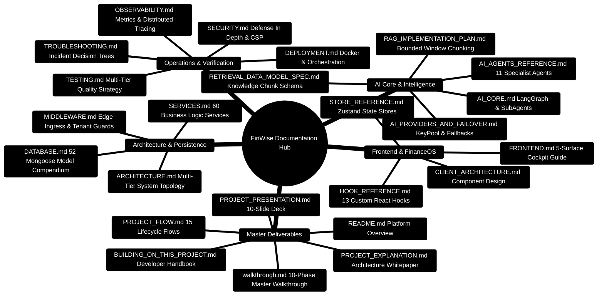

# FinWise — Documentation Index & Master Knowledge Atlas

> **The Central Knowledge Hub for the FinWise Autonomous Personal Finance Platform**  
> *Production Engineering Blueprints, Multi-Agent AI Core References, REST API Contracts, and Operational Runbooks*  
> **Release Target:** 2026 Enterprise Edition · **Runtime:** Node.js `>=24.14.1 <25` · Python `3.11+` · React `18.3` · MongoDB `7.0` · Redis `7.0`

---

## 1. Master System Knowledge Mindmap



---

## 2. Master Documentation Directory

### 2.1 Executive & Core Architectural Documents

| Document | Description | Format | Target Audience |
| :--- | :--- | :--- | :--- |
| [**README.md**](../README.md) | Platform overview, technology stack, local quick start, and system topology | Hub | Everyone |
| [**BUILDING_ON_THIS_PROJECT.md**](BUILDING_ON_THIS_PROJECT.md) | The definitive developer handbook for extending, customizing, and scaling the platform | Master Blueprint | Full-Stack Engineers & Contributors |
| [**walkthrough.md**](../walkthrough.md) | Complete 10-phase architectural implementation and verification walkthrough | Walkthrough | Engineers & Reviewers |
| [**PROJECT_EXPLANATION.md**](../PROJECT_EXPLANATION.md) | Exhaustive engineering whitepaper covering multi-tier design, data models, and math | Whitepaper | Senior Engineers & Architects |
| [**PROJECT_FLOW.md**](../PROJECT_FLOW.md) | 15 end-to-end computational, request, failover, and data lifecycles | Flow Catalog | Full-Stack Engineers |
| [**PROJECT_PRESENTATION.md**](../PROJECT_PRESENTATION.md) | 10-slide executive presentation deck with colourful mindmaps and ASCII flows | Slide Deck | Executives & Leads |

---

### 2.2 System Architecture & Backend Guides

| Document | Description | Key Focus Areas |
| :--- | :--- | :--- |
| [**ARCHITECTURE.md**](ARCHITECTURE.md) | Multi-tier system architecture, Express 5 composition root, and BullMQ queues | Gateway topology, Kahn DAG, RAG Phase 2 |
| [**SERVICES.md**](SERVICES.md) | Exhaustive directory of all 60 business logic domain services with code blueprints | Health scoring, newsletter, DLQ, chunker |
| [**DATABASE.md**](DATABASE.md) | Compendium of all 52 Mongoose models, compound B-Tree indexes, and GridFS storage | Mongoose 8, `OrgScopePlugin`, ERD diagram |
| [**API.md**](API.md) | Canonical `/api/v1` REST endpoints, query parameters, and SSE streams | 100+ endpoints, Zod schemas, auth tokens |
| [**MIDDLEWARE.md**](MIDDLEWARE.md) | Express middleware pipeline, CSRF defenses, and tenant scoping filters | `authAny`, `orgContext`, `rateLimiter` |

---

### 2.3 AI Core, Multi-Agent DAG & RAG Guides

| Document | Description | Key Focus Areas |
| :--- | :--- | :--- |
| [**AI_CORE.md**](AI_CORE.md) | Python FastAPI and LangGraph multi-agent financial reasoning engine | StateGraph DAG, SubAgentManager, KeyPool |
| [**AI_AGENTS_REFERENCE.md**](AI_AGENTS_REFERENCE.md) | Catalog of all 11 specialist agents and their Pydantic V2 output contracts | Income, Budget, Debt, Invest, Education |
| [**AI_PROVIDERS_AND_FAILOVER.md**](AI_PROVIDERS_AND_FAILOVER.md) | Multi-key KeyPool rotation, circuit breaking, and 6-tier provider fallback | Gemini, OpenRouter, Groq, Math fallback |
| [**RAG_IMPLEMENTATION_PLAN.md**](RAG_IMPLEMENTATION_PLAN.md) | Bounded window chunking (1,800 ch) and lexical BM25 matching architecture | Grounding Score $G$, citation badges |
| [**RETRIEVAL_DATA_MODEL_SPEC.md**](RETRIEVAL_DATA_MODEL_SPEC.md) | Mongoose schema specification for `WorkspaceKnowledgeChunk` records | Text indexes, token counts, page offsets |

---

### 2.4 Frontend & FinanceOS Cockpit Guides

| Document | Description | Key Focus Areas |
| :--- | :--- | :--- |
| [**FRONTEND.md**](FRONTEND.md) | Client architecture, FinanceOS 5-surface cockpit, and UI blueprints | Wouter routing, Radix UI, Framer Motion |
| [**CLIENT_ARCHITECTURE.md**](CLIENT_ARCHITECTURE.md) | Detailed component breakdown, state lifecycles, and layout wrappers | Zustand stores, TanStack Query cache |
| [**HOOK_REFERENCE.md**](HOOK_REFERENCE.md) | Exhaustive reference for 13 custom React hooks | `useAIStream`, `useRealtimeEvents` |
| [**STORE_REFERENCE.md**](STORE_REFERENCE.md) | Zustand reactive state management schema and actions reference | `chatStore`, `aiStore`, `orgStore` |

---

### 2.5 Operations, Security & Quality Guides

| Document | Description | Key Focus Areas |
| :--- | :--- | :--- |
| [**SECURITY.md**](SECURITY.md) | Multi-layer platform security architecture and defense mechanisms | TOTP 2FA, NoSQL sanitization, Strict CSP |
| [**DEPLOYMENT.md**](DEPLOYMENT.md) | Production Docker Compose orchestration, SSL termination, and reverse proxy | Multi-container setup, volumes, networking |
| [**TESTING.md**](TESTING.md) | Multi-tier testing strategy, Vitest integration suites, and invariant testing | Supertest, RTL, MSW, Eval runner |
| [**TROUBLESHOOTING.md**](TROUBLESHOOTING.md) | Diagnostic decision trees, symptom matrices, and recovery recipes | Port conflicts, DB reconnection, DLQ |
| [**OBSERVABILITY.md**](OBSERVABILITY.md) | Prometheus metrics, OpenTelemetry distributed tracing, and Pino logging | Metric counters, latency histograms, traces |
| [**REALTIME.md**](REALTIME.md) | Server-Sent Events (SSE) and Redis domain event bus architecture | Event fanout, SSE stream management |
| [**WORKFLOWS.md**](WORKFLOWS.md) | Autonomous financial automation engine and cron scheduler | Triggers, conditions, action execution |

---

### 2.6 Mega Technical Playbooks & Canonical API Contracts

| Document | Description | Key Focus Areas |
| :--- | :--- | :--- |
| [**MEGA_PROJECT_GUIDE.md**](MEGA_PROJECT_GUIDE.md) | Exhaustive master architectural blueprint and multi-agent synergy | Kahn's algorithm, Number Safety, LangGraph |
| [**MEGA_CODEBASE_REFERENCE.md**](MEGA_CODEBASE_REFERENCE.md) | Directory-by-directory grep-friendly atlas and composition root | Monorepo layout, inter-service contracts |
| [**MEGA_DATA_MODEL_COMPENDIUM.md**](MEGA_DATA_MODEL_COMPENDIUM.md) | Compendium of 52 multi-tenant schemas and compound B-tree indexes | `OrgScopePlugin`, tenant barriers, GridFS |
| [**MEGA_DEVELOPER_RECIPES.md**](MEGA_DEVELOPER_RECIPES.md) | Production feature delivery recipes from contracts to UI | Zod validation, ACID sessions, EventBus |
| [**MEGA_FRONTEND_UI_ATLAS.md**](MEGA_FRONTEND_UI_ATLAS.md) | FinanceOS 5-surface cockpit breakdown and reactive state streams | `useAIStream`, Zustand stores, Framer Motion |
| [**MEGA_OPERATIONS_RUNBOOK.md**](MEGA_OPERATIONS_RUNBOOK.md) | Production SRE runbook, zero-downtime cutover, and DLQ recovery | BullMQ DLQ replay, health probes, Prometheus |
| [**MEGA_SECURITY_RUNBOOK.md**](MEGA_SECURITY_RUNBOOK.md) | Defense-in-depth specifications, cryptographic CSRF, and TOTP | Argon2id hashing, double-submit cookie, RBAC |
| [**MEGA_TESTING_PLAYBOOK.md**](MEGA_TESTING_PLAYBOOK.md) | Testing pyramid handbook, Supertest suites, and invariant testing | Vitest, Supertest tenant isolation, Pytest |
| [**api-contracts-week4.md**](../server/docs/api-contracts-week4.md) | Task engine execution, idempotent effect application, and provenance | `PATCH /api/tasks/:id`, What-If scenarios |

---

## 3. Official Documentation Book (`documentation/` Directory)

For modular, chapter-by-chapter deep dives, consult the official documentation book:

| Chapter | Title | Primary Topics |
| :--- | :--- | :--- |
| [**01**](../documentation/01-getting-started.md) | **Getting Started** | Prerequisites, environment configuration, and local launch |
| [**02**](../documentation/02-architecture.md) | **Architecture** | 3-tier distributed architecture and service boundaries |
| [**03**](../documentation/03-api-reference.md) | **API Reference** | Canonical `/api/v1` routes and JSON contracts |
| [**04**](../documentation/04-database-schema.md) | **Database Schema** | Detailed schema specifications and compound indexes |
| [**05**](../documentation/05-ai-system.md) | **AI System** | LangGraph orchestration and specialist agent contracts |
| [**06**](../documentation/06-security.md) | **Security** | Authentication, authorization, and tenant isolation |
| [**07**](../documentation/07-performance.md) | **Performance** | Caching, compound indexes, and latency optimizations |
| [**08**](../documentation/08-deployment.md) | **Deployment** | Docker Compose and cloud production deployment |
| [**09**](../documentation/09-testing.md) | **Testing** | Unit, integration, component, and invariant tests |
| [**10**](../documentation/10-troubleshooting.md) | **Troubleshooting** | Symptom matrices and diagnostic recovery recipes |
| [**11**](../documentation/11-contributing.md) | **Contributing** | Conventional Commits and code review standards |
| [**12**](../documentation/12-future-improvements.md) | **Future Roadmap** | Long-term roadmap and architectural innovations |

---

## 4. Documentation Discovery ASCII Roadmap

```text
┌─────────────────────────────────────────────────────────────────────────────────────────────────┐
│ 🟢 FINWISE KNOWLEDGE BASE DISCOVERY ROADMAP                                                     │
│    Select your objective to follow the optimal documentation journey                            │
└───────────────────────────────────────────────┬─────────────────────────────────────────────────┘
                                                │
         ┌──────────────────────────────────────┼──────────────────────────────────────┐
         ▼                                      ▼                                      ▼
┌──────────────────────────────┐ ┌──────────────────────────────┐ ┌──────────────────────────────┐
│ 🚀 NEW DEVELOPER ONBOARDING  │ │ 🧠 AI & SPECIALIST AGENTS    │ │ ⚙️ INFRASTRUCTURE & SRE      │
│  1. README.md                │ │  1. AI_CORE.md               │ │  1. DEPLOYMENT.md            │
│  2. walkthrough.md           │ │  2. AI_AGENTS_REFERENCE.md   │ │  2. OBSERVABILITY.md         │
│  3. docs/QUICK_START.md      │ │  3. AI_PROVIDERS_FAILOVER.md │ │  3. SECURITY.md              │
│  4. documentation/01-getting-│ │  4. RAG_IMPLEMENTATION_      │ │  4. TROUBLESHOOTING.md       │
│     started.md               │ │     PLAN.md                  │ │  5. documentation/08-        │
│  5. documentation/11-        │ │  5. documentation/05-        │ │     deployment.md            │
│     contributing.md          │ │     ai-system.md             │ │                              │
└──────────────────────────────┘ └──────────────────────────────┘ └──────────────────────────────┘
```


---

## 5. Enterprise Verification & Fast Launch Code Blueprint

```bash
# 1. Clone repository and initialize environment
git clone https://github.com/your-org/personal-finance.git
cd personal-finance

# 2. Fast multi-tier launch across all subsystems
# Terminal 1: Express 5 API Gateway (Port 3000)
cd server && npm install && npm run dev

# Terminal 2: React 18 FinanceOS Client (Port 5173)
cd client && npm install && npm run dev

# Terminal 3: FastAPI AI Core Multi-Agent Engine (Port 8001)
cd server/AI_Core && pip install -r requirements.txt && uvicorn main:app --port 8001 --reload

# 3. Execute full platform test verification pyramid
# Server test suite (49 suites, 193 tests passed)
cd server && npm test

# Client test suite (45 suites, 293 tests passed)
cd client && npm test

# AI Core evaluation suite (29 suites, 217 tests, 175 evals passed)
cd server/AI_Core && pytest tests/ -v && python -m evals.runner
```
