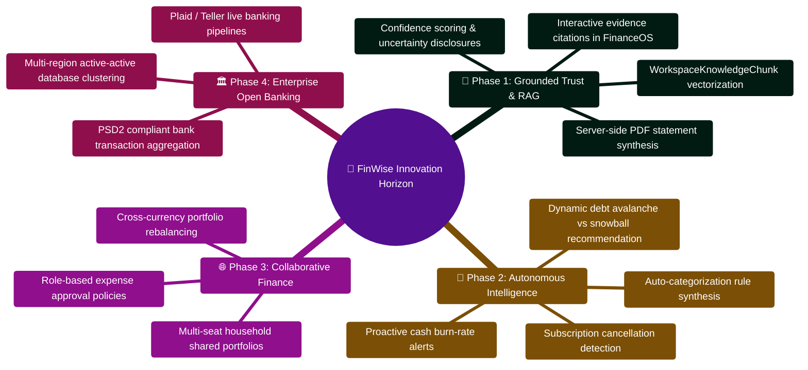

# FinWise Innovation Roadmap

This document extends the existing roadmap with implementation-aware
innovation ideas grounded in the current repository structure.

It focuses on three questions:

1. What innovation building blocks already exist?
2. Which high-leverage AI and product capabilities are closest to shipping?
3. Where should the team invest next for the biggest user impact?

## 1. What the codebase already enables

The repository already contains several strong foundations for advanced product
work:

- uploaded files are stored, text-extracted, and analyzable through the
  workspace file flow
- AI requests already receive grounded context from accounts, budgets,
  recurring candidates, tasks, reminders, workspace files, and memory records
- the AI Core already supports multi-agent routing, checkpointing, fallback,
  OCR, and session memory
- transaction search already uses text search, and AI memory already uses
  SQLite FTS
- the app already has automation, exports, collaboration, notifications, and
  workflow-oriented surfaces that future features can plug into

This means innovation work can build on real primitives rather than requiring a
full greenfield AI rewrite.

## 2. Code-backed innovation opportunities

### A. Retrieval-Augmented Finance Assistant

Why it fits:

- `server/src/services/fileTextExtraction.ts` already extracts document text
- `server/src/models/workspaceFileModel.ts` already stores extracted content
- `server/src/services/financeGrounding.ts` already passes file evidence into AI
- `server/AI_Core/memory/store.py` already supports FTS retrieval

What is missing:

- chunking large documents into retrievable sections
- vector embeddings or hybrid retrieval
- ranking and citation of retrieved passages
- a unified retrieval layer across files, memory, transactions, and notes

User value:

- ask questions against uploaded statements, receipts, plans, and financial
  documents
- receive answers with source citations instead of only summary snippets
- reduce hallucination risk for document-specific financial advice

### B. Financial Knowledge Vault

Why it fits:

- workspace files, memory, and extracted summaries already exist
- the app already supports organization and user scoping

What it would do:

- let users build a lasting finance knowledge base from statements, policies,
  contracts, reports, tax documents, and advisor notes
- support semantic retrieval, timeline browsing, and knowledge cards

User value:

- long-term recall for financial decisions
- better continuity across sessions
- reusable evidence for future AI reasoning

### C. Explainable Decision Layer

Why it fits:

- AI responses already carry `evidence`, `confidence`, and `workflow_trace`
- the server already normalizes these fields for client consumption

What it would do:

- make every recommendation show why it was generated
- expose source coverage, confidence gaps, and missing information
- help users decide whether to trust a recommendation

User value:

- higher confidence in the assistant
- easier debugging of poor AI outputs
- better product differentiation from generic chat apps

### D. Proactive Finance Operations

Why it fits:

- workflows, tasks, exports, notifications, and recurring detection already
  exist

What it would do:

- generate proactive alerts and workflows from AI-detected patterns
- schedule review tasks when cash flow weakens or suspicious trends appear
- turn insight into action instead of passive reporting

User value:

- more habit-forming product behavior
- higher retention through ongoing utility
- better financial follow-through

## 3. Innovation tiers

### Tier 1: Near-term additions

These are closest to the current architecture.

- ask-your-files chat with chunk citations
- hybrid retrieval over workspace files and AI memory
- evidence panel improvements using existing `evidence` and `confidence` data
- global search expansion beyond transactions
- document-aware AI prompts for statements, tax docs, and contracts

### Tier 2: Medium-term platform features

- knowledge vault with saved insights and linked entities
- portfolio and tax document intelligence
- anomaly detection plus workflow automation
- cross-document financial timeline and evidence graph
- org-level policy and plan retrieval for collaborative finance use cases

### Tier 3: Larger strategic bets

- local/private embedding pipelines for privacy-sensitive deployments
- advisor/copilot mode with explainability-first outputs
- family or team finance collaboration grounded in shared knowledge
- automated monthly review packs assembled from retrieved evidence and AI
  synthesis

## 4. Highest-leverage innovation bets

If the team wants the most value per engineering effort, these are the best
next bets:

1. RAG for workspace files
2. hybrid search across more finance entities
3. explainability UI for evidence and confidence
4. proactive workflow generation from grounded AI outputs

Those four ideas align closely with code that already exists and compound well
together.

## 5. Innovation constraints to respect

### Privacy

Finance data is highly sensitive, so innovation work should default to:

- org- and user-scoped retrieval
- explicit provenance for every retrieved item
- configurable retention and deletion behavior
- careful audit logging for AI-assisted data access

### Cost

The repo already supports multiple providers and fallbacks, which is useful for
innovation, but retrieval systems can increase token and storage costs. Any
RAG work should include:

- chunk limits
- query limits
- caching
- optional summarization layers

### Trust

For financial software, innovation should improve trust, not just novelty. That
means grounded answers, citations, confidence signaling, and graceful handling
of missing data are more important than flashy generation alone.

## 6. Recommended sequence

1. Ship document chunking and retrieval.
2. Add source citations to file-aware AI answers.
3. Expand retrieval to memory and additional domain entities.
4. Build UI affordances for evidence, confidence, and suggested actions.
5. Turn grounded insights into proactive workflows and digests.

## 7. Companion documents

- `docs/RAG_IMPLEMENTATION_PLAN.md`
- `docs/FEATURE_EXPANSION_BLUEPRINT.md`
- `docs/KNOWN_ISSUES_AND_DRIFT.md`

## Innovation Strategy & Horizon Mindmap



## Innovation Concept to Production Release ASCII Flow

```text
┌────────────────────────────────────────────────────────────────────────┐
│ 🟢 INNOVATION HYPOTHESIS: Autonomous Cashflow Forecasting Bot          │
└───────────────────────────────────┬────────────────────────────────────┘
                                    │
                                    ▼
┌────────────────────────────────────────────────────────────────────────┐
│ 🔬 STEP 1: PROOF-OF-CONCEPT & FINANCIAL FORMULA VALIDATION             │
│    ├─► Implement prototype tool in financial_calculators.py            │
│    ├─► Test mathematical precision against Monte Carlo simulations     │
│    └─► Benchmark latency and token consumption metrics                 │
└───────────────────────────────────┬────────────────────────────────────┘
                                    │
                                    ▼
┌────────────────────────────────────────────────────────────────────────┐
│ 🛡️ STEP 2: MULTI-TENANT SAFETY & ARCHITECTURAL INTEGRATION             │
│    ├─► Enforce orgId scoping and prevent cross-tenant inference        │
│    ├─► Create Zod schemas for structured input/output validation       │
│    └─► Build interactive evidence preview cards in FinanceOS UI        │
└───────────────────────────────────┬────────────────────────────────────┘
                                    │
                                    ▼
┌────────────────────────────────────────────────────────────────────────┐
│ 🚀 STEP 3: CANARY EXPERIMENTATION & GENERAL AVAILABILITY               │
│    ├─► Deploy behind FeatureFlag: EXPERIMENTAL_FORECASTING=true        │
│    ├─► Measure user adoption, confidence score, and error rates        │
│    └─► Promote to GA in standard release cycle 🟢                      │
└────────────────────────────────────────────────────────────────────────┘
```


---

> [!TIP]
> **Developer Guide: Building & Extending on This Project**  
> For complete step-by-step blueprints, Mongoose models, Zod schemas, Express controllers, React hooks, and LangGraph subagents, see the [**Master Developer Handbook: Building on This Project**](./BUILDING_ON_THIS_PROJECT.md).

## Production Implementation Blueprint: Monte Carlo Simulation Engine (`server/src/services/monteCarloEngine.ts`)

```typescript
export interface MonteCarloParams {
  initialPortfolio: number;
  annualContribution: number;
  annualWithdrawal: number;
  years: number;
  meanReturn: number;      // e.g. 0.07 (7%)
  volatility: number;      // e.g. 0.15 (15% standard deviation)
  inflationRate: number;   // e.g. 0.03 (3%)
  simulations?: number;    // default: 1000 iterations
}

export interface SimulationSummary {
  p10TerminalWealth: number;
  p50TerminalWealth: number;
  p90TerminalWealth: number;
  successProbability: number; // Percentage of paths avoiding portfolio ruin
}

/**
 * Executes a deterministic Monte Carlo simulation using the Box-Muller transform
 * for normal distribution sampling over multi-decade financial horizons.
 */
export function runMonteCarloSimulation(params: MonteCarloParams): SimulationSummary {
  const { initialPortfolio, annualContribution, annualWithdrawal, years, meanReturn, volatility, inflationRate } = params;
  const numSims = params.simulations || 1000;
  const terminalValues: number[] = [];
  let successfulRuns = 0;

  for (let s = 0; s < numSims; s++) {
    let balance = initialPortfolio;
    let survived = true;

    for (let y = 0; y < years; y++) {
      // Box-Muller transform for Gaussian random walk
      const u1 = Math.random() || 1e-10;
      const u2 = Math.random() || 1e-10;
      const z0 = Math.sqrt(-2.0 * Math.log(u1)) * Math.cos(2.0 * Math.PI * u2);

      const netReturn = meanReturn - inflationRate + volatility * z0;
      balance = balance * (1.0 + netReturn) + annualContribution - annualWithdrawal;

      if (balance <= 0) {
        balance = 0;
        survived = false;
        break;
      }
    }

    if (survived) successfulRuns++;
    terminalValues.push(balance);
  }

  terminalValues.sort((a, b) => a - b);

  return {
    p10TerminalWealth: Math.round(terminalValues[Math.floor(numSims * 0.10)]),
    p50TerminalWealth: Math.round(terminalValues[Math.floor(numSims * 0.50)]),
    p90TerminalWealth: Math.round(terminalValues[Math.floor(numSims * 0.90)]),
    successProbability: parseFloat((successfulRuns / numSims).toFixed(3)),
  };
}
```