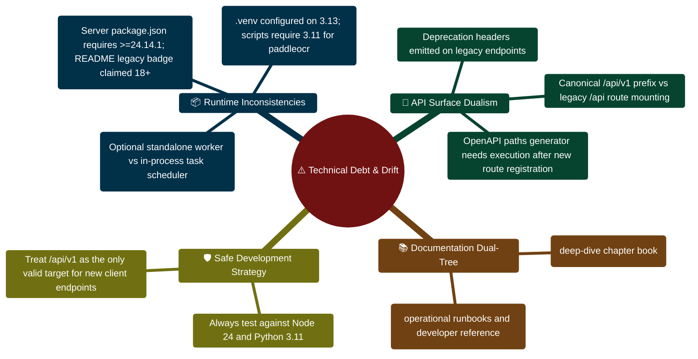

# FinWise Known Issues and Drift

## Prioritized release review - 31 October 2026

This dated register supersedes conflicting historical observations below.

| Priority | Issue and current status | Evidence / remaining action |
| --- | --- | --- |
| P0 resolved | Receipt failure logging imported a missing `recordDeadLetter` export and prevented API startup | Restored the shared bounded queue API; startup/readiness and 176 server tests pass |
| P1 resolved | Copilot history could be reused across users/workspaces | Identity-scoped session cache, reactive workspace changes and late-response isolation; four regressions |
| P1 resolved | Shared finance query caches, drafts and chat state survived account/workspace changes | A private QueryClient per owner, remounted screens, scoped persisted chat selection, cleared transient histories and revision checks for late replies; two-workspace browser checks pass |
| P1 resolved | Old authentication checks and AI streams could restore retired state | Newest auth check wins, logout invalidates earlier checks; streams abort on unmount/replacement, ignore old replies and release readers; three stream regressions failed before the fix and now pass |
| P1 resolved | Automatic API recovery could act on a newer context | Request revision plus stored owner/workspace checks fence delayed CSRF replays, stale-org clearing and quota dialogs; current-owner recovery remains supported |
| P2 resolved | An empty workspace was assessed as balanced cash flow and below a savings target | Missing cash-flow inputs now show setup guidance; savings rate requires positive income; known expense-only cash flow remains visible; five targeted tests and browser recheck |
| P1 resolved | Analytics omitted opening balances and negated already signed outflows | Signed-ledger regression covers income, expense, investment, cents, credit and foreign organization exclusion |
| P1 resolved | Analytics assumed USD and displayed failed requests as empty/zero data | Workspace formatting, mixed-currency net worth left uncombined, explicit retry state; focused client regressions |
| P1 resolved | Financial Story used lightweight records as full insights; session reads consumed credential attempts | Full-record query and separate credential-attempt limits; browser and integration regressions |
| P2 resolved | Import actions could overflow a phone dialog; Preview did nothing without a file | Bounded scrollable dialogs, stacked actions, named file inputs and disabled empty Preview; 390px browser recheck |
| P1 open | Final hosting, provider accounts and external integrations need staging | Validate TLS/cookies, shared AI token, SMTP/OAuth, live Stripe/webhooks, connectors, Redis worker and Docker health checks |
| P1 open | Gemini access was denied in the configured account; free-form provider output is not signed off | Latest summary narration used factual fallback; activity/document answers work; operator must verify model/account entitlement |
| P2 open | Large client entry chunk (~672 kB minified) | Measure cold mobile load in staging before selecting further splitting work |
| P2 resolved | Repeated dashboard summary synthesis | User/org/context-keyed snapshots, two-minute TTL, 15-second degraded TTL, per-process coalescing and forced Refresh; latest live read used zero calls (61ms vs 545ms generation) |
| P1 resolved | Conversation summaries entered the full financial-plan workflow | Explicit summary task, bounded owned snapshots, one synthesis step, two-attempt narration cap and canonical conversation links; malformed narration falls back to factual counts |
| P1 resolved | Conversation-summary generation bypassed the AI usage limit | Generation enforces and records the existing monthly AI unit; cached reads are free; quota responses retain HTTP 402 and the UI links to plan limits |
| P2 resolved | Mobile Settings tabs and password visibility icons lacked accessible names | Screen-reader tab labels and named visibility toggles with larger targets; current browser checks and incoming Settings tests |
| Roadmap | Semantic retrieval, dedicated Perplexity research, independent Gemini fact checking and six requested specialist roles are not all implemented | Follow capability status and RAG plans; do not describe adapters/catalog entries as verified services |

Current verification: the final full client run passed 271 tests / 45 files,
including the lifecycle, empty-state and retired-request refinements.
The unchanged backend/AI retain their earlier 192 server tests / 49 files plus
38 and 32 targeted rechecks, and 392 AI tests/evaluations. On 31 October all
33 live local API checks passed; file access returned 200 in the original QA
workspace and 404 in the separate empty fixture. Lint and the type-checked client
build pass. Earlier audits reported zero npm
production-dependency vulnerabilities. Browser route/control coverage is recorded
in BROWSER_TEST_RESULTS.md; this is not certification of every possible button,
breakpoint, external account or production deployment.

This file captures repository-level issues and documentation drift observed
from the current workspace layout and runtime configuration. It is intended as
an implementation planning aid, not a bug tracker replacement.

## Summary

The project already contains strong implementation detail, but the biggest
maintenance cost right now appears to be alignment rather than missing volume:
multiple documentation tracks, runtime drift between high-level docs and
package manifests, and a few architectural patterns that are easy to miss
unless you read the composition roots directly.

## Issue register

| ID | Issue | Evidence | Impact | Suggested follow-up |
| -- | ----- | -------- | ------ | ------------------- |
| DOC-01 | Documentation is split across multiple sources | `README.md`, `docs/`, `documentation/`, `walkthrough.md`, `IMPROVEMENT_PLAN.txt` | Maintainers can update one source and unintentionally leave others stale | Declare one primary doc set and one staging area, then add cross-links or a consolidation plan |
| DOC-02 | Runtime requirements have drifted from the root overview | `README.md` advertises Node 18 LTS, while `server/package.json` requires `node >=24.14.1 <25` and `npm >=11` | New contributors may install the wrong runtime and hit avoidable setup failures | Update high-level setup docs to match manifests or add an explicit compatibility note |
| ARC-01 | The API surface exists in both canonical and legacy forms | `server/src/routes/routeRegistry.ts` mounts `/api/v1/...` and `/api/...` variants | Endpoint behavior, docs, and tests can drift if one path is updated without the other | Maintain an explicit policy for which routes must remain dual-mounted |
| OPS-01 | Scheduler behavior depends on environment flags and process mode | `server/src/server.ts` starts workflow scheduling only when `ASYNC_JOBS_ENABLED` is false | Developers can misunderstand whether the server or a worker is responsible for scheduled work | Add a short run-mode matrix to setup and deployment docs |
| CFG-01 | Feature availability is partially environment-driven | `server/src/routes/routeRegistry.ts` conditionally mounts monetization and task routes; `server/src/config/env.ts` defines many feature flags | Teams may treat missing routes as bugs when they are actually disabled | Centralize feature-flag documentation in one maintainer-facing matrix |
| DX-01 | Repository navigation is noisy in a live workspace | The current tree includes generated or local runtime directories such as `client/dist`, `client/node_modules`, `server/dist`, and `server/AI_Core/.venv` | Grep, indexing, and onboarding scans can become slower and less focused | Document a preferred search scope for maintainers: `client/src`, `server/src`, `server/AI_Core`, and `packages/contracts` |
| AI-01 | AI Core is optional in theory but deeply integrated in practice | `README.md` presents AI as central, `server/src/config/env.ts` references `PYTHON_API_URL`, and `server/AI_Core/api_service.py` owns multiple workflows | Teams may underestimate how much functionality changes when AI providers or the Python service are absent | Document degraded-mode expectations per feature surface |
| DOC-03 | Large existing docs are rich but not always optimized for fast implementation work | The `docs/` tree contains many deep references plus several "mega" guides | New maintainers can spend too long reading broad reference material before locating the real edit points | Keep this supplemental implementation map and add more task-oriented guides over time |

## Practical implications for contributors

### Before setup

- trust `package.json` and runtime config over older summary text
- check whether you need the AI Core for the change you are making
- verify whether a worker process is expected in your chosen mode

### Before coding

- confirm whether the feature sits on canonical routes only or dual routes
- confirm whether feature flags or env toggles affect the code path
- narrow searches to source directories, not generated folders

### Before documenting

- decide whether the update belongs in `docs/`, `documentation/`, or both
- avoid assuming a high-level doc is current until you check the related code

## Suggested medium-term cleanup plan

1. Pick a primary documentation system.
2. Publish a runtime compatibility matrix in one obvious place.
3. Add a short route policy for canonical vs legacy APIs.
4. Add a developer run-mode matrix for server-only vs server-plus-worker.
5. Decide whether `documentation/` is the future source or an internal rewrite.

## What this file does not claim

This file does not claim that all listed items are production defects. Several
entries are maintenance and onboarding risks rather than end-user bugs. They
are documented here because they increase implementation uncertainty and slow
down safe changes.

## Technical Debt & Architectural Drift Mindmap



## Architectural Drift Triage & Reconciliation ASCII Flow

```text
┌────────────────────────────────────────────────────────────────────────┐
│ 🟢 OBSERVE DISCREPANCY (e.g. Runtime version or API path behavior)     │
└───────────────────────────────────┬────────────────────────────────────┘
                                    │
                                    ▼
┌────────────────────────────────────────────────────────────────────────┐
│ 🔍 STEP 1: VERIFY GROUND TRUTH IN CODE & MANIFESTS                     │
│    ├─► Server Runtime: Inspect server/package.json "engines" field     │
│    ├─► Route Surface: Check server/src/routes/v1Routes.ts              │
│    └─► Python Dependencies: Inspect server/AI_Core/requirements.txt    │
└───────────────────────────────────┬────────────────────────────────────┘
                                    │
                                    ▼
┌────────────────────────────────────────────────────────────────────────┐
│ ⚖️ STEP 2: CLASSIFY RISK (Active Bug vs Onboarding Debt)               │
│    ├── Does it break production runtime? ──► Prioritize immediate patch│
│    └── Is it doc/onboarding drift? ──► Document caveat & reconcile     │
└───────────────────────────────────┬────────────────────────────────────┘
                                    │
                                    ▼
┌────────────────────────────────────────────────────────────────────────┐
│ 📝 STEP 3: DOCUMENT REMEDIATION & UPDATE CANONICAL REFERENCES          │
│    ├─► Update docs/ and documentation/ in sync                         │
│    └─► Run verification suites to ensure zero behavioral regression 🟢 │
└────────────────────────────────────────────────────────────────────────┘
```


---

> [!TIP]
> **Developer Guide: Building & Extending on This Project**  
> For complete step-by-step blueprints, Mongoose models, Zod schemas, Express controllers, React hooks, and LangGraph subagents, see the [**Master Developer Handbook: Building on This Project**](./BUILDING_ON_THIS_PROJECT.md).

## Production Implementation Blueprint: Tenant Reconciliation Script (`server/src/scripts/reconcileTenantDrift.ts`)

```typescript
import mongoose from "mongoose";
import { TransactionModel } from "../models/transactionModel";
import { OrganizationModel } from "../models/organizationModel";
import { logger } from "../config/logger";

/**
 * Diagnostic reconciliation script: Identifies orphaned transaction records
 * lacking an associated tenant orgId and safely associates them with the fallback org.
 */
export async function reconcileOrphanedRecords(fallbackOrgId: string): Promise<number> {
  const fallbackOrg = await OrganizationModel.findById(fallbackOrgId);
  if (!fallbackOrg) {
    throw new Error(`RECONCILIATION_ABORTED: Fallback organization ${fallbackOrgId} does not exist`);
  }

  // Find all transactions bypassing orgScope (using bypassOrgScope flag)
  const orphanedCount = await TransactionModel.countDocuments(
    { orgId: { $in: [null, undefined, ""] } },
    { bypassOrgScope: true }
  );

  logger.warn({ orphanedCount }, "Detected orphaned transactions requiring reconciliation");

  if (orphanedCount > 0) {
    const updateRes = await TransactionModel.updateMany(
      { orgId: { $in: [null, undefined, ""] } },
      { $set: { orgId: fallbackOrgId } },
      { bypassOrgScope: true }
    );
    logger.info({ modified: updateRes.modifiedCount }, "Successfully repaired tenant drift on orphaned records");
    return updateRes.modifiedCount;
  }

  return 0;
}
```
