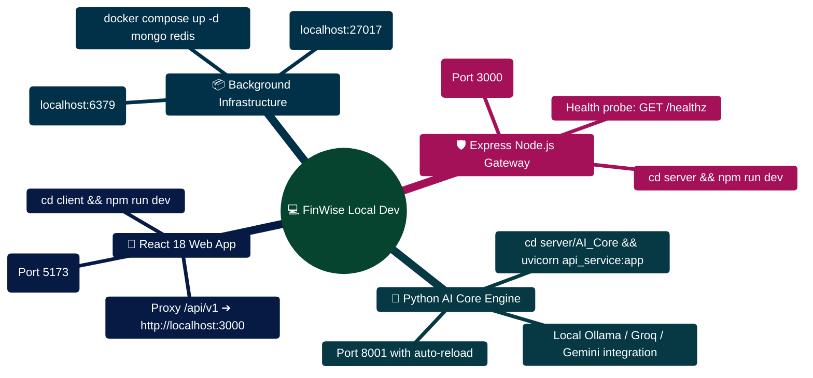

# FinWise Local Development Guide

> Step-by-step guide to setting up and running FinWise locally for development.

---

> [!TIP]
> **Developer Guide: Building & Extending on This Project**  
> For complete step-by-step blueprints, Mongoose models, Zod schemas, Express controllers, React hooks, and LangGraph subagents, see the [**Master Developer Handbook: Building on This Project**](./BUILDING_ON_THIS_PROJECT.md).

## Overview

FinWise is a three-tier monorepo with a React client, Express server, and Python AI Core. This guide covers prerequisites, installation, environment configuration, running each tier, common workflows, and troubleshooting.

---

## Prerequisites

| Tool | Version | Purpose | Install |
|------|---------|---------|---------|
| Node.js | >= 24.14.1 | Server and client runtime | [nodejs.org](https://nodejs.org/) |
| npm | >= 11 | Package management | Comes with Node.js |
| Python | >= 3.11 | AI Core runtime | [python.org](https://www.python.org/) |
| pip | Latest | Python package management | Comes with Python |
| MongoDB | >= 7.0 | Database (or use in-memory for dev) | [mongodb.com](https://www.mongodb.com/) |
| Redis | >= 7.0 | Optional: caching and sessions | [redis.io](https://redis.io/) |
| Git | >= 2.30 | Version control | [git-scm.com](https://git-scm.com/) |

### Quick Check

```bash
node --version    # Should be >= 24.14.1
npm --version     # Should be >= 11
python --version  # Should be >= 3.11
mongod --version  # Should be >= 7.0 (optional)
redis-cli --version  # Optional
```

---

## Clone and Setup

```bash
# Clone the repository
git clone https://github.com/your-org/personal-finance.git
cd personal-finance

# Install client dependencies
cd client && npm install && cd ..

# Install server dependencies
cd server && npm install && cd ..

# Install AI Core dependencies
cd server/AI_Core && pip install -r requirements.txt && cd ../..
```

---

## Environment Configuration

### 1. Server Environment

```bash
cd server
cp .env.example .env
```

Edit `server/.env` with your configuration:

```bash
# Required
JWT_SECRET=your-random-secret-at-least-32-characters

# Database (optional -- uses in-memory MongoDB if not set)
# MONGO_URI=mongodb://localhost:27017/finwise

# AI Core connection
PYTHON_API_URL=http://localhost:8001

# Client URL (for CORS)
CLIENT_URL=http://localhost:5173
CORS_ORIGINS=http://localhost:5173

# Optional: Redis
# REDIS_URL=redis://localhost:6379

# Optional: Feature flags
# ASYNC_JOBS_ENABLED=false
# CSRF_ENABLED=true
```

### 2. AI Core Environment

```bash
cd server/AI_Core
cp .env.example .env
```

Edit `server/AI_Core/.env` with at least one LLM API key:

```bash
# Set at least ONE API key
GEMINI_API_KEY=your-gemini-api-key

# Optional: additional providers
# OPENROUTER_API_KEY=your-openrouter-key
# GROQ_API_KEY=your-groq-key
# GROK_API_KEY=your-grok-key
# TOGETHER_API_KEY=your-together-key
# MISTRAL_API_KEY=your-mistral-key

# Optional: logging
LOG_LEVEL=INFO
```

### 3. Client Environment

```bash
cd client
cp .env.example .env
```

The defaults work for local development:

```bash
VITE_API_BASE_URL=/api
VITE_API_PROXY_TARGET=http://localhost:3000
VITE_APP_NAME=FinWise

# Optional: logging level
# VITE_LOG_LEVEL=debug
```

---

## Running the Application

### Option 1: Run All Tiers (Recommended)

Open three terminal windows:

**Terminal 1 -- Client (port 5173):**
```bash
cd client
npm run dev
```

**Terminal 2 -- Server (port 3000):**
```bash
cd server
npm run dev
```

**Terminal 3 -- AI Core (port 8001):**
```bash
cd server/AI_Core
python api_service.py
```

### Option 2: Client + Server Only (No AI)

If you don't need AI features:

```bash
# Terminal 1
cd client && npm run dev

# Terminal 2
cd server && npm run dev
```

The AI features will gracefully degrade to offline mode. The chat interface will show fallback messages.

### Option 3: Docker Compose

```bash
# Start MongoDB and Redis
docker compose up -d mongo redis

# Then run the application tiers in separate terminals
```

---

## Accessing the Application

| Service | URL | Description |
|---------|-----|-------------|
| Client | http://localhost:5173 | React SPA |
| Server API | http://localhost:3000/api | REST API |
| AI Core | http://localhost:8001 | FastAPI service |
| Health Check | http://localhost:3000/healthz | Server liveness |
| AI Status | http://localhost:8001/api/ai/status | AI diagnostics |
| API Docs | http://localhost:8001/docs | AI Core OpenAPI docs |

---

## Development Workflows

### Making Code Changes

**Client:**
- Hot Module Replacement (HMR) is enabled -- changes appear instantly in the browser
- TypeScript errors show in terminal and browser overlay
- Use `@/` path alias for imports (e.g., `import { useAuth } from "@/hooks/useAuth"`)

**Server:**
- Uses `tsx` for automatic restart on file changes
- Check terminal for structured JSON logs
- Use `asyncRoute()` wrapper for all async Express handlers

**AI Core:**
- Uses `uvicorn --reload` for automatic restart
- Check terminal for agent execution logs
- Agents are stateless and reusable -- changes take effect on next request

### Running Tests

```bash
# Client tests (Vitest + Testing Library + MSW)
cd client && npm test

# Server tests (Vitest + supertest + mongodb-memory-server)
cd server && npm test

# AI Core tests (pytest)
cd server/AI_Core && pytest

# AI Core with verbose output
cd server/AI_Core && pytest -v

# Run specific test file
cd server/AI_Core && pytest tests/test_master_agent.py -v
```

### Linting

```bash
# Client ESLint
cd client && npm run lint

# Server ESLint
cd server && npm run lint

# AI Core Ruff
cd server/AI_Core && ruff check .

# AI Core Ruff with auto-fix
cd server/AI_Core && ruff check --fix .
```

### Type Checking

```bash
# Client TypeScript
cd client && npm run build  # Includes type checking

# Server TypeScript
cd server && npm run check
```

---

## Common Development Tasks

### Adding a New API Endpoint

1. Define Zod schema in `server/src/schemas/`
2. Create controller in `server/src/controllers/`
3. Create service in `server/src/services/`
4. Add route in `server/src/routes/v1Routes.ts`
5. Create client API module in `client/src/lib/api/v1/`
6. Add React Query hook in component
7. Add tests in `server/src/test/`

### Adding a New AI Agent

1. Create agent file in `server/AI_Core/agents/`
2. Add to `AnalysisType` enum in `graph/state.py`
3. Register in workflow graph in `graph/workflow.py`
4. Add routing keywords in `master_agent.py`
5. Add to `__init__.py` exports
6. Add contract in `contracts/`
7. Add tests in `tests/`

### Adding a New UI Component

1. Create component in `client/src/components/`
2. Use Radix UI primitives from `components/ui/`
3. Style with Tailwind CSS + `cn()` utility
4. Add to route in `routes/routeDefinitions.tsx` if it's a page
5. Add tests if complex logic

### Adding a New Zustand Store

1. Create store in `client/src/stores/`
2. Use `create` from Zustand
3. Add `persist` middleware if state should survive refreshes
4. Document state shape and actions
5. Use selectors to minimize re-renders

---

## Project Structure

```
personal-finance/
  client/                     # React frontend
    src/
      app/providers/          # Provider composition
      components/             # UI components (36+)
        ui/                   # Radix primitives (47)
      features/               # Feature modules
      hooks/                  # Custom hooks (13)
      lib/                    # API client and utilities
        api/                  # Domain-specific API modules
      pages/                  # Route-level pages (34)
      routes/                 # Wouter router definitions
      stores/                 # Zustand stores (6)
      context/                # React context providers
      services/               # Client-side services
    vite.config.ts            # Vite + PWA + test config

  server/                     # Express backend
    src/
      config/                 # Environment, DB, Redis config
      controllers/            # Route handlers (44)
      middleware/              # Express middleware (13)
      models/                 # Mongoose models (49)
      routes/                 # Route definitions (17)
      schemas/                # Zod validation schemas (35)
      services/               # Business logic (49)
      modules/                # Domain modules (plugins, queue, realtime)
    AI_Core/                  # Python AI system
      agents/                 # Agent implementations (10)
      graph/                  # LangGraph workflow
      tools/                  # Agent tools
      contracts/              # Pydantic models
      memory/                 # SQLite memory system
      utils/                  # LLM wrapper, helpers
      api_service.py          # FastAPI HTTP server

  packages/
    contracts/                # Shared OpenAPI specs
  docs/                       # Documentation
```

---

## Troubleshooting

### Port Already in Use

```bash
# Find process using port (Windows)
netstat -ano | findstr :3000

# Find process using port (macOS/Linux)
lsof -i :3000

# Kill process (replace <PID>)
kill -9 <PID>           # macOS/Linux
taskkill /PID <PID> /F  # Windows
```

### MongoDB Connection Failed

```bash
# Check if MongoDB is running
mongosh --eval "db.adminCommand('ping')"

# Or use in-memory MongoDB (default in development)
# No MONGO_URI needed -- server auto-detects
```

### Python Import Errors

```bash
# Ensure you're in the AI_Core directory
cd server/AI_Core

# Verify Python path
python -c "import sys; print(sys.path)"

# Reinstall dependencies
pip install -r requirements.txt --force-reinstall

# Check for virtual environment
python -m venv .venv
source .venv/bin/activate  # macOS/Linux
.venv\Scripts\activate     # Windows
pip install -r requirements.txt
```

### TypeScript Errors After Pull

```bash
# Regenerate types
cd client && npm run build
cd server && npm run check

# Clear node_modules and reinstall
rm -rf node_modules package-lock.json
npm install
```

### CORS Errors

Check that `CORS_ORIGINS` in `server/.env` includes the client URL:
```bash
CORS_ORIGINS=http://localhost:5173
CLIENT_URL=http://localhost:5173
```

### SSE Connection Issues

```bash
# Verify SSE endpoint is accessible
curl -N -H "Accept: text/event-stream" http://localhost:3000/api/events/stream

# Check for proxy issues in Vite config
# The dev server proxies /api to localhost:3000
```

### AI Core Not Responding

```bash
# Check if AI Core is running
curl http://localhost:8001/health

# Check Python process
ps aux | grep python

# Check for port conflicts
netstat -ano | findstr :8001  # Windows
lsof -i :8001                 # macOS/Linux
```

### Redis Connection Issues

```bash
# Check Redis connectivity
redis-cli ping  # Should return PONG

# Start Redis (if not running)
redis-server    # macOS/Linux
# Or via Docker
docker run -d -p 6379:6379 redis:7
```

---

## IDE Setup

### VS Code (Recommended)

Install extensions:
- **ESLint** -- JavaScript/TypeScript linting
- **Prettier** -- Code formatting
- **Python** -- Python language support
- **Tailwind CSS IntelliSense** -- Tailwind autocomplete
- **Thunder Client** or **REST Client** -- API testing
- **GitLens** -- Git history and blame

### VS Code Settings

```json
{
  "editor.formatOnSave": true,
  "editor.defaultFormatter": "esbenp.prettier-vscode",
  "typescript.tsdk": "node_modules/typescript/lib",
  "python.defaultInterpreterPath": "server/AI_Core/.venv/bin/python",
  "tailwindCSS.experimental.classRegex": [
    ["cva\\(([^)]*)\\)", "[\"'`]([^\"'`]*).*?[\"'`]"]
  ]
}
```

### Recommended Workflow

1. Open the project root in VS Code
2. Use integrated terminals for each tier
3. Use the built-in debugger for breakpoints
4. Use GitLens for commit history and blame

---

## Performance Tips

### Faster Development

- Use `npm run dev` (not `npm run build`) for development
- Vite HMR provides instant updates without full page reloads
- Use React Query DevTools to inspect cache state
- Use React Profiler to identify slow components

### Faster Tests

- Run specific test files instead of the full suite
- Use `--watch` mode for iterative development
- Use `mongodb-memory-server` for server tests (no external DB needed)

---

_See also_: [CLIENT_ARCHITECTURE.md](./CLIENT_ARCHITECTURE.md) | [DEBUGGING_GUIDE.md](./DEBUGGING_GUIDE.md) | [ARCHITECTURE.md](./ARCHITECTURE.md) | [SETUP.md](./SETUP.md)

## Local Development Topology Mindmap



## Local Development Bootstrapping ASCII Flow

```text
┌────────────────────────────────────────────────────────────────────────┐
│ 🟢 STEP 1: START PERSISTENCE CONTAINERS                                │
│    $ docker compose up -d mongo redis                                  │
│    ► Mongo: localhost:27017 (WiredTiger) • Redis: localhost:6379       │
└───────────────────────────────────┬────────────────────────────────────┘
                                    │
                                    ▼
┌────────────────────────────────────────────────────────────────────────┐
│ 🔷 STEP 2: LAUNCH BACKEND NODE GATEWAY                                 │
│    $ cd server && npm run dev                                         │
│    ► Express listening on http://localhost:3000 (Zod + Mongoose)      │
└───────────────────────────────────┬────────────────────────────────────┘
                                    │
                                    ▼
┌────────────────────────────────────────────────────────────────────────┐
│ 🧠 STEP 3: LAUNCH FASTAPI AI CORE (LangGraph Orchestrator)             │
│    $ cd server/AI_Core && uvicorn api_service:app --port 8001 --reload│
│    ► FastAPI listening on http://localhost:8001                        │
└───────────────────────────────────┬────────────────────────────────────┘
                                    │
                                    ▼
┌────────────────────────────────────────────────────────────────────────┐
│ 📱 STEP 4: LAUNCH FRONTEND CLIENT                                      │
│    $ cd client && npm run dev                                         │
│    ► Vite dev server running at http://localhost:5173 🟢               │
└────────────────────────────────────────────────────────────────────────┘
```
