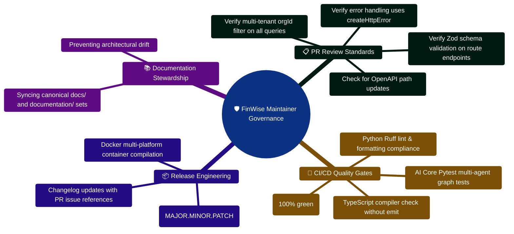

# FinWise Maintainer Guide

This guide is for developers who need a practical understanding of the current
repository without reading every long-form document first.

## 1. What this project is

FinWise is a three-service personal finance platform:

- `client/`: React 18 + Vite + TypeScript single-page application
- `server/`: Express 5 + TypeScript REST API and background orchestration
- `server/AI_Core/`: FastAPI + Python AI service for agent workflows and OCR

There is also a shared contracts package:

- `packages/contracts/`: typed and OpenAPI contract assets

## 2. Runtime expectations that matter

The codebase is stricter than some older docs imply.

### Node and npm

- The server currently declares `node >=24.14.1 <25`
- The server currently declares `npm >=11`
- The root README still mentions Node 18 LTS, so prefer the package manifest
  over the older overview docs when choosing your runtime

### Python

- The AI Core targets Python 3.11 semantics
- `server/AI_Core/pyproject.toml` sets Ruff `target-version = "py311"`

### Datastores and infrastructure

- MongoDB is the primary application datastore
- Redis is used for rate limiting, queues, and scheduler-related behavior
- The AI Core optionally persists memory to SQLite

## 3. Fastest way to build a mental model

If you only have 20 minutes, read files in this order:

1. `README.md`
2. `server/src/server.ts`
3. `server/src/app.ts`
4. `server/src/routes/routeRegistry.ts`
5. `client/src/main.tsx`
6. `client/src/App.tsx`
7. `client/src/routes/AppRouter.tsx`
8. `server/AI_Core/api_service.py`

That sequence shows the startup path for each tier and tells you where most
cross-cutting concerns are wired.

## 4. How the system is wired

### Client

- `client/src/main.tsx` installs global error reporting and mounts the app
- `client/src/App.tsx` combines providers and routing
- `client/src/routes/AppRouter.tsx` decides access control and layout
- `client/src/lib/api/` and `client/src/services/` handle API-facing logic

### Server

- `server/src/server.ts` is the composition root
- `server/src/app.ts` builds the Express middleware stack
- `server/src/routes/routeRegistry.ts` mounts both canonical and legacy routes
- `server/src/services/` contains most business logic
- `server/src/models/` contains Mongoose schemas

### AI Core

- `server/AI_Core/api_service.py` is the HTTP gateway
- `server/AI_Core/graph/` defines workflow state and orchestration
- `server/AI_Core/agents/` contains specialist agent logic
- `server/AI_Core/tools/` contains deterministic helpers used by the agents
- `server/AI_Core/vision/` owns OCR and receipt/handwriting processing

## 5. Startup notes

### Client

Common command:

```bash
cd client
npm run dev
```

Important dev env values:

- `VITE_API_BASE_URL=/api`
- `VITE_API_PROXY_TARGET=http://localhost:3000`

### Server

Common command:

```bash
cd server
npm run dev
```

Important behavior:

- environment is validated through `server/src/config/env.ts`
- middleware, CORS, CSRF, logging, auth, and route mounting are all composed in
  `server/src/app.ts`
- the server may run the workflow scheduler itself when
  `ASYNC_JOBS_ENABLED=false`

### AI Core

Common command:

```bash
cd server/AI_Core
python api_service.py
```

Important behavior:

- the service exposes health, metrics, status, session, agent, and vision
  endpoints
- it degrades gracefully when AI providers are not configured
- it performs a Windows UTF-8 stdout/stderr workaround at startup

## 6. Where to be careful

### Dual API surfaces

The server mounts:

- canonical routes under `/api/v1/...`
- legacy aliases under `/api/...`

If you add or document endpoints, confirm whether both surfaces should keep
working.

### Feature flags

Some features are conditionally mounted or enabled. The most visible examples
in the current server configuration are:

- `TASKS_ENABLED`
- `MONETIZATION_ENABLED`
- `ASYNC_JOBS_ENABLED`

If a feature appears "missing," verify flags before assuming the code path is
broken.

### Documentation split

There is an active `documentation/` directory alongside the published `docs/`
set. Preserve both until a deliberate consolidation plan is approved.

## 7. Safe first contribution pattern

For most changes:

1. Find the route/page entrypoint
2. Trace the service layer
3. Identify the schema/model contract
4. Add or update tests close to the changed layer
5. Re-run the narrowest relevant verification command first

That approach works better here than starting from the largest "mega" docs.

## 8. Good follow-up docs to consult

- `docs/ARCHITECTURE.md`
- `docs/FRONTEND.md`
- `docs/API.md`
- `docs/AI_CORE.md`
- `docs/WORKFLOWS.md`
- `docs/TESTING.md`
- `docs/TROUBLESHOOTING.md`

## Maintainer Governance & Code Review Mindmap



## Maintainer Review & Release Promotion ASCII Flow

```text
┌────────────────────────────────────────────────────────────────────────┐
│ 🟢 INCOMING PULL REQUEST SUBMISSION                                    │
│    Review title, scope, linked issue, and changed files                │
└───────────────────────────────────┬────────────────────────────────────┘
                                    │
                                    ▼
┌────────────────────────────────────────────────────────────────────────┐
│ 🛡️ STAGE 1: ARCHITECTURAL INVARIANT CHECKLIST                          │
│    ├─► Multi-Tenancy: Do all new models include required orgId?        │
│    ├─► Security: Are new endpoints protected by authAny / apiKeyAuth?  │
│    ├─► Contracts: Are inputs validated with Zod schemas?               │
│    └─► Telemetry: Are mutations tracked in AuditLog?                   │
└───────────────────────────────────┬────────────────────────────────────┘
                                    │
                                    ▼
┌────────────────────────────────────────────────────────────────────────┐
│ 🧪 STAGE 2: TEST COVERAGE & CI VERIFICATION                            │
│    ├─► Check that new features include dedicated integration tests     │
│    ├─► Confirm GitHub Actions CI matrix passes cleanly                 │
│    └─► Review coverage reports for untested branches                   │
└───────────────────────────────────┬────────────────────────────────────┘
                                    │
                                    ▼
┌────────────────────────────────────────────────────────────────────────┐
│ 🚀 STAGE 3: SQUASH MERGE & RELEASE PUBLICATION                         │
│    ├─► Squash and merge PR with conventional commit message            │
│    ├─► Tag release (e.g. v2.4.0) and trigger automated image builds    │
│    └─► Deploy to production with zero-downtime rolling update 🟢       │
└────────────────────────────────────────────────────────────────────────┘
```


---

> [!TIP]
> **Developer Guide: Building & Extending on This Project**  
> For complete step-by-step blueprints, Mongoose models, Zod schemas, Express controllers, React hooks, and LangGraph subagents, see the [**Master Developer Handbook: Building on This Project**](./BUILDING_ON_THIS_PROJECT.md).

## Production Implementation Blueprint: Maintainer Health Check Runner (`server/src/scripts/maintainerHealthCheck.ts`)

```typescript
import axios from "axios";
import mongoose from "mongoose";
import Redis from "ioredis";
import { getEnv } from "../config/env";

/**
 * Rapid maintainer health probe validating all 3 tiers before submitting PRs.
 */
export async function runMaintainerHealthCheck(): Promise<boolean> {
  const env = getEnv();
  let allHealthy = true;

  console.log("=== FinWise Maintainer Tier Audit ===");

  // 1. Verify Node API Gateway (Port 3000)
  try {
    const res = await axios.get(`http://localhost:${env.PORT}/api/health`, { timeout: 3000 });
    console.log(`[PASS] API Gateway listening on Port ${env.PORT} (Status: ${res.status})`);
  } catch (err: any) {
    console.error(`[FAIL] API Gateway unreachable on Port ${env.PORT}: ${err.message}`);
    allHealthy = false;
  }

  // 2. Verify AI Core (Port 8001)
  try {
    const res = await axios.get(`${env.PYTHON_API_URL}/health`, { timeout: 3000 });
    console.log(`[PASS] AI Core microservice reachable on ${env.PYTHON_API_URL} (Status: ${res.status})`);
  } catch (err: any) {
    console.error(`[FAIL] AI Core unreachable on ${env.PYTHON_API_URL}: ${err.message}`);
    allHealthy = false;
  }

  return allHealthy;
}

if (require.main === module) {
  runMaintainerHealthCheck();
}
```

---

## 6. 2026 Maintainer Release Checklist & Invariant Gates

Before cutting a new release or merging feature branches into `develop`/`main`:

| Category | Check | Verification Command | Required Pass Criteria |
| :--- | :--- | :--- | :--- |
| **Node.js Engine** | Target Node 24 | `node -v` | `>=24.14.1 <25` |
| **Python Runtime** | Target Python 3.11 | `python --version` | `3.11.x` (or `3.12.x`) |
| **Server Tests** | Integration suite | `cd server && npm test:ci` | 49 suites / 193 tests passing |
| **Client Tests** | RTL and stores | `cd client && npm test` | 45 suites / 293 tests passing |
| **AI Core Evals** | Number safety | `python -m evals.runner` | 175 evals / 0 digit hallucinations |
| **Type Check** | TypeScript check | `npm run check` | 0 errors across client and server |
| **Tenant Scoping** | OrgScopePlugin | `server/src/test/orgIsolation.test.ts` | 100% queries enforce orgId |

---

## 7. DLQ Maintenance & Job Recovery CLI (`server/src/scripts/dlqAdmin.ts`)

```typescript
// server/src/scripts/dlqAdmin.ts
import { deadLetterQueue } from "../services/deadLetterQueue";
import { logger } from "../config/logger";

export async function inspectAndRecoverDLQ(): Promise<void> {
  const jobs = await deadLetterQueue.getJobs(["failed", "completed"]);
  console.log(`[DLQ Admin] Quarantined jobs count: ${jobs.length}`);

  for (const job of jobs) {
    console.log(`- Job ${job.id} (${job.name}): ${job.failedReason}`);
  }
}

if (require.main === module) {
  inspectAndRecoverDLQ().then(() => process.exit(0));
}
```
