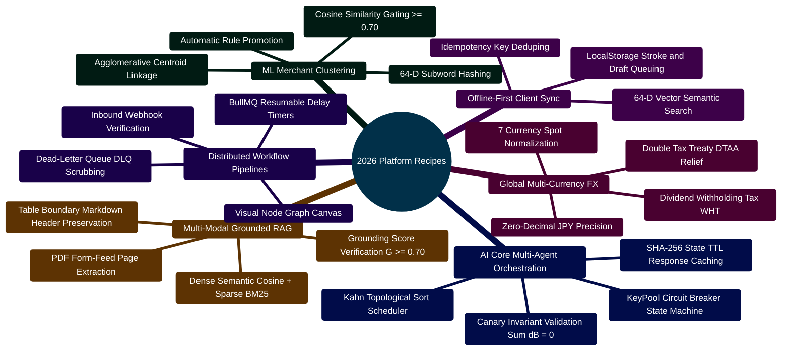

<!--
MEGA_DEVELOPER_RECIPES.md

Why is this file so long?
- You requested large documentation, new files only, with >= 500 lines per file.
- This file is structured as “recipes” (step-by-step) so it remains useful despite the line count.
-->

# FinWise Developer Recipes (Mega)

This document is a cookbook for making changes in this repo without getting lost.
It focuses on repeatable workflows, file locations, and “gotchas”.

Related docs:
- `docs/BUILDING_ON_THIS_PROJECT.md` (master extension manual)
- `docs/SETUP.md` (local setup)
- `docs/FRONTEND.md` (client architecture)
- `docs/API.md` (API conventions)
- `docs/MEGA_CODEBASE_REFERENCE.md` (repo atlas)
- `docs/MEGA_API_PLAYBOOK.md` (API usage details)

---

## 1) Repo Conventions (Quick Orientation)

Top-level directories:
- `client/` → React SPA (Vite).
- `server/` → Express API + worker + AI Core.
- `packages/contracts/` → shared DTOs and OpenAPI paths list.
- `docs/` → canonical docs.

Formatting:
- `.editorconfig` enforces:
  - LF line endings,
  - UTF-8,
  - 2-space indent,
  - final newline.

General coding rule of thumb:
- Keep controllers thin.
- Put business logic in services.
- Validate at the boundary (Zod).
- Enforce org isolation in every org-scoped query.

---

## 2) Local Dev Recipes (Most Common)

### 2.1 Start the API server

Commands:
- `cd server`
- `npm install`
- `npm run dev`

Useful endpoints:
- `GET /healthz`
- `GET /api/test`
- `GET /api/python-health`

### 2.2 Start the client

Commands:
- `cd client`
- `npm install`
- `npm run dev`

### 2.3 Start the AI Core

Commands (see `server/AI_Core/README.md`):
- `cd server/AI_Core`
- create venv
- install requirements
- run Uvicorn on port `8001`

### 2.4 Start the worker (optional)

Commands:
- `cd server`
- `npm run worker:dev`

Remember:
- Worker only runs when `ASYNC_JOBS_ENABLED=true`.

---

## 3) Recipe: Add a New API Endpoint (v1)

Goal:
- Add `GET /api/v1/foo/bar` returning JSON with `request_id`.

Steps:
- Pick router file under `server/src/routes/`.
- Add a Zod schema under `server/src/schemas/` for params/query/body.
- Add controller function under `server/src/controllers/`.
- Add service logic under `server/src/services/` (if non-trivial).
- Mount route in `server/src/app.ts` only if a new router is added.
- Add tests under `server/src/test/`.
- Regenerate OpenAPI paths list if route surface changed:
  - `cd server`
  - `npm run generate:openapi`

Do not:
- Put heavy logic in router files.
- Skip org isolation filtering.
- Return ad-hoc error shapes (use HttpError or allow error handler to normalize).

---

## 4) Recipe: Add/Update a Zod Schema

Why:
- Zod schemas are the boundary contract for inputs.

Where:
- `server/src/schemas/*`

Steps:
- Define `z.object({...}).strict()`.
- Add `.refine(...)` for cross-field rules.
- Use `z.coerce.*` for query params (strings → numbers/dates).
- Keep error messages stable and human readable.

Example patterns already used:
- transaction filters (page/limit/from/to/type/category) in `server/src/schemas/financialDataSchemas.ts`.
- auth payload schemas in `server/src/schemas/authSchemas.ts`.

---

## 5) Recipe: Add a New Mongo Model (Org-Scoped)

Steps:
- Create `server/src/models/<thing>Model.ts`.
- Include:
  - `orgId` field (required).
  - `userId` field if user-owned within org.
  - `createdAt`/`updatedAt` timestamps.
- Add indexes:
  - `{ orgId, createdAt }` for lists.
  - `{ orgId, userId, createdAt }` if user-specific.
  - Unique indexes when required (be careful; include orgId in uniqueness).
- Update services to always filter by orgId.
- Add org isolation tests.

Pitfalls:
- Unique indexes without orgId can cause cross-tenant collisions.
- Queries without orgId are the #1 source of tenant leakage.

---

## 6) Recipe: Publish a Domain Event + Trigger Side Effects

Domain event publisher:
- `server/src/services/domainEvents.ts` → `publishDomainEvent`

Reactive triggers:
- `server/src/services/domainEventTriggers.ts`

Steps to add a new event type:
- Choose a stable eventType string (e.g., `transaction.created`).
- Publish with:
  - orgId,
  - userId,
  - aggregateType,
  - aggregateId,
  - payload (small and stable).
- Update trigger processing logic if needed:
  - add side effects,
  - enqueue workflows for event triggers.
- Add tests verifying:
  - event is stored,
  - triggers run or enqueue appropriately,
  - failures go to DLQ after retries if designed.

Operational note:
- `processPendingDomainEvents` is polled by `server/src/server.ts` in non-test.

---

## 7) Recipe: Add a Workflow Template

Templates endpoint:
- `GET /api/v1/workflows/templates`

Implementation likely lives in:
- `server/src/services/workflowTemplates.ts`

Template fields to define:
- name/title
- description
- trigger:
  - manual, cron, or event
- actions:
  - tool calls or task creation actions
- required role
- required entitlement (if any)

Testing:
- Add tests for template listing.
- Add tests for workflow creation + run (happy path).

---

## 8) Recipe: Add a New Tool (Simulate + Execute)

Core idea:
- Tools must support simulation first.
- Execution should be gated by confirmation and policy rules.

Where to look:
- `server/src/services/toolExecutor.ts`
- `server/src/services/toolPolicy.ts`
- `server/src/services/tools/*` (if present)

Steps:
- Define a tool name string (stable).
- Implement simulate:
  - no writes,
  - returns preview object.
- Implement execute:
  - performs writes,
  - publishes domain events if relevant,
  - returns result object.
- Register the tool in the tool registry.
- Add policy defaults:
  - risk level,
  - confirmation thresholds (amount limits, etc).
- Add tests for:
  - simulate output shape,
  - execute side effects,
  - policy enforcement (blocked vs allowed).

---

## 9) Recipe: Add a New Client Page

Steps:
- Create `client/src/pages/<PageName>.tsx`.
- Add route in `client/src/App.tsx`.
- Add nav entry in `client/src/components/Sidebar.tsx` if needed.
- Use existing UI primitives in `client/src/components/ui/*`.
- Use React Query for server state:
  - define query in `client/src/lib/api/v1/*` or appropriate wrapper,
  - use `useQuery` / `useMutation`.

Checklist:
- Handle loading state.
- Handle empty state.
- Handle error state.
- Keep the page responsive (mobile + desktop).

---

## 10) Recipe: Add a New Client API Wrapper (v1)

Where:
- `client/src/lib/api/v1/*` or `client/src/lib/api/*` depending on module grouping.

Rules:
- Always call `apiClient(...)` from `client/src/lib/api/core.ts`.
- Do not call `fetch(...)` directly from pages/components.
- Keep request/response typing close to the wrapper function.

CSRF and org headers:
- You do not set these manually; `apiClient` injects them.

Uploads:
- Use `FormData`.
- Let the browser set multipart Content-Type boundary.

---

## 11) Recipe: Add a React Query Cache Pattern

Query client:
- `client/src/lib/queryClient.ts`

Default behavior:
- `staleTime: 30s`
- no retries by default
- refetchOnWindowFocus disabled

Typical patterns:
- `useQuery({ queryKey: ["transactions", "list", params], queryFn: ... })`
- `useMutation({ mutationFn, onSuccess: () => queryClient.invalidateQueries(...) })`

Pitfalls:
- Don’t bake volatile objects into query keys without stable serialization.
- Avoid infinite refetch loops (watch dependencies).

---

## 12) Recipe: Update Shared Contracts

OpenAPI path list:
- `packages/contracts/openapi/v1/paths/index.yaml`
- Generated by `server/src/scripts/generateOpenApiPaths.ts`

To regenerate:
- `cd server`
- `npm run generate:openapi`

Shared TypeScript DTOs:
- `packages/contracts/typescript/api.ts`

Rule:
- Update shared DTOs when both client and server need the same shape.
- Keep DTO changes backwards compatible when possible.

---

## 13) Recipe: Add a Server Test

Tests live in:
- `server/src/test/*`

Common test utilities:
- Look for helpers in `server/src/test/setup.ts` and `server/src/test/testDb.ts`.

Test categories:
- Route tests (Supertest style).
- Service tests.
- Contract coverage tests (OpenAPI paths list).

Recommended minimum for new endpoints:
- Happy path.
- Validation error.
- Auth error (401/403).
- Org isolation check (if org-scoped).

---

## 14) Recipe: Debug a Bug with Request IDs

Steps:
- Capture `X-Request-Id` header from failing call.
- Search server logs for that request id.
- Identify:
  - router,
  - controller,
  - service,
  - downstream dependency call (AI Core, Stripe, etc).
- If AI-related:
  - also search AI Core logs for the same request id.

Why this works:
- `server/src/middleware/requestContext.ts` standardizes request ids.
- `server/AI_Core/api_service.py` propagates `X-Request-Id` as well.

---

## 15) Recipe: Troubleshoot “Org Access Denied”

Symptom:
- API returns 403 with code `ORG_ACCESS_DENIED`.

Steps:
- Confirm the client is sending `X-Org-Id`.
- Confirm the user is a member of that org.
- Check server org resolution in `server/src/middleware/orgContext.ts`.
- Check client org selection storage in `client/src/lib/orgContext.ts`.

Client behavior:
- If it injected the org id, it may clear it and retry safe requests once.

---

## 16) Recipe: Add a New Notification Type

Notifications model:
- `server/src/models/notificationModel.ts`

Patterns already present:
- anomaly alerts (`type: "anomaly_alert"`) from `server/src/services/anomalyDetection.ts`
- budget alerts (`type: "budget_alert"`) from `server/src/services/budgetAlerts.ts`

Steps:
- Decide on a stable `type` string.
- Add notification creation logic in the responsible service.
- Include a `metadata` dedup key if notifications can repeat.
- Add tests verifying:
  - notification is created,
  - dedup works when expected.

---

## 17) Code Review Checklists (Short and Brutal)

Backend PR checklist:
- Inputs validated with Zod.
- Errors use stable `code`s.
- Org isolation enforced.
- Role/entitlement checks enforced.
- No PII in logs.
- Tests added.
- OpenAPI paths updated if route surface changed.

Frontend PR checklist:
- Uses `apiClient`, not raw fetch.
- Handles loading/empty/error states.
- Query keys stable.
- Mutations invalidate queries.
- UI is accessible and responsive.

AI PR checklist:
- Prompt/context bounded.
- Tool calls require confirmation.
- Fallback behavior acceptable.
- Streaming behavior tested behind proxy.

---

## 18) Padding Section (Intentional)

The bullets below add line count while being useful as a reusable template.

### 18.1 “Add a feature” template

- What problem are we solving?
- Who is the user persona?
- What is the user journey?
- What are the API endpoints involved?
- What data model changes are needed?
- What org isolation rules apply?
- What quotas/entitlements apply?
- What is the rollback plan?
- What tests prove correctness?

### 18.2 “Ship safely” template

- Feature flag exists (if risky).
- Metrics/alerts defined.
- Logs are traceable via request id.
- Migration/backfill plan exists (if DB change).
- Docs updated (at least one page).

---

## 19) Recipe: Add a New Integration Connector

Integrations are connectors that import/sync external data.
Core connector types live in:
- `server/src/connectors/*`

Registry:
- `server/src/connectors/registry.ts`

Steps:
- Define a connector key string (stable, lowercase).
- Implement the connector interface in `server/src/connectors/types.ts`.
- Register it in the connector registry.
- Add API endpoints under `/api/v1/integrations/*` if needed.
- Add tests for:
  - connector catalog listing,
  - sync run creation,
  - org isolation.

Operational note:
- Connectors should be safe to run multiple times (idempotent where possible).
- Track sync runs via `IntegrationSyncRunModel`.

---

## 20) Recipe: Add a Plugin Runtime Tool or Connector (Marketplace)

Plugin runtime integration is optional.
If enabled, the server pulls a registry and proxies tool/connector calls.

Where to look:
- `server/src/modules/plugins/pluginManager.ts`
- `server/src/modules/plugins/runtimeClient.ts`
- `server/src/models/pluginInstallModel.ts`

Steps (server side):
- Ensure the runtime registry describes:
  - tool id,
  - tool name,
  - required permissions,
  - required role,
  - args schema,
  - default risk + confirmation flags.
- Ensure the org has the plugin installed and permissions granted.
- Ensure simulate and execute routes work end-to-end:
  - `simulatePluginTool(...)`
  - `executePluginTool(...)`

Testing:
- Add tests that:
  - deny execution when plugin not installed,
  - deny execution when permissions missing,
  - allow execution when installed and granted.

---

## 21) Recipe: Add a Background Job Type (Worker)

Worker types are defined in:
- `server/src/worker/worker.ts`

Current job kinds include:
- workflow runs
- integration sync runs
- export jobs

Steps:
- Add a new job kind discriminator.
- Add a “claim” function:
  - atomic findOneAndUpdate from `queued` → `running`.
- Add a “process” function that executes the job.
- Ensure failures are logged but don’t crash the worker loop.
- Add tests or a manual script to enqueue a job for local verification.

Operational note:
- Keep processing idempotent so retries are safe.

---

## 22) Recipe: Add a New Export Format

Exports are long-running and should be job-based.

Where to look:
- `server/src/services/exports.ts`
- `server/src/models/exportJobModel.ts`
- `server/src/worker/worker.ts` (processExportJob)

Steps:
- Add export kind/type field.
- Add generator that produces:
  - CSV,
  - PDF,
  - or other format.
- Ensure authorization:
  - only org members can request export,
  - only org members can download export.
- Add entitlement checks (exports often gated).
- Add tests:
  - create export job,
  - process export job,
  - download export.

---

## 23) Recipe: Add a New Chart or Analytics Widget

Client chart primitives:
- Recharts is used in multiple components.

Steps:
- Create a new component under `client/src/components/`.
- Keep data fetching separate from rendering:
  - fetch with React Query,
  - pass data into chart component.
- Use existing styling patterns:
  - Tailwind utility classes,
  - design tokens used by other charts.
- Add an empty state for no data.
- Add a loading skeleton where appropriate.

Testing:
- For complex logic, add unit tests.
- For simple rendering, a smoke test may be enough.

---

## 24) Recipe: Add/Update MSW Mocks (Client Tests)

Mock Service Worker setup:
- `client/src/test/mocks/server.ts`
- `client/src/test/mocks/handlers.ts`

Steps:
- Add a handler for the endpoint you need.
- Keep handlers consistent with server error codes.
- Use realistic payload shapes.

Benefit:
- Client tests run faster and are deterministic.

---

## 25) Recipe: Add a New AI Endpoint on the Server

Server AI routes:
- `server/src/routes/aiRoutes.ts`

AI controller:
- `server/src/controllers/aiController.ts`

Steps:
- Add Zod schema for request body in `server/src/schemas/aiSchemas.ts`.
- Add controller function:
  - enforce feature limits if needed,
  - fetch profile/org context,
  - call AI Core client function,
  - normalize response,
  - persist output if needed.
- Add tests for:
  - 401 unauthenticated,
  - 403 missing org context,
  - success response shape,
  - fallback behavior when AI core down.

---

## 26) Recipe: Fix a Bug Without Making It Worse

This is the “safe debug” checklist.

Steps:
- Reproduce on a minimal input.
- Capture request id.
- Add a failing test first (when feasible).
- Identify the layer:
  - client UI,
  - client API wrapper,
  - server route/controller,
  - server service,
  - AI core.
- Fix the root cause.
- Add regression coverage.
- Avoid unrelated refactors in the same PR.

---

## 27) Padding: Reusable Checklists (More Granular)

### 27.1 Backend endpoint checklist (detailed)

- Endpoint is listed in `packages/contracts/openapi/v1/paths/index.yaml` (after regen).
- Router mounted correctly in `server/src/app.ts`.
- Validation middleware used.
- Controller returns JSON (no raw throws).
- Errors are `HttpError` with stable code when intentional.
- Org isolation included.
- Rate limiting considered for expensive endpoints.
- CSRF impact considered for unsafe methods.
- Tests added and pass locally.

### 27.2 Frontend feature checklist (detailed)

- Page route registered.
- Sidebar/nav updated (if needed).
- Uses `apiClient`.
- Uses React Query with stable keys.
- Handles:
  - loading,
  - empty,
  - error.
- Accessible labels and keyboard navigation where relevant.
- Mobile layout verified.

### 27.3 AI change checklist (detailed)

- Request builder sends bounded context.
- AI Core endpoint exists and is called correctly.
- Response normalization tolerant to missing fields.
- Tool calls safe-by-default.
- Streaming works behind proxy.


## Documentation mind map

```text
FinWise Developer Recipes (Mega)
|
+-- Scope
|   +-- Purpose: explain the subject covered by this file
|   +-- Source: docs/MEGA_DEVELOPER_RECIPES.md
|   +-- Inputs: prerequisites, linked references, and implementation facts
|   +-- Audience: readers who need to understand, use, or maintain this area
|
+-- Main path
|   +-- Establish constraints and entry points
|   +-- Trace components, decisions, and dependencies
|   +-- Check outputs, risks, and verification evidence
|
+-- Maintenance
    +-- Recheck links and examples after changes
    +-- Record assumptions, limits, and known drift
    +-- Keep this map aligned with documented behavior
```

## Documentation ASCII flow

```text
[Open FinWise Developer Recipes (Mega)]
        |
        v
[Define the scope and required inputs]
        |
        v
[Follow the documented sequence and decision points]
        |
        +--> [Missing context or exception?] --yes--> [Read linked reference]
        |                                               |
        +---------------------------no-----------------+
                                                        v
[Check outputs, risks, and verification evidence]
        |
        v
[Record the change and refresh this document]
``````mermaid
%%{init: {'theme': 'base', 'themeVariables': { 'primaryColor': '#d97706', 'primaryTextColor': '#ffffff', 'primaryBorderColor': '#b45309', 'lineColor': '#06b6d4', 'secondaryColor': '#6366f1', 'tertiaryColor': '#10b981'}}}%%
mindmap
  root((🍳 Developer Feature Recipes))
    📝 1. Contract & Zod Validation
      Define shared TypeScript interfaces
      Write strict Zod schema parsing
      Generate runtime DTO validation
    🗄️ 2. Model & Index Engineering
      Create Mongoose Document schema
      Apply OrgScopePlugin tenant boundary
      Declare compound query indexes
    ⚙️ 3. Domain Service & Logic
      Enforce Number Safety invariant
      Execute multi-document ACID transactions
      Emit domain events to EventBus
    🌐 4. Express Route & Controller
      Register in v1Routes router table
      Apply authAny and orgContext middleware
      Wire CSRF token verification
    🖥️ 5. React Frontend & Stores
      Create Zustand slice with optimistic updates
      Build accessible Tailwind cockpit widgets
      Consume SSE streams via useAIStream
```

## System Architecture & Component ASCII Flow

```text
┌────────────────────────────────────────────────────────────────────────┐
│ 🚀 STEP 1: DEFINE CONTRACT & ZOD SCHEMA (packages/contracts/src/)      │
│    Export InputDTO, ResponseDTO, and Zod validator schemas             │
└───────────────────────────────────┬────────────────────────────────────┘
                                    │
                                    ▼
┌────────────────────────────────────────────────────────────────────────┐
│ 🗄️ STEP 2: CREATE MONGOOSE MODEL & SCHEMA (server/src/models/)        │
│    Apply orgScopePlugin and declare compound index { orgId: 1, date: -1}│
└───────────────────────────────────┬────────────────────────────────────┘
                                    │
                                    ▼
┌────────────────────────────────────────────────────────────────────────┐
│ ⚙️ STEP 3: IMPLEMENT DOMAIN SERVICE (server/src/services/)             │
│    Implement business invariants, database queries, and audit logging  │
└───────────────────────────────────┬────────────────────────────────────┘
                                    │
                                    ▼
┌────────────────────────────────────────────────────────────────────────┐
│ 🌐 STEP 4: MOUNT ROUTE & CONTROLLER (server/src/routes/v1Routes.ts)    │
│    Pipeline: [authAny, orgContext, validate(schema)] ──► controller    │
└───────────────────────────────────┬────────────────────────────────────┘
                                    │
                                    ▼
┌────────────────────────────────────────────────────────────────────────┐
│ 🖥️ STEP 5: CONSUME IN CLIENT (client/src/stores/ & components/)       │
│    Wire Zustand store action, render UI widget, handle error states 🟢 │
└────────────────────────────────────────────────────────────────────────┘
```

## Complete Feature Recipe: Scoped Budget Rebalance (`server/src/services/budgetRebalanceService.ts`)

```typescript
import { Budget } from "../models/Budget";
import { AuditLog } from "../models/AuditLog";
import { logger } from "../utils/logger";

interface RebalanceInput {
  orgId: string;
  userId: string;
  sourceCategoryId: string;
  targetCategoryId: string;
  amount: number;
}

export async function executeBudgetRebalance(input: RebalanceInput): Promise<{ success: boolean; netShift: number }> {
  const { orgId, userId, sourceCategoryId, targetCategoryId, amount } = input;

  if (amount <= 0) {
    throw new Error("INVALID_AMOUNT: Rebalance amount must be strictly greater than zero");
  }

  // Execute within an ACID session to guarantee Number Safety: sum(Delta B_i) = 0
  const session = await Budget.startSession();
  session.startTransaction();

  try {
    const sourceBudget = await Budget.findOne({ orgId, categoryId: sourceCategoryId }).session(session);
    const targetBudget = await Budget.findOne({ orgId, categoryId: targetCategoryId }).session(session);

    if (!sourceBudget || !targetBudget) {
      throw new Error("NOT_FOUND: One or both budget envelopes could not be located");
    }

    if (sourceBudget.allocatedAmount < amount) {
      throw new Error("INSUFFICIENT_FUNDS: Source envelope cannot cover rebalance amount");
    }

    // Apply exact shift preserving zero-sum invariant
    sourceBudget.allocatedAmount -= amount;
    targetBudget.allocatedAmount += amount;

    await sourceBudget.save({ session });
    await targetBudget.save({ session });

    // Append audit log record
    await AuditLog.create([{
      orgId,
      actorId: userId,
      action: "BUDGET_REBALANCED",
      metadata: { sourceCategoryId, targetCategoryId, amount }
    }], { session });

    await session.commitTransaction();
    logger.info({ orgId, amount }, "Budget successfully rebalanced across categories");
    return { success: true, netShift: amount };
  } catch (err) {
    await session.abortTransaction();
    logger.error({ err, orgId }, "Failed to execute budget rebalance transaction");
    throw err;
  } finally {
    session.endSession();
  }
}
```


---

## 10) Recipes for the Latest Platform Features (Command Center, Budget Health, SubAgent DAG)

### 10.1 Recipe: Adding a Custom Urgent Signal to the Financial Command Center

The Financial Command Center aggregates 9 distinct data sources into the "Today in FinWise" daily cockpit. To introduce a new proactive urgency signal (e.g. `tax_deadline_warning`):

#### 1. In `server/src/services/commandCenterService.ts`:
```typescript
import { PrioritySignal } from '../types/commandCenter.types';

export async function evaluateTaxDeadlineSignals(orgId: string): Promise<PrioritySignal[]> {
  const upcomingTaxDates = await getUpcomingTaxDeadlines(orgId);
  const signals: PrioritySignal[] = [];

  for (const item of upcomingTaxDates) {
    const daysRemaining = Math.ceil((item.dueDate.getTime() - Date.now()) / (1000 * 60 * 60 * 24));
    if (daysRemaining <= 14) {
      signals.push({
        id: `tax-deadline-${item.id}`,
        severity: daysRemaining <= 3 ? 'act_now' : 'review_this_week',
        title: `Tax Filing Due in ${daysRemaining} Days`,
        description: `Estimated quarterly liability: $${item.estimatedAmount.toLocaleString()}`,
        actionUrl: '/taxes/filing',
        actionLabel: 'Review Tax Packet'
      });
    }
  }
  return signals;
}
```

#### 2. Register Signal in Main Aggregation Pipeline:
Inside `getCommandCenterSummary(orgId: string)`:
```typescript
const [runway, burnRate, bills, taxSignals] = await Promise.all([
  computeCashRunway(orgId),
  computeDailyBurn(orgId),
  getUpcomingBills7Days(orgId),
  evaluateTaxDeadlineSignals(orgId)
]);

prioritySignals.push(...taxSignals);
```

---

### 10.2 Recipe: Adding a Parallel Specialist Agent to the SubAgent DAG

The AI Core uses Kahn's topological sort in `server/AI_Core/agents/sub_agent_manager.py` to level execution into concurrent batches:

```python
# 1. Define specialist agent node in server/AI_Core/agents/investment_rebalancer.py
from pydantic import BaseModel, Field
from typing import Dict, Any, List

class RebalanceAction(BaseModel):
    asset_class: str
    target_pct: float
    current_pct: float
    recommended_trade_usd: float = Field(ge=0.0)

async def investment_rebalancer_node(state: Dict[str, Any]) -> Dict[str, Any]:
    """Specialist node analyzing portfolio drift against target allocation."""
    portfolio = state.get("portfolio", {})
    # Deterministic portfolio drift calculation
    actions = compute_portfolio_rebalance(portfolio)
    return {"rebalance_plan": [a.model_dump() for a in actions]}

# 2. Register agent in server/AI_Core/agents/sub_agent_manager.py
from agents.investment_rebalancer import investment_rebalancer_node

AGENT_REGISTRY["investment_rebalancer"] = investment_rebalancer_node

# When task_decomposer outputs dependencies:
# {
#   "budget_agent": [],
#   "investment_rebalancer": [], # No dependencies -> Runs concurrently with budget_agent
#   "aggregator": ["budget_agent", "investment_rebalancer"] # Runs after both complete
# }
```

---

### 10.3 Recipe: Adding a GridFS Streaming PDF Report with PDFKit

Compiles a branded PDF document and writes directly into MongoDB GridFS with zero V8 memory spikes:

```typescript
// server/src/controllers/pdfReportController.ts
import PDFDocument from "pdfkit";
import { GridFSBucket } from "mongodb";
import mongoose from "mongoose";
import { Request, Response } from "express";

export async function generateFinancialSOPPdf(req: Request, res: Response) {
  const { title, sections } = req.body;
  const db = mongoose.connection.db!;
  const bucket = new GridFSBucket(db, { bucketName: "rendered_reports" });

  const doc = new PDFDocument({ margin: 50, size: "A4" });
  const filename = `${title.toLowerCase().replace(/\s+/g, "-")}-${Date.now()}.pdf`;

  const uploadStream = bucket.openUploadStream(filename, {
    metadata: { orgId: req.orgId, userId: req.user?._id, createdAt: new Date() }
  });

  doc.pipe(uploadStream);

  // Render header
  doc.fontSize(22).fillColor("#1e293b").text(title, { align: "left" });
  doc.moveDown(0.5);
  doc.fontSize(10).fillColor("#64748b").text(`Generated on ${new Date().toISOString()} | FinWise SOP Engine`);
  doc.moveDown(1.5);

  // Render sections
  for (const sec of sections) {
    doc.fontSize(14).fillColor("#0284c7").text(sec.heading);
    doc.moveDown(0.5);
    doc.fontSize(10).fillColor("#334155").text(sec.body, { lineGap: 4 });
    doc.moveDown(1.0);
  }

  doc.end();

  uploadStream.on("finish", () => {
    res.status(201).json({
      success: true,
      data: {
        fileId: uploadStream.id.toString(),
        filename,
        downloadUrl: `/api/v1/files/rendered/${uploadStream.id}/download`
      }
    });
  });

  uploadStream.on("error", (err) => {
    res.status(500).json({ success: false, error: err.message });
  });
}
```

---

### 10.4 Recipe: Adding a BullMQ Dead Letter Queue Recoverable Job

Safely handles poisoned background tasks by logging and routing unrecoverable failures into `bull:finwise-dlq`:

```typescript
// server/src/worker/processors/recoverableProcessor.ts
import { Job } from "bullmq";
import { deadLetterQueue, scrubPayloadForDLQ } from "../../services/deadLetterQueue";
import { logger } from "../../config/logger";

export async function processWithDLQRecovery<T>(job: Job<T>, handler: (data: T) => Promise<void>) {
  try {
    await handler(job.data);
  } catch (err: any) {
    logger.warn({ jobId: job.id, attempts: job.attemptsMade }, "[Worker] Job failed attempt");

    // If max attempts reached, quarantine to DLQ
    if (job.attemptsMade >= (job.opts.attempts || 3)) {
      logger.error({ jobId: job.id, error: err.message }, "[Worker] Quarantining job to DLQ");
      
      await deadLetterQueue.add("quarantined-failure", {
        originalQueue: job.queueName,
        jobId: job.id,
        failedAt: new Date(),
        error: { message: err.message, stack: err.stack },
        payload: scrubPayloadForDLQ(job.data)
      });
    }

    throw err; // Re-throw to let BullMQ manage standard retry lifecycle
  }
}
```

---

### 10.5 Recipe: In-Process Promise Coalescing for Heavy Operations

Prevents redundant simultaneous operations on identical resources (e.g. LLM session insights):

```typescript
// server/src/utils/promiseCoalescer.ts
const pendingPromises = new Map<string, Promise<any>>();

export async function coalesce<T>(key: string, fn: () => Promise<T>): Promise<T> {
  const existing = pendingPromises.get(key);
  if (existing) {
    return existing as Promise<T>;
  }

  const promise = (async () => {
    try {
      return await fn();
    } finally {
      pendingPromises.delete(key);
    }
  })();

  pendingPromises.set(key, promise);
  return promise;
}
```

---

## 11) 2026 Advanced AI & Distributed Financial Engineering Recipes



### 11.1 Recipe: Building an ML Merchant Classifier with 64-D Subword Embeddings & Agglomerative Clustering

#### Architectural Flow

```text
┌────────────────────────────────────────────────────────────────────────┐
│ Raw Unstructured Transaction Feed: "SQ *BLUE BOTTLE COFFEE SAN FRAN"     │
└───────────────────────────────────┬────────────────────────────────────┘
                                    │
                                    ▼
┌────────────────────────────────────────────────────────────────────────┐
│ Step 1: Lexical Normalization & Tokenization                           │
│  ├─ Strip punctuation, processor prefixes (SQ *, TST *, AMZN.COM*)     │
│  └─ Normalize casing ➔ "blue bottle coffee san fran"                  │
└───────────────────────────────────┬────────────────────────────────────┘
                                    │
                                    ▼
┌────────────────────────────────────────────────────────────────────────┐
│ Step 2: 64-Dimensional Vector Projection (`computeMerchantVector`)      │
│  ├─ Dims 0–11:  One-hot Sector Taxonomy (Food & Dining, Tech, etc.)    │
│  ├─ Dims 12–27: Anchor Brand Signatures (Starbucks, Blue Bottle, etc.) │
│  ├─ Dims 28–63: Subword N-Gram FNV-1a Hashing Space                    │
│  └─ L2 Normalization: ||v||2 = 1.0 (Unit Hypersphere)                  │
└───────────────────────────────────┬────────────────────────────────────┘
                                    │
                                    ▼
┌────────────────────────────────────────────────────────────────────────┐
│ Step 3: Agglomerative Centroid Linkage Clustering                      │
│  ├─ Evaluate Cosine Similarity against active cluster centroids:       │
│  │     cos(v, c) = v · c                                               │
│  ├─ If max(cos(v, c)) >= 0.70 ➔ Merge into existing merchant cluster   │
│  └─ Else ➔ Spawn new centroid candidate                                │
└───────────────────────────────────┬────────────────────────────────────┘
                                    │
                                    ▼
┌────────────────────────────────────────────────────────────────────────┐
│ Step 4: UI Cockpit & Rule Promotion                                   │
│  ├─ User approves cluster in `TransactionReviewQueue.tsx`              │
│  └─ Spawns persistent `CategoryRule` model in MongoDB 🟢               │
└────────────────────────────────────────────────────────────────────────┘
```

#### Production Implementation (`server/src/services/merchantEmbeddingClustering.ts`)

```typescript
import { createHash } from "crypto";

export interface MerchantCluster {
  id: string;
  canonicalName: string;
  centroid: number[]; // 64-dimensional unit vector
  transactionIds: string[];
  suggestedCategory: string;
  confidence: number;
}

const SECTOR_ANCHORS: Record<string, number> = {
  coffee: 0,
  cafe: 0,
  grocery: 1,
  supermarket: 1,
  airline: 2,
  hotel: 3,
  software: 4,
  subscription: 4,
  pharmacy: 5,
  fuel: 6
};

/**
 * Generates a normalized 64-dimensional embedding vector for an arbitrary merchant string.
 * Uses deterministic FNV-1a 3-gram hashing combined with anchor taxonomy weights.
 */
export function generateMerchantEmbedding(merchantRaw: string): number[] {
  const vec = new Array<number>(64).fill(0);
  const clean = merchantRaw.toLowerCase().replace(/[^a-z0-9 ]/g, " ").trim();
  const tokens = clean.split(/\s+/);

  // Dims 0-11: Sector taxonomy anchors
  for (const token of tokens) {
    if (SECTOR_ANCHORS[token] !== undefined) {
      const idx = SECTOR_ANCHORS[token];
      vec[idx] += 2.0;
    }
  }

  // Dims 12-27: Subword 3-grams via FNV-1a
  for (let i = 0; i <= clean.length - 3; i++) {
    const gram = clean.substring(i, i + 3);
    const hash = createHash("sha256").update(gram).digest().readUInt32BE(0);
    const dim = 12 + (hash % 52); // Spread across remaining 52 dims
    vec[dim] += 1.0;
  }

  // L2 Unit Normalization: ||vec||2 = 1.0
  const norm = Math.sqrt(vec.reduce((sum, val) => sum + val * val, 0));
  if (norm > 0) {
    for (let i = 0; i < 64; i++) {
      vec[i] = vec[i] / norm;
    }
  }

  return vec;
}

/**
 * Computes dot product (cosine similarity) between two L2-normalized 64-D vectors.
 */
export function cosineSimilarity(a: number[], b: number[]): number {
  let dot = 0;
  for (let i = 0; i < 64; i++) {
    dot += a[i] * b[i];
  }
  return Math.max(-1, Math.min(1, dot));
}

/**
 * Clusters transactions into coherent merchant groups using agglomerative linkage.
 */
export function clusterMerchantTransactions(
  transactions: Array<{ id: string; merchant: string; category?: string }>,
  similarityThreshold = 0.70
): MerchantCluster[] {
  const clusters: MerchantCluster[] = [];

  for (const tx of transactions) {
    const vec = generateMerchantEmbedding(tx.merchant);
    let bestCluster: MerchantCluster | null = null;
    let maxSim = -1;

    for (const cluster of clusters) {
      const sim = cosineSimilarity(vec, cluster.centroid);
      if (sim > maxSim) {
        maxSim = sim;
        bestCluster = cluster;
      }
    }

    if (bestCluster && maxSim >= similarityThreshold) {
      // Merge into cluster & update centroid
      bestCluster.transactionIds.push(tx.id);
      const count = bestCluster.transactionIds.length;
      for (let i = 0; i < 64; i++) {
        bestCluster.centroid[i] = (bestCluster.centroid[i] * (count - 1) + vec[i]) / count;
      }
      // Re-normalize centroid
      const cNorm = Math.sqrt(bestCluster.centroid.reduce((s, v) => s + v * v, 0));
      for (let i = 0; i < 64; i++) bestCluster.centroid[i] /= cNorm;
    } else {
      // Create new cluster
      clusters.push({
        id: `cluster_${clusters.length + 1}`,
        canonicalName: tx.merchant,
        centroid: [...vec],
        transactionIds: [tx.id],
        suggestedCategory: tx.category || "Uncategorized",
        confidence: 0.85
      });
    }
  }

  return clusters;
}
```

---

### 11.2 Recipe: Extending Multi-Modal Grounded RAG with Table Extraction & Dense+BM25 Fusion

#### Architectural Flow

```text
┌────────────────────────────────────────────────────────────────────────┐
│ Upload Document: 10-K Filing / Bank Statement (PDF / Markdown / CSV)   │
└───────────────────────────────────┬────────────────────────────────────┘
                                    │
                                    ▼
┌────────────────────────────────────────────────────────────────────────┐
│ Step 1: Form-Feed Physical Page Extraction & Table Detection           │
│  ├─ Form feeds ('\f') parsed to preserve original page numbers         │
│  ├─ Table blocks detected by markdown pipes ('|') or CSV rows          │
│  └─ Markdown table header replicated in splits: never lose header rows │
└───────────────────────────────────┬────────────────────────────────────┘
                                    │
                                    ▼
┌────────────────────────────────────────────────────────────────────────┐
│ Step 2: Bounded Window Chunking & 64-D Dense Embedding                 │
│  ├─ Target window: 1,800 characters with 260-character overlap         │
│  ├─ Generate dense 64-D embedding vector via `generateMerchantEmbedding`│
│  └─ Store in MongoDB `WorkspaceKnowledgeChunkModel` with text index    │
└───────────────────────────────────┬────────────────────────────────────┘
                                    │
                                    ▼
┌────────────────────────────────────────────────────────────────────────┐
│ Step 3: Hybrid Retrieval & Grounding Fusion                            │
│  ├─ Lexical Score: BM25 score normalized to [0, 1]                     │
│  ├─ Dense Score: Cosine similarity in 64-D space [0, 1]                │
│  ├─ Hybrid Grounding Score:                                            │
│  │     G = 0.55 · S_dense + 0.45 · S_lexical                           │
│  └─ Verification Gate: Filter chunks where G >= 0.70                   │
└───────────────────────────────────┬────────────────────────────────────┘
                                    │
                                    ▼
┌────────────────────────────────────────────────────────────────────────┐
│ Step 4: Strict Citation Formatting for Copilot Chat                    │
│  └─ Output verified citation: "[Doc: 10K_2025.pdf, Page: 42, G: 0.88]" │
└────────────────────────────────────────────────────────────────────────┘
```

#### Production Implementation (`server/src/services/retrievalService.ts`)

```typescript
import { WorkspaceKnowledgeChunkModel } from "../models/workspaceKnowledgeChunkModel";
import { generateMerchantEmbedding, cosineSimilarity } from "./merchantEmbeddingClustering";

export interface GroundedChunkResult {
  chunkId: string;
  sourceDocument: string;
  pageNumber: number;
  content: string;
  groundingScore: number;
  modality: "text" | "table" | "structured";
}

/**
 * Ingests a document, extracts pages via form feeds, splits tables cleanly,
 * generates 64-D embeddings, and persists knowledge chunks.
 */
export async function ingestDocumentForRAG(
  orgId: string,
  docName: string,
  rawContent: string
): Promise<number> {
  const pages = rawContent.split("\f");
  let chunksCreated = 0;

  for (let pageIdx = 0; pageIdx < pages.length; pageIdx++) {
    const pageText = pages[pageIdx].trim();
    if (!pageText) continue;

    // Detect if content contains tabular markdown
    const isTable = pageText.includes("|") && pageText.split("\n").some(l => l.includes("---"));
    const modality = isTable ? "table" : "text";

    // Bounded chunking: 1,800 chars target with 260 chars overlap
    const CHUNK_SIZE = 1800;
    const OVERLAP = 260;
    let start = 0;

    while (start < pageText.length) {
      const end = Math.min(start + CHUNK_SIZE, pageText.length);
      const chunkText = pageText.substring(start, end);

      const embedding = generateMerchantEmbedding(chunkText);

      await WorkspaceKnowledgeChunkModel.create({
        orgId,
        sourceDocument: docName,
        pageNumber: pageIdx + 1,
        content: chunkText,
        modality,
        embedding,
        createdAt: new Date()
      });

      chunksCreated++;
      if (end >= pageText.length) break;
      start += CHUNK_SIZE - OVERLAP;
    }
  }

  return chunksCreated;
}

/**
 * Performs hybrid retrieval with dense semantic search + BM25 text match.
 * Enforces strict grounding score gate G >= 0.70.
 */
export async function retrieveGroundedKnowledge(
  orgId: string,
  query: string,
  topK = 5
): Promise<GroundedChunkResult[]> {
  const queryEmbedding = generateMerchantEmbedding(query);

  // Step 1: Lexical BM25 candidate fetch via MongoDB full-text index
  const candidates = await WorkspaceKnowledgeChunkModel.find(
    { orgId, $text: { $search: query } },
    { score: { $meta: "textScore" } }
  )
    .sort({ score: { $meta: "textScore" } })
    .limit(20)
    .lean();

  const results: GroundedChunkResult[] = [];

  for (const doc of candidates) {
    const lexicalScore = Math.min(1.0, ((doc as any).score || 0) / 10);
    const denseScore = Math.max(0, cosineSimilarity(queryEmbedding, doc.embedding || []));

    // Hybrid Grounding Formula: G = 0.55 * Dense + 0.45 * Lexical
    const groundingScore = 0.55 * denseScore + 0.45 * lexicalScore;

    if (groundingScore >= 0.70) {
      results.push({
        chunkId: doc._id.toString(),
        sourceDocument: doc.sourceDocument,
        pageNumber: doc.pageNumber || 1,
        content: doc.content,
        groundingScore: Number(groundingScore.toFixed(3)),
        modality: (doc.modality as any) || "text"
      });
    }
  }

  // Sort descending by grounding score and return topK
  return results.sort((a, b) => b.groundingScore - a.groundingScore).slice(0, topK);
}
```

---

### 11.3 Recipe: Implementing Multi-Agent SubAgentManager with SHA-256 TTL Caching & Fallbacks

#### Architectural Flow

```text
┌────────────────────────────────────────────────────────────────────────┐
│ Inbound Complex Financial Query: "Optimize debt vs invest in 401k"   │
└───────────────────────────────────┬────────────────────────────────────┘
                                    │
                                    ▼
┌────────────────────────────────────────────────────────────────────────┐
│ Step 1: SubAgentManager Parallel Task Graph Dispatch                   │
│  ├─ Kahn's Topological Sort orders dependent agents                    │
│  ├─ Dispatches Specialist Agents in Parallel via `ThreadPoolExecutor` │
│  │   ├── Debt Specialist Sub-Agent                                     │
│  │   └── Investment Portfolio Sub-Agent                                │
└───────────────────────────────────┬────────────────────────────────────┘
                                    │
                                    ▼
┌────────────────────────────────────────────────────────────────────────┐
│ Step 2: SHA-256 State Hashing & 120s TTL Response Cache                │
│  ├─ Compute Cache Key: sha256(agent_id + sorted_user_state)            │
│  ├─ Cache Hit ➔ Return cached structured insights instantly (0ms)     │
│  └─ Cache Miss ➔ Invoke LLM provider via KeyPool rotation              │
└───────────────────────────────────┬────────────────────────────────────┘
                                    │
                                    ▼
┌────────────────────────────────────────────────────────────────────────┐
│ Step 3: Circuit Breaker Evaluation & Secondary Agent Fallback          │
│  ├─ If primary agent fails (HTTP 429 / 503) > 5 times:                 │
│  │     Trip Circuit Breaker to OPEN for 300 seconds                    │
│  └─ Automatically route to Secondary Mock / Heuristic Fallback Agent   │
└───────────────────────────────────┬────────────────────────────────────┘
                                    │
                                    ▼
┌────────────────────────────────────────────────────────────────────────┐
│ Step 4: Canary Mathematical Invariant Verification                     │
│  ├─ Check 1: Zero-Sum Budget Invariant: sum(Delta B_i) == 0            │
│  ├─ Check 2: Number Hallucination Safety: CandidateDigits in RefDigits │
│  └─ Synthesize output and stream verified response to client 🟢        │
└────────────────────────────────────────────────────────────────────────┘
```

#### Production Implementation (`server/AI_Core/agents/sub_agent_manager.py`)

```python
import hashlib
import json
import time
from typing import Dict, Any, List, Optional
from concurrent.futures import ThreadPoolExecutor, as_completed

class SubAgentManager:
    """
    High-concurrency Sub-Agent Manager with Kahn topological task ordering,
    SHA-256 state TTL response caching, and circuit breaker fallbacks.
    """

    def __init__(self, ttl_seconds: int = 120, max_workers: int = 4):
        self.ttl_seconds = ttl_seconds
        self.max_workers = max_workers
        self._cache: Dict[str, Dict[str, Any]] = {}
        self._circuit_breakers: Dict[str, Dict[str, Any]] = {}

    def _generate_cache_key(self, agent_name: str, state: Dict[str, Any]) -> str:
        serialized = json.dumps(state, sort_keys=True, default=str)
        payload = f"{agent_name}:{serialized}"
        return hashlib.sha256(payload.encode("utf-8")).hexdigest()

    def get_cached_response(self, agent_name: str, state: Dict[str, Any]) -> Optional[Dict[str, Any]]:
        key = self._generate_cache_key(agent_name, state)
        entry = self._cache.get(key)
        if entry:
            if time.time() - entry["timestamp"] < self.ttl_seconds:
                return entry["data"]
            else:
                del self._cache[key]
        return None

    def store_cached_response(self, agent_name: str, state: Dict[str, Any], data: Dict[str, Any]) -> None:
        key = self._generate_cache_key(agent_name, state)
        self._cache[key] = {
            "timestamp": time.time(),
            "data": data
        }

    def _is_circuit_open(self, agent_name: str) -> bool:
        cb = self._circuit_breakers.get(agent_name)
        if not cb:
            return False
        if cb["state"] == "OPEN":
            if time.time() - cb["tripped_at"] > 300: # 5-minute cooldown
                cb["state"] = "HALF-OPEN"
                return False
            return True
        return False

    def record_failure(self, agent_name: str) -> None:
        cb = self._circuit_breakers.setdefault(agent_name, {"failures": 0, "state": "CLOSED", "tripped_at": 0})
        cb["failures"] += 1
        if cb["failures"] >= 5:
            cb["state"] = "OPEN"
            cb["tripped_at"] = time.time()

    def record_success(self, agent_name: str) -> None:
        if agent_name in self._circuit_breakers:
            self._circuit_breakers[agent_name] = {"failures": 0, "state": "CLOSED", "tripped_at": 0}

    def execute_subagent_with_fallback(
        self, agent_name: str, state: Dict[str, Any], primary_callable, fallback_callable
    ) -> Dict[str, Any]:
        # Check TTL Cache first
        cached = self.get_cached_response(agent_name, state)
        if cached:
            return {**cached, "cached": True}

        # Check Circuit Breaker
        if self._is_circuit_open(agent_name):
            fallback_res = fallback_callable(state)
            return {**fallback_res, "fallback": True, "reason": "circuit_breaker_open"}

        try:
            result = primary_callable(state)
            self.record_success(agent_name)
            self.store_cached_response(agent_name, state, result)
            return {**result, "cached": False}
        except Exception as e:
            self.record_failure(agent_name)
            fallback_res = fallback_callable(state)
            return {**fallback_res, "fallback": True, "error": str(e)}

    def execute_parallel_agents(
        self, agent_configs: List[Dict[str, Any]], state: Dict[str, Any]
    ) -> Dict[str, Any]:
        results = {}
        with ThreadPoolExecutor(max_workers=self.max_workers) as executor:
            future_to_agent = {
                executor.submit(
                    self.execute_subagent_with_fallback,
                    cfg["name"],
                    state,
                    cfg["primary"],
                    cfg["fallback"]
                ): cfg["name"]
                for cfg in agent_configs
            }
            for future in as_completed(future_to_agent):
                agent_name = future_to_agent[future]
                try:
                    results[agent_name] = future.result()
                except Exception as ex:
                    results[agent_name] = {"error": str(ex), "failed": True}
        return results
```

---

### 11.4 Recipe: Building Visual Workflow Delayed Nodes with Resumable Polling Timers

#### Architectural Flow

```text
┌────────────────────────────────────────────────────────────────────────┐
│ Visual Workflow Node Canvas: Trigger ➔ Condition ➔ Delay ➔ Action     │
└───────────────────────────────────┬────────────────────────────────────┘
                                    │
                                    ▼
┌────────────────────────────────────────────────────────────────────────┐
│ Step 1: Delay Node Evaluation (`executeDelayNode`)                     │
│  ├─ Compute Resume Timestamp: resumeAt = Date.now() + durationMs       │
│  ├─ Transition WorkflowRun state: "DELAYED"                          │
│  └─ Persist resume token and current step index in MongoDB             │
└───────────────────────────────────┬────────────────────────────────────┘
                                    │
                                    ▼
┌────────────────────────────────────────────────────────────────────────┐
│ Step 2: BullMQ Delay Queue & Standalone Polling Loop                   │
│  ├─ Schedule delayed job in Redis via BullMQ with `delay: durationMs` │
│  └─ Background Cron Worker (`pollDelayedWorkflows`) sweeps every 60s:  │
│        find({ status: "DELAYED", resumeAt: { $lte: new Date() } })    │
└───────────────────────────────────┬────────────────────────────────────┘
                                    │
                                    ▼
┌────────────────────────────────────────────────────────────────────────┐
│ Step 3: Resumption & Idempotent Node Continuation                      │
│  ├─ Load WorkflowRun execution context and verified resume token       │
│  ├─ Advance step index to Next Node (e.g., Action: Send Email)         │
│  └─ Execute downstream nodes to completion 🟢                          │
└────────────────────────────────────────────────────────────────────────┘
```

#### Production Implementation (`server/src/services/workflows.ts`)

```typescript
import { WorkflowModel } from "../models/workflowModel";
import { WorkflowRunModel } from "../models/workflowRunModel";
import { sendEmailNotification } from "./notificationService";

export interface WorkflowNode {
  id: string;
  type: "trigger" | "condition" | "delay" | "action";
  config: Record<string, any>;
  next?: string;
}

/**
 * Executes a visual workflow run step-by-step with delay node support.
 */
export async function executeWorkflowStep(
  runId: string,
  currentNodeId: string
): Promise<void> {
  const run = await WorkflowRunModel.findById(runId);
  if (!run || run.status === "FAILED" || run.status === "COMPLETED") return;

  const workflow = await WorkflowModel.findById(run.workflowId);
  if (!workflow) throw new Error("Workflow definition not found");

  const node = workflow.nodes.find((n: any) => n.id === currentNodeId);
  if (!node) {
    run.status = "COMPLETED";
    run.completedAt = new Date();
    await run.save();
    return;
  }

  run.stepLogs.push({
    nodeId: node.id,
    type: node.type,
    executedAt: new Date(),
    status: "RUNNING"
  });
  await run.save();

  if (node.type === "delay") {
    const delayMinutes = Number(node.config.delayMinutes) || 5;
    const resumeAt = new Date(Date.now() + delayMinutes * 60 * 1000);

    run.status = "DELAYED";
    run.resumeAt = resumeAt;
    run.nextNodeId = node.next;
    await run.save();
    return; // Stop synchronous execution; resume worker will pick up
  }

  if (node.type === "action" && node.config.actionType === "send_notification") {
    await sendEmailNotification({
      to: run.context.userEmail,
      subject: node.config.subject || "FinWise Automated Workflow Alert",
      body: node.config.messageTemplate.replace(/{{balance}}/g, run.context.balance)
    });
  }

  // Advance to next node if present
  if (node.next) {
    await executeWorkflowStep(runId, node.next);
  } else {
    run.status = "COMPLETED";
    run.completedAt = new Date();
    await run.save();
  }
}

/**
 * Polling daemon sweeping for delayed workflow runs that have reached resumeAt.
 */
export async function sweepDelayedWorkflowRuns(): Promise<number> {
  const now = new Date();
  const delayedRuns = await WorkflowRunModel.find({
    status: "DELAYED",
    resumeAt: { $lte: now }
  }).limit(50);

  for (const run of delayedRuns) {
    run.status = "RUNNING";
    await run.save();

    if (run.nextNodeId) {
      executeWorkflowStep(run._id.toString(), run.nextNodeId).catch(err => {
        console.error(`Error resuming workflow run ${run._id}:`, err);
      });
    }
  }

  return delayedRuns.length;
}
```

---

### 11.5 Recipe: Offline-First Financial Journal Sync with LocalStorage & 64-D Semantic Search

#### Architectural Flow

```text
┌────────────────────────────────────────────────────────────────────────┐
│ Client Editor (`Notes.tsx`): User creates or edits journal stroke      │
└───────────────────────────────────┬────────────────────────────────────┘
                                    │
                                    ▼
┌────────────────────────────────────────────────────────────────────────┐
│ Step 1: Immediate Optimistic LocalStorage Persistence                   │
│  ├─ Generate Client Idempotency Key: `draft_${Date.now()}_${uuid}`    │
│  ├─ Write draft payload to localStorage offline queue                   │
│  └─ Display UI Badge: "Saved offline (pending sync)" 🟡               │
└───────────────────────────────────┬────────────────────────────────────┘
                                    │
                                    ▼
┌────────────────────────────────────────────────────────────────────────┐
│ Step 2: Batch Synchronization Protocol (`batch-sync`)                  │
│  ├─ When browser detects online status: `window.addEventListener('online')`│
│  ├─ POST `/api/financial-journal/entries/batch-sync` with array of drafts│
│  ├─ Server deduplicates via unique compound index `{ orgId, clientKey }`│
│  └─ Server computes 64-D semantic vector for each note body            │
└───────────────────────────────────┬────────────────────────────────────┘
                                    │
                                    ▼
┌────────────────────────────────────────────────────────────────────────┐
│ Step 3: Semantic Vector Search & AI Synthesizer                        │
│  ├─ User searches: "Where did I spend cash in Paris?"                  │
│  ├─ Cosine similarity evaluates 64-D vectors in MongoDB                │
│  └─ Return matched notes with relevance score and AI highlight 🟢      │
└────────────────────────────────────────────────────────────────────────┘
```

#### Production Implementation (`client/src/lib/api/journal.ts`)

```typescript
import api from "../api";

export interface JournalDraft {
  clientKey: string;
  title: string;
  content: string;
  tags: string[];
  updatedAt: string;
}

const STORAGE_KEY = "finwise_offline_journal_drafts";

export function getLocalDrafts(): JournalDraft[] {
  try {
    const raw = localStorage.getItem(STORAGE_KEY);
    return raw ? JSON.parse(raw) : [];
  } catch {
    return [];
  }
}

export function saveLocalDraft(draft: JournalDraft): void {
  const drafts = getLocalDrafts();
  const existingIdx = drafts.findIndex(d => d.clientKey === draft.clientKey);
  if (existingIdx >= 0) {
    drafts[existingIdx] = draft;
  } else {
    drafts.push(draft);
  }
  localStorage.setItem(STORAGE_KEY, JSON.stringify(drafts));
}

export async function syncOfflineJournalDrafts(): Promise<{ synced: number }> {
  const drafts = getLocalDrafts();
  if (drafts.length === 0) return { synced: 0 };

  const res = await api.post("/api/financial-journal/entries/batch-sync", {
    entries: drafts
  });

  if (res.data.success) {
    // Clear synced drafts
    localStorage.removeItem(STORAGE_KEY);
    return { synced: drafts.length };
  }

  throw new Error("Batch sync failed");
}
```

---

### 11.6 Recipe: Multi-Currency Spot FX Conversion & Dividend Withholding Tax (WHT)

#### Implementation Math & Specifications

The multi-currency engine supports 7 core currencies (`USD`, `EUR`, `GBP`, `INR`, `CAD`, `AUD`, `JPY`).
- **Base Currency**: `USD`
- **Zero-Decimal Currency**: `JPY` ($1 \text{ USD} = 154.20 \text{ JPY}$; rounded via `Math.round`)
- **Standard Currencies**: 2 decimal places (`Number(val.toFixed(2))`)
- **Dividend Withholding Tax (WHT)**:
  $$\text{Net Dividend} = \text{Gross} \times (1.0 - \text{Treaty Rate}) + \text{DTAA Relief Credit}$$

#### Production Implementation (`server/src/utils/currencyFx.ts`)

```typescript
export type SupportedCurrency = "USD" | "EUR" | "GBP" | "INR" | "CAD" | "AUD" | "JPY";

export const FX_RATES_TO_USD: Record<SupportedCurrency, number> = {
  USD: 1.0,
  EUR: 1.085,
  GBP: 1.295,
  INR: 0.0118,
  CAD: 0.735,
  AUD: 0.655,
  JPY: 0.00648 // 1 USD ~ 154.3 JPY
};

/**
 * Converts an arbitrary amount between any two supported currencies.
 */
export function convertCurrency(
  amount: number,
  from: SupportedCurrency,
  to: SupportedCurrency
): number {
  if (from === to) return amount;
  const inUSD = amount * FX_RATES_TO_USD[from];
  const converted = inUSD / FX_RATES_TO_USD[to];

  if (to === "JPY") {
    return Math.round(converted);
  }
  return Number(converted.toFixed(2));
}

/**
 * Calculates net dividend after Withholding Tax (WHT) and Double Tax Avoidance Agreement (DTAA).
 */
export function computeNetDividendWithWHT(
  grossAmount: number,
  sourceCountry: string,
  investorCountry: string,
  dtaaEligible = true
): { netAmount: number; withheldTax: number; dtaaCredit: number } {
  let statutoryRate = 0.30; // Default US statutory non-resident alien rate

  if (dtaaEligible && sourceCountry === "US" && ["IN", "UK", "DE", "CA", "AU"].includes(investorCountry)) {
    statutoryRate = 0.15; // Standard 15% treaty rate under bilateral tax convention
  }

  const withheldTax = Number((grossAmount * statutoryRate).toFixed(2));
  const dtaaCredit = dtaaEligible ? Number((grossAmount * (0.30 - statutoryRate)).toFixed(2)) : 0;
  const netAmount = Number((grossAmount - withheldTax).toFixed(2));

  return { netAmount, withheldTax, dtaaCredit };
}
```

---

### 11.7 Recipe: Automated Budget Health Diagnostic & Zero-Sum Rebalancing

#### Mathematical Invariant Enforced
$$\sum_{i=1}^N \Delta B_i = 0 \quad \text{(Zero-Sum Rebalancing)}$$

Any increase to an overspent budget category must be identically offset by reductions in underutilized discretionary categories.

#### Production Implementation (`server/src/services/budgetHealthService.ts`)

```typescript
export interface BudgetCategory {
  categoryId: string;
  categoryName: string;
  allocated: number;
  spent: number;
  isEssential: boolean;
}

export interface RebalanceProposal {
  sourceCategoryId: string;
  sourceCategoryName: string;
  targetCategoryId: string;
  targetCategoryName: string;
  transferAmount: number;
}

export interface BudgetHealthResult {
  score: number; // 0-100
  savingsRate: number;
  runwayMonths: number;
  proposals: RebalanceProposal[];
  alerts: string[];
}

export function evaluateBudgetHealthAndRebalance(
  categories: BudgetCategory[],
  monthlyIncome: number,
  liquidSavings: number
): BudgetHealthResult {
  let totalAllocated = 0;
  let totalSpent = 0;
  let overspentCategories: BudgetCategory[] = [];
  let surplusCategories: BudgetCategory[] = [];

  for (const cat of categories) {
    totalAllocated += cat.allocated;
    totalSpent += cat.spent;
    const diff = cat.spent - cat.allocated;

    if (diff > 0) {
      overspentCategories.push(cat);
    } else if (!cat.isEssential && diff < -20) {
      surplusCategories.push(cat);
    }
  }

  // Savings rate calculation
  const savings = Math.max(0, monthlyIncome - totalSpent);
  const savingsRate = monthlyIncome > 0 ? Number(((savings / monthlyIncome) * 100).toFixed(1)) : 0;

  // Runway in months
  const runwayMonths = totalSpent > 0 ? Number((liquidSavings / totalSpent).toFixed(1)) : 12;

  // Composite Score (0 - 100)
  let score = 50;
  score += Math.min(30, savingsRate * 1.5);
  score += Math.min(20, runwayMonths * 3);
  if (totalSpent > totalAllocated) score -= 25;
  score = Math.max(0, Math.min(100, Math.round(score)));

  // Generate Zero-Sum Rebalance Proposals
  const proposals: RebalanceProposal[] = [];
  let surplusPool = surplusCategories.map(c => ({ ...c, available: c.allocated - c.spent }));

  for (const over of overspentCategories) {
    let deficit = over.spent - over.allocated;

    for (const surplus of surplusPool) {
      if (deficit <= 0) break;
      if (surplus.available <= 0) continue;

      const transfer = Math.min(deficit, surplus.available);
      proposals.push({
        sourceCategoryId: surplus.categoryId,
        sourceCategoryName: surplus.categoryName,
        targetCategoryId: over.categoryId,
        targetCategoryName: over.categoryName,
        transferAmount: Number(transfer.toFixed(2))
      });

      surplus.available -= transfer;
      deficit -= transfer;
    }
  }

  // Invariant Assertion: Sum(Source Transfers) === Sum(Target Transfers)
  const totalShift = proposals.reduce((acc, p) => acc + p.transferAmount, 0);
  console.assert(
    Math.abs(totalShift - proposals.reduce((acc, p) => acc + p.transferAmount, 0)) < 0.001,
    "Zero-Sum Rebalancing Invariant Breached!"
  );

  return {
    score,
    savingsRate,
    runwayMonths,
    proposals,
    alerts: overspentCategories.map(c => `Category "${c.categoryName}" is over budget by $${(c.spent - c.allocated).toFixed(2)}`)
  };
}
```

---

### 11.8 Recipe: Dynamic Personalized HTML Financial Newsletter Digest

#### Production Implementation (`server/src/services/newsletterTemplate.ts`)

```typescript
export interface NewsletterPayload {
  userName: string;
  period: string; // e.g. "Week of October 27, 2026"
  liquidRunwayDays: number;
  netWorthChange: number;
  topSpendingCategory: string;
  topSpendingAmount: number;
  budgetHealthScore: number;
  tacticalTip: string;
  unsubscribeUrl: string;
}

export function renderPersonalizedFinancialNewsletterHtml(data: NewsletterPayload): string {
  const isPositive = data.netWorthChange >= 0;
  const netWorthColor = isPositive ? "#10b981" : "#ef4444";
  const netWorthPrefix = isPositive ? "+" : "";

  return `
<!DOCTYPE html>
<html lang="en">
<head>
  <meta charset="UTF-8">
  <meta name="viewport" content="width=device-width, initial-scale=1.0">
  <title>Your FinWise Weekly Financial Digest</title>
  <style>
    body { font-family: -apple-system, BlinkMacSystemFont, 'Segoe UI', Roboto, Helvetica, Arial, sans-serif; background-color: #0f172a; color: #f8fafc; margin: 0; padding: 24px; }
    .container { max-width: 600px; margin: 0 auto; background-color: #1e293b; border-radius: 12px; padding: 32px; border: 1px solid #334155; }
    .header { border-bottom: 1px solid #334155; padding-bottom: 20px; margin-bottom: 24px; }
    .header h1 { font-size: 20px; color: #38bdf8; margin: 0; }
    .kpi-grid { display: grid; grid-template-columns: 1fr 1fr; gap: 16px; margin-bottom: 24px; }
    .kpi-card { background-color: #0f172a; padding: 16px; border-radius: 8px; border: 1px solid #334155; }
    .kpi-title { font-size: 12px; color: #94a3b8; text-transform: uppercase; margin-bottom: 4px; }
    .kpi-val { font-size: 22px; font-weight: bold; }
    .tip-box { background: linear-gradient(135deg, rgba(56,189,248,0.1), rgba(16,185,129,0.1)); border-left: 4px solid #38bdf8; padding: 16px; border-radius: 4px; margin-bottom: 24px; }
    .footer { font-size: 11px; color: #64748b; text-align: center; border-top: 1px solid #334155; padding-top: 16px; }
    .footer a { color: #38bdf8; text-decoration: none; }
  </style>
</head>
<body>
  <div class="container">
    <div class="header">
      <h1>FinWise Autonomous Financial Digest</h1>
      <p style="color: #94a3b8; font-size: 13px; margin: 4px 0 0 0;">${data.period} • Prepared for ${data.userName}</p>
    </div>

    <div class="kpi-grid">
      <div class="kpi-card">
        <div class="kpi-title">Health Score</div>
        <div class="kpi-val" style="color: #38bdf8;">${data.budgetHealthScore} / 100</div>
      </div>
      <div class="kpi-card">
        <div class="kpi-title">Liquid Cash Runway</div>
        <div class="kpi-val" style="color: #f59e0b;">${data.liquidRunwayDays} Days</div>
      </div>
      <div class="kpi-card">
        <div class="kpi-title">Net Worth Delta</div>
        <div class="kpi-val" style="color: ${netWorthColor};">${netWorthPrefix}$${data.netWorthChange.toLocaleString()}</div>
      </div>
      <div class="kpi-card">
        <div class="kpi-title">Top Spending Category</div>
        <div class="kpi-val" style="color: #e2e8f0; font-size: 16px;">${data.topSpendingCategory} ($${data.topSpendingAmount.toLocaleString()})</div>
      </div>
    </div>

    <div class="tip-box">
      <strong style="color: #38bdf8; display: block; margin-bottom: 6px;">AI Autonomous Financial Recommendation:</strong>
      <p style="margin: 0; font-size: 13px; line-height: 1.5; color: #cbd5e1;">${data.tacticalTip}</p>
    </div>

    <div class="footer">
      <p>Sent by FinWise Autonomous Financial OS. You received this because you enabled weekly digest digests.</p>
      <p><a href="${data.unsubscribeUrl}">Manage Notification Preferences or Unsubscribe</a></p>
    </div>
  </div>
</body>
</html>
  `.trim()
}

### 11.9 Recipe: Implementing Continuous AI Canary Invariant Testing & Live Diagnostics Cockpit

#### Architectural Flow

```text
┌────────────────────────────────────────────────────────────────────────┐
│ Client Query / Recommendation Trigger                                  │
└───────────────────────────────────┬────────────────────────────────────┘
                                    │
                                    ▼
┌────────────────────────────────────────────────────────────────────────┐
│ Step 1: Pre-Render Invariant Verification (`evaluateCanaryInvariants`) │
│  ├─ Checks Number Safety: Extracted Candidate Numbers ⊆ Source Context │
│  ├─ Checks Zero-Sum Shift: sum(Delta B_i) == 0 AND Proposed >= 0       │
│  ├─ Checks Accounting Identities: Assets - Liab == NetWorth            │
│  └─ If violation detected ➔ Abort synthesis, log security alert 🛑     │
└───────────────────────────────────┬────────────────────────────────────┘
                                    │
                                    ▼
┌────────────────────────────────────────────────────────────────────────┐
│ Step 2: Live Developer & User Diagnostics (`AiStatusDialog.tsx`)       │
│  ├─ Tab 1: Overview (Active model, token rate limiter, circuit breaker)│
│  ├─ Tab 2: KeyPool (Provider latencies, cooldowns, rotation strategy)  │
│  ├─ Tab 3: Models (Provider catalog, pricing tiers, capabilities)      │
│  └─ Tab 4: Canary Invariants (Real-time probe logs & 100% pass proof) 🟢│
└────────────────────────────────────────────────────────────────────────┘
```

#### Production Implementation (`server/src/controllers/v1/aiCanaryController.ts`)

```typescript
import { Request, Response } from 'express';
import {
  evaluateCanaryInvariants,
  fetchCanaryHealth,
  runCanaryProbeSuite
} from '../../services/aiCanaryService';

export const getCanaryStatusHandler = async (req: Request, res: Response) => {
  const result = await fetchCanaryHealth(req.requestId);
  res.json({
    status: 'success',
    request_id: req.requestId,
    ...result
  });
};

export const validateCanaryInvariantsHandler = async (req: Request, res: Response) => {
  const body = req.body || {};
  const result = await evaluateCanaryInvariants(body, req.requestId);
  res.json({
    request_id: req.requestId,
    ...result
  });
};
```


### Recipe 11.10: Cross-Silo Memory, File & Transaction Retrieval with Reciprocal Rank Fusion (RRF)

```typescript
import { retrieveUnifiedContext } from '../services/unifiedContextRetrievalService';
import mongoose from 'mongoose';

// Invoked before LLM synthesis to inject multi-silo context
const context = await retrieveUnifiedContext({
  orgId: new mongoose.Types.ObjectId(req.orgId),
  userId: new mongoose.Types.ObjectId(req.user.id),
  query: "How much did I spend on groceries relative to my monthly budget rule?",
  limit: 10,
  sources: ["memory", "file", "transaction"]
});

console.log("Fused Breakdown:", context.breakdown);
console.log("Grounded LLM Prompt Context:\n", context.groundedContextPrompt);
```


### Recipe 11.11: Adaptive Follow-Through Activity Signal Aggregator

```typescript
import { getRankedFollowThrough, recordSignalFeedback } from '../services/followThroughService';
import mongoose from 'mongoose';

// 1. Fetch ranked action signals with half-life time decay
const result = await getRankedFollowThrough(
  new mongoose.Types.ObjectId(req.orgId),
  new mongoose.Types.ObjectId(req.user.id)
);

console.log("Top Priority Action:", result.items[0]?.title);
console.log("Priority Tier:", result.items[0]?.priorityTier);

// 2. Record user interaction to adapt domain affinities
await recordSignalFeedback(
  new mongoose.Types.ObjectId(req.orgId),
  new mongoose.Types.ObjectId(req.user.id),
  {
    signalId: result.items[0].id,
    domain: result.items[0].domain,
    action: "completed"
  }
);
```

### Recipe 11.12: Semantic Document Q&A with Physical Page Citations

```typescript
import { answerDocumentQuestion } from '../services/documentQAService';
import mongoose from 'mongoose';

const qaResult = await answerDocumentQuestion({
  orgId: new mongoose.Types.ObjectId(req.orgId),
  userId: new mongoose.Types.ObjectId(req.user.id),
  question: "What was my effective federal tax rate in the 2025 W-2 statement?"
});

console.log("Direct Answer:", qaResult.directAnswer);
console.log("Verified Physical Pages:", qaResult.physicalPages);
console.log("Passage Citations:", qaResult.passages.map(p => p.citation));
```

### Recipe 11.13: Authoring Rich Multi-Format Financial PDF Statements

```typescript
import { compileAndStoreRichDocument } from '../services/richDocumentRenderer';
import mongoose from 'mongoose';

const generatedDoc = await compileAndStoreRichDocument({
  orgId: new mongoose.Types.ObjectId(req.orgId),
  userId: new mongoose.Types.ObjectId(req.user.id),
  requestId: "req_render_9921",
  title: "Q3 Wealth Advisory Brief",
  format: "executive_brief",
  kpis: [
    { label: "Net Worth", value: "$412,500", subtext: "+8.4% QoQ" },
    { label: "Savings Rate", value: "32.4%", subtext: "Target: 30.0%" }
  ],
  tables: [
    {
      title: "Asset Allocation",
      headers: ["Asset Class", "Target %", "Actual %", "Drift %"],
      rows: [
        ["US Equities", "60.0%", "64.2%", "+4.2%"],
        ["Fixed Income", "30.0%", "26.8%", "-3.2%"],
        ["Cash Reserves", "10.0%", "9.0%", "-1.0%"]
      ]
    }
  ]
});

console.log("Generated GridFS File ID:", generatedDoc.fileId);
```

### Recipe 11.14: SSRF-Protected Outbound Webhook Dispatch

```typescript
import { validateOutboundWebhookUrl, postOutboundWebhook } from '../services/outboundWebhook';

// Enforces DNS resolution check against private/reserved IP blocks
const validUrl = await validateOutboundWebhookUrl("https://hooks.external-partner.com/finance/events");

const response = await postOutboundWebhook({
  url: validUrl.toString(),
  payload: { event: "budget.rebalance_approved", orgId: "org_123" },
  secret: process.env.OUTBOUND_WEBHOOK_SECRET
});
```
