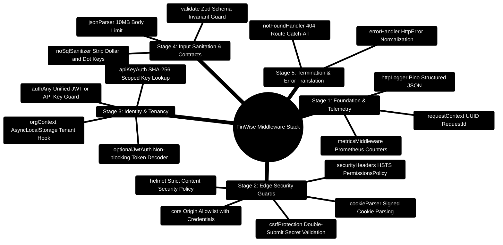

# FinWise — Express 5 Ingress Middleware Pipeline & Security Guards

> **Comprehensive Middleware Specification for the FinWise Gateway**  
> *Ingress Security, Dual Authentication, Multi-Tenant Context Propagation, Zod Validation, and Lifecycle Topologies*  
> **Runtime Target:** Node.js `>=24.14.1 <25` · TypeScript `5.9` · Express `5.x` · Passport.js `0.7` · Helmet `8.0`

---

> [!TIP]
> **Adding Custom Middleware?**  
> Learn how middleware integrates with tenant context (`req.orgId`) and security policies in the [**Master Developer Handbook: Building on This Project**](./BUILDING_ON_THIS_PROJECT.md).

## 1. Middleware Architecture Mindmap



---

## 2. Ingress Request Pipeline ASCII Flow

```text
┌─────────────────────────────────────────────────────────────────────────────────────────────────┐
│ 🌐 INCOMING HTTP / SSE REQUEST                                                                  │
└───────────────────────────────────────────────┬─────────────────────────────────────────────────┘
                                                │
                                                ▼
┌─────────────────────────────────────────────────────────────────────────────────────────────────┐
│ 1️⃣ STAGE 1: TELEMETRY & CONTEXT (requestContext.ts, metrics.ts)                                  │
│    ├─► Assign unique X-Request-Id (UUID v4)                                                     │
│    ├─► Start high-resolution process.hrtime() timer                                             │
│    └─► Increment http_requests_total Prometheus counter                                         │
└───────────────────────────────────────────────┬─────────────────────────────────────────────────┘
                                                │
                                                ▼
┌─────────────────────────────────────────────────────────────────────────────────────────────────┐
│ 2️⃣ STAGE 2: EDGE GUARDS & HEADERS (helmet, securityHeaders.ts, cors)                            │
│    ├─► Strict Content-Security-Policy (default-src 'self')                                      │
│    ├─► Strict-Transport-Security: max-age=63072000; includeSubDomains                             │
│    ├─► Permissions-Policy: camera=(), microphone=(), geolocation=()                            │
│    └─► CORS: Origin match against CLIENT_URL with credentials: true                             │
└───────────────────────────────────────────────┬─────────────────────────────────────────────────┘
                                                │
                                                ▼
┌─────────────────────────────────────────────────────────────────────────────────────────────────┐
│ 3️⃣ STAGE 3: CSRF GUARD & BODY SANITIZATION (csrfProtection.ts, express.json)                   │
│    ├─► Parse JSON body (10MB limit)                                                             │
│    ├─► Sanitize keys: strip MongoDB operator characters ($ and .)                               │
│    └─► For mutating methods (POST/PUT/PATCH/DELETE): verify X-CSRF-Token matches cookie          │
└───────────────────────────────────────────────┬─────────────────────────────────────────────────┘
                                                │
                                                ▼
┌─────────────────────────────────────────────────────────────────────────────────────────────────┐
│ 4️⃣ STAGE 4: IDENTITY & TENANT BOUNDARY (authAny.ts, orgContext.ts)                             │
│    ├─► Resolve Identity: verify JWT Bearer token OR lookup SHA-256 hashed API key               │
│    ├─► Resolve Tenant: extract X-Org-ID header; verify user is active member of organization   │
│    └─► Bind orgId and userId into Node.js AsyncLocalStorage context                             │
└───────────────────────────────────────────────┬─────────────────────────────────────────────────┘
                                                │
                                                ▼
┌─────────────────────────────────────────────────────────────────────────────────────────────────┐
│ 5️⃣ STAGE 5: ZOD INPUT VALIDATION (validate.ts)                                                   │
│    ├─► Validate req.body, req.query, and req.params against strict Zod schemas                  │
│    └─► Strip untyped fields; coerce dates and decimals                                          │
└───────────────────────────────────────────────┬─────────────────────────────────────────────────┘
                                                │
                                                ▼
┌─────────────────────────────────────────────────────────────────────────────────────────────────┐
│ 🚀 STAGE 6: DOMAIN CONTROLLER & SERVICE EXECUTION                                               │
│    Controller executes domain logic with guaranteed { orgId } scoping                           │
└─────────────────────────────────────────────────────────────────────────────────────────────────┘
```

---

## 3. Middleware Execution Sequence (Application Order)

| Step | Middleware Name | Source File | Responsibilities |
| :--- | :--- | :--- | :--- |
| **01** | `requestContext` | `server/src/middleware/requestContext.ts` | Generates UUID `X-Request-Id` and initializes latency timer. |
| **02** | `metricsMiddleware`| `server/src/observability/metrics.ts` | Records HTTP request count and active connection metrics. |
| **03** | `cors` | npm `cors` | Whitelists frontend origin (`http://localhost:5173` or production domain). |
| **04** | `helmet` | npm `helmet` | Sets standard OWASP recommended headers (frameguard, XSS filter, CSP). |
| **05** | `securityHeaders` | `server/src/middleware/securityHeaders.ts` | Sets HSTS (`max-age=63072000`), Permissions-Policy, and cache headers. |
| **06** | `cookieParser` | npm `cookie-parser` | Parses signed session cookies and CSRF tokens. |
| **07** | `json` / `urlencoded`| npm `express` | Body parsers with 10MB payload size boundaries. |
| **08** | `noSqlSanitizer` | Inline in `app.ts` | Recursively strips `$` and `.` to neutralize NoSQL operator injection. |
| **09** | `csrfProtection` | `server/src/middleware/csrfProtection.ts` | Enforces double-submit cookie pattern on mutating HTTP requests. |
| **10** | `optionalJwtAuth`| `server/src/middleware/optionalJwtAuth.ts` | Non-blocking token decoder attaching `req.user` if valid. |
| **11** | `apiKeyAuth` | `server/src/middleware/apiKeyAuth.ts` | Authenticates machine requests via peppered SHA-256 API key hashes. |
| **12** | `authAny` | `server/src/middleware/authAny.ts` | Unified gateway guard accepting either JWT bearer tokens or API keys. |
| **13** | `orgContext` | `server/src/middleware/orgContext.ts` | Extracts `X-Org-ID` and validates tenant membership for the user. |
| **14** | `validate` | `server/src/middleware/validate.ts` | Factory producing Zod schema validation middlewares for body/query/params. |
| **15** | `legacyApiDeprecation`| `server/src/middleware/legacyApiDeprecation.ts` | Adds `X-API-Deprecation` headers for legacy `/api` routes. |
| **16** | `responseContext`| `server/src/middleware/responseContext.ts` | Standardizes outgoing JSON envelopes with `request_id` and timing metadata. |
| **17** | `notFoundHandler`| `server/src/middleware/errorHandler.ts` | 404 handler returning uniform JSON error responses. |
| **18** | `errorHandler` | `server/src/middleware/errorHandler.ts` | Centralized error handler normalizing exceptions into typed `HttpError` formats. |

---

## 4. Key Middleware Implementation Blueprints

### Blueprint 1: Double-Submit CSRF Guard (`csrfProtection.ts`)

```typescript
import { Request, Response, NextFunction } from "express";
import crypto from "crypto";

const SAFE_METHODS = new Set(["GET", "HEAD", "OPTIONS"]);
const EXEMPT_PATHS = new Set(["/api/v1/billing/webhook", "/api/internal/tools"]);

export function csrfProtection(req: Request, res: Response, next: NextFunction) {
  if (process.env.CSRF_ENABLED === "false" || SAFE_METHODS.has(req.method)) {
    // Generate and attach CSRF cookie on safe requests if missing
    if (!req.cookies["csrf_token"]) {
      const token = crypto.randomBytes(32).toString("hex");
      res.cookie("csrf_token", token, {
        httpOnly: false, // Must be readable by client JS to echo in X-CSRF-Token header
        secure: process.env.NODE_ENV === "production",
        sameSite: "strict",
        path: "/"
      });
    }
    return next();
  }

  // Exempt webhooks and internal machine tools
  if (EXEMPT_PATHS.has(req.path) || req.headers["x-api-key"]) {
    return next();
  }

  const cookieToken = req.cookies["csrf_token"];
  const headerToken = req.headers["x-csrf-token"];

  if (!cookieToken || !headerToken || cookieToken !== headerToken) {
    return res.status(403).json({
      success: false,
      error: { code: "CSRF_VALIDATION_FAILED", message: "Invalid or missing CSRF token." }
    });
  }

  next();
}
```

---

### Blueprint 2: Multi-Tenant Context Resolver (`orgContext.ts`)

```typescript
import { Request, Response, NextFunction } from "express";
import { OrgMemberModel } from "../models/orgMemberModel";
import { HttpError } from "../utils/apiResponse";

export async function orgContext(req: Request, res: Response, next: NextFunction) {
  try {
    const orgIdHeader = req.headers["x-org-id"] as string;
    const user = req.user;

    // For authenticated users, verify tenant membership
    if (user && orgIdHeader) {
      const membership = await OrgMemberModel.findOne({
        orgId: orgIdHeader,
        userId: user._id
      }).lean();

      if (!membership) {
        throw new HttpError(403, "Access denied: User is not a member of the requested organization.");
      }

      req.org = {
        orgId: orgIdHeader,
        role: membership.role,
        source: "header"
      };
    } else if (user) {
      // Fallback to user default personal organization
      req.org = {
        orgId: `personal_${user._id}`,
        role: "owner",
        source: "default"
      };
    }

    next();
  } catch (err) {
    next(err);
  }
}
```

---

### Blueprint 3: Zod Schema Validation Factory (`validate.ts`)

```typescript
import { Request, Response, NextFunction } from "express";
import { ZodSchema, ZodError } from "zod";
import { HttpError } from "../utils/apiResponse";

interface ValidationSchemas {
  body?: ZodSchema;
  query?: ZodSchema;
  params?: ZodSchema;
}

export function validate(schemas: ValidationSchemas) {
  return async (req: Request, res: Response, next: NextFunction) => {
    try {
      if (schemas.params) {
        req.params = await schemas.params.parseAsync(req.params);
      }
      if (schemas.query) {
        req.query = await schemas.query.parseAsync(req.query);
      }
      if (schemas.body) {
        req.body = await schemas.body.parseAsync(req.body);
      }
      next();
    } catch (err) {
      if (err instanceof ZodError) {
        const details = err.issues.map((i) => ({
          field: i.path.join("."),
          message: i.message,
          code: i.code
        }));
        next(new HttpError(400, "Validation error on incoming payload", details));
      } else {
        next(err);
      }
    }
  };
}
```

---

### Blueprint 4: Monotonic Context Revision Verification Guard (`contextRevisionGuard.ts`)

Prevents race conditions caused by delayed background AI worker evaluations or out-of-order SSE streaming:

```typescript
// server/src/middleware/contextRevisionGuard.ts
import { Request, Response, NextFunction } from "express";
import { logger } from "../config/logger";

const sessionRevisionMap = new Map<string, number>();

export function monotonicRevisionGuard(req: Request, res: Response, next: NextFunction) {
  const sessionId = req.params.sessionId || req.body.sessionId;
  const incomingRevision = Number(req.headers["x-context-revision"] || req.body.revision);

  if (!sessionId || isNaN(incomingRevision)) {
    return next();
  }

  const currentRevision = sessionRevisionMap.get(sessionId) || 0;

  if (incomingRevision <= currentRevision) {
    logger.warn(
      { sessionId, incomingRevision, currentRevision },
      "[RevisionGuard] Rejecting stale out-of-order request"
    );
    return res.status(409).json({
      success: false,
      error: {
        code: "STALE_CONTEXT_REVISION",
        message: `Incoming revision ${incomingRevision} is older than or equal to current committed revision ${currentRevision}.`
      }
    });
  }

  sessionRevisionMap.set(sessionId, incomingRevision);
  next();
}
```

---

### Blueprint 5: Redis Sliding-Window Rate Limiter (`rateLimiter.ts`)

Tiered rate limiting protecting general API endpoints (200 req/min) and sensitive auth endpoints (20 req/min):

```typescript
// server/src/middleware/rateLimiter.ts
import { Request, Response, NextFunction } from "express";
import Redis from "ioredis";

export function createSlidingWindowLimiter(redis: Redis, maxRequests: number, windowSeconds: number) {
  return async (req: Request, res: Response, next: NextFunction) => {
    const keyIdentifier = req.user?._id || req.headers["x-api-key"] || req.ip;
    const redisKey = `ratelimit:${req.baseUrl}:${keyIdentifier}`;
    const now = Date.now();
    const clearBefore = now - windowSeconds * 1000;

    const pipeline = redis.pipeline();
    pipeline.zremrangebyscore(redisKey, 0, clearBefore);
    pipeline.zadd(redisKey, now, `${now}-${Math.random()}`);
    pipeline.zcard(redisKey);
    pipeline.expire(redisKey, windowSeconds);

    const results = await pipeline.exec();
    const count = (results?.[2]?.[1] as number) || 0;

    res.setHeader("X-RateLimit-Limit", maxRequests);
    res.setHeader("X-RateLimit-Remaining", Math.max(0, maxRequests - count));

    if (count > maxRequests) {
      return res.status(429).json({
        success: false,
        error: { code: "RATE_LIMIT_EXCEEDED", message: "Too many requests. Please slow down." }
      });
    }

    next();
  };
}
```

---

### Blueprint 6: NoSQL Operator Injection Sanitizer (`noSqlSanitizer.ts`)

Recursively strips dangerous MongoDB operators (`$` and `.`) from user inputs to prevent injection attacks:

```typescript
// server/src/middleware/noSqlSanitizer.ts
import { Request, Response, NextFunction } from "express";

function sanitize(obj: any): any {
  if (Array.isArray(obj)) {
    return obj.map(sanitize);
  }
  if (obj !== null && typeof obj === "object") {
    const clean: any = {};
    for (const key of Object.keys(obj)) {
      if (key.startsWith("$") || key.includes(".")) {
        continue; // Strip injection payload key
      }
      clean[key] = sanitize(obj[key]);
    }
    return clean;
  }
  return obj;
}

export function noSqlSanitizer(req: Request, res: Response, next: NextFunction) {
  if (req.body) req.body = sanitize(req.body);
  if (req.query) req.query = sanitize(req.query);
  if (req.params) req.params = sanitize(req.params);
  next();
}
```

---

### Blueprint 7: Legacy API Deprecation & Sunset Headers (`legacyApiDeprecation.ts`)

Adds standard RFC 8594 deprecation and sunset headers to legacy `/api/*` endpoints transitioning to canonical `/api/v1/*`:

```typescript
// server/src/middleware/legacyApiDeprecation.ts
import { Request, Response, NextFunction } from "express";

export function legacyApiDeprecation(req: Request, res: Response, next: NextFunction) {
  if (req.originalUrl.startsWith("/api/") && !req.originalUrl.startsWith("/api/v1/")) {
    res.setHeader("Deprecation", "true");
    res.setHeader("Sunset", "2026-05-31");
    res.setHeader("Link", `<https://api.finwise.app/api/v1${req.path}>; rel="successor-version"`);
  }
  next();
}
```
