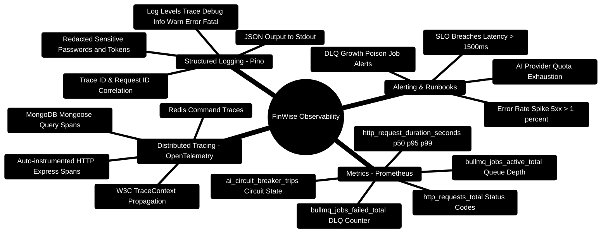

# FinWise — Observability, Telemetry & SRE Runbook

> **Production Observability, Prometheus Metrics, OpenTelemetry Tracing, and Structured Logging**  
> *Service Level Objectives (SLOs), Latency Histograms, Distributed Spans, and Diagnostic Dashboards*  
> **Runtime Target:** Node.js `>=24.14.1 <25` · `prom-client 15.1` · OpenTelemetry `1.25` · Pino `9.0`

---

> [!TIP]
> **Instrumenting New Services:**  
> Follow the logging and telemetry conventions in the [**Master Developer Handbook: Building on This Project**](./BUILDING_ON_THIS_PROJECT.md).

## 1. Observability Architecture Mindmap



---

## 2. Telemetry Ingestion & Export ASCII Topology

```text
┌─────────────────────────────────────────────────────────────────────────────────────────────────┐
│ 🟢 INCOMING HTTP REQUEST (X-Request-Id: 7a9f... / traceparent: 00-4bf92f3577b34da6a3ce...)      │
└───────────────────────────────────────────────┬─────────────────────────────────────────────────┘
                                                │
                                                ▼
┌─────────────────────────────────────────────────────────────────────────────────────────────────┐
│ 🔷 EXPRESS GATEWAY OBSERVABILITY MIDDLEWARE (server/src/observability/metrics.ts)                │
│    ├─► Pino Logger attaches { req_id, trace_id, org_id, path }                                  │
│    ├─► Prometheus metricsMiddleware starts hrtime() stopwatch                                   │
│    └─► OpenTelemetry SDK begins active Span: "express.request /api/v1/finance/transactions"     │
└───────────────────────────────────────────────┬─────────────────────────────────────────────────┘
                                                │
                                                ▼
                         [Request Processing Across Downstream Layers]
                         /                      |                       \
             MongoDB Query                BullMQ Job Queue          AI Core HTTP Call
                   /                            |                               \
                  v                             v                                v
     ┌────────────────────────┐   ┌───────────────────────────┐   ┌─────────────────────────────┐
     │ Mongoose OTel Span     │   │ BullMQ Metric Recorded    │   │ Outgoing HTTP OTel Span     │
     │ db.transactions.find() │   │ queue_depth_gauge.set(12) │   │ POST http://ai-core:8001    │
     └────────────┬───────────┘   └─────────────┬─────────────┘   └──────────────┬──────────────┘
                  │                             │                                │
                  └─────────────────────────────┼────────────────────────────────┘
                                                │
                                                ▼
┌─────────────────────────────────────────────────────────────────────────────────────────────────┐
│ 🚀 RESPONSE DISPATCH & METRIC EMISSION                                                           │
│    ├─► Record duration in http_request_duration_seconds histogram bucket                        │
│    ├─► Emit structured JSON log with status_code: 200, latency_ms: 18.4                         │
│    └─► Close OpenTelemetry Span and export via OTLP (Port 4318) to Jaeger / Grafana Tempo        │
└─────────────────────────────────────────────────────────────────────────────────────────────────┘
```

---

## 3. Canonical Prometheus Metrics Catalog

All metrics are exposed at `GET /api/metrics` (protected by `Authorization: Bearer <METRICS_TOKEN>`):

| Metric Name | Type | Labels | Description / SLA Target |
| :--- | :--- | :--- | :--- |
| `http_request_duration_seconds` | Histogram | `method`, `route`, `status_code` | Request latency buckets. Target: p95 $< 250\text{ms}$ for CRUD, $< 2.5\text{s}$ for AI streams. |
| `http_requests_total` | Counter | `method`, `route`, `status_code` | Cumulative request volume. Alert if 5xx error rate exceeds $1\%$. |
| `http_active_requests` | Gauge | `method` | Real-time concurrent in-flight requests. |
| `bullmq_queue_size` | Gauge | `queue_name` | Number of jobs waiting in BullMQ queues (`newsletter`, `pdf-exports`). |
| `bullmq_dlq_failed_total` | Counter | `original_queue` | Number of poisoned jobs moved to `bull:finwise-dlq`. Alert immediately if $>0$. |
| `ai_core_circuit_state` | Gauge | `provider` | State of the AI Core circuit breaker (0 = Closed/Healthy, 1 = Open/Failing). |
| `ai_core_request_latency_seconds` | Histogram | `agent_type` | AI Core response latency for specialist subagents. |
| `workspace_chunks_retrieved_total` | Counter | `org_id`, `file_type` | Total RAG Phase 2 knowledge chunks retrieved via BM25 lexical search. |

---

## 4. Production Implementation Blueprints

### Blueprint 1: Prometheus Metrics Middleware (`metrics.ts`)

```typescript
// server/src/observability/metrics.ts
import client from "prom-client";
import { Request, Response, NextFunction } from "express";

const register = new client.Registry();
client.collectDefaultMetrics({ register });

export const httpRequestDurationMicroseconds = new client.Histogram({
  name: "http_request_duration_seconds",
  help: "Duration of HTTP requests in seconds",
  labelNames: ["method", "route", "code"],
  buckets: [0.01, 0.05, 0.1, 0.25, 0.5, 1, 2.5, 5, 10]
});
register.registerMetric(httpRequestDurationMicroseconds);

export const metricsMiddleware = (req: Request, res: Response, next: NextFunction) => {
  const start = process.hrtime();

  res.on("finish", () => {
    const elapsed = process.hrtime(start);
    const elapsedSeconds = elapsed[0] + elapsed[1] / 1e9;
    const route = req.route ? req.route.path : req.path;

    httpRequestDurationMicroseconds
      .labels(req.method, route, res.statusCode.toString())
      .observe(elapsedSeconds);
  });

  next();
};

export const metricsHandler = async (req: Request, res: Response) => {
  const token = req.headers.authorization?.replace("Bearer ", "");
  if (process.env.NODE_ENV === "production" && token !== process.env.METRICS_TOKEN) {
    return res.status(401).send("Unauthorized: Invalid metrics token");
  }

  res.set("Content-Type", register.contentType);
  res.end(await register.metrics());
};
```

---

### Blueprint 2: Structured JSON Logging (`logger.ts`)

```typescript
// server/src/config/logger.ts
import pino from "pino";

export const logger = pino({
  level: process.env.LOG_LEVEL || "info",
  redact: {
    paths: ["req.headers.authorization", "req.headers.cookie", "password", "token", "twoFactorSecret"],
    censor: "[REDACTED]"
  },
  formatters: {
    level: (label) => ({ level: label }),
    bindings: (bindings) => ({
      pid: bindings.pid,
      hostname: bindings.hostname,
      service: "finwise-api"
    })
  },
  timestamp: pino.stdTimeFunctions.isoTime
});
```


---

## 5. OpenTelemetry Distributed Tracing (`tracer.ts`)

To trace incoming HTTP requests across Express middleware, MongoDB queries, and Python FastAPI AI subagents, OpenTelemetry distributed contexts propagate the `X-Request-Id` and `traceparent` headers:

```typescript
// server/src/observability/tracer.ts
import { NodeSDK } from "@opentelemetry/sdk-node";
import { getNodeAutoInstrumentations } from "@opentelemetry/auto-instrumentations-node";
import { OTLPTraceExporter } from "@opentelemetry/exporter-trace-otlp-http";
import { Resource } from "@opentelemetry/resources";
import { SemanticResourceAttributes } from "@opentelemetry/semantic-conventions";

export const otelSdk = new NodeSDK({
  resource: new Resource({
    [SemanticResourceAttributes.SERVICE_NAME]: "finwise-api-gateway",
    [SemanticResourceAttributes.SERVICE_VERSION]: "1.0.0",
    [SemanticResourceAttributes.DEPLOYMENT_ENVIRONMENT]: process.env.NODE_ENV || "production",
  }),
  traceExporter: new OTLPTraceExporter({
    url: process.env.OTEL_EXPORTER_OTLP_ENDPOINT || "http://localhost:4318/v1/traces",
  }),
  instrumentations: [getNodeAutoInstrumentations({
    "@opentelemetry/instrumentation-fs": { enabled: false }, // Reduce file system noise
  })],
});
```

---

## 6. Production Prometheus Alerting Rules (`prometheus/alerts.yml`)

```yaml
groups:
  - name: finwise_core_alerts
    rules:
      - alert: HighHttp5xxErrorRate
        expr: sum(rate(http_requests_total{status_code=~"5.."}[5m])) / sum(rate(http_requests_total[5m])) * 100 > 1.0
        for: 2m
        labels:
          severity: critical
        annotations:
          summary: "Express API 5xx error rate exceeds 1% (current: {{ $value }}%)"

      - alert: DeadLetterQueueNotEmpty
        expr: bullmq_dlq_failed_total > 0
        for: 1m
        labels:
          severity: critical
        annotations:
          summary: "Poison-pill jobs detected in BullMQ Dead-Letter Queue (count: {{ $value }})"

      - alert: AiCoreCircuitTripped
        expr: ai_core_circuit_state == 1
        for: 30s
        labels:
          severity: warning
        annotations:
          summary: "AI Core Circuit Breaker is OPEN. Serving deterministic calculations fallback."
```

---

## 7. SRE Incident Runbooks for Production Alerts

```mermaid
%%{init: {'theme': 'base', 'themeVariables': { 'primaryColor': '#b91c1c', 'primaryTextColor': '#ffffff', 'primaryBorderColor': '#991b1b', 'lineColor': '#ef4444', 'secondaryColor': '#d97706', 'tertiaryColor': '#2563eb'}}}%%
mindmap
  root((🚨 SRE Alert Triage))
    DeadLetterQueueNotEmpty
      Inspect: redis-cli LLEN bull:finwise-dlq:failed
      Review: GET /api/v1/dlq/jobs
      Remedy: POST /api/v1/dlq/replay/:id
    AiCoreCircuitTripped
      Inspect: GET /api/v1/ai-core/status
      Check: KeyPool exhausted 429 quotas
      Remedy: Cycle GEMINI_API_KEYS or fallback to Groq
    HighHttp5xxErrorRate
      Inspect: Pino error logs with correlationId
      Check: Mongoose connection drop or unhandled promise
      Remedy: Verify mongod readiness & restart gateway
    GridFSUploadTimeout
      Inspect: mongosh db['rendered_reports.chunks'].stats()
      Check: Large document vector compilation freeze
      Remedy: Enforce stream piping and scale worker RAM
```

### Runbook 1: `DeadLetterQueueNotEmpty` Incident Response

- **Trigger**: Prometheus rule fires when `bullmq_dlq_failed_total > 0`.
- **Immediate Triage (0–5 min)**:
  1. Inspect the quarantined job count and oldest failure timestamp:
     ```bash
     curl -H "Authorization: Bearer <ADMIN_TOKEN>" http://localhost:3000/api/v1/dlq/stats
     ```
  2. Inspect the failed job stack trace and scrubbed payload:
     ```bash
     curl -H "Authorization: Bearer <ADMIN_TOKEN>" "http://localhost:3000/api/v1/dlq/jobs?limit=5"
     ```
- **Remediation**:
  - If failure was caused by transient upstream SMTP downtime, trigger replay:
    ```bash
    curl -X POST -H "Authorization: Bearer <ADMIN_TOKEN>" http://localhost:3000/api/v1/dlq/replay/<JOB_ID>
    ```
  - If failure was caused by corrupted user input, discard poison pill:
    ```bash
    curl -X DELETE -H "Authorization: Bearer <ADMIN_TOKEN>" http://localhost:3000/api/v1/dlq/job/<JOB_ID>
    ```

---

### Runbook 2: `AiCoreCircuitTripped` Incident Response

- **Trigger**: AI Core trips circuit to OPEN state after consecutive upstream provider 429s.
- **Immediate Triage (0–5 min)**:
  1. Query AI Core health endpoint:
     ```bash
     curl http://localhost:8001/health
     ```
  2. Check current active provider in response metadata (`active_provider`, `fallback_path`).
- **Remediation**:
  1. If Google Gemini keys hit quota, add fresh keys to `server/AI_Core/.env`:
     ```env
     GEMINI_API_KEYS="key_alpha,key_beta,key_gamma"
     ```
  2. The `KeyPool` will automatically lease fresh keys outside the 60s cooldown window.
  3. If all LLM providers are down, the platform continues operating with 100% availability by falling back to deterministic Python calculators.

---

## 8. Deep Health Checks & Readiness Probes Specification

The platform exposes layered probe endpoints for Kubernetes / Docker container orchestrators:

| Path | Probe Type | Authentication | Description |
| :--- | :--- | :--- | :--- |
| `GET /healthz` | Liveness | None (Public) | Returns HTTP 200 `{"status":"ok"}` if the Express event loop is responsive. |
| `GET /readyz` | Readiness | None (Public) | Returns HTTP 200 only if MongoDB `db.admin().ping()` and Redis `PING` both succeed. |
| `GET /api/health` | Diagnostic | None / Internal | Returns JSON summary of datastore latencies, BullMQ queue status, and memory usage. |
| `GET /api/v1/ai-core/status` | Deep AI | Bearer JWT | Probes AI Core model catalog, KeyPool cooldowns, and SQLite checkpoint health. |

```typescript
// server/src/routes/healthRoutes.ts
import { Router } from "express";
import mongoose from "mongoose";
import { getRedisClient } from "../config/redis";

export const healthRouter = Router();

healthRouter.get("/healthz", (_req, res) => res.json({ status: "ok" }));

healthRouter.get("/readyz", async (_req, res) => {
  try {
    const mongoOk = mongoose.connection.readyState === 1;
    const redisClient = getRedisClient();
    const redisOk = redisClient ? (await redisClient.ping()) === "PONG" : true;

    if (mongoOk && redisOk) {
      return res.status(200).json({ status: "ready", mongo: "connected", redis: "connected" });
    }
    return res.status(503).json({ status: "unready", mongo: mongoOk, redis: redisOk });
  } catch (err: any) {
    return res.status(503).json({ status: "unready", error: err.message });
  }
});
```
