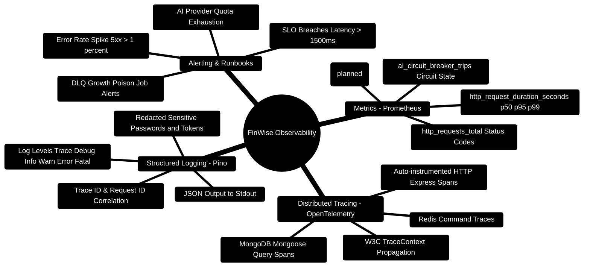
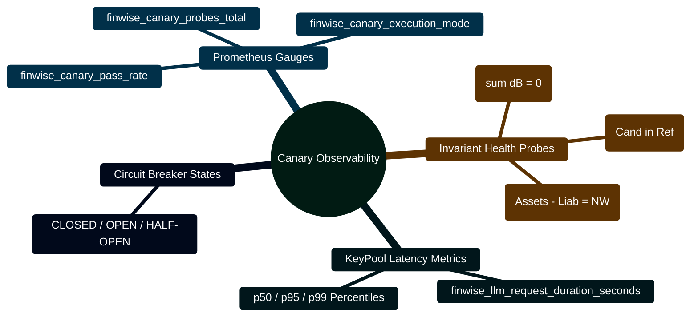

# FinWise — Observability, Telemetry & SRE Runbook

> **Production Observability, Prometheus Metrics, OpenTelemetry Tracing, and Structured Logging**  
> *Service Level Objectives (SLOs), Latency Histograms, Distributed Spans, and Diagnostic Dashboards*  
> **Runtime Target:** Node.js `>=24.14.1 <25` · `prom-client 15.1` · OpenTelemetry `1.25` · Pino `9.0`

---

> [!TIP]
> **Instrumenting New Services:**  
> Follow the logging and telemetry conventions in the [**Master Developer Handbook: Building on This Project**](./BUILDING_ON_THIS_PROJECT.md).

## 1. Observability Architecture Mindmap



---

## 2. Telemetry Ingestion & Export ASCII Topology

```text
┌─────────────────────────────────────────────────────────────────────────────────────────────────┐
│ 🟢 INCOMING HTTP REQUEST (X-Request-Id: 7a9f... / traceparent: 00-4bf92f3577b34da6a3ce...)      │
└───────────────────────────────────────────────┬─────────────────────────────────────────────────┘
                                                │
                                                ▼
┌─────────────────────────────────────────────────────────────────────────────────────────────────┐
│ 🔷 EXPRESS GATEWAY OBSERVABILITY MIDDLEWARE (server/src/observability/metrics.ts)                │
│    ├─► Pino Logger attaches { req_id, trace_id, org_id, path }                                  │
│    ├─► Prometheus metricsMiddleware starts hrtime() stopwatch                                   │
│    └─► OpenTelemetry SDK begins active Span: "express.request /api/v1/finance/transactions"     │
└───────────────────────────────────────────────┬─────────────────────────────────────────────────┘
                                                │
                                                ▼
                         [Request Processing Across Downstream Layers]
                         /                      |                       \
             MongoDB Query          MongoDB Worker Claim          AI Core HTTP Call
                   /                            |                               \
                  v                             v                                v
     ┌────────────────────────┐   ┌───────────────────────────┐   ┌─────────────────────────────┐
     │ Mongoose OTel Span     │   │ Worker Metric Recorded    │   │ Outgoing HTTP OTel Span     │
     │ db.transactions.find() │   │ queue_depth_gauge.set(12) │   │ POST http://ai-core:8001    │
     └────────────┬───────────┘   └─────────────┬─────────────┘   └──────────────┬──────────────┘
                  │                             │                                │
                  └─────────────────────────────┼────────────────────────────────┘
                                                │
                                                ▼
┌─────────────────────────────────────────────────────────────────────────────────────────────────┐
│ 🚀 RESPONSE DISPATCH & METRIC EMISSION                                                           │
│    ├─► Record duration in http_request_duration_seconds histogram bucket                        │
│    ├─► Emit structured JSON log with status_code: 200, latency_ms: 18.4                         │
│    └─► Close OpenTelemetry Span and export via OTLP (Port 4318) to Jaeger / Grafana Tempo        │
└─────────────────────────────────────────────────────────────────────────────────────────────────┘
```

---

## 3. Canonical Prometheus Metrics Catalog

Gateway metrics: `GET /api/metrics` (Bearer `METRICS_TOKEN`). `METRICS_ENABLED=true` **requires** `METRICS_TOKEN` or the gateway
refuses to boot. The path is blocked (404) at the nginx edge, so scrape the replicas directly
(`deploy/observability/prometheus.yml`). AI Core metrics: `GET /metrics` on port 8001, closed (404) until `AI_CORE_METRICS_TOKEN` is set.
Both registries also expose the default Node/Python process metrics.

> An earlier revision of this table listed names such as `http_request_duration_seconds` and `ai_core_circuit_state`. Those
> never existed. The names below are what the code registers. Note that the gateway and AI Core **both** export
> `finwise_ai_core_request_duration_ms` with different labels (gateway: `endpoint`, `fallback_used`; AI Core: `method`, `path`,
> `status`), so always select by the scrape `job` (`finwise-server` / `finwise-ai-core`).

### 3.1 Gateway (`server/src/observability/metrics.ts`, `platformMetrics.ts`)

| Metric | Type | Labels | Meaning |
| :-- | :-- | :-- | :-- |
| `finwise_http_request_duration_ms` | Histogram | `method`, `path`, `status` | Request latency. `path` is the normalised URL (ObjectIds become `:id`). |
| `finwise_http_requests_total` | Counter | `method`, `path`, `status` | Request volume; basis of the availability SLI. |
| `finwise_ai_core_request_duration_ms` | Histogram | `endpoint`, `fallback_used` | Gateway-to-AI Core call latency. |
| `finwise_ai_fallback_total` | Counter | `endpoint` | Deterministic fallbacks served. |
| `finwise_ai_cache_total`, `finwise_response_cache_total` | Counter | `endpoint`, `hit` | Cache lookups. |
| `finwise_ai_circuit_open`, `finwise_ai_circuit_state` | Gauge | none | Breaker (1 = open) and state (0 closed, 1 half-open, 2 open). |
| `finwise_ai_consecutive_failures` | Gauge | none | Failures counted toward the breaker threshold. |
| `finwise_ai_gateway_in_flight` | Gauge | none | AI requests holding a gateway slot. |
| `finwise_ai_gateway_queue_depth` | Gauge | `lane` | Queued AI requests. |
| `finwise_ai_gateway_shed_total` | Counter | `lane`, `reason` | Sheds: `queue_full`, `queue_timeout`, `user_queue_full`, `evicted`. |
| `finwise_sse_connections` | Gauge | `kind` | Open SSE streams (`events`, `ai_stream`, `other`). Wired for the events stream only. |
| `finwise_cache_layer_total` | Counter | `cache`, `layer`, `result` | Layered cache outcomes. Currently fed by the conversation-summary cache only. |
| `finwise_redis_up` | Gauge | none | Pulled at scrape: 1 ready, 0 configured but not ready. Absent when `REDIS_URL` is unset. |
| `finwise_task_events_total`, `finwise_ocr_parse_total`, `finwise_scenario_duration_ms`, `finwise_usage_events_total` | mixed | see code | Feature counters. |

### 3.2 AI Core (`server/AI_Core/utils/prometheus_metrics.py`)

| Metric | Type | Labels | Meaning |
| :-- | :-- | :-- | :-- |
| `finwise_ai_core_request_duration_ms` | Histogram | `method`, `path`, `status` | HTTP latency inside AI Core. |
| `finwise_ai_core_inflight` | Gauge | none | Heavy requests running in this process (limit `AI_CORE_MAX_INFLIGHT`). |
| `finwise_ai_core_shed_total` | Counter | none | 503s from the work gate. |
| `finwise_ai_core_llm_calls_total` | Counter | none | Upstream LLM calls. |
| `finwise_ai_core_fallback_total` | Counter | `endpoint` | Deterministic fallbacks. |
| `finwise_ai_core_llm_cache_total` | Counter | `outcome` | `hit`, `miss`, `coalesced`, `skip`. |
| `finwise_ai_core_llm_rate_limited_total` | Counter | none | Calls refused by the local token bucket. |
| `finwise_ai_core_llm_provider_429_total` | Counter | `provider` | Upstream quota responses. |
| `finwise_ai_core_node_duration_ms` | Histogram | `agent` | Per graph node time. |
| `finwise_ai_core_llm_tokens_total` | Counter | `model`, `direction` | Tokens in/out. |
| `finwise_ai_core_llm_cost_usd_total` | Counter | `model` | Estimated spend. Stays at 0 unless `LLM_COST_USD_PER_1K_INPUT_TOKENS` / `LLM_COST_USD_PER_1K_OUTPUT_TOKENS` are set (default 0). |

<a id="defined-but-unwired"></a>
### 3.3 Defined but unwired

These exist in code and are registered, but **nothing in the application calls them yet**, so the series stay empty (or zero).
Dashboards and alerts built on them show nothing. The Grafana panels and Prometheus alerts that depend on them are labelled
"needs wiring".

| Metric | Provider function | Needed wiring |
| :-- | :-- | :-- |
| `finwise_dlq_size` | `registerDlqSizeProvider(name, fn)` | register a provider that counts quarantined jobs (alert `FinwiseDeadLetterQueueGrowing`) |
| `finwise_event_bus_lag_ms` | `observeEventBusLag({bus, lagMs})` | call from the event bus consumer (alert `FinwiseEventBusLag`) |
| `finwise_ai_canary_events_total` | `recordCanaryEvent({event})` | call from canary promote/rollback code (alert `FinwiseCanaryRollback`) |
| `finwise_llm_tokens_total`, `finwise_llm_cost_usd_total` (gateway, per org) | `recordLlmUsage(...)` | call where entitlements/usage are recorded. AI Core already exports tokens and cost per model |
| `finwise_mongo_pool_*` | `attachMongoPoolMetrics(client)` | call once with the Mongo client (alerts `FinwiseMongoPoolPressure`, `FinwiseMongoCheckoutFailures`) |

Alerts keyed on these never fire until wired. Do not read their silence as health.

### 3.4 Metrics-related environment variables

| Variable | Where | Default | Purpose |
| :-- | :-- | :-- | :-- |
| `METRICS_ENABLED` | gateway | `false` | Expose `/api/metrics` |
| `METRICS_TOKEN` | gateway | unset | Bearer token; required when enabled |
| `AI_CORE_METRICS_TOKEN` | AI Core | unset | Enables `/metrics`; Bearer token |
| `OTEL_ENDPOINT` | gateway | unset | Enables span export; otherwise a `traceparent` is derived per request |
| `CAPACITY_*` | gateway | see [CAPACITY_AND_SLOS.md](./CAPACITY_AND_SLOS.md#24-capacity-estimate-in-the-app) | Summary capacity estimator |
| `LLM_COST_USD_PER_1K_INPUT_TOKENS`, `LLM_COST_USD_PER_1K_OUTPUT_TOKENS` | AI Core | `0` | Cost estimate |

### 3.5 Correlation and tracing headers

The gateway honours or creates `X-Request-Id` and a W3C `traceparent`, and forwards both to AI Core (`aiCoreTransport.ts`), whose
middleware (`utils/request_ids.py`) logs and echoes them. nginx logs the same id as `rid=` and forwards it upstream. One id therefore
follows a request from the edge through the gateway to the AI Core log lines.

### 3.6 SLO assets

SLOs, burn-rate alerts, dashboard and run instructions: [CAPACITY_AND_SLOS.md](./CAPACITY_AND_SLOS.md),
[deploy/observability/README.md](../deploy/observability/README.md). Load tests: [loadtest/k6/README.md](../loadtest/k6/README.md).
None of these assets has been executed against a live Prometheus, Grafana, or promtool.

---

## 4. Production Implementation Blueprints

### Blueprint 1: Prometheus Metrics Middleware (`metrics.ts`)

```typescript
// server/src/observability/metrics.ts
import client from "prom-client";
import { Request, Response, NextFunction } from "express";

const register = new client.Registry();
client.collectDefaultMetrics({ register });

export const httpRequestDurationMicroseconds = new client.Histogram({
  name: "http_request_duration_seconds",
  help: "Duration of HTTP requests in seconds",
  labelNames: ["method", "route", "code"],
  buckets: [0.01, 0.05, 0.1, 0.25, 0.5, 1, 2.5, 5, 10]
});
register.registerMetric(httpRequestDurationMicroseconds);

export const metricsMiddleware = (req: Request, res: Response, next: NextFunction) => {
  const start = process.hrtime();

  res.on("finish", () => {
    const elapsed = process.hrtime(start);
    const elapsedSeconds = elapsed[0] + elapsed[1] / 1e9;
    const route = req.route ? req.route.path : req.path;

    httpRequestDurationMicroseconds
      .labels(req.method, route, res.statusCode.toString())
      .observe(elapsedSeconds);
  });

  next();
};

export const metricsHandler = async (req: Request, res: Response) => {
  const token = req.headers.authorization?.replace("Bearer ", "");
  if (process.env.NODE_ENV === "production" && token !== process.env.METRICS_TOKEN) {
    return res.status(401).send("Unauthorized: Invalid metrics token");
  }

  res.set("Content-Type", register.contentType);
  res.end(await register.metrics());
};
```

---

### Blueprint 2: Structured JSON Logging (`logger.ts`)

```typescript
// server/src/config/logger.ts
import pino from "pino";

export const logger = pino({
  level: process.env.LOG_LEVEL || "info",
  redact: {
    paths: ["req.headers.authorization", "req.headers.cookie", "password", "token", "twoFactorSecret"],
    censor: "[REDACTED]"
  },
  formatters: {
    level: (label) => ({ level: label }),
    bindings: (bindings) => ({
      pid: bindings.pid,
      hostname: bindings.hostname,
      service: "finwise-api"
    })
  },
  timestamp: pino.stdTimeFunctions.isoTime
});
```


---

## 5. OpenTelemetry Distributed Tracing (`tracer.ts`)

To trace incoming HTTP requests across Express middleware, MongoDB queries, and Python FastAPI AI subagents, OpenTelemetry distributed contexts propagate the `X-Request-Id` and `traceparent` headers:

```typescript
// server/src/observability/tracer.ts
import { NodeSDK } from "@opentelemetry/sdk-node";
import { getNodeAutoInstrumentations } from "@opentelemetry/auto-instrumentations-node";
import { OTLPTraceExporter } from "@opentelemetry/exporter-trace-otlp-http";
import { Resource } from "@opentelemetry/resources";
import { SemanticResourceAttributes } from "@opentelemetry/semantic-conventions";

export const otelSdk = new NodeSDK({
  resource: new Resource({
    [SemanticResourceAttributes.SERVICE_NAME]: "finwise-api-gateway",
    [SemanticResourceAttributes.SERVICE_VERSION]: "1.0.0",
    [SemanticResourceAttributes.DEPLOYMENT_ENVIRONMENT]: process.env.NODE_ENV || "production",
  }),
  traceExporter: new OTLPTraceExporter({
    url: process.env.OTEL_EXPORTER_OTLP_ENDPOINT || "http://localhost:4318/v1/traces",
  }),
  instrumentations: [getNodeAutoInstrumentations({
    "@opentelemetry/instrumentation-fs": { enabled: false }, // Reduce file system noise
  })],
});
```

---

## 6. Production Prometheus Alerting Rules

The maintained rules live in `deploy/observability/prometheus-rules.yml` (SLI recording rules, multi-window burn-rate alerts, AI
latency and shed alerts, platform alerts). They use the real metric names from section 3.

The example rules that used to be here referenced `http_requests_total` and `ai_core_circuit_state`, which are not exported.
Incident procedures for each alert: [CAPACITY_AND_SLOS.md](./CAPACITY_AND_SLOS.md#runbook).

---

## 7. SRE Incident Runbooks for Production Alerts

```mermaid
%%{init: {'theme': 'base', 'themeVariables': { 'primaryColor': '#b91c1c', 'primaryTextColor': '#ffffff', 'primaryBorderColor': '#991b1b', 'lineColor': '#ef4444', 'secondaryColor': '#d97706', 'tertiaryColor': '#2563eb'}}}%%
mindmap
  root((🚨 SRE Alert Triage))
    WorkerFailures
      Inspect: worker structured logs and MongoDB job records
      Remedy: retry or remediate the failed job explicitly
    AiCoreCircuitTripped
      Inspect: GET /api/v1/ai-core/status
      Check: KeyPool exhausted 429 quotas
      Remedy: Cycle GEMINI_API_KEYS or fallback to Groq
    HighHttp5xxErrorRate
      Inspect: Pino error logs with correlationId
      Check: Mongoose connection drop or unhandled promise
      Remedy: Verify mongod readiness & restart gateway
    GridFSUploadTimeout
      Inspect: mongosh db['rendered_reports.chunks'].stats()
      Check: Large document vector compilation freeze
      Remedy: Enforce stream piping and scale worker RAM
```

### Runbook 1: Worker Failure Incident Response

- **Trigger**: worker logs report a failure or a MongoDB job record reaches `failed`.
- **Immediate Triage (0–5 min)**:
  1. Inspect the quarantined job count and oldest failure timestamp:
     ```bash
     curl -H "Authorization: Bearer <ADMIN_TOKEN>" http://localhost:3000/api/v1/dlq/stats
     ```
  2. Inspect the failed job stack trace and scrubbed payload:
     ```bash
     curl -H "Authorization: Bearer <ADMIN_TOKEN>" "http://localhost:3000/api/v1/dlq/jobs?limit=5"
     ```
- **Remediation**:
  - If failure was caused by transient upstream SMTP downtime, trigger replay:
    ```bash
    curl -X POST -H "Authorization: Bearer <ADMIN_TOKEN>" http://localhost:3000/api/v1/dlq/replay/<JOB_ID>
    ```
  - If failure was caused by corrupted user input, discard poison pill:
    ```bash
    curl -X DELETE -H "Authorization: Bearer <ADMIN_TOKEN>" http://localhost:3000/api/v1/dlq/job/<JOB_ID>
    ```

---

### Runbook 2: `AiCoreCircuitTripped` Incident Response

- **Trigger**: AI Core trips circuit to OPEN state after consecutive upstream provider 429s.
- **Immediate Triage (0–5 min)**:
  1. Query AI Core health endpoint:
     ```bash
     curl http://localhost:8001/health
     ```
  2. Check current active provider in response metadata (`active_provider`, `fallback_path`).
- **Remediation**:
  1. If Google Gemini keys hit quota, add fresh keys to `server/AI_Core/.env`:
     ```env
     GEMINI_API_KEYS="key_alpha,key_beta,key_gamma"
     ```
  2. The `KeyPool` will automatically lease fresh keys outside the 60s cooldown window.
  3. If all LLM providers are down, the platform continues operating with 100% availability by falling back to deterministic Python calculators.

---

## 8. Deep Health Checks & Readiness Probes Specification

The platform exposes layered probe endpoints for Kubernetes / Docker container orchestrators:

| Path | Probe Type | Authentication | Description |
| :--- | :--- | :--- | :--- |
| `GET /healthz` | Liveness | None (Public) | Returns HTTP 200 `{"status":"ok"}` if the Express event loop is responsive. |
| `GET /readyz` | Readiness | None (Public) | Returns HTTP 200 only if MongoDB `db.admin().ping()` and Redis `PING` both succeed. |
| `GET /api/health` | Diagnostic | None / Internal | Returns JSON summary of datastore latencies and memory usage. |
| `GET /api/v1/ai-core/status` | Deep AI | Bearer JWT | Probes AI Core model catalog, KeyPool cooldowns, and SQLite checkpoint health. |

```typescript
// server/src/routes/healthRoutes.ts
import { Router } from "express";
import mongoose from "mongoose";
import { getRedisClient } from "../config/redis";

export const healthRouter = Router();

healthRouter.get("/healthz", (_req, res) => res.json({ status: "ok" }));

healthRouter.get("/readyz", async (_req, res) => {
  try {
    const mongoOk = mongoose.connection.readyState === 1;
    const redisClient = getRedisClient();
    const redisOk = redisClient ? (await redisClient.ping()) === "PONG" : true;

    if (mongoOk && redisOk) {
      return res.status(200).json({ status: "ready", mongo: "connected", redis: "connected" });
    }
    return res.status(503).json({ status: "unready", mongo: mongoOk, redis: redisOk });
  } catch (err: any) {
    return res.status(503).json({ status: "unready", error: err.message });
  }
});
```

---

## 6. 2026 Continuous Canary Telemetry, Invariant Tracking & Model Health Metrics



### 6.1 Prometheus Canary & Invariant Metrics

```typescript
// server/src/services/metricsService.ts
import client from 'prom-client';

export const canaryPassRate = new client.Gauge({
  name: 'finwise_canary_pass_rate',
  help: 'Percentage of mathematical invariant canary checks passing (target: 1.0)',
  labelNames: ['invariant', 'source']
});

export const llmLatencyHistogram = new client.Histogram({
  name: 'finwise_llm_request_duration_seconds',
  help: 'Latency distribution of foundation model invocations',
  labelNames: ['provider', 'model', 'status'],
  buckets: [0.1, 0.25, 0.5, 1.0, 2.5, 5.0, 10.0]
});
```

### 6.2 Health Readiness Probe Extension (`GET /readyz`)
In Kubernetes environments, `/readyz` probes verify database connectivity, Redis responsiveness, and AI Canary readiness:

```typescript
healthRouter.get('/readyz', async (_req, res) => {
  const mongoOk = mongoose.connection.readyState === 1;
  const redisOk = (await getRedisClient().ping()) === 'PONG';
  const canaryHealthy = (await fetchCanaryHealth()).reachable;

  if (mongoOk && redisOk && canaryHealthy) {
    return res.status(200).json({ status: 'ready', mongo: true, redis: true, canary: true });
  }
  return res.status(503).json({ status: 'unready', mongo: mongoOk, redis: redisOk, canary: canaryHealthy });
});
```


---

## 7. Platform Infrastructure & Distributed Telemetry (`platformMetrics.ts`)

In addition to HTTP and application metrics, FinWise registers low-overhead platform gauges, histograms, and counters directly into the Prometheus registry (`/metrics`):

| Metric Name | Type | Labels | Description & SLO Target |
| :--- | :--- | :--- | :--- |
| `finwise_sse_connections` | Gauge | `kind` (`events`, `ai_stream`, `other`) | Number of active Server-Sent Events connections currently held by this replica. |
| `finwise_event_bus_lag_ms` | Histogram | None | End-to-end delivery latency between event publication and client fanout. |
| `finwise_cache_requests_total` | Counter | `layer` (`l1_mongo`, `l2_redis`, `in_flight`), `status` (`hit`, `miss`, `coalesced`) | Multi-tier cache efficiency for expensive conversation summaries and AI responses. |
| `finwise_llm_tokens_total` | Counter | `provider`, `model`, `type` (`prompt`, `completion`), `org` (optional) | Real-time token consumption across all connected model providers. |
| `finwise_llm_cost_cents_total` | Counter | `provider`, `model`, `org` (optional) | Precise financial billing accumulator based on provider pricing tables. |
| `finwise_canary_events_total` | Counter | `action` (`probe_pass`, `probe_fail`, `invariant_violation`) | Security canary events auditing zero-sum budgets and number safety. |
| `finwise_dlq_size` | Gauge | `queue` | Dead Letter Queue depth per queue. Triggers SEV2 alert if $> 0$ for $> 5$ minutes. |
| `finwise_mongo_pool_checked_out` | Gauge | None | Active checked-out connections in the Mongoose connection pool. |
| `finwise_mongo_pool_wait_queue_size`| Gauge | None | Number of connection requests waiting in the MongoDB pool queue. |
| `finwise_redis_available` | Gauge | None | Binary gauge (`1` = responsive, `0` = partitioned or down). |

```typescript
// server/src/observability/platformMetrics.ts
export const trackSseConnection = (kind: "events" | "ai_stream" | "other" = "events"): (() => void) => {
  if (!isMetricsEnabled()) return () => undefined;
  sseConnections.inc({ kind });
  let closed = false;
  return () => {
    if (closed) return;
    closed = true;
    sseConnections.dec({ kind });
  };
};
```

---

## 8. W3C Distributed Tracing & Request ID Governance (`tracing.ts`)

Inbound requests carry correlation IDs through the entire gateway-to-AI-Core topology:

- **Strict Validation (`REQUEST_ID_PATTERN`)**: Inbound `X-Request-Id` headers are sanitized against `^[A-Za-z0-9][A-Za-z0-9._:-]{7,127}$` to eliminate CRLF injection and log forgery.
- **Traceparent Header Derivation**: When OpenTelemetry collector is active (`OTEL_EXPORTER_OTLP_ENDPOINT`), spans propagate transparently. When running standalone without a collector, `buildTraceparent` generates a deterministic W3C trace string (`00-<traceId>-<spanId>-01`) derived from the SHA-256 hash of the request ID, ensuring complete cross-service correlation in centralized logs.

---

**Evidence:**
- `server/src/observability/platformMetrics.ts` (`finwise_*` platform metrics)
- `server/src/observability/registry.ts` (Centralized Prometheus registry)
- `server/src/observability/tracing.ts` (`REQUEST_ID_PATTERN` and `buildTraceparent`)
- `server/AI_Core/utils/prometheus_metrics.py` (AI Core Prometheus exporter)
