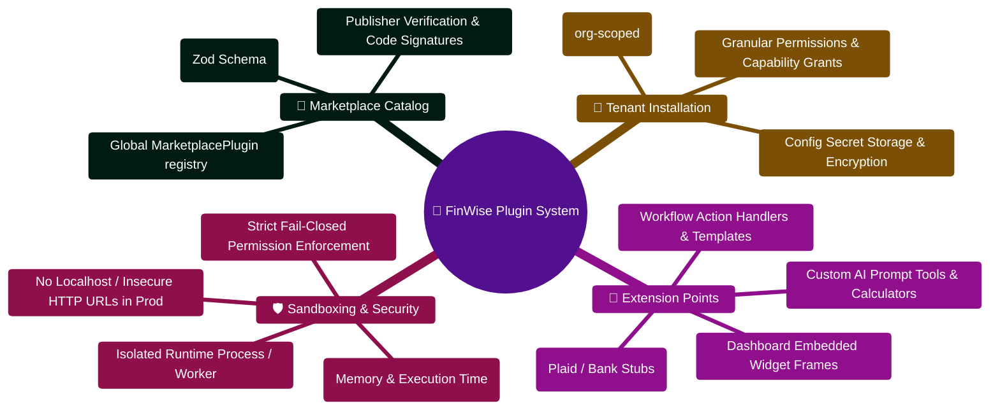

# FinWise — Plugin System

> Architecture, permission model, and runtime reference for the FinWise plugin system. Plugins extend FinWise's functionality through a sandboxed, permission-enforced runtime.

---

> [!TIP]
> **Developer Guide: Building & Extending on This Project**  
> For complete step-by-step blueprints, Mongoose models, Zod schemas, Express controllers, React hooks, and LangGraph subagents, see the [**Master Developer Handbook: Building on This Project**](./BUILDING_ON_THIS_PROJECT.md).

## Architecture Overview

```text
┌────────────────────────────────────────────────────────────────────────┐
│                      FinWise Core Server Engine                        │
│                                                                        │
│  ┌──────────────┐   ┌────────────────┐   ┌────────────────────────┐    │
│  │  Marketplace │──►│ Plugin Manager │──►│ Runtime Client (HTTP)  │───┼──► Plugin Runtime
│  │  Controller  │   │                │   │                        │    │    (Isolated VM)
│  └──────────────┘   └───────┬────────┘   └────────────────────────┘    │
│                             │                                          │
│                    ┌────────▼────────┐                                 │
│                    │   Permission    │                                 │
│                    │   Sandbox       │                                 │
│                    └────────┬────────┘                                 │
│                             │                                          │
│                    ┌────────▼────────┐                                 │
│                    │   Permission    │                                 │
│                    │   Middleware    │                                 │
│                    └─────────────────┘                                 │
└────────────────────────────────────────────────────────────────────────┘
```

---

## Directory Structure

```
server/src/modules/plugins/
├──  pluginManager.ts          # Plugin lifecycle (install, update, uninstall)
├──  permissionSandbox.ts      # Permission evaluation and enforcement
├──  permissionMiddleware.ts   # Express middleware for permission checks
├──  runtimeClient.ts          # HTTP client for plugin runtime service
└──  types.ts                  # Plugin type definitions and interfaces
```

---

## Components

### Plugin Manager (`pluginManager.ts`)

Manages the full plugin lifecycle:

| Operation     | Description                                           |
| ------------- | ----------------------------------------------------- |
| **Install**   | Validate manifest, check permissions, register plugin |
| **Update**    | Update plugin version and configuration               |
| **Uninstall** | Remove plugin, clean up permissions and data          |
| **List**      | Get installed plugins for an organization             |

The plugin manager validates manifests before installation, ensures required permissions are within the org's capability set, and persists plugin state in the database.

### Permission Sandbox (`permissionSandbox.ts`)

Enforces a **fail-closed** permission model:

```ts
// Permission check flow
1. Plugin requests an action (e.g., "read transactions")
2. Sandbox looks up the plugin's granted permissions
3. If the permission is NOT explicitly granted → DENY (fail-closed)
4. If the permission IS granted → ALLOW
```

**Supported permission scopes:**

| Scope                | Description                 |
| -------------------- | --------------------------- |
| `transactions:read`  | Read transaction data       |
| `transactions:write` | Create/update transactions  |
| `accounts:read`      | Read financial accounts     |
| `budgets:read`       | Read budget allocations     |
| `budgets:write`      | Modify budget allocations   |
| `profile:read`       | Read user financial profile |
| `insights:read`      | Read AI-generated insights  |
| `exports:write`      | Generate data exports       |

### Permission Middleware (`permissionMiddleware.ts`)

Express middleware that:

1. Checks if the requesting plugin has the required scope for the target endpoint
2. Validates plugin manifest structures (`POST /api/v1/plugins/validate-manifest`)
3. Returns `403 INSUFFICIENT_PLUGIN_PERMISSIONS` on denial

### Runtime Client (`runtimeClient.ts`)

HTTP client for communicating with the external plugin runtime service:

| Config Variable                  | Default | Description                     |
| -------------------------------- | ------- | ------------------------------- |
| `PLUGIN_RUNTIME_URL`             | —       | Base URL of the runtime service |
| `PLUGIN_RUNTIME_TOKEN`           | —       | Auth token for runtime API      |
| `PLUGIN_RUNTIME_TIMEOUT_MS`      | `15000` | Request timeout                 |
| `PLUGIN_RUNTIME_ALLOW_INSECURE`  | auto    | Allow HTTP (non-HTTPS) URLs     |
| `PLUGIN_RUNTIME_ALLOW_LOCALHOST` | auto    | Allow localhost URLs            |

> Both `ALLOW_INSECURE` and `ALLOW_LOCALHOST` default to `true` in non-production, `false` in production.

---

## API Endpoints

| Method | Endpoint                            | Description                  |
| ------ | ----------------------------------- | ---------------------------- |
| `GET`  | `/api/v1/marketplace/catalog`       | Browse available plugins     |
| `POST` | `/api/v1/marketplace/install`       | Install a plugin             |
| `GET`  | `/api/v1/plugins`                   | List installed plugins       |
| `POST` | `/api/v1/plugins/:id/update`        | Update plugin config/version |
| `POST` | `/api/v1/plugins/:id/uninstall`     | Uninstall a plugin           |
| `POST` | `/api/v1/plugins/validate-manifest` | Validate a plugin manifest   |

---

## Plugin Manifest

Plugins declare their capabilities and requirements in a manifest:

```json
{
  "name": "expense-tracker-pro",
  "version": "1.0.0",
  "description": "Advanced expense tracking and categorization",
  "permissions": ["transactions:read", "transactions:write", "accounts:read"],
  "hooks": {
    "onTransactionCreate": true,
    "onMonthClose": true
  },
  "config": {
    "apiEndpoint": "https://plugin.example.com/api",
    "webhookUrl": "https://plugin.example.com/webhook"
  }
}
```

Validate manifests before submission with `POST /api/v1/plugins/validate-manifest`.

---

## Connectors

External service connectors live in `server/src/connectors/`:

| File                   | Description                                 |
| ---------------------- | ------------------------------------------- |
| `registry.ts`          | Connector type registry and lookup          |
| `types.ts`             | Connector interface definitions             |
| `bankStubConnector.ts` | Stub bank connector for development/testing |

Connectors implement a standard interface for data synchronization and health reporting. The `connectorHealth` service monitors connector status and detects stale connections.

---

## Security Model

1. **Fail-closed** — Any action not explicitly permitted is denied
2. **Org-scoped** — Plugins are installed per-organization, not globally
3. **Manifest validation** — Manifests are validated against the schema before installation
4. **Runtime isolation** — Plugin code runs in a separate runtime service, not in the main server process
5. **Network restrictions** — Production disallows insecure (HTTP) and localhost plugin URLs

---

_See also_: [SECURITY.md](./SECURITY.md) · [MIDDLEWARE.md](./MIDDLEWARE.md) · [ENV_VARIABLES.md](./ENV_VARIABLES.md) · [API.md](./API.md)

## Plugin Architecture & Extensibility Mindmap



## Plugin Installation & Runtime Execution ASCII Flow

```text
┌────────────────────────────────────────────────────────────────────────┐
│ 🟢 TENANT DISCOVERY: Browse Marketplace Plugins                        │
│    User navigates to Marketplace in FinanceOS                          │
└───────────────────────────────────┬────────────────────────────────────┘
                                    │
                                    ▼
┌────────────────────────────────────────────────────────────────────────┐
│ 🛡️ STAGE 1: MANIFEST VALIDATION & PERMISSION AUDIT                     │
│    ├─► Download and parse plugin-manifest.json                         │
│    ├─► Verify declared permissions (e.g. read:transactions, net:plaid) │
│    └─► Reject unverified capabilities or untrusted HTTP endpoints 🔴   │
└───────────────────────────────────┬────────────────────────────────────┘
                                    │
                                    ▼
┌────────────────────────────────────────────────────────────────────────┐
│ 🏢 STAGE 2: TENANT ORG-SCOPED INSTALLATION                             │
│    ├─► Admin approves permissions for organization                     │
│    ├─► Upsert PluginInstall { pluginId, orgId, enabled: true }         │
│    └─► Encrypt and store API credentials & configuration               │
└───────────────────────────────────┬────────────────────────────────────┘
                                    │
                                    ▼
┌────────────────────────────────────────────────────────────────────────┐
│ ⚡ STAGE 3: SANDBOXED EXECUTION & DISPATCH                             │
│    ├─► Connector execution triggered by BullMQ sync worker             │
│    ├─► Run in isolated sandbox process with restricted fetch()         │
│    ├─► Inject only tenant-scoped financial models                      │
│    └─► Stream synced transactions safely into MongoDB 🟢               │
└────────────────────────────────────────────────────────────────────────┘
```


---

## Production Implementation Blueprint (`server/src/modules/plugins/pluginManager.ts`)

```typescript
import mongoose from "mongoose";
import { logger } from "../../config/logger";
import { upsertTool, unregisterTool } from "../../services/tools/registry";
import { upsertConnector, unregisterConnector } from "../../connectors/registry";
import PluginInstallModel from "../../models/pluginInstallModel";
import { executePluginTool, syncPluginConnector } from "./runtimeClient";
import type { PluginRuntimeTool, PluginRuntimeConnector } from "./types";

/**
 * Manages plugin lifecycle, registering sandboxed dynamic tools and data connectors
 * within the active organization context.
 */
export async function installPlugin(orgId: string, pluginId: string, config: Record<string, any>): Promise<void> {
  logger.info({ orgId, pluginId }, "Installing plugin into organization context");

  // 1. Verify and record installation in MongoDB
  const installRecord = await PluginInstallModel.findOneAndUpdate(
    { orgId, pluginId },
    { $set: { enabled: true, config, installedAt: new Date() } },
    { upsert: true, new: true }
  );

  // 2. Register runtime tools in the domain execution catalog
  if (config.tools && Array.isArray(config.tools)) {
    for (const tool of config.tools as PluginRuntimeTool[]) {
      upsertTool(orgId, {
        tool: tool.tool,
        title: tool.title,
        description: tool.description,
        risk_default: tool.risk_default,
        handler: async (args: any, context: any) => {
          return executePluginTool(orgId, pluginId, tool.tool, args, context);
        },
      });
    }
  }

  logger.info({ orgId, pluginId, installId: installRecord._id }, "Plugin successfully registered and activated");
}
```