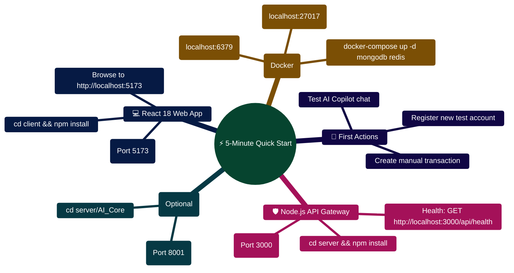

# FinWise — Quick Start Guide

> [!TIP]
> **Developer Guide: Building & Extending on This Project**  
> For complete step-by-step blueprints, Mongoose models, Zod schemas, Express controllers, React hooks, and LangGraph subagents, see the [**Master Developer Handbook: Building on This Project**](./BUILDING_ON_THIS_PROJECT.md).

> Get FinWise running locally in 5 minutes.

## Prerequisites

Ensure you have these installed:

- **Node.js** >=24.14.1 <25 and **npm** >=11.0.0 (Node 24 LTS)
- **MongoDB** 7.0+ (running locally or connection URI)
- **Redis** 7+ (running locally)
- **Python** 3.11+ (for AI features)

## Quick Setup

### 1. Clone and Install

```bash
# Clone the repository
git clone <repository-url>
cd personal-finance

# Install server dependencies
cd server
npm install

# Install client dependencies
cd ../client
npm install

# Install AI Core dependencies (optional)
cd ../server/AI_Core
python -m venv .venv
# Windows:
.venv\Scripts\activate
# macOS/Linux:
source .venv/bin/activate
pip install -r requirements.txt
cd ../..
```

### 2. Configure Environment Variables

**Server** (`server/.env`):

```bash
# Required
NODE_ENV=development
PORT=3000
MONGO_URI=mongodb://localhost:27017/finwise
REDIS_URL=redis://localhost:6379
JWT_SECRET=your-secret-key-here

# Optional: AI Core
PYTHON_API_URL=http://localhost:8001
```

**Client** (`client/.env`):

```bash
VITE_API_BASE_URL=http://localhost:3000
```

**AI Core** (`server/AI_Core/.env`):

```bash
# Optional: For full AI features
GEMINI_API_KEY=your-gemini-api-key
```

### 3. Start Services

Open **three terminal windows**:

**Terminal 1 - Server:**
```bash
cd server
npm run dev
# Runs on http://localhost:3000
```

**Terminal 2 - Client:**
```bash
cd client
npm run dev
# Runs on http://localhost:5173
```

**Terminal 3 - AI Core (optional):**
```bash
cd server/AI_Core
.venv\Scripts\activate  # Windows
# source .venv/bin/activate  # macOS/Linux
python api_service.py
# Runs on http://localhost:8001
```

### 4. Verify Installation

1. Open browser to **http://localhost:5173**
2. You should see the FinWise app
3. Create an account or sign in
4. Try creating a transaction to verify database connectivity

## Optional: Background Worker

For background jobs and scheduled tasks:

```bash
cd server
npm run worker:dev
```

## Troubleshooting

**MongoDB connection failed:**
- Ensure MongoDB is running: `mongod --version`
- Check connection URI in `server/.env` (`MONGO_URI`)

**Redis connection failed:**
- Ensure Redis is running: `redis-cli ping` (should return PONG)
- Check connection URI in `server/.env` (`REDIS_URL`)

**Port already in use:**
- Change `PORT` in `server/.env`
- Change `server.port` in `client/vite.config.ts` proxy settings

**AI features not working:**
- AI Core is optional; app works without it
- Check `PYTHON_API_URL` in `server/.env`
- Verify Python service is running on port 8001

## Next Steps

- [Complete Setup Guide](./SETUP.md) - Detailed setup with all features
- [Architecture Overview](./ARCHITECTURE.md) - Understand the system design
- [API Documentation](./API.md) - Available API endpoints
- [Development Guide](./DEVELOPMENT.md) - Common dev tasks
- [Troubleshooting](./TROUBLESHOOTING.md) - Common issues and solutions

## Build for Production

**Client:**
```bash
cd client
npm run build
# Outputs to client/dist/
```

**Server:**
```bash
cd server
npm run build
npm start
```

See [DEPLOYMENT.md](./DEPLOYMENT.md) for production deployment guide.

## 5-Minute Quick Start Mindmap



## Developer Fast-Track Boot Sequence ASCII Flow

```text
┌────────────────────────────────────────────────────────────────────────┐
│ 🟢 STEP 1: SPIN UP BACKGROUND SERVICES                                 │
│    $ docker-compose up -d mongodb redis                               │
│    ► Mongo: localhost:27017 • Redis: localhost:6379                    │
└───────────────────────────────────┬────────────────────────────────────┘
                                    │
                                    ▼
┌────────────────────────────────────────────────────────────────────────┐
│ 🔷 STEP 2: START BACKEND API GATEWAY                                   │
│    $ cd server && cp .env.example .env && npm run dev                  │
│    ► Express listening on http://localhost:3000                        │
└───────────────────────────────────┬────────────────────────────────────┘
                                    │
                                    ▼
┌────────────────────────────────────────────────────────────────────────┐
│ 🧠 STEP 3: START PYTHON AI CORE (Optional for AI copilot)              │
│    $ cd server/AI_Core && uvicorn api_service:app --port 8001          │
│    ► FastAPI listening on http://localhost:8001                        │
└───────────────────────────────────┬────────────────────────────────────┘
                                    │
                                    ▼
┌────────────────────────────────────────────────────────────────────────┐
│ 📱 STEP 4: LAUNCH FRONTEND WEB PORTAL                                  │
│    $ cd client && cp .env.example .env && npm run dev                  │
│    ► Vite dev server running on http://localhost:5173 🟢               │
└────────────────────────────────────────────────────────────────────────┘
```

---

## 2026 Enterprise Quick Smoke Test

Verify the newly added 2026 enterprise capabilities:

1. **Command Center Cockpit**: Browse to `http://localhost:5173/` and verify liquid cash runway in days and priority signal triage chips.
2. **Transaction Review Queue**: Browse to `http://localhost:5173/transactions?tab=review` and test one-click approval or "Always categorize like this".
3. **Automated Newsletter Trigger**: Test manual dispatch:
   ```bash
   curl -X POST http://localhost:3000/api/v1/newsletter/trigger-now \
     -H "Authorization: Bearer <USER_TOKEN>"
   ```
4. **Server-Side PDF Generation**:
   ```bash
   curl -X POST http://localhost:3000/api/v1/files/render-prompt \
     -H "Authorization: Bearer <USER_TOKEN>" \
     -H "Content-Type: application/json" \
     -d '{"title":"Test Report","content":"Executive Summary text"}'
   ```
