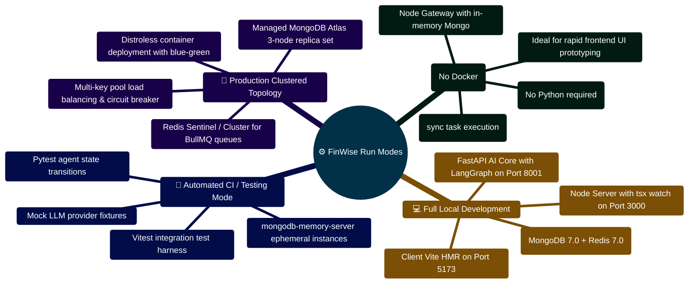

# FinWise Run Mode Matrix

This document explains how FinWise behaves in different process modes.

It focuses on the practical question:

"Which process is responsible for what in my current environment?"

## 1. Why this file matters

The repository supports more than one valid runtime shape:

- client only
- client + server
- client + server + AI Core
- client + server + AI Core + worker

The most important distinction is whether async jobs run inline in the server
process or through the dedicated worker.

## 2. Core services

| Service | Primary responsibility |
| -- | -- |
| `client` | React SPA, routing, UI, API consumption |
| `server` | REST API, auth, middleware, grounding, route orchestration |
| `AI_Core` | multi-agent reasoning, OCR, session memory, AI workflows |
| `worker` | background execution for queued workflow, export, and integration jobs |

## 3. Mode matrix

| Mode | `ASYNC_JOBS_ENABLED` | Workflow scheduler owner | Job execution owner | Notes |
| -- | -- | -- | -- | -- |
| Local lightweight mode | `false` | `server` | `server` | Simplest mode; fewer processes |
| Full async mode | `true` | `worker` | `worker` | Best match for dedicated background processing |
| Test mode | varies | usually suppressed or constrained | test-specific | Confirm test assumptions per suite |

## 4. What the server does

Based on `server/src/server.ts`:

- validates environment
- initializes telemetry
- configures auth
- connects to MongoDB
- starts plugin and realtime services
- may start the workflow scheduler when async jobs are not delegated
- mounts the Express app and routes
- starts domain event polling outside test mode

### Scheduler behavior in the server

The server starts the workflow scheduler only when:

- `NODE_ENV !== "test"`
- `ASYNC_JOBS_ENABLED === false`

That means the server owns scheduled workflow ticking only in inline mode.

## 5. What the worker does

Based on `server/src/worker/worker.ts`:

- exits immediately when `ASYNC_JOBS_ENABLED=false`
- requires a strict MongoDB connection
- claims queued jobs from MongoDB-backed run collections
- processes:
  - `workflow_run`
  - `integration_sync_run`
  - `export_job`
- starts the workflow scheduler in worker mode outside test

### Scheduler behavior in the worker

The worker starts the scheduler when:

- `ASYNC_JOBS_ENABLED === true`
- `NODE_ENV !== "test"`

So in async mode, the worker is the expected scheduler owner.

## 6. What `enqueueWorkflowRun` does in each mode

Based on `server/src/services/workflows.ts`:

### When `ASYNC_JOBS_ENABLED=true`

- workflow runs are queued
- the worker is expected to pick them up
- responses may indicate queued rather than completed work

### When `ASYNC_JOBS_ENABLED=false`

- queued runs are processed inline via `processWorkflowRun`
- there is no dependency on a separate worker process

## 7. Recommended local setups

### Setup A: Docs/UI/API work

Use:

- client
- server
- optional AI Core

Set:

- `ASYNC_JOBS_ENABLED=false`

Why:

- fewer moving parts
- easier local debugging
- suitable for most non-background feature work

### Setup B: Background workflow testing

Use:

- client
- server
- AI Core
- worker

Set:

- `ASYNC_JOBS_ENABLED=true`

Why:

- matches dedicated background execution paths
- useful for workflow, export, and integration testing

## 8. Common misunderstandings

### "The worker is running but nothing happens"

Possible cause:

- `ASYNC_JOBS_ENABLED=false`, so the worker exits intentionally

### "A workflow executed even though the worker was off"

Possible cause:

- async jobs were disabled, so the server processed the run inline

### "Production-like security behavior differs from local"

Possible cause:

- flags like `CSRF_ENABLED` and cookie-related values compute differently by
  environment

## 9. Operational recommendation

When documenting or debugging the app, always note:

- whether AI Core is running
- whether the worker is running
- whether `ASYNC_JOBS_ENABLED` is true or false
- whether you are observing canonical or legacy API routes

These four details explain a large share of environment-specific confusion.

## 10. Companion docs

- `docs/FEATURE_FLAG_MATRIX.md`
- `docs/MAINTAINER_GUIDE.md`
- `docs/KNOWN_ISSUES_AND_DRIFT.md`

## Operational Run Modes & Topologies Mindmap



## Runtime Environment Topology Decision ASCII Flow

```text
┌────────────────────────────────────────────────────────────────────────┐
│ 🟢 SELECT TARGET OPERATION ENVIRONMENT                                 │
└───────────────────────────────────┬────────────────────────────────────┘
                                    │
         ┌──────────────────────────┼──────────────────────────┐
         ▼                          ▼                          ▼
┌──────────────────┐       ┌──────────────────┐       ┌──────────────────┐
│ 🌱 DEV MINIMAL   │       │ 💻 DEV COMPLETE  │       │ 🚀 PRODUCTION    │
│  No Docker/Redis │       │  Full Stack      │       │  Full HA Cluster │
│  In-Memory Mongo │       │  Docker Services │       │  Mongo ReplicaSet│
│  Rules Fallback  │       │  AI Core Active  │       │  KeyPool Failover│
└────────┬─────────┘       └────────┬─────────┘       └────────┬─────────┘
         │                          │                          │
         └──────────────────────────┼──────────────────────────┘
                                    │
                                    ▼
┌────────────────────────────────────────────────────────────────────────┐
│ 🔍 PRE-FLIGHT VERIFICATION OF ACTIVE CAPABILITIES                      │
│    ├─► Check AI Core Reachability: GET http://localhost:8001/health    │
│    ├─► Check Redis Reachability: redis-cli ping                        │
│    └─► Server config adapts automatically (degrades gracefully) 🟢     │
└────────────────────────────────────────────────────────────────────────┘
```


---

> [!TIP]
> **Developer Guide: Building & Extending on This Project**  
> For complete step-by-step blueprints, Mongoose models, Zod schemas, Express controllers, React hooks, and LangGraph subagents, see the [**Master Developer Handbook: Building on This Project**](./BUILDING_ON_THIS_PROJECT.md).

## Production Implementation Blueprint: Run-Mode Configuration Resolver (`server/src/config/runMode.ts`)

```typescript
import { getEnv } from "./env";
import { logger } from "../config/logger";

export interface ResolvedRunMode {
  mode: "development" | "production" | "test" | "airgapped";
  asyncWorkersEnabled: boolean;
  aiCoreAvailable: boolean;
  redisCacheActive: boolean;
}

export function resolveSystemRunMode(): ResolvedRunMode {
  const env = getEnv();
  const isProd = env.NODE_ENV === "production";
  const isTest = env.NODE_ENV === "test";

  const resolved: ResolvedRunMode = {
    mode: isProd ? "production" : isTest ? "test" : "development",
    asyncWorkersEnabled: Boolean(process.env.ASYNC_JOBS_ENABLED !== "false"),
    aiCoreAvailable: Boolean(env.PYTHON_API_URL),
    redisCacheActive: Boolean(env.REDIS_URL),
  };

  logger.info(
    { runMode: resolved.mode, asyncWorkers: resolved.asyncWorkersEnabled, aiCore: resolved.aiCoreAvailable },
    "Resolved system operational run-mode"
  );

  return resolved;
}
```

---

## 8. 2026 Enterprise Subsystem Execution Matrix

How newly added enterprise capabilities behave across different run modes:

| Enterprise Capability | Local Dev Mode (`ASYNC_JOBS_ENABLED=false`) | Clustered Production (`ASYNC_JOBS_ENABLED=true`) |
| :--- | :--- | :--- |
| **RAG Phase 2 Chunking** | Inline execution during file upload | Offloaded to background BullMQ chunking queue |
| **BullMQ Newsletter Cron** | Polled by Express gateway process every 60s | Executed by dedicated worker container |
| **Dead Letter Queue (DLQ)** | In-memory retry fallback | Quarantined in Redis `bull:finwise-dlq` (500 cap) |
| **PDFKit Compilation** | Direct HTTP streaming to GridFS | Dedicated worker compiles large statement files |
| **Conversation Insights** | In-process 64-slot Promise coalescing buffer | L1 Memory + L2 Redis shared cluster cache |
| **Multi-Agent DAG** | Local FastAPI on port 8001 | Auto-scaled FastAPI containers behind load balancer |
