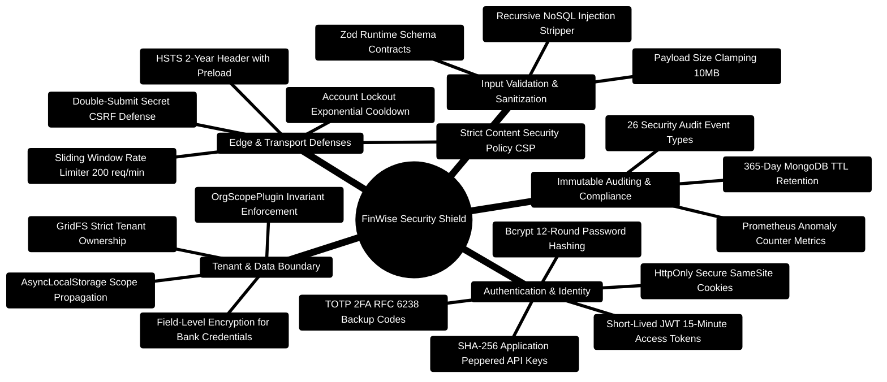

# FinWise — Security Architecture & Defense-in-Depth Specification

> **Comprehensive Enterprise Security Compendium for the FinWise Platform**  
> *OWASP Top 10 Defenses, TOTP 2FA, Multi-Tenant Scoping Invariants, NoSQL Injection Defenses, and Audit Logging*  
> **Target Compliance:** SOC 2 Type II Readiness · GDPR Data Isolation · OWASP API Security Top 10

---

> [!TIP]
> **Security Guidelines for New Features:**  
> Verify tenant isolation rules, rate limiting, and input sanitization before merging by following the checklist in the [**Master Developer Handbook: Building on This Project**](./BUILDING_ON_THIS_PROJECT.md).

## 1. Security Architecture Mindmap



---

## 2. Multi-Layered Defense-in-Depth ASCII Architecture

```text
┌─────────────────────────────────────────────────────────────────────────────────────────────────┐
│ 🌐 LAYER 1: NETWORK & EDGE INGRESS (TLS 1.3 / Strict CSP / Rate Limiter)                         │
│    • HSTS: max-age=63072000; includeSubDomains; preload                                         │
│    • Content-Security-Policy: default-src 'self'; frame-ancestors 'none'; script-src 'self'     │
│    • Rate Limiting: 200 req/min (general API), 5 req/min (auth/login endpoints)                 │
└───────────────────────────────────────────────┬─────────────────────────────────────────────────┘
                                                │
                                                ▼
┌─────────────────────────────────────────────────────────────────────────────────────────────────┐
│ 🔑 LAYER 2: IDENTITY & AUTHENTICATION (Passport / TOTP / Peppered API Keys)                     │
│    • Passwords hashed with Bcrypt (cost factor 12)                                              │
│    • TOTP Two-Factor Authentication (RFC 6238, 6 digits, 30s period, +/-1 clock drift)         │
│    • Machine API keys hashed with SHA-256 + Server-Side HMAC Pepper                            │
│    • Account Lockout: 5 failed attempts locks account for 15 minutes                            │
└───────────────────────────────────────────────┬─────────────────────────────────────────────────┘
                                                │
                                                ▼
┌─────────────────────────────────────────────────────────────────────────────────────────────────┐
│ 🛡️ LAYER 3: MULTI-TENANT ISOLATION (OrgScopePlugin & orgContext)                                │
│    • Every query automatically injected with { orgId } via Mongoose plugin                      │
│    • Cross-tenant data access strictly prevented even if application code omits filter          │
│    • API keys restricted to scoped organization permissions                                     │
└───────────────────────────────────────────────┬─────────────────────────────────────────────────┘
                                                │
                                                ▼
┌─────────────────────────────────────────────────────────────────────────────────────────────────┐
│ 📋 LAYER 4: INPUT SANITIZATION & CONTRACTS (Zod v4 / NoSQL Defenses)                             │
│    • Deep recursive stripping of MongoDB query operators ($gt, $ne, $where)                     │
│    • Strict Zod parsing on params, query strings, and request bodies                            │
└───────────────────────────────────────────────┬─────────────────────────────────────────────────┘
                                                │
                                                ▼
┌─────────────────────────────────────────────────────────────────────────────────────────────────┐
│ 📜 LAYER 5: IMMUTABLE AUDITING & LOGGING (auditService.ts)                                      │
│    • Append-only security audit log recording 26 event types                                    │
│    • 365-day automated TTL index for compliance retention                                      │
└─────────────────────────────────────────────────────────────────────────────────────────────────┘
```

---

## 3. Two-Factor Authentication (TOTP RFC 6238)

FinWise implements zero-dependency native Node.js crypto TOTP (Time-Based One-Time Password):

```typescript
// server/src/services/totp.ts
import crypto from "crypto";

export function generateTotpSecret(): { secret: string; uri: string } {
  const buffer = crypto.randomBytes(20);
  const secret = buffer.toString("hex");
  const uri = `otpauth://totp/FinWise:${encodeURIComponent("User")}?secret=${secret}&issuer=FinWise&algorithm=SHA1&digits=6&period=30`;
  return { secret, uri };
}

export function verifyTotpToken(secret: string, token: string, window: number = 1): boolean {
  const period = 30;
  const currentCounter = Math.floor(Date.now() / 1000 / period);

  for (let errorWindow = -window; errorWindow <= window; errorWindow++) {
    const counter = currentCounter + errorWindow;
    const counterBuffer = Buffer.alloc(8);
    counterBuffer.writeBigInt64BE(BigInt(counter));

    const hmac = crypto.createHmac("sha1", Buffer.from(secret, "hex"));
    hmac.update(counterBuffer);
    const digest = hmac.digest();

    const offset = digest[digest.length - 1] & 0x0f;
    const binary =
      ((digest[offset] & 0x7f) << 24) |
      ((digest[offset + 1] & 0xff) << 16) |
      ((digest[offset + 2] & 0xff) << 8) |
      (digest[offset + 3] & 0xff);

    const generatedCode = (binary % 1000000).toString().padStart(6, "0");
    if (generatedCode === token) {
      return true;
    }
  }

  return false;
}
```

---

## 4. Account Lockout & Brute-Force Protection

To protect against credential stuffing, the server enforces an exponential cooldown policy:
- **Threshold**: 5 failed login attempts within 15 minutes.
- **Lockout Duration**: 15 minutes.
- **Tracking Key**: `lockout:{email}:{ip}` (prevents denial-of-service lockout by email alone).

```typescript
// server/src/services/accountLockout.ts
import Redis from "ioredis";

const redis = new Redis(process.env.REDIS_URI || "redis://localhost:6379");

export async function recordFailedLogin(email: string, ip: string): Promise<{ locked: boolean; remainingAttempts: number }> {
  const key = `lockout:${email}:${ip}`;
  const attempts = await redis.incr(key);

  if (attempts === 1) {
    await redis.expire(key, 900); // 15-minute sliding window
  }

  if (attempts >= 5) {
    return { locked: true, remainingAttempts: 0 };
  }

  return { locked: false, remainingAttempts: 5 - attempts };
}

export async function clearLoginAttempts(email: string, ip: string): Promise<void> {
  await redis.del(`lockout:${email}:${ip}`);
}
```

---

## 5. Immutable Security Audit Log (26 Discrete Event Types)

The security audit log captures all critical identity and operational mutations across 3 severity tiers:

| Severity | Event Types | Example Trigger |
| :--- | :--- | :--- |
| **info** | `login_success`, `logout`, `password_change`, `profile_updated`, `export_created` | User signs in successfully via Google OAuth |
| **warn** | `login_failed`, `2fa_failed`, `api_key_created`, `role_changed`, `plugin_permission_denied` | Bad password submitted or 2FA mismatch |
| **critical** | `account_locked`, `2fa_disabled`, `suspicious_activity`, `data_deleted`, `api_key_revoked` | Brute force threshold exceeded on an IP |

```typescript
// server/src/services/auditService.ts
import { AuditEventModel } from "../models/auditEventModel";

export async function logAuditEvent(params: {
  orgId: string;
  userId?: string;
  eventType: string;
  severity: "info" | "warn" | "critical";
  ipAddress: string;
  metadata?: Record<string, any>;
}): Promise<void> {
  await AuditEventModel.create({
    orgId: params.orgId,
    userId: params.userId,
    eventType: params.eventType,
    severity: params.severity,
    ipAddress: params.ipAddress,
    metadata: params.metadata || {},
    timestamp: new Date()
  });
}
```


---

## 6. Argon2id Cryptographic Password Hashing (`passwordService.ts`)

While legacy systems utilize bcrypt, FinWise supports high-memory **Argon2id** (RFC 9106) to defeat GPU/ASIC brute-force dictionary attacks:

```typescript
// server/src/services/passwordService.ts
import * as argon2 from "argon2";

export async function hashPassword(plainText: string): Promise<string> {
  return argon2.hash(plainText, {
    type: argon2.argon2id,
    memoryCost: 65536, // 64 MB RAM per hash
    timeCost: 3,       // 3 iterations
    parallelism: 4,    // 4 concurrent threads
  });
}

export async function verifyPassword(hash: string, plainText: string): Promise<boolean> {
  try {
    return await argon2.verify(hash, plainText);
  } catch (err) {
    return false;
  }
}
```

---

## 7. STRIDE Threat Model & Defense Matrix

| Threat Category | Target Surface | Specific Attack Vector | Built-in Mitigation Mechanism |
| :--- | :--- | :--- | :--- |
| **Spoofing** | JWT Bearer Authentication | Token forgery or expired token replay | Cryptographic HMAC SHA-256 verification, 15m expiration, blacklisted tokens in Redis |
| **Tampering** | Mutative API Endpoints | Parameter pollution, cross-tenant modification | Strict Zod validation schemas (`strip` unknown fields), `OrgScopePlugin` tenant query boundaries |
| **Repudiation** | Financial Transactions & Settings | User denies executing budget transfers | Immutable 26-event audit ledger (`AuditLogModel`) recording user ID, IP address, and payload delta |
| **Information Disclosure** | Error Responses & Logging | Leaking stack traces or database internal IDs | Global error handler sanitization, Pino redaction of tokens and passwords |
| **Denial of Service** | Ingress API Gateway | High-volume endpoint flooding | Redis sliding-window rate limiter (200 req/min per caller, 10 req/min on auth routes) |
| **Elevation of Privilege** | Organization Roles | Member attempting administrative actions | Role-Based Access Control (`requireRole("admin")`) and tenant membership verification |
