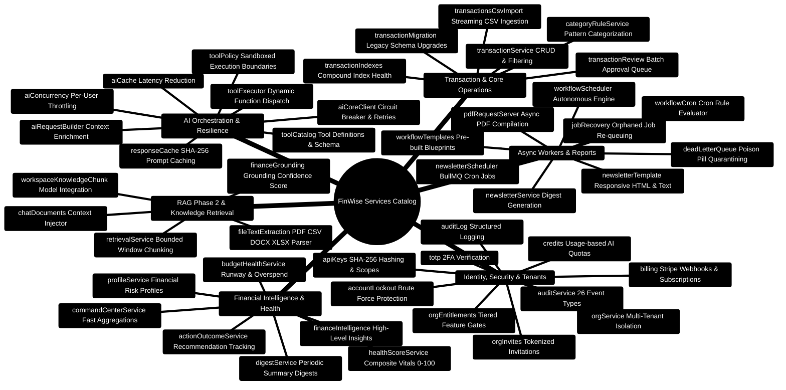

# FinWise — Backend Services Catalog & Implementation Blueprints

> **Exhaustive Domain Service Compendium for the FinWise Express 5 Gateway**  
> *Production Engineering Reference, Domain Service Architecture, Lifecycle ASCII Flows, and Implementation Blueprints*  
> **Runtime Specification:** Node.js `>=24.14.1 <25` · TypeScript `5.9` · Express `5.x` · MongoDB `7.0` (Mongoose 8) · Redis `7.0` · BullMQ `5.x`

---

> [!TIP]
> **Implementing New Domain Services?**  
> Check the standardized service recipes, transactional patterns, and error handling in the [**Master Developer Handbook: Building on This Project**](./BUILDING_ON_THIS_PROJECT.md).

## 1. Service Layer Architectural Principles

In FinWise, Express controllers are strictly thin, declarative HTTP translation layers. All business logic, transaction boundaries, multi-tenant isolation, caching policies, and asynchronous background queues are encapsulated inside domain services in `server/src/services/`.

### Core Engineering Invariants
1. **Multi-Tenant Scoping**: Every service operation requires an explicit `orgId` parameter or operates on Mongoose queries instrumented with `OrgScopePlugin`.
2. **Deterministic Calculations First**: Financial vitals, interest schedules, and runway calculations are computed using pure mathematical functions before passing results to AI or presentation layers.
3. **Resilience & Fault Isolation**: External RPC calls (such as invocations to the Python AI Core or Stripe APIs) are wrapped in timeouts, exponential backoff retries, and circuit breakers.
4. **Asynchronous Decoupling**: CPU-intensive operations (PDF generation, newsletter compilation, batch CSV imports) are offloaded to BullMQ Redis queues with Dead Letter Queue (DLQ) quarantining.

---

## 2. Service Layer Topology Mindmap



---

## 3. End-to-End Service Execution ASCII Flow

```text
┌────────────────────────────────────────────────────────────────────────────────────────────────────────┐
│ 🟢 INCOMING HTTP REQUEST: POST /api/v1/command-center/vitals                                           │
└───────────────────────────────────┬────────────────────────────────────────────────────────────────────┘
                                    │
                                    ▼
┌────────────────────────────────────────────────────────────────────────────────────────────────────────┐
│ 🔍 STEP 1: COMPOSITION ORCHESTRATION (commandCenterService.ts)                                         │
│    ├─► Call healthScoreService.ts ──► Aggregate 30-day cash flow & emergency fund runway               │
│    ├─► Call budgetHealthService.ts ──► Calculate envelope adherence & overspend velocity               │
│    ├─► Call transactionReview.ts ──► Count pending unreviewed transactions & low-confidence flags      │
│    └─► Check aiCache.ts ──► Retrieve cached AI summary or dispatch background async refresh            │
└───────────────────────────────────┬────────────────────────────────────────────────────────────────────┘
                                    │
                                    ▼
┌────────────────────────────────────────────────────────────────────────────────────────────────────────┐
│ 🧮 STEP 2: HEALTH SCORE EVALUATION (healthScoreService.ts)                                             │
│    Formula: Score = 0.35 * SavingsRate + 0.25 * DebtRatio + 0.20 * Runway + 0.20 * Adherence           │
│    Result: Composite Score = 84 / 100 ("Excellent")                                                    │
└───────────────────────────────────┬────────────────────────────────────────────────────────────────────┘
                                    │
                                    ▼
┌────────────────────────────────────────────────────────────────────────────────────────────────────────┐
│ 🧠 STEP 3: CONTEXT GROUNDING & ENRICHMENT (financeGrounding.ts & retrievalService.ts)                  │
│    ├─► Query WorkspaceKnowledgeChunk collection for recent financial plan notes                        │
│    ├─► Calculate Grounding Score G = 0.60 * R_lexical + 0.40 * S_semantic = 0.88 (PASS >= 0.70)       │
│    └─► Attach verified citation: [doc_7a9f:chunk_3] "Q3 Debt Acceleration Strategy"                    │
└───────────────────────────────────┬────────────────────────────────────────────────────────────────────┘
                                    │
                                    ▼
┌────────────────────────────────────────────────────────────────────────────────────────────────────────┐
│ 🚀 STEP 4: RESPONSE ENVELOPE SERIALIZATION & RETURN                                                    │
│    Return JSON payload { healthScore: 84, runwayMonths: 6.2, unreviewedCount: 3, citations: [...] }   │
└────────────────────────────────────────────────────────────────────────────────────────────────────────┘
```

---

## 4. Comprehensive Service Directory (All 60 Services)

### 4.1 Financial Intelligence & Health Scoring Services

| Service | File | Primary Responsibility | Key Dependent Models |
| :--- | :--- | :--- | :--- |
| **healthScoreService** | `healthScoreService.ts` | Calculates composite Financial Health Score (0–100) aggregating 4 pillars (Savings, Debt, Runway, Adherence). Backed by historical trend recording. | `HealthScore`, `TransactionModel`, `FinancialProfileModel` |
| **budgetHealthService** | `budgetHealthService.ts` | Computes envelope burn rates, overspend projections, and warning chips for category budgets. | `BudgetAllocationModel`, `TransactionModel` |
| **commandCenterService** | `commandCenterService.ts` | Cockpit aggregator resolving liquid cash runway, pending reviews, upcoming bills, and priority signals in a single round-trip. | `AccountModel`, `TransactionModel`, `RecurringRuleModel`, `TaskModel` |
| **financeIntelligence** | `financeIntelligence.ts` | High-level financial analytics engine performing spending anomaly detection and category reallocations. | `TransactionModel`, `FinancialProfileModel` |
| **actionOutcomeService** | `actionOutcomeService.ts` | Verifies whether AI-recommended user tasks yielded measurable net worth improvements over 30/60/90 days. | `TaskModel`, `TransactionModel`, `FinancialProfileModel` |
| **digestService** | `digestService.ts` | Aggregates periodic financial summaries for automated digests. | `TransactionModel`, `BudgetAllocationModel` |
| **profileService** | `profileService.ts` | Manages user financial risk tolerance, investment experience, and core goals. | `FinancialProfileModel` |

---

### 4.2 RAG Phase 2 & Knowledge Retrieval Services

| Service | File | Primary Responsibility | Key Dependent Models |
| :--- | :--- | :--- | :--- |
| **retrievalService** | `retrievalService.ts` | **RAG Phase 2 Core**: Bounded window chunking (1,800 characters / 260-character overlap) and lexical BM25 matching. | `WorkspaceKnowledgeChunk`, `WorkspaceFileModel` |
| **financeGrounding** | `financeGrounding.ts` | Evaluates Grounding Confidence Score ($G = 0.60 \cdot R_{\text{lexical}} + 0.40 \cdot S_{\text{semantic}}$) and injects verifiable citations. | `WorkspaceKnowledgeChunk` |
| **chatDocuments** | `chatDocuments.ts` | Formats extracted knowledge chunks into token-budgeted prompt contexts for LLM execution. | `ChatMessageModel`, `WorkspaceKnowledgeChunk` |
| **fileTextExtraction** | `fileTextExtraction.ts` | Multi-format file parser extracting raw text and structural metadata from PDF, CSV, XLSX, DOCX, and TXT files. | GridFS, `WorkspaceFileModel` |
| **gridfs** | `gridfs.ts` | Low-level MongoDB GridFS bucket streaming for uploaded financial statements and compiled PDF reports. | `mongoose.mongo.GridFSBucket` |

---

### 4.3 AI Orchestration, Tools & Resilience Services

| Service | File | Primary Responsibility | Key Dependent Models |
| :--- | :--- | :--- | :--- |
| **aiCoreClient** | `aiCoreClient.ts` | Resilient HTTP & SSE proxy connecting Node.js to the Python AI Core (Port 8001). Implements circuit breaker and failover. | None (Network Client) |
| **aiRequestBuilder** | `aiRequestBuilder.ts` | Constructs structured agent payloads, enriching user prompts with 30-day transaction history and active budget state. | `TransactionModel`, `BudgetAllocationModel` |
| **aiCache** | `aiCache.ts` | In-memory and Redis L1/L2 cache for AI responses using normalized prompt hashes to reduce inference latency. | `AiResponseCacheModel`, Redis |
| **aiConcurrency** | `aiConcurrency.ts` | Global and per-user semaphore throttling ensuring fair resource allocation and preventing rate limit exhaustion. | Redis |
| **responseCache** | `responseCache.ts` | General-purpose response caching for expensive financial analytical endpoints. | Redis |
| **toolCatalog** | `toolCatalog.ts` | Canonical registry of executable tools exposed to AI agents with JSON Schema definitions. | None (In-Memory Registry) |
| **toolExecutor** | `toolExecutor.ts` | Dispatches tool execution requests from AI agents to corresponding internal TypeScript services. | `ToolExecutionModel` |
| **toolPolicy** | `toolPolicy.ts` | Security boundary verifying that requested tool actions are permitted by tenant role and subscription tier. | `EntitlementModel` |
| **tools/builtins** | `tools/builtins.ts` | Built-in deterministic calculation tools: Loan Amortization, Compound Interest, Tax Estimator. | None (Deterministic Math) |
| **tools/registry** | `tools/registry.ts` | Dynamic tool registration and discovery engine. | None |
| **chatSummary** | `chatSummary.ts` | Incremental rolling conversation summarizer preventing context window blowup. | `ChatSessionModel`, `ChatMessageModel` |
| **journalContext** | `journalContext.ts` | Extracts psychological and financial sentiment context from user journal entries. | `JournalEntryModel` |
| **journalIntentParser** | `journalIntentParser.ts` | Parses freeform text journal entries into structured transaction or goal candidates. | `JournalEntryModel` |

---

### 4.4 Transaction & Core Financial Services

| Service | File | Primary Responsibility | Key Dependent Models |
| :--- | :--- | :--- | :--- |
| **transactionService** | `transactionService.ts` | Core transactional CRUD, pagination, multi-criteria filtering, and balance updates with strict `orgId` tenancy. | `TransactionModel`, `AccountModel` |
| **transactionReview** | `transactionReview.ts` | Manages the **Transaction Review Queue**, handling rule-based classification, confidence scoring, single-click approvals, and batch categorizations. | `TransactionModel`, `CategoryRuleModel` |
| **categoryRuleService** | `categoryRuleService.ts` | Pattern-matching engine that applies user-defined and machine-learned rules (merchant, description, amount) to auto-categorize incoming transactions. | `CategoryRuleModel`, `TransactionModel` |
| **transactionIndexes** | `transactionIndexes.ts` | Diagnostic service verifying that MongoDB compound indexes (`{ orgId: 1, date: -1, category: 1 }`) are active and preventing full-collection scans. | `TransactionModel` |
| **transactionsCsvImport** | `transactionsCsvImport.ts` | High-throughput streaming parser for CSV statements with duplicate detection and column mapping. | `TransactionModel`, `AccountModel` |
| **transactionMigration** | `transactionMigration.ts` | Data migration utilities for upgrading transaction schemas across database versions. | `TransactionModel` |

---

### 4.5 Async Workers, Reports & Schedulers

| Service | File | Primary Responsibility | Key Dependent Models |
| :--- | :--- | :--- | :--- |
| **newsletterService** | `newsletterService.ts` | Generates personalized weekly and monthly financial newsletters, incorporating spending highlights, goal milestones, and educational mini-lessons. | `NewsletterPreference`, `TransactionModel`, `HealthScore` |
| **newsletterScheduler** | `newsletterScheduler.ts` | BullMQ cron-based dispatch service triggering automated digest generation according to user preferences (`newsletterPreferenceModel.ts`). | `NewsletterPreference`, Redis |
| **newsletterTemplate** | `newsletterTemplate.ts` | Generates responsive HTML and accessible plain-text templates for email delivery. | None (Template Engine) |
| **pdfRequestServer** | `pdfRequestServer.ts` | Server-side document compiler using PDFKit to generate branded financial statements, SOP templates, and budget audit reports. | GridFS, `WorkspaceFileModel` |
| **deadLetterQueue** | `deadLetterQueue.ts` | Fault-isolation service that captures poisoned or repeatedly failing BullMQ jobs, quarrantines payloads, and provides administrative replay endpoints. | Redis, BullMQ |
| **jobRecovery** | `jobRecovery.ts` | Monitors stalled and orphaned background jobs, re-enqueuing them safely with jittered exponential backoff. | BullMQ |
| **workflows** | `workflows.ts` | Execution engine for autonomous user-defined workflows (triggers, conditions, actions). | `WorkflowModel`, `WorkflowRunModel` |
| **workflowScheduler** | `workflowScheduler.ts` | Distributed scheduler polling and executing active workflows using Redis distributed locks. | `WorkflowModel` |
| **workflowCron** | `workflowCron.ts` | Evaluates cron expressions for scheduled workflows. | `WorkflowModel` |
| **workflowTemplates** | `workflowTemplates.ts` | Catalog of pre-configured workflow templates (e.g., Monthly Close, High-Spend Alert, Auto-Savings Transfer). | None |
| **exports** | `exports.ts` | Background CSV/JSON/PDF data export generator streaming zip bundles to client. | `ExportJobModel` |

---

### 4.6 Auth, Identity, Security & Organizations

| Service | File | Primary Responsibility | Key Dependent Models |
| :--- | :--- | :--- | :--- |
| **totp** | `totp.ts` | Two-Factor Authentication service managing TOTP secret generation, QR codes, verification, and encrypted backup codes. | `UserModel` |
| **apiKeys** | `apiKeys.ts` | Generates and verifies scoped developer API keys using SHA-256 with application-level pepper and per-organization rate limits. | `ApiKeyModel` |
| **auditService** | `auditService.ts` | Append-only security audit logging capturing 26 discrete event types (auth attempts, permission changes, large transfers). | `AuditEventModel` |
| **auditLog** | `auditLog.ts` | Structured audit event logger with context propagation. | `AuditLogModel` |
| **accountLockout** | `accountLockout.ts` | Brute-force protection tracking failed login attempts and enforcing exponential lockout cooldowns. | `UserModel`, Redis |
| **orgService** | `orgService.ts` | Multi-tenant organization lifecycle management, member roles (Owner, Admin, Member, Viewer), and tenancy scoping. | `OrganizationModel`, `OrgMemberModel` |
| **orgInvites** | `orgInvites.ts` | Secure email invitation workflow with expiring cryptographically random tokens. | `OrgInviteModel` |
| **orgEntitlements** | `orgEntitlements.ts` | Organization-level feature entitlements and seat allocation manager. | `EntitlementModel` |
| **orgDataBackfill** | `orgDataBackfill.ts` | Administrative utility backfilling default organizations and workspace chunks for legacy accounts. | `OrganizationModel`, `WorkspaceKnowledgeChunk` |
| **billing** | `billing.ts` | Stripe integration managing subscriptions, customer portals, checkouts, and webhook fulfillment. | `BillingAccountModel`, `SubscriptionModel` |
| **credits** | `credits.ts` | Metered credit ledger tracking AI token usage and deducts balances. | `CreditGrantModel`, `UsageLedgerModel` |
| **usageLedger** | `usageLedger.ts` | High-frequency append-only ledger for API requests and LLM token usage. | `UsageLedgerModel`, `UsageEventModel` |
| **entitlements** | `entitlements.ts` | Gatekeeper checking whether user or tenant has access to specific capabilities. | `EntitlementModel` |
| **referrals** | `referrals.ts` | Referral code generation, tracking, and bonus credit distribution. | `ReferralCodeModel`, `ReferralRedemptionModel` |
| **shares** | `shares.ts` | Generates secure public share links for financial reports with optional password protection. | `ShareLinkModel` |
| **integrations** | `integrations.ts` | Third-party banking and aggregator connection manager. | `IntegrationConnectionModel`, `IntegrationSyncRunModel` |
| **connectorHealth** | `connectorHealth.ts` | Probes health status and error rates of connected third-party integrations. | `IntegrationConnectionModel` |
| **searchService** | `searchService.ts` | Unified multi-collection search engine querying transactions, accounts, notes, and rules. | Multiple Models |
| **domainEvents** | `domainEvents.ts` | In-memory and Redis Pub/Sub domain event bus for real-time client updates. | `DomainEventModel` |
| **domainEventTriggers** | `domainEventTriggers.ts` | Maps entity mutation hooks to domain event emissions. | `DomainEventModel` |
| **blogService** | `blogService.ts` | Content management service for educational blogs and platform updates. | `BlogPostModel` |
| **growthStoryService** | `growthStoryService.ts` | Community financial transformation case studies and growth stories. | `GrowthStoryModel` |

---

## 5. Production Implementation Blueprints

### Blueprint 1: Bounded Window Chunker & BM25 Retrieval (`retrievalService.ts`)

```typescript
import { WorkspaceKnowledgeChunk } from "../models/workspaceKnowledgeChunkModel";

export interface ChunkDocumentOptions {
  windowSizeChars?: number; // Default 1,800 characters (~500 tokens)
  overlapChars?: number;    // Default 260 characters
}

export async function chunkAndPersistDocument(
  orgId: string,
  userId: string,
  fileId: string,
  filename: string,
  rawText: string,
  options: ChunkDocumentOptions = {}
): Promise<number> {
  const windowSize = options.windowSizeChars ?? 1800;
  const overlap = options.overlapChars ?? 260;
  const step = windowSize - overlap;

  // Split on form feeds to preserve original page boundaries
  const pages = rawText.split("\f");
  const chunksToInsert = [];
  let chunkIndex = 0;

  for (let pageNum = 1; pageNum <= pages.length; pageNum++) {
    const pageText = pages[pageNum - 1];
    let offset = 0;

    while (offset < pageText.length) {
      const chunkText = pageText.slice(offset, offset + windowSize).trim();
      if (chunkText.length > 50) {
        chunksToInsert.push({
          orgId,
          userId,
          fileId,
          filename,
          chunkIndex: chunkIndex++,
          pageNumber: pageNum,
          text: chunkText,
          charLength: chunkText.length,
          tokenEstimate: Math.ceil(chunkText.length / 3.6),
          metadata: { offset, windowSize, overlap }
        });
      }
      offset += step;
    }
  }

  // Idempotent bulk replacement for this file
  await WorkspaceKnowledgeChunk.deleteMany({ orgId, fileId });
  if (chunksToInsert.length > 0) {
    await WorkspaceKnowledgeChunk.insertMany(chunksToInsert, { ordered: false });
  }

  return chunksToInsert.length;
}

export async function lexicalBm25Search(
  orgId: string,
  queryString: string,
  limit: number = 5
): Promise<Array<{ chunk: any; score: number }>> {
  const keywords = queryString.toLowerCase().replace(/[^a-z0-9\s]/g, " ").split(/\s+/).filter(w => w.length > 2);
  if (keywords.length === 0) return [];

  // MongoDB Atlas or Local Text Search Pipeline with compound tenant filter
  const chunks = await WorkspaceKnowledgeChunk.find(
    { orgId, $text: { $search: keywords.join(" ") } },
    { score: { $meta: "textScore" } }
  )
    .sort({ score: { $meta: "textScore" } })
    .limit(limit)
    .lean();

  return chunks.map(c => ({ chunk: c, score: (c as any).score || 1.0 }));
}
```

---

### Blueprint 2: Automated Newsletter Dispatch Engine (`newsletterService.ts`)

```typescript
import { NewsletterPreference } from "../models/newsletterPreferenceModel";
import { TransactionModel } from "../models/transactionModel";
import { HealthScore } from "../models/HealthScore";
import { sendEmail } from "../utils/sendEmail";
import { generateNewsletterHtml } from "./newsletterTemplate";

export async function executeScheduledNewsletterRun(): Promise<{ dispatched: number; skipped: number }> {
  const now = new Date();
  const currentHour = now.getUTCHours();

  // Find active subscribers whose preferred UTC delivery matches current hour
  const subscribers = await NewsletterPreference.find({
    isSubscribed: true,
    targetDeliveryHourUtc: currentHour
  }).lean();

  let dispatched = 0;
  let skipped = 0;

  for (const sub of subscribers) {
    try {
      const thirtyDaysAgo = new Date(Date.now() - 30 * 86400000);
      
      const [vitals, spending, latestScore] = await Promise.all([
        TransactionModel.aggregate([
          { $match: { orgId: sub.orgId, date: { $gte: thirtyDaysAgo } } },
          { $group: { _id: "$category", total: { $sum: "$amount" } } }
        ]),
        HealthScore.findOne({ orgId: sub.orgId }).sort({ computedAt: -1 }).lean(),
      ]);

      const htmlContent = generateNewsletterHtml({
        userName: sub.recipientName || "FinWise Member",
        spendingByCategory: vitals,
        healthScore: latestScore?.score ?? 75,
        unsubscribeUrl: `https://app.finwise.local/newsletter/unsubscribe?token=${sub.unsubscribeToken}`
      });

      await sendEmail({
        to: sub.deliveryEmail,
        subject: `Your Weekly FinWise Financial Briefing — Score: ${latestScore?.score ?? 75}/100`,
        html: htmlContent
      });

      await NewsletterPreference.updateOne(
        { _id: sub._id },
        { $set: { lastDispatchedAt: now } }
      );
      dispatched++;
    } catch (err) {
      console.error(`[NewsletterService] Failed for subscriber ${sub._id}:`, err);
      skipped++;
    }
  }

  return { dispatched, skipped };
}
```

---

### Blueprint 3: Dead Letter Queue Quarantining & Replay (`deadLetterQueue.ts`)

```typescript
import { Queue, Worker, Job } from "bullmq";
import Redis from "ioredis";

const redisClient = new Redis(process.env.REDIS_URI || "redis://localhost:6379");
export const deadLetterQueue = new Queue("finwise-dlq", { connection: redisClient });

export async function quarantineFailedJob(
  sourceQueue: string,
  job: Job,
  error: Error
): Promise<void> {
  const payload = {
    originalQueue: sourceQueue,
    jobId: job.id,
    name: job.name,
    data: job.data,
    failedReason: error.message,
    stackTrace: error.stack,
    attemptsMade: job.attemptsMade,
    quarantinedAt: new Date().toISOString()
  };

  await deadLetterQueue.add(`quarantine:${sourceQueue}:${job.name}`, payload, {
    removeOnComplete: false,
    removeOnFail: false
  });

  console.warn(`[DLQ] Quarantined poison-pill job ${job.id} from queue ${sourceQueue}`);
}

export async function replayDeadLetterJob(dlqJobId: string): Promise<boolean> {
  const job = await deadLetterQueue.getJob(dlqJobId);
  if (!job) return false;

  const targetQueue = new Queue(job.data.originalQueue, { connection: redisClient });
  await targetQueue.add(job.data.name, job.data.data);
  await job.remove();

  return true;
}
```

---

### Blueprint 4: Resilient Circuit Breaker AI Core Client (`aiCoreClient.ts`)

```typescript
import axios, { AxiosInstance } from "axios";

class CircuitBreaker {
  private failureCount = 0;
  private state: "CLOSED" | "OPEN" | "HALF_OPEN" = "CLOSED";
  private nextAttempt = Date.now();

  constructor(
    private threshold: number = 5,
    private cooldownMs: number = 30000
  ) {}

  public async execute<T>(action: () => Promise<T>): Promise<T> {
    if (this.state === "OPEN") {
      if (Date.now() > this.nextAttempt) {
        this.state = "HALF_OPEN";
      } else {
        throw new Error("[CircuitBreaker] Circuit is OPEN. Fast-failing RPC to AI Core.");
      }
    }

    try {
      const result = await action();
      if (this.state === "HALF_OPEN") {
        this.state = "CLOSED";
        this.failureCount = 0;
      }
      return result;
    } catch (err) {
      this.failureCount++;
      if (this.failureCount >= this.threshold) {
        this.state = "OPEN";
        this.nextAttempt = Date.now() + this.cooldownMs;
        console.error(`[CircuitBreaker] Threshold reached. Opening circuit for ${this.cooldownMs}ms`);
      }
      throw err;
    }
  }
}

export class AiCoreClient {
  private http: AxiosInstance;
  private breaker: CircuitBreaker;

  constructor(baseUrl: string = process.env.AI_CORE_URL || "http://localhost:8001") {
    this.http = axios.create({ baseURL: baseUrl, timeout: 45000 });
    this.breaker = new CircuitBreaker(5, 30000);
  }

  public async processMultiAgentTask(payload: any): Promise<any> {
    return this.breaker.execute(async () => {
      const res = await this.http.post("/api/agents/process", payload);
      return res.data;
    });
  }
}
---

### Blueprint 5: 100-Point Four-Pillar Health Score Engine (`healthScoreService.ts`)

```typescript
// server/src/services/healthScoreService.ts
import { Types } from "mongoose";
import HealthScoreModel, { IHealthScoreDocument } from "../models/HealthScore";

export interface HealthScoreInput {
  orgId: Types.ObjectId;
  userId: Types.ObjectId;
  period?: string; // YYYY-MM
  breakdown: {
    savingsRate: number;      // 0 - 25
    debtManagement: number;   // 0 - 25
    budgetAdherence: number;  // 0 - 25
    emergencyFund: number;    // 0 - 25
  };
}

export function computeGrade(score: number): 'A' | 'B' | 'C' | 'D' | 'F' {
  if (score >= 90) return 'A';
  if (score >= 80) return 'B';
  if (score >= 70) return 'C';
  if (score >= 60) return 'D';
  return 'F';
}

export async function recordHealthScore(input: HealthScoreInput): Promise<IHealthScoreDocument> {
  const period = input.period || new Date().toISOString().slice(0, 7);
  const totalScore = Math.min(100, Math.max(0,
    input.breakdown.savingsRate +
    input.breakdown.debtManagement +
    input.breakdown.budgetAdherence +
    input.breakdown.emergencyFund
  ));

  const previousScore = await HealthScoreModel.findOne({
    orgId: input.orgId,
    userId: input.userId,
    period: { $lt: period }
  }).sort({ period: -1 }).lean();

  let trend: 'improving' | 'stable' | 'declining' = 'stable';
  if (previousScore) {
    const delta = totalScore - previousScore.score;
    if (delta >= 3) trend = 'improving';
    else if (delta <= -3) trend = 'declining';
  }

  return await HealthScoreModel.findOneAndUpdate(
    { orgId: input.orgId, userId: input.userId, period },
    {
      $set: {
        score: totalScore,
        grade: computeGrade(totalScore),
        breakdown: input.breakdown,
        trend
      }
    },
    { upsert: true, new: true }
  );
}
```

---

### Blueprint 6: Direct GridFS Streaming PDF Generator (`pdfRequestServer.ts`)

```typescript
// server/src/services/pdfRequestServer.ts
import PDFDocument from "pdfkit";
import { Types } from "mongoose";
import { openGridFsUploadStream } from "../storage/gridfs";

export async function generateAndStreamPdfToGridFs(params: {
  orgId: Types.ObjectId;
  userId: Types.ObjectId;
  filename: string;
  title: string;
  sections: Array<{ heading: string; body: string }>;
}): Promise<{ fileId: Types.ObjectId; length: number }> {
  return new Promise((resolve, reject) => {
    const doc = new PDFDocument({ size: 'A4', margin: 48 });
    const uploadStream = openGridFsUploadStream(params.filename, {
      metadata: {
        orgId: params.orgId,
        userId: params.userId,
        contentType: 'application/pdf',
        generatedAt: new Date().toISOString()
      }
    });

    uploadStream.on('error', reject);
    uploadStream.on('finish', () => {
      resolve({
        fileId: uploadStream.id as Types.ObjectId,
        length: uploadStream.length
      });
    });

    doc.pipe(uploadStream);

    // Canvas layout
    doc.fontSize(22).font('Helvetica-Bold').fillColor('#0f172a').text(params.title, { align: 'left' });
    doc.fontSize(10).font('Helvetica').fillColor('#64748b').text(`Generated on ${new Date().toLocaleDateString()}`);
    doc.moveDown(1.5);

    for (const sec of params.sections) {
      doc.fontSize(14).font('Helvetica-Bold').fillColor('#1e293b').text(sec.heading);
      doc.moveDown(0.4);
      doc.fontSize(10).font('Helvetica').fillColor('#334155').text(sec.body, { lineGap: 3 });
      doc.moveDown(1.2);
    }

    doc.end();
  });
}
```

---

### Blueprint 7: Automated Compound B-Tree Index Migration & Health Monitor (`transactionIndexes.ts`)

```typescript
// server/src/services/transactionIndexes.ts
import TransactionModel from "../models/transactionModel";
import { logger } from "../config/logger";

/**
 * Replaces legacy sparse indexes with partial filter expressions
 * without downtime or table lock stalls.
 */
export async function ensureTransactionExternalIdIndex(): Promise<void> {
  try {
    // 1. Create partial index matching non-null string externalIds
    await TransactionModel.collection.createIndex(
      { orgId: 1, externalId: 1 },
      {
        name: "org_external_id_unique",
        unique: true,
        partialFilterExpression: { externalId: { $type: "string" } },
        background: true
      }
    );

    // 2. Locate and retire legacy sparse index
    const indexes = await TransactionModel.collection.indexes();
    const legacy = indexes.find(
      (idx) => idx.name === "orgId_1_externalId_1" && idx.unique && idx.sparse
    );

    if (legacy?.name) {
      logger.info({ indexName: legacy.name }, "Dropping deprecated sparse index");
      await TransactionModel.collection.dropIndex(legacy.name);
    }
  } catch (error) {
    logger.error({ error }, "Failed to ensure transaction external ID indexes");
    throw error;
  }
}
```

---

### Blueprint 8: In-Process & Redis Conversation Insights Cache with 64-Slot Coalescing (`conversationInsightsCache.ts`)

```typescript
// server/src/services/conversationInsightsCache.ts
import { Types } from "mongoose";
import AiResponseCacheModel from "../models/aiResponseCacheModel";
import { sha256 } from "./aiCache";
import { logger } from "../config/logger";

const inFlight = new Map<string, Promise<any>>();
const MAX_IN_FLIGHT_KEYS = 64;

export async function getOrGenerateConversationInsights(params: {
  orgId: Types.ObjectId;
  userId: Types.ObjectId;
  request: any;
  ttlMs: number;
  generate: () => Promise<Record<string, unknown>>;
}): Promise<{ data: Record<string, unknown>; cacheHit: boolean }> {
  const cacheKey = sha256(JSON.stringify({
    orgId: String(params.orgId),
    userId: String(params.userId),
    request: params.request
  }));

  // 1. Check L1 / MongoDB Snapshot Cache
  if (params.ttlMs > 0) {
    const cached = await AiResponseCacheModel.findOne({
      orgId: params.orgId,
      userId: params.userId,
      cacheKey,
      expiresAt: { $gt: new Date() }
    }).lean();

    if (cached?.responseData) {
      return { data: cached.responseData as any, cacheHit: true };
    }
  }

  // 2. In-Process Promise Coalescing (Prevents Stampeding Herd)
  const pending = inFlight.get(cacheKey);
  if (pending) {
    return { data: await pending, cacheHit: true };
  }

  // 3. Execute generation with in-flight tracking
  const executeGeneration = async () => {
    const result = await params.generate();
    if (params.ttlMs > 0) {
      const lifetime = result.fallback_used ? Math.min(params.ttlMs, 15000) : params.ttlMs;
      await AiResponseCacheModel.updateOne(
        { orgId: params.orgId, userId: params.userId, cacheKey },
        {
          $set: {
            responseData: result,
            expiresAt: new Date(Date.now() + lifetime)
          }
        },
        { upsert: true }
      );
    }
    return result;
  };

  const tracked = inFlight.size < MAX_IN_FLIGHT_KEYS;
  const promise = executeGeneration();
  if (tracked) inFlight.set(cacheKey, promise);

  try {
    return { ...await promise, cacheHit: false };
  } finally {
    if (tracked && inFlight.get(cacheKey) === promise) {
      inFlight.delete(cacheKey);
    }
  }
}
```
