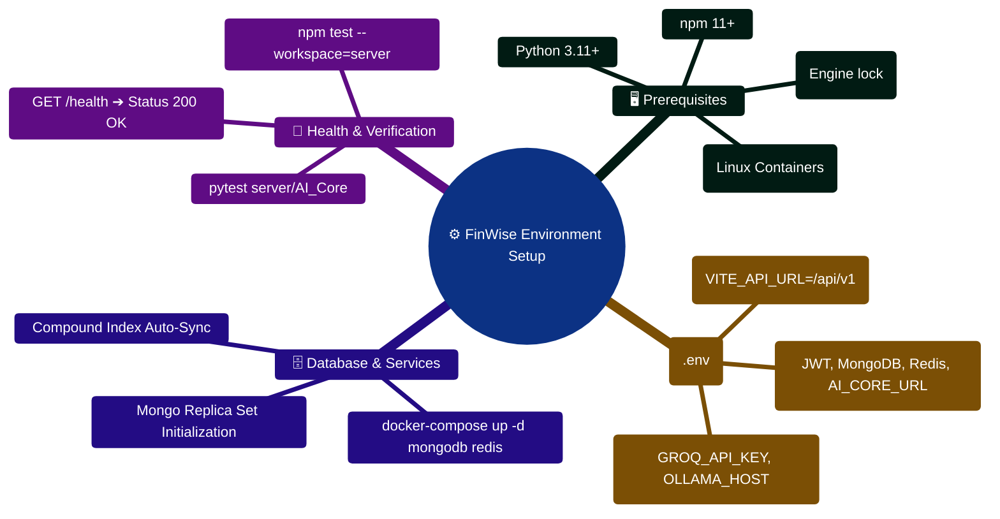

# FinWise — Environment Setup & Configuration Guide

> A comprehensive, step-by-step master guide to establishing the optimal development and production environments for FinWise. This document covers prerequisites, service dependencies, microservice-like spin-up, and robust troubleshooting for common integration issues.

---

> [!TIP]
> **Developer Guide: Building & Extending on This Project**  
> For complete step-by-step blueprints, Mongoose models, Zod schemas, Express controllers, React hooks, and LangGraph subagents, see the [**Master Developer Handbook: Building on This Project**](./BUILDING_ON_THIS_PROJECT.md).

## 🏗️ 1. Architecture & Prerequisites

The application employs a decoupled architecture requiring several runtime environments. Before initiating any installation, ensure your system meets the strict minimum requirements outlined below.

### Core Runtime Dependencies

| Tool / Service | Minimum Version | Hard Requirement | Description & Purpose                                                                                    |
| -------------- | --------------- | ---------------- | -------------------------------------------------------------------------------------------------------- |
| **Node.js**    | `>=24.14.1 <25` (Node 24 LTS)     | **Yes**          | The core runtime for both the Express Server and the Vite React Client. Check via `node -v`              |
| **npm**        | `>=11.0.0` (npm 11)          | **Yes**          | Ships automatically with Node.js. Used for deterministic dependency resolution.                          |
| **MongoDB**    | `v7.0+` (MongoDB 7)         | **Yes**          | The primary NoSQL datastore managing 52 independent domain schemas. Local or Atlas (Cloud) supported.    |
| **Redis**      | `v7.0+`         | **Yes**          | In-memory data structure store required for rate-limiting (token buckets) and BullMQ background workers. |
| **Python**     | `v3.11+`        | No\*             | Required exclusively if you intend to run the **AI Core Service** (Financial Copilot, OCR, Autopilot).   |
| **Git**        | `v2.30+`        | **Yes**          | Version control system to fetch and manage the repository branches.                                      |

_Note: The application will run without Python, but AI-related frontend features will degrade gracefully with user-friendly warnings._

---

## 📥 2. Repository Initialization

Begin by securely cloning the canonical repository to your local workspace. We recommend cloning via SSH if you have configured keys with your Git provider.

```bash
# Clone via HTTPS or SSH
git clone <repository-url>
cd personal-finance

# Verify you are on the primary development branch
git checkout main
```

---

## ⚙️ 3. Backend Server & API Initialization

The backend is built on Express 5 using TypeScript. It includes native multi-tenancy (Organizations), robust authentication (Passport+JWT+TOTP), and event-driven architecture.

### 3.1 Resolving Dependencies

Navigate to the server directory and install the strict lockfile dependencies:

```bash
cd server
npm install
```

_Note: If you run into build errors related to `bcrypt` or native bindings, ensure you have Python and `build-essential` (Linux) or Visual Studio Build Tools (Windows) installed so `node-gyp` can compile._

### 3.2 Environment Variable Configuration

The application relies heavily on process context variables.

```bash
cp .env.example .env
```

Open `.env` in your preferred editor. You **must** define the following critical keys to boot the server:

- `MONGO_URI`: E.g., `mongodb://localhost:27017/finwise`. Ensure the database exists; Mongoose will create collections automatically.
- `REDIS_URL`: E.g., `redis://localhost:6379`. Essential for the server to bind queues to worker pools.
- `JWT_SECRET`: A secure randomly-generated hash used for signing stateless authentication tokens.

**Extended Integrations (Optional but recommended):**

- **Stripe**: Define `STRIPE_SECRET_KEY` and `STRIPE_WEBHOOK_SECRET` internally for billing features.
- **Google OAuth2**: Set `GOOGLE_CLIENT_ID` and `GOOGLE_CLIENT_SECRET`. Make sure to add `http://localhost:3000/auth/google/callback` to your authorized redirect URIs in Google Cloud Console.
- **Security Framework**: Set `CSRF_ENABLED=true` to force Double-Submit cookie validation on mutating requests (Auto enabled in `production`).

### 3.3 Bootstrapping the Backend

The backend utilizes concurrency for REST APIs and background workers. We recommend running them in separate terminal instances for clear standard output debugging.

**Terminal A (The Master Express API):**

```bash
# Boot the server on the configured PORT (defaults to 3000)
npm run dev
```

**Terminal B (The BullMQ Distributed Worker):**

```bash
# Boot the background consumer for email, webhooks, and heavy exports
npm run worker:dev
```

---

## 💻 4. Frontend Client Initialization

The React application uses Vite for ultra-fast Hot Module Replacement (HMR) and relies on React Query for API communication.

### 4.1 Resolving Dependencies

```bash
# Assuming you are in the project root
cd client
npm install
```

### 4.2 Environment Variable Configuration

The client utilizes scoped environment variables mapped by Vite.

```bash
cp .env.example .env
```

Ensure `VITE_API_BASE_URL` is pointing directly to where your Express server is hosted (e.g., `http://localhost:3000`). If using Google OAuth, `VITE_GOOGLE_CLIENT_ID` must match the server counterpart.

### 4.3 Bootstrapping the Client

```bash
# Starts the Vite development server
npm run dev
```

Navigate your browser to `http://localhost:5173`. You should see the Personal Finance login portal.

---

## 🤖 5. Python AI Core Initialization (Copilot & OCR)

To enable the advanced Artificial Intelligence integration powered by LangGraph, you must boot the specialized Python microservice.

### 5.1 Virtual Environment Preparation

To avoid system-wide dependency pollution, always use a virtual environment.

```bash
# Assuming you are in the project root
cd server/AI_Core

# Create the virtual environment using Python 3.11+
python -m venv .venv
```

**Activate the standard environment:**

- **macOS/Linux**: `source .venv/bin/activate`
- **Windows CMD**: `.venv\Scripts\activate.bat`
- **Windows PowerShell**: `.venv\Scripts\Activate.ps1`

### 5.2 Dependency Resolution & Configuration

Install the required libraries:

```bash
pip install -r requirements.txt
```

Create the environment file:

```bash
# server/AI_Core/.env
cat <<EOT >> .env
GEMINI_API_KEY=your_google_ai_studio_api_key_here
LOG_LEVEL=DEBUG
EOT
```

_You can obtain a Gemini API key free from Google AI Studio._

### 5.3 Bootstrapping the Multi-Agent System

```bash
# Starts the FastAPI internal orchestration service (defaults to port 8001)
python main.py
```

---

## 🌱 6. Database Hydration & Migrations

If this is a fresh installation, you will want populated data to test features like charts and budgets.

```bash
# Run from the /server directory
cd server

# Seed static content for testing (Blogs, Growth Stories)
npm run seed:content

# Run necessary migrations for schema standardization
npm run migrate:transactions
npm run migrate:orgids
```

---

## 🧪 7. Test Operations & Quality Assurance

To ensure system stability, utilize the built-in suites:

**Backend Subsystem & API:**

```bash
cd server
npm test           # Fires the Vitest suite against an in-memory MongoDB
npm run test:watch # Useful during Active Development/TDD
npm run lint       # Run typescript verification and strict linters
```

**AI Agent Subsystem:**

```bash
cd server/AI_Core
pytest tests/      # Asserts AI logical routing and fallback mechanisms
```

**React Interface Subsystem:**

```bash
cd client
npm test           # Execute Vitest DOM assertions
npm run lint       # Asserts formatting, accessibility rules, and valid hooks
```

---

## 🚨 8. Advanced Troubleshooting Matrix

If things go wrong, cross-reference your specific issues here before opening a GitHub Issue.

| Symptom / Error                                  | Root Cause Analysis                           | Remediation Strategy                                                                                                 |
| ------------------------------------------------ | --------------------------------------------- | -------------------------------------------------------------------------------------------------------------------- |
| **`ECONNREFUSED` (Port 27017)**                  | The API cannot dial the MongoDB host.         | Verify `mongod` is active. If using Docker: `docker run -d -p 27017:27017 mongo`. If using Atlas, whitelist your IP. |
| **`ECONNREFUSED` (Port 6379)**                   | BullMQ/Rate Limiter cannot dial Redis.        | Verify `redis-server` is active. Check `REDIS_URL` formatting in `.env`.                                             |
| **Vite: `Port 5173 is in use`**                  | Another Vite instance is bound to the port.   | Terminate rogue node processes or configure Vite binding explicitly via the `vite.config.ts`.                        |
| **AI Copilot HTTP 500 Failures**                 | Agent orchestration failure via Gemini.       | Check `/server/AI_Core/personal-finance.log` for stack traces. Verify your `GEMINI_API_KEY` has not exceeded quota.  |
| **OAuth Redirect `URI_MISMATCH`**                | Google rejected the callback destination.     | Log into GCP Console and add the exact URL (including specific port) to "Authorized redirect URIs".                  |
| **Silent API failure on POST/PUT**               | Application is rejecting mutative operations. | Disabling `CSRF_ENABLED` locally is safe, but verify Double-Submit headers are sent by the React Axios interceptors. |
| **Module Not Found `Error: Cannot find module`** | Outdated or missing `node_modules`.           | Perform a clean sweep: `rm -rf node_modules package-lock.json && npm install`.                                       |

---

**Next Steps**
Familiarize yourself with the business domain by reading the [System Architecture Guide](./ARCHITECTURE.md) and exploring the comprehensive [REST API definitions](./API.md).

## Environment Setup & Configuration Mindmap



## Developer Environment Provisioning ASCII Flow

```text
┌────────────────────────────────────────────────────────────────────────┐
│ 🟢 STEP 1: HOST ENVIRONMENT AUDIT                                      │
│    $ node --version (>= 24.14.1 required) • $ python --version (3.11+) │
└───────────────────────────────────┬────────────────────────────────────┘
                                    │
                                    ▼
┌────────────────────────────────────────────────────────────────────────┐
│ 🟡 STEP 2: DOCKER CONTAINER ORCHESTRATION                              │
│    $ docker-compose up -d mongodb redis                               │
│    ├─► MongoDB 7.0 listening on localhost:27017                       │
│    └─► Redis 7.0 listening on localhost:6379                          │
└───────────────────────────────────┬────────────────────────────────────┘
                                    │
                                    ▼
┌────────────────────────────────────────────────────────────────────────┐
│ 🟣 STEP 3: CONFIGURE SECRET TOKENS & ENVIRONMENT VARIABLES             │
│    ├─► Generate cryptographically secure JWT_SECRET (openssl rand -hex)│
│    ├─► Configure server/.env: DATABASE_URL, REDIS_URL, AI_CORE_URL     │
│    └─► Configure server/AI_Core/.env: GROQ_API_KEY, MODEL_CATALOG      │
└───────────────────────────────────┬────────────────────────────────────┘
                                    │
                                    ▼
┌────────────────────────────────────────────────────────────────────────┐
│ 🔷 STEP 4: INSTALL DEPENDENCIES & LAUNCH DEV SERVERS                   │
│    ├─► Server: cd server && npm install && npm run dev (Port 3000)     │
│    ├─► AI Core: cd server/AI_Core && pip install -r requirements.txt   │
│    │            uvicorn api_service:app (Port 8001)                    │
│    └─► Client: cd client && npm install && npm run dev (Port 5173) 🟢  │
└────────────────────────────────────────────────────────────────────────┘
```

---

## 8. 2026 Enterprise Features Setup & Verification

### 8.1 Automated RAG Phase 2 Chunking Backfill
If you are initializing an existing database with uploaded PDF/TXT statement files, run the automated chunking backfill:

```bash
cd server
npm run backfill:chunks
```

### 8.2 Inspecting Dead Letter Queue (DLQ)
Verify Redis connection and DLQ capacity:

```bash
redis-cli ping # Expect: PONG
redis-cli LLEN bull:finwise-dlq:failed # Expect: 0 (clean state)
```

### 8.3 Verifying Full-Stack Connectivity
Run the diagnostic probe script to verify all four layers (API, MongoDB, Redis, AI Core) simultaneously:

```bash
cd server
npx ts-node src/scripts/diagnoseSystem.ts
```
