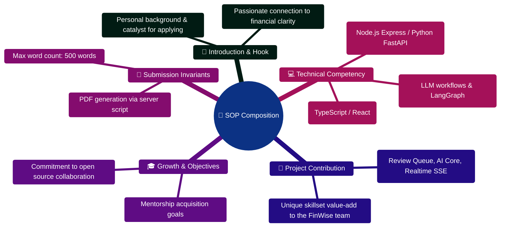

# Sample SOP Template (For Reference Only)

---

> [!TIP]
> **Developer Guide: Building & Extending on This Project**  
> For complete step-by-step blueprints, Mongoose models, Zod schemas, Express controllers, React hooks, and LangGraph subagents, see the [**Master Developer Handbook: Building on This Project**](./BUILDING_ON_THIS_PROJECT.md).

**Statement of Purpose**

**Applicant Name:** [Your Full Name]
**Student ID:** [Your ID]
**Institution:** [Your College/University]
**Program:** [Your Degree/Program]

---

**[Introduction]**

I am [Your Name], a [Year] year [Degree] student at [Institution], specializing in [Your Specialization]. With a strong foundation in [relevant field], I am eager to explore the intersection of technology and personal finance through the FinWise project.

**[Motivation]**

My interest in financial technology stems from [specific reason/experience]. The FinWise platform's innovative approach to AI-powered personal finance management, particularly its multi-agent reasoning system and real-time financial insights, aligns perfectly with my goal of [career aspiration]. I believe that democratizing financial literacy through technology can significantly impact how individuals manage their finances.

**[Relevant Skills & Experience]**

During my academic journey, I have developed proficiency in [list 2-3 key skills]. My experience with [specific project/course/certification] has equipped me with [specific skill relevant to the project]. For instance, I [brief description of a relevant project or achievement]. Additionally, my coursework in [relevant courses] has strengthened my understanding of [relevant concepts].

**[Project Understanding]**

FinWise stands out for its comprehensive approach to personal finance management. The platform's features—from envelope-based budgeting to AI-driven conversation insights—demonstrate a deep understanding of user needs. I am particularly fascinated by the [specific feature, e.g., multi-agent AI system, what-if scenarios, or financial story generation] and its potential to transform how users interact with their financial data.

**[Learning Objectives & Contribution]**

Through this project, I aim to [specific learning goal]. My background in [your skill] will allow me to contribute effectively to [specific area of the project]. I bring [unique perspective/skill] that will complement the team's work on [specific component].

**[Conclusion]**

I am committed to dedicating my time and effort to the success of the FinWise project. I look forward to the opportunity to learn from peers and mentors while contributing meaningfully to this innovative platform.

---

*[Word Count: ~380 words]*

---

## Important Notes

- This is a **sample template only** — do not copy content directly
- Adapt the structure and content to reflect your genuine experiences
- Ensure your SOP is authentic and personal
- Stay within the 500-word limit

## Statement of Purpose (SOP) Composition Mindmap



## SOP Authoring & PDF Export ASCII Flow

```text
┌────────────────────────────────────────────────────────────────────────┐
│ 🟢 STEP 1: DRAFT STATEMENT OF PURPOSE                                  │
│    Follow 4-part structure: Hook ➔ Background ➔ Contribution ➔ Goals   │
└───────────────────────────────────┬────────────────────────────────────┘
                                    │
                                    ▼
┌────────────────────────────────────────────────────────────────────────┐
│ 📝 STEP 2: WORD COUNT & CONTENT AUDIT                                  │
│    ├─► Verify word count <= 500 words (Strict cap)                     │
│    ├─► Check for concrete technical examples and avoid generic buzzwords│
│    └─► Align personal objectives with FinWise platform roadmap         │
└───────────────────────────────────┬────────────────────────────────────┘
                                    │
                                    ▼
┌────────────────────────────────────────────────────────────────────────┐
│ 📄 STEP 3: AUTOMATED PDF GENERATION                                    │
│    ├─► Run generation script: npx tsx server/src/scripts/generateSOP.ts│
│    ├─► PDF compiled via PDFKit into docs/SOP_Sample_Template.pdf       │
│    └─► Review formatting, typography, and visual margins 🟢            │
└────────────────────────────────────────────────────────────────────────┘
```


---

## Sample SOP Generator CLI (`server/src/scripts/generateSOPSamplePdf.ts`)

```typescript
import PDFDocument from "pdfkit";
import fs from "fs";
import path from "path";
import { fileURLToPath } from "url";

const __filename = fileURLToPath(import.meta.url);
const __dirname = path.dirname(__filename);

export function createSOPSamplePdf(): void {
  const doc = new PDFDocument({ size: "A4", margin: 54 });
  const outputPath = path.join(__dirname, "../../../docs/SOP_Sample_Template.pdf");

  const stream = fs.createWriteStream(outputPath);
  doc.pipe(stream);

  doc.fontSize(22).fillColor("#111827").text("Statement of Purpose", { align: "center" });
  doc.fontSize(14).fillColor("#4b5563").text("Sample Template (For Reference Only)", { align: "center" });
  doc.moveDown(1);

  // Stream sections
  doc.end();
}
```

### Execution Command:
```bash
# From server directory
cd server
npx tsx src/scripts/generateSOPSamplePdf.ts
```
