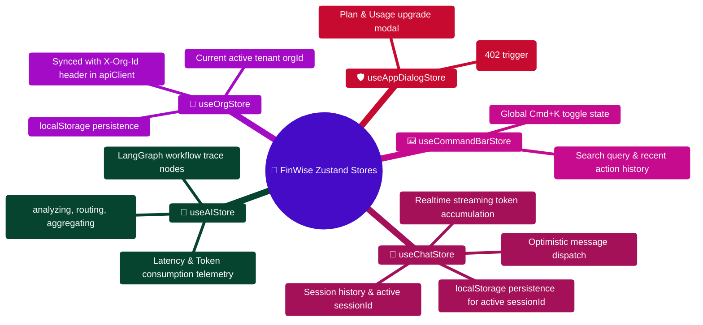

# FinWise Zustand Store Reference

> Complete reference for all Zustand state stores in the FinWise client application.

---

> [!TIP]
> **Developer Guide: Building & Extending on This Project**  
> For complete step-by-step blueprints, Mongoose models, Zod schemas, Express controllers, React hooks, and LangGraph subagents, see the [**Master Developer Handbook: Building on This Project**](./BUILDING_ON_THIS_PROJECT.md).

## Overview

FinWise uses 6 Zustand stores for client-side state management. Zustand was chosen over Redux for its minimal boilerplate, first-class TypeScript support, and ability to update state from non-React code (critical for SSE event handlers).

| Store | File | Purpose | Persistence |
|-------|------|---------|-------------|
| `useAIStore` | `stores/aiStore.ts` | AI processing phases and workflow trace | None |
| `useChatStore` | `stores/chatStore.ts` | Chat sessions, messages, workflow progress | localStorage (partial) |
| `useOrgStore` | `stores/orgStore.ts` | Active organization ID | localStorage |
| `useCommandBarStore` | `stores/commandBarStore.ts` | Command bar state and history | None |
| `useAppDialogStore` | `stores/appDialogStore.ts` | Feature limit and plan/usage dialogs | None |

---

## useAIStore

**File:** `client/src/stores/aiStore.ts`

**Purpose:** Tracks the real-time state of AI request processing, including the current phase, active agent, and workflow trace entries. Updated by the `useAIStream` hook as SSE chunks arrive from the server.

### State Shape

```typescript
interface AIStore {
  phase: AIPhase;                          // Current AI processing phase
  activeAgent: string | null;              // Currently active agent name
  traceEntries: WorkflowTraceEntry[];      // Accumulated workflow trace entries
  errorMessage: string | null;             // Error message if phase is 'error'
}
```

### Types

```typescript
type AIPhase = "idle" | "routing" | "analyzing" | "synthesizing" | "complete" | "error";

type WorkflowTraceEntry = {
  agent: string;        // Agent name (e.g., "cashflow_analyst", "budget_planner")
  startedAt: string;    // ISO timestamp when agent started
  endedAt?: string;     // ISO timestamp when agent finished
  status: string;       // "running" | "completed" | "failed"
  error?: string;       // Error message if status is "failed"
};
```

### Actions

| Action | Signature | Description |
|--------|-----------|-------------|
| `setPhase` | `(phase: AIPhase) => void` | Update phase; clears error when leaving error state |
| `setError` | `(message: string) => void` | Set error phase with a message |
| `pushTraceEntry` | `(entry: WorkflowTraceEntry) => void` | Append trace entry and update active agent |
| `reset` | `() => void` | Reset all state to initial values |

### Phase Lifecycle

```
idle → routing → analyzing → complete (happy path)
idle → routing → analyzing → error (failure path)
```

### Usage Example

```typescript
import { useAIStore } from "@/stores/aiStore";

function AgentWorkflowVisualizer() {
  const { phase, activeAgent, traceEntries } = useAIStore();

  return (
    <div>
      <PhaseIndicator phase={phase} />
      {traceEntries.map((entry) => (
        <AgentTraceRow key={entry.agent} entry={entry} isActive={entry.agent === activeAgent} />
      ))}
    </div>
  );
}
```

### Non-React Access

```typescript
// From SSE event handlers (outside React render cycle)
import { useAIStore } from "@/stores/aiStore";

function handleSSEChunk(chunk) {
  if (chunk.phase === "trace") {
    useAIStore.getState().pushTraceEntry(chunk.entry);
  }
}
```

**Persistence:** None (resets on page refresh)

---

## useChatStore

**File:** `client/src/stores/chatStore.ts`

**Purpose:** Manages all chat-related state including sessions, messages, and AI workflow progress visualization. Uses Zustand's `persist` middleware to save the current session ID to localStorage.

### State Shape

```typescript
interface ChatState {
  // Sessions
  sessions: IChatSession[];
  currentSessionId: string | null;

  // Messages
  messages: IChatMessage[];

  // Loading states
  isLoadingSessions: boolean;
  isLoadingMessages: boolean;
  isSending: boolean;

  // Workflow progress tracking
  currentPhase: WorkflowPhase | null;
  currentAgent: string | null;
  phaseHistory: Array<{ phase: WorkflowPhase; agent?: string; timestamp: number }>;
}
```

### Actions

| Action | Signature | Description |
|--------|-----------|-------------|
| `loadSessions` | `() => Promise<void>` | Fetch all chat sessions from server |
| `createSession` | `() => Promise<IChatSession \| null>` | Create new session and auto-select it |
| `selectSession` | `(sessionId: string) => Promise<void>` | Select session and load its messages |
| `deleteSession` | `(sessionId: string) => Promise<void>` | Delete session and clear if current |
| `renameSession` | `(sessionId: string, title: string) => Promise<void>` | Rename a session |
| `sendMessage` | `(content, options?) => Promise<void>` | Send message with optimistic update |
| `clearCurrentSession` | `() => void` | Clear current session state |
| `setWorkflowPhase` | `(phase, agent?) => void` | Set workflow phase (from SSE handlers) |
| `clearWorkflowProgress` | `() => void` | Clear workflow progress tracking |

### Optimistic Update Flow

When `sendMessage` is called:

1. Auto-creates session if none selected
2. Sets workflow phase to "routing"
3. Optimistically adds a temporary user message to the UI
4. Sends the request to the server
5. On success: replaces temp message with real messages from server
6. On error: removes the temp message and sets error phase

```typescript
// Temporary message structure
const tempUserMessage: IChatMessage = {
  id: `temp-${Date.now()}`,
  sessionId,
  role: "user",
  content,
  createdAt: new Date().toISOString(),
};
```

### Persistence Configuration

```typescript
persist(
  (set, get) => ({ /* state and actions */ }),
  {
    name: "finwise-chat-storage",  // localStorage key
    partialize: (state) => ({
      currentSessionId: state.currentSessionId  // Only persist session ID
    }),
  }
)
```

**Persistence:** `currentSessionId` only (messages are fetched fresh from server)

### Usage Example

```typescript
import { useChatStore } from "@/stores/chatStore";

function ChatContainer() {
  const { sessions, currentSessionId, messages, sendMessage, isSending } = useChatStore();

  useEffect(() => {
    useChatStore.getState().loadSessions();
  }, []);

  return (
    <div>
      <SessionList sessions={sessions} activeId={currentSessionId} />
      <MessageList messages={messages} />
      <ChatInput onSend={sendMessage} disabled={isSending} />
    </div>
  );
}
```

---

## useOrgStore

**File:** `client/src/stores/orgStore.ts`

**Purpose:** Stores the user's currently active organization ID for multi-tenant data isolation. Persists to localStorage so the selection survives page refreshes.

### State Shape

```typescript
interface OrgStore {
  activeOrgId: string | null;
}
```

### Actions

| Action | Signature | Description |
|--------|-----------|-------------|
| `setActiveOrg` | `(orgId: string \| null) => void` | Set the active org (persisted) |

### Multi-Tenancy Flow

```
1. User logs in -> fetches their orgs (useAppConfig or org API)
2. User selects an org -> setActiveOrg(orgId)
3. API client reads activeOrgId and injects X-Org-Id header
4. Server scopes all data queries to that org
```

### Persistence Configuration

```typescript
persist(
  (set) => ({
    activeOrgId: null,
    setActiveOrg: (orgId) => set({ activeOrgId: orgId }),
  }),
  { name: "finwise-org" },  // localStorage key
)
```

**Persistence:** `activeOrgId` to localStorage under key `finwise-org`

### Usage Example

```typescript
import { useOrgStore } from "@/stores/orgStore";

function OrgSwitcher() {
  const { activeOrgId, setActiveOrg } = useOrgStore();
  const { data: orgs } = useQuery(["/api/orgs"]);

  return (
    <select value={activeOrgId || ""} onChange={(e) => setActiveOrg(e.target.value)}>
      {orgs?.map((org) => (
        <option key={org.id} value={org.id}>{org.name}</option>
      ))}
    </select>
  );
}
```

---

## useCommandBarStore

**File:** `client/src/stores/commandBarStore.ts`

**Purpose:** Manages the global command bar (Cmd+K palette) state. The command bar provides quick access to navigation, actions, and AI commands.

### State Shape

```typescript
interface CommandBarStore {
  isOpen: boolean;     // Whether the command bar is open
  history: string[];   // Recent command history (max 20)
}
```

### Actions

| Action | Signature | Description |
|--------|-----------|-------------|
| `open` | `() => void` | Open the command bar |
| `close` | `() => void` | Close the command bar |
| `toggle` | `() => void` | Toggle the command bar |
| `pushHistory` | `(query: string) => void` | Add query to history (deduplicated, max 20) |

### History Management

- Maximum 20 entries
- Deduplicated: if the query already exists, it is moved to the top
- Not persisted (resets on page refresh)

### Usage Example

```typescript
import { useCommandBarStore } from "@/stores/commandBarStore";

// From keyboard shortcut handler (outside React)
useCommandBarStore.getState().toggle();

// From command bar component
function AiCommandBar() {
  const isOpen = useCommandBarStore((s) => s.isOpen);
  const history = useCommandBarStore((s) => s.history);
  const close = useCommandBarStore((s) => s.close);
  const pushHistory = useCommandBarStore((s) => s.pushHistory);

  if (!isOpen) return null;

  return (
    <CommandPalette onClose={close}>
      <HistorySection items={history} onSelect={pushHistory} />
    </CommandPalette>
  );
}
```

**Persistence:** None

---

## useAppDialogStore

**File:** `client/src/stores/appDialogStore.ts`

**Purpose:** Manages global dialog state for feature-limit modals and plan/usage dialogs. These dialogs are triggered programmatically by API responses (402 status codes), not by user interaction.

### State Shape

```typescript
type AppDialogState = {
  featureLimit: FeatureLimitDialogState | null;
  planAndUsageOpen: boolean;
};

type FeatureLimitDialogState = {
  open: boolean;
  message: string;
  code: "FEATURE_LIMIT_REACHED" | "FEATURE_NOT_AVAILABLE";
  requestId?: string;
  details?: unknown;
};
```

### Actions

| Action | Signature | Description |
|--------|-----------|-------------|
| `showFeatureLimit` | `(error: ApiError) => void` | Show feature limit dialog if error code matches |
| `closeFeatureLimit` | `() => void` | Close the feature limit dialog |
| `openPlanAndUsage` | `() => void` | Open the plan and usage dialog |
| `closePlanAndUsage` | `() => void` | Close the plan and usage dialog |

### Trigger Flow

```
1. API client receives 402 with FEATURE_LIMIT_REACHED code
2. apiClient calls useAppDialogStore.getState().showFeatureLimit(error)
3. Global FeatureLimitDialog reads featureLimit state and renders
4. User closes dialog or navigates to upgrade page
```

### Guard Logic

The `showFeatureLimit` action only activates for matching error codes:

```typescript
showFeatureLimit: (error) => {
  const code = error.code as FeatureLimitCode | undefined;
  if (code !== "FEATURE_LIMIT_REACHED" && code !== "FEATURE_NOT_AVAILABLE") return;
  set({ featureLimit: { open: true, message: error.message, code, ... } });
}
```

### Usage Example

```typescript
import { useAppDialogStore } from "@/stores/appDialogStore";

// Triggered automatically from API client (not in components)
import { useAppDialogStore } from "@/stores/appDialogStore";

// In apiClient error handler:
if (apiError.status === 402) {
  useAppDialogStore.getState().showFeatureLimit(apiError);
}

// Global dialog component (rendered in AppProviders)
function FeatureLimitDialog() {
  const featureLimit = useAppDialogStore((s) => s.featureLimit);
  const close = useAppDialogStore((s) => s.closeFeatureLimit);

  if (!featureLimit?.open) return null;

  return (
    <Dialog open onOpenChange={close}>
      <DialogContent>
        <h2>Feature Limit Reached</h2>
        <p>{featureLimit.message}</p>
        <Button onClick={() => navigate("/billing")}>Upgrade Plan</Button>
      </DialogContent>
    </Dialog>
  );
}
```

**Persistence:** None

---

## Store Usage Patterns

### Accessing Store State Outside React

Zustand stores can be accessed from any JavaScript code using `getState()` and `setState()`:

```typescript
// From SSE event handlers
useAIStore.getState().pushTraceEntry(entry);

// From API client error handlers
useAppDialogStore.getState().showFeatureLimit(error);

// From keyboard shortcut handlers
useCommandBarStore.getState().toggle();
```

### Selector Best Practices

Use selectors to minimize re-renders:

```typescript
// Good: only re-renders when isOpen changes
const isOpen = useCommandBarStore((s) => s.isOpen);

// Bad: re-renders on any store change
const store = useCommandBarStore();
```

### Combining Stores

When a component needs data from multiple stores, use separate selectors:

```typescript
function ChatPage() {
  const sessions = useChatStore((s) => s.sessions);
  const activeOrgId = useOrgStore((s) => s.activeOrgId);
  const isOpen = useCommandBarStore((s) => s.isOpen);
  // ...
}
```

---

## Store Dependency Map

```
useAIStore
  └──  Updated by: useAIStream hook, SSE event handlers

useChatStore
  ├──  Reads from: chatApi service
  └──  Updated by: Chat components, SSE event handlers

useOrgStore
  └──  Reads by: API client (core.ts) for X-Org-Id header

useCommandBarStore
  ├──  Reads by: useKeyboardShortcuts hook
  └──  Reads by: AiCommandBar component

useAppDialogStore
  ├──  Updated by: API client (core.ts) on 402 errors
  └──  Reads by: FeatureLimitDialog, PlanAndUsageDialog components
```

---

_See also_: [CLIENT_ARCHITECTURE.md](./CLIENT_ARCHITECTURE.md) | [HOOK_REFERENCE.md](./HOOK_REFERENCE.md) | [ARCHITECTURE.md](./ARCHITECTURE.md)

## Zustand State Architecture & Store Dependency Mindmap



## Zustand Store Mutation & Selector Subscription ASCII Flow

```text
┌────────────────────────────────────────────────────────────────────────┐
│ 🟢 ACTION OCCURS (User Types Message OR API Returns 402 Limit)         │
└───────────────────────────────────┬────────────────────────────────────┘
                                    │
                  ┌─────────────────┴─────────────────┐
                  ▼                                   ▼
┌──────────────────────────────────┐┌────────────────────────────────────┐
│ 💬 CHAT STREAMING MUTATION       ││ 🛡️ GLOBAL ERROR 402 INTERCEPTION   │
│  useChatStore.getState().        ││  apiClient catches 402 Payment Req │
│    appendTokenChunk("...")       ││  useAppDialogStore.getState().     │
│  ├─ Immutable state slice update ││    showFeatureLimit(error)         │
│  └─ Only subscribers re-render   ││  └─ Opens Upgrade Plan Modal       │
└─────────────────┬────────────────┘└─────────────────┬──────────────────┘
                  │                                   │
                  └─────────────────┬─────────────────┘
                                    │
                                    ▼
┌────────────────────────────────────────────────────────────────────────┐
│ ⚡ FINE-GRAINED SELECTOR EVALUATION                                    │
│    const currentSession = useChatStore((s) => s.currentSessionId);     │
│    ├─► Shallow equality check prevents unnecessary component re-renders│
│    └─► Only matching DOM elements update with 60fps smoothness 🟢      │
└────────────────────────────────────────────────────────────────────────┘
```

---

## 2026 Enterprise Store Patterns: Scoped QueryClient & Monotonic Revision Guard

### Scoped QueryClient Sandboxing (`client/src/lib/queryClient.ts`)

To prevent cross-account cache bleed on shared terminals, TanStack Query is isolated per user:

```typescript
// client/src/lib/queryClient.ts
import { QueryClient } from "@tanstack/react-query";

let activeUserId: string | null = null;
let activeQueryClient: QueryClient | null = null;

export function getScopedQueryClient(userId: string | null): QueryClient {
  if (!userId) {
    if (activeQueryClient) {
      activeQueryClient.clear();
      activeQueryClient = null;
    }
    activeUserId = null;
    return new QueryClient();
  }

  if (activeUserId !== userId || !activeQueryClient) {
    if (activeQueryClient) {
      activeQueryClient.clear();
    }
    activeUserId = userId;
    activeQueryClient = new QueryClient({
      defaultOptions: {
        queries: {
          staleTime: 1000 * 60 * 2,
          gcTime: 1000 * 60 * 10,
          retry: 1,
          refetchOnWindowFocus: false,
        },
      },
    });
  }

  return activeQueryClient;
}
```

### Monotonic Revision Handling in `chatStore`

Prevents out-of-order SSE chunks from overwriting newer user state:

```typescript
// client/src/stores/chatStore.ts
interface ChatSessionState {
  currentRevision: number;
  // ...
  applyStreamingChunk: (chunk: { text: string; revision?: number }) => void;
}

// In store implementation:
applyStreamingChunk: (chunk) => {
  set((state) => {
    if (chunk.revision && chunk.revision < state.currentRevision) {
      // Discard older, delayed packet
      return state;
    }
    return {
      currentRevision: chunk.revision || state.currentRevision + 1,
      streamingText: state.streamingText + chunk.text
    };
  });
}
```
