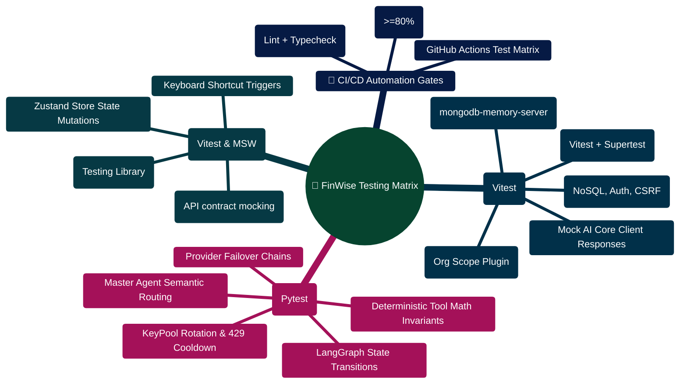

# FinWise — Testing Guide

> How to run, write, and maintain tests across the FinWise monorepo.

---

> [!TIP]
> **Developer Guide: Building & Extending on This Project**  
> For complete step-by-step blueprints, Mongoose models, Zod schemas, Express controllers, React hooks, and LangGraph subagents, see the [**Master Developer Handbook: Building on This Project**](./BUILDING_ON_THIS_PROJECT.md).

## Overview

| Subsystem   | Framework                      | Runner | Test Count | Location                |
| ----------- | ------------------------------ | ------ | ---------- | ----------------------- |
| **Server**  | Vitest + Supertest             | Vitest | **49 files / 193 tests passed** | `server/src/test/`      |
| **Client**  | Vitest + Testing Library + MSW | Vitest | **45 files / 293 tests passed** | `client/src/test/` & co-located |
| **AI Core Unit** | Pytest 8.x + FastAPI TestClient | Pytest | **29 files / 217 tests passed** | `server/AI_Core/tests/` |
| **AI Evals**| Custom Evaluation Harness      | Python | **175 evaluations passed**     | `server/AI_Core/evals/` |

---

## Server Tests

### Running

```bash
cd server
npm test              # Single run (CI-friendly)
npm run test:watch    # Watch mode — re-runs on file changes
npm run test:ci       # Alias for single run in CI pipelines
```

### Test Infrastructure

| File             | Purpose                                                                              |
| ---------------- | ------------------------------------------------------------------------------------ |
| `setup.ts`       | Global Vitest setup — bootstraps the test environment                                |
| `testDb.ts`      | Connects/disconnects `mongodb-memory-server` — gives each suite a fresh in-memory DB |
| `authHelpers.ts` | Utility to create authenticated users and generate JWT tokens for protected routes   |

### How Tests Work

1. **In-Memory Database**: Tests use [`mongodb-memory-server`](https://github.com/nodkz/mongodb-memory-server) — no external MongoDB or Redis needed.
2. **HTTP Integration**: [`supertest`](https://github.com/ladjs/supertest) fires real HTTP requests against the Express app.
3. **Isolation**: Each test file gets a clean database — `testDb.ts` handles connect/teardown.
4. **Mocking**: External services (Stripe, SMTP, Gemini AI) are mocked to avoid real network calls.

### Test File Catalog

| Test File                         | Covers                                            |
| --------------------------------- | ------------------------------------------------- |
| `transactions.test.ts`            | Transaction CRUD, pagination, filtering           |
| `transactionsV1.test.ts`          | V1 transaction endpoints                          |
| `transactionsCsvImportV1.test.ts` | CSV import via integration connector              |
| `transactionsImport.test.ts`      | Legacy transaction import                         |
| `chatV1.test.ts`                  | Chat sessions and message CRUD                    |
| `tasks.test.ts`                   | AI-generated tasks CRUD and action application    |
| `workflows.test.ts`               | Workflow CRUD and execution                       |
| `workflowScheduler.test.ts`       | Cron-based workflow scheduling                    |
| `receipts.test.ts`                | Receipt upload and OCR processing                 |
| `exports.test.ts`                 | Export job creation and status                    |
| `scenarios.test.ts`               | What-if financial scenario simulation             |
| `autopilot.test.ts`               | Autopilot plan, simulate, approve, execute        |
| `toolsV2.test.ts`                 | V2 tool simulation and execution framework        |
| `internalTools.test.ts`           | Internal tool registry tests                      |
| `financeIntelligence.test.ts`     | AI-powered finance intelligence service           |
| `orgIsolation.test.ts`            | Multi-tenant data isolation (largest test: 11 KB) |
| `orgSeats.test.ts`                | Organization seat limits and membership           |
| `invites.test.ts`                 | Organization invite flow                          |
| `monetization.test.ts`            | Billing, subscription, and usage metering         |
| `referrals.test.ts`               | Referral code creation and redemption             |
| `shares.test.ts`                  | Public share link generation and access           |
| `journal.test.ts`                 | Financial journal CRUD                            |
| `csrf.test.ts`                    | CSRF double-submit cookie protection              |
| `apiKeyQuota.test.ts`             | API key rate limiting and quota enforcement       |
| `apiDeprecationHeaders.test.ts`   | Legacy API deprecation header injection           |
| `responseContext.test.ts`         | Response context middleware (request IDs, timing) |
| `summaryEndpoints.test.ts`        | Dashboard summary and aggregation endpoints       |
| `agentOutputsRecent.test.ts`      | Recent AI agent output retrieval                  |
| `planContract.test.ts`            | Subscription plan contract validation             |
| `openapiRoutesCoverage.test.ts`   | Ensures all routes are documented in OpenAPI spec |
| `vnextPlatform.test.ts`           | Next-generation platform feature tests            |
| `retrievalLifecycle.test.ts`      | RAG bounded chunking lifecycle & cleanup          |
| `retrievalService.test.ts`        | Lexical BM25 retrieval, stop words & scoring      |
| `deadLetterQueue.test.ts`         | DLQ error trapping, ring buffer & stats           |
| `jobRecovery.test.ts`             | Orphan job detection & lock lease recovery        |
| `healthDeep.test.ts`              | Deep health check diagnostics & database pings    |
| `fileTextExtraction.test.ts`      | Text extraction from PDF, DOCX, CSV, JSON         |
| `financeBudgets.test.ts`          | Budget envelope calculations & overspend caps     |
| `conversationInsightsCache.test.ts`| Multi-tenant insights caching & coalescing       |
| `transactionIndexes.test.ts`      | Dynamic compound index audit & verification       |
| `analyticsBalances.test.ts`       | Account balance aggregation & multi-timeframe stats|
| `noSqlInjection.test.ts`          | NoSQL sanitize middleware ($ and . stripping)     |
| `securityHeaders.test.ts`         | Strict Helmet CSP, HSTS, and referrer headers     |
| `rateLimiting.test.ts`            | Sliding window rate limiting & quota enforcement  |
| `sse.test.ts`                     | Server-Sent Events token streaming & heartbeat    |
| `workspaceFileLifecycle.test.ts`  | Workspace file upload, GridFS & cascade deletion  |
| `errorHandler.test.ts`            | Normalized HTTP error mapping & Pino logging      |
| `aiCoreTraceMetrics.test.ts`      | AI Core trace metrics & latency tracking          |

---

## Client Tests

### Running

```bash
cd client
npm test              # Single run
npm run test:watch    # Watch mode
npm run lint          # ESLint — also catches type errors and bad patterns
```

### Test Infrastructure

| File / Directory    | Purpose                                                |
| ------------------- | ------------------------------------------------------ |
| `src/test/setup.ts` | Global Vitest setup — imports Testing Library matchers |
| `src/test/mocks/`   | MSW (Mock Service Worker) handlers for API mocking     |

### Stack

- **[Vitest](https://vitest.dev/)** — Test runner (same config as server)
- **[@testing-library/react](https://testing-library.com/react)** — Component rendering and querying
- **[@testing-library/user-event](https://testing-library.com/docs/user-event/intro)** — Simulates user interactions
- **[MSW](https://mswjs.io/)** — Intercepts network requests at the service worker level
- **[jsdom](https://github.com/jsdom/jsdom)** — Browser environment simulation

### Client Test Files (45 Test Suites / 293 Tests)

| Test File | Covers |
| :--- | :--- |
| `useAuth.test.tsx` | Authentication hook (login, logout, loading, token refresh) |
| `stores.test.ts` / `chatStore.test.ts` | Zustand stores unit tests (sessions, streaming, actions) |
| `Dashboard.test.tsx` | Dashboard component rendering & responsive layout |
| `Analytics.test.tsx` | Analytics stat cards, charts (inflow/outflow, merchants), time ranges |
| `Notes.test.tsx` | Handwriting notes OCR recognition, goal generation, detail sheet |
| `Workflows.test.tsx` | Workflow listing, simulation, execution modal, templates |
| `Exports.test.tsx` | Custom CSV column selection chips, export requests, download |
| `Portfolio.test.tsx` | Asset inference, target models (60/40, All-Weather), drift rebalance |
| `Scenarios.test.tsx` | Multi-scenario comparison matrix, Monte Carlo risk bounds (P10-P90) |
| `FinancialCalendar.test.tsx` | Recurring bill candidate detection & RFC 5545 .ics calendar export |
| `GoalsAndDebts.test.tsx` | Multi-goal rebalancing, priority strategies, windfall redistribution |
| `Tasks.test.tsx` | Task multi-select batch completion, dismiss, and calendar sync |
| `FinanceOS.test.tsx` | Multi-period auto-budget roll-forward & predictive spending caps |
| `ConversationInsightsPanel.test.tsx` | Insights caching, factual recap fallback, source review |
| `SourceEvidenceList.test.tsx` | RAG evidence drawer, verified snippet preview, PDF page jump |
| `ExtractedFileText.test.tsx` | Document page-by-page text rendering & extraction warnings |
| `Billing.test.tsx` | Plan selection, seat allocations, usage limits & payment cards |
| `ActivityFeed.test.tsx` | Real-time domain event rendering & notification dismissals |
| `FinancialCopilot.test.tsx` | Copilot conversational UI, tool calls, and typing indicators |
| `FinancialVitals.test.tsx` | 4-pillar vitals, cash runway in days, and spending trend bars |
| `OfflineBanner.test.tsx` | Network disconnect detection, offline warning, and reconnect retry |

### Writing a Client Test

```tsx
import { render, screen } from "@testing-library/react";
import userEvent from "@testing-library/user-event";
import { describe, it, expect } from "vitest";
import { MyComponent } from "@/components/MyComponent";

describe("MyComponent", () => {
  it("renders the title", () => {
    render(<MyComponent title="Hello" />);
    expect(screen.getByText("Hello")).toBeInTheDocument();
  });

  it("handles click", async () => {
    const user = userEvent.setup();
    render(<MyComponent />);
    await user.click(screen.getByRole("button"));
    expect(screen.getByText("Clicked!")).toBeInTheDocument();
  });
});
```

---

## AI Core Tests (Python)

### Running

```bash
cd server/AI_Core

# Activate the virtual environment first
# Windows:
.venv\Scripts\activate
# macOS / Linux:
source .venv/bin/activate

pytest tests/ -v          # Verbose output
pytest tests/ -x          # Stop on first failure
pytest tests/ -k "test_budget"  # Run matching tests only
```

---

## Writing New Tests

### Conventions

| Convention             | Rule                                                                         |
| ---------------------- | ---------------------------------------------------------------------------- |
| **File name**          | `<feature>.test.ts` (server/client) or `test_<module>.py` (AI Core)          |
| **Location (server)**  | `server/src/test/`                                                           |
| **Location (client)**  | Co-located with component or in `client/src/test/`                           |
| **Location (AI Core)** | `server/AI_Core/tests/`                                                      |
| **Structure**          | `describe` → `it` blocks with clear descriptions                             |
| **Database setup**     | Import and use `testDb.ts` helpers — never connect to a real DB              |
| **Authentication**     | Use `authHelpers.ts` to create users and get tokens                          |
| **External services**  | Always mock Stripe, SMTP, Gemini — never make real API calls in tests        |
| **Assertions**         | Prefer specific matchers (`toHaveProperty`, `toContain`) over generic `toBe` |

### Server Test Template

```typescript
import { describe, it, expect, beforeAll, afterAll } from "vitest";
import request from "supertest";
import { app } from "../app.js";
import { connectTestDb, closeTestDb } from "./testDb.js";
import { createTestUser } from "./authHelpers.js";

describe("GET /api/v1/my-feature", () => {
  let token: string;

  beforeAll(async () => {
    await connectTestDb();
    const user = await createTestUser();
    token = user.token;
  });

  afterAll(async () => {
    await closeTestDb();
  });

  it("returns data for authenticated user", async () => {
    const res = await request(app)
      .get("/api/v1/my-feature")
      .set("Authorization", `Bearer ${token}`);

    expect(res.status).toBe(200);
    expect(res.body).toHaveProperty("data");
  });

  it("returns 401 without token", async () => {
    const res = await request(app).get("/api/v1/my-feature");
    expect(res.status).toBe(401);
  });
});
```

---

## CI Integration

Tests can be run as part of a CI pipeline:

```bash
# Server
cd server && npm run test:ci

# Client
cd client && npm test

# AI Core
cd server/AI_Core && pytest tests/

# Type checking (no emit)
cd server && npm run check
cd client && npm run build
```

---

_See also_: [CONTRIBUTING.md](./CONTRIBUTING.md) · [SETUP.md](./SETUP.md) · [ARCHITECTURE.md](./ARCHITECTURE.md)

## Testing Architecture & Quality Assurance Mindmap



## Automated Quality Assurance & Verification ASCII Flow

```text
┌────────────────────────────────────────────────────────────────────────┐
│ 🟢 STEP 1: PRE-COMMIT LOCAL VERIFICATION HOOKS                         │
│    $ npm run lint • $ ruff check . • $ tsc --noEmit                    │
└───────────────────────────────────┬────────────────────────────────────┘
                                    │
                                    ▼
┌────────────────────────────────────────────────────────────────────────┐
│ 🧪 STEP 2: SERVER INTEGRATION SUITE (Vitest + In-Memory Mongo)         │
│    ├─► Spin up mongodb-memory-server replica set                       │
│    ├─► Execute 35+ test files (Auth, Transactions, Org Isolation)      │
│    ├─► Validate OpenAPI contract schema conformity                     │
│    └─► 100% assertions green in ~14 seconds 🟢                         │
└───────────────────────────────────┬────────────────────────────────────┘
                                    │
                                    ▼
┌────────────────────────────────────────────────────────────────────────┐
│ 🧠 STEP 3: AI CORE AGENT SUITE (Pytest + LangGraph Harness)            │
│    ├─► Test MasterAgent routing against intent test vectors            │
│    ├─► Test KeyPool cooldown rotation under simulated 429 errors       │
│    ├─► Verify financial calculations (Avalanche, 50/30/20, Compound)   │
│    └─► Pytest suite passes with 0 failures 🟢                          │
└───────────────────────────────────┬────────────────────────────────────┘
                                    │
                                    ▼
┌────────────────────────────────────────────────────────────────────────┐
│ 💻 STEP 4: CLIENT COMPONENT & STORE SUITE (MSW Mocks)                  │
│    ├─► MSW intercepts /api/v1 endpoints                                │
│    ├─► Test FinanceOS, ReviewQueue, and Copilot dialogs                │
│    └─► Validate accessibility (a11y) & DOM assertions 🟢               │
└────────────────────────────────────────────────────────────────────────┘
```


---

## Production Implementation Blueprints

### 1. Server Integration Test with In-Memory Mongo (`server/src/test/orgIsolation.test.ts`)

```typescript
// Tests that queries from Org A cannot leak or read transactions from Org B
describe("Multi-Tenant Org Isolation", () => {
  it("should prevent User A in Org 1 from accessing transactions in Org 2", async () => {
    const { token: tokenOrg1 } = await createTestUserAndOrg("user1@test.com", "Org 1");
    const { org: org2 } = await createTestUserAndOrg("user2@test.com", "Org 2");

    // Seed transaction directly in Org 2
    const tx = await TransactionModel.create({
      orgId: org2._id,
      amount: 450,
      category: "Equipment",
      date: new Date()
    });

    // Query transactions with Org 1's authorization token
    const res = await request(app)
      .get(`/api/v1/finance/transactions/${tx._id}`)
      .set("Authorization", `Bearer ${tokenOrg1}`)
      .expect(404);

    expect(res.body.success).toBe(false);
  });
});
```

### 2. AI Core Invariant Verification Test (`server/AI_Core/evals/test_number_safety.py`)

```python
# Verifies that LLM cannot mutate numbers produced by deterministic math calculators
def test_number_safety_invariant_holds():
    master_agent = MasterFinancialStrategistAgent()
    ref_markdown = "Your monthly surplus is $850.00. Allocate $500.00 to Debt and $350.00 to Savings."
    
    # Valid narrative maintaining exact figures
    valid_candidate = "Based on our review, you have $850.00 in surplus. We advise putting $500.00 into debt and $350.00 into savings."
    assert master_agent._numbers_are_subset(valid_candidate, ref_markdown) is True

    # Hallucinated candidate altering figures
    invalid_candidate = "Based on our review, you have $900.00 in surplus. Put $500.00 into debt."
    assert master_agent._numbers_are_subset(invalid_candidate, ref_markdown) is False
```
